# Aula 1 — Matrizes (parte 1): vetores e matrizes estáticos

- **Material original:** [`aulas/Aula_1.pdf`](../Aula_1.pdf) — 91 slides, “AULA 1 – MATRIZES – PARTE 1 (NÍVEL AVANÇADO)”, 07/10/2022, *Capacitação em C – Prof. Me. Lucas Kriesel Sperotto*.
- **Programas:** [`src/Fontes_Aula_1/`](../../src/Fontes_Aula_1/) — `Prog1.c` a `Prog12.c` (A01-P01 a A01-P12).
- **Tarefas do SIGAA:** [Aula 01 — parte 1](../../atividades/aula-01-pt1.md) (Prog01–Prog05) e [parte 2](../../atividades/aula-01-pt2.md) (Prog06–Prog12).

**Como ler este documento.** A seção 3 reproduz o PDF slide a slide, na ordem original, dentro de blocos de citação (barra cinza à esquerda). Tudo o que está fora desses blocos foi acrescentado nesta documentação: notas de transcrição (em itálico), explicações, exemplos e exercícios. Trechos curtos de código que no PDF aparecem como imagem foram transcritos como texto; capturas de programas completos são reproduzidas como figura e remetem ao fonte do repositório. Palavras grafadas de forma errada no original estão marcadas com `[sic]`; omissões de acento foram mantidas sem marcação. O rodapé repetido em todos os slides (“07/10/2022 · Capacitação em C – Prof. Me. Lucas Kriesel Sperotto · número da página”) foi omitido.

## Sumário

1. [Identificação da aula](#1-identificação-da-aula)
2. [Objetivos de aprendizagem](#2-objetivos-de-aprendizagem)
3. [Conteúdo transcrito do material original](#3-conteúdo-transcrito-do-material-original)
4. [Explicações complementares](#4-explicações-complementares)
5. [Conceitos fundamentais](#5-conceitos-fundamentais)
6. [Programas C da aula](#6-programas-c-da-aula)
7. [Exemplos de execução](#7-exemplos-de-execução)
8. [Observações técnicas](#8-observações-técnicas)
9. [Exercícios relacionados](#9-exercícios-relacionados)
10. [Referências e fontes consultadas](#10-referências-e-fontes-consultadas)

## 1. Identificação da aula

| Item | Descrição |
|---|---|
| Disciplina | FALECT-CC-011 — Algoritmos e Laboratório de Programação II (UNEMAT, Alto Araguaia), oferta 2026.2 |
| Posição no plano 2026.2 | Módulo 1 (31/08 a 04/09/2026): vetores e matrizes, strings e structs |
| Ementa contemplada | Vetores e matrizes estáticos (busca e ordenação); passagem de parâmetros (vetores passados por endereço) |
| Material original | `Aula_1.pdf`, 91 páginas, autoria de Lucas Kriesel Sperotto, baseado em Mizrahi (2008) |
| Correspondência | Slides 3–90 → programas `Prog1.c`–`Prog12.c` de `src/Fontes_Aula_1/`; a matriz completa está em [`docs/MATRIZ_RASTREABILIDADE.md`](../../docs/MATRIZ_RASTREABILIDADE.md#aula-1) |
| Terminologia | O material usa “matriz” para qualquer *array*. Nesta documentação, **vetor** designa o *array* unidimensional e **matriz** o bidimensional; ver [4.1](#c-1-1) |

## 2. Objetivos de aprendizagem

Ao final da aula, o estudante deve ser capaz de:

1. declarar e inicializar vetores e matrizes de tipos simples, explicando quanto de memória cada declaração reserva;
2. acessar e percorrer elementos por índice, respeitando o intervalo válido `0` a `N-1`;
3. explicar por que C não verifica limites e implementar essa verificação em laços de leitura com sentinela;
4. calcular a posição de um elemento de matriz de duas ou três dimensões a partir da ordem por linhas;
5. passar vetores e matrizes para funções e prever o efeito, no chamador, das alterações feitas pela função;
6. rastrear e analisar a complexidade de um algoritmo de ordenação por trocas.

## 3. Conteúdo transcrito do material original

### 3.1 Capa e roteiro (slides 1–2)

<a id="slide-1"></a>
**Slide 1 — Capa**

> ALGORITMO E LABORATÓRIO DE PROGRAMAÇÃO II
>
> AULA 1 – MATRIZES – PARTE 1 (NÍVEL AVANÇADO)
>
> 07/10/2022 · Capacitação em C – Prof. Me. Lucas Kriesel Sperotto

<a id="slide-2"></a>
**Slide 2 — Roteiro**

> - Declaração de Matrizes
> - Referenciação do elemento da matriz
> - Matrizes de outros tipos de elementos
> - Verificação de limites
> - Inicialização de matrizes
> - Matrizes de mais de uma dimensão
> - Matrizes como argumentos de funções
> - Matrizes são passadas para funções por referência
> - A ordenação bolha

### 3.2 Introdução (slides 3–7)

<a id="slide-3"></a>
**Slide 3 — Introdução**

> - Matriz é uma coleção de variáveis do mesmo tipo que compartilham um mesmo nome.
> - Imagine o seguinte problema:
> - Calcular a média aritmética das notas de prova de cinco alunos.
> - Você poderia escrever o seguinte programa:

<a id="slide-4"></a>
**Slide 4 — Introdução**

> 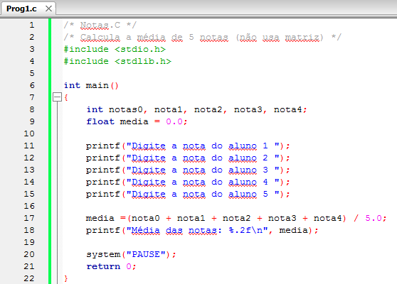

*Figura:* captura do editor com `Prog1.c` (**A01-P01**), linhas 1–22 da versão histórica do programa. Fonte revisado: [`src/Fontes_Aula_1/Prog1.c`](../../src/Fontes_Aula_1/Prog1.c); versão anterior à revisão de 2026 em texto: [commit `04ac409`](https://github.com/Lucas-Sperotto/falect-cc-011-algoritmos-e-laboratorio-de-programacao-ii/blob/04ac4094dba3c3812809dd433a7d3855c4bffdc9/src/Fontes_Aula_1/Prog1.c); explicação: [seção 6](#a01-p01). Na captura, as cinco notas são somadas sem nenhuma leitura (não há `scanf`); ver [observação 8.1](#obs-1-1).

<a id="slide-5"></a>
**Slide 5 — Introdução**

> - Imagine agora se você pretendesse encontrar a média aritmética das notas de uma classe com 50 alunos, ou da escola toda, com 2 mil alunos?
> - Seria uma tarefa bastante volumosa!
> - É evidente que precisamos de uma maneira conveniente para referenciar tais coleções de dados similares.

<a id="slide-6"></a>
**Slide 6 — Introdução**

> - Matriz é o tipo de dado oferecido por C para esse propósito, pois é um conjunto de variáveis de mesmo tipo e referenciadas por um único nome.
> - Cada variável é diferenciada por meio de um número chamado índice.
> - Os colchetes são usados para conter o índice.

<a id="slide-7"></a>
**Slide 7 — Introdução**

> 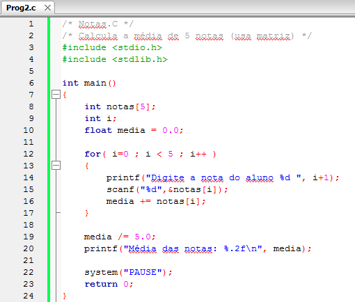

*Figura:* captura do editor com `Prog2.c` (**A01-P02**), linhas 1–24 da versão histórica do programa. Fonte revisado: [`src/Fontes_Aula_1/Prog2.c`](../../src/Fontes_Aula_1/Prog2.c); versão anterior à revisão de 2026 em texto: [commit `04ac409`](https://github.com/Lucas-Sperotto/falect-cc-011-algoritmos-e-laboratorio-de-programacao-ii/blob/04ac4094dba3c3812809dd433a7d3855c4bffdc9/src/Fontes_Aula_1/Prog2.c); explicação: [seção 6](#a01-p02).

### 3.3 Declaração de matrizes (slides 8–11)

<a id="slide-8"></a>
**Slide 8 — Roteiro** · *repete o roteiro do [slide 2](#slide-2), sem destaque do tópico seguinte.*

<a id="slide-9"></a>
**Slide 9 — Declaração da Matriz**

> - Em C, matrizes precisam ser declaradas como quaisquer outras variáveis, para que o compilador conheça o tipo de seus elementos e reserve espaço de memória suficiente para armazená-las.
> - Os elementos da matriz são guardados numa sequência contínua de memória, isto é, um seguido ao outro, o que não ocorre quando criamos variáveis separadas.

<a id="slide-10"></a>
**Slide 10 — Declaração da Matriz**

> - O que diferencia a declaração de uma matriz de qualquer outra variável é a parte que acompanha seu nome, isto é, o par de colchetes ([ e ]) que envolve um número inteiro, indicando o tamanho da matriz.
> - A instrução
>
>   ```c
>   int notas[5];
>   ```
>
>   informa que a matriz notas é formada por cinco elementos do tipo int.

<a id="slide-11"></a>
**Slide 11 — Declaração da Matriz**

> - Por definição, uma matriz é composta por elementos de um único tipo.
> - O valor que dimensiona a matriz, na sua declaração, deve ser uma constante inteira.
> - Assim, não podemos dimensionar uma matriz por meio de uma variável.

*Nota de transcrição:* a regra vale para o C89; desde o C99 existem vetores de tamanho variável (VLA). Ver [observação 8.2](#obs-1-2).

### 3.4 Referenciação dos elementos da matriz (slides 12–16)

<a id="slide-12"></a>
**Slide 12 — Roteiro** · *repete o roteiro do [slide 2](#slide-2), sem destaque do tópico seguinte.*

<a id="slide-13"></a>
**Slide 13 — Referenciação dos Elementos da Matriz**

> - Cada um dos elementos da matriz é referenciado individualmente por meio de um número inteiro, entre colchetes, após o nome da matriz.
> - Quando referencia um elemento, esse número tem um significado diferente daquele da declaração da matriz, sua posição é especificada por esse número.

<a id="slide-14"></a>
**Slide 14 — Referenciação dos Elementos da Matriz**

> - Os elementos são sempre numerados por índices iniciados por zero.
> - Por exemplo, a instrução:
>
>   ```c
>   notas[2] = 90;
>   ```
>
> - Atribui o valor 90 ao terceiro elemento da matriz, pois a numeração começa em zero.
> - O último elemento possui um índice de uma unidade menor que a dimensão da matriz.

<a id="slide-15"></a>
**Slide 15 — Referenciação dos Elementos da Matriz**

> - O índice utilizado para referenciar elementos de uma matriz pode ser o valor de uma variável inteira ou uma constante.
> - Em nosso programa, utilizamos a variável i como índice.

<a id="slide-16"></a>
**Slide 16 — Referenciação dos Elementos da Matriz**

> - Observe a instrução:
>
>   ```c
>   scanf("%d", &notas[i]);
>   ```
>
> - Quando escrevemos notas[i], estamos escrevendo o nome de uma variável do tipo int como outra qualquer.
> - Assim, em todo lugar em que podemos utilizar o nome de uma variável int, podemos usar notas[i].

### 3.5 Matrizes de outros tipos de elementos (slides 17–25)

<a id="slide-17"></a>
**Slide 17 — Roteiro** · *repete o roteiro do [slide 2](#slide-2), sem destaque do tópico seguinte.*

<a id="slide-18"></a>
**Slide 18 — Matrizes de Outros Tipos de Elementos**

> - O fato de uma matriz ser composta por uma série de elementos de um único tipo permite a escolha de qualquer tipo de variável para ela.
> - Suponhamos que você queira que as notas dos seus alunos fiquem no intervalo de 0 a 10 e que seja desprezada a parte fracionária.
> - A solução seria usar uma matriz de elementos do tipo float.

*Nota de transcrição:* o texto diz “que seja desprezada a parte fracionária”, mas a solução proposta (float) justamente preserva a parte fracionária; ver [observação 8.3](#obs-1-3).

<a id="slide-19"></a>
**Slide 19 — Matrizes de Outros Tipos de Elementos**

> 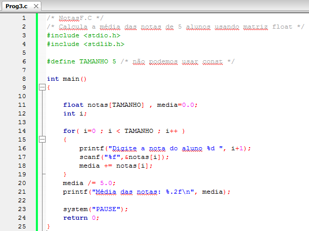

*Figura:* captura do editor com `Prog3.c` (**A01-P03**), linhas 1–25 da versão histórica do programa. Fonte revisado: [`src/Fontes_Aula_1/Prog3.c`](../../src/Fontes_Aula_1/Prog3.c); versão anterior à revisão de 2026 em texto: [commit `04ac409`](https://github.com/Lucas-Sperotto/falect-cc-011-algoritmos-e-laboratorio-de-programacao-ii/blob/04ac4094dba3c3812809dd433a7d3855c4bffdc9/src/Fontes_Aula_1/Prog3.c); explicação: [seção 6](#a01-p03).

<a id="slide-20"></a>
**Slide 20 — Matrizes de Outros Tipos de Elementos**

> - O programa apresenta um novo detalhe: o uso da diretiva #define para criar a constante que dimensiona a matriz e controla o limite do laço:
>
>   ```c
>   #define TAMANHO 5 /* não podemos usar const */
>   ```
>
> - Usar # define no lugar de um número constante facilita a alteração do tamanho da matriz.

*Nota de transcrição:* sobre o comentário “não podemos usar const”, ver [observação 8.4](#obs-1-4).

<a id="slide-21"></a>
**Slide 21 — Matrizes de Outros Tipos de Elementos**

> - Se você desejar calcular a média das notas de mais alunos, somente uma linha do programa deve ser alterada.
> - Por exemplo, para calcular a média das notas de 30 alunos, devemos alterar somente a instrução de declaração da constante:
>
>   ```c
>   #define TAMANHO 30
>   ```

<a id="slide-22"></a>
**Slide 22 — Matrizes de Outros Tipos de Elementos**

> - Um Número Desconhecido de Elementos:
>   - Nos exemplos anteriores, utilizamos um número fixo de notas.
>   - Como faríamos se não conhecêssemos de antemão quantos itens entrariam na matriz?
>   - O programa seguinte aceita até 50 notas e pode ser facilmente modificado para aceitar qualquer número de notas:

<a id="slide-23"></a>
**Slide 23 — Matrizes de Outros Tipos de Elementos**

> 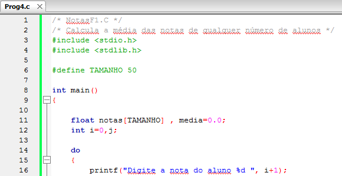

*Figura:* captura do editor com `Prog4.c` (**A01-P04**), linhas 1–16 da versão histórica do programa. Fonte revisado: [`src/Fontes_Aula_1/Prog4.c`](../../src/Fontes_Aula_1/Prog4.c); versão anterior à revisão de 2026 em texto: [commit `04ac409`](https://github.com/Lucas-Sperotto/falect-cc-011-algoritmos-e-laboratorio-de-programacao-ii/blob/04ac4094dba3c3812809dd433a7d3855c4bffdc9/src/Fontes_Aula_1/Prog4.c); explicação: [seção 6](#a01-p04).

<a id="slide-24"></a>
**Slide 24 — Matrizes de Outros Tipos de Elementos**

> 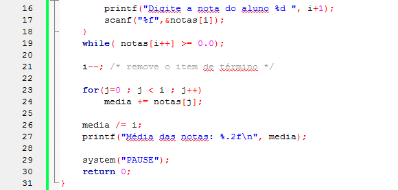

*Figura:* continuação de `Prog4.c` (**A01-P04**), linhas 16–31.

<a id="slide-25"></a>
**Slide 25 — Matrizes de Outros Tipos de Elementos**

> - Um Número Desconhecido de Elementos:
>   - O laço for foi substituído pelo laço do-while.
>   - Esse laço repete a solicitação da nota do usuário, armazenando-a na matriz notas[], até que seja fornecido um valor menor que zero.
>   - Quando o último item for digitado, a variável i terá alcançado um valor acima do total de itens.
>   - Isso é verdadeiro, pois é contado o número negativo de finalização da entrada. Assim, devemos subtrair 1 do valor contido em i para encontrar o número correto de intens [sic].

### 3.6 Verificação de limites (slides 26–33)

<a id="slide-26"></a>
**Slide 26 — Roteiro** · *repete o roteiro do [slide 2](#slide-2), sem destaque do tópico seguinte.*

<a id="slide-27"></a>
**Slide 27 — Verificação de Limites**

> - A nossa matriz foi dimensionada em 50 e este número permite a entrada de até 50 notas.
> - Suponhamos que o usuário decida inserir mais de 50 notas.
> - Como expulsar os dados excedentes?
> - A linguagem C não realiza verificação de limite em matrizes, por isso nada impede que você vá além do fim de uma matriz.

<a id="slide-28"></a>
**Slide 28 — Verificação de Limites**

> - Se você transpuser o fim da matriz durante uma operação de atribuição, os valores sobressalentes irão se sobrepor a outros dados da memória.
> - Estes valores serão armazenados em sequência, seguindo os elementos da matriz na memória.

<a id="slide-29"></a>
**Slide 29 — Verificação de Limites**

> - Como não foi reservado espaço para guardá-los, eles irão se sobrepor a outras variáveis ou até mesmo a uma parte do código do próprio programa que por acaso esteja nesta memória
> - Isso acarretará resultados imprevisíveis, e nenhuma mensagem de erro do compilador avisará o que está ocorrendo.

<a id="slide-30"></a>
**Slide 30 — Verificação de Limites**

> - Em linguagem C, não há sistema que avise quando o limite de uma matriz for excedido.
> - Providenciar a verificação do limite de uma matriz é responsabilidade do programador.
> - A solução é não permitir que o usuário digite dados acima do limite em elementos da matriz.
> - Para isso, modificaremos o laço do-while, do programa anterior, como segue:

<a id="slide-31"></a>
**Slide 31 — Verificação de Limites**

> 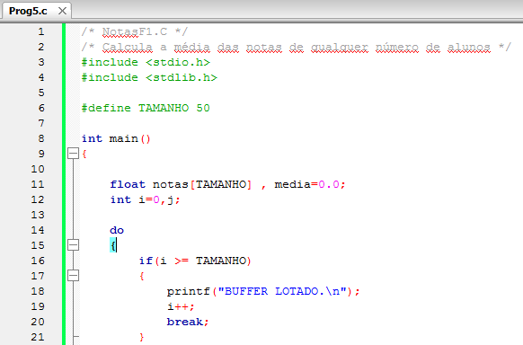

*Figura:* captura do editor com `Prog5.c` (**A01-P05**), linhas 1–21 da versão histórica do programa. Fonte revisado: [`src/Fontes_Aula_1/Prog5.c`](../../src/Fontes_Aula_1/Prog5.c); versão anterior à revisão de 2026 em texto: [commit `04ac409`](https://github.com/Lucas-Sperotto/falect-cc-011-algoritmos-e-laboratorio-de-programacao-ii/blob/04ac4094dba3c3812809dd433a7d3855c4bffdc9/src/Fontes_Aula_1/Prog5.c); explicação: [seção 6](#a01-p05).

<a id="slide-32"></a>
**Slide 32 — Verificação de Limites**

> 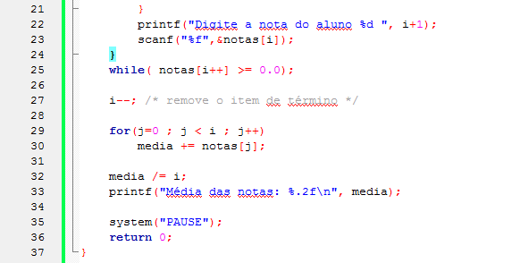

*Figura:* continuação de `Prog5.c` (**A01-P05**), linhas 21–37.

<a id="slide-33"></a>
**Slide 33 — Verificação de Limites**

> - Com essa modificação, quando i atingir 50, que é um acima do último índice da matriz, a mensagem “BUFFER LOTADO.” será impressa e o comando break fará com que o controle saia do laço do-while e passe para a segunda parte do programa.

*Nota de transcrição:* sobre o laço com sentinela e o limite de 50 notas, ver [observação 8.5](#obs-1-5).

### 3.7 Inicialização de matrizes (slides 34–41)

<a id="slide-34"></a>
**Slide 34 — Roteiro** · *repete o roteiro do [slide 2](#slide-2), sem destaque do tópico seguinte.*

<a id="slide-35"></a>
**Slide 35 — Inicialização de Matrizes**

> - Você pode fornecer valores a cada elemento da matriz na mesma instrução de sua declaração.
> - Veja um exemplo que calcula o número de dias transcorridos do início do ano até a data especificada pelo usuário.
> - O programa verifica se o ano é ou não bissexto.

<a id="slide-36"></a>
**Slide 36 — Inicialização de Matrizes**

> 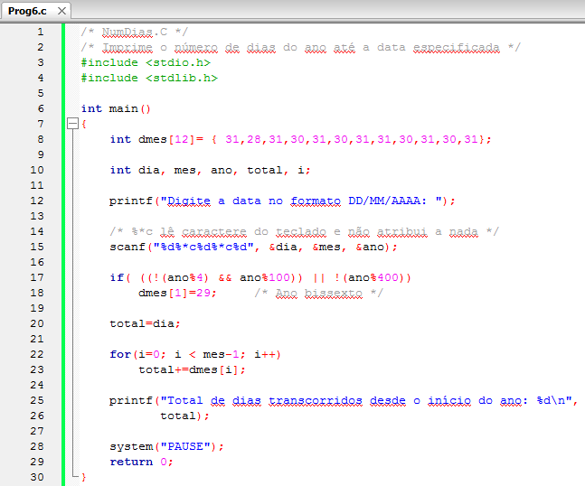

*Figura:* captura do editor com `Prog6.c` (**A01-P06**), linhas 1–30 da versão histórica do programa. Fonte revisado: [`src/Fontes_Aula_1/Prog6.c`](../../src/Fontes_Aula_1/Prog6.c); versão anterior à revisão de 2026 em texto: [commit `04ac409`](https://github.com/Lucas-Sperotto/falect-cc-011-algoritmos-e-laboratorio-de-programacao-ii/blob/04ac4094dba3c3812809dd433a7d3855c4bffdc9/src/Fontes_Aula_1/Prog6.c); explicação: [seção 6](#a01-p06).

<a id="slide-37"></a>
**Slide 37 — Inicialização de Matrizes**

> - O programa inicializa a matriz dmes[] na instrução:
>
>   ```c
>   int dmes[12]= { 31,28,31,30,31,30,31,31,30,31,30,31};
>   ```
>
> - A lista de valores é colocada entre chaves e os valores são separados por vírgulas.
> - Eles são atribuídos na sequência em que são escritos, isto é, dmes[0] terá o valor inicial 31 dmes[1] terá o valor inicial 28 e assim por diante.

<a id="slide-38"></a>
**Slide 38 — Inicialização de Matrizes**

> - Observe que há um ponto-e-virgula após o fechamento das chaves, na inicialização da matriz.
> - Em C, as estruturas de programação como laços, funções e comandos de decisão não admitem um ponto-e-virgula após a chave de seus blocos de código, enquanto as estruturas de dados sempre terminam por ponto-e-virgula após a chave de fechamento.

<a id="slide-39"></a>
**Slide 39 — Inicialização de Matrizes**

> - Matrizes só podem ser inicializadas se forem criadas em tempo de compilação.
> - Assim, para inicializar uma matriz, ela deve ser da classe static ou extern.
> - Se uma matriz for criada dentro de uma função e inicializada sem que seja escrito explicitamente static, o compilador se encarregará de criá-la como static ou apresentará erro.

*Nota de transcrição:* a exigência de `static` ou `extern` descreve o C anterior ao padrão ANSI; ver [observação 8.6](#obs-1-6).

<a id="slide-40"></a>
**Slide 40 — Inicialização de Matrizes**

> ```c
> static int dmes[12]= { 31,28,31,30,31,30,31,31,30,31,30,31};
> ```
>
> - A instrução de declaração de uma matriz inicializada pode suprimir a dimensão da matriz, restando apenas um par de colchetes vazios:
>
>   ```c
>   int dmes[ ]= { 31,28,31,30,31,30,31,31,30,31,30,31};
>   ```
>
> - Se nenhum número for dado para dimensionar a matriz, o compilador contará o número de valores inicializados e o fixará como dimensão da matriz.

<a id="slide-41"></a>
**Slide 41 — Inicialização de Matrizes**

> - Caso você especifique a dimensão da matriz e use menos inicializadores que esse tamanho, os elementos não inicializados conterão zeros.
> - Se for colocado um número de inicializadores maior que o necessário, o compilador emitirá um erro.
> - Lamentavelmente, em C, não há como especificar a repetição de um inicializador nem inicializar um elemento no meio de uma matriz sem o fazer com todos os anteriores.

*Nota de transcrição:* desde o C99 há inicializadores designados, que permitem inicializar um elemento no meio; ver [observação 8.7](#obs-1-7).

### 3.8 Matrizes de mais de uma dimensão (slides 42–51)

<a id="slide-42"></a>
**Slide 42 — Roteiro** · *repete o roteiro do [slide 2](#slide-2), sem destaque do tópico seguinte.*

<a id="slide-43"></a>
**Slide 43 — Matrizes de Mais de Uma Dimensão**

> - Os elementos de uma matriz podem ser de qualquer tipo, incluindo matrizes.
> - Os exemplos vistos até agora são de matrizes de uma dimensão, isto é, matrizes nas quais os elementos são de tipos simples.
> - Diremos que uma matriz é de duas dimensões quando seus elementos forem matrizes de uma dimensão.

<a id="slide-44"></a>
**Slide 44 — Matrizes de Mais de Uma Dimensão**

> - Na verdade, em C, o termo duas dimensões não faz sentido, pois todas as matrizes são armazenadas na memória de forma linear.
> - Usaremos esse termo para indicar matrizes em que os elementos são outras matrizes.
> - Com dois pares de colchetes, obtemos uma matriz de duas dimensões, e com cada par de colchetes adicionais obtemos matrizes com uma dimensão a mais.

*Nota de transcrição:* sobre o armazenamento linear (ordem por linhas), ver [seção 4.4](#c-1-4).

<a id="slide-45"></a>
**Slide 45 — Matrizes de Mais de Uma Dimensão**

> - Para ilustrar esse conceito, apresentaremos um programa que usa uma matriz de duas dimensões para criar 50 combinações para a loteria (sena).

<a id="slide-46"></a>
**Slide 46 — Matrizes de Mais de Uma Dimensão**

> 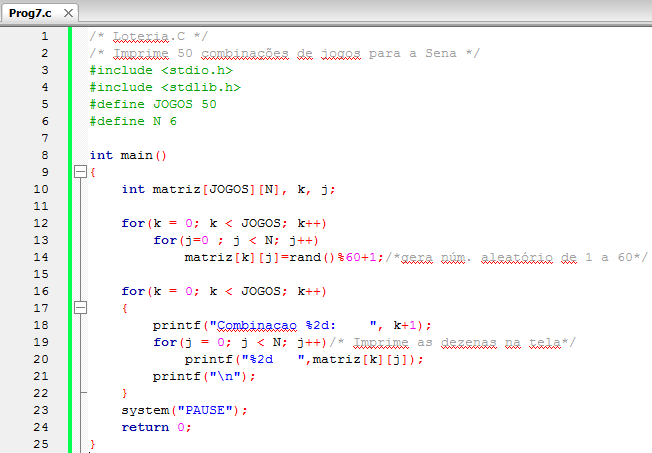

*Figura:* captura do editor com `Prog7.c` (**A01-P07**), linhas 1–25 da versão histórica do programa. Fonte revisado: [`src/Fontes_Aula_1/Prog7.c`](../../src/Fontes_Aula_1/Prog7.c); versão anterior à revisão de 2026 em texto: [commit `04ac409`](https://github.com/Lucas-Sperotto/falect-cc-011-algoritmos-e-laboratorio-de-programacao-ii/blob/04ac4094dba3c3812809dd433a7d3855c4bffdc9/src/Fontes_Aula_1/Prog7.c); explicação: [seção 6](#a01-p07).

<a id="slide-47"></a>
**Slide 47 — Matrizes de Mais de Uma Dimensão**

> - O próximo exemplo usa uma matriz de duas dimensões para criar uma grade do jogo-da-velha.
> - Inicialmente, a matriz é preenchida com pontos.
> - Depois, o programa forma um ciclo por meio de um laço while no qual a matriz é impressa, verifica se algum jogador já ganhou ou se houve empate, solicita ao jogador que digite um par de coordenadas e finalmente atribui o caractere ‘o’ ou ‘x’ ao elemento da matriz correspondente às coordenadas entradas.

<a id="slide-48"></a>
**Slide 48 — Matrizes de Mais de Uma Dimensão**

> - Executando esse programa, você verá como trabalha um sistema de coordenadas de duas dimensões.
> - Digite pares de números como (0 0), (1 2), (2 2) etc.
> - A coordenada horizontal, ou seja, o número da linha, é fornecida primeiro.
> - Não esqueça de que os índices começam em zero.

<a id="slide-49"></a>
**Slide 49 — Matrizes de Mais de Uma Dimensão**

> 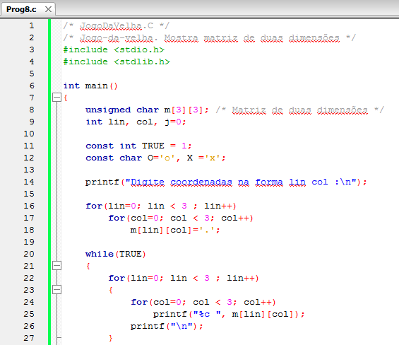

*Figura:* captura do editor com `Prog8.c` (**A01-P08**), linhas 1–27 da versão histórica do programa. Fonte revisado: [`src/Fontes_Aula_1/Prog8.c`](../../src/Fontes_Aula_1/Prog8.c); versão anterior à revisão de 2026 em texto: [commit `04ac409`](https://github.com/Lucas-Sperotto/falect-cc-011-algoritmos-e-laboratorio-de-programacao-ii/blob/04ac4094dba3c3812809dd433a7d3855c4bffdc9/src/Fontes_Aula_1/Prog8.c); explicação: [seção 6](#a01-p08).

<a id="slide-50"></a>
**Slide 50 — Matrizes de Mais de Uma Dimensão**

> 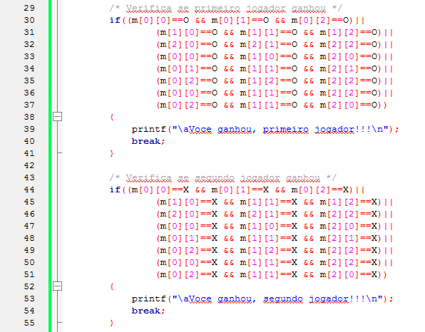

*Figura:* continuação de `Prog8.c` (**A01-P08**), linhas 29–55.

<a id="slide-51"></a>
**Slide 51 — Matrizes de Mais de Uma Dimensão**

> 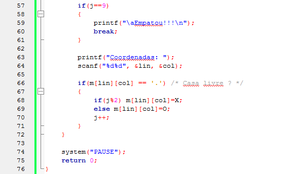

*Figura:* continuação de `Prog8.c` (**A01-P08**), linhas 57–76. As coordenadas lidas não são verificadas antes de indexar `m`; ver [observação 8.10](#obs-1-10).

### 3.9 Inicialização de matrizes de duas e três dimensões (slides 52–63)

<a id="slide-52"></a>
**Slide 52 — Roteiro** · *repete o roteiro do [slide 2](#slide-2), sem destaque do tópico seguinte.*

<a id="slide-53"></a>
**Slide 53 — Inicialização de Matrizes de Duas Dimensões**

> - As matrizes de duas dimensões são inicializadas da mesma maneira que as de dimensão única, isto é, os elementos são colocados entre chave [sic] depois do sinal de igual e separados por vírgulas.
> - Como cada elemento de uma matiz [sic] de duas dimensões é por sua vez uma matriz, então cada elemento deve estar entre chaves e os elementos internos devem ser separados por vírgulas.

<a id="slide-54"></a>
**Slide 54 — Inicialização de Matrizes de Duas Dimensões**

> - Como exemplo, vamos reescrever o programa do jogo da velha inicializando a matriz com pontos.

<a id="slide-55"></a>
**Slide 55 — Inicialização de Matrizes de Duas Dimensões**

> 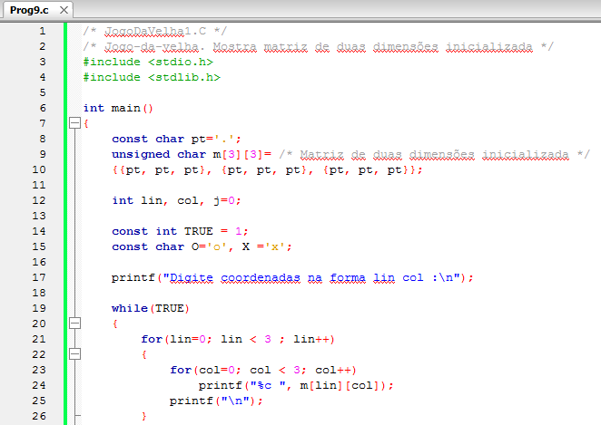

*Figura:* captura do editor com `Prog9.c` (**A01-P09**), linhas 1–26 da versão histórica do programa. Fonte revisado: [`src/Fontes_Aula_1/Prog9.c`](../../src/Fontes_Aula_1/Prog9.c); versão anterior à revisão de 2026 em texto: [commit `04ac409`](https://github.com/Lucas-Sperotto/falect-cc-011-algoritmos-e-laboratorio-de-programacao-ii/blob/04ac4094dba3c3812809dd433a7d3855c4bffdc9/src/Fontes_Aula_1/Prog9.c); explicação: [seção 6](#a01-p09).

<a id="slide-56"></a>
**Slide 56 — Inicialização de Matrizes de Duas Dimensões**

> 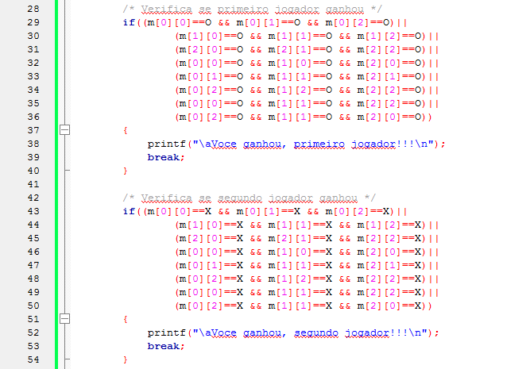

*Figura:* continuação de `Prog9.c` (**A01-P09**), linhas 28–54.

<a id="slide-57"></a>
**Slide 57 — Inicialização de Matrizes de Duas Dimensões**

> 

*Figura:* continuação de `Prog9.c` (**A01-P09**), linhas 56–75.

<a id="slide-58"></a>
**Slide 58 — Inicialização de Matrizes de Duas Dimensões**

> - A matriz m[] tem três elementos: m[0], m[1] e m[2].
> - Cada elemento me m[] [sic] é, por sua vez, uma matriz de três elementos do tipo char.
> - Assim, m[0], m[1] e m[2] são nomes de matrizes de elementos do tipo char.

<a id="slide-59"></a>
**Slide 59 — Inicialização de Matrizes de Duas Dimensões**

> - Para inicializar uma matriz, devemos colocar a lista de elementos em ordem, entre chaves e separados por vírgulas, exatamente como fizemos ao inicializar uma matriz de uma dimensão:
>
>   ```c
>   const char pt='.';
>   unsigned char m[3][3]= /* Matriz de duas dimensões inicializada */
>   {{pt, pt, pt}, {pt, pt, pt}, {pt, pt, pt}};
>   ```
>
> - A lista de valores usada para inicializar a matriz apresenta constantes separadas por vírgulas e envoltas por chaves.

<a id="slide-60"></a>
**Slide 60 — Inicialização de Matrizes de Três Dimensões**

> - Uma matriz de três dimensões é aquela em que cada elemento é uma matriz de duas dimensões.
> - Observe o fragmento de programa a seguir que inicializa uma matriz de três dimensões:

<a id="slide-61"></a>
**Slide 61 — Inicialização de Matrizes de Três Dimensões**

> ```c
> int tresd[3][2][4] =
> {
>     {
>         {1, 2, 3. 4},
>         {5, 6, 7, 8}
>     },
>     {
>
>         {7, 9, 3, 2},
>         {4, 6, 8, 3}
>     },
>     {
>         {7, 2, 6, 3},
>         {0, 1, 9, 4}
>     },
> };
> ```

*Nota de transcrição:* o fragmento é reproduzido como está na figura, inclusive `3. 4` (ponto no lugar da vírgula), que impede a compilação; ver [observação 8.11](#obs-1-11).

<a id="slide-62"></a>
**Slide 62 — Inicialização de Matrizes de Três Dimensões**

> - A matriz tresd[] tem três elementos: tresd[0], tresd[1] e tresd[2].
> - Cada um de seus elementos é uma matriz de duas dimensões.
> - O primeiro índice é [2], pois o zero pertence ao terceiro grupo.
> - O segundo índice é [1], pois o zero está na segunda matriz do terceiro grupo.
> - O terceiro índice é [0], pois é o primeiro dos quatro números.

<a id="slide-63"></a>
**Slide 63 — Inicialização de Matrizes de Três Dimensões**

> - Então:
>
>   ```c
>   tresd[2][1][0] == 0
>   ```

### 3.10 Matrizes como argumentos de funções (slides 64–71)

<a id="slide-64"></a>
**Slide 64 — Roteiro** · *repete o roteiro do [slide 2](#slide-2), sem destaque do tópico seguinte.*

<a id="slide-65"></a>
**Slide 65 — Matrizes como argumentos de Funções**

> - Temos visto exemplos da passagem de vários tipos de variáveis como argumentos de funções.
> - As matrizes também podem ser passadas como argumento para uma função.
> - O programa seguinte é uma variação do programa que faz a média das notas, que usa uma função para calcular a média aritmética dos valores de uma matriz.

<a id="slide-66"></a>
**Slide 66 — Matrizes como argumentos de Funções**

> 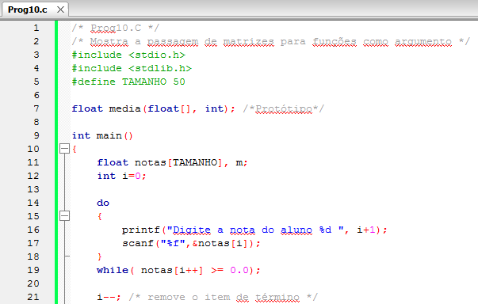

*Figura:* captura do editor com `Prog10.c` (**A01-P10**), linhas 1–21 da versão histórica do programa. Fonte revisado: [`src/Fontes_Aula_1/Prog10.c`](../../src/Fontes_Aula_1/Prog10.c); versão anterior à revisão de 2026 em texto: [commit `04ac409`](https://github.com/Lucas-Sperotto/falect-cc-011-algoritmos-e-laboratorio-de-programacao-ii/blob/04ac4094dba3c3812809dd433a7d3855c4bffdc9/src/Fontes_Aula_1/Prog10.c); explicação: [seção 6](#a01-p10).

<a id="slide-67"></a>
**Slide 67 — Matrizes como argumentos de Funções**

> 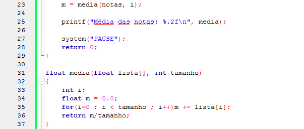

*Figura:* continuação de `Prog10.c` (**A01-P10**), linhas 23–37. Na linha 26 da captura, `printf` recebe `media` (o nome da função) em vez da variável `m`; ver [observação 8.12](#obs-1-12).

<a id="slide-68"></a>
**Slide 68 — Matrizes como argumentos de Funções**

> - A primeira parte deste programa lê a lista das notas enquanto não for digitada uma nota negativa.
> - O único elemento novo deste programa é a instrução:
>
>   ```c
>   m = media(notas, i);
>   ```
>
> - Ela é uma chamada à função media(), que retorna a média das notas armazenadas na matriz.

<a id="slide-69"></a>
**Slide 69 — Matrizes como argumentos de Funções**

> - A parte interessante a ser considerada aqui e como [sic] foi passada a matriz para a função: usamos unicamente o nome da matriz.
> - Para referenciar um elemento da matriz já sabemos que a sintaxe é notas[i]; mas o que representa o nome da matriz sem colchetes?
> - O nome de uma matriz, desacompanhado de colchetes, representa o endereço de memória em que a matriz foi armazenada.

<a id="slide-70"></a>
**Slide 70 — Matrizes como argumentos de Funções**

> - O nome de uma variável simples representa o valor nela contido; entretanto, o nome de uma matriz representa seu endereço de memória.
> - Esse endereço é o do primeiro elemento da matriz.
> - Em outras palavras, notas é o endereço de notas[0], que é uma variável do tipo float.

<a id="slide-71"></a>
**Slide 71 — Matrizes como argumentos de Funções**

> - Assim, a função media() recebe o endereço de uma variável float e não um valor.
> - Devemos declarar esse endereço corretamente.
> - O tipo float[] indica o endereço de uma variável float.
> - O bom entendimento de endereços tornar-se-á imprescindível quando estudarmos ponteiros.

*Nota de transcrição:* em parâmetros, `float[]` é ajustado para `float *`; ver [observação 8.13](#obs-1-13).

### 3.11 Matrizes são passadas para funções por referência (slides 72–78)

<a id="slide-72"></a>
**Slide 72 — Roteiro** · *repete o roteiro do [slide 2](#slide-2), sem destaque do tópico seguinte.*

<a id="slide-73"></a>
**Slide 73 — Matrizes São Passadas para Funções por Referência**

> - As matrizes são consideradas um tipo de dado bastante grande, pois são formadas por diversas variáveis.
> - Por causa disso, em linguagem C, determina-se ser mais eficiente existir uma única cópia da matriz na memória, sendo, portanto, irrelevante o número de funções que a acessem.
> - Assim, não são passados os valores contidos na matriz, somente o seu endereço de memória.

<a id="slide-74"></a>
**Slide 74 — Matrizes São Passadas para Funções por Referência**

> - O que ocorre quando o endereço de uma matriz é passado para uma função como argumento?
> - A função usa o endereço para acessar os elementos da matriz original, criada na função que chama.
> - Isso significa que as alterações que a função efetuar nos elementos da matriz afetarão a matriz original.

<a id="slide-75"></a>
**Slide 75 — Matrizes São Passadas para Funções por Referência**

> - Ao passar o nome de uma matriz para uma função não se cria uma nova cópia da matriz; a passagem é por referência.

*Nota de transcrição:* sobre o termo “por referência”, ver [observação 8.13](#obs-1-13).

<a id="slide-76"></a>
**Slide 76 — Matrizes São Passadas para Funções por Referência**

> - No exemplo anterior, a função media() não altera os valores dos elementos da matriz.
> - Vamos analisar um programa que ordena os valores de uma matriz e observar que a mudança da ordem é feita na matriz original, criada em main().

<a id="slide-77"></a>
**Slide 77 — Matrizes São Passadas para Funções por Referência**

> 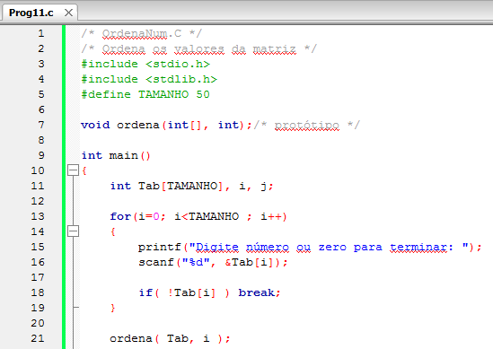

*Figura:* captura do editor com `Prog11.c` (**A01-P11**), linhas 1–21 da versão histórica do programa. Fonte revisado: [`src/Fontes_Aula_1/Prog11.c`](../../src/Fontes_Aula_1/Prog11.c); versão anterior à revisão de 2026 em texto: [commit `04ac409`](https://github.com/Lucas-Sperotto/falect-cc-011-algoritmos-e-laboratorio-de-programacao-ii/blob/04ac4094dba3c3812809dd433a7d3855c4bffdc9/src/Fontes_Aula_1/Prog11.c); explicação: [seção 6](#a01-p11).

<a id="slide-78"></a>
**Slide 78 — Matrizes São Passadas para Funções por Referência**

> 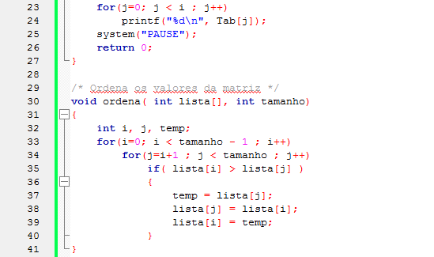

*Figura:* continuação de `Prog11.c` (**A01-P11**), linhas 23–41.

### 3.12 A ordenação bolha (slides 79–83)

<a id="slide-79"></a>
**Slide 79 — Roteiro** · *repete o roteiro do [slide 2](#slide-2), sem destaque do tópico seguinte.*

<a id="slide-80"></a>
**Slide 80 — A Ordenação Bolha**

> - O processo de ordenação utilizado na função ordena() merece alguma explanação.
> - A função começa considerando a primeira variável da matriz, lista[0].
> - O objetivo é colocar o menor item da lista nessa variável.
> - Assim, a função percorre cada um dos itens seguintes a fim de encontrar o menor deles.

<a id="slide-81"></a>
**Slide 81 — A Ordenação Bolha**

> - Sempre que encontra um item menor, eles são trocados.
> - Terminada a operação, segue-se ao próximo item: lista[1].
> - Esse item deverá conter o próximo menor valor.
> - Novamente, são realizadas as comparações e trocas.
> - O processo continua até que a lista esteja ordenada.

<a id="slide-82"></a>
**Slide 82 — A Ordenação Bolha**

> - O processo de ordenação é feito por meio de dois laços.
> - O laço mais externo determina qual elemento da matriz será usado como base da comparação.
> - O laço mais interno compara cada item seguinte com o de base e, quando encontra um item menor que o de base, faz a troca.
> - A troca é feita no corpo do if por meio de uma variável temporária.

<a id="slide-83"></a>
**Slide 83 — A Ordenação Bolha**

> - Esse método é chamado de ordenação bolha.
> - Sua popularidade vem de sua simples utilização.
> - No entanto, existem outros algoritmos, e alguns mais eficientes.
> - A função main() imprime os valores dos elementos da matriz após o retorno da função ordena().
> - Observe como a matriz foi efetivamente alterada.

*Nota de transcrição:* o algoritmo da função `ordena()` compara cada posição-base com todas as seguintes; difere da ordenação bolha clássica, que compara vizinhos. Ver [observação 8.14](#obs-1-14).

### 3.13 Matrizes de duas dimensões como argumento de funções (slides 84–90)

<a id="slide-84"></a>
**Slide 84 — Matrizes de Duas Dimensões como Argumento de Funções**

> - Para ilustrar o uso de uma matriz de duas dimensões passada como argumento para uma função, escreveremos um programa para avaliar a eficiência dos funcionários de uma loja quanto ao número de peças vendidas por cada um deles em três meses.
> - O primeiro índice da matriz indica o número de funcionários da loja e o segundo, o número de meses a serem considerados.

<a id="slide-85"></a>
**Slide 85 — Matrizes de Duas Dimensões como Argumento de Funções**

> 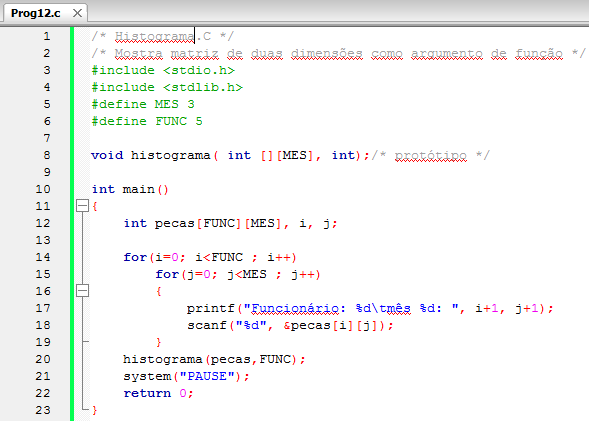

*Figura:* captura do editor com `Prog12.c` (**A01-P12**), linhas 1–23 da versão histórica do programa. Fonte revisado: [`src/Fontes_Aula_1/Prog12.c`](../../src/Fontes_Aula_1/Prog12.c); versão anterior à revisão de 2026 em texto: [commit `04ac409`](https://github.com/Lucas-Sperotto/falect-cc-011-algoritmos-e-laboratorio-de-programacao-ii/blob/04ac4094dba3c3812809dd433a7d3855c4bffdc9/src/Fontes_Aula_1/Prog12.c); explicação: [seção 6](#a01-p12).

<a id="slide-86"></a>
**Slide 86 — Matrizes de Duas Dimensões como Argumento de Funções**

> 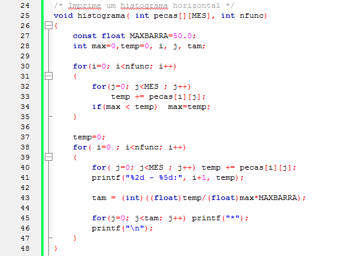

*Figura:* continuação de `Prog12.c` (**A01-P12**), linhas 24–48. A variável `temp` não é zerada a cada funcionário, de modo que as barras acumulam os totais anteriores; ver [observação 8.15](#obs-1-15).

<a id="slide-87"></a>
**Slide 87 — Matrizes de Duas Dimensões como Argumento de Funções**

> - O método de passagem do endereço da matriz para a função é idêntico ao da passagem de uma matriz de uma dimensão, não importando quantas dimensões tenha a matriz, visto que sempre passamos o seu endereço.
>
>   ```c
>   histograma(pecas,FUNC);
>   ```

<a id="slide-88"></a>
**Slide 88 — Matrizes de Duas Dimensões como Argumento de Funções**

> - Entretanto, a declaração da matriz na função e no seu protótipo é um tanto misteriosa:
>
>   ```c
>   void histograma( int pecas[][MES], int nfunc)
>   ```
>
> - Por que só estamos informando a segunda dimensão da matriz?
> - Como não há verificação de limites, uma matriz com a primeira dimensão de qualquer valor pode ser passada para a função chamada.

<a id="slide-89"></a>
**Slide 89 — Matrizes de Duas Dimensões como Argumento de Funções**

> - Mas em uma função que recebe uma matriz bidimensional deverá ser informada do comprimento da segunda dimensão para poder operar com declarações do tipo:
>
>   ```c
>   pecas[2][1];
>   ```
>
> - para encontrar a posição de memória em que pecas[2][1] está guardada, a função multiplica o primeiro índice (2) pelo número de elementos da segunda dimensão (MES) e adiciona o segundo índice (1), para finalmente somar o endereço da matriz (pecas).

<a id="slide-90"></a>
**Slide 90 — Matrizes de Duas Dimensões como Argumento de Funções**

> - Caso o comprimento da segunda dimensão não seja conhecido, será impossível saber onde estão os valores.
> - Nesse ponto, você já está apto a trabalhar com matrizes. Você sabe como declarar matrizes de diferentes dimensões e tipos, como inicializar matrizes, como referenciar um elemento particular de matriz e como passar uma matriz para uma função.

### 3.14 Referências do material original (slide 91)

<a id="slide-91"></a>
**Slide 91 — Referências**

> - MIZRAHI, Victorine V. Treinamento em Linguagem C, São Paulo: Pearson Prentice Hall, 2008;

## 4. Explicações complementares

<a id="c-1-1"></a>
### 4.1 Vetor, matriz e *array*: a terminologia do material

O livro-base (Mizrahi) traduz *array* por “matriz”. Por isso, `int notas[5]` é chamado de matriz nos slides, embora seja um **vetor** (uma dimensão). Nesta documentação:

| Termo | Declaração típica | Forma de acesso |
|---|---|---|
| vetor (*array* unidimensional) | `float notas[50];` | `notas[i]` |
| matriz (*array* de *arrays*) | `int pecas[5][3];` | `pecas[i][j]` |
| *array* tridimensional | `int tresd[3][2][4];` | `tresd[i][j][k]` |

Em todos os casos, um *array* é uma sequência contígua de objetos do mesmo tipo, com tamanho fixado na declaração.

<a id="c-1-2"></a>
### 4.2 O que a declaração reserva na memória

`int notas[5];` reserva `5 * sizeof(int)` bytes contíguos. No GCC para Linux x86-64, `sizeof(int)` é 4, logo o vetor ocupa 20 bytes. Os endereços a seguir são ilustrativos (o valor real muda a cada execução):

| Elemento | `notas[0]` | `notas[1]` | `notas[2]` | `notas[3]` | `notas[4]` |
|---|---|---|---|---|---|
| Endereço | `0x1000` | `0x1004` | `0x1008` | `0x100c` | `0x1010` |
| Deslocamento (bytes) | 0 | 4 | 8 | 12 | 16 |

O endereço do elemento de índice $i$ é calculado, e não armazenado:

$$\text{endereço}(v[i]) = \text{endereço}(v[0]) + i \cdot \texttt{sizeof}(T)$$

Por isso o índice começa em zero: ele é o **deslocamento**, em elementos, a partir do início. O padrão define `v[i]` como `*(v + i)` (ISO/IEC 9899:2011, §6.5.2.1), relação que a [Aula 6](../aula-06/README.md) explora com ponteiros. Cinco variáveis separadas (`nota0` … `nota4`, como em `Prog1.c`) não têm essa garantia de contiguidade nem podem ser percorridas por um índice.

Para obter o número de elementos de um vetor **no mesmo escopo em que foi declarado**, use `sizeof notas / sizeof notas[0]`. Dentro de uma função que recebeu o vetor como parâmetro essa conta não funciona (ver [4.6](#c-1-6)).

<a id="c-1-3"></a>
### 4.3 Índices fora do intervalo: comportamento indefinido

Os índices válidos de `float notas[50]` são `0` a `49`. Ler ou escrever `notas[50]` não gera erro de compilação nem, necessariamente, erro de execução: é **comportamento indefinido** (§3.4.3 e §6.5.6p8). O slide 29 descreve uma consequência possível (sobrescrever outras variáveis), mas o padrão não promete nem isso: o compilador pode supor que o acesso inválido nunca ocorre e gerar código com efeitos imprevisíveis.

A verificação é responsabilidade do programa e deve acontecer **antes** do acesso:

```c
if (i < TAMANHO)        /* testa primeiro... */
    notas[i] = valor;   /* ...e só então escreve */
```

Para detectar violações durante os testes, compile com o AddressSanitizer, como faz a infraestrutura do repositório (`bash script.sh --executar --sanitizers`) ou manualmente:

```bash
gcc -std=c11 -g -fsanitize=address,undefined src/Fontes_Aula_1/Prog5.c -o /tmp/prog5
```

<a id="c-1-4"></a>
### 4.4 Matrizes de duas e três dimensões: ordem por linhas

`int pecas[5][3]` é um vetor de 5 elementos em que cada elemento é um vetor de 3 `int`. Na memória, as linhas ficam uma após a outra (*row-major order*, §6.5.2.1p3): o último índice varia mais rápido.

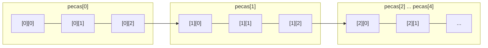

Para uma matriz `T m[L][C]`, o deslocamento do elemento `m[i][j]`, em elementos, é

$$\text{desl}(i, j) = i \cdot C + j,$$

e para `T t[A][B][C]`, $\text{desl}(i,j,k) = (i \cdot B + j)\cdot C + k$. No slide 62, `tresd[2][1][0]` tem deslocamento $(2 \cdot 2 + 1)\cdot 4 + 0 = 20$: contando os 24 inicializadores a partir de zero, o de número 20 é justamente o `0` do terceiro grupo. No slide 89, `pecas[2][1]` está a $2 \cdot \texttt{MES} + 1 = 7$ elementos do início, ou seja, a 28 bytes quando `sizeof(int)` vale 4.

A fórmula mostra por que a função que recebe uma matriz precisa conhecer todas as dimensões, **exceto a primeira**: o número de linhas `L` não aparece no cálculo; o número de colunas `C` aparece.

<a id="c-1-5"></a>
### 4.5 Regras de inicialização

| Declaração | Resultado |
|---|---|
| `int v[5] = {1, 2};` | `{1, 2, 0, 0, 0}`: os elementos sem inicializador recebem zero (§6.7.9p21) |
| `int v[5] = {0};` | todos os elementos iguais a zero |
| `int v[] = {31, 28, 31};` | o compilador conta os inicializadores: `v` tem 3 elementos (§6.7.9p22) |
| `int v[2] = {1, 2, 3};` | erro de compilação ou diagnóstico: inicializadores em excesso |
| `int v[10] = {[5] = 7};` | C99 ou posterior: inicializador designado; os demais são zero |
| `int v[5];` (variável local) | conteúdo indeterminado até ser atribuído (§6.7.9p10) |
| `static int v[5];` ou global | todos os elementos iguais a zero |

Em matrizes, as chaves internas agrupam as linhas: `{{1, 2, 3}, {4, 5, 6}}`. As chaves internas podem ser omitidas (`{1, 2, 3, 4, 5, 6}`), porque os valores são distribuídos na ordem por linhas, mas mantê-las torna a intenção clara e ajuda o compilador a avisar sobre erros.

<a id="c-1-6"></a>
### 4.6 Vetores como argumentos: o que a função realmente recebe

Na chamada `media(notas, i)`, o nome `notas` é convertido no endereço de `notas[0]` (§6.3.2.1p3). O parâmetro `float lista[]` é ajustado pelo compilador para `float *lista` (§6.7.6.3p7). Consequências:

1. a função acessa **o mesmo** vetor do chamador; alterações feitas por `ordena()` em `Prog11.c` aparecem em `main()`;
2. a função não sabe quantos elementos existem: o tamanho precisa ser passado (`tamanho`, `nfunc`);
3. dentro da função, `sizeof lista` é o tamanho de um ponteiro (8 bytes em x86-64), e não do vetor.

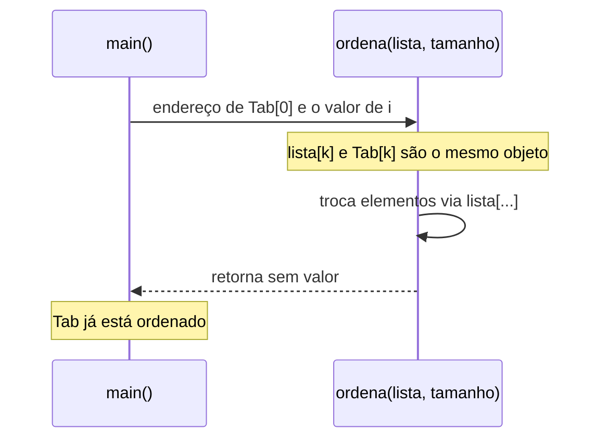

Em C, todo argumento é passado **por valor**; no caso dos vetores, o valor copiado é um endereço. O efeito equivale a uma passagem por referência, termo usado no material (ver [observação 8.13](#obs-1-13)).

Para matrizes, o parâmetro `int pecas[][MES]` é ajustado para `int (*pecas)[MES]`: ponteiro para vetores de `MES` inteiros. É essa informação de tipo que permite calcular `pecas[i][j]` com a fórmula da seção 4.4.

<a id="c-1-7"></a>
### 4.7 A ordenação de `Prog11.c`: rastreamento e custo

A função `ordena()` fixa uma posição-base `i` e compara `lista[i]` com cada `lista[j]` posterior, trocando quando encontra um valor menor. Ao final de cada iteração externa vale o **invariante**: `lista[0..i]` contém os `i+1` menores valores, já em ordem. Rastreamento para a entrada `3 1 2`:

| `i` | `j` | Comparação | Vetor após o passo |
|---:|---:|---|---|
| 0 | 1 | `3 > 1`: troca | `1 3 2` |
| 0 | 2 | `1 > 2`: não troca | `1 3 2` |
| 1 | 2 | `3 > 2`: troca | `1 2 3` |

Para $n$ elementos são feitas sempre

$$\sum_{i=0}^{n-2}(n-1-i) = \frac{n(n-1)}{2}$$

comparações, ou seja, custo $O(n^2)$ independentemente da entrada. O nome “bolha” usado nos slides costuma designar outra variante, que compara **vizinhos** (`lista[j]` e `lista[j+1]`) e faz os maiores valores “subirem” ao fim do vetor; ver [observação 8.14](#obs-1-14). A biblioteca padrão oferece `qsort()`, estudada na [Aula 7](../aula-07/README.md).

<a id="c-1-8"></a>
### 4.8 Leitura com sentinela e validação da entrada

Os programas 4, 5, 10 e 11 leem até encontrar um valor especial (**sentinela**): nota negativa ou zero. Três cuidados tornam esse padrão correto:

1. **conferir o retorno de `scanf`**: ele devolve quantos itens converteu (ou `EOF`); se a conversão falhar, a variável não recebeu valor e não pode ser usada (§7.21.6.2);
2. **testar o limite antes de gravar**, para não escrever além do vetor;
3. **não contar a sentinela** e tratar o caso de nenhuma nota, que levaria à divisão por zero.

Os slides usam `do { ... } while (notas[i++] >= 0.0); i--;`: o incremento dentro da condição conta também a sentinela, compensada pelo `i--`. As versões revisadas usam `while (i < TAMANHO)` com `break` ao ler a sentinela, o que torna os três cuidados explícitos.

<a id="c-1-9"></a>
### 4.9 Calendário em `Prog6.c`

O vetor `dmes` guarda a quantidade de dias de cada mês, e o total de dias até `dia/mes` é

$$\text{total} = \text{dia} + \sum_{k=0}^{\text{mes}-2} \text{dmes}[k].$$

A regra gregoriana de ano bissexto, escrita em `Prog6.c` como `((!(ano%4) && ano%100)) || !(ano%400)`, corresponde a

$$(a \bmod 4 = 0 \;\wedge\; a \bmod 100 \neq 0) \;\vee\; a \bmod 400 = 0.$$

O especificador `%*c` lê um caractere (a barra) e o descarta, sem atribuí-lo a nenhuma variável.

<a id="c-1-10"></a>
### 4.10 Escala do histograma em `Prog12.c`

Cada barra tem comprimento proporcional ao total do funcionário em relação ao maior total:

$$\text{tam}_i = \left\lfloor \frac{\text{total}_i}{\max_k \text{total}_k} \cdot 50 \right\rfloor.$$

A conversão para `double` antes da divisão evita a divisão inteira, que daria 0 para todos, exceto o maior; o caso `max = 0` (ninguém vendeu) precisa ser tratado à parte, porque a divisão por zero produziria NaN, cuja conversão para `int` é indefinida.

<a id="c-1-11"></a>
### 4.11 Números pseudoaleatórios em `Prog7.c`

`rand()` devolve uma sequência determinística: sem `srand()`, ela é a mesma de `srand(1)` (§7.22.2.2), e o programa imprime sempre as mesmas 50 combinações. `srand((unsigned) time(NULL))` muda a semente a cada execução. Duas limitações do exemplo:

- `rand() % 60 + 1` sorteia cada dezena de forma independente, então um mesmo jogo pode repetir números (não é uma aposta válida);
- o resto da divisão introduz um pequeno viés quando `RAND_MAX + 1` não é múltiplo de 60.

Gerar seis dezenas **distintas** exige verificar repetições ou embaralhar um vetor de 1 a 60 (exercício 9.2.6).

## 5. Conceitos fundamentais

| Conceito | Definição operacional | Onde aparece |
|---|---|---|
| Vetor (*array*) | Sequência contígua de `N` objetos do mesmo tipo, acessados por índice | slides 6–16; `Prog2.c` |
| Índice | Deslocamento, em elementos, a partir do primeiro; válido de `0` a `N-1` | slides 13–16 |
| Dimensão | Número de elementos; em C89, uma expressão constante inteira | slides 10–11, 20–21 |
| Constante simbólica | Nome criado com `#define` para a dimensão, alterável em um só lugar | slides 20–21; `Prog3.c` |
| Sentinela | Valor especial que encerra a leitura e não faz parte dos dados | slides 22–25; `Prog4.c` |
| Verificação de limites | Teste explícito `i < N` antes de acessar `v[i]` | slides 27–33; `Prog5.c` |
| Comportamento indefinido | Situação para a qual o padrão não impõe resultado (ex.: índice fora do vetor) | [4.3](#c-1-3) |
| Inicializador | Lista entre chaves que fornece valores na declaração | slides 35–41, 53–63 |
| Matriz | Vetor cujos elementos são vetores; armazenada em ordem por linhas | slides 43–63 |
| Conversão de vetor em ponteiro | O nome do vetor, em expressões, vale o endereço do primeiro elemento | slides 69–71; [4.6](#c-1-6) |
| Passagem por valor do endereço | A função recebe uma cópia do endereço e altera o vetor original | slides 73–78 |
| Ordenação por trocas | Algoritmo $O(n^2)$ que fixa cada posição e troca com menores posteriores | slides 80–83; `Prog11.c` |

## 6. Programas C da aula

Os doze programas estão em [`src/Fontes_Aula_1/`](../../src/Fontes_Aula_1/). Os fontes do repositório foram revisados em 2026 (ver [revisão por fonte](../../docs/auditorias/REVISAO_POR_FONTE.md)): a lógica didática foi mantida, mas leituras passaram a ser verificadas e acessos inválidos foram eliminados. Por isso, cada ficha indica as diferenças em relação à captura do slide. Compilação individual: `gcc -std=c11 -Wall -Wextra -Wpedantic src/Fontes_Aula_1/ProgN.c -o /tmp/progN`, ou `bash script.sh --source src/Fontes_Aula_1/ProgN.c`.

| ID | Arquivo | SIGAA | Slides | Tema |
|---|---|---|---|---|
| [A01-P01](#a01-p01) | [`Prog1.c`](../../src/Fontes_Aula_1/Prog1.c) | Prog01.c | 3–4 | média de cinco notas sem vetor |
| [A01-P02](#a01-p02) | [`Prog2.c`](../../src/Fontes_Aula_1/Prog2.c) | Prog02.c | 6–7, 10–16 | média com vetor `int` |
| [A01-P03](#a01-p03) | [`Prog3.c`](../../src/Fontes_Aula_1/Prog3.c) | Prog03.c | 18–21 | vetor `float` e `#define` |
| [A01-P04](#a01-p04) | [`Prog4.c`](../../src/Fontes_Aula_1/Prog4.c) | Prog04.c | 22–25 | quantidade desconhecida, sentinela |
| [A01-P05](#a01-p05) | [`Prog5.c`](../../src/Fontes_Aula_1/Prog5.c) | Prog05.c | 27–33 | verificação de limites |
| [A01-P06](#a01-p06) | [`Prog6.c`](../../src/Fontes_Aula_1/Prog6.c) | Prog06.c | 35–41 | vetor inicializado, dias do ano |
| [A01-P07](#a01-p07) | [`Prog7.c`](../../src/Fontes_Aula_1/Prog7.c) | Prog07.c | 43–46 | matriz 50×6, `rand()` |
| [A01-P08](#a01-p08) | [`Prog8.c`](../../src/Fontes_Aula_1/Prog8.c) | Prog08.c | 47–51 | jogo da velha, matriz 3×3 |
| [A01-P09](#a01-p09) | [`Prog9.c`](../../src/Fontes_Aula_1/Prog9.c) | Prog09.c | 53–59 | matriz 3×3 inicializada |
| [A01-P10](#a01-p10) | [`Prog10.c`](../../src/Fontes_Aula_1/Prog10.c) | Prog10.c | 65–71 | vetor como argumento |
| [A01-P11](#a01-p11) | [`Prog11.c`](../../src/Fontes_Aula_1/Prog11.c) | Prog11.c | 76–83 | ordenação na função |
| [A01-P12](#a01-p12) | [`Prog12.c`](../../src/Fontes_Aula_1/Prog12.c) | Prog12.c | 84–90 | matriz como argumento, histograma |

<a id="a01-p01"></a>
### 6.1 A01-P01 — `Prog1.c`: média sem vetor

- **Finalidade:** motivar o uso de vetores; cinco variáveis independentes guardam cinco notas.
- **Entrada:** cinco inteiros. **Saída:** a média com duas casas. Entrada inválida ou fim de arquivo encerram com código 1 e mensagem em `stderr`.
- **Conceitos:** variáveis escalares, conversão de tipos na expressão, verificação do retorno de `scanf`.
- **Funcionamento:** cada nota é lida por um `scanf` próprio; a soma é feita em `double` antes da divisão por `5.0`.
- **Diferença em relação ao slide 4:** a captura mostra apenas os `printf` dos pedidos, sem nenhuma leitura; somava variáveis não inicializadas ([8.1](#obs-1-1)). A versão revisada lê e valida as cinco notas.
- **Cuidados:** a conversão `(double)nota0 + ...` evita que a soma de cinco `int` grandes transborde; repetir cinco blocos idênticos é justamente o problema que o vetor resolve.

<!-- codigo: src/Fontes_Aula_1/Prog1.c de=`/* A conversão` ate=`printf("Média` -->
<sub>Copiado de [`src/Fontes_Aula_1/Prog1.c`](../../src/Fontes_Aula_1/Prog1.c#L42-L44) (linhas 42–44) por `scripts/documentacao_aulas.py`; não edite este bloco à mão.</sub>

```c
    /* A conversão antes da soma evita overflow na soma de inteiros. */
    media = ((double)nota0 + nota1 + nota2 + nota3 + nota4) / 5.0;
    printf("Média das notas: %.2f\n", media);
```
<!-- /codigo -->

<a id="a01-p02"></a>
### 6.2 A01-P02 — `Prog2.c`: média com vetor `int`

- **Finalidade:** mostrar que um vetor e um laço substituem as cinco variáveis.
- **Entrada:** cinco inteiros. **Saída:** a média.
- **Conceitos:** declaração `int notas[5]`, índice variável, acumulação durante a leitura.
- **Funcionamento:** o `for` usa `i` de 0 a 4; `&notas[i]` é o endereço do elemento lido; `media` acumula e, ao final, é dividida por `5.0`.
- **Diferença em relação ao slide 7:** apenas a verificação do retorno de `scanf`.
- **Cuidados:** o número 5 aparece duas vezes (dimensão e divisor); `Prog3.c` resolve isso com `#define`.

<!-- codigo: src/Fontes_Aula_1/Prog2.c de=`int notas[5];` ate=`media /= 5.0;` -->
<sub>Copiado de [`src/Fontes_Aula_1/Prog2.c`](../../src/Fontes_Aula_1/Prog2.c#L13-L27) (linhas 13–27) por `scripts/documentacao_aulas.py`; não edite este bloco à mão.</sub>

```c
    int notas[5];
    int i;
    float media = 0.0;

    for( i=0 ; i < 5 ; i++ )
    {
        printf("Digite a nota do aluno %d ", i+1);
        if (scanf("%d", &notas[i]) != 1) {
            fputs("Entrada inválida.\n", stderr);
            return 1;
        }
        media += notas[i];
    }

    media /= 5.0;
```
<!-- /codigo -->

<a id="a01-p03"></a>
### 6.3 A01-P03 — `Prog3.c`: vetor `float` e constante simbólica

- **Finalidade:** permitir notas fracionárias e centralizar a dimensão em `TAMANHO`.
- **Entrada:** cinco números reais. **Saída:** a média.
- **Conceitos:** vetor de `float`, `#define`, especificador `%f` em `scanf`.
- **Funcionamento:** igual a `Prog2.c`, com `float notas[TAMANHO]`; a soma é feita em `double`.
- **Diferença em relação ao slide 19:** verificação de `scanf` e acumulador `double`, para que valores finitos grandes (por exemplo, `3e38`) não produzam infinito.
- **Cuidados:** a divisão continua escrita como `5.0` (linha `media /= 5.0`), e não `TAMANHO`; ao alterar a constante para 30, como sugere o slide 21, é preciso alterar também essa linha. Esse detalhe é bom para discutir em aula.

<!-- codigo: src/Fontes_Aula_1/Prog3.c -->
<sub>Copiado de [`src/Fontes_Aula_1/Prog3.c`](../../src/Fontes_Aula_1/Prog3.c#L1-L34) (arquivo completo, 34 linhas) por `scripts/documentacao_aulas.py`; não edite este bloco à mão.</sub>

```c
/*
 * ID: A01-P03
 * Aula: ../../aulas/aula-01/README.md
 * Objetivo: Calcula a média das notas de cinco alunos usando matriz float.
 */
/* NotasF.C */
/* Calcula a média das notas de 5 alunos usando matriz float */
#include <stdio.h>
#include <stdlib.h>

#define TAMANHO 5 /* não podemos usar const */

int main(void)
{

    float notas[TAMANHO];
    double media=0.0; /* Acumulação evita overflow com notas float finitas. */
    int i;

    for( i=0 ; i < TAMANHO ; i++ )
    {
        printf("Digite a nota do aluno %d ", i+1);
        if (scanf("%f", &notas[i]) != 1) {
            fputs("Entrada inválida.\n", stderr);
            return 1;
        }
        media += notas[i];
    }
    media /= 5.0;
    printf("Média das notas: %.2f\n", media);

    // system("PAUSE");
    return 0;
}
```
<!-- /codigo -->

<a id="a01-p04"></a>
### 6.4 A01-P04 — `Prog4.c`: quantidade desconhecida de notas

- **Finalidade:** ler até 50 notas, terminando com uma nota negativa (sentinela).
- **Entrada:** números reais terminados por um negativo. **Saída:** média das notas não negativas. Sem notas válidas, encerra com código 1.
- **Conceitos:** vetor dimensionado pelo máximo esperado, sentinela, contador `i` como tamanho lógico.
- **Funcionamento:** o laço lê em `notas[i]`; se o valor for negativo, sai sem contá-lo; caso contrário incrementa `i`. A média usa apenas `notas[0..i-1]`.
- **Diferença em relação aos slides 23–24:** o slide usa `do ... while (notas[i++] >= 0.0); i--;`, que não impede escrever além de `notas[49]` e divide por zero quando a primeira nota já é negativa. A versão revisada verifica o limite (antecipando o `Prog5.c`) e trata a ausência de notas ([8.5](#obs-1-5)).

<!-- codigo: src/Fontes_Aula_1/Prog4.c de=`while (i < TAMANHO)` ate=`media /= i;` -->
<sub>Copiado de [`src/Fontes_Aula_1/Prog4.c`](../../src/Fontes_Aula_1/Prog4.c#L22-L41) (linhas 22–41) por `scripts/documentacao_aulas.py`; não edite este bloco à mão.</sub>

```c
    while (i < TAMANHO)
    {
        printf("Digite a nota do aluno %d ", i+1);
        if (scanf("%f", &notas[i]) != 1) {
            fputs("Nota inválida.\n", stderr);
            return 1;
        }
        if (notas[i] < 0.0)
            break; /* A sentinela não entra no cálculo. */
        i++;
    }
    if (i == 0) {
        fputs("Nenhuma nota informada.\n", stderr);
        return 1;
    }

    for(j=0 ; j < i ; j++)
        media += notas[j];

    media /= i;
```
<!-- /codigo -->

<a id="a01-p05"></a>
### 6.5 A01-P05 — `Prog5.c`: verificação de limites

- **Finalidade:** impedir que o usuário digite mais notas do que o vetor comporta.
- **Entrada e saída:** como em `Prog4.c`; ao atingir 50 notas, imprime `BUFFER LOTADO.` e calcula a média das 50.
- **Conceitos:** teste de limite antes da escrita, `break`.
- **Diferença em relação aos slides 31–32:** no slide, o teste `if(i >= TAMANHO)` fica no início do `do`, com `i++` para compensar o `i--` final. A versão revisada obtém o mesmo efeito com `while (i < TAMANHO)` e imprime a mensagem depois do laço. A lógica é equivalente; a estrutura `do-while` do material não aparece mais no código (ver [8.5](#obs-1-5)).

<!-- codigo: src/Fontes_Aula_1/Prog5.c de=`while (i < TAMANHO)` ate=`if (i == TAMANHO)` -->
<sub>Copiado de [`src/Fontes_Aula_1/Prog5.c`](../../src/Fontes_Aula_1/Prog5.c#L21-L32) (linhas 21–32) por `scripts/documentacao_aulas.py`; não edite este bloco à mão.</sub>

```c
    while (i < TAMANHO)
    {
        printf("Digite a nota do aluno %d ", i+1);
        if (scanf("%f", &notas[i]) != 1) {
            fputs("Nota inválida.\n", stderr);
            return 1;
        }
        if (notas[i] < 0.0)
            break; /* A sentinela não entra no cálculo. */
        i++;
    }
    if (i == TAMANHO) printf("BUFFER LOTADO.\n");
```
<!-- /codigo -->

<a id="a01-p06"></a>
### 6.6 A01-P06 — `Prog6.c`: dias transcorridos no ano

- **Finalidade:** usar um vetor inicializado como tabela (dias de cada mês).
- **Entrada:** data `DD/MM/AAAA`. **Saída:** número de dias desde 1º de janeiro, inclusive o dia informado. Data inválida encerra com código 1.
- **Conceitos:** inicialização por lista, tabela de consulta, expressão booleana de ano bissexto, `%*c`.
- **Funcionamento:** corrige fevereiro para 29 em ano bissexto, valida o dia contra `dmes[mes-1]` e soma os meses anteriores ([4.9](#c-1-9)).
- **Diferença em relação ao slide 36:** validação de leitura, de ano (1 a 9999), mês e dia; sem ela, `mes = 13` indexaria `dmes` fora do vetor ([8.17](#obs-1-17)).

<!-- codigo: src/Fontes_Aula_1/Prog6.c de=`if( ((!(ano%4)` ate=`total+=dmes[i];` -->
<sub>Copiado de [`src/Fontes_Aula_1/Prog6.c`](../../src/Fontes_Aula_1/Prog6.c#L26-L36) (linhas 26–36) por `scripts/documentacao_aulas.py`; não edite este bloco à mão.</sub>

```c
    if( ((!(ano%4) && ano%100)) || !(ano%400))
        dmes[1]=29; 	/* Ano bissexto */

    if (dia < 1 || dia > dmes[mes-1]) {
        fputs("Data inválida.\n", stderr);
        return 1;
    }
    total=dia;

    for(i=0; i < mes-1; i++)
        total+=dmes[i];
```
<!-- /codigo -->

<a id="a01-p07"></a>
### 6.7 A01-P07 — `Prog7.c`: 50 combinações para a Mega-Sena

- **Finalidade:** primeiro uso de matriz: 50 linhas (jogos) por 6 colunas (dezenas).
- **Entrada:** nenhuma. **Saída:** 50 linhas com seis números de 1 a 60.
- **Conceitos:** matriz `int matriz[JOGOS][N]`, laços aninhados, `rand()`.
- **Funcionamento:** o primeiro par de laços preenche a matriz; o segundo imprime linha a linha com largura fixa (`%2d`).
- **Diferença em relação ao slide 46:** nenhuma de lógica; foi acrescentado o comentário sobre repetição de dezenas.
- **Cuidados:** sem `srand`, a saída é sempre a mesma; dezenas podem repetir no mesmo jogo ([4.11](#c-1-11), [8.9](#obs-1-9)).

<!-- codigo: src/Fontes_Aula_1/Prog7.c de=`int matriz[JOGOS][N]` ate=`printf("\n");` -->
<sub>Copiado de [`src/Fontes_Aula_1/Prog7.c`](../../src/Fontes_Aula_1/Prog7.c#L17-L28) (linhas 17–28) por `scripts/documentacao_aulas.py`; não edite este bloco à mão.</sub>

```c
    int matriz[JOGOS][N], k, j;

    for(k = 0; k < JOGOS; k++)
        for(j=0 ; j < N; j++)
            matriz[k][j]=rand()%60+1;/*gera núm. aleatório de 1 a 60*/

    for(k = 0; k < JOGOS; k++)
    {
        printf("Combinacao %2d:    ", k+1);
        for(j = 0; j < N; j++)/* Imprime as dezenas na tela*/
            printf("%2d   ",matriz[k][j]);
        printf("\n");
```
<!-- /codigo -->

<a id="a01-p08"></a>
### 6.8 A01-P08 — `Prog8.c`: jogo da velha

- **Finalidade:** usar uma matriz 3×3 como tabuleiro e coordenadas (linha, coluna) como índices.
- **Entrada:** pares `lin col` de 0 a 2, alternando os jogadores `o` e `x`. **Saída:** o tabuleiro a cada jogada e o resultado (vitória ou empate). Coordenada fora do tabuleiro encerra com código 1.
- **Conceitos:** preenchimento por laços aninhados, impressão linha a linha, contagem de jogadas (`j`), paridade (`j % 2`) para alternar jogadores.
- **Funcionamento:** o laço principal imprime, verifica as oito linhas vencedoras de cada jogador, verifica empate (`j == 9`), lê a jogada e ocupa a casa se estiver livre.
- **Diferença em relação aos slides 49–51:** validação das coordenadas antes de `m[lin][col]` ([8.10](#obs-1-10)).
- **Cuidados:** casa ocupada é ignorada silenciosamente (o mesmo jogador joga de novo); `\a` emite um sinal sonoro em terminais que o suportam.

<!-- codigo: src/Fontes_Aula_1/Prog8.c de=`printf("Coordenadas: ");` ate=`j++;` -->
<sub>Copiado de [`src/Fontes_Aula_1/Prog8.c`](../../src/Fontes_Aula_1/Prog8.c#L68-L79) (linhas 68–79) por `scripts/documentacao_aulas.py`; não edite este bloco à mão.</sub>

```c
        printf("Coordenadas: ");
        if (scanf("%d%d", &lin, &col) != 2 ||
            lin < 0 || lin >= 3 || col < 0 || col >= 3) {
            fputs("Coordenadas inválidas: use índices de 0 a 2.\n", stderr);
            return 1;
        }

        if(m[lin][col] == '.') /* Casa livre ? */
        {
            if(j%2)	m[lin][col]=X;
            else m[lin][col]=O;
            j++;
```
<!-- /codigo -->

<details><summary>Código completo revisado de <code>Prog8.c</code></summary>

<!-- codigo: src/Fontes_Aula_1/Prog8.c -->
<sub>Copiado de [`src/Fontes_Aula_1/Prog8.c`](../../src/Fontes_Aula_1/Prog8.c#L1-L86) (arquivo completo, 86 linhas) por `scripts/documentacao_aulas.py`; não edite este bloco à mão.</sub>

```c
/*
 * ID: A01-P08
 * Aula: ../../aulas/aula-01/README.md
 * Objetivo: Jogo-da-velha: mostra matriz de duas dimensões.
 */
/* JogoDaVelha.C */
/* Jogo-da-velha. Mostra matriz de duas dimensões */
#include <stdio.h>
#include <stdlib.h>

int main(void)
{
    unsigned char m[3][3]; /* Matriz de duas dimensões */
    int lin, col, j=0;

    const int TRUE = 1;
    const char O='o', X ='x';

    printf("Digite coordenadas na forma lin col :\n");

    for(lin=0; lin < 3 ; lin++)
        for(col=0; col < 3; col++)
            m[lin][col]='.';

    while(TRUE)
    {
        for(lin=0; lin < 3 ; lin++)
        {
            for(col=0; col < 3; col++)
                printf("%c ", m[lin][col]);
            printf("\n");
        }

        /* Verifica se primeiro jogador ganhou */
        if((m[0][0]==O && m[0][1]==O && m[0][2]==O)||
                (m[1][0]==O && m[1][1]==O && m[1][2]==O)||
                (m[2][0]==O && m[2][1]==O && m[2][2]==O)||
                (m[0][0]==O && m[1][0]==O && m[2][0]==O)||
                (m[0][1]==O && m[1][1]==O && m[2][1]==O)||
                (m[0][2]==O && m[1][2]==O && m[2][2]==O)||
                (m[0][0]==O && m[1][1]==O && m[2][2]==O)||
                (m[0][2]==O && m[1][1]==O && m[2][0]==O))
        {
            printf("\aVoce ganhou, primeiro jogador!!!\n");
            break;
        }

        /* Verifica se segundo jogador ganhou */
        if((m[0][0]==X && m[0][1]==X && m[0][2]==X)||
                (m[1][0]==X && m[1][1]==X && m[1][2]==X)||
                (m[2][0]==X && m[2][1]==X && m[2][2]==X)||
                (m[0][0]==X && m[1][0]==X && m[2][0]==X)||
                (m[0][1]==X && m[1][1]==X && m[2][1]==X)||
                (m[0][2]==X && m[1][2]==X && m[2][2]==X)||
                (m[0][0]==X && m[1][1]==X && m[2][2]==X)||
                (m[0][2]==X && m[1][1]==X && m[2][0]==X))
        {
            printf("\aVoce ganhou, segundo jogador!!!\n");
            break;
        }

        if(j==9)
        {
            printf("\aEmpatou!!!\n");
            break;
        }

        printf("Coordenadas: ");
        if (scanf("%d%d", &lin, &col) != 2 ||
            lin < 0 || lin >= 3 || col < 0 || col >= 3) {
            fputs("Coordenadas inválidas: use índices de 0 a 2.\n", stderr);
            return 1;
        }

        if(m[lin][col] == '.') /* Casa livre ? */
        {
            if(j%2)	m[lin][col]=X;
            else m[lin][col]=O;
            j++;
        }
    }

    // system("PAUSE");
    return 0;
}

```
<!-- /codigo -->

</details>

<a id="a01-p09"></a>
### 6.9 A01-P09 — `Prog9.c`: jogo da velha com matriz inicializada

- **Finalidade:** mostrar a inicialização de matriz por listas aninhadas, eliminando os laços de preenchimento de `Prog8.c`.
- **Entrada, saída e funcionamento:** idênticos a `Prog8.c`.
- **Conceitos:** inicializador `{{pt, pt, pt}, {pt, pt, pt}, {pt, pt, pt}}`; `const char pt = '.'`.
- **Diferença em relação aos slides 55–57:** a mesma validação de coordenadas de `Prog8.c`.
- **Observação:** usar uma variável `const` como inicializador é permitido aqui porque `m` é local (automática); em uma matriz `static` ou global, os inicializadores precisariam ser expressões constantes, e `pt` não é.

<!-- codigo: src/Fontes_Aula_1/Prog9.c de=`const char pt='.';` ate=`{{pt, pt, pt}` -->
<sub>Copiado de [`src/Fontes_Aula_1/Prog9.c`](../../src/Fontes_Aula_1/Prog9.c#L13-L15) (linhas 13–15) por `scripts/documentacao_aulas.py`; não edite este bloco à mão.</sub>

```c
    const char pt='.';
    unsigned char m[3][3]= /* Matriz de duas dimensões inicializada */
    {{pt, pt, pt}, {pt, pt, pt}, {pt, pt, pt}};
```
<!-- /codigo -->

<a id="a01-p10"></a>
### 6.10 A01-P10 — `Prog10.c`: vetor como argumento de função

- **Finalidade:** separar o cálculo da média em uma função que recebe o vetor.
- **Entrada:** notas terminadas por negativo (até 50). **Saída:** a média.
- **Conceitos:** protótipo `float media(float[], int)`, passagem do nome do vetor, parâmetro de tamanho.
- **Funcionamento:** `main()` lê como `Prog4.c`/`Prog5.c` e chama `m = media(notas, i)`; a função percorre `lista[0..tamanho-1]`.
- **Diferença em relação aos slides 66–67:** no slide, `printf("Média das notas: %.2f\n", media)` imprime o endereço da função (comportamento indefinido) em vez de `m` ([8.12](#obs-1-12)); a versão revisada imprime `m`, verifica limites e acumula em `double`.

<!-- codigo: src/Fontes_Aula_1/Prog10.c funcao=media -->
<sub>Copiado de [`src/Fontes_Aula_1/Prog10.c`](../../src/Fontes_Aula_1/Prog10.c#L44-L50) (linhas 44–50) por `scripts/documentacao_aulas.py`; não edite este bloco à mão.</sub>

```c
float media(float lista[], int tamanho)
{
    int i;
    double m = 0.0; /* Soma de float finitos pode exceder FLT_MAX. */
    for(i=0 ; i < tamanho ; i++)m += lista[i];
    return m/tamanho;
}
```
<!-- /codigo -->

<a id="a01-p11"></a>
### 6.11 A01-P11 — `Prog11.c`: a função altera o vetor do chamador

- **Finalidade:** demonstrar que a função `ordena()` modifica o vetor criado em `main()`.
- **Entrada:** inteiros terminados por 0 (até 50). **Saída:** os valores em ordem crescente, um por linha.
- **Conceitos:** passagem do endereço, ordenação por trocas, variável temporária para troca.
- **Funcionamento:** ver o rastreamento em [4.7](#c-1-7).
- **Diferença em relação aos slides 77–78:** verificação do retorno de `scanf`.
- **Cuidados:** com 50 números não nulos, o laço termina por limite e `i` vale 50, o que é tratado corretamente; o zero é sentinela, então não pode ser ordenado como dado.

<!-- codigo: src/Fontes_Aula_1/Prog11.c funcao=ordena -->
<sub>Copiado de [`src/Fontes_Aula_1/Prog11.c`](../../src/Fontes_Aula_1/Prog11.c#L37-L49) (linhas 37–49) por `scripts/documentacao_aulas.py`; não edite este bloco à mão.</sub>

```c
/* Ordena os valores da matriz */
void ordena( int lista[], int tamanho)
{
    int i, j, temp;
    for(i=0; i < tamanho - 1 ; i++)
        for(j=i+1 ; j < tamanho ; j++)
            if( lista[i] > lista[j] )
            {
                temp = lista[j];
                lista[j] = lista[i];
                lista[i] = temp;
            }
}
```
<!-- /codigo -->

<a id="a01-p12"></a>
### 6.12 A01-P12 — `Prog12.c`: matriz como argumento e histograma

- **Finalidade:** passar uma matriz 5×3 (funcionários × meses) para uma função que desenha um histograma horizontal.
- **Entrada:** 15 quantidades não negativas. **Saída:** uma linha por funcionário com o total e uma barra de `*` proporcional ([4.10](#c-1-10)).
- **Conceitos:** parâmetro `int pecas[][MES]`, segunda dimensão obrigatória, escala com conversão para `double`.
- **Diferença em relação aos slides 85–86:** no slide, `temp` não é zerado a cada funcionário (os totais se acumulam) e `max == 0` causa divisão por zero ([8.15](#obs-1-15)). A versão revisada zera `temp`, usa `long long` para que a soma de três `int` não transborde e trata `max == 0`.

<!-- codigo: src/Fontes_Aula_1/Prog12.c funcao=histograma -->
<sub>Copiado de [`src/Fontes_Aula_1/Prog12.c`](../../src/Fontes_Aula_1/Prog12.c#L32-L59) (linhas 32–59) por `scripts/documentacao_aulas.py`; não edite este bloco à mão.</sub>

```c
/* Imprime um histograma horizontal */
void histograma( int pecas[][MES], int nfunc)
{
    const double MAXBARRA=50.0;
    long long max=0, temp;
    int i, j, tam;

    for(i=0; i<nfunc; i++)
    {
        temp=0; /* Total de cada funcionário, sem acumular os anteriores. */
        for(j=0; j<MES ; j++)
            temp += pecas[i][j];
        if(max < temp)	max=temp;
    }

    for( i=0 ; i<nfunc; i++)
    {
        temp=0;
        for( j=0; j<MES ; j++) temp += pecas[i][j];
        printf("%2d - %5lld:", i+1, temp);

        /* Sem produção, todas as barras têm tamanho zero. */
        tam = max == 0 ? 0 : (int)((double)temp/(double)max*MAXBARRA);

        for(j=0; j<tam; j++) printf("*");
        printf("\n");
    }
}
```
<!-- /codigo -->

## 7. Exemplos de execução

Os blocos abaixo são gerados executando os fontes revisados com as entradas dos cenários revisados do repositório. Como a entrada vem de um arquivo e não do teclado, os valores digitados não aparecem ecoados na saída: a entrada é mostrada à parte. Para executar manualmente, compile e digite os mesmos valores, por exemplo `gcc -std=c11 -Wall src/Fontes_Aula_1/Prog2.c -o /tmp/prog2 && /tmp/prog2`.

### 7.1 Média de cinco notas (`Prog1.c` e `Prog2.c`)

<!-- execucao: src/Fontes_Aula_1/Prog2.c cenario=media-cinco-notas -->
Execução real do cenário revisado `media-cinco-notas` ([manifesto](../../scripts/cenarios_fontes_c.json)), compilado com `gcc -std=c11 -Wall -Wextra -Wpedantic -O0`; bloco gerado por `scripts/documentacao_aulas.py`.

Comando: `./Prog2`

Entrada padrão:

```text
6 7 8 9 10
```

Saída padrão:

```text
Digite a nota do aluno 1 Digite a nota do aluno 2 Digite a nota do aluno 3 Digite a nota do aluno 4 Digite a nota do aluno 5 Média das notas: 8.00
```

Código de saída: `0`.
<!-- /execucao -->

### 7.2 Entrada inválida (`Prog1.c`)

<!-- execucao: src/Fontes_Aula_1/Prog1.c cenario=entrada-invalida -->
Execução real do cenário revisado `entrada-invalida` ([manifesto](../../scripts/cenarios_fontes_c.json)), compilado com `gcc -std=c11 -Wall -Wextra -Wpedantic -O0`; bloco gerado por `scripts/documentacao_aulas.py`.

Comando: `./Prog1`

Entrada padrão:

```text
x
```

Saída padrão (sem quebra de linha final):

```text
Digite a nota do aluno 1 
```

Saída de erro:

```text
Nota inválida.
```

Código de saída: `1`.
<!-- /execucao -->

### 7.3 Notas reais (`Prog3.c`)

<!-- execucao: src/Fontes_Aula_1/Prog3.c cenario=media-cinco-notas -->
Execução real do cenário revisado `media-cinco-notas` ([manifesto](../../scripts/cenarios_fontes_c.json)), compilado com `gcc -std=c11 -Wall -Wextra -Wpedantic -O0`; bloco gerado por `scripts/documentacao_aulas.py`.

Comando: `./Prog3`

Entrada padrão:

```text
6 7 8 9 10
```

Saída padrão:

```text
Digite a nota do aluno 1 Digite a nota do aluno 2 Digite a nota do aluno 3 Digite a nota do aluno 4 Digite a nota do aluno 5 Média das notas: 8.00
```

Código de saída: `0`.
<!-- /execucao -->

### 7.4 Sentinela (`Prog4.c`)

<!-- execucao: src/Fontes_Aula_1/Prog4.c cenario=sentinela-com-notas -->
Execução real do cenário revisado `sentinela-com-notas` ([manifesto](../../scripts/cenarios_fontes_c.json)), compilado com `gcc -std=c11 -Wall -Wextra -Wpedantic -O0`; bloco gerado por `scripts/documentacao_aulas.py`.

Comando: `./Prog4`

Entrada padrão:

```text
6 8 -1
```

Saída padrão:

```text
Digite a nota do aluno 1 Digite a nota do aluno 2 Digite a nota do aluno 3 Média das notas: 7.00
```

Código de saída: `0`.
<!-- /execucao -->

### 7.5 Nenhuma nota antes da sentinela (`Prog4.c`)

<!-- execucao: src/Fontes_Aula_1/Prog4.c cenario=sentinela-sem-notas -->
Execução real do cenário revisado `sentinela-sem-notas` ([manifesto](../../scripts/cenarios_fontes_c.json)), compilado com `gcc -std=c11 -Wall -Wextra -Wpedantic -O0`; bloco gerado por `scripts/documentacao_aulas.py`.

Comando: `./Prog4`

Entrada padrão:

```text
-1
```

Saída padrão (sem quebra de linha final):

```text
Digite a nota do aluno 1 
```

Saída de erro:

```text
Nenhuma nota informada.
```

Código de saída: `1`.
<!-- /execucao -->

### 7.6 Vetor cheio (`Prog5.c`)

<!-- execucao: src/Fontes_Aula_1/Prog5.c cenario=limite-cinquenta -->
Execução real do cenário revisado `limite-cinquenta` ([manifesto](../../scripts/cenarios_fontes_c.json)), compilado com `gcc -std=c11 -Wall -Wextra -Wpedantic -O0`; bloco gerado por `scripts/documentacao_aulas.py`.

Comando: `./Prog5`

Entrada padrão:

```text
8 8 8 8 8 8 8 8 8 8 8 8 8 8 8 8 8 8 8 8 8 8 8 8 8 8 8 8 8 8 8 8 8 8 8 8 8 8 8 8 8 8 8 8 8 8 8 8 8 8
```

Saída padrão:

```text
Digite a nota do aluno 1 Digite a nota do aluno 2 Digite a nota do aluno 3 Digite a nota do aluno 4 Digite a nota do aluno 5 Digite a nota do aluno 6 Digite a nota do aluno 7 Digite a nota do aluno 8 Digite a nota do aluno 9 Digite a nota do aluno 10 Digite a nota do aluno 11 Digite a nota do aluno 12 Digite a nota do aluno 13 Digite a nota do aluno 14 Digite a nota do aluno 15 Digite a nota do aluno 16 Digite a nota do aluno 17 Digite a nota do aluno 18 Digite a nota do aluno 19 Digite a nota do aluno 20 Digite a nota do aluno 21 Digite a nota do aluno 22 Digite a nota do aluno 23 Digite a nota do aluno 24 Digite a nota do aluno 25 Digite a nota do aluno 26 Digite a nota do aluno 27 Digite a nota do aluno 28 Digite a nota do aluno 29 Digite a nota do aluno 30 Digite a nota do aluno 31 Digite a nota do aluno 32 Digite a nota do aluno 33 Digite a nota do aluno 34 Digite a nota do aluno 35 Digite a nota do aluno 36 Digite a nota do aluno 37 Digite a nota do aluno 38 Digite a nota do aluno 39 Digite a nota do aluno 40 Digite a nota do aluno 41 Digite a nota do aluno 42 Digite a nota do aluno 43 Digite a nota do aluno 44 Digite a nota do aluno 45 Digite a nota do aluno 46 Digite a nota do aluno 47 Digite a nota do aluno 48 Digite a nota do aluno 49 Digite a nota do aluno 50 BUFFER LOTADO.
Média das notas: 8.00
```

Código de saída: `0`.
<!-- /execucao -->

### 7.7 Ano bissexto (`Prog6.c`)

<!-- execucao: src/Fontes_Aula_1/Prog6.c cenario=ano-bissexto -->
Execução real do cenário revisado `ano-bissexto` ([manifesto](../../scripts/cenarios_fontes_c.json)), compilado com `gcc -std=c11 -Wall -Wextra -Wpedantic -O0`; bloco gerado por `scripts/documentacao_aulas.py`.

Comando: `./Prog6`

Entrada padrão:

```text
29/02/2024
```

Saída padrão:

```text
Digite a data no formato DD/MM/AAAA: Total de dias transcorridos desde o início do ano: 60
```

Código de saída: `0`.
<!-- /execucao -->

### 7.8 Data inexistente (`Prog6.c`)

<!-- execucao: src/Fontes_Aula_1/Prog6.c cenario=dia-invalido -->
Execução real do cenário revisado `dia-invalido` ([manifesto](../../scripts/cenarios_fontes_c.json)), compilado com `gcc -std=c11 -Wall -Wextra -Wpedantic -O0`; bloco gerado por `scripts/documentacao_aulas.py`.

Comando: `./Prog6`

Entrada padrão:

```text
29/02/2023
```

Saída padrão (sem quebra de linha final):

```text
Digite a data no formato DD/MM/AAAA: 
```

Saída de erro:

```text
Data inválida.
```

Código de saída: `1`.
<!-- /execucao -->

### 7.9 Combinações da loteria (`Prog7.c`)

<!-- execucao: src/Fontes_Aula_1/Prog7.c cenario=cinquenta-combinacoes max=8 -->
Execução real do cenário revisado `cinquenta-combinacoes` ([manifesto](../../scripts/cenarios_fontes_c.json)), compilado com `gcc -std=c11 -Wall -Wextra -Wpedantic -O0`; bloco gerado por `scripts/documentacao_aulas.py`.

Comando: `./Prog7`

Entrada padrão: *(vazia)*

Saída padrão (exibidas 8 de 50 linhas):

```text
Combinacao  1:    44   47   58   56   54   56   
Combinacao  2:    47   13   10    2    3    8   
Combinacao  3:    51   20   24   47    1    7   
Combinacao  4:    53   17   12    9   28   10   
Combinacao  5:     3   51    3   44    8   56   
Combinacao  6:    30   43   43   19   30   28   
Combinacao  7:    14   17   32   23   10   34   
Combinacao  8:    22   60   45   38   39   45   
…
```

Código de saída: `0`.
<!-- /execucao -->

### 7.10 Vitória no jogo da velha (`Prog8.c`)

<!-- execucao: src/Fontes_Aula_1/Prog8.c cenario=vitoria-primeiro -->
Execução real do cenário revisado `vitoria-primeiro` ([manifesto](../../scripts/cenarios_fontes_c.json)), compilado com `gcc -std=c11 -Wall -Wextra -Wpedantic -O0`; bloco gerado por `scripts/documentacao_aulas.py`.

Comando: `./Prog8`

Entrada padrão:

```text
0 0
1 0
0 1
1 1
0 2
```

Saída padrão:

```text
Digite coordenadas na forma lin col :
. . . 
. . . 
. . . 
Coordenadas: o . . 
. . . 
. . . 
Coordenadas: o . . 
x . . 
. . . 
Coordenadas: o o . 
x . . 
. . . 
Coordenadas: o o . 
x x . 
. . . 
Coordenadas: o o o 
x x . 
. . . 
␇Voce ganhou, primeiro jogador!!!
```

Código de saída: `0`.
<!-- /execucao -->

### 7.11 Coordenada fora do tabuleiro (`Prog9.c`)

<!-- execucao: src/Fontes_Aula_1/Prog9.c cenario=fora-do-vetor -->
Execução real do cenário revisado `fora-do-vetor` ([manifesto](../../scripts/cenarios_fontes_c.json)), compilado com `gcc -std=c11 -Wall -Wextra -Wpedantic -O0`; bloco gerado por `scripts/documentacao_aulas.py`.

Comando: `./Prog9`

Entrada padrão:

```text
3 0
```

Saída padrão (sem quebra de linha final):

```text
Digite coordenadas na forma lin col :
. . . 
. . . 
. . . 
Coordenadas: 
```

Saída de erro:

```text
Coordenadas inválidas: use índices de 0 a 2.
```

Código de saída: `1`.
<!-- /execucao -->

### 7.12 Média calculada pela função (`Prog10.c`)

<!-- execucao: src/Fontes_Aula_1/Prog10.c cenario=sentinela-com-notas -->
Execução real do cenário revisado `sentinela-com-notas` ([manifesto](../../scripts/cenarios_fontes_c.json)), compilado com `gcc -std=c11 -Wall -Wextra -Wpedantic -O0`; bloco gerado por `scripts/documentacao_aulas.py`.

Comando: `./Prog10`

Entrada padrão:

```text
6 8 -1
```

Saída padrão:

```text
Digite a nota do aluno 1 Digite a nota do aluno 2 Digite a nota do aluno 3 Média das notas: 7.00
```

Código de saída: `0`.
<!-- /execucao -->

### 7.13 Ordenação (`Prog11.c`)

<!-- execucao: src/Fontes_Aula_1/Prog11.c cenario=ordenacao -->
Execução real do cenário revisado `ordenacao` ([manifesto](../../scripts/cenarios_fontes_c.json)), compilado com `gcc -std=c11 -Wall -Wextra -Wpedantic -O0`; bloco gerado por `scripts/documentacao_aulas.py`.

Comando: `./Prog11`

Entrada padrão:

```text
3 1 2 0
```

Saída padrão:

```text
Digite número ou zero para terminar: Digite número ou zero para terminar: Digite número ou zero para terminar: Digite número ou zero para terminar: 1
2
3
```

Código de saída: `0`.
<!-- /execucao -->

### 7.14 Histograma (`Prog12.c`)

<!-- execucao: src/Fontes_Aula_1/Prog12.c cenario=histograma-individual -->
Execução real do cenário revisado `histograma-individual` ([manifesto](../../scripts/cenarios_fontes_c.json)), compilado com `gcc -std=c11 -Wall -Wextra -Wpedantic -O0`; bloco gerado por `scripts/documentacao_aulas.py`.

Comando: `./Prog12`

Entrada padrão:

```text
1 1 1 2 2 2 3 3 3 4 4 4 5 5 5
```

Saída padrão:

```text
Funcionário: 1	mês 1: Funcionário: 1	mês 2: Funcionário: 1	mês 3: Funcionário: 2	mês 1: Funcionário: 2	mês 2: Funcionário: 2	mês 3: Funcionário: 3	mês 1: Funcionário: 3	mês 2: Funcionário: 3	mês 3: Funcionário: 4	mês 1: Funcionário: 4	mês 2: Funcionário: 4	mês 3: Funcionário: 5	mês 1: Funcionário: 5	mês 2: Funcionário: 5	mês 3:  1 -     3:**********
 2 -     6:********************
 3 -     9:******************************
 4 -    12:****************************************
 5 -    15:**************************************************
```

Código de saída: `0`.
<!-- /execucao -->

## 8. Observações técnicas

Esta seção reúne divergências entre o material original e o C padrão (ISO/IEC 9899:2011, adotado pelos fontes revisados), erros dos exemplos históricos e cuidados de portabilidade. As correções já aplicadas nos fontes estão detalhadas na [revisão por fonte](../../docs/auditorias/REVISAO_POR_FONTE.md#aulas-1-e-2--srcfontes_aula_1).

<a id="obs-1-1"></a>
**8.1 Notas nunca lidas no slide 4.** A captura de `Prog1.c` imprime os cinco pedidos, mas não contém `scanf`. As variáveis `nota0`…`nota4` são locais sem inicialização, e usar seu valor indeterminado torna o resultado imprevisível (§6.7.9p10). O texto do slide 3 (“Você poderia escrever o seguinte programa”) indica que a intenção era ler as notas.

<a id="obs-1-2"></a>
**8.2 Dimensão constante e vetores de tamanho variável (slide 11).** A afirmação “não podemos dimensionar uma matriz por meio de uma variável” vale para o C89 e para vetores `static` ou globais. O C99 introduziu os VLA (`int v[n];` com `n` conhecido só na execução, §6.7.6.2), que o C11 tornou opcionais (`__STDC_NO_VLA__`). Os VLA ficam na pilha, sem forma de detectar falta de memória; para tamanhos definidos pelo usuário, a alocação dinâmica da [Aula 8](../aula-08/README.md) é mais segura.

<a id="obs-1-3"></a>
**8.3 “Que seja desprezada a parte fracionária” (slide 18).** O texto contradiz a solução: usar `float` serve justamente para **não** desprezar a parte fracionária. A redação provável era “que não seja desprezada”. A transcrição mantém o original.

<a id="obs-1-4"></a>
**8.4 Por que “não podemos usar const” (slides 19–20).** Em C, um objeto `const int TAMANHO = 5;` não é uma *expressão constante inteira* (§6.6p6); por isso não pode dimensionar um vetor global ou `static` (em C++ pode). Dentro de uma função, `float notas[TAMANHO]` com `const int` compilaria como VLA, o que muda a natureza do vetor. `#define` ou um enumerador (`enum { TAMANHO = 5 };`) são as alternativas portáveis.

<a id="obs-1-5"></a>
**8.5 Sentinela e limite (slides 22–33).** Na captura do `Prog4.c`, o laço `do { ... scanf("%f", &notas[i]); } while (notas[i++] >= 0.0);` grava a 51ª nota fora do vetor se o usuário digitar mais de 50 valores; e, se a primeira nota já for negativa, `i` vale 0 e `media /= i` divide por zero. O `Prog5.c` do slide 31 resolve o limite, mas não a divisão por zero nem a falha de leitura. Os fontes revisados de `Prog4.c` e `Prog5.c` são quase idênticos (ambos verificam o limite), e ambos trocaram o `do-while` do material por `while` com `break`. Para o professor: a progressão “sem verificação → com verificação” dos slides 23–33 deixou de ser visível no código; ver a recomendação R1 em [`CLAUDE_AUDIT.md`](../../docs/auditorias/CLAUDE_AUDIT.md#recomendacoes).

<a id="obs-1-6"></a>
**8.6 Inicialização só de `static`/`extern` (slides 19 e 39).** Essa restrição pertence ao C anterior ao padrão ANSI (K&R). Desde o C89, vetores locais (automáticos) podem ser inicializados normalmente, e o compilador **não** os transforma em `static`. A diferença real é outra: um vetor `static` é inicializado uma única vez e conserva seu conteúdo entre chamadas, enquanto um vetor automático é recriado (e reinicializado) a cada execução do bloco.

<a id="obs-1-7"></a>
**8.7 Inicializar um elemento no meio (slide 41).** Desde o C99 isso é possível com inicializadores designados: `int dmes[12] = { [1] = 28 };` define só o segundo elemento e zera os demais. A observação do slide (“não há como”) vale para o C89.

<a id="obs-1-8"></a>
**8.8 “Duas dimensões não faz sentido” (slide 44).** A ideia central está correta: a memória é linear e a matriz é um vetor de vetores. Mas o tipo `int[3][3]` é de fato bidimensional para o compilador, que usa as dimensões para calcular endereços ([4.4](#c-1-4)). Isso o diferencia de um vetor de ponteiros (`int *v[3]`), estudado na [Aula 6](../aula-06/README.md).

<a id="obs-1-9"></a>
**8.9 Combinações da loteria (slides 45–46).** O programa não chama `srand`, logo repete a mesma sequência em todas as execuções, e as dezenas de um jogo podem se repetir. É um exemplo de matriz, não um gerador de apostas válidas ([4.11](#c-1-11)).

<a id="obs-1-10"></a>
**8.10 Coordenadas sem validação (slides 49–51 e 55–57).** Nas capturas, `scanf("%d%d", &lin, &col)` é seguido de `m[lin][col]` sem testar se `lin` e `col` estão entre 0 e 2. Digitar `3 0` acessa memória fora da matriz (comportamento indefinido). As versões revisadas validam os índices e encerram com mensagem, como mostra o [exemplo 7.11](#711-coordenada-fora-do-tabuleiro-prog9c).

<a id="obs-1-11"></a>
**8.11 Fragmento `tresd` (slide 61).** Na primeira linha interna lê-se `{1, 2, 3. 4}`, com ponto no lugar da vírgula: `3.` é uma constante `double` seguida de `4`, o que é erro de sintaxe. Com a vírgula, a matriz tem os 24 valores esperados. A vírgula após o último grupo (`},` antes de `};`) é permitida em listas de inicialização.

<a id="obs-1-12"></a>
**8.12 `printf` com o nome da função (slide 67).** Em `printf("Média das notas: %.2f\n", media);`, `media` é o nome da função: o argumento passado é um ponteiro para função, incompatível com `%f` (comportamento indefinido; o GCC avisa com `-Wall`). O valor correto é a variável `m`, calculada na linha anterior.

<a id="obs-1-13"></a>
**8.13 `float[]` e “passagem por referência” (slides 69–75).** Em um parâmetro, `float lista[]` é ajustado para `float *lista`; o tipo do parâmetro é “ponteiro para `float`” e não um tipo especial de vetor (§6.7.6.3p7). C não tem passagem por referência no sentido de C++: o que a função recebe é uma **cópia do endereço**. O efeito prático descrito nos slides está correto (a função altera o vetor original), e a [Aula 5](../aula-05/README.md) formaliza a diferença.

<a id="obs-1-14"></a>
**8.14 “Ordenação bolha” (slides 80–83).** O algoritmo de `ordena()` compara a posição-base `i` com todas as posições `j > i` e troca sempre que encontra um menor. Ele é uma ordenação por trocas, aparentada com a ordenação por seleção (que faria uma só troca por iteração). A ordenação bolha clássica compara elementos **vizinhos** e pode terminar antes se uma passagem não fizer trocas. Os três métodos têm custo $O(n^2)$ no pior caso.

<a id="obs-1-15"></a>
**8.15 Histograma acumulado (slide 86).** Na captura, `temp` é zerado só uma vez antes de cada laço externo, de modo que o total do funcionário 2 inclui o do funcionário 1, e assim por diante; `max` acaba sendo o total geral. Se todas as quantidades forem zero, `max == 0` e a escala divide por zero. As duas falhas foram corrigidas no fonte.

<a id="obs-1-16"></a>
**8.16 Portabilidade e ambiente.** As chamadas `system("PAUSE")` dos slides dependem do `cmd.exe` do Windows e permanecem apenas como comentário nos fontes. As mensagens sem acento (`Voce ganhou`, `Combinacao`) são do original. Os fontes estão em UTF-8; em terminais configurados com outra codificação, acentos podem aparecer trocados.

<a id="obs-1-17"></a>
**8.17 Data sem validação (slide 36).** A captura do `Prog6.c` aceita qualquer mês e dia: `mes = 13` faz o laço somar `dmes[12]`, fora do vetor, e `dia = 40` produz um total sem sentido. A versão revisada valida a leitura e o calendário.

## 9. Exercícios relacionados

### 9.1 Tarefa do SIGAA

As tarefas [Aula 01 — parte 1](../../atividades/aula-01-pt1.md) e [parte 2](../../atividades/aula-01-pt2.md) pedem os programas `Prog01.c` a `Prog12.c`. Ao reproduzi-los, explique em comentários o papel de cada vetor ou matriz e teste ao menos um caso de limite por programa (vetor cheio, sentinela imediata, coordenada inválida).

### 9.2 Exercícios propostos (acréscimo desta documentação)

Os exercícios abaixo não constam do PDF. Seguem a abordagem por problemas da disciplina e podem ser feitos em 30 a 45 minutos cada. Em atividades com IA permitida, use-a para entender erros e conceitos, não para obter a solução pronta ([política de IA](../../POLITICA_IA.md)).

1. **Notas válidas.** Altere `Prog5.c` para aceitar apenas notas entre 0 e 10, pedindo novamente quando o valor estiver fora do intervalo (sem contá-lo). Teste com `11`, `-0.5` antes de uma nota válida e `-1` como sentinela. *Habilidades:* validação, laços.
2. **Estatísticas.** Acrescente ao exercício anterior a maior nota, a menor e o desvio padrão $\sigma = \sqrt{\tfrac{1}{n}\sum_{i}(x_i - \bar{x})^2}$. Por que o desvio exige guardar as notas em um vetor, e a média não?
3. **Busca linear.** Escreva `int buscar(const int v[], int n, int chave)` que retorna o índice da primeira ocorrência de `chave` ou `-1`. Conte quantas comparações são feitas no melhor e no pior caso.
4. **Inserção e remoção em vetor ordenado.** Mantenha um vetor de até 20 inteiros em ordem crescente. Implemente `inserir` (desloca os maiores uma posição à direita) e `remover` (desloca à esquerda). Trate vetor cheio e valor ausente. *Relação com a ementa:* inserção, remoção e busca em vetores estáticos.
5. **Vencedor por laços.** Substitua as oito condições de vitória de `Prog9.c` por uma função `char vencedor(unsigned char m[3][3])` que verifica linhas, colunas e diagonais com laços. Quantas comparações ela faz?
6. **Aposta válida.** Gere seis dezenas **distintas** entre 1 e 60 e imprima-as em ordem crescente usando a função `ordena()` de `Prog11.c`. Inicialize a semente com `srand((unsigned) time(NULL))`.
7. **Endereços na matriz.** Para `int m[4][5]`, imprima `&m[i][j]` (com `%p` e `(void *)`) e a diferença em bytes para `&m[0][0]`. Confirme a fórmula da seção 4.4.

## 10. Referências e fontes consultadas

- SPEROTTO, Lucas Kriesel. *Aula 1 – Matrizes – Parte 1 (nível avançado)*. Capacitação em C, 07/10/2022. 91 slides. [`aulas/Aula_1.pdf`](../Aula_1.pdf).
- MIZRAHI, Victorine Viviane. *Treinamento em Linguagem C*. São Paulo: Pearson Prentice Hall, 2008 (referência citada no slide 91). O [plano de curso 2026.2](../../PLANO_DISCIPLINA.md) lista a edição de 1990 e o Módulo 2.
- ISO/IEC 9899:2011 — *Programming languages — C* (C11). Rascunho público N1570: <https://www.open-std.org/jtc1/sc22/wg14/www/docs/n1570.pdf>. Seções citadas: §3.4.3 (comportamento indefinido), §6.3.2.1 (conversão de vetor em ponteiro), §6.5.2.1 (indexação e ordem por linhas), §6.5.6 (aritmética de endereços), §6.6 (expressões constantes), §6.7.6.2 (declaradores de vetor e VLA), §6.7.6.3 (ajuste de parâmetros), §6.7.9 (inicialização), §7.21.6.2 (`fscanf`/`scanf`), §7.22.2 (`rand`/`srand`).
- cppreference.com — *Array declaration* (<https://en.cppreference.com/w/c/language/array>) e *Array initialization* (<https://en.cppreference.com/w/c/language/array_initialization>).
- GCC — *Program Instrumentation Options* (`-fsanitize=address,undefined`): <https://gcc.gnu.org/onlinedocs/gcc/Instrumentation-Options.html>.
- Fontes do repositório: [`src/Fontes_Aula_1/`](../../src/Fontes_Aula_1/), [catálogo](../../docs/auditorias/CATALOGO_FONTES.json), [cenários de teste](../../scripts/cenarios_fontes_c.json) e [revisão por fonte](../../docs/auditorias/REVISAO_POR_FONTE.md).
