# Aula 2 — Matrizes (parte 2): strings

- **Material original:** [`aulas/Aula_2.pdf`](../Aula_2.pdf) — 58 slides, “AULA 2 – MATRIZES – PARTE 2 (NÍVEL AVANÇADO)”, 07/10/2022, *Capacitação em C – Prof. Me. Lucas Kriesel Sperotto*.
- **Programas:** [`src/Fontes_Aula_1/`](../../src/Fontes_Aula_1/) — `Prog13.c` a `Prog25.c` (A01-P13 a A01-P25). A pasta histórica se chama `Fontes_Aula_1`, mas estes programas pertencem à Aula 2.
- **Tarefa do SIGAA:** [Aula 02](../../atividades/aula-02.md) (Prog13–Prog25).

**Como ler este documento.** A seção 3 reproduz o PDF slide a slide, na ordem original, dentro de blocos de citação (barra cinza à esquerda). Tudo o que está fora desses blocos foi acrescentado nesta documentação: notas de transcrição (em itálico), explicações, exemplos e exercícios. Trechos curtos de código que no PDF aparecem como imagem foram transcritos como texto; capturas de programas completos são reproduzidas como figura e remetem ao fonte do repositório. Palavras grafadas de forma errada no original estão marcadas com `[sic]`; omissões de acento foram mantidas sem marcação. O rodapé repetido em todos os slides (“07/10/2022 · Capacitação em C – Prof. Me. Lucas Kriesel Sperotto · número da página”) foi omitido.

## Sumário

1. [Identificação da aula](#1-identificação-da-aula)
2. [Objetivos de aprendizagem](#2-objetivos-de-aprendizagem)
3. [Conteúdo transcrito do material original](#3-conteúdo-transcrito-do-material-original)
4. [Explicações complementares](#4-explicações-complementares)
5. [Conceitos fundamentais](#5-conceitos-fundamentais)
6. [Programas C da aula](#6-programas-c-da-aula)
7. [Exemplos de execução](#7-exemplos-de-execução)
8. [Observações técnicas](#8-observações-técnicas)
9. [Exercícios relacionados](#9-exercícios-relacionados)
10. [Referências e fontes consultadas](#10-referências-e-fontes-consultadas)

## 1. Identificação da aula

| Item | Descrição |
|---|---|
| Disciplina | FALECT-CC-011 — Algoritmos e Laboratório de Programação II (UNEMAT, Alto Araguaia), oferta 2026.2 |
| Posição no plano 2026.2 | Módulo 1 (31/08 a 04/09/2026): vetores e matrizes, **strings** e structs |
| Ementa contemplada | Manipulação de cadeias de caracteres; vetores e matrizes estáticos (remoção de elemento em `strdel`) |
| Material original | `Aula_2.pdf`, 58 páginas, autoria de Lucas Kriesel Sperotto, baseado em Mizrahi (2008) |
| Correspondência | Slides 8–57 → programas `Prog13.c`–`Prog25.c` de `src/Fontes_Aula_1/`; ver a [matriz de rastreabilidade](../../docs/MATRIZ_RASTREABILIDADE.md#aula-2) |
| Pré-requisito | [Aula 1](../aula-01/README.md): vetores, índices, passagem de vetores para funções |

## 2. Objetivos de aprendizagem

Ao final da aula, o estudante deve ser capaz de:

1. explicar a representação de uma string em C (vetor de `char` terminado por `'\0'`) e distinguir capacidade de comprimento;
2. ler textos do teclado com limite de tamanho, justificando por que `gets()` foi abandonada;
3. usar `strlen`, `strcpy`, `strcat`, `strcmp` e suas variantes `strn…`, verificando as pré-condições de capacidade e de não sobreposição;
4. obter sufixos de uma string por aritmética com endereços;
5. comparar conteúdos de strings (e não endereços) e interpretar o sinal devolvido por `strcmp`;
6. declarar e percorrer uma matriz de strings.

## 3. Conteúdo transcrito do material original

### 3.1 Capa e roteiro (slides 1–2)

<a id="slide-1"></a>
**Slide 1 — Capa**

> ALGORITMO E LABORATÓRIO DE PROGRAMAÇÃO II
>
> AULA 2 – MATRIZES – PARTE 2 (NÍVEL AVANÇADO)
>
> 07/10/2022 · Capacitação em C – Prof. Me. Lucas Kriesel Sperotto

<a id="slide-2"></a>
**Slide 2 — Roteiro**

> - Strings
> - As funções para manipulação de Strings
> - Aritmética com endereços
> - Outras funções para manipulação de Strings: strlen(); strcat(); strcmp(); strcpy(); strncat(); srtncmp() [sic]; strncpy()
> - Matrizes de Strings.
> - Um programa que imprime um cartão de Natal

### 3.2 Strings (slides 3–9)

<a id="slide-3"></a>
**Slide 3 — Strings**

> - O uso mais importante de matrizes é aplicado à criação de tipos de dados para armazenar e manipular textos como palavras, nomes e sentenças.
> - String é uma matriz do tipo char, que armazena um texto formado de caracteres e sempre terminado pelo caractere zero (‘0’) [sic].
> - Em outras palavras, string é uma série de caracteres, em que cada um ocupa um byte de memória, armazenando em sequência e terminando por um byte de valor zero (‘0’) [sic].

*Nota de transcrição:* o slide escreve o terminador como ‘0’ (o caractere zero, código 48); o correto é ‘\0’ (código 0). Ver [observação 8.1](#obs-2-1).

<a id="slide-4"></a>
**Slide 4 — Strings**

> - Cada caractere é um elemento independente da matriz e pode ser acessado por meio de um índice.

<a id="slide-5"></a>
**Slide 5 — Strings Constantes**

> - Sempre que o compilador encontra qualquer coisa entre aspas duplas, ele reconhece que se trata de uma string constante.
> - Ao longo do curso básico, já mostramos vários exemplos de strings constantes.
> - Veja mais um exemplo:
>
>   ```c
>   printf("%s","Saudações");
>   ```

<a id="slide-6"></a>
**Slide 6 — Strings Constantes**

> - Na memória a cadeia de caracteres “Saudações!” é armazenada da seguinte forma:
>
>   | Endereço | Conteúdo |
>   |---|---|
>   | 1449 | |
>   | 1450 | S |
>   | 1451 | a |
>   | 1452 | u |
>   | 1453 | d |
>   | 1454 | a |
>   | 1455 | ç |
>   | 1456 | õ |
>   | 1457 | e |
>   | 1458 | s |
>   | 1459 | ! |
>   | 1460 | \0 |
>   | 1461 | |

*Nota de transcrição:* no slide, a tabela fica à direita do texto. A contagem de um byte por caractere vale para codificações de 8 bits; em UTF-8, “ç” e “õ” ocupam dois bytes cada. Ver [observação 8.2](#obs-2-2).

<a id="slide-7"></a>
**Slide 7 — Strings Constantes**

> - Observe que o caractere ‘\0’, também chamado NULL, tem valor zero decimal, e não é o mesmo que o caractere ‘\0’ [sic], com valor 48 decimal.
> - A terminação com zero é importante, pois é a única maneira de as funções reconhecerem onde é o fim da string.

*Nota de transcrição:* o segundo ‘\0’ deveria ser ‘0’ (o caractere de código 48); além disso, o nome do caractere nulo é NUL, enquanto NULL é o ponteiro nulo. Ver [observação 8.1](#obs-2-1).

<a id="slide-8"></a>
**Slide 8 — Strings Variáveis**

> - Um dos modos de se les [sic] strings do teclado é por meio da função scanf(), pelo formato %s.
> - O exemplo seguinte mostra como definir uma string variável para receber um nome pelo teclado.

<a id="slide-9"></a>
**Slide 9 — Strings Variáveis**

> 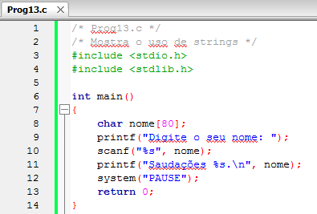

*Figura:* captura do editor com `Prog13.c` (**A01-P13**), linhas 1–14 da versão histórica do programa. Fonte revisado: [`src/Fontes_Aula_1/Prog13.c`](../../src/Fontes_Aula_1/Prog13.c); versão anterior à revisão de 2026 em texto: [commit `04ac409`](https://github.com/Lucas-Sperotto/falect-cc-011-algoritmos-e-laboratorio-de-programacao-ii/blob/04ac4094dba3c3812809dd433a7d3855c4bffdc9/src/Fontes_Aula_1/Prog13.c); explicação: [seção 6](#a01-p13).

### 3.3 As funções para manipulação de strings (slides 10–20)

<a id="slide-10"></a>
**Slide 10 — Roteiro** · *repete o roteiro do [slide 2](#slide-2), sem destaque do tópico seguinte.*

<a id="slide-11"></a>
**Slide 11 — As Funções para Manipulação de Strings**

> - A função scanf():
>   - A instrução
>
>     ```c
>     scanf("%s", nome);
>     ```
>
>   - Lê cada caractere digitado e os armazena a partir do endereço nome.
>   - O processo termina quando um caractere branco é encontrado.
>   - Nesse ponto é incluído automaticamente o caractere ‘\0’ na próxima posição livre da matriz.
>   - Observe que você não poderá ultrapassar o limite estipulado na criação da matriz e deverá prever espaço para o caractere ‘\0’.

*Nota de transcrição:* sem largura máxima (`%79s`), `scanf("%s", ...)` pode escrever além do vetor; ver [observação 8.3](#obs-2-3).

<a id="slide-12"></a>
**Slide 12 — As funções para Manipulação de Strings**

>   - A função scanf() entende um espaço em branco como término da entrada.
>   - O resultado é que não existe uma forma de digitar um texto de múltiplas palavras.
>   - Assim, somente o primeiro nome foi armazenado.
>   - Você deve ter notado que não usamos o operador & precedendo o segundo argumento de scanf().
>   - Já que o nome de uma matriz é o seu endereço inicial, seria errado utilizar o operador de endereço junto a ele.

<a id="slide-13"></a>
**Slide 13 — As funções para Manipulação de Strings**

>   - A expressão nome é equivalente a &nome[0].
>   - A função scanf() é principalmente usada para ler uma mistura de tipos de dados numa mesma instrução.
>   - Por exemplo, se em cada linha de entrada quisermos ler o código de um material do estoque, o seu número no estoque e o seu preço, scanf() se adapta perfeitamente.

<a id="slide-14"></a>
**Slide 14 — As funções para Manipulação de Strings**

> - A função gets():
>   - A função gets(), como prtótipo [sic] no arquivo stdio.h, é mais conveniente para a leitura de textos.
>   - O seu protótipo [sic] é unicamente ler uma cadeia de caracteres do teclado enquanto não for pressionada a tecla [ENTER].
>   - Todos os caracteres são armazenados na string e é incluído o caractere NULL no final.
>   - Caracteres brancos, como espaços e tabulações, são perfeitamente aceitáveis como parte da cadeia. Veja o programa modificado:

<a id="slide-15"></a>
**Slide 15 — As funções para Manipulação de Strings**

> 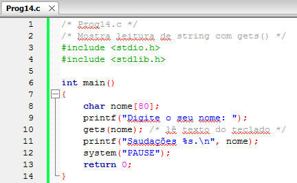

*Figura:* captura do editor com `Prog14.c` (**A01-P14**), linhas 1–14 da versão histórica do programa. Fonte revisado: [`src/Fontes_Aula_1/Prog14.c`](../../src/Fontes_Aula_1/Prog14.c); versão anterior à revisão de 2026 em texto: [commit `04ac409`](https://github.com/Lucas-Sperotto/falect-cc-011-algoritmos-e-laboratorio-de-programacao-ii/blob/04ac4094dba3c3812809dd433a7d3855c4bffdc9/src/Fontes_Aula_1/Prog14.c); explicação: [seção 6](#a01-p14). A captura usa `gets()`, removida da biblioteca padrão no C11; ver [observação 8.4](#obs-2-4).

<a id="slide-16"></a>
**Slide 16 — As funções para Manipulação de Strings**

> - Impressão de strings com puts():
>   - A função puts() é o complemento da função gets e é bem fácil de usar.
>   - O propósito de puts() é imprimir uma única string por vez.
>   - O endereço dessa string deve ser enviado para puts() como argumento.
>   - O próximo exemplo ilustra seu uso:

<a id="slide-17"></a>
**Slide 17 — As funções para Manipulação de Strings**

> 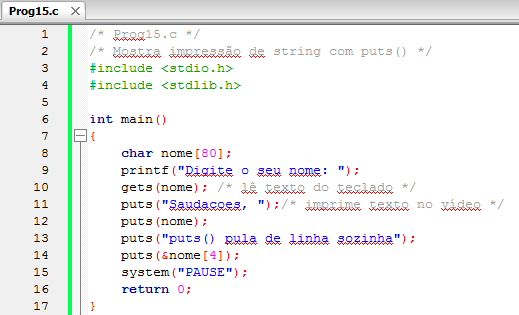

*Figura:* captura do editor com `Prog15.c` (**A01-P15**), linhas 1–17 da versão histórica do programa. Fonte revisado: [`src/Fontes_Aula_1/Prog15.c`](../../src/Fontes_Aula_1/Prog15.c); versão anterior à revisão de 2026 em texto: [commit `04ac409`](https://github.com/Lucas-Sperotto/falect-cc-011-algoritmos-e-laboratorio-de-programacao-ii/blob/04ac4094dba3c3812809dd433a7d3855c4bffdc9/src/Fontes_Aula_1/Prog15.c); explicação: [seção 6](#a01-p15). A última chamada, `puts(&nome[4])`, lê além do terminador quando o nome tem menos de quatro caracteres; ver [observação 8.5](#obs-2-5).

<a id="slide-18"></a>
**Slide 18 — As funções para Manipulação de Strings**

> - Impressão de strings com puts():
>   - A função puts() reconhece o ‘\0’ como o fim da string.
>   - Observe que cada string impressa por puts() termina por um caractere de nova linha.
>   - Portanto, se você desejar imprimir duas strings na mesma linha, a solução é usar printf().
>   - As duas instruções seguintes tem o mesmo efeito:
>
>     ```c
>     printf("%s\n", nome);
>     puts(nome);
>     ```

<a id="slide-19"></a>
**Slide 19 — Inicialização de Strings**

> - Lembre-se de que qualquer matriz pode ser inicializada, contanto que seja da classe extern ou static.
> - Essa característica vale também para string que são matrizes do tipo char.
>
>   ```c
>   char nome[] = {'A', 'n', 'a', '\0'};
>   ```
>
> - O compilador oferece uma forma de inicialização equivalente, mas consideravelmente mais simples:
>
>   ```c
>   char nome[] = "Anna";
>   ```

*Nota de transcrição:* as duas formas apresentadas como equivalentes inicializam textos diferentes ("Ana" e "Anna"); ver [observação 8.6](#obs-2-6).

*Nota de transcrição:* sobre a exigência de `extern` ou `static`, ver a [observação 8.6 da Aula 1](../aula-01/README.md#obs-1-6).

<a id="slide-20"></a>
**Slide 20 — Inicialização de Strings**

> 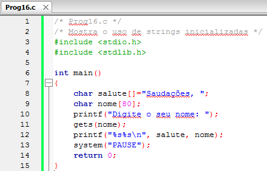

*Figura:* captura do editor com `Prog16.c` (**A01-P16**), linhas 1–15 da versão histórica do programa. Fonte revisado: [`src/Fontes_Aula_1/Prog16.c`](../../src/Fontes_Aula_1/Prog16.c); versão anterior à revisão de 2026 em texto: [commit `04ac409`](https://github.com/Lucas-Sperotto/falect-cc-011-algoritmos-e-laboratorio-de-programacao-ii/blob/04ac4094dba3c3812809dd433a7d3855c4bffdc9/src/Fontes_Aula_1/Prog16.c); explicação: [seção 6](#a01-p16).

### 3.4 Aritmética com endereços (slides 21–26)

<a id="slide-21"></a>
**Slide 21 — Roteiro** · *repete o roteiro do [slide 2](#slide-2), sem destaque do tópico seguinte.*

<a id="slide-22"></a>
**Slide 22 — Aritmética com Endereços**

> - Já sabemos que o nome de uma matriz é um endereço, que corresponde ao endereço do primeiro elemento da matriz.
> - Em outras palavras, salute é o endereço de salute[0], que é uma variável do tipo char.
> - Ou seja, salute é o endereço de uma variável do tipo char.

<a id="slide-23"></a>
**Slide 23 — Aritmética com Endereços**

> - O que significa salute + 1?
> - O número 1 desta soma tem uma unidade estranha:
>   - Significa um byte, se o endereço for de uma variável char;
>   - 4 bytes (ou tamanho da palavra da máquina), se o endereço for de uma variável int;
>   - 4 bytes, se o endereço for de uma variável float;
>   - E assim por diante.

*Nota de transcrição:* os tamanhos citados (4 bytes para `int` e `float`) são os mais comuns, mas dependem da implementação; ver [observação 8.7](#obs-2-7).

<a id="slide-24"></a>
**Slide 24 — Aritmética com Endereços**

> - Portanto, se somarmos 1 ao endereço de uma matriz de elementos do tipo int, estaremos obtendo o endereço da proxima variável int da memória, ou o proximo elemento da matriz.
> - Em regra geral, se M é o nome de uma matriz e i é uma variável do tipo int, então M + i é equivalente a M[i].

*Nota de transcrição:* a regra correta é `M + i` ≡ `&M[i]` e `*(M + i)` ≡ `M[i]`, como a própria Aula 6 apresenta; ver [observação 8.8](#obs-2-8).

<a id="slide-25"></a>
**Slide 25 — Aritmética com Endereços**

> - Utilizando esse conceito, podemos extrair uma substring de uma string somando ao seu endereço um número inteiro que indique o byte onde começará nossa substring.
> - Veja o exemplo:

<a id="slide-26"></a>
**Slide 26 — Aritmética com Endereços**

> 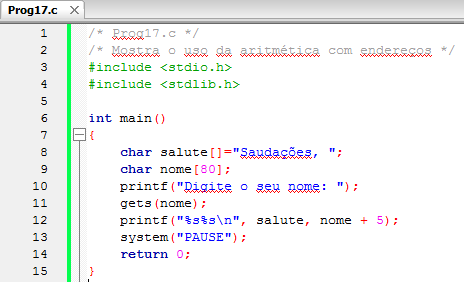

*Figura:* captura do editor com `Prog17.c` (**A01-P17**), linhas 1–15 da versão histórica do programa. Fonte revisado: [`src/Fontes_Aula_1/Prog17.c`](../../src/Fontes_Aula_1/Prog17.c); versão anterior à revisão de 2026 em texto: [commit `04ac409`](https://github.com/Lucas-Sperotto/falect-cc-011-algoritmos-e-laboratorio-de-programacao-ii/blob/04ac4094dba3c3812809dd433a7d3855c4bffdc9/src/Fontes_Aula_1/Prog17.c); explicação: [seção 6](#a01-p17).

### 3.5 Outras funções de manipulação de strings (slides 27–46)

<a id="slide-27"></a>
**Slide 27 — Roteiro** · *repete o roteiro do [slide 2](#slide-2), sem destaque do tópico seguinte.*

<a id="slide-28"></a>
**Slide 28 — Outras funções de manipulação de Strings**

> - Os compiladores oferecem, em suas bibliotecas, várias funções para trabalhar com strings.
> - A seguir analisaremos algumas delas.

<a id="slide-29"></a>
**Slide 29 — Outras funções de manipulação de Strings**

> - A Função strlen():
>   - A função strlen(), declarada no arquivo string.h, recebe como argumento o endereço de uma string e retorna o seu tamanho (o número de caracteres armazenados na string).
>   - O programa seguinte examina cada posição de memória ocupada pela string e imprime o que tiver encontrado.

<a id="slide-30"></a>
**Slide 30 — Outras funções de manipulação de Strings**

> 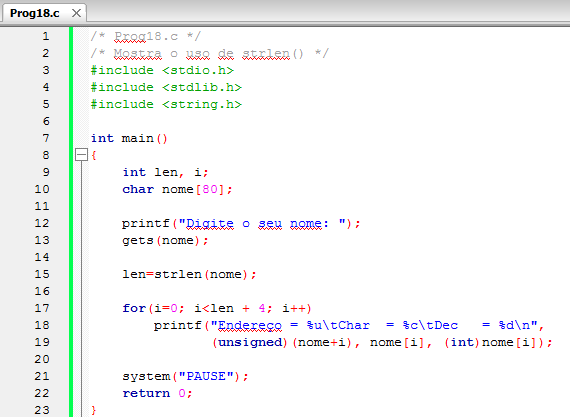

*Figura:* captura do editor com `Prog18.c` (**A01-P18**), linhas 1–23 da versão histórica do programa. Fonte revisado: [`src/Fontes_Aula_1/Prog18.c`](../../src/Fontes_Aula_1/Prog18.c); versão anterior à revisão de 2026 em texto: [commit `04ac409`](https://github.com/Lucas-Sperotto/falect-cc-011-algoritmos-e-laboratorio-de-programacao-ii/blob/04ac4094dba3c3812809dd433a7d3855c4bffdc9/src/Fontes_Aula_1/Prog18.c); explicação: [seção 6](#a01-p18). O laço `for(i=0; i<len + 4; i++)` imprime posições além do terminador e converte o endereço para `unsigned`; ver [observação 8.9](#obs-2-9).

<a id="slide-31"></a>
**Slide 31 — Outras funções de manipulação de Strings**

> - A Função strlen():
>   - Imprimindo quatro caracteres além do final da string.
>   - O primeiro é o NULL, que não aparece, pois tem valor zero; já os outros são caracteres considerados lixo.
>   - Em nosso programa a instrução:
>
>     ```c
>     len=strlen(nome);
>     ```
>
>   - Atribui o valor 5 à variável len se o nome “Andre” for inserido. Observe que strlen() não conta o caractere NULL.

<a id="slide-32"></a>
**Slide 32 — Outras funções de manipulação de Strings**

> - A Função strcat():
>   - A função strcat(), declarada no arquivo string.h, concatena uma cadeia de caracteres a outra, ou seja, acrescenta uma cadeia de variáveis do tipo char e concatena a segunda na primeira.
>   - A segunda cadeia não é alterada.
>   - Cuidado! Essa função não verifica se a primeira cadeia tem espaço suficiente para que a segunda cadeia seja adicionada ao seu final.

<a id="slide-33"></a>
**Slide 33 — Outras funções de manipulação de Strings**

> 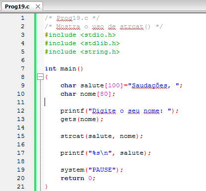

*Figura:* captura do editor com `Prog19.c` (**A01-P19**), linhas 1–21 da versão histórica do programa. Fonte revisado: [`src/Fontes_Aula_1/Prog19.c`](../../src/Fontes_Aula_1/Prog19.c); versão anterior à revisão de 2026 em texto: [commit `04ac409`](https://github.com/Lucas-Sperotto/falect-cc-011-algoritmos-e-laboratorio-de-programacao-ii/blob/04ac4094dba3c3812809dd433a7d3855c4bffdc9/src/Fontes_Aula_1/Prog19.c); explicação: [seção 6](#a01-p19).

<a id="slide-34"></a>
**Slide 34 — Outras funções de manipulação de Strings**

> - A Função strcmp():
>   - Suponhamos que você queira comparar uma cadeia de caracteres digitada pelo usuário com alguma string interna do programa e decida escrever o seguinte programa:

<a id="slide-35"></a>
**Slide 35 — Outras funções de manipulação de Strings**

> 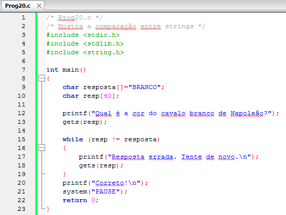

*Figura:* captura do editor com `Prog20.c` (**A01-P20**), linhas 1–23 da versão histórica do programa. Fonte revisado: [`src/Fontes_Aula_1/Prog20.c`](../../src/Fontes_Aula_1/Prog20.c); versão anterior à revisão de 2026 em texto: [commit `04ac409`](https://github.com/Lucas-Sperotto/falect-cc-011-algoritmos-e-laboratorio-de-programacao-ii/blob/04ac4094dba3c3812809dd433a7d3855c4bffdc9/src/Fontes_Aula_1/Prog20.c); explicação: [seção 6](#a01-p20). O programa é um contraexemplo intencional: compara endereços, não conteúdos.

<a id="slide-36"></a>
**Slide 36 — Outras funções de manipulação de Strings**

> - A Função strcmp():
>   - Este programa não trabalhará corretamente, pois resp e resposta são endreços [sic] de variáveis char, então a expressão:
>
>     ```c
>     while (resp != resposta)
>     ```
>
>   - Realmente não pergunta se as duas cadeias são diferentes e sim se os dois endereços são diferentes.
>   - Como resp e resposta são endereços distintos, o laço while é infinito.

<a id="slide-37"></a>
**Slide 37 — Outras funções de manipulação de Strings**

> - A Função strcmp():
>   - Para comparar os caracteres contidos nas duas cadeias, é necessário utilizar uma função.
>   - A função strcmp(), declarada no arquivo string.h, recebe dois endereços de strings e retorna um número inteiro, que indica a diferença numérica do primeiro caractere diferente da primeira cadeia em relação ao da segunda.

*Nota de transcrição:* o padrão garante apenas o sinal do valor devolvido por `strcmp()`, não a diferença numérica; ver [observação 8.11](#obs-2-11).

<a id="slide-38"></a>
**Slide 38 — Outras funções de manipulação de Strings**

> - A Função strcmp():
>   - Então se este número for:
>     - < 0 string1 é menor que string2
>     - = 0 string1 é igual a string2
>     - \> 0 string1 é maior que string2
>   - Nesse contexto, “menor que” ou “maior que” indica que, se string1 e string2 forem colocadas em ordem alfabética (de dicionário), o que aparecer primeiro é menor.
>   - Vamos reescrever o programa anterior corretamente:

<a id="slide-39"></a>
**Slide 39 — Outras funções de manipulação de Strings**

> 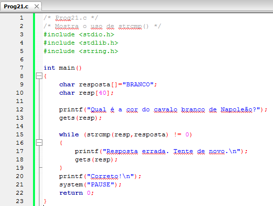

*Figura:* captura do editor com `Prog21.c` (**A01-P21**), linhas 1–23 da versão histórica do programa. Fonte revisado: [`src/Fontes_Aula_1/Prog21.c`](../../src/Fontes_Aula_1/Prog21.c); versão anterior à revisão de 2026 em texto: [commit `04ac409`](https://github.com/Lucas-Sperotto/falect-cc-011-algoritmos-e-laboratorio-de-programacao-ii/blob/04ac4094dba3c3812809dd433a7d3855c4bffdc9/src/Fontes_Aula_1/Prog21.c); explicação: [seção 6](#a01-p21).

<a id="slide-40"></a>
**Slide 40 — Outras funções de manipulação de Strings**

> - A Função strcmp():
>   - Veja um exemplo que imprime o valor retornado por strcmp() em várias situações:

<a id="slide-41"></a>
**Slide 41 — Outras funções de manipulação de Strings**

> 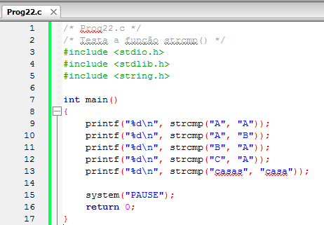

*Figura:* captura do editor com `Prog22.c` (**A01-P22**), linhas 1–17 da versão histórica do programa. Fonte revisado: [`src/Fontes_Aula_1/Prog22.c`](../../src/Fontes_Aula_1/Prog22.c); versão anterior à revisão de 2026 em texto: [commit `04ac409`](https://github.com/Lucas-Sperotto/falect-cc-011-algoritmos-e-laboratorio-de-programacao-ii/blob/04ac4094dba3c3812809dd433a7d3855c4bffdc9/src/Fontes_Aula_1/Prog22.c); explicação: [seção 6](#a01-p22).

<a id="slide-42"></a>
**Slide 42 — Outras funções de manipulação de Strings**

> - A Função strcpy():
>   - A função strcpy(), declarada no arquivo string.h, recebe dois endereços de strings e copia o conteúdo da segunda na primeira.
>   - Para ilustrar o seu uso, escreveremos uma função que apaga um caractere de uma cadeia de caracteres:

<a id="slide-43"></a>
**Slide 43 — Outras funções de manipulação de Strings**

> 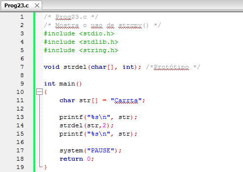

*Figura:* captura do editor com `Prog23.c` (**A01-P23**), linhas 1–19 da versão histórica do programa. Fonte revisado: [`src/Fontes_Aula_1/Prog23.c`](../../src/Fontes_Aula_1/Prog23.c); versão anterior à revisão de 2026 em texto: [commit `04ac409`](https://github.com/Lucas-Sperotto/falect-cc-011-algoritmos-e-laboratorio-de-programacao-ii/blob/04ac4094dba3c3812809dd433a7d3855c4bffdc9/src/Fontes_Aula_1/Prog23.c); explicação: [seção 6](#a01-p23).

<a id="slide-44"></a>
**Slide 44 — Outras funções de manipulação de Strings**

> 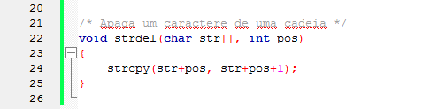
>
>   - A função strdel() move, em um espaço à esquerda todos os caracteres que estão à direita do que está sendo apagado.
>   - Para essa movimentação, a função utiliza strcpy();

*Figura:* continuação de `Prog23.c` (**A01-P23**), linhas 20–26. A cópia `strcpy(str+pos, str+pos+1)` envolve regiões sobrepostas, o que a biblioteca padrão não permite; ver [observação 8.12](#obs-2-12).

<a id="slide-45"></a>
**Slide 45 — As Funções strncat(), strncmp() e strncpy()**

> - Essas funções são semelhantes às que acabamos de analizar [sic].
> - A diferença é que elas trabalham com um número fixo de caracteres.
> - Todas recebem um terceiro argumento indicando o número de caracteres a processar.

<a id="slide-46"></a>
**Slide 46 — As Funções strncat(), strncmp() e strncpy()**

> - Por exemplo, a função strncat() concatena n caracteres da segunda cadeia na primeira; strncmp compara n caracteres das cadeias; e strcpy() [sic] copia n caracteres da segunda cadeia para a primeira.

*Nota de transcrição:* quem copia `n` caracteres é `strncpy()`; e `strncpy()` não acrescenta o terminador quando a origem tem `n` caracteres ou mais. Ver [observação 8.13](#obs-2-13).

### 3.6 Matrizes de strings (slides 47–51)

<a id="slide-47"></a>
**Slide 47 — Roteiro** · *repete o roteiro do [slide 2](#slide-2), sem destaque do tópico seguinte.*

<a id="slide-48"></a>
**Slide 48 — Matrizes de Strings**

> - No decorrer deste capítulo, vimos vários exemplos de matrizes bidimensionais.
> - Como uma string é uma matriz, uma matriz de strings é na realidade uma matriz de matrizes, ou uma matriz de duas dimensões.
> - O nosso programa de exemplo é uma melhoria do programa que imprime os dias da semana que utilizamos no curso básico para estudar comandos de decisão.

*Nota de transcrição:* o “curso básico” citado é um material anterior, que não faz parte deste repositório.

<a id="slide-49"></a>
**Slide 49 — Matrizes de Strings**

> - Ele solicita que seja digitada uma data e imprime o dia da semana.
> - Observe como a matriz de strings é inicializada.
> - Cada nome entre aspas é uma matriz de uma dimensão.

<a id="slide-50"></a>
**Slide 50 — Matrizes de Strings**

> 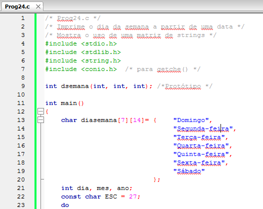

*Figura:* captura do editor com `Prog24.c` (**A01-P24**), linhas 1–23 da versão histórica do programa. Fonte revisado: [`src/Fontes_Aula_1/Prog24.c`](../../src/Fontes_Aula_1/Prog24.c); versão anterior à revisão de 2026 em texto: [commit `04ac409`](https://github.com/Lucas-Sperotto/falect-cc-011-algoritmos-e-laboratorio-de-programacao-ii/blob/04ac4094dba3c3812809dd433a7d3855c4bffdc9/src/Fontes_Aula_1/Prog24.c); explicação: [seção 6](#a01-p24).

<a id="slide-51"></a>
**Slide 51 — Matrizes de Strings**

> 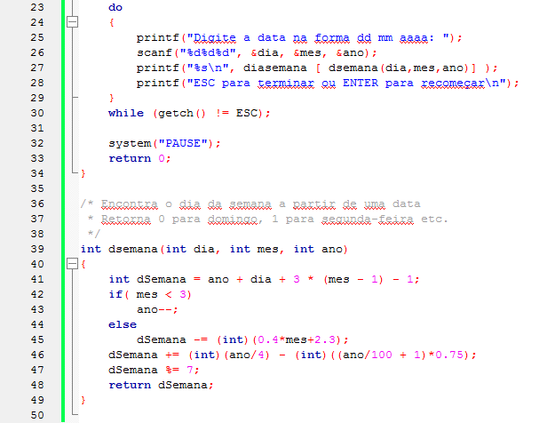

*Figura:* continuação de `Prog24.c` (**A01-P24**), linhas 23–50.

*Nota de transcrição:* sobre a fórmula de `dsemana()` e a leitura com `getch()`, ver [observação 8.15](#obs-2-15).

### 3.7 Um programa que imprime um cartão de Natal (slides 52–57)

<a id="slide-52"></a>
**Slide 52 — Roteiro** · *repete o roteiro do [slide 2](#slide-2), sem destaque do tópico seguinte.*

<a id="slide-53"></a>
**Slide 53 — Um programa que imprime um cartão de Natal**

> - O próximo programa usa as funções de manipulação de strings para imprimir um lindo cartão de Natal.
> - Eis a listagem:

<a id="slide-54"></a>
**Slide 54 — Um programa que imprime um cartão de Natal**

> 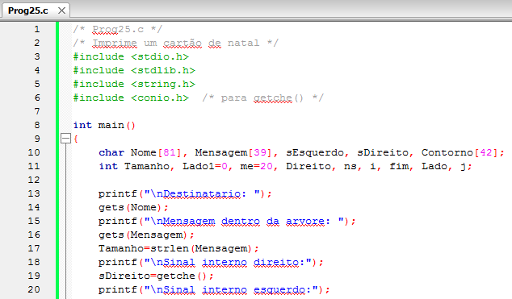

*Figura:* captura do editor com `Prog25.c` (**A01-P25**), linhas 1–20 da versão histórica do programa. Fonte revisado: [`src/Fontes_Aula_1/Prog25.c`](../../src/Fontes_Aula_1/Prog25.c); versão anterior à revisão de 2026 em texto: [commit `04ac409`](https://github.com/Lucas-Sperotto/falect-cc-011-algoritmos-e-laboratorio-de-programacao-ii/blob/04ac4094dba3c3812809dd433a7d3855c4bffdc9/src/Fontes_Aula_1/Prog25.c); explicação: [seção 6](#a01-p25).

<a id="slide-55"></a>
**Slide 55 — Um programa que imprime um cartão de Natal**

> 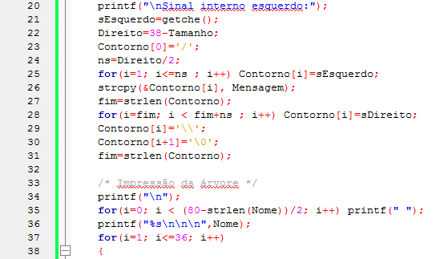

*Figura:* continuação de `Prog25.c` (**A01-P25**), linhas 20–38.

<a id="slide-56"></a>
**Slide 56 — Um programa que imprime um cartão de Natal**

> 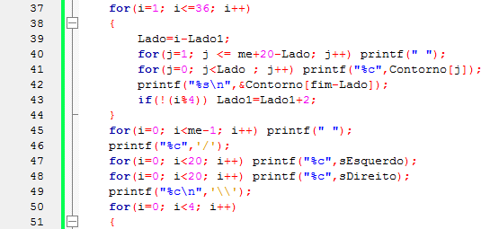

*Figura:* continuação de `Prog25.c` (**A01-P25**), linhas 37–51.

<a id="slide-57"></a>
**Slide 57 — Um programa que imprime um cartão de Natal**

> 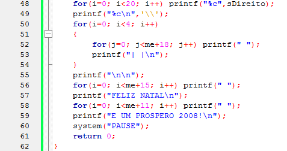

*Figura:* continuação de `Prog25.c` (**A01-P25**), linhas 48–62.

*Nota de transcrição:* sobre `gets()`, `getche()` e o cálculo de centralização, ver [observação 8.16](#obs-2-16).

### 3.8 Referências do material original (slide 58)

<a id="slide-58"></a>
**Slide 58 — Referências**

> - MIZRAHI, Victorine V. Treinamento em Linguagem C, São Paulo: Pearson Prentice Hall, 2008;

## 4. Explicações complementares

<a id="c-2-1"></a>
### 4.1 String é um vetor de `char` com terminador

Uma string é uma sequência de bytes armazenada em um vetor de `char` e encerrada pelo **caractere nulo** `'\0'` (valor 0). O terminador é o que permite às funções da biblioteca descobrir onde o texto acaba, já que o vetor não guarda o próprio comprimento.

```c
char nome[8] = "Ana";
```

| Índice | 0 | 1 | 2 | 3 | 4 | 5 | 6 | 7 |
|---|---|---|---|---|---|---|---|---|
| Conteúdo | `'A'` | `'n'` | `'a'` | `'\0'` | 0 | 0 | 0 | 0 |

- **capacidade** é o tamanho do vetor: `sizeof nome` vale 8;
- **comprimento** é a quantidade de bytes antes do terminador: `strlen(nome)` vale 3;
- a string sempre precisa de **comprimento + 1** bytes; `char s[3] = "Ana";` é aceito pelo compilador, mas deixa `s` sem terminador e não pode ser usado como string.

Os elementos 4 a 7 valem zero porque, em uma inicialização parcial, o restante do vetor é zerado ([Aula 1, 4.5](../aula-01/README.md#c-1-5)). Uma constante entre aspas (*literal de string*), como `"Saudações"`, é um vetor de `char` com terminador criado pelo compilador; modificá-lo é comportamento indefinido (§6.4.5p7), ao contrário de `char salute[] = "Saudações, ";`, que copia o literal para um vetor modificável.

<a id="c-2-2"></a>
### 4.2 Bytes não são letras: UTF-8

O slide 6 mostra “Saudações!” ocupando um byte por letra, o que vale para codificações de 8 bits, como a ISO-8859-1 e a CP1252 usadas na época. Os fontes atuais estão em UTF-8, em que letras acentuadas ocupam mais de um byte:

| Texto | Letras | Bytes em UTF-8 (`strlen`) | Bytes com terminador (`sizeof` do literal) |
|---|---:|---:|---:|
| `"Ana"` | 3 | 3 | 4 |
| `"Saudações!"` | 10 | 12 | 13 |
| `"Terça-feira"` | 11 | 12 | 13 |

Consequências práticas: `strlen` conta bytes; um índice como `nome[4]` aponta para o quinto **byte**, que pode estar no meio de uma letra acentuada; e as capacidades devem ser calculadas em bytes. Os comentários dos fontes revisados usam essa convenção (“nome de até 79 bytes”).

<a id="c-2-3"></a>
### 4.3 Como ler uma string do teclado

| Forma | O que lê | Limite de tamanho | Observação |
|---|---|---|---|
| `scanf("%s", nome)` | uma palavra (para no primeiro espaço) | nenhum | pode escrever além do vetor |
| `scanf("%79s", nome)` | uma palavra | 79 bytes + terminador | o resto da linha fica na entrada |
| `gets(nome)` | a linha inteira | nenhum | removida do padrão no C11 |
| `fgets(nome, sizeof nome, stdin)` | a linha, incluindo o `'\n'` | `sizeof nome - 1` bytes | é preciso remover o `'\n'` |
| `ler_linha(nome, sizeof nome)` | a linha, sem o `'\n'` | `sizeof nome - 1` bytes | função do repositório ([`src/entrada_segura.h`](../../src/entrada_segura.h)) |

`gets()` não recebe o tamanho do vetor: qualquer linha maior do que a capacidade transborda, e o programa não tem como impedir. Esse defeito foi explorado em ataques reais e levou à remoção da função no C11. Nos fontes revisados, cada `gets()` histórico foi trocado por `ler_linha()`, que:

1. lê com `fgets` até `capacidade - 1` bytes;
2. remove o `'\n'` (e o `'\r'` de arquivos gerados no Windows);
3. se a linha não couber, descarta o restante dela e retorna 0, para que o excesso não seja lido como a próxima entrada;
4. retorna 0 também em fim de arquivo ou erro, e 1 em leitura completa.

<!-- codigo: src/entrada_segura.h funcao=ler_linha -->
<sub>Copiado de [`src/entrada_segura.h`](../../src/entrada_segura.h#L8-L45) (linhas 8–45) por `scripts/documentacao_aulas.py`; não edite este bloco à mão.</sub>

```c
/* Alternativa limitada a gets(): remove a quebra e rejeita linhas excessivas.
 * Retorna 1 na leitura completa e 0 em EOF, erro ou truncamento.
 * O restante de uma linha longa é consumido para não virar a próxima entrada.
 */
static inline int ler_linha(char *destino, size_t capacidade)
{
    int ch;
    char *quebra;
    if (capacidade < 2 || capacidade > INT_MAX ||
        fgets(destino, (int)capacidade, stdin) == NULL)
        return 0;
    quebra = strchr(destino, '\n');
    if (quebra != NULL) {
        *quebra = '\0';
        if (quebra > destino && quebra[-1] == '\r')
            quebra[-1] = '\0';
        return 1;
    }
    ch = getchar();
    if (ch == '\n') {
        size_t tamanho = strlen(destino);
        if (tamanho > 0 && destino[tamanho - 1] == '\r')
            destino[tamanho - 1] = '\0';
        return 1;
    }
    if (ch == EOF && !ferror(stdin))
        return 1;
    /* CRLF também pode começar logo após o último caractere que cabe. */
    if (ch == '\r') {
        ch = getchar();
        if (ch == '\n')
            return 1;
    }
    while (ch != '\n' && ch != EOF)
        ch = getchar();
    destino[0] = '\0';
    return 0;
}
```
<!-- /codigo -->

<a id="c-2-4"></a>
### 4.4 `puts`, `printf` e o especificador `%s`

`puts(s)` imprime a string e acrescenta `'\n'`; `printf("%s", s)` imprime a string sem acrescentar nada. Ambos param no primeiro `'\0'`. Por isso, `puts(&nome[4])` e `printf("%s", nome + 5)` imprimem **sufixos**: a impressão começa no endereço indicado e vai até o terminador original. Se o endereço estiver depois do terminador (nome curto), a função lê bytes que não pertencem à string, como alertam as [observações 8.5](#obs-2-5) e [8.9](#obs-2-9).

<a id="c-2-5"></a>
### 4.5 Funções de `<string.h>` e suas pré-condições

| Função | Efeito | Pré-condição que o programador deve garantir |
|---|---|---|
| `strlen(s)` | conta os bytes antes do `'\0'` | `s` termina com `'\0'` |
| `strcpy(d, o)` | copia `o` (com terminador) para `d` | `d` tem pelo menos `strlen(o) + 1` bytes; `d` e `o` não se sobrepõem |
| `strcat(d, o)` | acrescenta `o` ao fim de `d` | `d` tem `strlen(d) + strlen(o) + 1` bytes; sem sobreposição |
| `strcmp(a, b)` | compara byte a byte | ambos terminados; só o **sinal** do resultado é garantido |
| `strncpy(d, o, n)` | copia no máximo `n` bytes | se `strlen(o) >= n`, **não** grava terminador |
| `strncat(d, o, n)` | acrescenta no máximo `n` bytes e sempre termina | `d` tem `strlen(d) + n + 1` bytes |
| `strncmp(a, b, n)` | compara no máximo `n` bytes | — |
| `memmove(d, o, n)` | copia `n` bytes, mesmo com sobreposição | `n` bytes válidos nos dois lados |

Nenhuma dessas funções conhece a capacidade do vetor de destino. A verificação fica com quem chama, como em `Prog19.c`, cujo comentário justifica que 13 bytes de saudação mais 79 de nome mais o terminador cabem nos 100 de `salute`. Para montar textos com limite garantido, `snprintf(d, sizeof d, "%s%s", a, b)` é uma alternativa: nunca escreve além de `sizeof d` bytes e informa o tamanho que seria necessário.

<a id="c-2-6"></a>
### 4.6 Comparar endereços × comparar conteúdos

Em `resp != resposta`, os dois nomes de vetor são convertidos em endereços (do primeiro elemento de cada vetor). Como são vetores distintos, os endereços são sempre diferentes, e o laço do slide 35 nunca termina, qualquer que seja a resposta.

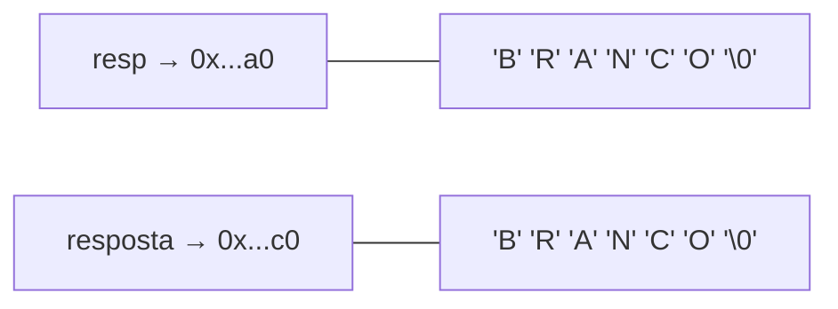

`strcmp` compara os conteúdos: percorre as duas strings enquanto os bytes forem iguais e, no primeiro par diferente (ou no fim), devolve um valor negativo, zero ou positivo. A comparação usa os valores dos bytes como `unsigned char` (§7.24.4), o que gera a “ordem de dicionário” só para letras sem acento e de mesma caixa: em ASCII, `'Z'` (90) vem antes de `'a'` (97), e em UTF-8 `"Álvaro"` vem depois de `"Zuleima"`.

<a id="c-2-7"></a>
### 4.7 Remover um caractere: por que `memmove`

`strdel(str, 2)` em `"Carrta"` desloca uma posição para a esquerda tudo o que está à direita do índice 2:

| Índice | 0 | 1 | 2 | 3 | 4 | 5 | 6 |
|---|---|---|---|---|---|---|---|
| Antes | `C` | `a` | `r` | `r` | `t` | `a` | `\0` |
| Depois | `C` | `a` | `r` | `t` | `a` | `\0` | `\0` |

Origem (`str + 3`) e destino (`str + 2`) se sobrepõem. `strcpy` exige regiões disjuntas (§7.24.2.3); com sobreposição, uma implementação otimizada pode copiar blocos em ordem diferente e corromper o resultado. `memmove` é especificada para funcionar nesse caso (§7.24.2.2). O fonte revisado copia `tamanho - pos` bytes, que incluem o terminador.

<a id="c-2-8"></a>
### 4.8 Matriz de strings

`char diasemana[7][14]` reserva 7 × 14 = 98 bytes, mesmo que “Domingo” use só 8. Cada linha `diasemana[k]` é um vetor de 14 `char` e pode ser usada onde se espera uma string. A dimensão 14 vem do maior nome, “Segunda-feira” (13 bytes + terminador). A [Aula 6](../aula-06/README.md) compara essa organização com um vetor de ponteiros, que ocupa apenas os bytes de cada nome.

<a id="c-2-9"></a>
### 4.9 A fórmula do dia da semana em `Prog24.c`

A função `dsemana()` devolve 0 para domingo, 1 para segunda-feira, e assim por diante. Com $d$ = dia, $m$ = mês e $a$ = ano, e tratando janeiro e fevereiro como meses do ano anterior ($a' = a - 1$ se $m < 3$, senão $a' = a$):

$$
s = \Bigl(a + d + 3(m-1) - 1 - c_m + \left\lfloor \tfrac{a'}{4} \right\rfloor - \left\lfloor 0{,}75\left(\left\lfloor \tfrac{a'}{100} \right\rfloor + 1\right) \right\rfloor\Bigr) \bmod 7,
\qquad
c_m = \begin{cases} 0, & m < 3 \\ \lfloor 0{,}4\,m + 2{,}3 \rfloor, & m \ge 3 \end{cases}
$$

- $a + d + 3(m-1)$: cada ano comum avança um dia da semana ($365 \bmod 7 = 1$), e cada mês de 31 dias avança 3 ($31 \bmod 7 = 3$);
- $c_m$ desconta os dias que faltam aos meses com menos de 31 dias até o mês $m$;
- $\lfloor a'/4 \rfloor$ soma os anos bissextos, e o último termo retira os séculos que não são bissextos no calendário gregoriano.

Para conferir, o resultado de `dsemana()` foi comparado com o calendário gregoriano proléptico da biblioteca `datetime` do Python para o dia 1º de todos os meses dos anos 1 a 9999, sem divergências. A data 29/10/2026, usada no exemplo 7.13, é uma quinta-feira.

<a id="c-2-10"></a>
### 4.10 Por que o cartão de Natal não transborda

Em `Prog25.c`, o vetor `Contorno[42]` recebe `'/'`, `ns` sinais esquerdos, a mensagem, `ns` sinais direitos, `'\\'` e o terminador. Com $T$ = comprimento da mensagem ($T \le 38$) e $ns = \lfloor (38 - T)/2 \rfloor$, o total é

$$1 + ns + T + ns + 1 + 1 \le 1 + (38 - T) + T + 2 = 41 \le 42 \text{ bytes}.$$

O comentário da linha 41 do fonte registra essa conta. É um bom exemplo de como justificar, por escrito, que uma cópia com `strcpy` é segura.

## 5. Conceitos fundamentais

| Conceito | Definição operacional | Onde aparece |
|---|---|---|
| String | Vetor de `char` com os bytes do texto seguidos de `'\0'` | slides 3–7 |
| Caractere nulo (NUL) | `'\0'`, de valor 0; marca o fim da string | slides 3, 7 |
| Literal de string | Texto entre aspas; vetor criado pelo compilador, não modificável | slide 5 |
| Capacidade × comprimento | `sizeof` do vetor × `strlen` do texto (bytes antes do NUL) | slides 29–31 |
| Leitura limitada | Leitura que recebe a capacidade e não escreve além dela | [4.3](#c-2-3) |
| Sufixo por endereço | `s + k` é a string que começa no byte `k` de `s` | slides 22–26 |
| Concatenação | Acrescentar uma string ao fim de outra (`strcat`) | slides 32–33 |
| Comparação lexicográfica | Comparação byte a byte até a primeira diferença (`strcmp`) | slides 34–41 |
| Sobreposição de memória | Origem e destino de uma cópia compartilham bytes | slides 42–44; [4.7](#c-2-7) |
| Matriz de strings | Vetor de vetores de `char`, uma string por linha | slides 48–51 |

## 6. Programas C da aula

Os fontes estão em [`src/Fontes_Aula_1/`](../../src/Fontes_Aula_1/) e foram revisados em 2026 ([revisão por fonte](../../docs/auditorias/REVISAO_POR_FONTE.md#aulas-1-e-2--srcfontes_aula_1)). A mudança mais visível é a substituição de `gets()`, `getch()` e `getche()` por leituras limitadas e portáveis; as chamadas históricas aparecem em comentários marcados com “Histórico:”.

| ID | Arquivo | SIGAA | Slides | Tema |
|---|---|---|---|---|
| [A01-P13](#a01-p13) | [`Prog13.c`](../../src/Fontes_Aula_1/Prog13.c) | Prog13.c | 8–13 | `scanf("%s")` lê uma palavra |
| [A01-P14](#a01-p14) | [`Prog14.c`](../../src/Fontes_Aula_1/Prog14.c) | Prog14.c | 14–15 | linha inteira (antes com `gets`) |
| [A01-P15](#a01-p15) | [`Prog15.c`](../../src/Fontes_Aula_1/Prog15.c) | Prog15.c | 16–18 | `puts()` |
| [A01-P16](#a01-p16) | [`Prog16.c`](../../src/Fontes_Aula_1/Prog16.c) | Prog16.c | 19–20 | string inicializada |
| [A01-P17](#a01-p17) | [`Prog17.c`](../../src/Fontes_Aula_1/Prog17.c) | Prog17.c | 22–26 | aritmética com endereços |
| [A01-P18](#a01-p18) | [`Prog18.c`](../../src/Fontes_Aula_1/Prog18.c) | Prog18.c | 29–31 | `strlen()` e bytes da string |
| [A01-P19](#a01-p19) | [`Prog19.c`](../../src/Fontes_Aula_1/Prog19.c) | Prog19.c | 32–33 | `strcat()` |
| [A01-P20](#a01-p20) | [`Prog20.c`](../../src/Fontes_Aula_1/Prog20.c) | Prog20.c | 34–36 | contraexemplo: comparação de endereços |
| [A01-P21](#a01-p21) | [`Prog21.c`](../../src/Fontes_Aula_1/Prog21.c) | Prog21.c | 37–39 | `strcmp()` |
| [A01-P22](#a01-p22) | [`Prog22.c`](../../src/Fontes_Aula_1/Prog22.c) | Prog22.c | 40–41 | valores devolvidos por `strcmp()` |
| [A01-P23](#a01-p23) | [`Prog23.c`](../../src/Fontes_Aula_1/Prog23.c) | Prog23.c | 42–44 | remover caractere (`strdel`) |
| [A01-P24](#a01-p24) | [`Prog24.c`](../../src/Fontes_Aula_1/Prog24.c) | Prog24.c | 48–51 | matriz de strings, dia da semana |
| [A01-P25](#a01-p25) | [`Prog25.c`](../../src/Fontes_Aula_1/Prog25.c) | Prog25.c | 53–57 | cartão de Natal |

<a id="a01-p13"></a>
### 6.1 A01-P13 — `Prog13.c`: `scanf` com `%s`

- **Finalidade:** ler um nome e cumprimentar. **Entrada:** uma palavra. **Saída:** `Saudações <nome>.`
- **Conceitos:** vetor `char nome[80]`, `%s` sem `&` (o nome do vetor já é um endereço), largura máxima `%79s`.
- **Diferença em relação ao slide 9:** largura `79` e verificação do retorno. Com `Ana Maria`, apenas `Ana` é lido, como explica o slide 12 ([exemplo 7.1](#71-uma-palavra-por-vez-prog13c)).

<!-- codigo: src/Fontes_Aula_1/Prog13.c de=`char nome[80];` ate=`printf("Saudações` -->
<sub>Copiado de [`src/Fontes_Aula_1/Prog13.c`](../../src/Fontes_Aula_1/Prog13.c#L13-L20) (linhas 13–20) por `scripts/documentacao_aulas.py`; não edite este bloco à mão.</sub>

```c
    char nome[80];
    printf("Digite o seu nome: ");
    /* O limite reserva um byte para o terminador da string. */
    if (scanf("%79s", nome) != 1) {
        fputs("Nome não informado.\n", stderr);
        return 1;
    }
    printf("Saudações %s.\n", nome);
```
<!-- /codigo -->

<a id="a01-p14"></a>
### 6.2 A01-P14 — `Prog14.c`: a linha inteira

- **Finalidade:** ler nomes com espaços. **Entrada:** uma linha de até 79 bytes. **Saída:** a saudação; linha longa demais ou fim de arquivo encerram com código 1.
- **Conceitos:** leitura de linha, limite de capacidade.
- **Diferença em relação ao slide 15:** `gets(nome)` virou `ler_linha(nome, sizeof nome)` ([4.3](#c-2-3), [8.4](#obs-2-4)).

<!-- codigo: src/Fontes_Aula_1/Prog14.c de=`/* Histórico: gets` ate=`printf("Saudações` -->
<sub>Copiado de [`src/Fontes_Aula_1/Prog14.c`](../../src/Fontes_Aula_1/Prog14.c#L16-L21) (linhas 16–21) por `scripts/documentacao_aulas.py`; não edite este bloco à mão.</sub>

```c
    /* Histórico: gets(nome); não limita a entrada e saiu do padrão C11. */
    if (!ler_linha(nome, sizeof nome)) {
        fputs("Entrada ausente ou longa demais.\n", stderr);
        return 1;
    }
    printf("Saudações %s.\n", nome);
```
<!-- /codigo -->

<a id="a01-p15"></a>
### 6.3 A01-P15 — `Prog15.c`: `puts()`

- **Finalidade:** imprimir strings com `puts`, que acrescenta a quebra de linha. **Entrada:** uma linha. **Saída:** quatro linhas, a última com o nome a partir do quinto byte.
- **Diferença em relação ao slide 17:** `puts(&nome[4])` só é executado se o nome tiver pelo menos quatro bytes ([8.5](#obs-2-5)).
- **Cuidado:** o programa usa `strlen` sem incluir `<string.h>`; compila porque `entrada_segura.h` inclui esse cabeçalho ([8.17](#obs-2-17)).

<!-- codigo: src/Fontes_Aula_1/Prog15.c de=`puts("Saudacoes, ");` ate=`puts(&nome[4]);` -->
<sub>Copiado de [`src/Fontes_Aula_1/Prog15.c`](../../src/Fontes_Aula_1/Prog15.c#L21-L26) (linhas 21–26) por `scripts/documentacao_aulas.py`; não edite este bloco à mão.</sub>

```c
    puts("Saudacoes, ");/* imprime texto no vídeo */
    puts(nome);
    puts("puts() pula de linha sozinha");
    /* Só forma a substring se o deslocamento pertence à string. */
    if (strlen(nome) >= 4)
        puts(&nome[4]);
```
<!-- /codigo -->

<a id="a01-p16"></a>
### 6.4 A01-P16 — `Prog16.c`: string inicializada

- **Finalidade:** compor a saudação a partir de uma string inicializada e de uma lida. **Saída:** `Saudações, <nome>`.
- **Conceitos:** `char salute[] = "Saudações, ";` (o compilador dimensiona o vetor), `%s%s`.
- **Diferença em relação ao slide 20:** apenas a leitura limitada.

<!-- codigo: src/Fontes_Aula_1/Prog16.c de=`char salute[]` ate=`printf("%s%s\n"` -->
<sub>Copiado de [`src/Fontes_Aula_1/Prog16.c`](../../src/Fontes_Aula_1/Prog16.c#L14-L22) (linhas 14–22) por `scripts/documentacao_aulas.py`; não edite este bloco à mão.</sub>

```c
    char salute[]="Saudações, ";
    char nome[80];
    printf("Digite o seu nome: ");
    /* Histórico: gets(nome); não limita a entrada e saiu do padrão C11. */
    if (!ler_linha(nome, sizeof nome)) {
        fputs("Entrada ausente ou longa demais.\n", stderr);
        return 1;
    }
    printf("%s%s\n", salute, nome);
```
<!-- /codigo -->

<a id="a01-p17"></a>
### 6.5 A01-P17 — `Prog17.c`: sufixo por aritmética com endereços

- **Finalidade:** imprimir o nome a partir do sexto byte (`nome + 5`). **Entrada:** uma linha. **Saída:** `Saudações, ` seguido do sufixo; nomes com menos de cinco bytes são recusados.
- **Conceitos:** `nome + 5` ≡ `&nome[5]`; a impressão vai até o terminador original.
- **Diferença em relação ao slide 26:** a verificação `strlen(nome) < 5`, que evita imprimir bytes além do texto ([8.5](#obs-2-5)).

<!-- codigo: src/Fontes_Aula_1/Prog17.c de=`if (strlen(nome) < 5)` ate=`nome + 5);` -->
<sub>Copiado de [`src/Fontes_Aula_1/Prog17.c`](../../src/Fontes_Aula_1/Prog17.c#L22-L26) (linhas 22–26) por `scripts/documentacao_aulas.py`; não edite este bloco à mão.</sub>

```c
    if (strlen(nome) < 5) {
        fputs("Informe um nome com pelo menos cinco bytes.\n", stderr);
        return 1;
    }
    printf("%s%s\n", salute, nome + 5);
```
<!-- /codigo -->

<a id="a01-p18"></a>
### 6.6 A01-P18 — `Prog18.c`: os bytes de uma string

- **Finalidade:** mostrar o endereço, o caractere e o valor de cada byte da string, inclusive o terminador.
- **Entrada:** uma linha. **Saída:** uma linha por byte, de `nome[0]` até o `'\0'`.
- **Conceitos:** `strlen` não conta o terminador; `%p` exige `void *`; `(unsigned char)` mostra bytes acima de 127 como 128–255.
- **Diferença em relação ao slide 30:** o laço `i < len + 4` (que lia três bytes não inicializados) virou `i <= len`; o endereço deixou de ser convertido para `unsigned`, que truncaria ponteiros de 64 bits ([8.9](#obs-2-9)).
- **Na saída:** o terminador é impresso com `%c`, ou seja, um byte 0. No exemplo 7.6 ele aparece como `␀`.

<!-- codigo: src/Fontes_Aula_1/Prog18.c de=`len=strlen(nome);` ate=`(int)(unsigned char)nome[i]);` -->
<sub>Copiado de [`src/Fontes_Aula_1/Prog18.c`](../../src/Fontes_Aula_1/Prog18.c#L25-L30) (linhas 25–30) por `scripts/documentacao_aulas.py`; não edite este bloco à mão.</sub>

```c
    len=strlen(nome);

    /* Exibe a string e seu terminador; posições seguintes não são texto. */
    for(i=0; i<=len; i++)
        printf("Endereço = %p\tChar  = %c\tDec   = %d\n",
               (void *)(nome+i), nome[i], (int)(unsigned char)nome[i]);
```
<!-- /codigo -->

<a id="a01-p19"></a>
### 6.7 A01-P19 — `Prog19.c`: `strcat()`

- **Finalidade:** acrescentar o nome ao fim da saudação. **Saída:** `Saudações, <nome>`.
- **Conceitos:** concatenação no próprio vetor de destino; capacidade suficiente calculada previamente (comentário da linha 20 do fonte).

<!-- codigo: src/Fontes_Aula_1/Prog19.c de=`char salute[100]` ate=`strcat(salute, nome);` -->
<sub>Copiado de [`src/Fontes_Aula_1/Prog19.c`](../../src/Fontes_Aula_1/Prog19.c#L15-L26) (linhas 15–26) por `scripts/documentacao_aulas.py`; não edite este bloco à mão.</sub>

```c
    char salute[100]="Saudações, ";
    char nome[80];

    printf("Digite o seu nome: ");
    /* Histórico: gets(nome); não limita a entrada e saiu do padrão C11. */
    if (!ler_linha(nome, sizeof nome)) {
        fputs("Entrada ausente ou longa demais.\n", stderr);
        return 1;
    }

    /* Há espaço: saudação de 13 bytes + nome de até 79 + terminador < 100. */
    strcat(salute, nome);
```
<!-- /codigo -->

<a id="a01-p20"></a>
### 6.8 A01-P20 — `Prog20.c`: contraexemplo de comparação

- **Finalidade:** mostrar o erro de comparar strings com `!=`.
- **Comportamento histórico (slide 35):** `while (resp != resposta)` nunca termina, porque compara endereços ([4.6](#c-2-6)).
- **Comportamento revisado:** o programa avalia a comparação de endereços uma única vez, informa que os endereços diferem mesmo com a resposta `BRANCO` e remete a `Prog21.c`. É uma escolha didática: manter o laço infinito tornaria o exemplo inexecutável ([8.10](#obs-2-10)).

<!-- codigo: src/Fontes_Aula_1/Prog20.c de=`/* Histórico: while` ate=`consulte Prog21.c` -->
<sub>Copiado de [`src/Fontes_Aula_1/Prog20.c`](../../src/Fontes_Aula_1/Prog20.c#L25-L30) (linhas 25–30) por `scripts/documentacao_aulas.py`; não edite este bloco à mão.</sub>

```c
    /* Histórico: while (resp != resposta) comparava endereços e nunca
     * terminava, mesmo com BRANCO. Avaliamos uma vez para estudar o erro;
     * a comparação do conteúdo com strcmp() aparece no Prog21.c. */
    if (&resp[0] != &resposta[0])
        printf("Endereços diferentes, mesmo que o conteúdo seja BRANCO.\n");
    printf("Para comparar o conteúdo, consulte Prog21.c.\n");
```
<!-- /codigo -->

<a id="a01-p21"></a>
### 6.9 A01-P21 — `Prog21.c`: `strcmp()`

- **Finalidade:** repetir a pergunta até a resposta correta. **Entrada:** linhas até `BRANCO`. **Saída:** `Resposta errada. Tente de novo.` a cada erro e `Correto!` no final.
- **Diferença em relação ao slide 39:** cada nova leitura é verificada; fim de arquivo depois de uma resposta errada encerra com código 1 em vez de repetir indefinidamente.

<!-- codigo: src/Fontes_Aula_1/Prog21.c de=`while (strcmp(resp,resposta) != 0)` ate=`printf("Correto!` -->
<sub>Copiado de [`src/Fontes_Aula_1/Prog21.c`](../../src/Fontes_Aula_1/Prog21.c#L25-L34) (linhas 25–34) por `scripts/documentacao_aulas.py`; não edite este bloco à mão.</sub>

```c
    while (strcmp(resp,resposta) != 0)
    {
        printf("Resposta errada. Tente de novo.\n");
        /* Histórico: gets(resp); não limita a entrada e saiu do padrão C11. */
        if (!ler_linha(resp, sizeof resp)) {
            fputs("Entrada ausente ou longa demais.\n", stderr);
            return 1;
        }
    }
    printf("Correto!\n");
```
<!-- /codigo -->

<a id="a01-p22"></a>
### 6.10 A01-P22 — `Prog22.c`: o que `strcmp()` devolve

- **Finalidade:** imprimir o resultado de cinco comparações. **Saída:** cinco inteiros.
- **Conceitos:** sinal do resultado; `"casas"` é maior que `"casa"` porque, esgotada `"casa"`, compara-se `'s'` com `'\0'`.
- **Cuidados:** no [exemplo 7.10](#710-valores-de-strcmp-prog22c) os resultados são −1, 0 e 1 porque os argumentos são literais e o GCC calcula `strcmp` durante a compilação. Compilado com `-fno-builtin`, o mesmo programa chama a função da glibc e imprime `0 -1 1 2 115` (diferenças entre os bytes). As duas saídas estão corretas: só o sinal é garantido ([8.11](#obs-2-11)).

<!-- codigo: src/Fontes_Aula_1/Prog22.c de=`printf("%d\n", strcmp("A", "A"));` ate=`"casa"));` -->
<sub>Copiado de [`src/Fontes_Aula_1/Prog22.c`](../../src/Fontes_Aula_1/Prog22.c#L15-L19) (linhas 15–19) por `scripts/documentacao_aulas.py`; não edite este bloco à mão.</sub>

```c
    printf("%d\n", strcmp("A", "A"));
    printf("%d\n", strcmp("A", "B"));
    printf("%d\n", strcmp("B", "A"));
    printf("%d\n", strcmp("C", "A"));
    printf("%d\n", strcmp("casas", "casa"));
```
<!-- /codigo -->

<a id="a01-p23"></a>
### 6.11 A01-P23 — `Prog23.c`: remover um caractere

- **Finalidade:** escrever `strdel()`, que apaga o caractere da posição `pos`. **Saída:** `Carrta` e, em seguida, `Carta`.
- **Conceitos:** deslocamento de elementos à esquerda (remoção em vetor), cópia com sobreposição.
- **Diferença em relação aos slides 43–44:** `strcpy(str+pos, str+pos+1)` virou `memmove(...)` com validação de `pos` ([4.7](#c-2-7), [8.12](#obs-2-12)). O comentário da linha 2 também mudou para descrever o `memmove`.

<!-- codigo: src/Fontes_Aula_1/Prog23.c funcao=strdel -->
<sub>Copiado de [`src/Fontes_Aula_1/Prog23.c`](../../src/Fontes_Aula_1/Prog23.c#L26-L34) (linhas 26–34) por `scripts/documentacao_aulas.py`; não edite este bloco à mão.</sub>

```c
/* Apaga um caractere de uma cadeia */
void strdel(char str[], int pos)
{
    size_t tamanho = strlen(str);
    if (pos < 0 || (size_t)pos >= tamanho)
        return;
    /* Histórico: strcpy(str+pos, str+pos+1) sobrepunha origem e destino. */
    memmove(str+pos, str+pos+1, tamanho-(size_t)pos);
}
```
<!-- /codigo -->

<a id="a01-p24"></a>
### 6.12 A01-P24 — `Prog24.c`: dia da semana com matriz de strings

- **Finalidade:** ler datas e imprimir o dia da semana correspondente.
- **Entrada:** `dd mm aaaa`; depois, ENTER para nova data ou ESC seguido de ENTER para terminar. **Saída:** o nome do dia.
- **Conceitos:** `char diasemana[7][14]`, indexação da matriz pelo valor devolvido por `dsemana()`, validação de calendário.
- **Diferença em relação aos slides 50–51:** `conio.h` e `getch()` (que leem uma tecla sem ENTER) não existem no GCC para Linux; a versão revisada lê a opção com `getchar()`. Também valida a data, o que os slides não faziam ([8.15](#obs-2-15)).

<!-- codigo: src/Fontes_Aula_1/Prog24.c funcao=dsemana -->
<sub>Copiado de [`src/Fontes_Aula_1/Prog24.c`](../../src/Fontes_Aula_1/Prog24.c#L57-L70) (linhas 57–70) por `scripts/documentacao_aulas.py`; não edite este bloco à mão.</sub>

```c
/* Encontra o dia da semana a partir de uma data
 * Retorna 0 para domingo, 1 para segunda-feira etc.
 */
int dsemana(int dia, int mes, int ano)
{
    int dSemana = ano + dia + 3 * (mes - 1) - 1;
    if( mes < 3)
        ano--;
    else
        dSemana -= (int)(0.4*mes+2.3);
    dSemana += (int)(ano/4) - (int)((ano/100 + 1)*0.75);
    dSemana %= 7;
    return dSemana;
}
```
<!-- /codigo -->

<a id="a01-p25"></a>
### 6.13 A01-P25 — `Prog25.c`: cartão de Natal

- **Finalidade:** desenhar uma árvore de Natal com o nome do destinatário centralizado e a mensagem dentro da árvore.
- **Entrada:** destinatário (até 80 bytes), mensagem (até 38 bytes) e dois caracteres de preenchimento. **Saída:** o cartão.
- **Conceitos:** montagem de string por partes (`Contorno`), `strcpy` com capacidade verificada ([4.10](#c-2-10)), impressão de sufixos com `&Contorno[fim-Lado]`.
- **Diferença em relação aos slides 54–57:** `gets()` e `getche()` foram substituídas; a centralização converte `strlen(Nome)` para `int` antes da subtração ([8.16](#obs-2-16)).

<!-- codigo: src/Fontes_Aula_1/Prog25.c de=`Direito=38-Tamanho;` ate=`fim=(int)strlen(Contorno);` -->
<sub>Copiado de [`src/Fontes_Aula_1/Prog25.c`](../../src/Fontes_Aula_1/Prog25.c#L42-L48) (linhas 42–48) por `scripts/documentacao_aulas.py`; não edite este bloco à mão.</sub>

```c
    Direito=38-Tamanho;
    Contorno[0]='/';
    ns=Direito/2;
    for(i=1; i<=ns ; i++) Contorno[i]=sEsquerdo;
    /* Mensagem tem até 38 bytes e a composição completa cabe em 42. */
    strcpy(&Contorno[i], Mensagem);
    fim=(int)strlen(Contorno);
```
<!-- /codigo -->

## 7. Exemplos de execução

Saídas reais dos fontes revisados, geradas com as entradas dos cenários revisados do repositório. A entrada vem de um arquivo, por isso o texto digitado não aparece ecoado na saída.

### 7.1 Uma palavra por vez (`Prog13.c`)

<!-- execucao: src/Fontes_Aula_1/Prog13.c cenario=nome-palavra -->
Execução real do cenário revisado `nome-palavra` ([manifesto](../../scripts/cenarios_fontes_c.json)), compilado com `gcc -std=c11 -Wall -Wextra -Wpedantic -O0`; bloco gerado por `scripts/documentacao_aulas.py`.

Comando: `./Prog13`

Entrada padrão:

```text
Ana Maria
```

Saída padrão:

```text
Digite o seu nome: Saudações Ana.
```

Código de saída: `0`.
<!-- /execucao -->

### 7.2 Linha longa demais (`Prog14.c`)

<!-- execucao: src/Fontes_Aula_1/Prog14.c cenario=nome-longo-recusado -->
Execução real do cenário revisado `nome-longo-recusado` ([manifesto](../../scripts/cenarios_fontes_c.json)), compilado com `gcc -std=c11 -Wall -Wextra -Wpedantic -O0`; bloco gerado por `scripts/documentacao_aulas.py`.

Comando: `./Prog14`

Entrada padrão:

```text
AAAAAAAAAAAAAAAAAAAAAAAAAAAAAAAAAAAAAAAAAAAAAAAAAAAAAAAAAAAAAAAAAAAAAAAAAAAAAAAA
```

Saída padrão (sem quebra de linha final):

```text
Digite o seu nome: 
```

Saída de erro:

```text
Entrada ausente ou longa demais.
```

Código de saída: `1`.
<!-- /execucao -->

### 7.3 `puts` e sufixo (`Prog15.c`)

<!-- execucao: src/Fontes_Aula_1/Prog15.c cenario=substring-segura -->
Execução real do cenário revisado `substring-segura` ([manifesto](../../scripts/cenarios_fontes_c.json)), compilado com `gcc -std=c11 -Wall -Wextra -Wpedantic -O0`; bloco gerado por `scripts/documentacao_aulas.py`.

Comando: `./Prog15`

Entrada padrão:

```text
Maria Silva
```

Saída padrão:

```text
Digite o seu nome: Saudacoes, 
Maria Silva
puts() pula de linha sozinha
a Silva
```

Código de saída: `0`.
<!-- /execucao -->

### 7.4 Saudação composta (`Prog16.c`)

<!-- execucao: src/Fontes_Aula_1/Prog16.c cenario=nome-curto -->
Execução real do cenário revisado `nome-curto` ([manifesto](../../scripts/cenarios_fontes_c.json)), compilado com `gcc -std=c11 -Wall -Wextra -Wpedantic -O0`; bloco gerado por `scripts/documentacao_aulas.py`.

Comando: `./Prog16`

Entrada padrão:

```text
Ana
```

Saída padrão:

```text
Digite o seu nome: Saudações, Ana
```

Código de saída: `0`.
<!-- /execucao -->

### 7.5 Sufixo a partir do sexto byte (`Prog17.c`)

<!-- execucao: src/Fontes_Aula_1/Prog17.c cenario=aritmetica-enderecos -->
Execução real do cenário revisado `aritmetica-enderecos` ([manifesto](../../scripts/cenarios_fontes_c.json)), compilado com `gcc -std=c11 -Wall -Wextra -Wpedantic -O0`; bloco gerado por `scripts/documentacao_aulas.py`.

Comando: `./Prog17`

Entrada padrão:

```text
Maria Silva
```

Saída padrão:

```text
Digite o seu nome: Saudações,  Silva
```

Código de saída: `0`.
<!-- /execucao -->

### 7.6 Bytes da string (`Prog18.c`)

<!-- execucao: src/Fontes_Aula_1/Prog18.c cenario=nome-curto -->
Execução real do cenário revisado `nome-curto` ([manifesto](../../scripts/cenarios_fontes_c.json)), compilado com `gcc -std=c11 -Wall -Wextra -Wpedantic -O0`; bloco gerado por `scripts/documentacao_aulas.py`.

Comando: `./Prog18`

Entrada padrão:

```text
Ana
```

Saída padrão:

```text
Digite o seu nome: Endereço = 0x7ffef2060810	Char  = A	Dec   = 65
Endereço = 0x7ffef2060811	Char  = n	Dec   = 110
Endereço = 0x7ffef2060812	Char  = a	Dec   = 97
Endereço = 0x7ffef2060813	Char  = ␀	Dec   = 0
```

Código de saída: `0`.
<!-- /execucao -->

### 7.7 Concatenação (`Prog19.c`)

<!-- execucao: src/Fontes_Aula_1/Prog19.c cenario=nome-curto -->
Execução real do cenário revisado `nome-curto` ([manifesto](../../scripts/cenarios_fontes_c.json)), compilado com `gcc -std=c11 -Wall -Wextra -Wpedantic -O0`; bloco gerado por `scripts/documentacao_aulas.py`.

Comando: `./Prog19`

Entrada padrão:

```text
Ana
```

Saída padrão:

```text
Digite o seu nome: Saudações, Ana
```

Código de saída: `0`.
<!-- /execucao -->

### 7.8 Comparação de endereços (`Prog20.c`)

<!-- execucao: src/Fontes_Aula_1/Prog20.c cenario=comparacao-didatica -->
Execução real do cenário revisado `comparacao-didatica` ([manifesto](../../scripts/cenarios_fontes_c.json)), compilado com `gcc -std=c11 -Wall -Wextra -Wpedantic -O0`; bloco gerado por `scripts/documentacao_aulas.py`.

Comando: `./Prog20`

Entrada padrão:

```text
BRANCO
```

Saída padrão:

```text
Qual é a cor do cavalo branco de Napoleão?Endereços diferentes, mesmo que o conteúdo seja BRANCO.
Para comparar o conteúdo, consulte Prog21.c.
```

Código de saída: `0`.
<!-- /execucao -->

### 7.9 Nova tentativa (`Prog21.c`)

<!-- execucao: src/Fontes_Aula_1/Prog21.c cenario=nova-tentativa -->
Execução real do cenário revisado `nova-tentativa` ([manifesto](../../scripts/cenarios_fontes_c.json)), compilado com `gcc -std=c11 -Wall -Wextra -Wpedantic -O0`; bloco gerado por `scripts/documentacao_aulas.py`.

Comando: `./Prog21`

Entrada padrão:

```text
PRETO
BRANCO
```

Saída padrão:

```text
Qual é a cor do cavalo branco de Napoleão?Resposta errada. Tente de novo.
Correto!
```

Código de saída: `0`.
<!-- /execucao -->

### 7.10 Valores de `strcmp` (`Prog22.c`)

<!-- execucao: src/Fontes_Aula_1/Prog22.c cenario=sinais-strcmp -->
Execução real do cenário revisado `sinais-strcmp` ([manifesto](../../scripts/cenarios_fontes_c.json)), compilado com `gcc -std=c11 -Wall -Wextra -Wpedantic -O0`; bloco gerado por `scripts/documentacao_aulas.py`.

Comando: `./Prog22`

Entrada padrão: *(vazia)*

Saída padrão:

```text
0
-1
1
1
1
```

Código de saída: `0`.
<!-- /execucao -->

### 7.11 Remoção de caractere (`Prog23.c`)

<!-- execucao: src/Fontes_Aula_1/Prog23.c cenario=remocao-sobreposta -->
Execução real do cenário revisado `remocao-sobreposta` ([manifesto](../../scripts/cenarios_fontes_c.json)), compilado com `gcc -std=c11 -Wall -Wextra -Wpedantic -O0`; bloco gerado por `scripts/documentacao_aulas.py`.

Comando: `./Prog23`

Entrada padrão: *(vazia)*

Saída padrão:

```text
Carrta
Carta
```

Código de saída: `0`.
<!-- /execucao -->

### 7.12 Data inexistente (`Prog24.c`)

<!-- execucao: src/Fontes_Aula_1/Prog24.c cenario=dia-invalido -->
Execução real do cenário revisado `dia-invalido` ([manifesto](../../scripts/cenarios_fontes_c.json)), compilado com `gcc -std=c11 -Wall -Wextra -Wpedantic -O0`; bloco gerado por `scripts/documentacao_aulas.py`.

Comando: `./Prog24`

Entrada padrão:

```text
31 4 2026
```

Saída padrão (sem quebra de linha final):

```text
Digite a data na forma dd mm aaaa: 
```

Saída de erro:

```text
Data inválida.
```

Código de saída: `1`.
<!-- /execucao -->

### 7.13 Dia da semana (`Prog24.c`)

A entrada termina com ESC (byte 27, exibido como `␛`) seguido de ENTER.

<!-- execucao: src/Fontes_Aula_1/Prog24.c cenario=dia-da-semana -->
Execução real do cenário revisado `dia-da-semana` ([manifesto](../../scripts/cenarios_fontes_c.json)), compilado com `gcc -std=c11 -Wall -Wextra -Wpedantic -O0`; bloco gerado por `scripts/documentacao_aulas.py`.

Comando: `./Prog24`

Entrada padrão:

```text
29 10 2026
␛
```

Saída padrão:

```text
Digite a data na forma dd mm aaaa: Quinta-feira
ESC e ENTER para terminar ou ENTER para recomeçar
```

Código de saída: `0`.
<!-- /execucao -->

### 7.14 Cartão de Natal (`Prog25.c`)

<!-- execucao: src/Fontes_Aula_1/Prog25.c cenario=cartao -->
Execução real do cenário revisado `cartao` ([manifesto](../../scripts/cenarios_fontes_c.json)), compilado com `gcc -std=c11 -Wall -Wextra -Wpedantic -O0`; bloco gerado por `scripts/documentacao_aulas.py`.

Comando: `./Prog25`

Entrada padrão:

```text
Ana
Paz
+
*
```

Saída padrão:

```text

Destinatario: 
Mensagem dentro da arvore: 
Sinal interno direito:
Sinal interno esquerdo:
                                      Ana


                                       /\
                                      /*+\
                                     /**++\
                                    /***+++\
                                     /**++\
                                    /***+++\
                                   /****++++\
                                  /*****+++++\
                                   /****++++\
                                  /*****+++++\
                                 /******++++++\
                                /*******+++++++\
                                 /******++++++\
                                /*******+++++++\
                               /********++++++++\
                              /*********+++++++++\
                               /********++++++++\
                              /*********+++++++++\
                             /**********++++++++++\
                            /***********+++++++++++\
                             /**********++++++++++\
                            /***********+++++++++++\
                           /************++++++++++++\
                          /*************+++++++++++++\
                           /************++++++++++++\
                          /*************+++++++++++++\
                         /**************++++++++++++++\
                        /***************+++++++++++++++\
                         /**************++++++++++++++\
                        /***************+++++++++++++++\
                       /****************++++++++++++++++\
                      /*****************+++++++++++++++++\
                       /****************++++++++++++++++\
                      /*****************+++++++++++++++++\
                     /*****************Pz+++++++++++++++++\
                    /*****************Paaz+++++++++++++++++\
                   /********************++++++++++++++++++++\
                                      | |
                                      | |
                                      | |
                                      | |


                                   FELIZ NATAL
                               E UM PROSPERO 2008!
```

Código de saída: `0`.
<!-- /execucao -->

## 8. Observações técnicas

Divergências entre o material original e o C padrão (ISO/IEC 9899:2011), erros dos exemplos históricos e cuidados de portabilidade.

<a id="obs-2-1"></a>
**8.1 `'0'`, `'\0'`, NUL e NULL (slides 3 e 7).** O slide 3 escreve o terminador como ‘0’, que é o caractere do algarismo zero (código 48), e o slide 7 repete ‘\0’ onde deveria estar ‘0’. O correto: o terminador é `'\0'`, de valor 0; o algarismo é `'0'`, de valor 48. O nome do caractere de valor zero é NUL; `NULL` é a constante de **ponteiro** nulo (§7.19), que não deve ser usada como caractere.

<a id="obs-2-2"></a>
**8.2 Um byte por caractere (slide 6).** A tabela vale para codificações de 8 bits. Em UTF-8, que é a codificação dos fontes atuais, “Saudações!” ocupa 12 bytes mais o terminador ([4.2](#c-2-2)). Os endereços 1449–1461 são ilustrativos.

<a id="obs-2-3"></a>
**8.3 `scanf("%s", nome)` sem largura (slides 9–13).** Sem um limite, `%s` grava quantos bytes houver na palavra digitada, além do fim de `nome[80]`. A correção é `%79s` (capacidade menos um). O slide 11 alerta para o limite, mas o código não o impõe.

<a id="obs-2-4"></a>
**8.4 `gets()` (slides 14–15).** A função foi declarada obsoleta no C99 (Corrigenda Técnica 3) e removida no C11 (Prefácio da norma; o anexo K oferece `gets_s`, opcional). Como não recebe a capacidade, não há uso seguro possível. O GCC atual ainda a encontra na glibc em modo compatível, com aviso; nos fontes revisados ela não é chamada.

<a id="obs-2-5"></a>
**8.5 Sufixo além do terminador (slides 17 e 26).** `puts(&nome[4])` e `nome + 5` supõem nomes longos. Com `Ana`, `&nome[4]` está depois do `'\0'` (índice 3) e aponta para bytes não inicializados de `nome[80]`: ler esse conteúdo dá resultado imprevisível. Os fontes revisados verificam `strlen(nome)` antes.

<a id="obs-2-6"></a>
**8.6 “Ana” × “Anna” (slide 19).** As duas declarações apresentadas como equivalentes inicializam textos diferentes: `{'A', 'n', 'a', '\0'}` é “Ana” (4 bytes) e `"Anna"` tem 5 bytes. A equivalência que o slide quer mostrar é entre `{'A', 'n', 'a', '\0'}` e `"Ana"`. A regra sobre `extern`/`static` foi discutida na [observação 8.6 da Aula 1](../aula-01/README.md#obs-1-6).

<a id="obs-2-7"></a>
**8.7 Tamanho dos tipos (slide 23).** “4 bytes (ou tamanho da palavra da máquina)” para `int` e “4 bytes” para `float` são valores comuns, não garantidos. No GCC para Linux x86-64, `int` e `float` têm 4 bytes e ponteiros, 8. A aritmética com endereços sempre avança `sizeof(T)` bytes por unidade, qualquer que seja o valor.

<a id="obs-2-8"></a>
**8.8 `M + i` ≡ `M[i]` (slide 24).** A regra está incompleta: `M + i` é um **endereço**, equivalente a `&M[i]`; o elemento é `*(M + i)`, equivalente a `M[i]` (§6.5.2.1). A própria [Aula 6](../aula-06/README.md) apresenta a forma correta.

<a id="obs-2-9"></a>
**8.9 `Prog18.c` histórico (slides 30–31).** O laço `for(i=0; i<len + 4; i++)` imprime três bytes depois do terminador, que não foram inicializados. Além disso, `(unsigned)(nome+i)` converte o endereço para um inteiro de 32 bits, perdendo metade dos bits em sistemas de 64 bits; o formato correto é `%p` com `(void *)`.

<a id="obs-2-10"></a>
**8.10 Contraexemplo `Prog20.c` (slides 35–36).** A comparação de endereços é o erro que a aula quer mostrar, e não um defeito a corrigir. No slide, o programa não termina nunca. A versão revisada preserva a condição histórica em comentário, executa a comparação uma vez e encerra, para que o exemplo possa ser executado e testado.

<a id="obs-2-11"></a>
**8.11 Resultado de `strcmp` (slides 37 e 41).** O padrão diz apenas que o resultado é maior, igual ou menor que zero (§7.24.4.2). A “diferença numérica” descrita no slide 37 é o que a glibc devolve, mas não é garantida: no [exemplo 7.10](#710-valores-de-strcmp-prog22c), o GCC substitui as chamadas com literais pelo resultado já calculado (−1, 0 ou 1), e com `-fno-builtin` a glibc imprime `2` e `115` nas duas últimas linhas. Testes como `strcmp(a, b) == 1` são, portanto, incorretos; compare com zero.

<a id="obs-2-12"></a>
**8.12 `strcpy` com sobreposição (slide 44).** `strcpy(str+pos, str+pos+1)` copia uma região para outra que a sobrepõe, o que é comportamento indefinido (§7.24.2.3p2). Funciona em muitas implementações simples, que copiam da esquerda para a direita, mas não há garantia. `memmove` é a função correta ([4.7](#c-2-7)).

<a id="obs-2-13"></a>
**8.13 `strncpy` (slide 46).** O texto atribui a `strcpy()` a cópia de `n` caracteres; a função é `strncpy()`. Além disso, `strncpy(d, o, n)` não grava o terminador se `o` tiver `n` bytes ou mais, e preenche o restante com zeros se `o` for menor. Depois de usá-la, é comum garantir o terminador com `d[n-1] = '\0'`.

<a id="obs-2-14"></a>
**8.14 Capacidade em `strcat` (slides 32–33).** O alerta do slide está correto: `strcat` não verifica espaço. No `Prog19.c` histórico, `gets(nome)` sem limite permitia um nome maior do que os 87 bytes livres de `salute`; a versão revisada limita o nome a 79 bytes e documenta a conta.

<a id="obs-2-15"></a>
**8.15 `Prog24.c` histórico (slides 50–51).** `conio.h`, `getch()` e `getche()` pertencem a compiladores para DOS/Windows (Turbo C, MinGW) e não fazem parte do C padrão nem da glibc. A data não era validada: `mes = 13` ou `dia = 40` produziam um índice qualquer para `diasemana`. A fórmula de `dsemana()` está correta para o calendário gregoriano ([4.9](#c-2-9)).

<a id="obs-2-16"></a>
**8.16 `Prog25.c` histórico (slides 54–57).** Além de `gets()` e `getche()`, a expressão `(80-strlen(Nome))/2` é calculada em `size_t` (sem sinal): com um nome de mais de 80 bytes, o resultado seria um número enorme, e não negativo. A versão revisada converte o comprimento para `int` e limita o nome a 80 bytes. A mensagem “E UM PROSPERO 2008!” é mantida por fazer parte do material.

<a id="obs-2-17"></a>
**8.17 Cabeçalho implícito em `Prog15.c` e `Prog17.c`.** Os dois fontes revisados chamam `strlen` sem `#include <string.h>`; compilam porque `src/entrada_segura.h` inclui esse cabeçalho. Como prática, cada fonte deveria incluir o que usa diretamente; a sugestão está registrada no [relatório da documentação](../../docs/auditorias/CLAUDE_AUDIT.md#recomendacoes).

## 9. Exercícios relacionados

### 9.1 Tarefa do SIGAA

A [tarefa da Aula 02](../../atividades/aula-02.md) pede os programas `Prog13.c` a `Prog25.c`. Para cada um, identifique no código a capacidade de cada vetor de `char` e explique, em comentário, por que nenhuma cópia ou leitura ultrapassa essa capacidade.

### 9.2 Exercícios propostos (acréscimo desta documentação)

Exercícios para 30 a 45 minutos, sem relação direta com o PDF. Em atividades com IA permitida, use-a para entender erros, não para obter a solução ([política de IA](../../POLITICA_IA.md)).

1. **Contagem de caracteres.** Leia uma linha com `ler_linha` (ou `fgets`) e conte letras, dígitos, espaços e outros símbolos usando `<ctype.h>` (`isalpha`, `isdigit`, `isspace`). Por que é preciso converter para `unsigned char` antes de chamar essas funções?
2. **Minhas funções de string.** Implemente `size_t meu_strlen(const char *s)` e `int minha_copia(char *d, size_t cap, const char *o)`, que copia no máximo `cap - 1` bytes, sempre termina `d` e retorna 0 se o texto foi truncado. Teste com `cap` igual a 1, ao comprimento exato e a um valor folgado.
3. **Inversão no lugar.** Inverta uma string sem vetor auxiliar, trocando `s[i]` com `s[n-1-i]`. O que acontece com letras acentuadas em UTF-8? Por quê?
4. **Palíndromo.** Verifique se uma frase em ASCII é palíndromo, ignorando espaços e diferenças entre maiúsculas e minúsculas.
5. **Remover todas as ocorrências.** Generalize `strdel` para apagar todas as ocorrências de um caractere em uma única passagem, com dois índices (leitura e escrita), sem chamar `memmove` a cada remoção. Compare o número de bytes copiados nas duas abordagens.
6. **Nomes em ordem.** Leia até 10 nomes para uma matriz `char nomes[10][30]` e ordene-os com `strcmp` e a ordenação por trocas da [Aula 1](../aula-01/README.md#c-1-7), copiando as linhas com `strcpy` e um vetor temporário. Na [Aula 6](../aula-06/README.md) a mesma tarefa será feita trocando apenas ponteiros.

## 10. Referências e fontes consultadas

- SPEROTTO, Lucas Kriesel. *Aula 2 – Matrizes – Parte 2 (nível avançado)*. Capacitação em C, 07/10/2022. 58 slides. [`aulas/Aula_2.pdf`](../Aula_2.pdf).
- MIZRAHI, Victorine Viviane. *Treinamento em Linguagem C*. São Paulo: Pearson Prentice Hall, 2008 (referência citada no slide 58).
- ISO/IEC 9899:2011 (C11), rascunho N1570: <https://www.open-std.org/jtc1/sc22/wg14/www/docs/n1570.pdf>. Seções citadas: Prefácio (remoção de `gets`), §6.4.5 (literais de string), §6.5.2.1 (indexação), §7.19 (`NULL`), §7.21.6.2 (`scanf`), §7.21.7.2 (`fgets`), §7.24.2.2 (`memmove`), §7.24.2.3 (`strcpy`), §7.24.4 (comparação), §7.24.6.3 (`strlen`); Anexo K (`gets_s`).
- cppreference.com — *Null-terminated byte strings*: <https://en.cppreference.com/w/c/string/byte>.
- Biblioteca GNU C (glibc) — *String and Array Utilities*: <https://www.gnu.org/software/libc/manual/html_node/String-and-Array-Utilities.html>.
- Unicode Consortium / IETF — RFC 3629, *UTF-8, a transformation format of ISO 10646*: <https://www.rfc-editor.org/rfc/rfc3629>.
- Fontes do repositório: [`src/Fontes_Aula_1/`](../../src/Fontes_Aula_1/), [`src/entrada_segura.h`](../../src/entrada_segura.h), [cenários de teste](../../scripts/cenarios_fontes_c.json) e [revisão por fonte](../../docs/auditorias/REVISAO_POR_FONTE.md).
