# Aula 3 — Novos tipos de dados com struct e typedef (parte 1)

- **Material original:** [`aulas/Aula_3.pdf`](../Aula_3.pdf) — 79 slides, “AULA 3 – NOVOS TIPOS DE DADOS COM STRUCT, TYPEDEF, UNION E ENUM - PARTE 1 (NÍVEL AVANÇADO)”, 26/09/2022, *Capacitação em C – Prof. Me. Lucas Kriesel Sperotto*. A capa traz o título “Capacitação em Linguagem de Programação C”.
- **Programas:** [`src/Fontes_Aula_3_e_4/`](../../src/Fontes_Aula_3_e_4/) — `Prog1.c` a `Prog5.c` e `BitTest.c` (A03-04-P01 a A03-04-P05 e A03-04-BITTEST). Os programas 6 a 13 da mesma pasta pertencem à [Aula 4](../aula-04/README.md).
- **Tarefa do SIGAA:** [Aulas 03 e 04](../../atividades/aulas-03-e-04.md) (Prog01–Prog05 nesta aula).

**Como ler este documento.** A seção 3 reproduz o PDF slide a slide, na ordem original, dentro de blocos de citação (barra cinza à esquerda). Tudo o que está fora desses blocos foi acrescentado nesta documentação: notas de transcrição (em itálico), explicações, exemplos e exercícios. Trechos curtos de código que no PDF aparecem como imagem foram transcritos como texto; capturas de programas completos são reproduzidas como figura e remetem ao fonte do repositório. Palavras grafadas de forma errada no original estão marcadas com `[sic]`; omissões de acento foram mantidas sem marcação. O rodapé repetido em todos os slides (“26/09/2022 · Capacitação em C – Prof. Me. Lucas Kriesel Sperotto · número da página”) foi omitido.

## Sumário

1. [Identificação da aula](#1-identificação-da-aula)
2. [Objetivos de aprendizagem](#2-objetivos-de-aprendizagem)
3. [Conteúdo transcrito do material original](#3-conteúdo-transcrito-do-material-original)
4. [Explicações complementares](#4-explicações-complementares)
5. [Conceitos fundamentais](#5-conceitos-fundamentais)
6. [Programas C da aula](#6-programas-c-da-aula)
7. [Exemplos de execução](#7-exemplos-de-execução)
8. [Observações técnicas](#8-observações-técnicas)
9. [Exercícios relacionados](#9-exercícios-relacionados)
10. [Referências e fontes consultadas](#10-referências-e-fontes-consultadas)

## 1. Identificação da aula

| Item | Descrição |
|---|---|
| Disciplina | FALECT-CC-011 — Algoritmos e Laboratório de Programação II (UNEMAT, Alto Araguaia), oferta 2026.2 |
| Posição no plano 2026.2 | Módulo 1 (31/08 a 04/09/2026): vetores e matrizes, strings e **structs** |
| Ementa contemplada | Registros; conceito de estrutura de dados e abstração de dados; variáveis locais e globais; passagem por valor |
| Material original | `Aula_3.pdf`, 79 páginas, datado de 26/09/2022 (as demais aulas são de 07/10/2022), baseado em Mizrahi (2008) |
| Correspondência | Slides 10–74 → `Prog1.c`–`Prog5.c`; slide 78 → `BitTest.c`; ver a [matriz de rastreabilidade](../../docs/MATRIZ_RASTREABILIDADE.md#aula-3) |
| Continuação | [Aula 4](../aula-04/README.md): `enum`, `union`, `sizeof` |

## 2. Objetivos de aprendizagem

Ao final da aula, o estudante deve ser capaz de:

1. definir tipos com `struct` e criar sinônimos com `typedef`, escolhendo entre as formas de declaração apresentadas;
2. acessar membros com o operador ponto, inclusive em estruturas aninhadas e em vetores de estruturas;
3. inicializar e atribuir estruturas, explicando por que a soma ou a comparação direta não são definidas;
4. passar estruturas para funções e retorná-las, prevendo que a função trabalha com cópias;
5. estimar o tamanho de uma estrutura, considerando o alinhamento e o preenchimento dos membros;
6. reconhecer campos de bits e saber por que sua disposição na memória depende do compilador.

## 3. Conteúdo transcrito do material original

### 3.1 Capa e roteiro (slides 1–2)

<a id="slide-1"></a>
**Slide 1 — Capa**

> CAPACITAÇÃO EM LINGUAGEM DE PROGRAMAÇÃO C
>
> AULA 3 – NOVOS TIPOS DE DADOS COM STRUCT, TYPEDEF, UNION E ENUM - PARTE 1 (NÍVEL AVANÇADO)
>
> 26/09/2022 · Capacitação em C – Prof. Me. Lucas Kriesel Sperotto

<a id="slide-2"></a>
**Slide 2 — Roteiro**

> - Criando novos tipos de dados com struct
> - Novos nomes para os tipos existentes
> - Usando typedef com struct
> - Inicializando estruturas
> - Atribuições entre estruturas
> - Estruturas aninhadas
> - Passando estruturas para funções
> - Funções que retornam uma estrutura
> - Matrizes de estruturas
> - Estruturas com campos bit

### 3.2 Introdução (slides 3–7)

<a id="slide-3"></a>
**Slide 3 — Introdução**

> - Talvez você já tenha se deparado com um problema de programação no qual deseje agrupar sob um único nome um conjunto de tipos de dados não similares.
> - Seu primeiro impulso seria, provavelmente, usar uma matriz.

<a id="slide-4"></a>
**Slide 4 — Introdução**

> - Como matrizes requerem que todos os seus elementos sejam do mesmo tipo, você, certamente, forçaria a resolução do problema selecionando uma matriz para cada tipo de dado, mas o resultado tornaria o programa ineficiente na maneira de manejar os dados.
> - O problema de agrupar dados de variáveis que agrupam dados geralmente desiguais; ao passo que matrizes agrupam dados similares.

*Nota de transcrição:* a segunda frase está truncada no original (“O problema de agrupar dados de variáveis que agrupam dados geralmente desiguais; …”); a transcrição não a completa. O sentido provável é que estruturas agrupam dados desiguais, enquanto matrizes agrupam dados similares. Ver [observação 8.1](#obs-3-1).

<a id="slide-5"></a>
**Slide 5 — Introdução**

> - Os itens de dados de estrutura são chamados de membros, e os da matriz, de elementos.
> - Em algumas linguagens de programação, estruturas são chamadas de registros.
> - O exemplo tradicional de uma estrutura é o registo [sic] de uma folha de pagamento:
>   - Um funcionário é descrito por um conjunto de atributos, tais como nome (string), o número do seu departamento (inteiro), salário (float), e assim por diante.

<a id="slide-6"></a>
**Slide 6 — Introdução**

> - Possivelmente, haverá outros funcionários, e você vai querer que seu programa os guarde, formando uma matriz de estruturas.
> - Nesta aula, exploraremos a criação de novos tipos de dados por meio de estruturas e uniões.
> - Você já conhece os cinco tipos de dados simples que estão predefinidos no compilador (char, int, float, double e void), os quais representam um único item de informação.

*Nota de transcrição:* sobre a lista de “cinco tipos de dados simples”, ver [observação 8.2](#obs-3-2).

<a id="slide-7"></a>
**Slide 7 — Introdução**

> - Com base nesses tipos, podemos definir tipos complexos, que possibilitem agrupar um conjunto de variáveis de tipos diferentes som um [sic] único nome.

### 3.3 Criando novos tipos de dados com struct (slides 8–18)

<a id="slide-8"></a>
**Slide 8 — Roteiro** · *repete o roteiro do [slide 2](#slide-2), sem destaque do tópico seguinte.*

<a id="slide-9"></a>
**Slide 9 — Criando Novos Tipos de Dados com struct**

> - Por meio da palavra-chave struct definimos um novo tipo de dado.
> - Definir um tipo de dado significa informar ao compilador seu nome, tamanho em bytes e a forma como deve ser armazenado e recuperado na memória.
> - Após ter sido definido, o novo tipo existe e pode ser utilizado para criar variáveis de modo similar a qualquer tipo simples.

<a id="slide-10"></a>
**Slide 10 — Criando Novos Tipos de Dados com struct**

> - O exemplo a seguir cria um tipo de dado que pode armazenar as informações de um aluno da escola.
> - Observe a listagem:

<a id="slide-11"></a>
**Slide 11 — Criando Novos Tipos de Dados com struct**

> 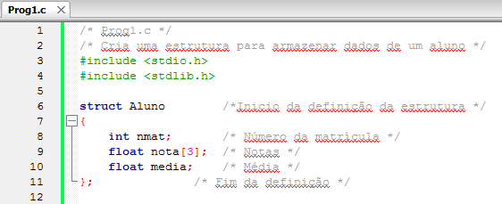

*Figura:* captura do editor com `Prog1.c` (**A03-04-P01**), linhas 1–12 da versão histórica do programa. Fonte revisado: [`src/Fontes_Aula_3_e_4/Prog1.c`](../../src/Fontes_Aula_3_e_4/Prog1.c); versão anterior à revisão de 2026 em texto: [commit `04ac409`](https://github.com/Lucas-Sperotto/falect-cc-011-algoritmos-e-laboratorio-de-programacao-ii/blob/04ac4094dba3c3812809dd433a7d3855c4bffdc9/src/Fontes_Aula_3_e_4/Prog1.c); explicação: [seção 6](#a03-04-p01).

<a id="slide-12"></a>
**Slide 12 — Criando Novos Tipos de Dados com struct**

> 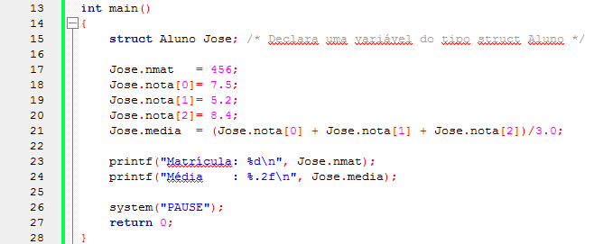

*Figura:* continuação de `Prog1.c` (**A03-04-P01**), linhas 13–28.

<a id="slide-13"></a>
**Slide 13 — Definindo a Estrutura**

> - A definição da estrutura informa como ela é organizada e quais são seus membros.
>
> 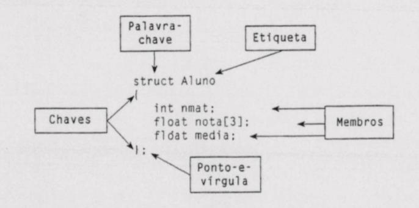

*Descrição da figura:* figura digitalizada (estilo de livro) com a definição `struct Aluno { int nmat; float nota[3]; float media; };` e cinco rótulos ligados por setas: “Palavra-chave” aponta para `struct`; “Etiqueta” para `Aluno`; “Chaves” para `{` e `}`; “Membros” para as três declarações internas; “Ponto-e-vírgula” para o `;` final.

<a id="slide-14"></a>
**Slide 14 — Definindo a Estrutura**

> - A definição de uma estrutura não cria nenhuma variável, somente informa ao compilador as características de um novo tipo de dado.
> - Não há nenhuma reserva de memória.
> - A palavra struct indica que um novo tipo de dado esta sendo definido e a palavra Aluno será sua etiqueta.
> - O nome do nosso novo tipo de dados é struct Aluno.

<a id="slide-15"></a>
**Slide 15 — Definindo a Estrutura**

> - No nosso exemplo, definimos o tipo struct Aluno antes de main(), o que permite um acesso global a todas as funções definidas no programa.
> - Poderíamos colocar essa definição dentro de uma função, restringindo o acesso às instruções do mesmo bloco e escritas abaixo dela.

<a id="slide-16"></a>
**Slide 16 — Definindo a Estrutura**

> 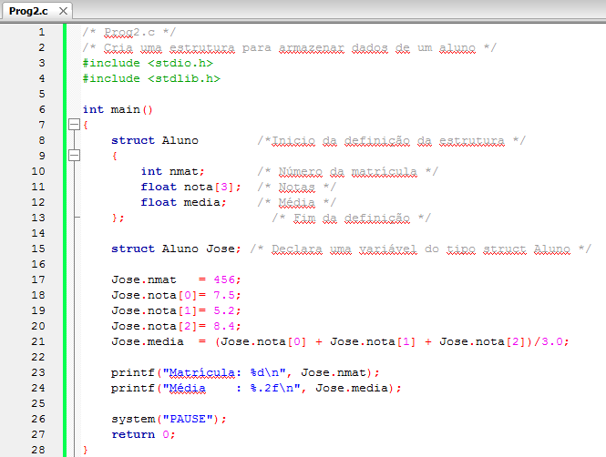

*Figura:* captura do editor com `Prog2.c` (**A03-04-P02**), linhas 1–28 da versão histórica do programa. Fonte revisado: [`src/Fontes_Aula_3_e_4/Prog2.c`](../../src/Fontes_Aula_3_e_4/Prog2.c); versão anterior à revisão de 2026 em texto: [commit `04ac409`](https://github.com/Lucas-Sperotto/falect-cc-011-algoritmos-e-laboratorio-de-programacao-ii/blob/04ac4094dba3c3812809dd433a7d3855c4bffdc9/src/Fontes_Aula_3_e_4/Prog2.c); explicação: [seção 6](#a03-04-p02).

<a id="slide-17"></a>
**Slide 17 — Declarando uma variável do tipo definido**

> - A instrução:
>
>   ```c
>   struct Aluno Jose;
>   ```
>
> - Declara uma variável de nome Jose do tipo struct Aluno.
> - Essa declaração reserva espaço de memória suficiente para armazenar todos os membros da estrutura:
>   - 4 bytes para nmat;
>   - 12 bytes para a matriz nota;
>   - 4 bytes para média;

*Nota de transcrição:* os tamanhos (4 + 12 + 4 bytes) são típicos, não garantidos, e uma estrutura pode ter bytes de preenchimento; ver [seção 4.2](#c-3-2) e [observação 8.3](#obs-3-3).

<a id="slide-18"></a>
**Slide 18 — Declarando uma variável do tipo definido**

> - Os membros de uma variável estrutura são armazenados em sequência contínua de memória.

### 3.4 Novos nomes para os tipos existentes: typedef (slides 19–21)

<a id="slide-19"></a>
**Slide 19 — Roteiro** · *repete o roteiro do [slide 2](#slide-2), sem destaque do tópico seguinte.*

<a id="slide-20"></a>
**Slide 20 — Novos Nomes para os Tipos Existentes: typedef**

> - Declarações com typedef não produzem novos tipos de dados.
> - Criam apenas novos nomes (sinônimos) para os tipos existentes.
> - Sintaxe:
>
>   ```c
>   typedef tipo-existente sinonimo;
>   ```
>
> - Observe o fragmento de código a seguir:

*Nota de transcrição:* a linha é um modelo de sintaxe: `tipo-existente` e `sinonimo` representam nomes que o programador escolhe.

<a id="slide-21"></a>
**Slide 21 — Novos Nomes para os Tipos Existentes: typedef**

> ```c
> typedef unsigned char BYTE; /* Cria o sinonimo BYTE */
> typedef unsigned int uint; /* Cria o sinonimo uint */
>
> int main()
> {
>     BYTE ch; /* Declara uma variável do tipo BYTE */
>     uint x; /* Declara uma variável do tipo uint */
>     unsigned char chmm; /* Os tipos originais podem ser usados */
> ```

*Nota de transcrição:* o fragmento termina sem a chave de fechamento de `main()`, como no slide.

### 3.5 Usando typedef com struct (slides 22–32)

<a id="slide-22"></a>
**Slide 22 — Roteiro** · *repete o roteiro do [slide 2](#slide-2), sem destaque do tópico seguinte.*

<a id="slide-23"></a>
**Slide 23 — Usando typedef com struct**

> - Com estruturas, podemos utilizar typedef de três formas:
>
>   ```c
>   struct Aluno
>   {
>       int nmat;
>       float nota[3];
>       float media;
>   };
>
>   typedef struct Aluno Aluno;
>
>   Aluno Jose;
>   ```

<a id="slide-24"></a>
**Slide 24 — Usando typedef com struct**

> - Outro modo é criar um sinônimo na mesma instrução de definição da estrutura:
>
>   ```c
>   typedef struct Aluno
>   {
>       int nmat;
>       float nota[3];
>       float media;
>   } Aluno;
>
>   Aluno Jose;
>   ```

<a id="slide-25"></a>
**Slide 25 — Usando typedef com struct**

> - E podemos ainda não informar a etiqueta da estrutura:
>
>   ```c
>   typedef struct
>   {
>       int nmat;
>       float nota[3];
>       float media;
>   } Aluno;
>
>   Aluno Jose;
>   ```

<a id="slide-26"></a>
**Slide 26 — Usando typedef com struct**

> - Observe a similaridade entre a declaração de variáveis de tipos simples e de variáveis de tipos definidos pelo usuário:
>
>   ```c
>   Aluno Jose;
>   int val;
>   ```

<a id="slide-27"></a>
**Slide 27 — Acessando os Membros da Estrutura**

> - Uma vez criada a variável estrutura, seus membros podem ser acessados por meio do operador ponto.
> - A instrução:
>
>   ```c
>   Jose.nmat   = 456;
>   ```
>
> - Atribui o valor 456 ao membro nmat da variável José.
> - O operador ponto conecta o nome de uma variável estrutura a um membro dela.

<a id="slide-28"></a>
**Slide 28 — Acessando os Membros da Estrutura**

> - A linguagem C trata os membros de uma estrutua [sic] como quaisquer outras variáveis simples.
> - Por exemplo, Jose.nmat é o nome de uma variável do tipo int e pode ser utilizada em todo lugar em que se use variáveis desse tipo.

<a id="slide-29"></a>
**Slide 29 — Combinando Declarações**

> - No exemplo anterior, definimos a estrutura e declaramos a variável em duas instruções distintas.
> - Essas duas instruções podem ser combinadas em uma.
>
>   ```c
>   struct Aluno       /*Inicio da definição da estrutura */
>   {
>       int nmat;      /* Número da matrícula */
>       float nota[3]; /* Notas */
>       float media;   /* Média */
>   } Jose;            /* Cria a variável José do tipo Aluno */
>   ```

<a id="slide-30"></a>
**Slide 30 — Combinando Declarações**

> - Podemos declarar quantas variáveis quisermos:
>
>   ```c
>   struct Aluno       /*Inicio da definição da estrutura */
>   {
>       int nmat;      /* Número da matrícula */
>       float nota[3]; /* Notas */
>       float media;   /* Média */
>   } Jose, Ana, Joao;  /* Cria variaveis do tipo Aluno */
>   ```

<a id="slide-31"></a>
**Slide 31 — Combinando Declarações**

> - A etiqueta pode ser suprimida:
>
>   ```c
>   struct      /*Inicio da definição da estrutura */
>   {
>       int nmat;      /* Número da matrícula */
>       float nota[3]; /* Notas */
>       float media;   /* Média */
>   } Jose, Ana, Joao;  /* Cria variaveis do tipo Aluno */
>   ```
>
> - Observe que a etiqueta, na definição da estrutura, pode ser suprimida caso nenhuma outra variável venha a ser declarada mais adiante.
> - Separadas por vírgulas, diversas variáveis podem ser declaradas de uma única vez.

<a id="slide-32"></a>
**Slide 32 — Combinando Declarações**

> - A combinação da definição da estrutura com a declaração das variáveis torna a escrita mais compacta, entretanto menos clara e menos flexível.

### 3.6 Inicializando estruturas (slides 33–38)

<a id="slide-33"></a>
**Slide 33 — Roteiro** · *repete o roteiro do [slide 2](#slide-2), sem destaque do tópico seguinte.*

<a id="slide-34"></a>
**Slide 34 — Inicializando Estruturas**

> - A inicialização de estruturas é semelhante à inicialização de uma matriz.
> - Uma variável do tipo estrutura só pode ser inicializada se criada em tempo de compilação; assim, deve ser das classes extern ou static.

*Nota de transcrição:* a restrição a `extern` ou `static` é do C anterior ao padrão ANSI; ver a [observação 8.6 da Aula 1](../aula-01/README.md#obs-1-6) e a [observação 8.4](#obs-3-4).

<a id="slide-35"></a>
**Slide 35 — Inicializando Estruturas**

> - Veja um exemplo:
>
>   ```c
>   typedef struct
>   {
>       int dia;
>       char mes[10];
>       int ano;
>   } Data;
>
>   static Data natal = {125, "dezembro", 2001};
>   static Data aniversario = {30, "julho", 1995};
>   ```
>
> - Se as variáveis inicializadas não forem declaradas como static, a maioria dos compiladores não apresentará nenhum erro e criará as variáveis desse tipo automaticamente.

*Nota de transcrição:* o valor `125` para o dia de Natal é um erro de digitação do slide; o slide 38 usa `25`.

<a id="slide-36"></a>
**Slide 36 — Inicializando Estruturas**

> - As variáveis natal e aniversário são inicializadas na mesma instrução de suas declarações.
> - Os valores a serem atribuídos a seus membros devem ser colocados na ordem em que foram definidos na estrutura, separados por vírgulas e entre chaves.

<a id="slide-37"></a>
**Slide 37 — Definindo e Inicializando na mesma Instrução**

> - No exemplo anterior, definimos a estrutura e declaramos a estrutura e declaramos [sic] a variável inicializadas em duas instruções distintas.
> - Quando não utilizamos a palavra typedef essas duas instruções podem ser combinadas em uma.

<a id="slide-38"></a>
**Slide 38 — Definindo e Inicializando na mesma Instrução**

> ```c
> struct Data
> {
>     int dia;
>     char mes[10];
>     int ano;
> } natal = {25,"dezembro", 2001},
>   aniversario = {30, "julho", 1995};
> ```

### 3.7 Atribuições e operações entre estruturas (slides 39–45)

<a id="slide-39"></a>
**Slide 39 — Roteiro** · *repete o roteiro do [slide 2](#slide-2), sem destaque do tópico seguinte.*

<a id="slide-40"></a>
**Slide 40 — Atribuições entre Estruturas**

> - Uma variável estrutura pode ser atribuída a outra do mesmo tipo por meio de uma atribuição simples:
>
>   ```c
>   static Data aniversario = {30, "julho", 2008};
>   Data Andre;
>
>   Andre = aniversario;
>   ```

<a id="slide-41"></a>
**Slide 41 — Atribuições entre Estruturas**

> - Certamente, constatamos que essa é uma estupenda capacidade quando pensamos a respeito dela:
>   - Todos os valores dos membros da estrutura estão realmente sendo atribuídos de uma única vez aos correspondentes da outra.
> - Uma expressão de atribuição tão simples não poderia ser usada para matrizes, que devem ser atribuídas elemento a elemento.

<a id="slide-42"></a>
**Slide 42 — Atribuições entre Estruturas**

> - Note que a atribuição só é permitida entre estruturas do mesmo tipo.
> - Se for atribuída uma variável de um tipo a outra de outro tipo, o compilador acusará um erro.

<a id="slide-43"></a>
**Slide 43 — Operações entre Estruturas**

> - Para exemplificar o modo de executar operações entre estruturas, vamos montar um tipo de dado que armazene o número de peças vendidas por uma loja num determinado dia e o valor total de venda.
> - Em seguida, criaremos duas variáveis com os dados de dois dias e uma terceira variável para armazenar o total de vendas.

<a id="slide-44"></a>
**Slide 44 — Operações entre Estruturas**

> ```c
> typedef struct
> {
>     int pecas;
>     float preco;
> } Venda;
>
> Venda A = {20, 110.0}, B = {3, 16.5}, Total;
> ```
>
> - Você poderia pensar em adicionar os valores das variáveis A e B por meio de uma instrução simples, como:
>
>   ```c
>   Total = A + B; /* ERRADO */
>   ```

<a id="slide-45"></a>
**Slide 45 — Operações entre Estruturas**

> - Em linguagem C, operações simples como a soma não estão definidas para tipos criados com a palavra struct.
> - A soma deve ser efetuada membro a membro:
>
>   ```c
>   Total.pecas = A.pecas + B.pecas;
>   Total.preco = A.preco + B.preco;
>   ```

*Nota de transcrição:* C também não define `==` para estruturas; a comparação também precisa ser feita membro a membro ([seção 4.5](#c-3-5)).

### 3.8 Estruturas aninhadas (slides 46–50)

<a id="slide-46"></a>
**Slide 46 — Roteiro** · *repete o roteiro do [slide 2](#slide-2), sem destaque do tópico seguinte.*

<a id="slide-47"></a>
**Slide 47 — Estruturas Aninhadas**

> - Exatamente como podemos ter matrizes em que cada elemento é outra matriz, podemos definir estruturas como membros que sejam outras estruturas.
>
>   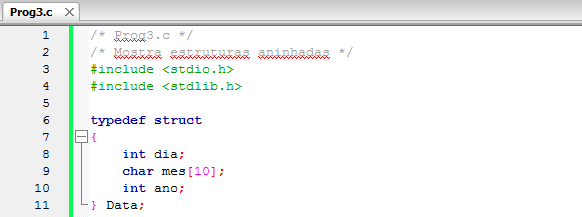

*Figura:* captura do editor com `Prog3.c` (**A03-04-P03**), linhas 1–11 da versão histórica do programa. Fonte revisado: [`src/Fontes_Aula_3_e_4/Prog3.c`](../../src/Fontes_Aula_3_e_4/Prog3.c); versão anterior à revisão de 2026 em texto: [commit `04ac409`](https://github.com/Lucas-Sperotto/falect-cc-011-algoritmos-e-laboratorio-de-programacao-ii/blob/04ac4094dba3c3812809dd433a7d3855c4bffdc9/src/Fontes_Aula_3_e_4/Prog3.c); explicação: [seção 6](#a03-04-p03).

<a id="slide-48"></a>
**Slide 48 — Estruturas Aninhadas**

> 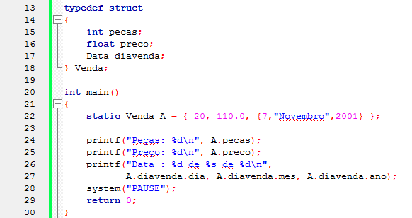

*Figura:* continuação de `Prog3.c` (**A03-04-P03**), linhas 13–30. A linha `printf("Preço: %d\n", A.preco);` usa `%d` com um valor `float`; ver [observação 8.5](#obs-3-5).

<a id="slide-49"></a>
**Slide 49 — Estruturas Aninhadas**

> - Nesse exemplo, adicionamos um membro do tipo Data à estrutura Venda, e criamos a variável A do tipo Venda.
> - A variável A tem três membros, dos quais um é estrutura do tipo Data.
> - Portanto, A.diavenda é o nome de uma variável do tipo Data, e para acessar seus membros devemos aplicar o operador ponto outra vez.

<a id="slide-50"></a>
**Slide 50 — Estruturas Aninhadas**

> - Logicamente, esse processo não para nesse nível; podemos ter uma estrutura dentro de outra quantas vezes desejarmos.
> - Inicializando estruturas aninhadas:
>   - A variável A foi inicializada na instrução:
>
>     ```c
>     static Venda A = { 20, 110.0, {7,"Novembro",2001} };
>     ```
>
>   - Observe que o membro diavenda, por ser uma estrutura, é inicializado com seus membros entre chaves e separados por vírgulas.

### 3.9 Passando estruturas para funções (slides 51–52)

<a id="slide-51"></a>
**Slide 51 — Roteiro** · *repete o roteiro do [slide 2](#slide-2), sem destaque do tópico seguinte.*

<a id="slide-52"></a>
**Slide 52 — Passando Estruturas para Funções**

> - As estruturas podem ser passadas como argumentos de funções da mesma forma que variáveis simples.
> - O nome de uma estrutura em C não é um endereço, portanto pode ser acessada por valor.

*Nota de transcrição:* sobre o custo de copiar estruturas grandes, ver [seção 4.6](#c-3-6).

### 3.10 Funções que retornam uma estrutura (slides 53–59)

<a id="slide-53"></a>
**Slide 53 — Roteiro** · *repete o roteiro do [slide 2](#slide-2), sem destaque do tópico seguinte.*

<a id="slide-54"></a>
**Slide 54 — Funções que Retornam uma Estrutura**

> - A linguagem C permite que as funções retornem uma estrutura completa para outra função.
> - Vamos exemplificar com uma função que recebe duas estruturas como argumento e retorna uma estrutura com a soma dos argumentos.

<a id="slide-55"></a>
**Slide 55 — Funções que Retornam uma Estrutura**

> 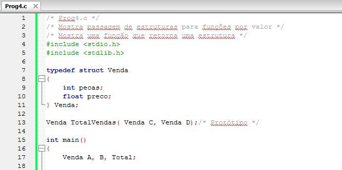

*Figura:* captura do editor com `Prog4.c` (**A03-04-P04**), linhas 1–18 da versão histórica do programa. Fonte revisado: [`src/Fontes_Aula_3_e_4/Prog4.c`](../../src/Fontes_Aula_3_e_4/Prog4.c); versão anterior à revisão de 2026 em texto: [commit `04ac409`](https://github.com/Lucas-Sperotto/falect-cc-011-algoritmos-e-laboratorio-de-programacao-ii/blob/04ac4094dba3c3812809dd433a7d3855c4bffdc9/src/Fontes_Aula_3_e_4/Prog4.c); explicação: [seção 6](#a03-04-p04).

<a id="slide-56"></a>
**Slide 56 — Funções que Retornam uma Estrutura**

> 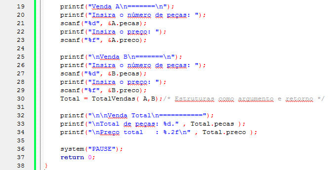

*Figura:* continuação de `Prog4.c` (**A03-04-P04**), linhas 19–38.

<a id="slide-57"></a>
**Slide 57 — Funções que Retornam uma Estrutura**

> 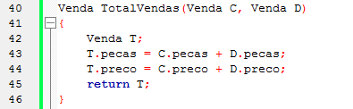

*Figura:* continuação de `Prog4.c` (**A03-04-P04**), linhas 40–46.

<a id="slide-58"></a>
**Slide 58 — Funções que Retornam uma Estrutura**

> - O protótipo da função TotalVendas() e as instruções de seu corpo tratam as variáveis argumentos como se trata qualquer tipo simples.
> - A função cria as novas variáveis C e D para conter cópia dos valores das variáveis A e B de main(), enviadas como argumentos, como faria com qualquer tipo de variável simples passada por valor.

<a id="slide-59"></a>
**Slide 59 — Funções que Retornam uma Estrutura**

> - Então, as variáveis C e D não são as mesmas das de main(); a função poderia alterá-las sem contudo alterar as originais.

### 3.11 Matrizes de estruturas (slides 60–74)

<a id="slide-60"></a>
**Slide 60 — Roteiro** · *repete o roteiro do [slide 2](#slide-2), sem destaque do tópico seguinte.*

<a id="slide-61"></a>
**Slide 61 — Matrizes de Estruturas**

> - Certamente, uma lista de peças e preços é composta por várias vendas (provavelmente mais de duas).
> - Cada venda é descrita por uma variável do tipo Venda.
> - Para tratar de várias vendas, é perfeitamente correto pensar em uma matriz de estruturas.

<a id="slide-62"></a>
**Slide 62 — Matrizes de Estruturas**

> - O programa seguinte, além de realizar nosso objetivo de criar uma matriz de estruturas, em que cada elemento da matriz representa uma venda, proporcionará uma interface simples com o usuário, constituida da escolha entre duas opções assinaladas pelas letras “E” e “L”.
> - Se o usuário pressionar “E”, o programa permitirá a entrada das informações de uma venda.

<a id="slide-63"></a>
**Slide 63 — Matrizes de Estruturas**

> - Caso pressione “L”, o programa listará todas as vendas e imprimirá os totais.
> - Vamos ainda aumentar as informações de cada venda, acrescentando a data da venda.
> - Usaremos duas novas funções de biblioteca C, atoi() e atof().

<a id="slide-64"></a>
**Slide 64 — Matrizes de Estruturas**

> - A primeira recebe o endereço de uma variável char (string) como argumento e a converte em um número inteiro correspondente a cadeia recebida.
> - Por exemplo, se enviarmos “1234” ela retorna o número inteiro 1234.
> - A segunda faz a mesma coisa, mas com variáveis float.

*Nota de transcrição:* as funções `atoi()` e `atof()` são apresentadas na [Aula 4](../aula-04/README.md#slide-3).

<a id="slide-65"></a>
**Slide 65 — Matrizes de Estruturas**

> 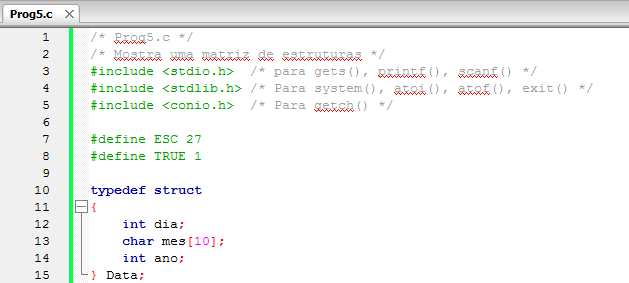

*Figura:* captura do editor com `Prog5.c` (**A03-04-P05**), linhas 1–15 da versão histórica do programa. Fonte revisado: [`src/Fontes_Aula_3_e_4/Prog5.c`](../../src/Fontes_Aula_3_e_4/Prog5.c); versão anterior à revisão de 2026 em texto: [commit `04ac409`](https://github.com/Lucas-Sperotto/falect-cc-011-algoritmos-e-laboratorio-de-programacao-ii/blob/04ac4094dba3c3812809dd433a7d3855c4bffdc9/src/Fontes_Aula_3_e_4/Prog5.c); explicação: [seção 6](#a03-04-p05).

<a id="slide-66"></a>
**Slide 66 — Matrizes de Estruturas**

> 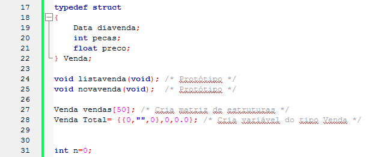

*Figura:* continuação de `Prog5.c` (**A03-04-P05**), linhas 17–31.

<a id="slide-67"></a>
**Slide 67 — Matrizes de Estruturas**

> 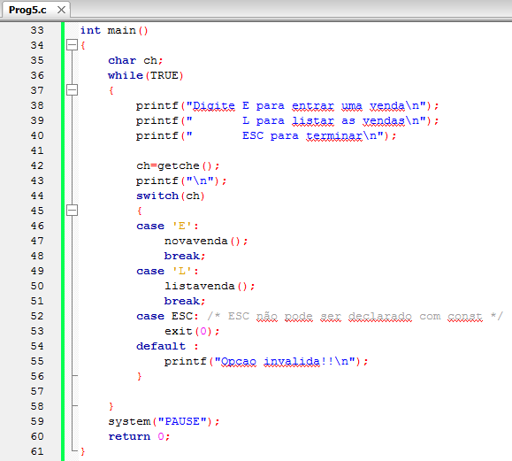

*Figura:* continuação de `Prog5.c` (**A03-04-P05**), linhas 33–61.

<a id="slide-68"></a>
**Slide 68 — Matrizes de Estruturas**

> 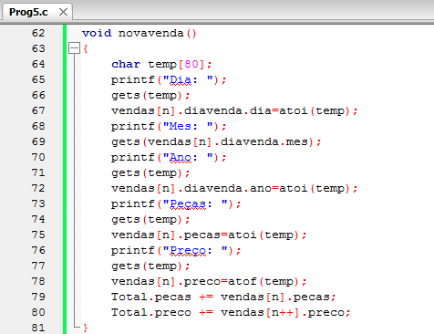

*Figura:* continuação de `Prog5.c` (**A03-04-P05**), linhas 62–81. A função `novavenda()` lê com `gets()` e não verifica se `n` já chegou a 50; ver [observação 8.7](#obs-3-7).

<a id="slide-69"></a>
**Slide 69 — Matrizes de Estruturas**

> 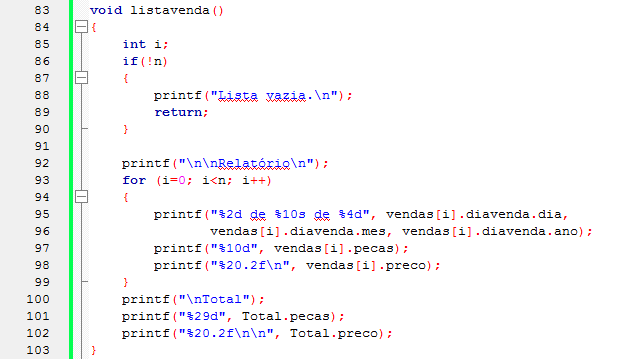

*Figura:* continuação de `Prog5.c` (**A03-04-P05**), linhas 83–103.

<a id="slide-70"></a>
**Slide 70 — Declarando a Matriz de Estruturas**

> - O processo de declaração de uma matriz de estruturas é perfeitamente análogo ao de declaração de qualquer outro tipo de matriz.
> - A instrução:
>
>   ```c
>   Venda vendas[50];
>   ```
>
> - Declara vendas como sendo uma matriz de 50 elementos.
> - Cada elemento da matriz é uma estrutura do tipo Venda.

<a id="slide-71"></a>
**Slide 71 — Declarando a Matriz de Estruturas**

> - Então, vendas[0] é a primeira estrutura do tipo Venda, vendas[1] é a segunda estrutura do tipo Venda, e assim por diante.
> - O nome vendas é o de uma matriz (portanto um endereço) em que os elementos são estruturas.
> - Observe que, a partir dessa instrução, o compilador providencia espaço contínuo de memória para armazenar 50 estruturas do tipo Venda.

<a id="slide-72"></a>
**Slide 72 — Declarando a Matriz de Estruturas**

> - Para simplificar, declaramos a matriz como externa, assim todas as funções do programa poderão acessá-la.

*Nota de transcrição:* sobre variáveis externas (globais) e locais, ver [seção 4.7](#c-3-7).

<a id="slide-73"></a>
**Slide 73 — Acessando Membros da Matriz de Estruturas**

> - Membros individuais de cada estrutura são acessados aplicando-se o operador ponto seguido do nome da variável, que, nesse caso, é um elemento da matriz.
>
>   ```c
>   vendas[n].preco
>   ```
>
> - Observe que o subscrito da matriz é associado a vendas e não ao membro.
> - A expressão acima refere-se ao membro preco da n-ésima estrutura da matriz.

<a id="slide-74"></a>
**Slide 74 — Acessando Membros da Matriz de Estruturas**

> - O esquema global desse programa pode ser aplicado a uma grande variedade de situações, como o controle de um estoque, em que cada variável poderá conter dados sobre um item do estoque, como número do material, preço, tipo, número de peças do estoque, etc.

### 3.12 Estruturas com campos bit (slides 75–78)

<a id="slide-75"></a>
**Slide 75 — Roteiro** · *repete o roteiro do [slide 2](#slide-2), sem destaque do tópico seguinte.*

<a id="slide-76"></a>
**Slide 76 — Estruturas com Campo bit**

> - Com a palavra struct podemos definir tipos de dados para manipulação de bits.
> - O conjunto de membros consiste nos bits de um char, short ou long.
> - Cada membro é formado por um ou mais bits inteiro.
> - A estrutura nomeia os membros e determina seus tamanhos.

*Nota de transcrição:* o padrão C só garante campos de bits de tipo `_Bool`, `signed int` e `unsigned int`; ver [observação 8.8](#obs-3-8).

<a id="slide-77"></a>
**Slide 77 — Estruturas com Campo bit**

> - Um caractere é impresso na memória de vídeo da console, ocupando dois bytes.
> - O primeiro byte é para o seu código ASCII, e o segundo, para um atributo (cor, piscante, reverso, etc.).
> - Como exemplo, vamos apresentar um tipo de dado que possa armazenar o caractere e seu atributo:

*Nota de transcrição:* a memória de vídeo em modo texto, com dois bytes por caractere, é a do PC com DOS (adaptadores CGA, EGA e VGA); não existe em terminais atuais. Ver [observação 8.8](#obs-3-8).

<a id="slide-78"></a>
**Slide 78 — Estruturas com Campo bit**

> ```c
> typedef struct
> {
>     unsigned short CodAscii: 8; /* Bits 0 a 7 */
>     unsigned short CorFrente: 3; /* Bits 8 a 10 */
>     unsigned short Intenso: 1; /* Bits 11 */
>     unsigned short CorFundo: 3; /* Bits 12 a 14 */
>     unsigned short Piscante: 1; /* Bits 15 */
> } Int16Bits;
>
> int main()
> {
>     Int16Bits A;
>     A.CodAscii = 'A';
>     A.CorFrente = 3;    /* Branco para a cor de frente */
>     A.Intenso = 1;      /* Intensificada a cor de frente */
>     A.CorFundo = 0;     /* Preto para a cor de fundo */
>     A.Piscante = 1;     /* Escolhe atributos piscante */
> }
> ```

*Nota de transcrição:* o programa deste slide corresponde a `BitTest.c` (**A03-04-BITTEST**), em [`src/Fontes_Aula_3_e_4/BitTest.c`](../../src/Fontes_Aula_3_e_4/BitTest.c); ver [seção 6](#a03-04-bittest) e [observação 8.8](#obs-3-8).

### 3.13 Referências do material original (slide 79)

<a id="slide-79"></a>
**Slide 79 — Referências**

> - MIZRAHI, Victorine V. Treinamento em Linguagem C, São Paulo: Pearson Prentice Hall, 2008;

## 4. Explicações complementares

<a id="c-3-1"></a>
### 4.1 Por que agrupar dados em registros

Sem estruturas, os dados de vários alunos ficariam em **vetores paralelos**: `int nmat[50]; float nota[50][3]; float media[50];`. A relação entre `nmat[i]` e `media[i]` existe só na cabeça do programador; ordenar um vetor exige lembrar de reordenar os outros, e uma função que trata “um aluno” precisa receber vários parâmetros. Com `struct Aluno`, cada aluno é **um** valor, que pode ser copiado, passado e retornado como uma unidade: essa é a ideia de **abstração de dados** da ementa, em que o programa passa a manipular “alunos” e “vendas”, e não números soltos.

<a id="c-3-2"></a>
### 4.2 Layout na memória: ordem, alinhamento e preenchimento

Os membros ficam na ordem em que foram declarados, e o primeiro começa no endereço da própria estrutura (§6.7.2.1p15). Entre os membros, e no fim, o compilador pode inserir **bytes de preenchimento** (*padding*) para que cada membro fique em um endereço múltiplo do seu alinhamento. Os valores abaixo foram medidos com `sizeof` e `offsetof` no GCC para Linux x86-64:

| Estrutura | Membro (deslocamento em bytes) | `sizeof` |
|---|---|---:|
| `struct Aluno` (`Prog1.c`) | `nmat` (0), `nota` (4), `media` (16) | 20 |
| `Data` (`Prog3.c`) | `dia` (0), `mes` (4), *2 bytes de preenchimento*, `ano` (16) | 20 |
| `Venda` de `Prog3.c` | `pecas` (0), `preco` (4), `diavenda` (8) | 28 |
| `Venda` de `Prog5.c` | `diavenda` (0), `pecas` (20), `preco` (24) | 28 |

O vetor `mes[10]` termina no byte 13; como `ano` é um `int` (alinhamento 4), ele começa no byte 16, e os bytes 14 e 15 ficam sem uso. Por isso o tamanho de uma estrutura não é, em geral, a soma dos tamanhos dos membros, e o programa deve usar `sizeof` em vez de contas feitas à mão. A [Aula 11](../aula-11/README.md) mostra a consequência ao gravar estruturas em arquivos binários.

```c
#include <stddef.h>   /* offsetof */
printf("%zu %zu\n", sizeof(Data), offsetof(Data, ano));   /* 20 16 no GCC x86-64 */
```

<a id="c-3-3"></a>
### 4.3 As formas de declarar e o espaço de nomes das etiquetas

| Forma | Exemplo | Nome do tipo |
|---|---|---|
| etiqueta | `struct Aluno { ... };` | `struct Aluno` |
| etiqueta + `typedef` separado | `typedef struct Aluno Aluno;` | `struct Aluno` ou `Aluno` |
| `typedef` com etiqueta | `typedef struct Aluno { ... } Aluno;` | `struct Aluno` ou `Aluno` |
| `typedef` sem etiqueta | `typedef struct { ... } Aluno;` | só `Aluno` |
| definição + variáveis | `struct Aluno { ... } Jose, Ana;` | `struct Aluno` |

`typedef struct Aluno Aluno;` é válido porque as etiquetas (`Aluno` depois de `struct`) e os nomes comuns (variáveis, funções, `typedef`) ocupam **espaços de nomes diferentes** em C (§6.2.3). A forma com etiqueta é necessária quando a estrutura precisa citar a si mesma, como o nó de lista encadeada da [Aula 8](../aula-08/README.md) (`struct Livro *Proximo;`): dentro das chaves, o sinônimo criado pelo `typedef` ainda não existe.

<a id="c-3-4"></a>
### 4.4 Inicialização

Os valores entre chaves são atribuídos na ordem dos membros; estruturas internas usam chaves internas, como em `{ 20, 110.0, {7, "Novembro", 2001} }`. Membros sem valor recebem zero, inclusive em variáveis locais (§6.7.9p19 e p21). Desde o C99 é possível nomear os membros (**inicializadores designados**), o que dispensa decorar a ordem:

```c
Data natal = { .dia = 25, .mes = "dezembro", .ano = 2001 };
Venda A = { .pecas = 20, .preco = 110.0f, .diavenda = { 7, "Novembro", 2001 } };
```

<a id="c-3-5"></a>
### 4.5 Atribuição copia tudo; soma e comparação não existem

`Andre = aniversario;` copia todos os membros, **inclusive o vetor `mes`**. É uma situação curiosa: vetores não podem ser atribuídos diretamente (`mes1 = mes2;` é erro), mas uma estrutura que contém um vetor pode. Já `A + B` e `A == B` não são definidos para estruturas: a soma precisa ser escrita membro a membro (slide 45), e a comparação também. Comparar estruturas com `memcmp` é arriscado, porque os bytes de preenchimento podem ter valores diferentes mesmo quando todos os membros são iguais.

<a id="c-3-6"></a>
### 4.6 Passagem por valor: a função recebe cópias

Em `Total = TotalVendas(A, B);`, os parâmetros `C` e `D` são variáveis novas, inicializadas com cópias de `A` e `B`; a estrutura `T` criada na função é copiada de volta para `Total` no retorno.

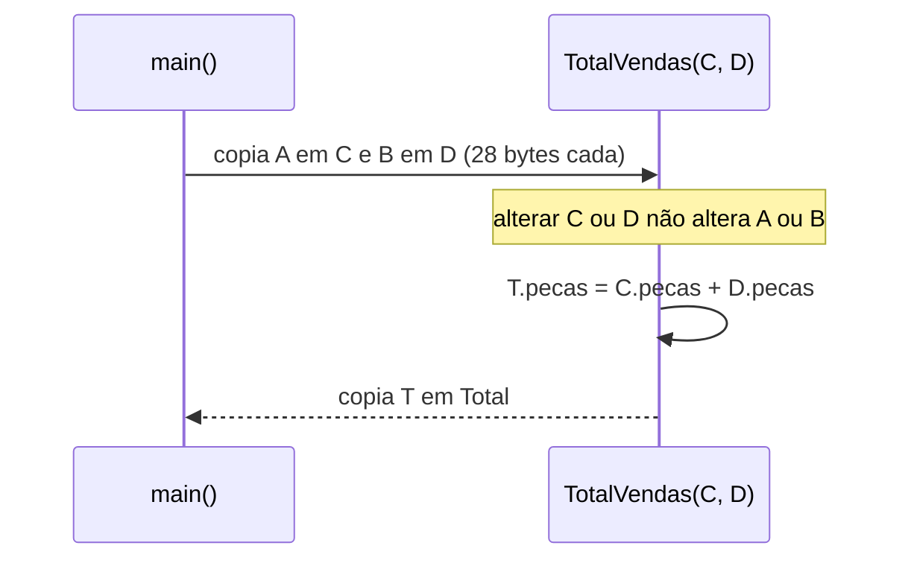

Para estruturas pequenas, como `Venda`, a cópia é barata e deixa claro que a função não modifica os originais. Para estruturas grandes, ou quando a função precisa alterar o original, passa-se o **endereço** da estrutura (`Venda *p`), e os membros são acessados com `p->pecas`, assunto da [Aula 7](../aula-07/README.md). Compare com vetores, que são sempre passados pelo endereço ([Aula 1, 4.6](../aula-01/README.md#c-1-6)): o slide 52 destaca justamente que “o nome de uma estrutura em C não é um endereço”.

<a id="c-3-7"></a>
### 4.7 Escopo e duração: tipos e variáveis locais ou globais

- **Tipo definido fora das funções** (`Prog1.c`): visível em todo o arquivo a partir da definição. **Dentro de `main()`** (`Prog2.c`): visível só naquele bloco; outra função não poderia declarar `struct Aluno`.
- **Variáveis globais** (`vendas`, `Total` e `n` em `Prog5.c`): existem durante toda a execução, começam com zero e podem ser usadas por qualquer função do arquivo. É por isso que `novavenda()` e `listavenda()` não recebem parâmetros.
- **Variáveis locais** (`temp`, `nova`): existem apenas enquanto a função executa.

A escolha de variáveis globais em `Prog5.c` simplifica o exemplo (slide 72), mas torna as funções dependentes do estado externo: não seria possível, por exemplo, manter duas listas de vendas. A versão com parâmetros (`void novavenda(Venda v[], int *n)`) exige ponteiros, vistos na [Aula 5](../aula-05/README.md).

<a id="c-3-8"></a>
### 4.8 Vetor de estruturas

`Venda vendas[50];` reserva 50 estruturas contíguas: no GCC x86-64, 50 × 28 = 1400 bytes. Em `vendas[n].preco`, primeiro se escolhe o elemento (`vendas[n]`, uma `Venda`) e depois o membro; o índice pertence ao vetor, como observa o slide 73. A variável `n` é o **tamanho lógico** (quantas posições estão em uso), distinto da capacidade 50, e o programa precisa garantir `n < 50` antes de gravar.

<a id="c-3-9"></a>
### 4.9 Campos de bits e a palavra de atributo

`Int16Bits` descreve a palavra de 16 bits usada pelo modo texto dos adaptadores de vídeo do PC: o byte baixo guarda o código do caractere e o byte alto, os atributos.

| Bits | 15 | 14–12 | 11 | 10–8 | 7–0 |
|---|---|---|---|---|---|
| Campo | `Piscante` | `CorFundo` | `Intenso` | `CorFrente` | `CodAscii` |
| Valor em `BitTest.c` | 1 | 000 | 1 | 011 | `0x41` (`'A'`) |

Reunidos, esses bits formam `1000 1011 0100 0001` = `0x8B41`, que é exatamente o valor medido no GCC x86-64 ao copiar a estrutura para um `unsigned short`. O resultado, porém, depende da implementação: a ordem em que os campos ocupam a palavra, o tipo permitido (`unsigned short` é uma extensão; o padrão garante `_Bool`, `signed int` e `unsigned int`) e até o tamanho da estrutura são definidos pelo compilador (§6.7.2.1p5 e p11). A forma portável de montar a mesma palavra usa máscaras e deslocamentos, assunto da [Aula 9](../aula-09/README.md):

```c
unsigned short palavra = (unsigned short)('A' | (3u << 8) | (1u << 11) | (0u << 12) | (1u << 15));
```

## 5. Conceitos fundamentais

| Conceito | Definição operacional | Onde aparece |
|---|---|---|
| Estrutura (registro) | Tipo que agrupa membros de tipos possivelmente diferentes | slides 3–18 |
| Membro | Cada variável componente de uma estrutura, acessada por `.` | slides 13, 27–28 |
| Etiqueta (*tag*) | Nome após `struct`, que identifica o tipo `struct Etiqueta` | slides 13–14 |
| `typedef` | Cria um sinônimo para um tipo existente; não cria tipo novo | slides 20–26 |
| Inicialização de estrutura | Lista entre chaves na ordem dos membros | slides 34–38, 50 |
| Atribuição entre estruturas | Cópia de todos os membros entre variáveis do mesmo tipo | slides 40–42 |
| Estrutura aninhada | Membro que é, ele próprio, uma estrutura | slides 47–50 |
| Passagem por valor | A função recebe cópias das estruturas passadas | slides 52, 58–59 |
| Vetor de estruturas | Sequência contígua de estruturas do mesmo tipo | slides 61–74 |
| Variável global (externa) | Declarada fora das funções; dura toda a execução | slide 72; [4.7](#c-3-7) |
| Preenchimento (*padding*) | Bytes inseridos para alinhar membros | [4.2](#c-3-2) |
| Campo de bits | Membro inteiro com largura definida em bits | slides 76–78 |

## 6. Programas C da aula

Fontes em [`src/Fontes_Aula_3_e_4/`](../../src/Fontes_Aula_3_e_4/), revisados em 2026 ([revisão por fonte](../../docs/auditorias/REVISAO_POR_FONTE.md#aulas-3-e-4--srcfontes_aula_3_e_4)).

| ID | Arquivo | SIGAA | Slides | Tema |
|---|---|---|---|---|
| [A03-04-P01](#a03-04-p01) | [`Prog1.c`](../../src/Fontes_Aula_3_e_4/Prog1.c) | Prog01.c | 10–18, 27–28 | `struct Aluno` global |
| [A03-04-P02](#a03-04-p02) | [`Prog2.c`](../../src/Fontes_Aula_3_e_4/Prog2.c) | Prog02.c | 15–16 | `struct Aluno` dentro de `main()` |
| [A03-04-P03](#a03-04-p03) | [`Prog3.c`](../../src/Fontes_Aula_3_e_4/Prog3.c) | Prog03.c | 47–50 | estruturas aninhadas |
| [A03-04-P04](#a03-04-p04) | [`Prog4.c`](../../src/Fontes_Aula_3_e_4/Prog4.c) | Prog04.c | 52–59 | passagem e retorno de estruturas |
| [A03-04-P05](#a03-04-p05) | [`Prog5.c`](../../src/Fontes_Aula_3_e_4/Prog5.c) | Prog05.c | 61–74 | vetor de estruturas, menu |
| [A03-04-BITTEST](#a03-04-bittest) | [`BitTest.c`](../../src/Fontes_Aula_3_e_4/BitTest.c) | — | 76–78 | campos de bits |

<a id="a03-04-p01"></a>
### 6.1 A03-04-P01 — `Prog1.c`: a primeira estrutura

- **Finalidade:** definir `struct Aluno`, preencher uma variável e imprimir matrícula e média. **Entrada:** nenhuma. **Saída:** `Matrícula: 456` e `Média    : 7.03`.
- **Conceitos:** definição de tipo, declaração de variável, operador ponto, membro vetor (`Jose.nota[0]`).
- **Diferença em relação aos slides 11–12:** nenhuma de lógica (só cabeçalho e `main(void)`).
- **Observação:** `(7.5 + 5.2 + 8.4)/3.0` vale 7,0333…, impresso como `7.03`.

<!-- codigo: src/Fontes_Aula_3_e_4/Prog1.c de=`struct Aluno` ate=`printf("Média` -->
<sub>Copiado de [`src/Fontes_Aula_3_e_4/Prog1.c`](../../src/Fontes_Aula_3_e_4/Prog1.c#L11-L29) (linhas 11–29) por `scripts/documentacao_aulas.py`; não edite este bloco à mão.</sub>

```c
struct Aluno		/*Inicio da definição da estrutura */
{
    int nmat;		/* Número da matrícula */
    float nota[3];	/* Notas */
    float media;	/* Média */
};				/* Fim da definição */

int main(void)
{
    struct Aluno Jose; /* Declara uma variável do tipo struct Aluno */

    Jose.nmat	= 456;
    Jose.nota[0]= 7.5;
    Jose.nota[1]= 5.2;
    Jose.nota[2]= 8.4;
    Jose.media	= (Jose.nota[0] + Jose.nota[1] + Jose.nota[2])/3.0;

    printf("Matrícula: %d\n", Jose.nmat);
    printf("Média    : %.2f\n", Jose.media);
```
<!-- /codigo -->

<a id="a03-04-p02"></a>
### 6.2 A03-04-P02 — `Prog2.c`: definição local

- **Finalidade:** mostrar que a definição pode ficar dentro de `main()`, com escopo restrito ao bloco (slide 15).
- **Entrada, saída e funcionamento:** idênticos a `Prog1.c` ([4.7](#c-3-7)).

<!-- codigo: src/Fontes_Aula_3_e_4/Prog2.c de=`int main(void)` ate=`struct Aluno Jose;` -->
<sub>Copiado de [`src/Fontes_Aula_3_e_4/Prog2.c`](../../src/Fontes_Aula_3_e_4/Prog2.c#L11-L20) (linhas 11–20) por `scripts/documentacao_aulas.py`; não edite este bloco à mão.</sub>

```c
int main(void)
{
    struct Aluno		/*Inicio da definição da estrutura */
    {
        int nmat;		/* Número da matrícula */
        float nota[3];	/* Notas */
        float media;	/* Média */
    };  			      /* Fim da definição */

    struct Aluno Jose; /* Declara uma variável do tipo struct Aluno */
```
<!-- /codigo -->

<a id="a03-04-p03"></a>
### 6.3 A03-04-P03 — `Prog3.c`: estruturas aninhadas

- **Finalidade:** incluir uma `Data` dentro de uma `Venda` e acessar `A.diavenda.dia`. **Saída:** peças, preço e data.
- **Conceitos:** `typedef` sem etiqueta, inicialização com chaves internas, operador ponto aplicado duas vezes.
- **Diferença em relação ao slide 48:** `printf("Preço: %d\n", A.preco)` virou `%.2f` ([8.5](#obs-3-5)).

<!-- codigo: src/Fontes_Aula_3_e_4/Prog3.c de=`typedef struct` ate=`A.diavenda.ano);` -->
<sub>Copiado de [`src/Fontes_Aula_3_e_4/Prog3.c`](../../src/Fontes_Aula_3_e_4/Prog3.c#L11-L32) (linhas 11–32) por `scripts/documentacao_aulas.py`; não edite este bloco à mão.</sub>

```c
typedef struct
{
    int dia;
    char mes[10];
    int ano;
} Data;

typedef struct
{
    int pecas;
    float preco;
    Data diavenda;
} Venda;

int main(void)
{
    static Venda A = { 20, 110.0, {7,"Novembro",2001} };

    printf("Peças: %d\n", A.pecas);
    printf("Preço: %.2f\n", A.preco);
    printf("Data : %d de %s de %d\n",
           A.diavenda.dia, A.diavenda.mes, A.diavenda.ano);
```
<!-- /codigo -->

<a id="a03-04-p04"></a>
### 6.4 A03-04-P04 — `Prog4.c`: estruturas como parâmetro e retorno

- **Finalidade:** ler duas vendas e calcular o total com uma função que recebe e devolve `Venda`.
- **Entrada:** peças e preço da venda A, depois da venda B. **Saída:** total de peças e de preço.
- **Conceitos:** passagem por valor de estruturas, retorno de estrutura ([4.6](#c-3-6)).
- **Diferença em relação aos slides 55–57:** verificação das leituras e limites de domínio (peças até 1 milhão; preço finito entre 0 e 1 bilhão), para que a soma não transborde.
- **Cuidado:** quando o domínio é violado, o programa termina com código 1 **sem mensagem** ([8.9](#obs-3-9)).

<!-- codigo: src/Fontes_Aula_3_e_4/Prog4.c funcao=TotalVendas -->
<sub>Copiado de [`src/Fontes_Aula_3_e_4/Prog4.c`](../../src/Fontes_Aula_3_e_4/Prog4.c#L67-L73) (linhas 67–73) por `scripts/documentacao_aulas.py`; não edite este bloco à mão.</sub>

```c
Venda TotalVendas(Venda C, Venda D)
{
    Venda T;
    T.pecas = C.pecas + D.pecas;
    T.preco = C.preco + D.preco;
    return T;
}
```
<!-- /codigo -->

<a id="a03-04-p05"></a>
### 6.5 A03-04-P05 — `Prog5.c`: vetor de estruturas com menu

- **Finalidade:** cadastrar até 50 vendas e listar um relatório com totais.
- **Entrada:** opções `E` (entrar venda), `L` (listar), `Q` ou ESC (terminar), cada uma seguida de ENTER; para cada venda, dia, mês, ano, peças e preço. **Saída:** o relatório formatado em colunas.
- **Conceitos:** vetor global de estruturas, estruturas aninhadas, tamanho lógico `n`, conversão de texto em número.
- **Funcionamento:** `novavenda()` preenche uma variável local `nova` e só a copia para `vendas[n++]` se todos os campos forem válidos; `listavenda()` percorre `vendas[0..n-1]`.
- **Diferença em relação aos slides 65–69:** `getche()` e `gets()` foram substituídas por `ler_linha()`; `atoi`/`atof` por `sscanf` com verificação; o limite de 50 é verificado; ESC passou a exigir ENTER. Uma venda com dado inválido é descartada **sem aviso** ([8.7](#obs-3-7)).

<!-- codigo: src/Fontes_Aula_3_e_4/Prog5.c funcao=novavenda -->
<sub>Copiado de [`src/Fontes_Aula_3_e_4/Prog5.c`](../../src/Fontes_Aula_3_e_4/Prog5.c#L61-L91) (linhas 61–91) por `scripts/documentacao_aulas.py`; não edite este bloco à mão.</sub>

```c
void novavenda(void)
{
    char temp[80];
    Venda nova;
    if (n >= 50)
    {
        puts("Limite de 50 vendas atingido.");
        return;
    }
    /* gets() não limitava as strings. Só adiciona uma venda completa. */
    printf("Dia: ");
    if (!ler_linha(temp, sizeof temp) || sscanf(temp, "%d", &nova.diavenda.dia) != 1)
        return;
    printf("Mês: ");
    if (!ler_linha(nova.diavenda.mes, sizeof nova.diavenda.mes))
        return;
    printf("Ano: ");
    if (!ler_linha(temp, sizeof temp) || sscanf(temp, "%d", &nova.diavenda.ano) != 1)
        return;
    printf("Peças: ");
    if (!ler_linha(temp, sizeof temp) || sscanf(temp, "%d", &nova.pecas) != 1 ||
        nova.pecas < 0 || nova.pecas > 1000000)
        return;
    printf("Preço: ");
    if (!ler_linha(temp, sizeof temp) || sscanf(temp, "%f", &nova.preco) != 1 ||
        !isfinite(nova.preco) || nova.preco < 0.0f || nova.preco > 1000000000.0f)
        return;
    vendas[n++] = nova;
    Total.pecas += nova.pecas;
    Total.preco += nova.preco;
}
```
<!-- /codigo -->

<a id="a03-04-bittest"></a>
### 6.6 A03-04-BITTEST — `BitTest.c`: campos de bits

- **Finalidade:** definir a estrutura `Int16Bits` do slide 78 e atribuir valores aos campos. **Entrada e saída:** nenhuma (o programa só compila e executa as atribuições).
- **Conceitos:** campos de bits de larguras 8, 3, 1, 3 e 1 ([4.9](#c-3-9)).
- **Observações:** não há tarefa SIGAA para este arquivo; o objetivo no cabeçalho do fonte, antes “Bits 0 a 7” (cópia do primeiro comentário do código), foi reescrito na revisão de comentários desta documentação ([relatório](../../docs/auditorias/CLAUDE_AUDIT.md#recomendacoes)). O `(void)A;` evita o aviso de variável não usada.

<!-- codigo: src/Fontes_Aula_3_e_4/BitTest.c de=`typedef struct` ate=`(void)A;` -->
<sub>Copiado de [`src/Fontes_Aula_3_e_4/BitTest.c`](../../src/Fontes_Aula_3_e_4/BitTest.c#L7-L25) (linhas 7–25) por `scripts/documentacao_aulas.py`; não edite este bloco à mão.</sub>

```c
typedef struct
{
    unsigned short CodAscii: 8; /* Bits 0 a 7 */
    unsigned short CorFrente: 3; /* Bits 8 a 10 */
    unsigned short Intenso: 1; /* Bits 11 */
    unsigned short CorFundo: 3; /* Bits 12 a 14 */
    unsigned short Piscante: 1; /* Bits 15 */
} Int16Bits;

int main(void)
{
    Int16Bits A;
    A.CodAscii = 'A';
    A.CorFrente = 3;    /* Branco para a cor de frente */
    A.Intenso = 1;      /* Intensificada a cor de frente */
    A.CorFundo = 0;     /* Preto para a cor de fundo */
    A.Piscante = 1;     /* Escolhe atributos piscante */
    /* A disposição dos campos de bits depende da implementação. */
    (void)A;
```
<!-- /codigo -->

## 7. Exemplos de execução

Saídas reais dos fontes revisados, com as entradas dos cenários revisados do repositório.

### 7.1 Estrutura simples (`Prog1.c`)

<!-- execucao: src/Fontes_Aula_3_e_4/Prog1.c cenario=normal -->
Execução real do cenário revisado `normal` ([manifesto](../../scripts/cenarios_fontes_c.json)), compilado com `gcc -std=c11 -Wall -Wextra -Wpedantic -O0`; bloco gerado por `scripts/documentacao_aulas.py`.

Comando: `./Prog1`

Entrada padrão: *(vazia)*

Saída padrão:

```text
Matrícula: 456
Média    : 7.03
```

Código de saída: `0`.
<!-- /execucao -->

### 7.2 Estruturas aninhadas (`Prog3.c`)

<!-- execucao: src/Fontes_Aula_3_e_4/Prog3.c cenario=normal -->
Execução real do cenário revisado `normal` ([manifesto](../../scripts/cenarios_fontes_c.json)), compilado com `gcc -std=c11 -Wall -Wextra -Wpedantic -O0`; bloco gerado por `scripts/documentacao_aulas.py`.

Comando: `./Prog3`

Entrada padrão: *(vazia)*

Saída padrão:

```text
Peças: 20
Preço: 110.00
Data : 7 de Novembro de 2001
```

Código de saída: `0`.
<!-- /execucao -->

### 7.3 Soma de vendas (`Prog4.c`)

<!-- execucao: src/Fontes_Aula_3_e_4/Prog4.c cenario=normal -->
Execução real do cenário revisado `normal` ([manifesto](../../scripts/cenarios_fontes_c.json)), compilado com `gcc -std=c11 -Wall -Wextra -Wpedantic -O0`; bloco gerado por `scripts/documentacao_aulas.py`.

Comando: `./Prog4`

Entrada padrão:

```text
2
10
3
20
```

Saída padrão:

```text
Venda A
=======
Insira o número de peças: Insira o preço: 
Venda B
=======
Insira o número de peças: Insira o preço: 

Venda Total
===========
Total de peças: 5.
Preço total   : 30.00
```

Código de saída: `0`.
<!-- /execucao -->

### 7.4 Preço negativo (`Prog4.c`)

<!-- execucao: src/Fontes_Aula_3_e_4/Prog4.c cenario=preco-negativo -->
Execução real do cenário revisado `preco-negativo` ([manifesto](../../scripts/cenarios_fontes_c.json)), compilado com `gcc -std=c11 -Wall -Wextra -Wpedantic -O0`; bloco gerado por `scripts/documentacao_aulas.py`.

Comando: `./Prog4`

Entrada padrão:

```text
1
-1
1
1
```

Saída padrão (sem quebra de linha final):

```text
Venda A
=======
Insira o número de peças: Insira o preço: 
Venda B
=======
Insira o número de peças: Insira o preço: 
```

Código de saída: `1`.
<!-- /execucao -->

### 7.5 Cadastro e relatório (`Prog5.c`)

<!-- execucao: src/Fontes_Aula_3_e_4/Prog5.c cenario=normal -->
Execução real do cenário revisado `normal` ([manifesto](../../scripts/cenarios_fontes_c.json)), compilado com `gcc -std=c11 -Wall -Wextra -Wpedantic -O0`; bloco gerado por `scripts/documentacao_aulas.py`.

Comando: `./Prog5`

Entrada padrão:

```text
E
29
Outubro
2026
2
12.5
L
Q
```

Saída padrão:

```text
Digite E para entrar uma venda
       L para listar as vendas
       ESC ou Q para terminar (confirme com Enter)
Dia: Mês: Ano: Peças: Preço: Digite E para entrar uma venda
       L para listar as vendas
       ESC ou Q para terminar (confirme com Enter)


Relatório
29 de    Outubro de 2026         2               12.50

Total                            2               12.50

Digite E para entrar uma venda
       L para listar as vendas
       ESC ou Q para terminar (confirme com Enter)
```

Código de saída: `0`.
<!-- /execucao -->

### 7.6 Opção inválida e lista vazia (`Prog5.c`)

<!-- execucao: src/Fontes_Aula_3_e_4/Prog5.c cenario=menu-invalido -->
Execução real do cenário revisado `menu-invalido` ([manifesto](../../scripts/cenarios_fontes_c.json)), compilado com `gcc -std=c11 -Wall -Wextra -Wpedantic -O0`; bloco gerado por `scripts/documentacao_aulas.py`.

Comando: `./Prog5`

Entrada padrão:

```text
X
L
Q
```

Saída padrão:

```text
Digite E para entrar uma venda
       L para listar as vendas
       ESC ou Q para terminar (confirme com Enter)
Opção inválida!
Digite E para entrar uma venda
       L para listar as vendas
       ESC ou Q para terminar (confirme com Enter)
Lista vazia.
Digite E para entrar uma venda
       L para listar as vendas
       ESC ou Q para terminar (confirme com Enter)
```

Código de saída: `0`.
<!-- /execucao -->

### 7.7 Campos de bits (`BitTest.c`)

<!-- execucao: src/Fontes_Aula_3_e_4/BitTest.c cenario=normal -->
Execução real do cenário revisado `normal` ([manifesto](../../scripts/cenarios_fontes_c.json)), compilado com `gcc -std=c11 -Wall -Wextra -Wpedantic -O0`; bloco gerado por `scripts/documentacao_aulas.py`.

Comando: `./BitTest`

Entrada padrão: *(vazia)*

Saída padrão: *(vazia)*

Código de saída: `0`.
<!-- /execucao -->

## 8. Observações técnicas

<a id="obs-3-1"></a>
**8.1 Frase truncada (slide 4).** O segundo tópico do slide está incompleto no PDF: “O problema de agrupar dados de variáveis que agrupam dados geralmente desiguais; ao passo que matrizes agrupam dados similares.” A frase do livro-base provavelmente dizia que o problema pede um tipo que agrupe dados desiguais, ao contrário das matrizes. A transcrição mantém o texto como está e registra a lacuna no [relatório](../../docs/auditorias/CLAUDE_AUDIT.md#lacunas).

<a id="obs-3-2"></a>
**8.2 “Cinco tipos de dados simples” (slide 6).** A lista `char`, `int`, `float`, `double` e `void` é a do C89 simplificado. `void` não armazena valores; os modificadores `short`, `long`, `signed` e `unsigned` geram outros tipos inteiros; e o C99 acrescentou `_Bool`, `long long` e os tipos complexos.

<a id="obs-3-3"></a>
**8.3 Tamanho da estrutura (slide 17).** A conta 4 + 12 + 4 bytes coincide com `sizeof(struct Aluno)` no GCC x86-64 (20 bytes), mas não é garantida: os tamanhos dos tipos variam e o compilador pode inserir preenchimento ([4.2](#c-3-2)). O slide 18 diz que os membros ficam “em sequência contínua de memória”; a ordem é garantida, a ausência de lacunas não.

<a id="obs-3-4"></a>
**8.4 Inicialização e o dia 125 (slides 34–35).** A exigência de `extern` ou `static` é a do C anterior ao ANSI ([Aula 1, 8.6](../aula-01/README.md#obs-1-6)); o próprio slide 35 reconhece que os compiladores aceitam variáveis automáticas. O valor `125` para o dia de Natal é erro de digitação (o slide 38 usa `25`); como `dia` é `int`, o compilador o aceita sem aviso.

<a id="obs-3-5"></a>
**8.5 `%d` com `float` (slide 48).** Em `printf("Preço: %d\n", A.preco)`, o `float` é promovido a `double` e passado onde `%d` espera um `int`: o comportamento é indefinido (§7.21.6.1p9), e na prática imprime um inteiro sem relação com 110. O GCC avisa com `-Wall` (`-Wformat`).

<a id="obs-3-6"></a>
**8.6 Passagem por valor (slides 52 e 58–59).** A explicação está correta. Vale acrescentar o custo: cada chamada copia a estrutura inteira, o que importa para estruturas grandes, como a de 112 bytes da [Aula 11](../aula-11/README.md).

<a id="obs-3-7"></a>
**8.7 `Prog5.c` (slides 65–69).** No original: `getche()` e `conio.h` não existem no GCC para Linux; `gets()` grava sem limite em `temp[80]` e em `mes[10]` (um mês como “Fevereiro” cabe, mas qualquer texto maior transborda); `novavenda()` não testa `n < 50`; e `atoi`/`atof` devolvem 0 para texto inválido, que entraria nos totais. A versão revisada corrige esses pontos, mas descarta a venda inválida sem informar o usuário, como mostra o cenário `venda-dia-invalido` (recomendação registrada em [`CLAUDE_AUDIT.md`](../../docs/auditorias/CLAUDE_AUDIT.md#recomendacoes)).

<a id="obs-3-8"></a>
**8.8 Campos de bits (slides 76–78).** O slide afirma que os membros “consistem nos bits de um char, short ou long”; o padrão garante apenas `_Bool`, `signed int` e `unsigned int`, e outros tipos são extensões aceitas pelo GCC (§6.7.2.1p5). A distribuição dos campos na palavra é definida pela implementação (§6.7.2.1p11). Na paleta de 16 cores do modo texto do PC, o valor 3 é ciano e o branco (cinza-claro) é 7: o comentário “Branco para a cor de frente” não corresponde ao valor 3. A memória de vídeo com dois bytes por caractere (slide 77) é a do modo texto do DOS; terminais atuais usam sequências de escape para cores.

<a id="obs-3-9"></a>
**8.9 Falha silenciosa em `Prog4.c`.** Quando as peças ou os preços estão fora do domínio aceito, o fonte revisado retorna `EXIT_FAILURE` sem mensagem (exemplo 7.4). Um texto em `stderr` explicaria o motivo ao usuário; a sugestão está nas [recomendações](../../docs/auditorias/CLAUDE_AUDIT.md#recomendacoes).

## 9. Exercícios relacionados

### 9.1 Tarefa do SIGAA

A tarefa [Aulas 03 e 04](../../atividades/aulas-03-e-04.md) inclui `Prog01.c` a `Prog05.c` desta aula. Em cada um, imprima `sizeof` das estruturas definidas e explique, em comentário, por que o valor obtido é igual ou maior que a soma dos membros.

### 9.2 Exercícios propostos (acréscimo desta documentação)

1. **Boletim.** Defina `typedef struct { int nmat; float nota[3]; float media; } Aluno;` e leia até 30 alunos (matrícula 0 encerra). Calcule a média de cada um e imprima os aprovados (média ≥ 6). Use uma função `void calcula_media(Aluno a)` e explique por que ela **não** altera o aluno do vetor; depois, reescreva-a para devolver o `Aluno` atualizado.
2. **Datas.** Escreva `int compara_datas(Data a, Data b)` que devolva negativo, zero ou positivo como `strcmp`, comparando ano, depois mês (use números de 1 a 12) e depois dia.
3. **Preenchimento.** Reordene os membros de `struct { char c; double d; char e; }` para reduzir o `sizeof`. Meça antes e depois com `sizeof` e `offsetof` e explique o resultado.
4. **Relatório ordenado.** Acrescente a `Prog5.c` uma opção `O` que ordena `vendas` por data (use a função do exercício 2 e a ordenação por trocas da [Aula 1](../aula-01/README.md#c-1-7)), trocando estruturas inteiras.
5. **Busca de registro.** Escreva uma função que receba o vetor de vendas e um mês e devolva o total de peças vendidas naquele mês.

## 10. Referências e fontes consultadas

- SPEROTTO, Lucas Kriesel. *Aula 3 – Novos tipos de dados com struct, typedef, union e enum – Parte 1 (nível avançado)*. Capacitação em C, 26/09/2022. 79 slides. [`aulas/Aula_3.pdf`](../Aula_3.pdf).
- MIZRAHI, Victorine Viviane. *Treinamento em Linguagem C*. São Paulo: Pearson Prentice Hall, 2008 (referência citada no slide 79).
- ISO/IEC 9899:2011 (C11), rascunho N1570: <https://www.open-std.org/jtc1/sc22/wg14/www/docs/n1570.pdf>. Seções citadas: §6.2.3 (espaços de nomes), §6.7.2.1 (estruturas, campos de bits, preenchimento), §6.7.8 (`typedef`), §6.7.9 (inicialização e designadores), §7.19 (`offsetof`), §7.21.6.1 (`printf`).
- cppreference.com — *Struct declaration* (<https://en.cppreference.com/w/c/language/struct>) e *Bit-fields* (<https://en.cppreference.com/w/c/language/bit_field>).
- Fontes do repositório: [`src/Fontes_Aula_3_e_4/`](../../src/Fontes_Aula_3_e_4/), [cenários de teste](../../scripts/cenarios_fontes_c.json) e [revisão por fonte](../../docs/auditorias/REVISAO_POR_FONTE.md).
