# Aula 4 — Novos tipos de dados com enum e union (parte 2)

- **Material original:** [`aulas/Aula_4.pdf`](../Aula_4.pdf) — 56 slides, “AULA 4 – NOVOS TIPOS DE DADOS COM STRUCT, TYPEDEF, UNION E ENUM - PARTE 2 (NÍVEL AVANÇADO)”, 07/10/2022, *Capacitação em C – Prof. Me. Lucas Kriesel Sperotto*.
- **Programas:** [`src/Fontes_Aula_3_e_4/`](../../src/Fontes_Aula_3_e_4/) — `Prog6.c` a `Prog13.c` (A03-04-P06 a A03-04-P13). Atenção: o `Prog8.c` dos slides 23–26 **não está no repositório** ([observação 8.6](#obs-4-6)).
- **Tarefa do SIGAA:** [Aulas 03 e 04](../../atividades/aulas-03-e-04.md) (Prog06–Prog13 nesta aula).

**Como ler este documento.** A seção 3 reproduz o PDF slide a slide, na ordem original, dentro de blocos de citação (barra cinza à esquerda). Tudo o que está fora desses blocos foi acrescentado nesta documentação: notas de transcrição (em itálico), explicações, exemplos e exercícios. Trechos curtos de código que no PDF aparecem como imagem foram transcritos como texto; capturas de programas completos são reproduzidas como figura e remetem ao fonte do repositório. Palavras grafadas de forma errada no original estão marcadas com `[sic]`; omissões de acento foram mantidas sem marcação. O rodapé repetido em todos os slides (“07/10/2022 · Capacitação em C – Prof. Me. Lucas Kriesel Sperotto · número da página”) foi omitido.

## Sumário

1. [Identificação da aula](#1-identificação-da-aula)
2. [Objetivos de aprendizagem](#2-objetivos-de-aprendizagem)
3. [Conteúdo transcrito do material original](#3-conteúdo-transcrito-do-material-original)
4. [Explicações complementares](#4-explicações-complementares)
5. [Conceitos fundamentais](#5-conceitos-fundamentais)
6. [Programas C da aula](#6-programas-c-da-aula)
7. [Exemplos de execução](#7-exemplos-de-execução)
8. [Observações técnicas](#8-observações-técnicas)
9. [Exercícios relacionados](#9-exercícios-relacionados)
10. [Referências e fontes consultadas](#10-referências-e-fontes-consultadas)

## 1. Identificação da aula

| Item | Descrição |
|---|---|
| Disciplina | FALECT-CC-011 — Algoritmos e Laboratório de Programação II (UNEMAT, Alto Araguaia), oferta 2026.2 |
| Posição no plano 2026.2 | Módulo 1 (31/08 a 04/09/2026): vetores e matrizes, strings e **structs** |
| Ementa contemplada | Registros e abstração de dados (tipos enumerados e uniões); relação entre tipos, memória e representação |
| Material original | `Aula_4.pdf`, 56 páginas, baseado em Mizrahi (2008) |
| Correspondência | Slides 13–54 → `Prog6.c`–`Prog13.c` (exceto os slides 23–27, cujo programa não está no repositório); ver a [matriz de rastreabilidade](../../docs/MATRIZ_RASTREABILIDADE.md#aula-4) |
| Pré-requisito | [Aula 3](../aula-03/README.md): `struct`, `typedef`, campos de bits |

## 2. Objetivos de aprendizagem

Ao final da aula, o estudante deve ser capaz de:

1. converter texto em número e reconhecer as limitações de `atoi` e `atof`;
2. usar o código de saída de `exit()` (ou de `return` em `main`) para comunicar sucesso ou falha;
3. declarar tipos enumerados, com ou sem `typedef`, e explicar que suas constantes são inteiras;
4. explicar que os membros de uma `union` compartilham a mesma memória e que só um deles está ativo de cada vez;
5. calcular o tamanho de estruturas e uniões com `sizeof` e imprimir o resultado com o formato correto;
6. identificar quais resultados dependem da representação dos dados na máquina (reinterpretação por união, ordem de campos de bits).

## 3. Conteúdo transcrito do material original

### 3.1 Capa e roteiro (slides 1–2)

<a id="slide-1"></a>
**Slide 1 — Capa**

> ALGORITMO E LABORATÓRIO DE PROGRAMAÇÃO II
>
> AULA 4 – NOVOS TIPOS DE DADOS COM STRUCT, TYPEDEF, UNION E ENUM - PARTE 2 (NÍVEL AVANÇADO)
>
> 07/10/2022 · Capacitação em C – Prof. Me. Lucas Kriesel Sperotto

<a id="slide-2"></a>
**Slide 2 — Roteiro**

> - As funções atoi() e atof()
> - A função exit()
> - Usando typedef para tipo de funções
> - Tipos de dados enumerados: enum
> - Usando typedef com enum
> - Uniões
> - Usando typedef com union
> - Uniões de estruturas
> - O operador sizeof
> - O operador de endereços (&) com union
> - Uniões anônimas

### 3.2 As funções atoi() e atof() (slides 3–4)

<a id="slide-3"></a>
**Slide 3 — As funções atoi() e atof()**

> - Decidimos apresentar duas novas funções da biblioteca C para que você as conheça.
> - A função atoi(), com protótipo no arquivo stdlib.h, recebe o endereço de uma string como argumento e o converte para um valor inteiro.
> - Caso a string não contenha um número válido, ela retornará zero.
> - Espaços em branco iniciais são ignorados.

<a id="slide-4"></a>
**Slide 4 — As funções atoi() e atof()**

> - A função atof(), com protótipo no arquivo stdlib.h, recebe o endereço de uma string como argumento e o converte a um valor double.
> - Caso a string não contenha um número válido, ela retornará zero.
> - Espaços em branco iniciais são ignorados.

*Nota de transcrição:* as duas funções têm comportamento indefinido quando o valor não cabe no tipo; ver [observação 8.1](#obs-4-1).

### 3.3 A função exit() (slides 5–7)

<a id="slide-5"></a>
**Slide 5 — Roteiro** · *repete o roteiro do [slide 2](#slide-2), sem destaque do tópico seguinte.*

<a id="slide-6"></a>
**Slide 6 — A função exit()**

> - A função exit() da biblioteca-padrão, com protótipo no arquivo stdlib.h, permite o término imediato do programa e passa o controle ao sistema operacional.
>   - A função exit() finaliza o programa() [sic].
> - O seu argumento é um número inteiro que é retornado ao sistema operacional e pode ser acessado por meio do subcomando ERRORLEVEL de um programa .BAT.

<a id="slide-7"></a>
**Slide 7 — A função exit()**

> - O arquivo .BAT pode conter uma linha como:
> - IF ERRORLEVEL 1 GOTO ERR1
> - O que provoca uma mudança de operação, dependendo do valor de retorno indicado pelo término do programa.
> - O zero costuma ser usado para indicar o término normal do programa.

*Nota de transcrição:* no Linux e no WSL, o código de saída do último comando aparece em `echo $?`; ver [observação 8.2](#obs-4-2).

### 3.4 Usando typedef para tipo de funções (slides 8–9)

<a id="slide-8"></a>
**Slide 8 — Roteiro** · *repete o roteiro do [slide 2](#slide-2), sem destaque do tópico seguinte.*

<a id="slide-9"></a>
**Slide 9 — Usando typedef para tipo de funções**

> - O exemplo seguinte cria o tipo FuncType() para uma função que não retorna nada e recebe um float e um int como argumentos, nessa ordem:
>
>   ```c
>   typedef void FuncType(float, int);
>   ```
>
> - Após essa instrução, a próxima declaração é válida:
>
>   ```c
>   FuncType MinhaFunc;
>   ```
>
> - E é equivalente à seguinte instrução:
>
>   ```c
>   void MinhaFunc(float, int);
>   ```

### 3.5 Tipos de dados enumerados: enum (slides 10–15)

<a id="slide-10"></a>
**Slide 10 — Roteiro** · *repete o roteiro do [slide 2](#slide-2), sem destaque do tópico seguinte.*

<a id="slide-11"></a>
**Slide 11 — Tipos de dados enumerados: enum**

> - Os tipos definidos com enum, chamados tipos enumerados, consistem num conjunto de constantes inteiras, em que cada uma delas é representada por nome.
> - Tipos enumerados são usados quando conhecemos o conjunto de valores que uma variável pode assumir.
> - A variável desse tipo é sempre int e, para cada um dos valores do conjunto, atribuímos um nome significativo.

*Nota de transcrição:* sobre o tipo das variáveis enumeradas, ver [observação 8.3](#obs-4-3).

<a id="slide-12"></a>
**Slide 12 — Tipos de dados enumerados: enum**

> - A palavra enum enumera a lista de nomes automaticamente, dando-lhes números em sequência (0, 1, 2, etc.).
> - A vantagem é que utilizamos esses nomes no lugar de números, o que torna o programa mais claro.
> - Vamos escrever um fragmento de programa que define o tipo enumerado e cria uma variável desse tipo para guardar o mês.

<a id="slide-13"></a>
**Slide 13 — Tipos de dados enumerados: enum**

> 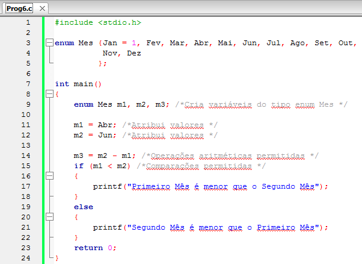

*Figura:* captura do editor com `Prog6.c` (**A03-04-P06**), linhas 1–24 da versão histórica do programa. Fonte revisado: [`src/Fontes_Aula_3_e_4/Prog6.c`](../../src/Fontes_Aula_3_e_4/Prog6.c); versão anterior à revisão de 2026 em texto: [commit `04ac409`](https://github.com/Lucas-Sperotto/falect-cc-011-algoritmos-e-laboratorio-de-programacao-ii/blob/04ac4094dba3c3812809dd433a7d3855c4bffdc9/src/Fontes_Aula_3_e_4/Prog6.c); explicação: [seção 6](#a03-04-p06).

<a id="slide-14"></a>
**Slide 14 — Tipos de dados enumerados: enum**

> - A palavra enum define um conjunto de nomes (cada um deles com um valor inteiro), enumera esses nomes a partir do zero (default) ou, como em nosso programa, a partir do primeiro valor fornecido.
> - Se fornecermos um valor a alguns nomes e não a outros, o compilador atribuirá o próximo valor inteiro aos que não tiverem valor.

<a id="slide-15"></a>
**Slide 15 — Tipos de dados enumerados: enum**

> - Uma variável de um tipo enumerado pode ter qualquer valor listado na definição.
> - Não podemos atribuir valores não listados.
>
>   ```c
>   m1 = sabado; /* ERRADO. É ilegal */
>   ```
>
> - Tipos enumerados são tratados internamente como inteiros; portanto, qualquer operação possível com inteiros é permitida com eles.

*Nota de transcrição:* em C (diferentemente de C++), atribuir a uma variável `enum` um inteiro fora da lista é aceito pelo compilador; o erro do exemplo está em `sabado` não ter sido declarado. Ver [observação 8.4](#obs-4-4).

### 3.6 Usando typedef com enum (slides 16–18)

<a id="slide-16"></a>
**Slide 16 — Roteiro** · *repete o roteiro do [slide 2](#slide-2), sem destaque do tópico seguinte.*

<a id="slide-17"></a>
**Slide 17 — Usando typedef com enum**

> 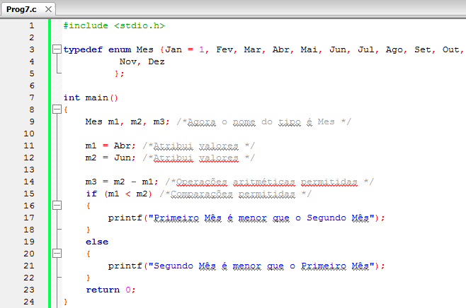

*Figura:* captura do editor com `Prog7.c` (**A03-04-P07**), linhas 1–24 da versão histórica do programa. Fonte revisado: [`src/Fontes_Aula_3_e_4/Prog7.c`](../../src/Fontes_Aula_3_e_4/Prog7.c); versão anterior à revisão de 2026 em texto: [commit `04ac409`](https://github.com/Lucas-Sperotto/falect-cc-011-algoritmos-e-laboratorio-de-programacao-ii/blob/04ac4094dba3c3812809dd433a7d3855c4bffdc9/src/Fontes_Aula_3_e_4/Prog7.c); explicação: [seção 6](#a03-04-p07). Na captura, `typedef enum Mes {...};` não declara o sinônimo `Mes` antes do `;`, de modo que `Mes m1, m2, m3;` não compila; ver [observação 8.5](#obs-4-5).

<a id="slide-18"></a>
**Slide 18 — Usando typedef com enum**

> - Outros exemplos:
>
>   ```c
>   typedef enum {Feminino, Masculino} sexo;
>   typedef enum {OFF, ON} chave;
>   ```
>
> - Se o modo como o compilador atribui valores não se adapta ao que você quer, poderá especificar os seus próprios valores:
>
>   ```c
>   typedef enum {Norte = 50, Sul = 80, Leste = 92, Oeste = 100} Direcao;
>   ```

### 3.7 Uniões (slides 19–27)

<a id="slide-19"></a>
**Slide 19 — Roteiro** · *repete o roteiro do [slide 2](#slide-2), sem destaque do tópico seguinte.*

<a id="slide-20"></a>
**Slide 20 — Uniões**

> - A sintaxe de definição de novos tipos de dados por meio da palavra Union [sic] é idêntica à da palavra struct.
> - Entretanto, uma union utiliza um mesmo espaço de memória a ser compartilhado com diferentes membros, enquanto uma struct aloca um espaço diferente de memória para cada membro.

<a id="slide-21"></a>
**Slide 21 — Uniões**

> - Em outras palavras, uma union é o meio pelo qual um pedaço de memória é tratado ora como uma variável de certo tipo, ora como outra variável de outro tipo.
> - Uniões podem ser usadas para poupar memória.
> - Quando você declara uma variável de um tipo union, automaticamente é alocado um espaço de memória suficiente para conter o seu ,maior [sic] membro.

*Nota de transcrição:* a economia de memória é real, mas o uso mais comum de uniões é guardar valores de tipos alternativos com um indicador de tipo, como em `Prog13.c` ([seção 4.4](#c-4-4)).

<a id="slide-22"></a>
**Slide 22 — Uniões**

> 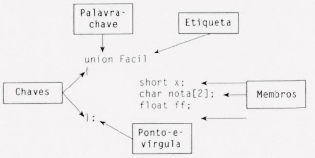
>
> - Veja um exemplo:

*Descrição da figura:* figura digitalizada (estilo de livro) com a definição `union Facil { short x; char nota[2]; float ff; };` e rótulos ligados por setas: “Palavra-chave” aponta para `union`; “Etiqueta” para `Facil`; “Chaves” para `{` e `}`; “Membros” para as três declarações; “Ponto-e-vírgula” para o `;` final. É a mesma estrutura gráfica do slide 13 da Aula 3, aplicada a `union`.

<a id="slide-23"></a>
**Slide 23 — Uniões**

> 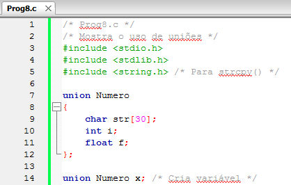

*Descrição da figura:* captura do código de `Prog8.c` **dos slides** (programa que não está no repositório; ver [observação 8.6](#obs-4-6)), linhas 1–14: comentários `/* Prog8.c */` e `/* Mostra o uso de uniões */`, `#include <string.h>` e a definição `union Numero { char str[30]; int i; float f; };` seguida da variável global `union Numero x;`.

*Nota de transcrição:* os slides 23 a 26 mostram um programa `Prog8.c` que não existe no repositório; o arquivo de mesmo nome contém outro exemplo. Ver [observação 8.6](#obs-4-6).

<a id="slide-24"></a>
**Slide 24 — Uniões**

> 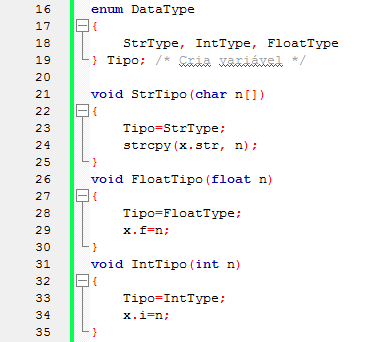

*Descrição da figura:* captura do código de `Prog8.c` **dos slides** (programa que não está no repositório; ver [observação 8.6](#obs-4-6)), linhas 16–35: `enum DataType { StrType, IntType, FloatType } Tipo;` e as funções `StrTipo(char n[])`, `FloatTipo(float n)` e `IntTipo(int n)`, que registram o tipo em `Tipo` e gravam o valor no membro correspondente de `x` (`strcpy(x.str, n)`, `x.f = n`, `x.i = n`).

<a id="slide-25"></a>
**Slide 25 — Uniões**

> 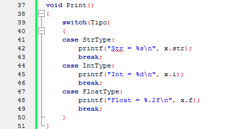

*Descrição da figura:* captura do código de `Prog8.c` **dos slides** (programa que não está no repositório; ver [observação 8.6](#obs-4-6)), linhas 37–51: a função `Print()`, que usa `switch(Tipo)` para imprimir `x.str` com `%s`, `x.i` com `%d` ou `x.f` com `%.2f`.

<a id="slide-26"></a>
**Slide 26 — Uniões**

> 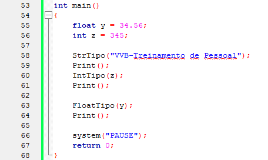

*Descrição da figura:* captura do código de `Prog8.c` **dos slides** (programa que não está no repositório; ver [observação 8.6](#obs-4-6)), linhas 53–68: `main()` com `float y = 34.56; int z = 345;` e as chamadas `StrTipo("VVB-Treinamento de Pessoal"); Print(); IntTipo(z); Print(); FloatTipo(y); Print();`.

<a id="slide-27"></a>
**Slide 27 — Uniões**

> - A seguir, a saída do programa:
>
> ```text
> Str = VVB -Treinamento de Pessoal
> Int = 345
> Float = 35
> ```
>
> - Uniões são tipos de dados que armazenam um único membro por vez.
> - Os membros de uma union representam os diversos tipos de dados que ela pode conter.

<details><summary>Imagem original (saída de execução, slide 27)</summary>

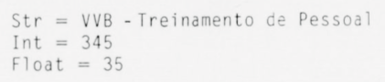

</details>

*Nota de transcrição:* com o formato `%.2f` usado em `Print()`, o terceiro valor seria impresso como `Float = 34.56`; a imagem de saída (de aparência digitalizada) não corresponde ao código. Ver [observação 8.7](#obs-4-7).

### 3.8 Usando typedef com union (slides 28–34)

<a id="slide-28"></a>
**Slide 28 — Roteiro** · *repete o roteiro do [slide 2](#slide-2), sem destaque do tópico seguinte.*

<a id="slide-29"></a>
**Slide 29 — Usando typedef com union**

> - A sintaxe de union é a mesma de struct.
> - Assim, podemos usar typedef.
>
>   ```c
>   typedef union
>   {
>       char str[30];
>       int i;
>       float f;
>   } Numero;
>
>   Numero x; /* Cria variável */
>   ```

<a id="slide-30"></a>
**Slide 30 — Usando typedef com union**

> - Combinando declarações:
>   - Podemos combinar a definição da union com a declaração da variável.
>
>     ```c
>     union Numero
>     {
>         char str[30];
>         int i;
>         float f;
>     } x; /* Cria variável */
>     ```
>
>   - Podemos declarar quantas variáveis quisermos:
>
>     ```c
>     union Numero
>     {
>         char str[30];
>         int i;
>         float f;
>     } x, y, z; /* Cria variável */
>     ```

<a id="slide-31"></a>
**Slide 31 — Usando typedef com union**

> - Combinando declarações:
>   - A etiqueta pode ser suprimida:
>
>     ```c
>     union
>     {
>         char str[30];
>         int i;
>         float f;
>     } x; /* Cria variável */
>     ```
>
> - Inicializando union:
>   - Estruturas e matrizes static ou extern podem ser inicializadas quando são definidas;
>   - Desse modo, seria razoável pensar que o mesmo é permitido para uniões.

<a id="slide-32"></a>
**Slide 32 — Usando typedef com union**

> - Inicializando union:
>   - Uma união tem um único membro ativo em qualquer tempo e seria conveniente pensar na seguinte inicialização:
>
>     ```c
>     static union
>     {
>         int idade;
>         float salario;
>     } uInit = {123.456};
>     ```

<a id="slide-33"></a>
**Slide 33 — Usando typedef com union**

> - Inicializando union:
>   - O compilador deveria ser capaz de entender que estamos inicializando a variável uInit por meio do membro float salario.
>   - Entretanto, muitos compiladores não permitem a inicialização de uniões e, quando permitem, ela é aplicada apenas ao primeiro membro declarado.

*Nota de transcrição:* desde o C99, inicializadores designados (`= { .salario = 123.456 }`) permitem escolher o membro; ver [observação 8.8](#obs-4-8).

<a id="slide-34"></a>
**Slide 34 — Usando typedef com union**

> - Inicializando union:
>   - Nesse caso, se você quer inicializar uInit.salario, a declaração de união deve ser modificada:
>
>     ```c
>     static union
>     {
>         float salario; /* Deve ser definido primeiro */
>         int idade;
>     } uInit = {123.456};
>     ```

*Nota de transcrição:* o exemplo dos slides 32 e 34 é o que está no arquivo `Prog8.c` do repositório (**A03-04-P08**); ver [seção 6](#a03-04-p08).

### 3.9 Uniões de estruturas (slides 35–42)

<a id="slide-35"></a>
**Slide 35 — Roteiro** · *repete o roteiro do [slide 2](#slide-2), sem destaque do tópico seguinte.*

<a id="slide-36"></a>
**Slide 36 — Uniões de estruturas**

> - Uma união pode ter membros de qualquer tipo, até mesmo estruturas ou outras uniões.
> - Uma união também pode ser membro de uma estrutura.
> - Veja um exemplo:

<a id="slide-37"></a>
**Slide 37 — Uniões de estruturas**

> 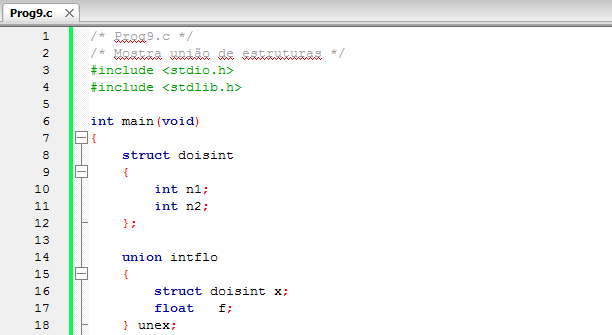

*Figura:* captura do editor com `Prog9.c` (**A03-04-P09**), linhas 1–18 da versão histórica do programa. Fonte revisado: [`src/Fontes_Aula_3_e_4/Prog9.c`](../../src/Fontes_Aula_3_e_4/Prog9.c); versão anterior à revisão de 2026 em texto: [commit `04ac409`](https://github.com/Lucas-Sperotto/falect-cc-011-algoritmos-e-laboratorio-de-programacao-ii/blob/04ac4094dba3c3812809dd433a7d3855c4bffdc9/src/Fontes_Aula_3_e_4/Prog9.c); explicação: [seção 6](#a03-04-p09).

<a id="slide-38"></a>
**Slide 38 — Uniões de estruturas**

> 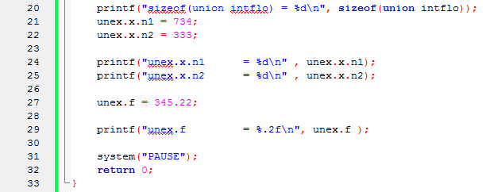

*Figura:* continuação de `Prog9.c` (**A03-04-P09**), linhas 20–33. `sizeof` é impresso com `%d`; ver [observação 8.9](#obs-4-9).

<a id="slide-39"></a>
**Slide 39 — Uniões de estruturas**

> - A saída será:
>
> ```text
> sizeof(union intflo) = 8
> unex.x.n1       = 734
> unex.x.n2       = 333
> unex.f          = 345.22
> ```
>
> - Observe que o operador ponto foi usado duas vezes para acessar os membros da estrutura interna x.
> - Vamos mostrar o uso de uma estrutura de campo bits como membro de uma union.
> - Eis um exemplo que permite convertes [sic] um caractere em seu correspondente binário:

<details><summary>Imagem original (saída de execução, slide 39)</summary>

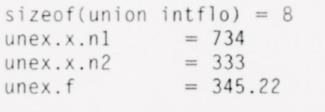

</details>

<a id="slide-40"></a>
**Slide 40 — Uniões de estruturas**

> 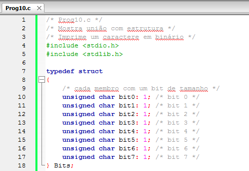

*Figura:* captura do editor com `Prog10.c` (**A03-04-P10**), linhas 1–18 da versão histórica do programa. Fonte revisado: [`src/Fontes_Aula_3_e_4/Prog10.c`](../../src/Fontes_Aula_3_e_4/Prog10.c); versão anterior à revisão de 2026 em texto: [commit `04ac409`](https://github.com/Lucas-Sperotto/falect-cc-011-algoritmos-e-laboratorio-de-programacao-ii/blob/04ac4094dba3c3812809dd433a7d3855c4bffdc9/src/Fontes_Aula_3_e_4/Prog10.c); explicação: [seção 6](#a03-04-p10).

<a id="slide-41"></a>
**Slide 41 — Uniões de estruturas**

> 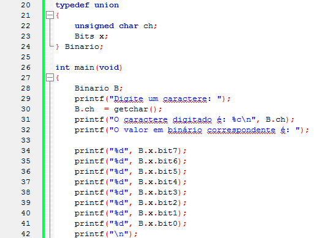

*Figura:* continuação de `Prog10.c` (**A03-04-P10**), linhas 20–42.

*Nota de transcrição:* ler um membro diferente do último gravado e a ordem dos campos de bits dependem da implementação; ver [observação 8.10](#obs-4-10).

<a id="slide-42"></a>
**Slide 42 — Uniões de estruturas**

> 
>
> - A seguir a saída do programa:
>
> ```text
> Digite um caractere: A
> O caractere digitado é: A
> O valor em binário correspondente é: 01000001
> ```

*Figura:* continuação de `Prog10.c` (**A03-04-P10**), linhas 44–46.

<details><summary>Imagem original (saída de execução, slide 42)</summary>

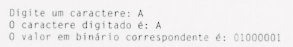

</details>

### 3.10 O operador sizeof (slides 43–46)

<a id="slide-43"></a>
**Slide 43 — Roteiro** · *repete o roteiro do [slide 2](#slide-2), sem destaque do tópico seguinte.*

<a id="slide-44"></a>
**Slide 44 — O operador sizeof**

> - Uma variável de um tipo union tem o tamanho do maior membro.
> - Para verificar isso, usaremos um novo operador C: sizeof.
> - O operador sizeof opera sobre o nome de um tipo de dado ou sobre o nome de uma variável e resulta o seu tamanho em bytes.
> - Veja um exemplo:

*Nota de transcrição:* `sizeof` produz um valor do tipo `size_t`, impresso com `%zu`.

<a id="slide-45"></a>
**Slide 45 — O operador sizeof**

> 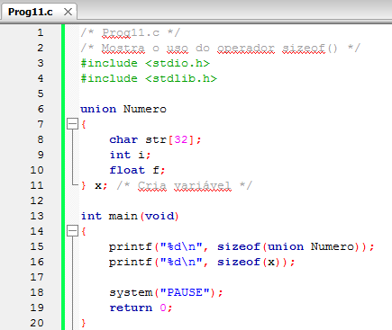

*Figura:* captura do editor com `Prog11.c` (**A03-04-P11**), linhas 1–20 da versão histórica do programa. Fonte revisado: [`src/Fontes_Aula_3_e_4/Prog11.c`](../../src/Fontes_Aula_3_e_4/Prog11.c); versão anterior à revisão de 2026 em texto: [commit `04ac409`](https://github.com/Lucas-Sperotto/falect-cc-011-algoritmos-e-laboratorio-de-programacao-ii/blob/04ac4094dba3c3812809dd433a7d3855c4bffdc9/src/Fontes_Aula_3_e_4/Prog11.c); explicação: [seção 6](#a03-04-p11).

<a id="slide-46"></a>
**Slide 46 — O operador sizeof**

> - A expressão
>
>   ```c
>   sizeof(union Numero)
>   ```
>
> - É equivalente a
>
>   ```c
>   sizeof(x)
>   ```
>
> - E resulta o tamanho do tipo union Numero.

### 3.11 O operador de endereços (&) com union (slides 47–50)

<a id="slide-47"></a>
**Slide 47 — Roteiro** · *repete o roteiro do [slide 2](#slide-2), sem destaque do tópico seguinte.*

<a id="slide-48"></a>
**Slide 48 — O operador de endereços (&) com union**

> - O endereço de memória de cada membro de uma união é o mesmo, visto que todos compartilham o mesmo espaço.
> - Podemos verificar isso utilizando o operador de endereços.

<a id="slide-49"></a>
**Slide 49 — O operador de endereços (&) com union**

> 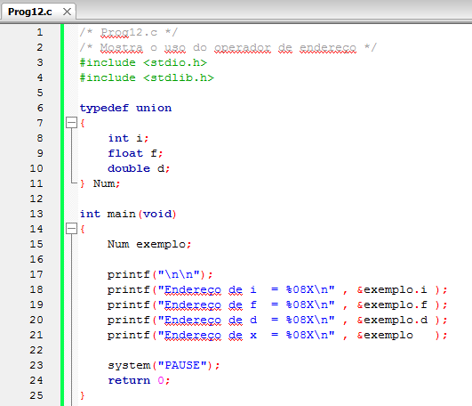

*Figura:* captura do editor com `Prog12.c` (**A03-04-P12**), linhas 1–25 da versão histórica do programa. Fonte revisado: [`src/Fontes_Aula_3_e_4/Prog12.c`](../../src/Fontes_Aula_3_e_4/Prog12.c); versão anterior à revisão de 2026 em texto: [commit `04ac409`](https://github.com/Lucas-Sperotto/falect-cc-011-algoritmos-e-laboratorio-de-programacao-ii/blob/04ac4094dba3c3812809dd433a7d3855c4bffdc9/src/Fontes_Aula_3_e_4/Prog12.c); explicação: [seção 6](#a03-04-p12). Os endereços são impressos com `%08X`, formato de inteiro; ver [observação 8.11](#obs-4-11).

<a id="slide-50"></a>
**Slide 50 — O operador de endereços (&) com union**

> - No programa, usamos o operador de endereços com cada um dos membros da união e também como o próprio nome da variável união.
> - A expressão
>
>   ```c
>   &exemplo
>   ```
>
> - Resulta o endereço do primeiro byte ocupado pela variável exemplo.

### 3.12 Uniões anônimas (slides 51–55)

<a id="slide-51"></a>
**Slide 51 — Roteiro** · *repete o roteiro do [slide 2](#slide-2), sem destaque do tópico seguinte.*

<a id="slide-52"></a>
**Slide 52 — Uniões anônimas**

> - Uniões anônimas são uniões definidas sem a especificação do nome do tipo.
> - Eis um exemplo:
>
>   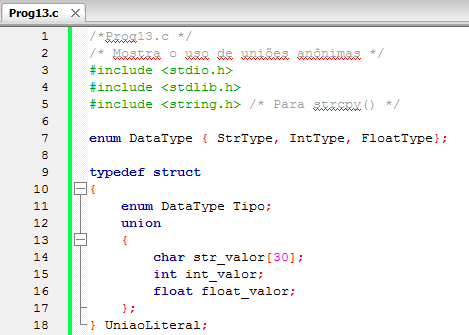

*Figura:* captura do editor com `Prog13.c` (**A03-04-P13**), linhas 1–18 da versão histórica do programa. Fonte revisado: [`src/Fontes_Aula_3_e_4/Prog13.c`](../../src/Fontes_Aula_3_e_4/Prog13.c); versão anterior à revisão de 2026 em texto: [commit `04ac409`](https://github.com/Lucas-Sperotto/falect-cc-011-algoritmos-e-laboratorio-de-programacao-ii/blob/04ac4094dba3c3812809dd433a7d3855c4bffdc9/src/Fontes_Aula_3_e_4/Prog13.c); explicação: [seção 6](#a03-04-p13).

<a id="slide-53"></a>
**Slide 53 — Uniões anônimas**

> 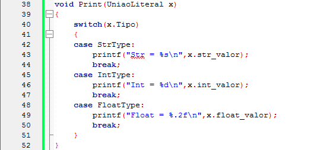

*Figura:* continuação de `Prog13.c` (**A03-04-P13**), linhas 38–52.

<a id="slide-54"></a>
**Slide 54 — Uniões anônimas**

> 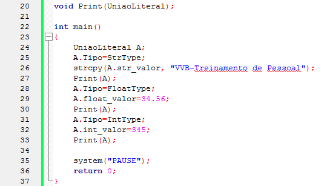

*Figura:* continuação de `Prog13.c` (**A03-04-P13**), linhas 20–37. O slide 53 mostra as linhas 38–52 antes deste, que mostra as linhas 20–37: a ordem das capturas está invertida no PDF.

<a id="slide-55"></a>
**Slide 55 — Uniões anônimas**

> - Em C, uniões anônimas só podem ser definidas como membros de estruturas.
> - Elas são acessadas diretamente, por meio do nome da variável struct, como se fossem membros da estrutura.
> - Quando criamos uma união anônima, devemos tomar cuidado de indicar a cada tempo qual é o membro da union corrente e lembrar que existirá somente um membro de cada vez.

*Nota de transcrição:* uniões anônimas foram padronizadas no C11, como membros de estruturas ou de outras uniões; ver [observação 8.12](#obs-4-12).

### 3.13 Referências do material original (slide 56)

<a id="slide-56"></a>
**Slide 56 — Referências**

> - MIZRAHI, Victorine V. Treinamento em Linguagem C, São Paulo: Pearson Prentice Hall, 2008;

## 4. Explicações complementares

<a id="c-4-1"></a>
### 4.1 Converter texto em número com detecção de erro

`atoi("12x")` devolve 12 e `atoi("x")` devolve 0, sem informar se houve erro; se o número não couber em `int`, o comportamento é indefinido (§7.22.1). As funções `strtol` e `strtod` informam onde a conversão parou e sinalizam estouro em `errno`:

```c
#include <errno.h>
#include <stdlib.h>

char *fim;
errno = 0;
long v = strtol(texto, &fim, 10);
if (fim == texto || *fim != '\0' || errno == ERANGE) {
    /* não é um número inteiro válido ou está fora da faixa de long */
}
```

Os fontes revisados usam `sscanf` com verificação de retorno em `Prog5.c` e `strtol`/`strtod` nas leituras de registros da [Aula 11](../aula-11/README.md).

<a id="c-4-2"></a>
### 4.2 Códigos de saída

`exit(n)` e `return n;` em `main()` encerram o programa e entregam `n` ao sistema operacional (§7.22.4.4 e §5.1.2.2.3). Antes de terminar, `exit` descarrega e fecha os arquivos abertos e executa as funções registradas com `atexit`. A convenção é 0 (ou `EXIT_SUCCESS`) para sucesso e outro valor (ou `EXIT_FAILURE`) para falha. No Linux e no WSL:

```bash
./prog5 < entradas.txt
echo $?          # mostra o código de saída do último comando
./prog5 && echo "terminou bem" || echo "falhou"
```

O `ERRORLEVEL` dos slides 6–7 é o equivalente nos arquivos `.BAT` do DOS e do `cmd.exe`. Os cenários de teste do repositório conferem exatamente esse código (campo `expected_returncode`).

<a id="c-4-3"></a>
### 4.3 `typedef` de tipo de função

`typedef void FuncType(float, int);` dá nome a um **tipo de função**, e `FuncType MinhaFunc;` declara (não define) a função `MinhaFunc`. É raro usar essa forma diretamente; o uso comum é o tipo **ponteiro para função**, `typedef void (*PFunc)(void);`, apresentado na [Aula 7](../aula-07/README.md).

<a id="c-4-4"></a>
### 4.4 Enumerações

Em `enum Mes {Jan = 1, Fev, Mar, ...};`, cada nome é uma constante inteira: `Jan` vale 1 e os seguintes valem 2, 3, …, 12. Sem valor inicial, a numeração começa em 0. As constantes enumeradas têm tipo `int`; a variável `enum Mes m1` tem um tipo inteiro compatível escolhido pelo compilador (§6.7.2.2). Vantagens em relação a `#define`: os nomes respeitam o escopo, são agrupados por tipo e aparecem no depurador.

Uma enumeração não guarda o **nome** do valor: para imprimir “Abr”, é preciso uma tabela de strings indexada pela constante (como a matriz `diasemana` da [Aula 2](../aula-02/README.md#c-2-8)):

```c
static const char *nomes[] = { "", "Jan", "Fev", "Mar", "Abr", "Mai", "Jun",
                               "Jul", "Ago", "Set", "Out", "Nov", "Dez" };
printf("%s\n", nomes[m1]);   /* "Abr" */
```

<a id="c-4-5"></a>
### 4.5 Uniões: uma única região para membros alternativos

Em uma `struct`, cada membro tem sua própria região; em uma `union`, todos os membros começam no mesmo endereço (§6.7.2.1p16), e o tamanho é o do maior membro, arredondado para o alinhamento (por isso `union Numero` com `char str[30]` tem 32 bytes no GCC x86-64).

| `union Numero` (GCC x86-64) | bytes 0–3 | bytes 4–29 | bytes 30–31 |
|---|---|---|---|
| `str` (30 bytes) | `str[0..3]` | `str[4..29]` | preenchimento |
| `i` (`int`) | `i` | — | — |
| `f` (`float`) | `f` | — | — |

Gravar em um membro sobrescreve os outros. Por isso o uso típico é a **união com indicador** (*tagged union*): uma estrutura guarda o tipo do valor atual e uma união guarda o valor, como em `Prog13.c` e no `Prog8.c` dos slides.

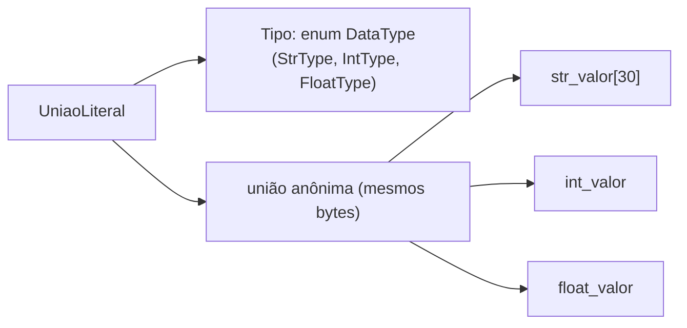

A função `Print()` consulta `Tipo` antes de ler a união; ler um membro diferente do último gravado só faz sentido quando se quer, de propósito, ver a representação (seção 4.7).

<a id="c-4-6"></a>
### 4.6 `sizeof`

`sizeof` é um **operador**, avaliado em tempo de compilação (exceto para vetores de tamanho variável), que dá o tamanho em bytes de um tipo ou de uma expressão. Com um tipo, os parênteses são obrigatórios (`sizeof(union Numero)`); com uma expressão, são opcionais (`sizeof x`). O resultado tem o tipo `size_t`, sem sinal, que se imprime com `%zu` (§7.21.6.1); usar `%d`, como nos slides 38 e 45, é incorreto em sistemas de 64 bits.

<a id="c-4-7"></a>
### 4.7 Reinterpretação de memória por união

Em `Prog9.c`, depois de `unex.f = 345.22;`, os quatro primeiros bytes da união guardam a representação IEEE 754 de `345.22f`. Se o programa lesse `unex.x.n1` nesse momento, veria esses mesmos bits interpretados como inteiro:

| Valor gravado | Bits (hexadecimal) | Lido como `int` (GCC x86-64) |
|---|---|---|
| `unex.f = 345.22f` | `0x43AC9C29` | `1135385641` |

`unex.x.n2` continuaria valendo 333, porque fica nos bytes 4–7, que o `float` não ocupa. C permite essa leitura através de uma união (§6.5.2.3, nota 95), mas o resultado depende da representação dos tipos e da ordem dos bytes (*endianness*), por isso não é portável. O mesmo vale para `Prog10.c`: a correspondência entre `bit0` e o bit menos significativo de `ch` é a escolha do GCC em x86, não uma regra da linguagem. A alternativa portável é extrair cada bit com máscara, `(ch >> k) & 1`, como na [Aula 9](../aula-09/README.md).

<a id="c-4-8"></a>
### 4.8 Inicializar uma união

Uma lista `= {valor}` inicializa o **primeiro** membro (§6.7.9p17). Em `static union { int idade; float salario; } uInit = {123.456};`, o valor é convertido para `int` e `idade` recebe 123: a fração é descartada. O slide 34 resolve isso colocando `salario` em primeiro lugar. Desde o C99, o inicializador designado escolhe o membro sem reordenar a declaração:

```c
static union { int idade; float salario; } uInit = { .salario = 123.456f };
```

## 5. Conceitos fundamentais

| Conceito | Definição operacional | Onde aparece |
|---|---|---|
| Conversão de texto em número | `atoi`, `atof` (sem detecção de erro), `strtol`, `strtod` (com detecção) | slides 3–4; [4.1](#c-4-1) |
| Código de saída | Inteiro entregue ao sistema ao terminar; 0 indica sucesso | slides 6–7; [4.2](#c-4-2) |
| Tipo enumerado | Conjunto de constantes inteiras com nome | slides 11–18 |
| União | Tipo cujos membros compartilham a mesma memória | slides 20–34 |
| Membro ativo | Último membro gravado em uma união | slides 27, 32–33 |
| União com indicador | Estrutura com o tipo atual e uma união com o valor | slides 23–26, 52–55 |
| `sizeof` | Operador que dá o tamanho em bytes de um tipo ou expressão (`size_t`) | slides 44–46 |
| Endereço de membro | Todos os membros de uma união têm o mesmo endereço | slides 48–50 |
| Representação | Padrão de bits que codifica um valor; depende do tipo e da máquina | slides 39–42; [4.7](#c-4-7) |
| União anônima | União sem nome dentro de uma estrutura; membros acessados diretamente | slides 52–55 |

## 6. Programas C da aula

Fontes em [`src/Fontes_Aula_3_e_4/`](../../src/Fontes_Aula_3_e_4/), revisados em 2026 ([revisão por fonte](../../docs/auditorias/REVISAO_POR_FONTE.md#aulas-3-e-4--srcfontes_aula_3_e_4)).

| ID | Arquivo | SIGAA | Slides | Tema |
|---|---|---|---|---|
| [A03-04-P06](#a03-04-p06) | [`Prog6.c`](../../src/Fontes_Aula_3_e_4/Prog6.c) | Prog06.c | 11–15 | `enum Mes` |
| [A03-04-P07](#a03-04-p07) | [`Prog7.c`](../../src/Fontes_Aula_3_e_4/Prog7.c) | Prog07.c | 16–18 | `typedef enum` |
| [A03-04-P08](#a03-04-p08) | [`Prog8.c`](../../src/Fontes_Aula_3_e_4/Prog8.c) | Prog08.c | 31–34 | inicialização de união |
| [A03-04-P09](#a03-04-p09) | [`Prog9.c`](../../src/Fontes_Aula_3_e_4/Prog9.c) | Prog09.c | 36–39 | união de estruturas |
| [A03-04-P10](#a03-04-p10) | [`Prog10.c`](../../src/Fontes_Aula_3_e_4/Prog10.c) | Prog10.c | 39–42 | união com campos de bits |
| [A03-04-P11](#a03-04-p11) | [`Prog11.c`](../../src/Fontes_Aula_3_e_4/Prog11.c) | Prog11.c | 44–46 | `sizeof` |
| [A03-04-P12](#a03-04-p12) | [`Prog12.c`](../../src/Fontes_Aula_3_e_4/Prog12.c) | Prog12.c | 48–50 | endereços dos membros |
| [A03-04-P13](#a03-04-p13) | [`Prog13.c`](../../src/Fontes_Aula_3_e_4/Prog13.c) | Prog13.c | 52–55 | união anônima |

<a id="a03-04-p06"></a>
### 6.1 A03-04-P06 — `Prog6.c`: enumeração dos meses

- **Finalidade:** declarar `enum Mes`, atribuir, subtrair e comparar valores. **Entrada:** nenhuma. **Saída:** a diferença (2) e a comparação.
- **Diferença em relação ao slide 13:** o fonte revisado imprime `m3`, que antes era calculado e não usado; a codificação foi convertida para UTF-8.
- **Observação:** a mensagem final não termina com `\n` (como no original), de modo que o prompt do terminal aparece colado.

<!-- codigo: src/Fontes_Aula_3_e_4/Prog6.c de=`enum Mes {Jan` ate=`printf("Diferença` -->
<sub>Copiado de [`src/Fontes_Aula_3_e_4/Prog6.c`](../../src/Fontes_Aula_3_e_4/Prog6.c#L8-L20) (linhas 8–20) por `scripts/documentacao_aulas.py`; não edite este bloco à mão.</sub>

```c
enum Mes {Jan = 1, Fev, Mar, Abr, Mai, Jun, Jul, Ago, Set, Out,
          Nov, Dez
         };

int main(void)
{
    enum Mes m1, m2, m3; /*Cria variáveis do tipo enum Mes */

    m1 = Abr; /*Atribui valores */
    m2 = Jun; /*Atribui valores */

    m3 = m2 - m1; /*Operações aritméticas permitidas */
    printf("Diferença entre os meses: %d\n", m3);
```
<!-- /codigo -->

<a id="a03-04-p07"></a>
### 6.2 A03-04-P07 — `Prog7.c`: `typedef enum`

- **Finalidade:** dar o nome `Mes` ao tipo enumerado. **Entrada, saída:** iguais a `Prog6.c`.
- **Diferença em relação ao slide 17:** o original escrevia `typedef enum Mes {...};`, sem o sinônimo, e não compilava; a versão revisada declara `} Mes;` ([8.5](#obs-4-5)).

<!-- codigo: src/Fontes_Aula_3_e_4/Prog7.c de=`typedef enum Mes` ate=`Mes m1, m2, m3;` -->
<sub>Copiado de [`src/Fontes_Aula_3_e_4/Prog7.c`](../../src/Fontes_Aula_3_e_4/Prog7.c#L8-L14) (linhas 8–14) por `scripts/documentacao_aulas.py`; não edite este bloco à mão.</sub>

```c
typedef enum Mes {Jan = 1, Fev, Mar, Abr, Mai, Jun, Jul, Ago, Set, Out,
          Nov, Dez
         } Mes;

int main(void)
{
    Mes m1, m2, m3; /*Agora o nome do tipo é Mes */
```
<!-- /codigo -->

<a id="a03-04-p08"></a>
### 6.3 A03-04-P08 — `Prog8.c`: inicialização de união

- **O que o arquivo contém:** o exemplo `uInit` dos slides 32–34, e **não** o programa `Prog8.c` dos slides 23–26 ([8.6](#obs-4-6)). Historicamente, o `main()` estava vazio.
- **Versão revisada:** inicializa a união com `{123}` (o primeiro membro é `int`) e imprime `uInit.idade`. O comentário explica que a fração de `123.456` era descartada ([4.8](#c-4-8)).
- **Saída:** `Idade (primeiro membro da união): 123`.

<!-- codigo: src/Fontes_Aula_3_e_4/Prog8.c de=`static union` ate=`uInit.idade);` -->
<sub>Copiado de [`src/Fontes_Aula_3_e_4/Prog8.c`](../../src/Fontes_Aula_3_e_4/Prog8.c#L12-L22) (linhas 12–22) por `scripts/documentacao_aulas.py`; não edite este bloco à mão.</sub>

```c
static union
{
    int idade;
    float salario;
} uInit = {123}; /* O primeiro membro é int: a fração original era truncada. */


int main(void)
{
    printf("Idade (primeiro membro da união): %d\n", uInit.idade);
```
<!-- /codigo -->

<a id="a03-04-p09"></a>
### 6.4 A03-04-P09 — `Prog9.c`: união de estruturas

- **Finalidade:** mostrar que a união tem o tamanho do maior membro (`struct doisint`, 8 bytes) e acessar `unex.x.n1`. **Saída:** igual à do slide 39.
- **Diferença em relação ao slide 38:** `%zu` para `sizeof` ([8.9](#obs-4-9)). O programa imprime `n1` e `n2` **antes** de gravar `unex.f`, por isso não mostra a sobreposição; a [seção 4.7](#c-4-7) mostra o que aconteceria.

<!-- codigo: src/Fontes_Aula_3_e_4/Prog9.c de=`union intflo` ate=`unex.f );` -->
<sub>Copiado de [`src/Fontes_Aula_3_e_4/Prog9.c`](../../src/Fontes_Aula_3_e_4/Prog9.c#L19-L34) (linhas 19–34) por `scripts/documentacao_aulas.py`; não edite este bloco à mão.</sub>

```c
    union intflo
    {
        struct doisint x;
        float   f;
    } unex;

    printf("sizeof(union intflo) = %zu\n", sizeof(union intflo));
    unex.x.n1 = 734;
    unex.x.n2 = 333;

    printf("unex.x.n1      = %d\n" , unex.x.n1);
    printf("unex.x.n2      = %d\n" , unex.x.n2);

    unex.f = 345.22;

    printf("unex.f         = %.2f\n", unex.f );
```
<!-- /codigo -->

<a id="a03-04-p10"></a>
### 6.5 A03-04-P10 — `Prog10.c`: caractere em binário

- **Finalidade:** ler um caractere e imprimir seus 8 bits por meio de uma união com campos de bits. **Entrada:** um caractere. **Saída:** o caractere e os bits, do mais ao menos significativo.
- **Diferença em relação aos slides 40–42:** `getchar()` passou a ser guardado em `int` antes da conversão, para distinguir `EOF` de um byte válido; o comentário registra que o resultado depende do compilador ([8.10](#obs-4-10)).

<!-- codigo: src/Fontes_Aula_3_e_4/Prog10.c de=`typedef union` ate=`printf("%d", B.x.bit0);` -->
<sub>Copiado de [`src/Fontes_Aula_3_e_4/Prog10.c`](../../src/Fontes_Aula_3_e_4/Prog10.c#L25-L51) (linhas 25–51) por `scripts/documentacao_aulas.py`; não edite este bloco à mão.</sub>

```c
typedef union
{
    unsigned char ch;
    Bits x;
} Binario;

int main(void)
{
    Binario B;
    printf("Digite um caractere: ");
    int entrada = getchar();
    if (entrada == EOF)
        return EXIT_FAILURE;
    B.ch = (unsigned char)entrada;
    /* A sobreposição de união e ordem dos bitfields dependem do compilador.
     * Para uma representação portátil, use máscaras e deslocamentos de B.ch. */
    printf("O caractere digitado é: %c\n", B.ch);
    printf("O valor em binário correspondente é: ");

    printf("%d", B.x.bit7);
    printf("%d", B.x.bit6);
    printf("%d", B.x.bit5);
    printf("%d", B.x.bit4);
    printf("%d", B.x.bit3);
    printf("%d", B.x.bit2);
    printf("%d", B.x.bit1);
    printf("%d", B.x.bit0);
```
<!-- /codigo -->

<a id="a03-04-p11"></a>
### 6.6 A03-04-P11 — `Prog11.c`: `sizeof`

- **Finalidade:** imprimir o tamanho de `union Numero` pelo tipo e pela variável. **Saída:** `32` duas vezes.
- **Observação:** no slide 45 o vetor é `char str[32]`; nos slides 23 e 29–31, `str[30]`. Com 30, o tamanho continuaria 32 por causa do alinhamento de 4 bytes ([4.5](#c-4-5)).

<!-- codigo: src/Fontes_Aula_3_e_4/Prog11.c de=`union Numero` ate=`sizeof(x));` -->
<sub>Copiado de [`src/Fontes_Aula_3_e_4/Prog11.c`](../../src/Fontes_Aula_3_e_4/Prog11.c#L11-L21) (linhas 11–21) por `scripts/documentacao_aulas.py`; não edite este bloco à mão.</sub>

```c
union Numero
{
    char str[32];
    int i;
    float f;
} x; /* Cria variável */

int main(void)
{
    printf("%zu\n", sizeof(union Numero));
    printf("%zu\n", sizeof(x));
```
<!-- /codigo -->

<a id="a03-04-p12"></a>
### 6.7 A03-04-P12 — `Prog12.c`: endereços dos membros

- **Finalidade:** mostrar que `&exemplo.i`, `&exemplo.f`, `&exemplo.d` e `&exemplo` são o mesmo endereço. **Saída:** quatro endereços iguais (variam a cada execução).
- **Diferença em relação ao slide 49:** `%08X` virou `%p` com `(void *)` ([8.11](#obs-4-11)). O rótulo “Endereço de x” refere-se à variável `exemplo`, como no original.

<!-- codigo: src/Fontes_Aula_3_e_4/Prog12.c de=`Num exemplo;` ate=`(void *)&exemplo );` -->
<sub>Copiado de [`src/Fontes_Aula_3_e_4/Prog12.c`](../../src/Fontes_Aula_3_e_4/Prog12.c#L20-L26) (linhas 20–26) por `scripts/documentacao_aulas.py`; não edite este bloco à mão.</sub>

```c
    Num exemplo;

    printf("\n\n");
    printf("Endereço de i  = %p\n" , (void *)&exemplo.i );
    printf("Endereço de f  = %p\n" , (void *)&exemplo.f );
    printf("Endereço de d  = %p\n" , (void *)&exemplo.d );
    printf("Endereço de x  = %p\n" , (void *)&exemplo );
```
<!-- /codigo -->

<a id="a03-04-p13"></a>
### 6.8 A03-04-P13 — `Prog13.c`: união anônima com indicador de tipo

- **Finalidade:** guardar uma string, um `float` e um `int` na mesma variável, alternadamente, e imprimir conforme o indicador `Tipo`. **Saída:** três linhas, `Str = …`, `Float = 34.56` e `Int = 345`.
- **Conceitos:** união anônima (membros acessados como `A.str_valor`), `enum` como indicador, passagem de estrutura por valor para `Print()`.
- **Diferença em relação aos slides 52–54:** nenhuma de lógica. É o programa do repositório mais próximo do `Prog8.c` ausente dos slides 23–26.

<!-- codigo: src/Fontes_Aula_3_e_4/Prog13.c de=`enum DataType` ate=`} UniaoLiteral;` -->
<sub>Copiado de [`src/Fontes_Aula_3_e_4/Prog13.c`](../../src/Fontes_Aula_3_e_4/Prog13.c#L12-L23) (linhas 12–23) por `scripts/documentacao_aulas.py`; não edite este bloco à mão.</sub>

```c
enum DataType { StrType, IntType, FloatType};

typedef struct
{
    enum DataType Tipo;
    union
    {
        char str_valor[30];
        int int_valor;
        float float_valor;
    };
} UniaoLiteral;
```
<!-- /codigo -->

## 7. Exemplos de execução

### 7.1 Enumeração (`Prog6.c`)

<!-- execucao: src/Fontes_Aula_3_e_4/Prog6.c cenario=normal -->
Execução real do cenário revisado `normal` ([manifesto](../../scripts/cenarios_fontes_c.json)), compilado com `gcc -std=c11 -Wall -Wextra -Wpedantic -O0`; bloco gerado por `scripts/documentacao_aulas.py`.

Comando: `./Prog6`

Entrada padrão: *(vazia)*

Saída padrão (sem quebra de linha final):

```text
Diferença entre os meses: 2
Primeiro Mês é menor que o Segundo Mês
```

Código de saída: `0`.
<!-- /execucao -->

### 7.2 Inicialização de união (`Prog8.c`)

<!-- execucao: src/Fontes_Aula_3_e_4/Prog8.c cenario=normal -->
Execução real do cenário revisado `normal` ([manifesto](../../scripts/cenarios_fontes_c.json)), compilado com `gcc -std=c11 -Wall -Wextra -Wpedantic -O0`; bloco gerado por `scripts/documentacao_aulas.py`.

Comando: `./Prog8`

Entrada padrão: *(vazia)*

Saída padrão:

```text
Idade (primeiro membro da união): 123
```

Código de saída: `0`.
<!-- /execucao -->

### 7.3 União de estruturas (`Prog9.c`)

<!-- execucao: src/Fontes_Aula_3_e_4/Prog9.c cenario=normal -->
Execução real do cenário revisado `normal` ([manifesto](../../scripts/cenarios_fontes_c.json)), compilado com `gcc -std=c11 -Wall -Wextra -Wpedantic -O0`; bloco gerado por `scripts/documentacao_aulas.py`.

Comando: `./Prog9`

Entrada padrão: *(vazia)*

Saída padrão:

```text
sizeof(union intflo) = 8
unex.x.n1      = 734
unex.x.n2      = 333
unex.f         = 345.22
```

Código de saída: `0`.
<!-- /execucao -->

### 7.4 Caractere em binário (`Prog10.c`)

<!-- execucao: src/Fontes_Aula_3_e_4/Prog10.c cenario=normal -->
Execução real do cenário revisado `normal` ([manifesto](../../scripts/cenarios_fontes_c.json)), compilado com `gcc -std=c11 -Wall -Wextra -Wpedantic -O0`; bloco gerado por `scripts/documentacao_aulas.py`.

Comando: `./Prog10`

Entrada padrão:

```text
A
```

Saída padrão:

```text
Digite um caractere: O caractere digitado é: A
O valor em binário correspondente é: 01000001
```

Código de saída: `0`.
<!-- /execucao -->

### 7.5 Tamanho da união (`Prog11.c`)

<!-- execucao: src/Fontes_Aula_3_e_4/Prog11.c cenario=normal -->
Execução real do cenário revisado `normal` ([manifesto](../../scripts/cenarios_fontes_c.json)), compilado com `gcc -std=c11 -Wall -Wextra -Wpedantic -O0`; bloco gerado por `scripts/documentacao_aulas.py`.

Comando: `./Prog11`

Entrada padrão: *(vazia)*

Saída padrão:

```text
32
32
```

Código de saída: `0`.
<!-- /execucao -->

### 7.6 Endereços dos membros (`Prog12.c`)

Os endereços mudam a cada execução (aleatorização do espaço de endereços), mas os quatro são sempre iguais entre si.

<!-- execucao: src/Fontes_Aula_3_e_4/Prog12.c cenario=normal -->
Execução real do cenário revisado `normal` ([manifesto](../../scripts/cenarios_fontes_c.json)), compilado com `gcc -std=c11 -Wall -Wextra -Wpedantic -O0`; bloco gerado por `scripts/documentacao_aulas.py`.

Comando: `./Prog12`

Entrada padrão: *(vazia)*

Saída padrão:

```text


Endereço de i  = 0x7ffc4e229f60
Endereço de f  = 0x7ffc4e229f60
Endereço de d  = 0x7ffc4e229f60
Endereço de x  = 0x7ffc4e229f60
```

Código de saída: `0`.
<!-- /execucao -->

### 7.7 União com indicador de tipo (`Prog13.c`)

<!-- execucao: src/Fontes_Aula_3_e_4/Prog13.c cenario=normal -->
Execução real do cenário revisado `normal` ([manifesto](../../scripts/cenarios_fontes_c.json)), compilado com `gcc -std=c11 -Wall -Wextra -Wpedantic -O0`; bloco gerado por `scripts/documentacao_aulas.py`.

Comando: `./Prog13`

Entrada padrão: *(vazia)*

Saída padrão:

```text
Str = VVB-Treinamento de Pessoal
Float = 34.56
Int = 345
```

Código de saída: `0`.
<!-- /execucao -->

## 8. Observações técnicas

<a id="obs-4-1"></a>
**8.1 `atoi` e `atof` (slides 3–4).** “Caso a string não contenha um número válido, ela retornará zero” descreve o resultado usual, mas o padrão vai além: se o valor convertido não puder ser representado, o comportamento é indefinido (§7.22.1p1). Como o zero também é um resultado válido, não há como distinguir “0” de “erro”; `strtol` e `strtod` resolvem isso ([4.1](#c-4-1)).

<a id="obs-4-2"></a>
**8.2 `exit()` e `ERRORLEVEL` (slides 6–7).** O texto “A função exit() finaliza o programa()” tem parênteses a mais. `ERRORLEVEL` e os arquivos `.BAT` são do DOS e do Windows; no Linux, o código de saída fica em `$?` ([4.2](#c-4-2)).

<a id="obs-4-3"></a>
**8.3 “A variável desse tipo é sempre int” (slide 11).** As **constantes** enumeradas têm tipo `int`; a **variável** do tipo enumerado usa um tipo inteiro escolhido pela implementação, capaz de representar todos os valores (§6.7.2.2p4). No GCC, ela costuma ter o tamanho de `unsigned int` ou `int`.

<a id="obs-4-4"></a>
**8.4 “Não podemos atribuir valores não listados” (slide 15).** Essa é a regra de C++. Em C, `m1 = 42;` é aceito sem diagnóstico, pois o tipo enumerado é um tipo inteiro. No exemplo `m1 = sabado;`, o erro de compilação ocorre porque `sabado` não foi declarado.

<a id="obs-4-5"></a>
**8.5 `typedef` sem sinônimo (slide 17).** Em `typedef enum Mes {...};`, falta o nome do sinônimo antes do `;`, e o compilador avisa que o `typedef` não declara nada; em seguida, `Mes m1;` é erro, porque `Mes` sozinho não é um tipo. O fonte histórico tinha esse erro e foi corrigido para `} Mes;`.

<a id="obs-4-6"></a>
**8.6 O `Prog8.c` dos slides 23–26 não está no repositório.** Os slides mostram um programa de 68 linhas com `union Numero`, `enum DataType` e as funções `StrTipo`, `FloatTipo`, `IntTipo` e `Print`. O arquivo `src/Fontes_Aula_3_e_4/Prog8.c`, desde a versão histórica (commit `04ac409`), contém apenas a união `uInit` dos slides 32–34, com `main()` vazio. A descrição do SIGAA (“Prog08.c — Mostra o uso de uniões”) coincide com o comentário do programa dos slides. Esta documentação não recria o programa ausente: as capturas dos slides 23–26 são a única fonte. A situação está registrada no [relatório de lacunas](../../docs/auditorias/CLAUDE_AUDIT.md#lacunas) como item a decidir com o professor.

<a id="obs-4-7"></a>
**8.7 Saída `Float = 35` (slide 27).** Com o formato `%.2f` usado em `Print()`, o programa dos slides imprimiria `Float = 34.56`, como faz `Prog13.c` (exemplo 7.7). A imagem de saída tem aparência de figura digitalizada do livro-base e não corresponde ao código mostrado. A linha `Str = VVB -Treinamento de Pessoal` também traz um espaço antes do hífen que não existe na string do código.

<a id="obs-4-8"></a>
**8.8 Inicialização de uniões (slides 31–34).** “Muitos compiladores não permitem a inicialização de uniões” descreve compiladores anteriores ao C89; desde o padrão ANSI, a inicialização se aplica ao primeiro membro, e desde o C99 qualquer membro pode ser escolhido por designador ([4.8](#c-4-8)). A exigência de `static` ou `extern` também é anterior ao ANSI.

<a id="obs-4-9"></a>
**8.9 `sizeof` com `%d` (slides 38 e 45).** `sizeof` produz `size_t`, que no Linux x86-64 tem 8 bytes; passá-lo para `%d` é comportamento indefinido (§7.21.6.1p9). O formato correto é `%zu`, adotado nos fontes revisados.

<a id="obs-4-10"></a>
**8.10 Bits e representação (slides 39–42).** A saída `01000001` para `A` (código 65) supõe que `bit0` ocupe o bit menos significativo de `ch`. Isso é verdade no GCC para x86, mas a disposição dos campos de bits é definida pela implementação (§6.7.2.1p11), e campos de tipo `unsigned char` são extensão. A reinterpretação por união também depende da representação dos tipos ([4.7](#c-4-7)).

<a id="obs-4-11"></a>
**8.11 Endereços com `%08X` (slide 49).** `%X` espera `unsigned int` (32 bits); um ponteiro de 64 bits é passado com o tipo errado, e mesmo que funcionasse metade do endereço seria perdida. O formato para endereços é `%p`, com o argumento convertido para `void *`.

<a id="obs-4-12"></a>
**8.12 Uniões anônimas (slides 52–55).** Até o C99, uniões anônimas eram uma extensão de compiladores; o C11 as padronizou como membros de estruturas ou de outras uniões (§6.7.2.1p13). A afirmação “só podem ser definidas como membros de estruturas” omite as uniões, mas está correta quanto à ideia principal.

## 9. Exercícios relacionados

### 9.1 Tarefa do SIGAA

A tarefa [Aulas 03 e 04](../../atividades/aulas-03-e-04.md) inclui `Prog06.c` a `Prog13.c`. Para `Prog08.c`, consulte o professor sobre qual versão entregar, já que o repositório não contém o programa dos slides 23–26 ([8.6](#obs-4-6)).

### 9.2 Exercícios propostos (acréscimo desta documentação)

1. **Leitura robusta.** Escreva `int ler_inteiro(const char *texto, long min, long max, long *saida)` com `strtol`, que recuse texto vazio, caracteres sobrando, estouro e valores fora de `[min, max]`. Teste com `"12"`, `"12x"`, `""`, `"99999999999999999999"`.
2. **Nome do mês.** Com `enum Mes` e uma tabela de strings, leia um número de 1 a 12 e imprima o nome do mês e o número de dias (ignore anos bissextos). O que acontece se o índice não for validado?
3. **Valor genérico.** Usando a ideia de `Prog13.c`, crie um vetor de 5 `UniaoLiteral` com tipos misturados e uma função que some apenas os valores numéricos, consultando o indicador. Por que somar sem consultar o indicador estaria errado?
4. **Ver os bits de um `float`.** Com uma união `{ float f; unsigned int u; }`, imprima em hexadecimal os bits de `1.0f`, `-1.0f`, `0.5f` e `345.22f`. Identifique o bit de sinal, o expoente e a mantissa do formato IEEE 754 (precisão simples). Registre que o resultado depende da representação da máquina.
5. **Tamanhos.** Preveja e depois meça o `sizeof` de uma `union` com `char c[5]` e `double d`, e de uma `struct` com os mesmos membros. Explique cada valor.

## 10. Referências e fontes consultadas

- SPEROTTO, Lucas Kriesel. *Aula 4 – Novos tipos de dados com struct, typedef, union e enum – Parte 2 (nível avançado)*. Capacitação em C, 07/10/2022. 56 slides. [`aulas/Aula_4.pdf`](../Aula_4.pdf).
- MIZRAHI, Victorine Viviane. *Treinamento em Linguagem C*. São Paulo: Pearson Prentice Hall, 2008 (referência citada no slide 56).
- ISO/IEC 9899:2011 (C11), rascunho N1570: <https://www.open-std.org/jtc1/sc22/wg14/www/docs/n1570.pdf>. Seções citadas: §5.1.2.2.3 (término de `main`), §6.5.2.3 (acesso a membros; nota 95 sobre uniões), §6.5.3.4 (`sizeof`), §6.7.2.1 (uniões, campos de bits, membros anônimos), §6.7.2.2 (enumerações), §6.7.9 (inicialização), §7.21.6.1 (`printf`), §7.22.1 (conversões numéricas), §7.22.4.4 (`exit`).
- IEEE 754-2019 — *Standard for Floating-Point Arithmetic* (formato de precisão simples usado por `float` nas plataformas atuais).
- cppreference.com — *Union declaration* (<https://en.cppreference.com/w/c/language/union>) e *Enumerations* (<https://en.cppreference.com/w/c/language/enum>).
- Fontes do repositório: [`src/Fontes_Aula_3_e_4/`](../../src/Fontes_Aula_3_e_4/), [cenários de teste](../../scripts/cenarios_fontes_c.json) e [revisão por fonte](../../docs/auditorias/REVISAO_POR_FONTE.md).
