# Aula 5 — Ponteiros (parte 1): endereços, indireção e aritmética

- **Material original:** [`aulas/Aula_5.pdf`](../Aula_5.pdf) — 74 slides, “AULA 5 – PONTEIROS - PARTE 1 (NÍVEL AVANÇADO)”, 07/10/2022, *Capacitação em C – Prof. Me. Lucas Kriesel Sperotto*.
- **Programas:** [`src/Fontes_Aula_5_6_7_e_8/`](../../src/Fontes_Aula_5_6_7_e_8/) — `Prog1.c` a `Prog7.c` (A05-08-P01 a A05-08-P07). A mesma pasta contém os programas das Aulas 6, 7 e 8.
- **Tarefa do SIGAA:** [Aulas 05 e 06](../../atividades/aulas-05-e-06.md) (Prog01–Prog07 nesta aula).

**Como ler este documento.** A seção 3 reproduz o PDF slide a slide, na ordem original, dentro de blocos de citação (barra cinza à esquerda). Tudo o que está fora desses blocos foi acrescentado nesta documentação: notas de transcrição (em itálico), explicações, exemplos e exercícios. Trechos curtos de código que no PDF aparecem como imagem foram transcritos como texto; capturas de programas completos são reproduzidas como figura e remetem ao fonte do repositório. Palavras grafadas de forma errada no original estão marcadas com `[sic]`; omissões de acento foram mantidas sem marcação. O rodapé repetido em todos os slides (“07/10/2022 · Capacitação em C – Prof. Me. Lucas Kriesel Sperotto · número da página”) foi omitido.

## Sumário

1. [Identificação da aula](#1-identificação-da-aula)
2. [Objetivos de aprendizagem](#2-objetivos-de-aprendizagem)
3. [Conteúdo transcrito do material original](#3-conteúdo-transcrito-do-material-original)
4. [Explicações complementares](#4-explicações-complementares)
5. [Conceitos fundamentais](#5-conceitos-fundamentais)
6. [Programas C da aula](#6-programas-c-da-aula)
7. [Exemplos de execução](#7-exemplos-de-execução)
8. [Observações técnicas](#8-observações-técnicas)
9. [Exercícios relacionados](#9-exercícios-relacionados)
10. [Referências e fontes consultadas](#10-referências-e-fontes-consultadas)

## 1. Identificação da aula

| Item | Descrição |
|---|---|
| Disciplina | FALECT-CC-011 — Algoritmos e Laboratório de Programação II (UNEMAT, Alto Araguaia), oferta 2026.2 |
| Posição no plano 2026.2 | Módulo 2 (21/09 a 25/09/2026): **ponteiros** e manipulação de arquivos |
| Ementa contemplada | Ponteiros; passagem de valor por parâmetros e por referência |
| Material original | `Aula_5.pdf`, 74 páginas, baseado em Mizrahi (2008) |
| Correspondência | Slides 15–70 → `Prog1.c`–`Prog7.c`; ver a [matriz de rastreabilidade](../../docs/MATRIZ_RASTREABILIDADE.md#aula-5) |
| Pré-requisito | [Aula 1](../aula-01/README.md) (vetores passados por endereço) e [Aula 2](../aula-02/README.md) (aritmética com endereços em strings) |

## 2. Objetivos de aprendizagem

Ao final da aula, o estudante deve ser capaz de:

1. distinguir o valor de uma variável, o seu endereço e o valor de um ponteiro que aponta para ela;
2. declarar, inicializar e usar ponteiros com os operadores `&` e `*`, inclusive em declarações com vários nomes;
3. escrever funções que alteram variáveis do chamador recebendo seus endereços, e explicar por que `troca(v1, v2)` não funciona;
4. explicar que a aritmética de ponteiros avança em unidades de `sizeof(T)` e que só é definida dentro de um mesmo vetor;
5. reconhecer ponteiros não inicializados e ponteiros nulos, e evitar acessar memória por meio deles;
6. imprimir endereços e diferenças de ponteiros com os formatos corretos (`%p` e `%td`).

## 3. Conteúdo transcrito do material original

### 3.1 Capa e roteiro (slides 1–2)

<a id="slide-1"></a>
**Slide 1 — Capa**

> ALGORITMO E LABORATÓRIO DE PROGRAMAÇÃO II
>
> AULA 5 – PONTEIROS -PARTE 1 (NÍVEL AVANÇADO)
>
> 07/10/2022 · Capacitação em C – Prof. Me. Lucas Kriesel Sperotto

<a id="slide-2"></a>
**Slide 2 — Roteiro**

> - O que são ponteiros?
> - Por que os ponteiros são usados?
> - Ponteiros variáveis
> - Ponteiros constantes e o operador de endereço &
> - Passando argumentos por referência com ponteiros
> - Variáveis que armazenam endereços
> - O operador indireto \*
> - Passando endereços para a função
> - Permutação do valor de duas variáveis
> - Ponteiros sem funções
> - Ponteiros e variáveis apontadas
> - Operações com ponteiros
> - A unidade adotada em operações com ponteiros

### 3.2 Introdução (slides 3–5)

<a id="slide-3"></a>
**Slide 3 — Introdução**

> - Ponteiros são a ferramenta mais poderosa oferecida pela linguagem C, considerados pela maioria dos programadores como um dos tópicos mais difíceis nessa linguagem.

<a id="slide-4"></a>
**Slide 4 — Introdução**

> - Há dois principais motivos para isso:
>   - Primeiro, os conceitos embutidos em ponteiros podem ser novos para muitos programadores, visto que não são comuns em linguagens de alto nível;
>   - Segundo, os símbolos usados para notação de ponteiros em C não são tão claros quanto poderiam ser. Por exemplo, o mesmo símbolo é usado para duas finalidades diferentes.

<a id="slide-5"></a>
**Slide 5 — Introdução**

> - Conceitualmente, os ponteiros podem ser difíceis, mas não muito.
> - Nosso objetivo neste capítulo é expor tão claramente quanto possível como trabalhar com ponteiros.

### 3.3 O que são ponteiros e por que são usados (slides 6–9)

<a id="slide-6"></a>
**Slide 6 — Roteiro** · *repete o roteiro do [slide 2](#slide-2), sem destaque do tópico seguinte.*

<a id="slide-7"></a>
**Slide 7 — O Que São Ponteiros?**

> - O nome de uma variável indica o que está armazenado nela.
> - O endereço de uma variável é um ponteiro.
> - Seu valor indica em que parte da memória do computador a variável está alocada.
> - Ponteiros proporcionam um modo de acesso à variável sem referenciá-la diretamente (modo indireto de acesso).

*Nota de transcrição:* o texto usa “ponteiro” tanto para o **valor** (um endereço) quanto para a **variável** que guarda um endereço; ver [seção 4.1](#c-5-1).

<a id="slide-8"></a>
**Slide 8 — Por Que os Ponteiros São Usados?**

> - Para dominar a linguagem C, é essencial dominar ponteiros, que são utilizados em situações em que o uso do nome de uma variável não é permitido ou é indesejável.
> - Algumas razões para o uso de ponteiros são:
>   - Fornecem maneiras com as quais as funções podem realmente modificar os argumentos que recebem (passagem por referência);
>   - Passar matrizes e strings mais convenientemente de uma função para outra (usá-los no ligar [sic] de matrizes);

<a id="slide-9"></a>
**Slide 9 — Por Que os Ponteiros São Usados?**

>   - Manipular os elementos de matrizes mais facilmente, por meio da movimentação de ponteiros para elas (ou parte delas), no lugar de índices entre colchetes;
>   - Criar estruturas de dados complexas, como listas encadeadas e árvores binárias, em que um item deve conter referências a outro;
>   - Alocar e desalocar memória dinamicamente do sistema;
>   - Passar para uma função o endereço de outra função.

### 3.4 Ponteiros variáveis (slides 10–13)

<a id="slide-10"></a>
**Slide 10 — Roteiro** · *repete o roteiro do [slide 2](#slide-2), sem destaque do tópico seguinte.*

<a id="slide-11"></a>
**Slide 11 — Ponteiros Variáveis**

> - Em C, há um tipo especial de variável, concebida para conter o endereço de outra variável, que se chama ponteiro variável.
> - Um ponteiro variável armazena um endereço de memória, que é a localização de outra variável.
> - Dizemos que uma variável aponta para outra variável quando a primeira contém o endereço da segunda.

<a id="slide-12"></a>
**Slide 12 — Ponteiros Variáveis**

> - A memória de seu computador é dividida em bytes, numerados de zero até o limite de memória de sua máquina.
> - Esses números são chamados endereços de bytes.
> - Um endereço é uma referência que o computador usa para localizar variáveis.
> - Toda variável ocupa uma certa localização na memória, e seu endereço é o primeiro byte ocupado por ela.

*Nota de transcrição:* em sistemas atuais, cada processo enxerga endereços **virtuais**; ver [observação 8.1](#obs-5-1).

<a id="slide-13"></a>
**Slide 13 — Ponteiros Variáveis**

> - Nossos programas, quando carregados para a memória, ocupam uma certa parte dela.
> - Desta forma, toda variável e toda função de nosso programa começa em um endereço particular, que é chamado de endereço de variável ou da função.

### 3.5 Ponteiros constantes e o operador de endereços & (slides 14–18)

<a id="slide-14"></a>
**Slide 14 — Roteiro** · *repete o roteiro do [slide 2](#slide-2), sem destaque do tópico seguinte.*

<a id="slide-15"></a>
**Slide 15 — Ponteiros Constantes e o Operador de Endereços &**

> - Para conhecer o endereço ocupado por uma variável usamos o operador de endereços &.
> - O resultado da operação é um ponteiro constante.
> - Eis um pequeno programa que mostra o seu uso:

<a id="slide-16"></a>
**Slide 16 — Ponteiros Constantes e o Operador de Endereços &**

> 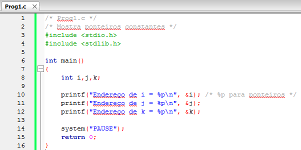

*Figura:* captura do editor com `Prog1.c` (**A05-08-P01**), linhas 1–16 da versão histórica do programa. Fonte revisado: [`src/Fontes_Aula_5_6_7_e_8/Prog1.c`](../../src/Fontes_Aula_5_6_7_e_8/Prog1.c); versão anterior à revisão de 2026 em texto: [commit `04ac409`](https://github.com/Lucas-Sperotto/falect-cc-011-algoritmos-e-laboratorio-de-programacao-ii/blob/04ac4094dba3c3812809dd433a7d3855c4bffdc9/src/Fontes_Aula_5_6_7_e_8/Prog1.c); explicação: [seção 6](#a05-08-p01).

<a id="slide-17"></a>
**Slide 17 — Ponteiros Constantes e o Operador de Endereços &**

> - Esse programa declara três variáveis e imprime o endereço de cada uma delas.
> - O endereço ocupado por essas variáveis dependerá de vários fatores, como o tamanho do sistema operacional, se há ou não outros programas residentes na memória, etc.
> - Por essas razões você pode encontrar números diferentes quando executar o programa.

*Nota de transcrição:* no Linux, os endereços mudam a cada execução também por segurança (aleatorização do espaço de endereços); ver [observação 8.2](#obs-5-2).

<a id="slide-18"></a>
**Slide 18 — Ponteiros Constantes e o Operador de Endereços &**

> - Decidimos imprimir os endereços em hexadecimal.
> - Esses endereços são constantes.

### 3.6 Passando argumentos por referência com ponteiros (slides 19–26)

<a id="slide-19"></a>
**Slide 19 — Roteiro** · *repete o roteiro do [slide 2](#slide-2), sem destaque do tópico seguinte.*

<a id="slide-20"></a>
**Slide 20 — Passando Argumentos por Referência com Ponteiros**

> - Uma função pode receber diversos argumentos, mas só consegue retornar um único valor por meio do comando return.
> - Como fazer para que uma função retorne mais de um valor para a função chamadora?
> - Usando ponteiros.

<a id="slide-21"></a>
**Slide 21 — Passando Argumentos por Referência com Ponteiros**

> - Há duas maneiras de passar argumentos para uma função: por valor e por referência por meio de ponteiros.

*Nota de transcrição:* em C, todo argumento é passado por valor; “por referência” significa aqui passar o endereço por valor. Ver [observação 8.3](#obs-5-3).

<a id="slide-22"></a>
**Slide 22 — Passando Argumentos por Referência com Ponteiros**

> - Para que uma função retorne mais de um valor para a função chamadora, devemos seguir dois passos:
>   - Primeiro, a função chamadora passa os endereços das suas variáveis usando o operador de endereços, os quais indicam variáveis nas quais queremos que a função chamada coloque os valores que devem ser retornados. Quando passamos endereços de variáveis, a função pode alterar a variável original.

<a id="slide-23"></a>
**Slide 23 — Passando Argumentos por Referência com Ponteiros**

>   - Segundo, a função chamada deverá criar variáveis para armazenar os endereços que estiver recebendo, enviados pela função chamadora. Essas variáveis são ponteiros variáveis.
> - Vamos mostrar um exemplo:

<a id="slide-24"></a>
**Slide 24 — Passando Argumentos por Referência com Ponteiros**

> 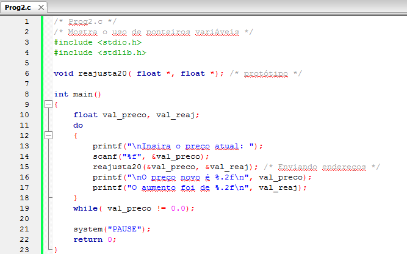

*Figura:* captura do editor com `Prog2.c` (**A05-08-P02**), linhas 1–23 da versão histórica do programa. Fonte revisado: [`src/Fontes_Aula_5_6_7_e_8/Prog2.c`](../../src/Fontes_Aula_5_6_7_e_8/Prog2.c); versão anterior à revisão de 2026 em texto: [commit `04ac409`](https://github.com/Lucas-Sperotto/falect-cc-011-algoritmos-e-laboratorio-de-programacao-ii/blob/04ac4094dba3c3812809dd433a7d3855c4bffdc9/src/Fontes_Aula_5_6_7_e_8/Prog2.c); explicação: [seção 6](#a05-08-p02).

<a id="slide-25"></a>
**Slide 25 — Passando Argumentos por Referência com Ponteiros**

> 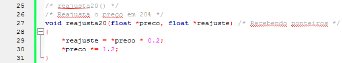

*Figura:* continuação de `Prog2.c` (**A05-08-P02**), linhas 25–31.

<a id="slide-26"></a>
**Slide 26 — Passando Argumentos por Referência com Ponteiros**

> - O programa solicita ao usuário que insira o preço atual de uma certa mercadoria.
> - Em seguida, modifica o preço para um valor aumentado em 20% e calcula o valor do aumento.

### 3.7 Variáveis que armazenam endereços (slides 27–32)

<a id="slide-27"></a>
**Slide 27 — Roteiro** · *repete o roteiro do [slide 2](#slide-2), sem destaque do tópico seguinte.*

<a id="slide-28"></a>
**Slide 28 — Variáveis que armazenam endereços**

> - Você já usou variáveis para armazenar números inteiros, caracteres, números em ponto flutuante, etc.
> - Endereços são armazenados, de modo semelhante, em variáveis com um tipo específico para esse fim.
> - Uma variável que armazena um endereço é chamada ponteiro.

<a id="slide-29"></a>
**Slide 29 — Variáveis que armazenam endereços**

> - Uma variável que armazena o endereço de uma variável do tipo float é do tipo float\*.
> - O asterisco faz parte do nome do tipo e indica ponteiro para.
> - A função reajusta20() recebe como argumento dois ponteiros para float.

*Nota de transcrição:* o asterisco pertence ao declarador de cada nome, e não ao tipo; ver [seção 4.2](#c-5-2).

<a id="slide-30"></a>
**Slide 30 — Variáveis que armazenam endereços**

> - O seu protótipo
>
>   ```c
>   void reajusta20( float *, float *); /* protótipo */
>   ```
>
> - Indica que serão criadas variáveis do tipo float\* para receber os endereços das variáveis passadas como argumentos pela função main().

<a id="slide-31"></a>
**Slide 31 — Variáveis que armazenam endereços**

> 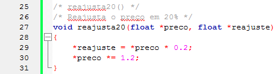
>
> - A declaração dos parâmetros da função reajusta20() indica que \*preco e \*reajuste são do tipo float e que preco e reajuste são do tipo float\* (ponteiros para variáveis float).

*Figura:* continuação de `Prog2.c` (**A05-08-P02**), linhas 25–31. Mesma região do slide 25, sem o comentário do fim da linha 27.

<a id="slide-32"></a>
**Slide 32 — Variáveis que armazenam endereços**

> - Na verdade, usar \*preco é uma maneira indireta de usar a variável val_preco de main().
> - Toda alteração feita em \*preco afetará diretamente val_preco.
> - Como preco contém o endereço da variável val_preco, dizemos que preco aponta para val_preco.

### 3.8 O operador indireto * (slides 33–35)

<a id="slide-33"></a>
**Slide 33 — Roteiro** · *repete o roteiro do [slide 2](#slide-2), sem destaque do tópico seguinte.*

<a id="slide-34"></a>
**Slide 34 — O operador Indireto \***

> - O operador indireto \* é unário e opera sobre um endereço ou ponteiro.
> - O resultado da operação é o nome da variável localizada nesse endereço (apontada).
> - O nome da variável representa o seu valor ou conteúdo.
> - Em outras palavras, resulta o valor da variável apontada.

<a id="slide-35"></a>
**Slide 35 — O operador Indireto \***

> - O operador de endereços & opera sobre o nome de uma variável e resulta o seu endereço, já o operador indireto \* opera sobre o endereço de uma variável e resulta seu nome.

*Nota de transcrição:* formalmente, `*p` designa o objeto apontado (é um *lvalue*), o que permite tanto ler quanto atribuir; ver [observação 8.5](#obs-5-5).

### 3.9 Passando endereços para a função (slides 36–41)

<a id="slide-36"></a>
**Slide 36 — Roteiro** · *repete o roteiro do [slide 2](#slide-2), sem destaque do tópico seguinte.*

<a id="slide-37"></a>
**Slide 37 — Passando Endereços para a Função**

> - A nossa função main() chama a função reajusta20() por meio da seguinte instrução:
>
>   ```c
>   reajusta20(&val_preco, &val_reaj);
>   ```
>
> - Os endereços das variáveis val_preco e val_reaj são acessados por meio do operador de endereços e enviados como argumentos para a função reajusta20().
> - A função reajusta20() recebe esses valores em ponteiros (tipos de variáveis para armazenar endereços).

<a id="slide-38"></a>
**Slide 38 — Passando Endereços para a Função**

> - Para que essa função possa acessar as variáveis apontadas, deverá não somente conhecer os seus endereços como também os seus tipos.
> - O endereço informa o primeiro byte ocupado pela variável;
> - É necessário saber quantos bytes estão ocupados por ela e qual é a forma de armazenamento para se ter acesso ao seu conteúdo.

<a id="slide-39"></a>
**Slide 39 — Passando Endereços para a Função**

> - O tipo de variável apontada é dado na declaração do ponteiro:
>
>   ```c
>   float *preco, float *reajuste
>   ```
>
> - Assim, float é do tipo da variável apontada por preco.
> - A função pode então usar instruções como:
>
>   ```c
>   *reajuste = *preco * 0.2;
>   *preco *= 1.2;
>   ```
>
> - Que modificam indiretamente as variáveis val_preco e val_reaj.

<a id="slide-40"></a>
**Slide 40 — Passando Endereços para a Função**

> - É indireto porque a função não tem acesso direto aos nomes dessas variáveis, e sim aos seus endereços.
> - A conclusão é que main() acessa diretamente as variáveis val_preco e val_reaj, enquanto reajusta20() as acessa via operador indireto.
> - Uma vez conhecidos os endereços e os tipos das variáveis como também ler o valor já armazenado nelas.

*Nota de transcrição:* a terceira frase está incompleta no original; ver [observação 8.6](#obs-5-6).

<a id="slide-41"></a>
**Slide 41 — Passando Endereços para a Função**

> - Ponteiros podem ser usados para que a função passe valores para o programa chamador, mas também para que o programa chamador passe valores para a função.
> - Na instrução:
>
>   ```c
>   *reajuste = *preco * 0.2;
>   ```
>
> - Estamos usando o valor original da variável val_preco, por meio de \*preco, multiplicando esse valor por 0,2 e atribuindo o resultado à variável val_reaj, indiretamente por meio de \*reajuste.

### 3.10 Permutação do valor de duas variáveis (slides 42–48)

<a id="slide-42"></a>
**Slide 42 — Roteiro** · *repete o roteiro do [slide 2](#slide-2), sem destaque do tópico seguinte.*

<a id="slide-43"></a>
**Slide 43 — Permutação do Valor de Duas Variáveis**

> - Por padrão, a linguagem C passa argumento para funções usando “chamada por valor”; a função chamada não pode alterar diretamente uma variável da função chamadora.
> - Por exemplo, uma rotina de ordenação poderia querer permutar dois elementos fora de ordem por meio de uma função chamada troca().

<a id="slide-44"></a>
**Slide 44 — Permutação do Valor de Duas Variáveis**

> 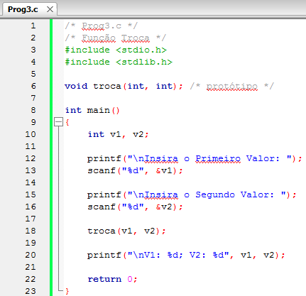

*Figura:* captura do editor com `Prog3.c` (**A05-08-P03**), linhas 1–23 da versão histórica do programa. Fonte revisado: [`src/Fontes_Aula_5_6_7_e_8/Prog3.c`](../../src/Fontes_Aula_5_6_7_e_8/Prog3.c); versão anterior à revisão de 2026 em texto: [commit `04ac409`](https://github.com/Lucas-Sperotto/falect-cc-011-algoritmos-e-laboratorio-de-programacao-ii/blob/04ac4094dba3c3812809dd433a7d3855c4bffdc9/src/Fontes_Aula_5_6_7_e_8/Prog3.c); explicação: [seção 6](#a05-08-p03).

<a id="slide-45"></a>
**Slide 45 — Permutação do Valor de Duas Variáveis**

> 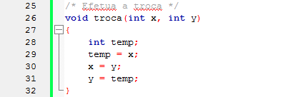

*Figura:* continuação de `Prog3.c` (**A05-08-P03**), linhas 25–32.

<a id="slide-46"></a>
**Slide 46 — Permutação do Valor de Duas Variáveis**

> - Por causa da chamada por valor, troca() não pode afetar os argumentos x e y da função que chama.
> - Ponteiros resolvem o problema.
> - O programa chamador passa os endereços dos valores a serem permutados
> - E na função troca(), os parâmetros são declarados como ponteiros, e as variáveis atuais são acessadas por meio deles.

<a id="slide-47"></a>
**Slide 47 — Permutação do Valor de Duas Variáveis**

> 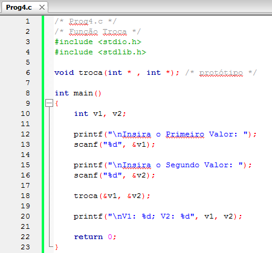

*Figura:* captura do editor com `Prog4.c` (**A05-08-P04**), linhas 1–23 da versão histórica do programa. Fonte revisado: [`src/Fontes_Aula_5_6_7_e_8/Prog4.c`](../../src/Fontes_Aula_5_6_7_e_8/Prog4.c); versão anterior à revisão de 2026 em texto: [commit `04ac409`](https://github.com/Lucas-Sperotto/falect-cc-011-algoritmos-e-laboratorio-de-programacao-ii/blob/04ac4094dba3c3812809dd433a7d3855c4bffdc9/src/Fontes_Aula_5_6_7_e_8/Prog4.c); explicação: [seção 6](#a05-08-p04).

<a id="slide-48"></a>
**Slide 48 — Permutação do Valor de Duas Variáveis**

> 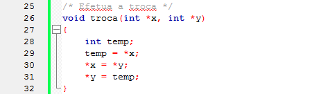

*Figura:* continuação de `Prog4.c` (**A05-08-P04**), linhas 25–32.

### 3.11 Ponteiros sem funções (slides 49–56)

<a id="slide-49"></a>
**Slide 49 — Roteiro** · *repete o roteiro do [slide 2](#slide-2), sem destaque do tópico seguinte.*

<a id="slide-50"></a>
**Slide 50 — Ponteiros Sem Funções**

> - O exemplo que apresentamos usou ponteiros como argumentos de funções.
> - O programa seguinte cria ponteiros como variáveis automáticas dentro da função main().

<a id="slide-51"></a>
**Slide 51 — Ponteiros Sem Funções**

> 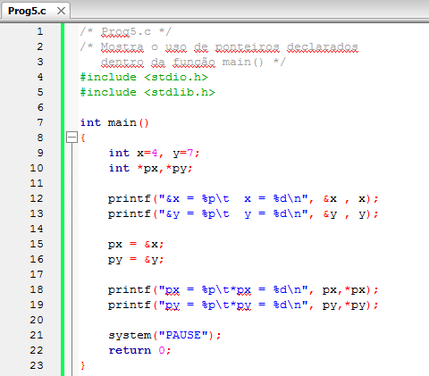

*Figura:* captura do editor com `Prog5.c` (**A05-08-P05**), linhas 1–23 da versão histórica do programa. Fonte revisado: [`src/Fontes_Aula_5_6_7_e_8/Prog5.c`](../../src/Fontes_Aula_5_6_7_e_8/Prog5.c); versão anterior à revisão de 2026 em texto: [commit `04ac409`](https://github.com/Lucas-Sperotto/falect-cc-011-algoritmos-e-laboratorio-de-programacao-ii/blob/04ac4094dba3c3812809dd433a7d3855c4bffdc9/src/Fontes_Aula_5_6_7_e_8/Prog5.c); explicação: [seção 6](#a05-08-p05).

<a id="slide-52"></a>
**Slide 52 — Ponteiros Sem Funções**

> - A instrução
>
>   ```c
>   int *px,*py;
>   ```
>
> - Declara px e py como ponteiros para variáveis int.
> - Quando um ponteiro não é inicializado na instrução de sua declaração, o compilador inicializa-o com o endereço zero (NULL).

*Nota de transcrição:* a afirmação está errada para variáveis locais: um ponteiro automático não inicializado tem valor indeterminado, e não `NULL`. Ver [observação 8.7](#obs-5-7).

<a id="slide-53"></a>
**Slide 53 — Ponteiros Sem Funções**

> - A linguagem C garante que NULL não é um endereço válido, então, antes de usá-los, devemos atribuir a eles algum endereço válido, isto é feito pelas instruções:
>
>   ```c
>   px = &x;
>   py = &y;
>   ```
>
> - Um ponteiro pode ser inicializado na mesma instrução de sua declaração:
>
>   ```c
>   int *px = &x,*py = &y;
>   ```

<a id="slide-54"></a>
**Slide 54 — Ponteiros Sem Funções**

> - Observe que estamos atribuindo &x e &y a px e py respectivamente, e não a \*px e \*py.
> - O asterisco na declaração faz parte do nome do tipo.

<a id="slide-55"></a>
**Slide 55 — Ponteiros Sem Funções**

> - C permite ponteiros de qualquer tipo, e as sintaxes de declaração possíveis são as seguintes:
>   - Operador indireto junto ao nome da variável.
>
>     ```c
>     int *p      /* Ponteiro int */
>     char *p     /* Ponteiro char */
>     String *p   /* Ponteiro para um tipo */
>                 /* Definido pelo usuário */
>     ```
>
>   - Operador indireto junto ao nome do tipo.
>
>     ```c
>     int* p      /* Ponteiro int */
>     char* p     /* Ponteiro char */
>     String* p   /* Ponteiro para um tipo */
>                 /* Definido pelo usuário */
>     ```

<a id="slide-56"></a>
**Slide 56 — Ponteiros Sem Funções**

>   - Se vários ponteiros são declarados numa mesma instrução, o tipo deve ser inserido somente uma vez; o asterisco, todas as vezes.
>
>     ```c
>     int* p, * p1, * p2;
>     int *p, *p1, *p2;
>     ```
>
>   - Inicializando ponteiros.
>
>     ```c
>     int i;
>     int *pi=&i;
>     int *pj, *pi=&i, *px;
>     ```
>
>   - Ponteiros e variáveis simples declarados numa única instrução.
>
>     ```c
>     int *p, i, *q;
>     int *px = &x, i, j = 5, *q;
>     ```

### 3.12 Ponteiros e variáveis apontadas (slides 57–60)

<a id="slide-57"></a>
**Slide 57 — Roteiro** · *repete o roteiro do [slide 2](#slide-2), sem destaque do tópico seguinte.*

<a id="slide-58"></a>
**Slide 58 — Ponteiros E Variáveis Apontadas**

> - Você pode usar ponteiros para executar qualquer operação na variável apontada.
> - Nesse programa, usamos o ponteiro para atribuir um valor à variável x; em seguida, usamos novamente o ponteiro para atribuir esse valor a y.

<a id="slide-59"></a>
**Slide 59 — Ponteiros E Variáveis Apontadas**

> 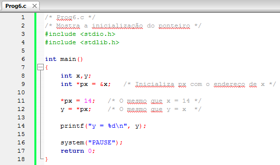

*Figura:* captura do editor com `Prog6.c` (**A05-08-P06**), linhas 1–18 da versão histórica do programa. Fonte revisado: [`src/Fontes_Aula_5_6_7_e_8/Prog6.c`](../../src/Fontes_Aula_5_6_7_e_8/Prog6.c); versão anterior à revisão de 2026 em texto: [commit `04ac409`](https://github.com/Lucas-Sperotto/falect-cc-011-algoritmos-e-laboratorio-de-programacao-ii/blob/04ac4094dba3c3812809dd433a7d3855c4bffdc9/src/Fontes_Aula_5_6_7_e_8/Prog6.c); explicação: [seção 6](#a05-08-p06).

<a id="slide-60"></a>
**Slide 60 — Ponteiros E Variáveis Apontadas**

> - O operador indireto, precedendo o nome do ponteiro em instruções como:
>
>   ```c
>   y = *px;    /* O mesmo que y = x  */
>   ```
>
> - Resulta o nome da variável apontada.

### 3.13 Operações com ponteiros (slides 61–70)

<a id="slide-61"></a>
**Slide 61 — Roteiro** · *repete o roteiro do [slide 2](#slide-2), sem destaque do tópico seguinte.*

<a id="slide-62"></a>
**Slide 62 — Operações com Ponteiros**

> - C permite várias operações básicas com ponteiros.
> - Nosso próximo exemplo mostra essas possibilidades.
> - O programa imprime os resultados de cada operação, o valor do ponteiro, o valor da variável apontada e o endereço do próprio ponteiro.

<a id="slide-63"></a>
**Slide 63 — Operações com Ponteiros**

> 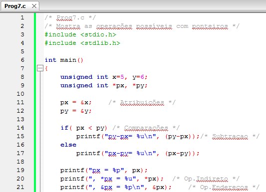

*Figura:* captura do editor com `Prog7.c` (**A05-08-P07**), linhas 1–21 da versão histórica do programa. Fonte revisado: [`src/Fontes_Aula_5_6_7_e_8/Prog7.c`](../../src/Fontes_Aula_5_6_7_e_8/Prog7.c); versão anterior à revisão de 2026 em texto: [commit `04ac409`](https://github.com/Lucas-Sperotto/falect-cc-011-algoritmos-e-laboratorio-de-programacao-ii/blob/04ac4094dba3c3812809dd433a7d3855c4bffdc9/src/Fontes_Aula_5_6_7_e_8/Prog7.c); explicação: [seção 6](#a05-08-p07). Na captura, `px` e `py` apontam para variáveis independentes `x` e `y`, que o programa compara e subtrai; ver [observação 8.8](#obs-5-8).

<a id="slide-64"></a>
**Slide 64 — Operações com Ponteiros**

> 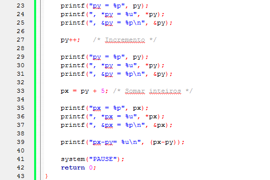

*Figura:* continuação de `Prog7.c` (**A05-08-P07**), linhas 23–43.

<a id="slide-65"></a>
**Slide 65 — Operações com Ponteiros**

> - Atribuição:
>   - Um endereço pode ser atribuído a um ponteiro desde que este seja do mesmo tipo daquele.
>   - Geralmente, fazemos isso usando o operados de [sic] endereços (&) junto ao nome de uma variável.
>   - Em nosso exemplo, atribuímos a px o endereço de x e a py o endereço de y.
>
>     ```c
>     px = &x;
>     py = &y;
>     ```

<a id="slide-66"></a>
**Slide 66 — Operações com Ponteiros**

> - Operação Indireta:
>   - O operador indireto \*, precedendo o nome do ponteiro, resulta no nome da variável apontada.
> - Trazendo o Endereço do Ponteiro:
>   - Como todas as variáveis, os ponteiros têm um endereço e um valor.
>   - O operador &, precedendo o nome do ponteiro, resulta na posição de memória em que o ponteiro está localizado.
>   - O nome do ponteiro indica o valor contido nele, isto é, o endereço para o qual ele aponta (o endereço da variável apontada).

<a id="slide-67"></a>
**Slide 67 — Operações com Ponteiros**

> - Incrementando um ponteiro:
>   - Podemos incrementar um ponteiro por meio de adição regular ou do operador de incremento.
>   - Incrementar um ponteiro acarreta sua movimentação para o próximo tipo apontado, isto é, se px é um ponteiro para uma variável int, depois de executar a instrução o valor de
>
>     ```c
>     px++;
>     ```
>
>     px será incrementado de um int (quatro bytes em ambientes 32 bits).

*Nota de transcrição:* quatro bytes é o tamanho de `int` no GCC para Linux, em 32 ou 64 bits; ver [observação 8.9](#obs-5-9).

<a id="slide-68"></a>
**Slide 68 — Operações com Ponteiros**

> - Incrementando um ponteiro:
>   - Cada vez que px é incrementado, apontará para o próximo int da memória.
>   - A mesma ideia é verdadeira para decremento.
>   - Toda vez que px é decrementado de uma unidade, o será de um tipo apontado, nesse caso int.
>   - Você pode subtrair ou adicionar números de ponteiros. A instrução:
>
>     ```c
>     px = py + 5;
>     ```
>
>   - Fará com que px caminhe cinco inteiros adiante de py.

<a id="slide-69"></a>
**Slide 69 — Operações com Ponteiros**

> - Diferença:
>   - Você pode encontrar a diferença entre dois ponteiros.
>   - Essa diferença será expressa em número de variáveis apontadas entre eles.
>   - Então, se py contém o endereço 4000 e px, 3996,
>
>     ```c
>     px - py;
>     ```
>
>     a expressão resultará 1 quando px e py são ponteiros para int em ambientes de 32 bits.

*Nota de transcrição:* com `py` = 4000 e `px` = 3996, `px - py` vale −1 (é `py - px` que vale 1); ver [observação 8.10](#obs-5-10).

<a id="slide-70"></a>
**Slide 70 — Operações com Ponteiros**

> - Comparações entre Ponteiros:
>   - Testes relacionais com >, <, >=, <=, ==, ou != são aceitos somente entre ponteiros do mesmo tipo.
>   - Cuidado, se você comparar ponteiros que apontam para variáveis de tipos diferentes obterá resultados sem sentido.
>   - Testes com NULL ou zero também podem ser feitos, contanto que você use o modificador de tipo:
>
>     ```c
>     if(px == (int *)0)
>     ```

*Nota de transcrição:* comparações com `<`, `>` são definidas apenas entre ponteiros para o mesmo vetor; o *cast* `(int *)` não é necessário ao comparar com 0. Ver [observação 8.11](#obs-5-11).

### 3.14 A unidade adotada em operações com ponteiros (slides 71–73)

<a id="slide-71"></a>
**Slide 71 — Roteiro** · *repete o roteiro do [slide 2](#slide-2), sem destaque do tópico seguinte.*

<a id="slide-72"></a>
**Slide 72 — A Unidade Adotada em Operações com Ponteiros**

> - Quando declaramos um ponteiro, o compilador necessita conhecer o tipo da variável apontada para poder executar corretamente operações aritméticas.
>
>   ```c
>   int *pi;
>   double *pd;
>   float *pf;
>   ```
>
> - O tipo declarado é entendido como o tipo de variável apontada.

<a id="slide-73"></a>
**Slide 73 — A Unidade Adotada em Operações com Ponteiros**

> - Assim, se somarmos 1 a pi, estaremos somando o tamanho de um int; se somarmos 1 a pd, estaremos somando o tamanho de um double (oito bytes), e assim por diante.
> - A unidade com ponteiros é o número de bytes do tipo apontado.

### 3.15 Referências do material original (slide 74)

<a id="slide-74"></a>
**Slide 74 — Referências**

> - MIZRAHI, Victorine V. Treinamento em Linguagem C, São Paulo: Pearson Prentice Hall, 2008;

## 4. Explicações complementares

<a id="c-5-1"></a>
### 4.1 Valor, endereço e ponteiro

Toda variável ocupa uma região da memória. O **endereço** é a posição do primeiro byte dessa região; o **ponteiro** é uma variável cujo valor é um endereço. Depois de `int x = 4; int *px = &x;`, a memória fica assim (endereços ilustrativos, para `int` de 4 bytes e ponteiro de 8 bytes):

| Nome | Endereço | Conteúdo | Tipo |
|---|---|---|---|
| `x` | `0x7ffc10` | `4` | `int` |
| `px` | `0x7ffc18` | `0x7ffc10` | `int *` |

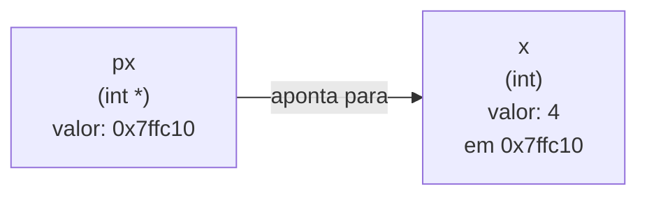

| Expressão | Significado | Valor no exemplo |
|---|---|---|
| `x` | conteúdo de `x` | `4` |
| `&x` | endereço de `x` (um valor, não uma variável) | `0x7ffc10` |
| `px` | conteúdo de `px`, que é um endereço | `0x7ffc10` |
| `*px` | o objeto no endereço guardado em `px`, ou seja, `x` | `4` |
| `&px` | endereço da própria variável `px` | `0x7ffc18` |

Os slides chamam `&x` de “ponteiro constante” e `px` de “ponteiro variável”. A distinção útil é: `&x` é um **valor** de tipo `int *` que não pode receber atribuição (não é um *lvalue*); `px` é um **objeto** que guarda um valor desse tipo e pode ser alterado.

<a id="c-5-2"></a>
### 4.2 Como ler declarações de ponteiros

O `*` pertence ao **declarador** de cada nome, e não ao tipo base. Por isso:

| Declaração | `p` | `q` |
|---|---|---|
| `int *p, *q;` | `int *` | `int *` |
| `int* p, q;` | `int *` | **`int`** (armadilha comum) |
| `int *p, i, *q;` | `int *` | `int *`, e `i` é `int` |

Nas declarações, `*` significa “é ponteiro para”; nas expressões, `*` é o operador indireto. É o “mesmo símbolo usado para duas finalidades diferentes” mencionado no slide 4. Uma forma de ler é da variável para fora: em `int *pi = &i;`, “`pi` é ponteiro para `int` e começa com o endereço de `i`” (o valor inicial vai para `pi`, e não para `*pi`, como alerta o slide 54).

<a id="c-5-3"></a>
### 4.3 Passagem por valor e a troca de duas variáveis

Em C, toda chamada copia os argumentos para os parâmetros. Em `Prog3.c`, `troca(v1, v2)` copia os **valores** 2 e 7 para `x` e `y`, que são variáveis locais de `troca()`; a função troca as cópias e termina, e `v1` e `v2` ficam como estavam.

```mermaid
sequenceDiagram
    participant M as main(): v1=2, v2=7
    participant T as troca(x, y)
    M->>T: copia 2 em x e 7 em y
    Note over T: troca x e y: x=7, y=2
    T-->>M: retorna; x e y deixam de existir
    Note over M: v1=2, v2=7 (inalterados)
```

Em `Prog4.c`, `troca(&v1, &v2)` copia os **endereços**. Os parâmetros `int *x, int *y` guardam esses endereços, e `*x`, `*y` designam as próprias variáveis `v1` e `v2`:

```mermaid
sequenceDiagram
    participant M as main(): v1=2, v2=7
    participant T as troca(int *x, int *y)
    M->>T: copia &v1 em x e &v2 em y
    Note over T: temp = *x (2); *x = *y (v1=7); *y = temp (v2=2)
    T-->>M: retorna
    Note over M: v1=7, v2=2
```

A passagem continua sendo por valor (o valor copiado é um endereço); o efeito é o de uma passagem por referência. É o mesmo mecanismo que permite a `scanf("%d", &v1)` gravar em `v1`, e que `reajusta20()` usa para devolver dois resultados (slides 20–23).

<a id="c-5-4"></a>
### 4.4 Ponteiro não inicializado, ponteiro nulo e ponteiro válido

| Situação | Exemplo | O que acontece ao usar `*p` |
|---|---|---|
| Não inicializado (local) | `int *p;` | valor indeterminado: comportamento indefinido |
| Nulo | `int *p = NULL;` | comportamento indefinido; no Linux, normalmente o programa é encerrado por falha de segmentação |
| Válido | `int *p = &x;` | acessa `x` |

Ao contrário do que afirma o slide 52, o compilador **não** inicializa ponteiros locais com `NULL` ([8.7](#obs-5-7)); apenas variáveis globais ou `static` começam com zero. A prática recomendada é sempre inicializar o ponteiro na declaração, com um endereço válido ou com `NULL`, e testar `if (p != NULL)` antes de usá-lo quando ele puder ser nulo.

<a id="c-5-5"></a>
### 4.5 Aritmética de ponteiros

Somar um inteiro $k$ a um ponteiro `p` de tipo `T *` produz o endereço $k$ elementos adiante:

$$\text{endereço}(p + k) = \text{endereço}(p) + k \cdot \texttt{sizeof}(T)$$

A diferença entre dois ponteiros para o mesmo vetor é medida em **elementos**, com tipo `ptrdiff_t` (formato `%td`):

$$q - p = \frac{\text{endereço}(q) - \text{endereço}(p)}{\texttt{sizeof}(T)}$$

Com `unsigned int valores[8]` (4 bytes por elemento), como no `Prog7.c` revisado:

| Ponteiro | Aponta para | Deslocamento em bytes | `*ponteiro` |
|---|---|---:|---:|
| `px = &valores[0]` | `valores[0]` | 0 | 5 |
| `py = &valores[1]` | `valores[1]` | 4 | 6 |
| `py++` | `valores[2]` | 8 | 7 |
| `px = py + 5` | `valores[7]` | 28 | 12 |
| `px - py` | — | — | 5 elementos |

Essas operações só são definidas dentro de um mesmo vetor (ou uma posição depois do último elemento, que pode ser calculada mas não acessada) (§6.5.6p8–9). Uma variável simples conta como vetor de um elemento. Por isso o `Prog7.c` original, que comparava e subtraía ponteiros para `x` e `y` independentes e lia `*py` depois de `py++`, tinha comportamento indefinido ([8.8](#obs-5-8)). Comparações com `<`, `>`, `<=` e `>=` seguem a mesma regra; `==` e `!=` podem comparar quaisquer ponteiros compatíveis (§6.5.8 e §6.5.9).

<a id="c-5-6"></a>
### 4.6 Por que o tipo do ponteiro importa

O endereço indica onde começa o objeto; o **tipo** do ponteiro indica quantos bytes ler e como interpretá-los (slides 38 e 72–73). No GCC x86-64:

| Declaração | `sizeof(*p)` | `p + 1` avança |
|---|---:|---:|
| `char *p` | 1 | 1 byte |
| `int *p` | 4 | 4 bytes |
| `float *p` | 4 | 4 bytes |
| `double *p` | 8 | 8 bytes |

Atribuir o endereço de um `int` a um `float *` exige conversão explícita e, mesmo assim, ler um `int` através de um `float *` é comportamento indefinido (regra de acesso por tipo efetivo, §6.5p7). A exceção é o ponteiro genérico `void *`, que só guarda o endereço e precisa ser convertido antes do acesso ([Aula 7](../aula-07/README.md)).

## 5. Conceitos fundamentais

| Conceito | Definição operacional | Onde aparece |
|---|---|---|
| Endereço | Posição do primeiro byte de um objeto na memória | slides 7, 12–13 |
| Ponteiro | Variável cujo valor é um endereço de objeto de um tipo dado | slides 11, 28–29 |
| Operador `&` | Produz o endereço de um objeto | slides 15–18 |
| Operador `*` (indireção) | Designa o objeto apontado; permite ler e gravar | slides 34–35 |
| Tipo apontado | Tipo `T` em `T *`; determina tamanho e interpretação | slides 38–39, 72–73 |
| Passagem do endereço | A função recebe a cópia de um endereço e altera o objeto original | slides 20–48 |
| Ponteiro nulo | Valor `NULL`, que não aponta para nenhum objeto | slides 52–53, 70 |
| Valor indeterminado | Conteúdo de variável local não inicializada | [4.4](#c-5-4) |
| Aritmética de ponteiros | `p + k`, `p++`, `q - p`, em unidades do tipo apontado | slides 62–73 |
| `ptrdiff_t` | Tipo da diferença entre ponteiros; impresso com `%td` | [4.5](#c-5-5) |

## 6. Programas C da aula

Fontes em [`src/Fontes_Aula_5_6_7_e_8/`](../../src/Fontes_Aula_5_6_7_e_8/), revisados em 2026 ([revisão por fonte](../../docs/auditorias/REVISAO_POR_FONTE.md#aulas-5-a-8--srcfontes_aula_5_6_7_e_8)). Em todos, endereços passaram a ser impressos com `%p` e `(void *)`.

| ID | Arquivo | SIGAA | Slides | Tema |
|---|---|---|---|---|
| [A05-08-P01](#a05-08-p01) | [`Prog1.c`](../../src/Fontes_Aula_5_6_7_e_8/Prog1.c) | Prog01.c | 15–18 | endereços com `&` |
| [A05-08-P02](#a05-08-p02) | [`Prog2.c`](../../src/Fontes_Aula_5_6_7_e_8/Prog2.c) | Prog02.c | 20–41 | dois resultados por ponteiros |
| [A05-08-P03](#a05-08-p03) | [`Prog3.c`](../../src/Fontes_Aula_5_6_7_e_8/Prog3.c) | Prog03.c | 43–46 | troca por valor (não funciona) |
| [A05-08-P04](#a05-08-p04) | [`Prog4.c`](../../src/Fontes_Aula_5_6_7_e_8/Prog4.c) | Prog04.c | 46–48 | troca por endereços |
| [A05-08-P05](#a05-08-p05) | [`Prog5.c`](../../src/Fontes_Aula_5_6_7_e_8/Prog5.c) | Prog05.c | 50–56 | ponteiros em `main()` |
| [A05-08-P06](#a05-08-p06) | [`Prog6.c`](../../src/Fontes_Aula_5_6_7_e_8/Prog6.c) | Prog06.c | 58–60 | inicialização e indireção |
| [A05-08-P07](#a05-08-p07) | [`Prog7.c`](../../src/Fontes_Aula_5_6_7_e_8/Prog7.c) | Prog07.c | 62–70 | operações com ponteiros |

<a id="a05-08-p01"></a>
### 6.1 A05-08-P01 — `Prog1.c`: endereços de variáveis

- **Finalidade:** imprimir os endereços de três variáveis `int`. **Entrada:** nenhuma. **Saída:** três endereços em hexadecimal.
- **Conceitos:** operador `&`, formato `%p`, variação dos endereços entre execuções.
- **Diferença em relação ao slide 16:** o argumento de `%p` passou a ser convertido para `void *`, como exige o formato (§7.21.6.1p8).
- **Observação:** a ordem e a distância entre `i`, `j` e `k` na memória são escolhas do compilador; não se pode supor que fiquem em sequência.

<!-- codigo: src/Fontes_Aula_5_6_7_e_8/Prog1.c de=`int i,j,k;` ate=`(void *)&k);` -->
<sub>Copiado de [`src/Fontes_Aula_5_6_7_e_8/Prog1.c`](../../src/Fontes_Aula_5_6_7_e_8/Prog1.c#L13-L17) (linhas 13–17) por `scripts/documentacao_aulas.py`; não edite este bloco à mão.</sub>

```c
    int i,j,k;

    printf("Endereço de i = %p\n", (void *)&i); /* %p para ponteiros */
    printf("Endereço de j = %p\n", (void *)&j);
    printf("Endereço de k = %p\n", (void *)&k);
```
<!-- /codigo -->

<a id="a05-08-p02"></a>
### 6.2 A05-08-P02 — `Prog2.c`: reajuste de 20% com dois resultados

- **Finalidade:** uma função que devolve, por ponteiros, o preço reajustado e o valor do aumento.
- **Entrada:** preços, até digitar 0. **Saída:** preço novo e aumento para cada preço.
- **Conceitos:** parâmetros `float *`, leitura e escrita por indireção, “parâmetros de saída”.
- **Funcionamento:** `reajusta20(&val_preco, &val_reaj)` envia os endereços; a função calcula `*reajuste` a partir do valor **atual** de `*preco` e só depois altera `*preco`, e a ordem das duas linhas importa.
- **Diferença em relação aos slides 24–25:** verificação do retorno de `scanf`.
- **Cuidado:** o laço compara `val_preco != 0.0` **depois** do reajuste; com a entrada 0, o novo preço é 0 × 1,2 = 0 e o laço termina.

<!-- codigo: src/Fontes_Aula_5_6_7_e_8/Prog2.c funcao=reajusta20 -->
<sub>Copiado de [`src/Fontes_Aula_5_6_7_e_8/Prog2.c`](../../src/Fontes_Aula_5_6_7_e_8/Prog2.c#L30-L36) (linhas 30–36) por `scripts/documentacao_aulas.py`; não edite este bloco à mão.</sub>

```c
/* reajusta20() */
/* Reajusta o preço em 20% */
void reajusta20(float *preco, float *reajuste) /* Recebendo ponteiros */
{
    *reajuste = *preco * 0.2;
    *preco *= 1.2;
}
```
<!-- /codigo -->

<a id="a05-08-p03"></a>
### 6.3 A05-08-P03 — `Prog3.c`: troca por valor

- **Finalidade:** **contraexemplo**: mostrar que uma função não altera as variáveis do chamador quando recebe apenas valores. **Entrada:** dois inteiros. **Saída:** os mesmos valores, na mesma ordem.
- **Característica didática preservada:** a troca sem efeito é intencional e não foi “corrigida” ([4.3](#c-5-3)).

<!-- codigo: src/Fontes_Aula_5_6_7_e_8/Prog3.c funcao=troca -->
<sub>Copiado de [`src/Fontes_Aula_5_6_7_e_8/Prog3.c`](../../src/Fontes_Aula_5_6_7_e_8/Prog3.c#L30-L37) (linhas 30–37) por `scripts/documentacao_aulas.py`; não edite este bloco à mão.</sub>

```c
/* Efetua a troca */
void troca(int x, int y)
{
    int temp;
    temp = x;
    x = y;
    y = temp;
}
```
<!-- /codigo -->

<a id="a05-08-p04"></a>
### 6.4 A05-08-P04 — `Prog4.c`: troca por endereços

- **Finalidade:** trocar os valores de `v1` e `v2` com uma função que recebe seus endereços. **Saída:** os valores trocados.
- **Conceitos:** `int *x`, `*x = *y`, variável temporária.

<!-- codigo: src/Fontes_Aula_5_6_7_e_8/Prog4.c funcao=troca -->
<sub>Copiado de [`src/Fontes_Aula_5_6_7_e_8/Prog4.c`](../../src/Fontes_Aula_5_6_7_e_8/Prog4.c#L30-L37) (linhas 30–37) por `scripts/documentacao_aulas.py`; não edite este bloco à mão.</sub>

```c
/* Efetua a troca */
void troca(int *x, int *y)
{
    int temp;
    temp = *x;
    *x = *y;
    *y = temp;
}
```
<!-- /codigo -->

<a id="a05-08-p05"></a>
### 6.5 A05-08-P05 — `Prog5.c`: ponteiros declarados em `main()`

- **Finalidade:** mostrar, lado a lado, `&x` e `x`, e depois `px` e `*px`. **Saída:** quatro linhas; `px` repete o endereço de `x`, e `*px` repete o valor de `x`.

<!-- codigo: src/Fontes_Aula_5_6_7_e_8/Prog5.c de=`int x=4, y=7;` ate=`(void *)py,*py);` -->
<sub>Copiado de [`src/Fontes_Aula_5_6_7_e_8/Prog5.c`](../../src/Fontes_Aula_5_6_7_e_8/Prog5.c#L14-L24) (linhas 14–24) por `scripts/documentacao_aulas.py`; não edite este bloco à mão.</sub>

```c
    int x=4, y=7;
    int *px,*py;

    printf("&x = %p\t  x = %d\n", (void *)&x , x);
    printf("&y = %p\t  y = %d\n", (void *)&y , y);

    px = &x;
    py = &y;

    printf("px = %p\t*px = %d\n", (void *)px,*px);
    printf("py = %p\t*py = %d\n", (void *)py,*py);
```
<!-- /codigo -->

<a id="a05-08-p06"></a>
### 6.6 A05-08-P06 — `Prog6.c`: inicialização e indireção

- **Finalidade:** atribuir a `x` e a `y` **por meio** de `px`. **Saída:** `y = 14`.
- **Conceitos:** `int *px = &x;` (inicializa o ponteiro, não `*px`), `*px = 14` grava em `x`, `y = *px` lê de `x`.

<!-- codigo: src/Fontes_Aula_5_6_7_e_8/Prog6.c de=`int x,y;` ate=`y = *px;` -->
<sub>Copiado de [`src/Fontes_Aula_5_6_7_e_8/Prog6.c`](../../src/Fontes_Aula_5_6_7_e_8/Prog6.c#L13-L17) (linhas 13–17) por `scripts/documentacao_aulas.py`; não edite este bloco à mão.</sub>

```c
    int x,y;
    int *px = &x;	/* Inicializa px com o endereço de x */

    *px = 14;	/* O mesmo que x = 14 */
    y = *px;	/* O mesmo que y = x  */
```
<!-- /codigo -->

<a id="a05-08-p07"></a>
### 6.7 A05-08-P07 — `Prog7.c`: operações com ponteiros

- **Finalidade:** demonstrar atribuição, comparação, diferença, indireção, endereço do ponteiro, incremento e soma de inteiro.
- **Entrada:** nenhuma. **Saída:** endereços (variáveis a cada execução), valores apontados e diferenças em elementos.
- **Diferença em relação aos slides 63–64:** o original usava duas variáveis independentes, `x` e `y`, e acessava memória fora delas; a versão revisada aplica as mesmas operações a elementos de um único vetor `valores[8]`, onde elas são definidas ([4.5](#c-5-5), [8.8](#obs-5-8)). As diferenças passaram a ser impressas com `%td`.

<!-- codigo: src/Fontes_Aula_5_6_7_e_8/Prog7.c de=`unsigned int valores[8]` ate=`printf("px-py= %td\n", (px-py));` -->
<sub>Copiado de [`src/Fontes_Aula_5_6_7_e_8/Prog7.c`](../../src/Fontes_Aula_5_6_7_e_8/Prog7.c#L15-L24) (linhas 15–24) por `scripts/documentacao_aulas.py`; não edite este bloco à mão.</sub>

```c
    unsigned int valores[8] = {5,6,7,8,9,10,11,12};
    unsigned int *px, *py;

    px = &valores[0];	/* Atribuições */
    py = &valores[1];

    if( px < py) /* Comparações */
        printf("py-px= %td\n", (py-px));/* Subtraçao */
    else
        printf("px-py= %td\n", (px-py));
```
<!-- /codigo -->

## 7. Exemplos de execução

Os endereços impressos mudam a cada execução; a validação automática desta documentação ignora essa variação e confere o restante da saída.

### 7.1 Endereços (`Prog1.c`)

<!-- execucao: src/Fontes_Aula_5_6_7_e_8/Prog1.c cenario=enderecos -->
Execução real do cenário revisado `enderecos` ([manifesto](../../scripts/cenarios_fontes_c.json)), compilado com `gcc -std=c11 -Wall -Wextra -Wpedantic -O0`; bloco gerado por `scripts/documentacao_aulas.py`.

Comando: `./Prog1`

Entrada padrão: *(vazia)*

Saída padrão:

```text
Endereço de i = 0x7ffe203e19ac
Endereço de j = 0x7ffe203e19b0
Endereço de k = 0x7ffe203e19b4
```

Código de saída: `0`.
<!-- /execucao -->

### 7.2 Reajuste (`Prog2.c`)

<!-- execucao: src/Fontes_Aula_5_6_7_e_8/Prog2.c cenario=reajuste -->
Execução real do cenário revisado `reajuste` ([manifesto](../../scripts/cenarios_fontes_c.json)), compilado com `gcc -std=c11 -Wall -Wextra -Wpedantic -O0`; bloco gerado por `scripts/documentacao_aulas.py`.

Comando: `./Prog2`

Entrada padrão:

```text
100
0
```

Saída padrão:

```text

Insira o preço atual: 
O preço novo é 120.00
O aumento foi de 20.00

Insira o preço atual: 
O preço novo é 0.00
O aumento foi de 0.00
```

Código de saída: `0`.
<!-- /execucao -->

### 7.3 Troca por valor (`Prog3.c`)

<!-- execucao: src/Fontes_Aula_5_6_7_e_8/Prog3.c cenario=troca_por_valor -->
Execução real do cenário revisado `troca_por_valor` ([manifesto](../../scripts/cenarios_fontes_c.json)), compilado com `gcc -std=c11 -Wall -Wextra -Wpedantic -O0`; bloco gerado por `scripts/documentacao_aulas.py`.

Comando: `./Prog3`

Entrada padrão:

```text
2
7
```

Saída padrão (sem quebra de linha final):

```text

Insira o Primeiro Valor: 
Insira o Segundo Valor: 
V1: 2; V2: 7
```

Código de saída: `0`.
<!-- /execucao -->

### 7.4 Troca por endereços (`Prog4.c`)

<!-- execucao: src/Fontes_Aula_5_6_7_e_8/Prog4.c cenario=troca_por_ponteiro -->
Execução real do cenário revisado `troca_por_ponteiro` ([manifesto](../../scripts/cenarios_fontes_c.json)), compilado com `gcc -std=c11 -Wall -Wextra -Wpedantic -O0`; bloco gerado por `scripts/documentacao_aulas.py`.

Comando: `./Prog4`

Entrada padrão:

```text
2
7
```

Saída padrão (sem quebra de linha final):

```text

Insira o Primeiro Valor: 
Insira o Segundo Valor: 
V1: 7; V2: 2
```

Código de saída: `0`.
<!-- /execucao -->

### 7.5 Ponteiros e variáveis apontadas (`Prog5.c`)

<!-- execucao: src/Fontes_Aula_5_6_7_e_8/Prog5.c cenario=enderecos -->
Execução real do cenário revisado `enderecos` ([manifesto](../../scripts/cenarios_fontes_c.json)), compilado com `gcc -std=c11 -Wall -Wextra -Wpedantic -O0`; bloco gerado por `scripts/documentacao_aulas.py`.

Comando: `./Prog5`

Entrada padrão: *(vazia)*

Saída padrão:

```text
&x = 0x7ffdfec1d530	  x = 4
&y = 0x7ffdfec1d534	  y = 7
px = 0x7ffdfec1d530	*px = 4
py = 0x7ffdfec1d534	*py = 7
```

Código de saída: `0`.
<!-- /execucao -->

### 7.6 Inicialização do ponteiro (`Prog6.c`)

<!-- execucao: src/Fontes_Aula_5_6_7_e_8/Prog6.c cenario=inicializacao -->
Execução real do cenário revisado `inicializacao` ([manifesto](../../scripts/cenarios_fontes_c.json)), compilado com `gcc -std=c11 -Wall -Wextra -Wpedantic -O0`; bloco gerado por `scripts/documentacao_aulas.py`.

Comando: `./Prog6`

Entrada padrão: *(vazia)*

Saída padrão:

```text
y = 14
```

Código de saída: `0`.
<!-- /execucao -->

### 7.7 Operações no mesmo vetor (`Prog7.c`)

Observe que os endereços de `px` e `py` avançam de 4 em 4 bytes (`sizeof(unsigned int)`), e que `&px` e `&py` não mudam: são os endereços das próprias variáveis ponteiro.

<!-- execucao: src/Fontes_Aula_5_6_7_e_8/Prog7.c cenario=aritmetica_no_mesmo_vetor -->
Execução real do cenário revisado `aritmetica_no_mesmo_vetor` ([manifesto](../../scripts/cenarios_fontes_c.json)), compilado com `gcc -std=c11 -Wall -Wextra -Wpedantic -O0`; bloco gerado por `scripts/documentacao_aulas.py`.

Comando: `./Prog7`

Entrada padrão: *(vazia)*

Saída padrão:

```text
py-px= 1
px = 0x7ffd44e626f0, *px = 5, &px = 0x7ffd44e626e0
py = 0x7ffd44e626f4, *py = 6, &py = 0x7ffd44e626e8
py = 0x7ffd44e626f8, *py = 7, &py = 0x7ffd44e626e8
px = 0x7ffd44e6270c, *px = 12, &px = 0x7ffd44e626e0
px-py= 5
```

Código de saída: `0`.
<!-- /execucao -->

## 8. Observações técnicas

<a id="obs-5-1"></a>
**8.1 Memória “numerada de zero até o limite” (slides 12–13).** O modelo é adequado para começar, mas, em sistemas atuais, cada processo trabalha com endereços **virtuais**, traduzidos pelo sistema operacional e pelo processador; o mesmo endereço em dois programas corresponde a posições físicas diferentes. Para o programa em C, só importa que os endereços identifiquem objetos.

<a id="obs-5-2"></a>
**8.2 Por que os endereços mudam (slide 17).** Além dos fatores citados, o Linux aplica **aleatorização do espaço de endereços** (ASLR): a pilha, o *heap* e as bibliotecas são carregados em posições diferentes a cada execução, para dificultar ataques. Por isso os exemplos 7.1, 7.5 e 7.7 mostram valores diferentes a cada geração.

<a id="obs-5-3"></a>
**8.3 “Por valor e por referência” (slides 20–23).** C tem um único mecanismo, a passagem por valor (§6.5.2.2p4). Passar um ponteiro é passar, por valor, um endereço, o que dá à função acesso ao objeto original. Linguagens como C++ têm referências verdadeiras (`int &x`), que não existem em C ([4.3](#c-5-3)).

<a id="obs-5-4"></a>
**8.4 “O asterisco faz parte do nome do tipo” (slides 29 e 54).** É verdade que o tipo de `preco` é `float *`, mas na sintaxe o `*` se liga a cada declarador. As duas grafias do slide 55 são equivalentes para **um** nome; com vários nomes, `int* p, q;` declara `q` como `int` ([4.2](#c-5-2)). O slide 56 mostra corretamente que o asterisco deve ser repetido.

<a id="obs-5-5"></a>
**8.5 “`*` resulta o nome da variável” (slides 34–35).** A formulação é didática. Tecnicamente, `*p` é um *lvalue* que designa o objeto apontado (§6.5.3.2p4): pode aparecer à esquerda de uma atribuição (`*p = 14`) ou ser lido (`y = *p`), como o nome da variável.

<a id="obs-5-6"></a>
**8.6 Frase incompleta (slide 40).** O terceiro tópico, “Uma vez conhecidos os endereços e os tipos das variáveis como também ler o valor já armazenado nelas.”, perdeu parte do texto. O sentido provável, coerente com o slide 41, é que, conhecidos o endereço e o tipo, a função pode tanto gravar quanto ler o valor armazenado. A transcrição mantém o original ([relatório de lacunas](../../docs/auditorias/CLAUDE_AUDIT.md#lacunas)).

<a id="obs-5-7"></a>
**8.7 Ponteiro não inicializado não é `NULL` (slide 52).** “Quando um ponteiro não é inicializado na instrução de sua declaração, o compilador inicializa-o com o endereço zero (NULL)” vale apenas para ponteiros com duração estática (globais ou `static`, §6.7.9p10). Os ponteiros `px` e `py` de `Prog5.c` são locais: até as atribuições `px = &x;`, contêm valores indeterminados, e usar `*px` antes delas seria comportamento indefinido. Esta é uma correção conceitual importante para os estudantes.

<a id="obs-5-8"></a>
**8.8 `Prog7.c` original (slides 63–64).** Com `x` e `y` independentes: a comparação `px < py` e a diferença `py - px` não são definidas (§6.5.8p5, §6.5.6p9); depois de `py++`, `*py` lê memória que não pertence a `y`; `px = py + 5` produz um endereço fora de qualquer objeto. Na prática, o resultado depende de onde o compilador colocou as variáveis. A versão revisada preserva as mesmas operações sobre um vetor.

<a id="obs-5-9"></a>
**8.9 Tamanhos (slides 67, 69 e 73).** “Quatro bytes em ambientes 32 bits” e “oito bytes” para `double` são os tamanhos usuais; no Linux x86-64 (64 bits), `int` continua com 4 bytes, `double` com 8 e os ponteiros têm 8. O que é garantido é a regra: a unidade é `sizeof` do tipo apontado.

<a id="obs-5-10"></a>
**8.10 Sinal da diferença (slide 69).** Com `py` = 4000 e `px` = 3996 (`int` de 4 bytes), `px - py` vale −1, porque `px` está um elemento **antes** de `py`. O valor 1 é o de `py - px`.

<a id="obs-5-11"></a>
**8.11 Comparações e o teste com zero (slide 70).** “Testes relacionais … são aceitos somente entre ponteiros do mesmo tipo” é incompleto: `<`, `>`, `<=`, `>=` exigem ponteiros para o **mesmo vetor** (do contrário, comportamento indefinido, e não “resultados sem sentido”). O teste com zero não precisa de conversão: `if (px == NULL)` ou `if (px == 0)`, porque 0 é uma constante de ponteiro nulo (§6.3.2.3p3).

## 9. Exercícios relacionados

### 9.1 Tarefa do SIGAA

A tarefa [Aulas 05 e 06](../../atividades/aulas-05-e-06.md) inclui `Prog01.c` a `Prog07.c` desta aula. Para cada programa, desenhe uma tabela como a da [seção 4.1](#c-5-1), com nome, endereço (use os valores impressos) e conteúdo de cada variável e ponteiro.

### 9.2 Exercícios propostos (acréscimo desta documentação)

1. **Divisão inteira com dois resultados.** Escreva `int divide(int a, int b, int *q, int *r)` que grave quociente e resto e retorne 0 se `b == 0` (sem gravar nada) ou 1 em caso de sucesso. Teste com valores negativos e explique o sinal do resto em C.
2. **Mínimo e máximo.** Escreva `void minmax(const int v[], int n, int *min, int *max)`. O que deve acontecer quando `n == 0`? Documente a decisão.
3. **Rastreamento.** Sem executar, preveja a saída de: `int a = 1, b = 2; int *p = &a, *q = &b; *p = *q; p = q; *p = 5; printf("%d %d\n", a, b);`. Depois confira executando.
4. **Ordenação de três valores.** Usando `troca()` de `Prog4.c`, escreva `void ordena3(int *a, int *b, int *c)`, que deixe `*a <= *b <= *c` com no máximo três comparações.
5. **Percorrer com ponteiro.** Some os elementos de um vetor de 10 `double` usando apenas um ponteiro que começa em `&v[0]` e para em `&v[10]` (uma posição depois do fim, que pode ser comparada mas não acessada).

## 10. Referências e fontes consultadas

- SPEROTTO, Lucas Kriesel. *Aula 5 – Ponteiros – Parte 1 (nível avançado)*. Capacitação em C, 07/10/2022. 74 slides. [`aulas/Aula_5.pdf`](../Aula_5.pdf).
- MIZRAHI, Victorine Viviane. *Treinamento em Linguagem C*. São Paulo: Pearson Prentice Hall, 2008 (referência citada no slide 74).
- ISO/IEC 9899:2011 (C11), rascunho N1570: <https://www.open-std.org/jtc1/sc22/wg14/www/docs/n1570.pdf>. Seções citadas: §6.3.2.3 (ponteiros e ponteiro nulo), §6.5p7 (tipo efetivo), §6.5.2.2 (chamadas de função), §6.5.3.2 (operadores `&` e `*`), §6.5.6 (aritmética de ponteiros), §6.5.8 e §6.5.9 (comparações), §6.7.9 (inicialização), §7.21.6.1 (`%p`, `%td`).
- cppreference.com — *Pointer declaration*: <https://en.cppreference.com/w/c/language/pointer>.
- Fontes do repositório: [`src/Fontes_Aula_5_6_7_e_8/`](../../src/Fontes_Aula_5_6_7_e_8/), [cenários de teste](../../scripts/cenarios_fontes_c.json) e [revisão por fonte](../../docs/auditorias/REVISAO_POR_FONTE.md).
