# Aula 6 — Ponteiros (parte 2): vetores, strings e vetores de ponteiros

- **Material original:** [`aulas/Aula_6.pdf`](../Aula_6.pdf) — 70 slides, “AULA 6 – PONTEIROS - PARTE 2 (NÍVEL AVANÇADO)”, 07/10/2022, *Capacitação em C – Prof. Me. Lucas Kriesel Sperotto*.
- **Programas:** [`src/Fontes_Aula_5_6_7_e_8/`](../../src/Fontes_Aula_5_6_7_e_8/) — `Prog8.c` a `Prog17.c` (A05-08-P08 a A05-08-P17).
- **Tarefas do SIGAA:** [Aulas 05 e 06](../../atividades/aulas-05-e-06.md) (Prog08–Prog13) e [Aulas 06 e 07](../../atividades/aulas-06-e-07.md) (Prog14–Prog17).

**Como ler este documento.** A seção 3 reproduz o PDF slide a slide, na ordem original, dentro de blocos de citação (barra cinza à esquerda). Tudo o que está fora desses blocos foi acrescentado nesta documentação: notas de transcrição (em itálico), explicações, exemplos e exercícios. Trechos curtos de código que no PDF aparecem como imagem foram transcritos como texto; capturas de programas completos são reproduzidas como figura e remetem ao fonte do repositório. Palavras grafadas de forma errada no original estão marcadas com `[sic]`; omissões de acento foram mantidas sem marcação. O rodapé repetido em todos os slides (“07/10/2022 · Capacitação em C – Prof. Me. Lucas Kriesel Sperotto · número da página”) foi omitido.

## Sumário

1. [Identificação da aula](#1-identificação-da-aula)
2. [Objetivos de aprendizagem](#2-objetivos-de-aprendizagem)
3. [Conteúdo transcrito do material original](#3-conteúdo-transcrito-do-material-original)
4. [Explicações complementares](#4-explicações-complementares)
5. [Conceitos fundamentais](#5-conceitos-fundamentais)
6. [Programas C da aula](#6-programas-c-da-aula)
7. [Exemplos de execução](#7-exemplos-de-execução)
8. [Observações técnicas](#8-observações-técnicas)
9. [Exercícios relacionados](#9-exercícios-relacionados)
10. [Referências e fontes consultadas](#10-referências-e-fontes-consultadas)

## 1. Identificação da aula

| Item | Descrição |
|---|---|
| Disciplina | FALECT-CC-011 — Algoritmos e Laboratório de Programação II (UNEMAT, Alto Araguaia), oferta 2026.2 |
| Posição no plano 2026.2 | Módulo 2 (21/09 a 25/09/2026): **ponteiros** e manipulação de arquivos |
| Ementa contemplada | Ponteiros; manipulação de cadeias de caracteres; passagem por referência |
| Material original | `Aula_6.pdf`, 70 páginas, baseado em Mizrahi (2008) |
| Correspondência | Slides 4–67 → `Prog8.c`–`Prog17.c`; ver a [matriz de rastreabilidade](../../docs/MATRIZ_RASTREABILIDADE.md#aula-6) |
| Pré-requisito | [Aula 5](../aula-05/README.md): `&`, `*` e aritmética de ponteiros |

## 2. Objetivos de aprendizagem

Ao final da aula, o estudante deve ser capaz de:

1. explicar a relação entre vetores e ponteiros (`v[i]` ≡ `*(v + i)`) e as situações em que um vetor **não** se converte em ponteiro;
2. percorrer vetores e strings com um ponteiro variável, usando corretamente `*(p++)`;
3. escrever funções que recebem e devolvem ponteiros, sem devolver endereços de variáveis locais;
4. distinguir `char s[] = "..."` de `const char *s = "..."` quanto à memória e à possibilidade de alteração;
5. comparar o custo de memória de uma matriz de strings e de um vetor de ponteiros para strings;
6. ordenar e rotacionar dados trocando apenas ponteiros, e ler expressões como `*(*(ptr + j) + k)`.

## 3. Conteúdo transcrito do material original

### 3.1 Capa e roteiro (slides 1–2)

<a id="slide-1"></a>
**Slide 1 — Capa**

> ALGORITMO E LABORATÓRIO DE PROGRAMAÇÃO II
>
> AULA 6 – PONTEIROS -PARTE 2 (NÍVEL AVANÇADO)
>
> 07/10/2022 · Capacitação em C – Prof. Me. Lucas Kriesel Sperotto

<a id="slide-2"></a>
**Slide 2 — Roteiro**

> - Ponteiros no lugar de matrizes
> - Ponteiros constantes e ponteiros variáveis
> - Passando matrizes como argumento para funções
> - Ponteiros e string
> - Funções de biblioteca para manipulação de strings
> - Ponteiros para uma cadeia de caracteres constante
> - Matrizes de ponteiros
> - Matriz de strings e a memória alocada
> - Matriz de ponteiros e a memória alocada
> - Ponteiros para ponteiros
> - Ordenando ponteiros
> - Notação ponteiro para matrizes de ponteiros
> - O programa do foguete

### 3.2 Ponteiros no lugar de matrizes (slides 3–8)

<a id="slide-3"></a>
**Slide 3 — Ponteiros no Lugar de Matrizes**

> - Em C, o relacionamento entre ponteiros e matrizes é tão estreito que estes deveriam ser realmente tratados juntos.
> - O compilador transforma matrizes em ponteiros, pois a arquitetura do microcomputador compreende ponteiros, e não matrizes.
> - Qualquer operação que possa ser feita com índices de uma matriz pode ser feita com ponteiros.

*Nota de transcrição:* vetores não são ponteiros: o nome do vetor é **convertido** em ponteiro na maioria das expressões; ver [seção 4.1](#c-6-1) e [observação 8.1](#obs-6-1).

<a id="slide-4"></a>
**Slide 4 — Ponteiros no Lugar de Matrizes**

> - Na aula de matrizes, aprendemos que o nome de uma matriz representa seu endereço de memória.
> - Esse endereço é o do primeiro elemento da matriz.
> - Em outras palavras, o nome de uma matriz é um ponteiro que aponta para o primeiro elemento da matriz.
> - Para esclarecer a relação entre ponteiros e matrizes, vamos examinar:

<a id="slide-5"></a>
**Slide 5 — Ponteiros no Lugar de Matrizes**

> 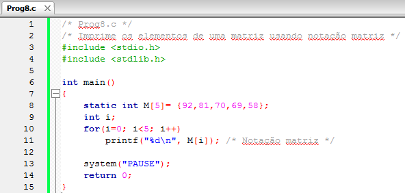

*Figura:* captura do editor com `Prog8.c` (**A05-08-P08**), linhas 1–15 da versão histórica do programa. Fonte revisado: [`src/Fontes_Aula_5_6_7_e_8/Prog8.c`](../../src/Fontes_Aula_5_6_7_e_8/Prog8.c); versão anterior à revisão de 2026 em texto: [commit `04ac409`](https://github.com/Lucas-Sperotto/falect-cc-011-algoritmos-e-laboratorio-de-programacao-ii/blob/04ac4094dba3c3812809dd433a7d3855c4bffdc9/src/Fontes_Aula_5_6_7_e_8/Prog8.c); explicação: [seção 6](#a05-08-p08).

<a id="slide-6"></a>
**Slide 6 — Ponteiros no Lugar de Matrizes**

> - O próximo exemplo usa a notação ponteiro:
>
>   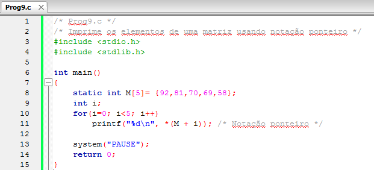

*Figura:* captura do editor com `Prog9.c` (**A05-08-P09**), linhas 1–15 da versão histórica do programa. Fonte revisado: [`src/Fontes_Aula_5_6_7_e_8/Prog9.c`](../../src/Fontes_Aula_5_6_7_e_8/Prog9.c); versão anterior à revisão de 2026 em texto: [commit `04ac409`](https://github.com/Lucas-Sperotto/falect-cc-011-algoritmos-e-laboratorio-de-programacao-ii/blob/04ac4094dba3c3812809dd433a7d3855c4bffdc9/src/Fontes_Aula_5_6_7_e_8/Prog9.c); explicação: [seção 6](#a05-08-p09).

<a id="slide-7"></a>
**Slide 7 — Ponteiros no Lugar de Matrizes**

> - A expressão \*(M + i) tem exatamente o mesmo valor de M[i].
> - Você já sabe que M é um ponteiro int e aponta para M[0], conhecendo também a aritmética com ponteiros.
> - Assim, se somarmos 1 a M, obteremos o endereço de M[1]; M + 2 é o endereço de M[2] e assim por diante.

<a id="slide-8"></a>
**Slide 8 — Ponteiros no Lugar de Matrizes**

> - Em regra geral, temos que:
>
>   ```text
>   M + i é equivalente a &M[i], portanto
>       *(M + i) é equivalente a M[i]
>   ```

*Nota de transcrição:* esta é a forma correta da regra que o slide 24 da [Aula 2](../aula-02/README.md#slide-24) apresentou de modo incompleto.

### 3.3 Ponteiros constantes e ponteiros variáveis (slides 9–15)

<a id="slide-9"></a>
**Slide 9 — Roteiro** · *repete o roteiro do [slide 2](#slide-2), sem destaque do tópico seguinte.*

<a id="slide-10"></a>
**Slide 10 — Ponteiros Constantes e Ponteiros Variáveis**

> - Analisando o exemplo anterior, você poderia perguntar se a instrução
>
>   ```c
>   printf("%d\n", *(M + i)); /* Notação ponteiro */
>   ```
>
> - Não poderia ser simplificada por
>
>   ```c
>   printf("%d\n", *(M ++)); /* ERRO */
>   ```
>
> - A resposta é não.
> - A razão disso é que não podemos incrementar uma constante.

<a id="slide-11"></a>
**Slide 11 — Ponteiros Constantes e Ponteiros Variáveis**

> - Da mesma forma que existem inteiros constantes e inteiros variáveis, existem ponteiros constantes e ponteiros variáveis.
> - O nome de uma matriz é um ponteiro constante.
> - Isso vale para qualquer constante.
> - Você não poderia escrever:
>
>   ```c
>   x = 3++; /* ERRADO */
>   ```
>
> - O compilador apresentaria um erro.

<a id="slide-12"></a>
**Slide 12 — Ponteiros Constantes e Ponteiros Variáveis**

> - O nome de uma matriz é um ponteiro constante e não pode ser alterado.
> - Um ponteiro variável é um lugar na memória que armazena um endereço.
> - Um ponteiro constante é um endereço, uma simples referência.
> - Vamos reescrever o programa anterior usando um ponteiro variável em vez do nome da matriz.

<a id="slide-13"></a>
**Slide 13 — Ponteiros Constantes e Ponteiros Variáveis**

> 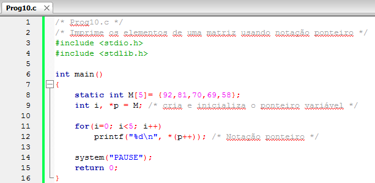

*Figura:* captura do editor com `Prog10.c` (**A05-08-P10**), linhas 1–16 da versão histórica do programa. Fonte revisado: [`src/Fontes_Aula_5_6_7_e_8/Prog10.c`](../../src/Fontes_Aula_5_6_7_e_8/Prog10.c); versão anterior à revisão de 2026 em texto: [commit `04ac409`](https://github.com/Lucas-Sperotto/falect-cc-011-algoritmos-e-laboratorio-de-programacao-ii/blob/04ac4094dba3c3812809dd433a7d3855c4bffdc9/src/Fontes_Aula_5_6_7_e_8/Prog10.c); explicação: [seção 6](#a05-08-p10).

<a id="slide-14"></a>
**Slide 14 — Ponteiros Constantes e Ponteiros Variáveis**

> - Nessa versão, definimos um ponteiro para um int e o inicializamos com o nome da matriz:
>
>   ```c
>   int *p = M;
>   ```
>
> - Agora podemos usar p em todo lugar do programa que usa M e, como p é um ponteiro variável e não uma constante, podemos usar expressões como:
>
>   ```c
>   *(p++)
>   ```

<a id="slide-15"></a>
**Slide 15 — Ponteiros Constantes e Ponteiros Variáveis**

> - O ponteiro p contém inicialmente o endereço do primeiro elemento da matriz &M[0].
> - Para acessar o próximo elemento, basta incrementar p de um.
> - Após o incremento, p aponta para o proximo elemento, &M[1], e a expressão \*(p++) representa o conteúdo desse segundo elemento.
> - O laço for faz com que a expressão acesse cada um dos elementos em ordem.

*Nota de transcrição:* a expressão `*(p++)` vale o elemento para o qual `p` apontava **antes** do incremento; na primeira iteração, imprime `M[0]`. Ver [observação 8.2](#obs-6-2).

### 3.4 Passando matrizes como argumento para funções (slides 16–22)

<a id="slide-16"></a>
**Slide 16 — Roteiro** · *repete o roteiro do [slide 2](#slide-2), sem destaque do tópico seguinte.*

<a id="slide-17"></a>
**Slide 17 — Passando Matrizes como Argumento para Funções**

> - Na aula sobre matrizes, apresentamos numerosos exemplos de como elas são passadas como argumentos para funções e como as funções podem acessar seus elementos.
> - Quando uma função recebe o endereço de uma matriz como argumento, ela o declara usando o nome do tipo e colchetes ([]).

<a id="slide-18"></a>
**Slide 18 — Passando Matrizes como Argumento para Funções**

> - Essa notação declara ponteiros constantes e não ponteiros variáveis.
> - Entretanto, é mais conveniente usar a notação ponteiro no lugar da notação matriz.
> - A notação ponteiro declara um ponteiro variável.
> - O próximo exemplo modifica o programa que calcula a média para que use ponteiros no lugar de matriz.

*Nota de transcrição:* em parâmetros, `float lista[]` e `float *lista` declaram exatamente o mesmo ponteiro, que pode ser alterado; ver [observação 8.3](#obs-6-3).

<a id="slide-19"></a>
**Slide 19 — Passando Matrizes como Argumento para Funções**

> 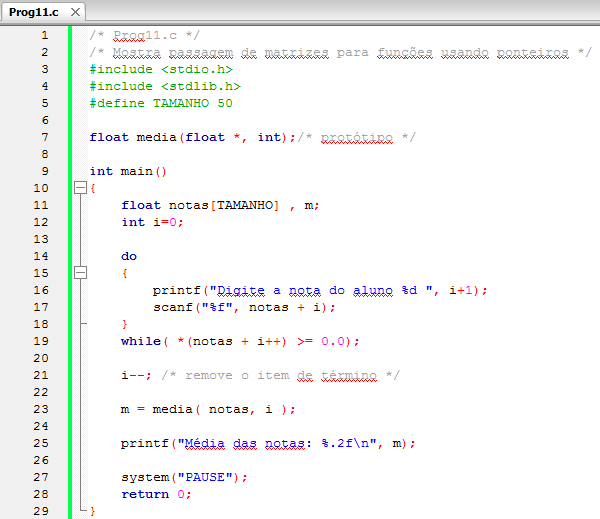

*Figura:* captura do editor com `Prog11.c` (**A05-08-P11**), linhas 1–29 da versão histórica do programa. Fonte revisado: [`src/Fontes_Aula_5_6_7_e_8/Prog11.c`](../../src/Fontes_Aula_5_6_7_e_8/Prog11.c); versão anterior à revisão de 2026 em texto: [commit `04ac409`](https://github.com/Lucas-Sperotto/falect-cc-011-algoritmos-e-laboratorio-de-programacao-ii/blob/04ac4094dba3c3812809dd433a7d3855c4bffdc9/src/Fontes_Aula_5_6_7_e_8/Prog11.c); explicação: [seção 6](#a05-08-p11).

<a id="slide-20"></a>
**Slide 20 — Passando Matrizes como Argumento para Funções**

> 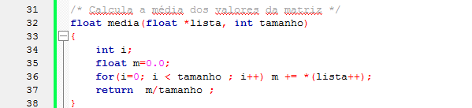

*Figura:* continuação de `Prog11.c` (**A05-08-P11**), linhas 31–38.

<a id="slide-21"></a>
**Slide 21 — Passando Matrizes como Argumento para Funções**

> - Observe primeiramente o protótipo da função media().
>
>   ```c
>   float media(float *, int);/* protótipo */
>   ```
>
> - A declaração: é equivalente à original
>
>   ```c
>   float *
>   ```
>
>   ```c
>   float[]
>   ```
>
> - A primeira declara um ponteiro variável, enquanto a segunda declara um ponteiro constante.

*Nota de transcrição:* ver [observação 8.3](#obs-6-3).

<a id="slide-22"></a>
**Slide 22 — Passando Matrizes como Argumento para Funções**

> - Como o nome da matriz é um endereço, não usamos o operador de endereços (&) na instrução de chamada à função:
>
>   ```c
>   m = media( notas, i );
>   ```

### 3.5 Ponteiros e strings (slides 23–27)

<a id="slide-23"></a>
**Slide 23 — Roteiro** · *repete o roteiro do [slide 2](#slide-2), sem destaque do tópico seguinte.*

<a id="slide-24"></a>
**Slide 24 — Ponteiros e Strings**

> - Strings são matrizes do tipo char.
> - Dessa forma, a notação ponteiro pode ser aplicada.
> - Como primeiro exemplo, vamos escrever uma função que procure um caractere numa cadeia de caracteres.
> - Essa função retorna o endereço da primeira ocorrência do caractere, se este existir, ou o endereço zero, caso o caractere não seja encontrado.

*Nota de transcrição:* a função devolve o ponteiro nulo quando não encontra o caractere; a biblioteca padrão tem `strchr()` com essa mesma finalidade ([seção 4.3](#c-6-3)).

<a id="slide-25"></a>
**Slide 25 — Ponteiros e Strings**

> 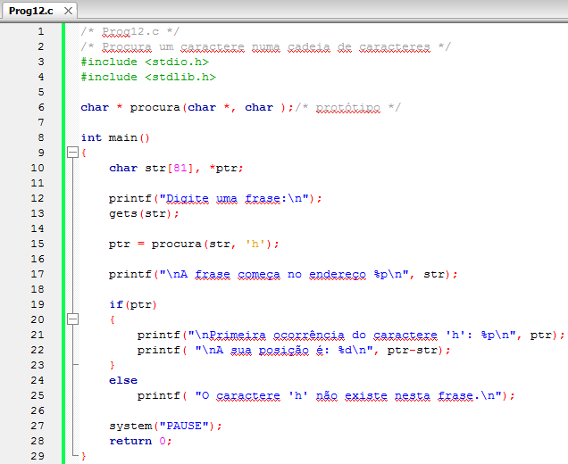

*Figura:* captura do editor com `Prog12.c` (**A05-08-P12**), linhas 1–29 da versão histórica do programa. Fonte revisado: [`src/Fontes_Aula_5_6_7_e_8/Prog12.c`](../../src/Fontes_Aula_5_6_7_e_8/Prog12.c); versão anterior à revisão de 2026 em texto: [commit `04ac409`](https://github.com/Lucas-Sperotto/falect-cc-011-algoritmos-e-laboratorio-de-programacao-ii/blob/04ac4094dba3c3812809dd433a7d3855c4bffdc9/src/Fontes_Aula_5_6_7_e_8/Prog12.c); explicação: [seção 6](#a05-08-p12).

<a id="slide-26"></a>
**Slide 26 — Ponteiros e Strings**

> 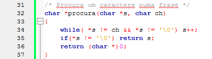

*Figura:* continuação de `Prog12.c` (**A05-08-P12**), linhas 31–37.

<a id="slide-27"></a>
**Slide 27 — Ponteiros e Strings**

> - Vamos analisar o protótipo da função procura().
>
>   ```c
>   char * procura(char *, char );/* protótipo */
>   ```
>
> - A função retorna um ponteiro char.
> - Assim, funções podem tanto receber ponteiros como argumentos ou retornar um ponteiro, desde que declarados de acordo.

### 3.6 Funções de biblioteca para manipulação de strings (slides 28–32)

<a id="slide-28"></a>
**Slide 28 — Roteiro** · *repete o roteiro do [slide 2](#slide-2), sem destaque do tópico seguinte.*

<a id="slide-29"></a>
**Slide 29 — Funções de Biblioteca para Manipulação de Strings**

> - Você já usou várias funções de biblioteca para manipular strings.
> - Essas funções usam ponteiros.
> - Apesar de existirem prontas na biblioteca C, escrevemos algumas delas para que você aprenda e as crie conforme suas necessidades.

*Nota de transcrição:* sobre os nomes das funções reescritas, ver [observação 8.5](#obs-6-5).

<a id="slide-30"></a>
**Slide 30 — Funções de Biblioteca para Manipulação de Strings**

> 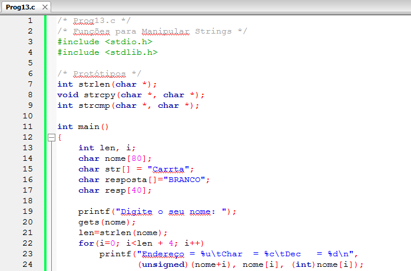

*Figura:* captura do editor com `Prog13.c` (**A05-08-P13**), linhas 1–24 da versão histórica do programa. Fonte revisado: [`src/Fontes_Aula_5_6_7_e_8/Prog13.c`](../../src/Fontes_Aula_5_6_7_e_8/Prog13.c); versão anterior à revisão de 2026 em texto: [commit `04ac409`](https://github.com/Lucas-Sperotto/falect-cc-011-algoritmos-e-laboratorio-de-programacao-ii/blob/04ac4094dba3c3812809dd433a7d3855c4bffdc9/src/Fontes_Aula_5_6_7_e_8/Prog13.c); explicação: [seção 6](#a05-08-p13). As funções da captura se chamam `strlen`, `strcpy` e `strcmp`, nomes reservados da biblioteca padrão; ver [observação 8.5](#obs-6-5).

<a id="slide-31"></a>
**Slide 31 — Funções de Biblioteca para Manipulação de Strings**

> 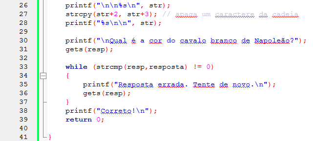

*Figura:* continuação de `Prog13.c` (**A05-08-P13**), linhas 26–41.

<a id="slide-32"></a>
**Slide 32 — Funções de Biblioteca para Manipulação de Strings**

> 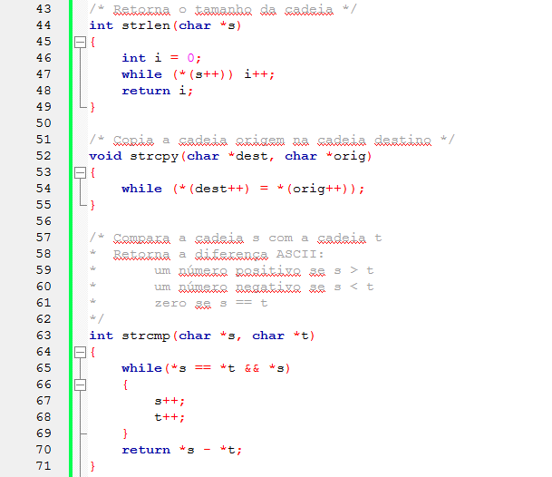

*Figura:* continuação de `Prog13.c` (**A05-08-P13**), linhas 43–71.

### 3.7 Ponteiros para uma cadeia de caracteres constante (slides 33–35)

<a id="slide-33"></a>
**Slide 33 — Roteiro** · *repete o roteiro do [slide 2](#slide-2), sem destaque do tópico seguinte.*

<a id="slide-34"></a>
**Slide 34 — Ponteiros para uma Cadeia de Caracteres Constante**

> - Vamos analisar duas maneiras de inicializar cadeias de caracteres constantes:
>   - Usando um ponteiro constante;
>   - Usando um ponteiro variável.
> - Observe o exemplo:
> - O ponteiro constante poderia ser usado em situações em que não queremos alterar o conteúdo da cadeia de caracteres, como para imprimir, enviar como argumento para uma função etc.

*Nota de transcrição:* os papéis estão trocados: o vetor `s1` é que não pode ser incrementado (seu nome não é uma variável), mas seu conteúdo pode ser alterado; o literal apontado por `s2` não deve ser alterado. Ver [seção 4.4](#c-6-4).

<a id="slide-35"></a>
**Slide 35 — Ponteiros para uma Cadeia de Caracteres Constante**

> 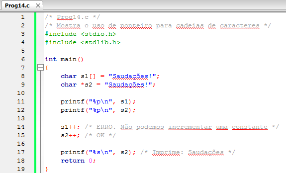

*Figura:* captura do editor com `Prog14.c` (**A05-08-P14**), linhas 1–19 da versão histórica do programa. Fonte revisado: [`src/Fontes_Aula_5_6_7_e_8/Prog14.c`](../../src/Fontes_Aula_5_6_7_e_8/Prog14.c); versão anterior à revisão de 2026 em texto: [commit `04ac409`](https://github.com/Lucas-Sperotto/falect-cc-011-algoritmos-e-laboratorio-de-programacao-ii/blob/04ac4094dba3c3812809dd433a7d3855c4bffdc9/src/Fontes_Aula_5_6_7_e_8/Prog14.c); explicação: [seção 6](#a05-08-p14). O comentário `/* Imprime: Saudações */` não corresponde ao que o programa imprime depois de `s2++`; ver [observação 8.6](#obs-6-6).

### 3.8 Matrizes de ponteiros (slides 36–42)

<a id="slide-36"></a>
**Slide 36 — Roteiro** · *repete o roteiro do [slide 2](#slide-2), sem destaque do tópico seguinte.*

<a id="slide-37"></a>
**Slide 37 — Matrizes de Ponteiros**

> - Matrizes de ponteiros são essencialmente utilizadas para substituir matrizes de duas dimensões em que cada elemento é uma cadeia de caracteres.
> - Esse uso permite uma grande economia de memória, já que não teremos a desvantagem de dimensionar todos os elementos com o tamanho da maior cadeia.

<a id="slide-38"></a>
**Slide 38 — Matrizes de Ponteiros**

> - Vamos modificar um programa da aula de matrizes, para que utilize uma matriz de ponteiros no lugar de uma matriz de strings.

<a id="slide-39"></a>
**Slide 39 — Matrizes de Ponteiros**

> 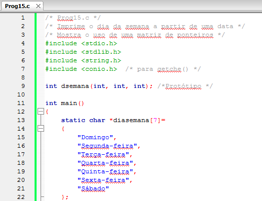

*Figura:* captura do editor com `Prog15.c` (**A05-08-P15**), linhas 1–22 da versão histórica do programa. Fonte revisado: [`src/Fontes_Aula_5_6_7_e_8/Prog15.c`](../../src/Fontes_Aula_5_6_7_e_8/Prog15.c); versão anterior à revisão de 2026 em texto: [commit `04ac409`](https://github.com/Lucas-Sperotto/falect-cc-011-algoritmos-e-laboratorio-de-programacao-ii/blob/04ac4094dba3c3812809dd433a7d3855c4bffdc9/src/Fontes_Aula_5_6_7_e_8/Prog15.c); explicação: [seção 6](#a05-08-p15).

<a id="slide-40"></a>
**Slide 40 — Matrizes de Ponteiros**

> 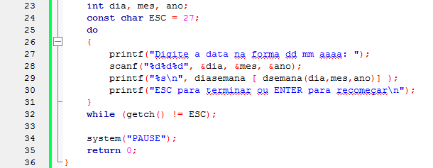

*Figura:* continuação de `Prog15.c` (**A05-08-P15**), linhas 23–36.

<a id="slide-41"></a>
**Slide 41 — Matrizes de Ponteiros**

> 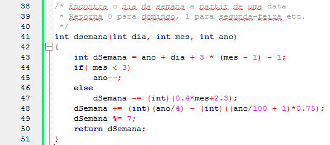

*Figura:* continuação de `Prog15.c` (**A05-08-P15**), linhas 38–51.

<a id="slide-42"></a>
**Slide 42 — Matrizes de Ponteiros**

> - Na versão matriz, as cadeias de caracteres são guardadas na memória em sete posições de 14 bytes cada uma, ou seja, ocupando 98 bytes de memória.
> - Na nova versão, as cadeias são guardadas de forma a ocupar somente o número de bytes necessários para o seu armazenamento.
> - Cada elemento da matriz é um ponteiro e não mais outra matriz.

*Nota de transcrição:* em UTF-8, “Terça-feira” e “Sábado” têm um byte a mais cada; a contagem de 98 bytes da matriz não muda, mas a de 79 bytes passa a 81. Ver [seção 4.5](#c-6-5).

### 3.9 Matriz de strings e a memória alocada (slides 43–44)

<a id="slide-43"></a>
**Slide 43 — Roteiro** · *repete o roteiro do [slide 2](#slide-2), sem destaque do tópico seguinte.*

<a id="slide-44"></a>
**Slide 44 — Matriz de Strings e a Memória Alocada**

> - A versão do código que usa matriz de string aloca 98 bytes de memória da seguinte forma:
>
> | | 0 | 1 | 2 | 3 | 4 | 5 | 6 | 7 | 8 | 9 | 10 | 11 | 12 | 13 |
> |---|---|---|---|---|---|---|---|---|---|---|---|---|---|---|
> | 1 | D | o | m | i | n | g | o | \0 |  |  |  |  |  |  |
> | 2 | S | e | g | u | n | d | a | - | f | e | i | r | a | \0 |
> | 3 | T | e | r | ç | a | - | f | e | i | r | a | \0 |  |  |
> | 4 | Q | u | a | r | t | a | - | f | e | i | r | a | \0 |  |
> | 5 | Q | u | i | n | t | a | - | f | e | i | r | a | \0 |  |
> | 6 | S | e | x | t | a | - | f | e | i | r | a | \0 |  |  |
> | 7 | S | á | b | a | d | o | \0 |  |  |  |  |  |  |  |

<details><summary>Imagem original (tabela, slide 44)</summary>

![Slide 44: matriz char diasemana[7][14] na memória](figuras/s044-x137.jpg)

</details>

*Nota de transcrição:* a figura numera as linhas de 1 a 7 e as colunas de 0 a 13; as células vazias também pertencem à matriz e não são usadas.

### 3.10 Matriz de ponteiros e a memória alocada (slides 45–46)

<a id="slide-45"></a>
**Slide 45 — Roteiro** · *repete o roteiro do [slide 2](#slide-2), sem destaque do tópico seguinte.*

<a id="slide-46"></a>
**Slide 46 — Matriz de Ponteiros e a Memória Alocada**

> - A versão do código que usa ponteiros aloca 79 bytes de memória da seguinte forma:
>
> | | 0 | 1 | 2 | 3 | 4 | 5 | 6 | 7 | 8 | 9 | 10 | 11 | 12 | 13 |
> |---|---|---|---|---|---|---|---|---|---|---|---|---|---|---|
> | 0 | D | o | m | i | n | g | o | \0 | S | e | g | u | n | d |
> | 1 | a | - | f | e | i | r | a | \0 | T | e | r | ç | a | - |
> | 2 | f | e | i | r | a | \0 | Q | u | a | r | t | a | - | f |
> | 3 | e | i | r | a | \0 | Q | u | i | n | t | a | - | f | e |
> | 4 | i | r | a | \0 | S | e | x | t | a | - | f | e | i | r |
> | 5 | a | \0 | S | á | b | a | d | o | \0 |  |  |  |  |  |
>
> - A versão que usa ponteiros aloca uma matriz de sete ponteiros e inicializa cada um deles com o endereço de cada uma das cadeias de caracteres constantes.

<details><summary>Imagem original (tabela, slide 46)</summary>

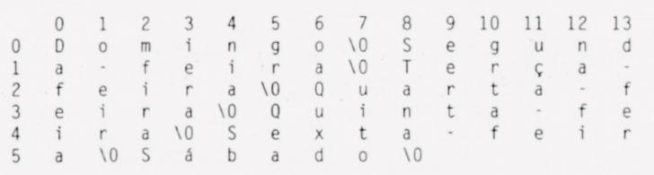

</details>

*Nota de transcrição:* a figura mostra as sete cadeias em sequência contínua, quebradas em linhas de 14 colunas apenas para caber na página; o vetor de sete ponteiros não aparece na figura.

*Nota de transcrição:* os 79 bytes não incluem o vetor de sete ponteiros (56 bytes em 64 bits); ver [seção 4.5](#c-6-5) e [observação 8.7](#obs-6-7).

### 3.11 Ponteiros para ponteiros (slides 47–52)

<a id="slide-47"></a>
**Slide 47 — Roteiro** · *repete o roteiro do [slide 2](#slide-2), sem destaque do tópico seguinte.*

<a id="slide-48"></a>
**Slide 48 — Ponteiros para Ponteiros**

> - No próximo programa, mostraremos a ordenação de nomes por meio de uma matriz de ponteiros.
> - No lugar de ordenar os próprios nomes, ordenaremos a matriz de ponteiros em que cada elemento aponta para um dos nomes.
> - Os elementos da matriz de ponteiros são ponteiros que apontam para outros ponteiros
> - Veja a listagem:

*Nota de transcrição:* cada elemento de `p` é um `char *` (aponta para caracteres); é o nome `p`, convertido em ponteiro, que aponta para ponteiros. Ver [observação 8.8](#obs-6-8).

<a id="slide-49"></a>
**Slide 49 — Ponteiros para Ponteiros**

> 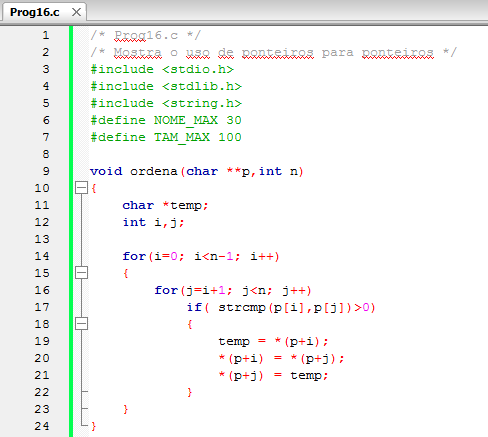

*Figura:* captura do editor com `Prog16.c` (**A05-08-P16**), linhas 1–24 da versão histórica do programa. Fonte revisado: [`src/Fontes_Aula_5_6_7_e_8/Prog16.c`](../../src/Fontes_Aula_5_6_7_e_8/Prog16.c); versão anterior à revisão de 2026 em texto: [commit `04ac409`](https://github.com/Lucas-Sperotto/falect-cc-011-algoritmos-e-laboratorio-de-programacao-ii/blob/04ac4094dba3c3812809dd433a7d3855c4bffdc9/src/Fontes_Aula_5_6_7_e_8/Prog16.c); explicação: [seção 6](#a05-08-p16).

<a id="slide-50"></a>
**Slide 50 — Ponteiros para Ponteiros**

> 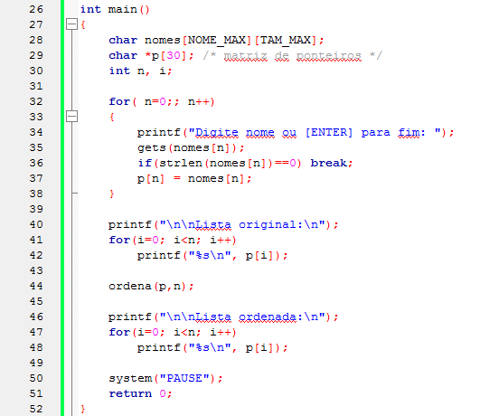

*Figura:* continuação de `Prog16.c` (**A05-08-P16**), linhas 26–52.

<a id="slide-51"></a>
**Slide 51 — Ponteiros para Ponteiros**

> - O programa declara uma matriz de duas dimensões para armazenar os nomes, em seguida cria uma matriz de ponteiros que apontarão para eles.
> - Toda vez que o usuário digitar um nome, seu endereço é atribuído a um elemento da matriz de ponteiros.
> - Quando [ENTER] for digitado, o processo é interrompido.

<a id="slide-52"></a>
**Slide 52 — Ponteiros para Ponteiros**

> - Os nomes são impressos duas vezes:
>   - A primeira, na mesma ordem em que foram digitados;
>   - E a segunda, em ordem alfabética.

### 3.12 Ordenando ponteiros (slides 53–57)

<a id="slide-53"></a>
**Slide 53 — Roteiro** · *repete o roteiro do [slide 2](#slide-2), sem destaque do tópico seguinte.*

<a id="slide-54"></a>
**Slide 54 — Ordenando Ponteiros**

> - A novidade desse programa está em como os nomes são ordenados.
> - Na realidade, a função ordena() não ordena os nomes, e sim os ponteiros para os nomes.
> - Essa ordenação é muito mais rápida que a da própria matriz nomes[][], pois estamos movimentando ponteiros pela memória, e não rearranjando cada letra de cada nome.

<a id="slide-55"></a>
**Slide 55 — Ordenando Ponteiros**

> - Os ponteiros são variáveis que ocupam pouco lugar de memória, entretanto os nomes podem ocupar muita memória.
> - Observe a declaração do primeiro argumento de ordena():
>
>   ```c
>   void ordena(char **p,int n)
>   ```
>
> - O tipo da variável p é char\*\*.
> - Essa notação indica que p é um ponteiro duplamente indireto.

<a id="slide-56"></a>
**Slide 56 — Ordenando Ponteiros**

> - Quando o endereço de um nome é passado para uma função como argumento, você já sabe que o seu tipo é char\*.
> - Um único asterisco é usado para indicar o endereço de um único nome.
> - A função ordena() não recebe o endereço de um nome, mas o de uma matriz de ponteiros para nomes.
> - O nome de uma matriz é um ponteiro para um elemento dela.

<a id="slide-57"></a>
**Slide 57 — Ordenando Ponteiros**

> - No caso da nossas [sic] matriz, um elemento é um ponteiro.
> - Portanto, o nome da matriz é um ponteiro que aponta para outro ponteiro.
> - Dois asteriscos são usados para indicar um ponteiro para ponteiro.

### 3.13 Notação ponteiro para matrizes de ponteiros (slides 58–59)

<a id="slide-58"></a>
**Slide 58 — Roteiro** · *repete o roteiro do [slide 2](#slide-2), sem destaque do tópico seguinte.*

<a id="slide-59"></a>
**Slide 59 — Notação Ponteiro para Matrizes de Ponteiros**

> - Cada elemento da matriz p é um ponteiro para um nome.
> - Assim p[i] é o endereço de um nome.
> - Você já sabe que um elemento de uma matriz pode ser escrito em notação ponteiro.
> - Dessa forma, podemos escrever a expressão p[i] como:
>
>   ```c
>   *(p+i)
>   ```

### 3.14 O programa do foguete (slides 60–69)

<a id="slide-60"></a>
**Slide 60 — Roteiro** · *repete o roteiro do [slide 2](#slide-2), sem destaque do tópico seguinte.*

<a id="slide-61"></a>
**Slide 61 — O Programa do Foguete**

> - Vamos analisar um exemplo que incorpora acesso duplamente indireto e mostra como manipular elementos de uma matriz usando ponteiros que apontam para ponteiros.
> - Este programa modela um foguete e imprime-o na tela.

<a id="slide-62"></a>
**Slide 62 — O Programa do Foguete**

> - O programa consiste em um amplo laço.
> - Cada vez que o laço é executado, o programa desenha o foguete e uma linha, representando a terra, composta de cinco caracteres de linha dupla (‘\xCD’).
> - O foguete é definido por quatro caracteres [sic]: o corpo (‘\xDB) [sic], o cone que forma o bico do foguete (‘\x1E’) e duas máquinas (‘\x1E’).

*Nota de transcrição:* os códigos `\xCD`, `\xDB` e `\x1E` são caracteres gráficos da página de código 437 do DOS; ver [observação 8.9](#obs-6-9).

<a id="slide-63"></a>
**Slide 63 — O Programa do Foguete**

> - Depois de desenhado o foguete, as linhas da matriz que o contém são rodadas;
> - Cada linha é movida uma posição acima e a primeira linha é colocada no lugar da última (na verdade, a matriz não é mexida; movemos uma matriz de ponteiros para as linhas).
> - A impressão é executada novamente.
> - O foguete, então, se distância [sic] da Terra.

<a id="slide-64"></a>
**Slide 64 — O Programa do Foguete**

> 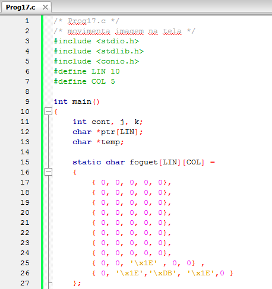

*Figura:* captura do editor com `Prog17.c` (**A05-08-P17**), linhas 1–27 da versão histórica do programa. Fonte revisado: [`src/Fontes_Aula_5_6_7_e_8/Prog17.c`](../../src/Fontes_Aula_5_6_7_e_8/Prog17.c); versão anterior à revisão de 2026 em texto: [commit `04ac409`](https://github.com/Lucas-Sperotto/falect-cc-011-algoritmos-e-laboratorio-de-programacao-ii/blob/04ac4094dba3c3812809dd433a7d3855c4bffdc9/src/Fontes_Aula_5_6_7_e_8/Prog17.c); explicação: [seção 6](#a05-08-p17).

<a id="slide-65"></a>
**Slide 65 — O Programa do Foguete**

> 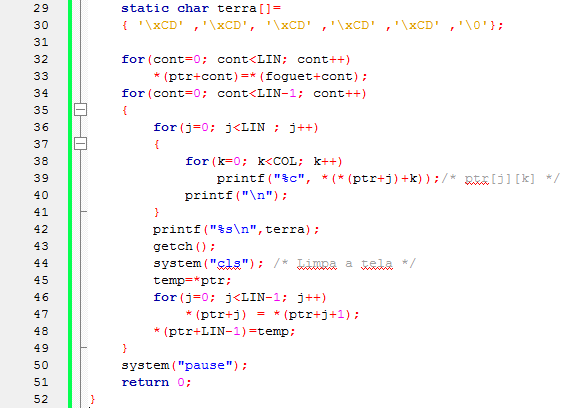

*Figura:* continuação de `Prog17.c` (**A05-08-P17**), linhas 29–52.

<a id="slide-66"></a>
**Slide 66 — O Programa do Foguete**

> - Declaramos uma matriz de ponteiros para armazenar as linhas do desenho do foguete.
>
>   ```c
>   char *ptr[LIN];
>   ```
>
> - A cada elemento da matriz, atribuímos o endereço de uma linha da matriz foguet[][] usada no laço:
>
>   ```c
>   for(cont=0; cont<LIN; cont++)
>       *(ptr+cont)=*(foguet+cont);
>   ```

<a id="slide-67"></a>
**Slide 67 — O Programa do Foguete**

> - Os elementos da matriz são impressos usando dois laços aninhados.
> - Foi usada notação de ponteiro para referenciar um elemento individual da matriz:
>
>   ```c
>   printf("%c", *(*(ptr+j)+k));/* ptr[j][k] */
>   ```
>
> - Aqui nós referenciamos propriamente [sic] a matriz foguet[][], mas sim a matriz de ponteiros ptr[], que aponta para ela.

*Nota de transcrição:* falta a palavra “não”: o sentido é “aqui **não** referenciamos propriamente a matriz `foguet[][]`, mas sim a matriz de ponteiros `ptr[]`”.

<a id="slide-68"></a>
**Slide 68 — O Programa do Foguete**

> - Para movimentar o foguete, se tivéssemos de mover os elementos de cada linha da matriz para cima, necessitaríamos mover 50 caracteres na memória, o que consumiria muito tempo.
> - Em vez disso, simplesmente movemos os ponteiros que apontam para as linhas.
> - Teremos, então, o movimento de dez ponteiros, o que torna a operação bem mais rápida.

<a id="slide-69"></a>
**Slide 69 — O Programa do Foguete**

> - É feita uma rotação com os ponteiros da matriz ptr[], cada elemento é movido uma localização acima, e o elemento do topo é movido para o fim.
> - O primeiro passo é guardar o valor do topo ptr[0] na variável temp, então usar um laço para mover o conteúdo de cada ponteiro para o imediatamente anterior e, finalmente, o elemento de topo, guardado na variável temp, é inserido.

### 3.15 Referências do material original (slide 70)

<a id="slide-70"></a>
**Slide 70 — Referências**

> - MIZRAHI, Victorine V. Treinamento em Linguagem C, São Paulo: Pearson Prentice Hall, 2008;

## 4. Explicações complementares

<a id="c-6-1"></a>
### 4.1 Vetores não são ponteiros, mas viram ponteiros

Um vetor é um bloco de elementos; um ponteiro é uma variável que guarda um endereço. A confusão vem de uma regra de conversão: na maioria das expressões, o nome de um vetor `M` é convertido no endereço do seu primeiro elemento, de tipo `int *` (§6.3.2.1p3). Por isso `M + i`, `*(M + i)` e `M[i]` funcionam. As exceções mostram que `M` não é um ponteiro:

| Expressão (com `int M[5]`) | Resultado | Por quê |
|---|---|---|
| `sizeof M` | 20 (no GCC x86-64) | tamanho do vetor inteiro; um ponteiro teria 8 |
| `&M` | endereço do vetor, de tipo `int (*)[5]` | mesmo valor numérico de `M`, tipo diferente |
| `M++` ou `M = p` | erro de compilação | `M` não é uma variável modificável |
| `char s[] = "abc";` | `s` recebe uma **cópia** do literal | inicialização de vetor |

A indexação é definida pela aritmética: `E1[E2]` é, por definição, `(*((E1)+(E2)))` (§6.5.2.1p2). Por isso `p[i]` também funciona com um ponteiro `p`, e `*(p + i)` funciona com um vetor.

<a id="c-6-2"></a>
### 4.2 `*(p++)`, `*p++` e `(*p)++`

O incremento pós-fixado devolve o valor **antigo** e só depois avança o ponteiro. Como `++` pós-fixado tem precedência maior que `*`, os parênteses de `*(p++)` são opcionais:

| Expressão | Valor obtido | Efeito colateral |
|---|---|---|
| `*(p++)` ou `*p++` | `*p` (elemento atual) | `p` passa a apontar para o próximo |
| `*(++p)` ou `*++p` | elemento seguinte | `p` avança antes |
| `(*p)++` | `*p` | incrementa o **elemento**, não o ponteiro |

Em `Prog10.c`, a primeira iteração imprime `M[0]` (92), e não `M[1]`, como poderia sugerir o slide 15 ([8.2](#obs-6-2)). A função `media()` de `Prog11.c` usa a mesma ideia: `m += *(lista++)` soma o elemento e avança.

<a id="c-6-3"></a>
### 4.3 Funções que devolvem ponteiros

`procura()` devolve um endereço **dentro do vetor recebido** ou o ponteiro nulo. Isso é seguro porque o vetor `str` continua existindo depois que a função retorna. O erro clássico é devolver o endereço de uma variável local:

```c
char *errado(void)
{
    char texto[20] = "temporário";
    return texto;   /* texto deixa de existir no retorno: ponteiro pendente */
}
```

O chamador receberia um endereço de memória já liberada da pilha, e usá-lo é comportamento indefinido. A biblioteca oferece `strchr(s, c)`, equivalente a `procura()`, e `strstr(s, t)`, que procura uma substring. A posição do caractere é a **diferença** de ponteiros `ptr - str`, de tipo `ptrdiff_t`, impressa com `%td`.

<a id="c-6-4"></a>
### 4.4 Vetor inicializado × ponteiro para literal

```c
char s1[] = "Saudações!";        /* vetor de 12 bytes (UTF-8 + '\0'), cópia modificável */
const char *s2 = "Saudações!";   /* ponteiro para o literal, armazenado em área somente leitura */
```

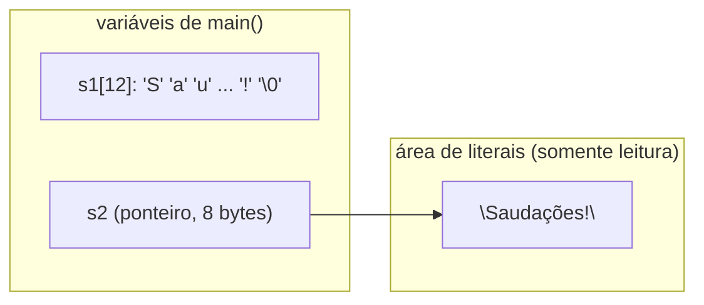

| Operação | `s1` (vetor) | `s2` (ponteiro) |
|---|---|---|
| alterar um caractere (`s[0] = 's'`) | permitido | comportamento indefinido (o literal não pode ser alterado, §6.4.5p7) |
| incrementar o nome (`s++`) | erro de compilação | permitido: `s2` passa a apontar para `"audações!"` |
| `sizeof` | 12 | 8 (tamanho do ponteiro) |

O slide 34 descreve o ponteiro “constante” como o que não se quer alterar; na verdade, é o **conteúdo** apontado por `s2` que não pode ser alterado, e o **nome** do vetor `s1` que não pode ser movido. O fonte revisado declara `s2` como `const char *`, para que o compilador acuse qualquer tentativa de alterar o literal.

<a id="c-6-5"></a>
### 4.5 Matriz de strings × vetor de ponteiros: quanto custa cada um

| Organização | Texto | Ponteiros | Total no GCC x86-64 |
|---|---:|---:|---:|
| `char diasemana[7][14]` (Aula 2) | 7 × 14 = 98 bytes | — | 98 bytes |
| `char *diasemana[7]` (Aula 6), texto em CP1252 | 79 bytes | 7 × 8 = 56 bytes | 135 bytes |
| `char *diasemana[7]` (Aula 6), texto em UTF-8 | 81 bytes | 7 × 8 = 56 bytes | 137 bytes |

A conta de 79 bytes do slide 46 considera só os caracteres (um byte por letra) e não inclui o vetor de ponteiros. Com ponteiros de 8 bytes, a versão com ponteiros gasta **mais** memória neste exemplo, porque os nomes têm comprimentos parecidos. A vantagem aparece quando as strings variam muito de tamanho ou são muitas e longas, e principalmente quando é preciso **reordená-las**: trocar dois ponteiros move 8 bytes; trocar duas linhas de `char[100]` move 300 bytes (com o temporário).

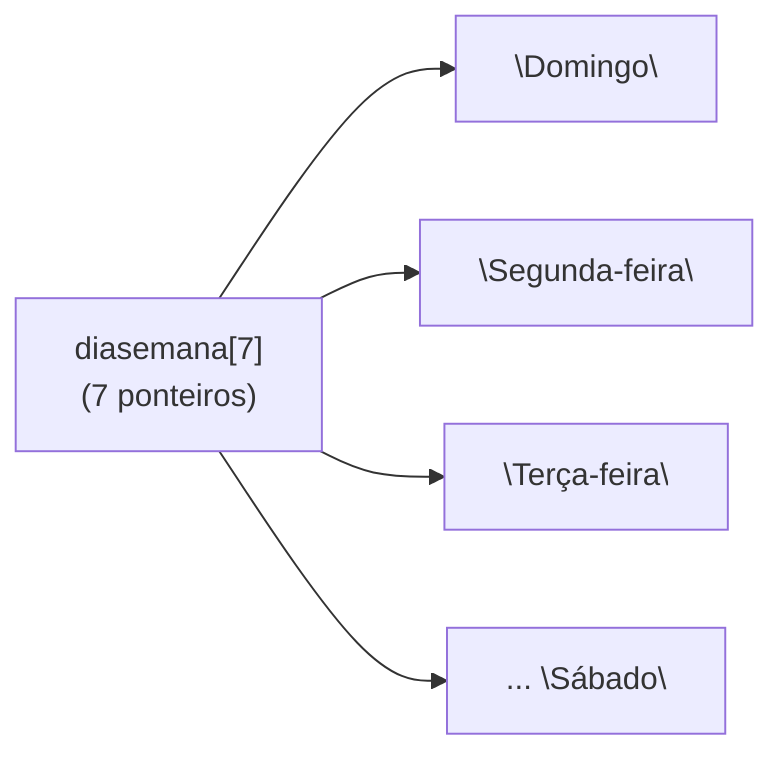

<a id="c-6-6"></a>
### 4.6 Ponteiro para ponteiro na ordenação de nomes

Em `Prog16.c`, os nomes ficam na matriz `nomes[30][100]` e **não se movem**; o vetor `p[30]` guarda o endereço de cada nome. `ordena(p, n)` recebe `p` convertido em `char **` (ponteiro para o primeiro `char *`) e troca apenas os elementos de `p`:

| | antes de `ordena` | depois de `ordena` |
|---|---|---|
| `p[0]` | `&nomes[0]` → “Zuleima” | `&nomes[1]` → “Andre” |
| `p[1]` | `&nomes[1]` → “Andre” | `&nomes[0]` → “Zuleima” |
| `nomes[0]`, `nomes[1]` | “Zuleima”, “Andre” | **inalterados** |

Dentro de `ordena`, `p[i]` (ou `*(p+i)`) é um `char *`, e `strcmp(p[i], p[j])` compara os textos apontados. Os tipos, de fora para dentro: `p` é `char **`; `*p` é `char *`; `**p` é `char`.

<a id="c-6-7"></a>
### 4.7 Lendo `*(*(ptr + j) + k)`

Com `char *ptr[LIN]`, a expressão se decompõe assim:

1. `ptr + j` é o endereço do elemento `j` do vetor de ponteiros (tipo `char **`);
2. `*(ptr + j)` é esse elemento, o ponteiro para a linha `j` (tipo `char *`), ou seja, `ptr[j]`;
3. `*(ptr + j) + k` é o endereço do caractere `k` dessa linha;
4. `*(*(ptr + j) + k)` é o caractere, ou seja, `ptr[j][k]`.

<a id="c-6-8"></a>
### 4.8 A rotação do foguete

A cada quadro, o programa gira o vetor de ponteiros uma posição para cima: guarda `ptr[0]` em `temp`, move `ptr[1..9]` para `ptr[0..8]` e coloca `temp` em `ptr[9]`. São 10 atribuições de ponteiro, em vez de copiar 50 caracteres. Como as linhas de cima são vazias, a linha vazia que sai do topo reaparece embaixo e o foguete “sobe”.

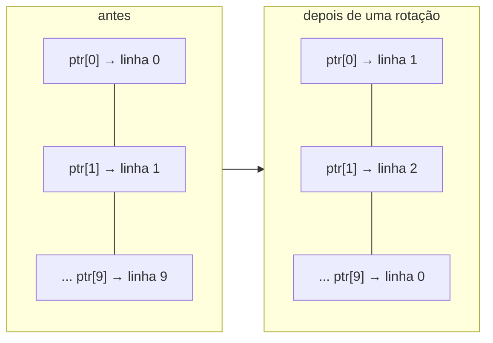

## 5. Conceitos fundamentais

| Conceito | Definição operacional | Onde aparece |
|---|---|---|
| Conversão de vetor em ponteiro | O nome do vetor vale `&v[0]` na maioria das expressões | slides 3–8 |
| Equivalência `v[i]` ≡ `*(v + i)` | A indexação é definida por aritmética de ponteiros | slides 7–8 |
| Ponteiro constante × variável | `&x` e o nome de vetor não podem ser alterados; um ponteiro variável pode | slides 10–15 |
| Pós-incremento de ponteiro | `*(p++)` lê o elemento atual e avança | slides 14–15 |
| Parâmetro ponteiro | `T v[]` e `T *v` são equivalentes em parâmetros | slides 17–22 |
| Função que devolve ponteiro | Devolve endereço válido após o retorno, ou `NULL` | slides 24–27 |
| Literal de string | Vetor criado pelo compilador, que não deve ser alterado | slides 34–35 |
| Vetor de ponteiros | Vetor cujos elementos são endereços (de strings, de linhas) | slides 37–46 |
| Ponteiro para ponteiro | `char **`: aponta para um `char *` | slides 48–59 |
| Ordenação de ponteiros | Reordena os endereços, e não os dados | slides 54–57 |

## 6. Programas C da aula

Fontes em [`src/Fontes_Aula_5_6_7_e_8/`](../../src/Fontes_Aula_5_6_7_e_8/), revisados em 2026 ([revisão por fonte](../../docs/auditorias/REVISAO_POR_FONTE.md#aulas-5-a-8--srcfontes_aula_5_6_7_e_8)).

| ID | Arquivo | SIGAA | Slides | Tema |
|---|---|---|---|---|
| [A05-08-P08](#a05-08-p08) | [`Prog8.c`](../../src/Fontes_Aula_5_6_7_e_8/Prog8.c) | Prog08.c | 4–5 | notação de índices |
| [A05-08-P09](#a05-08-p09) | [`Prog9.c`](../../src/Fontes_Aula_5_6_7_e_8/Prog9.c) | Prog09.c | 6–11 | notação de ponteiros |
| [A05-08-P10](#a05-08-p10) | [`Prog10.c`](../../src/Fontes_Aula_5_6_7_e_8/Prog10.c) | Prog10.c | 12–15 | ponteiro variável |
| [A05-08-P11](#a05-08-p11) | [`Prog11.c`](../../src/Fontes_Aula_5_6_7_e_8/Prog11.c) | Prog11.c | 17–22 | vetor passado como ponteiro |
| [A05-08-P12](#a05-08-p12) | [`Prog12.c`](../../src/Fontes_Aula_5_6_7_e_8/Prog12.c) | Prog12.c | 24–27 | função que devolve ponteiro |
| [A05-08-P13](#a05-08-p13) | [`Prog13.c`](../../src/Fontes_Aula_5_6_7_e_8/Prog13.c) | Prog13.c | 29–32 | funções de string próprias |
| [A05-08-P14](#a05-08-p14) | [`Prog14.c`](../../src/Fontes_Aula_5_6_7_e_8/Prog14.c) | Prog14.c | 34–35 | vetor × ponteiro para literal |
| [A05-08-P15](#a05-08-p15) | [`Prog15.c`](../../src/Fontes_Aula_5_6_7_e_8/Prog15.c) | Prog15.c | 37–46 | vetor de ponteiros (dia da semana) |
| [A05-08-P16](#a05-08-p16) | [`Prog16.c`](../../src/Fontes_Aula_5_6_7_e_8/Prog16.c) | Prog16.c | 48–59 | ordenação de ponteiros |
| [A05-08-P17](#a05-08-p17) | [`Prog17.c`](../../src/Fontes_Aula_5_6_7_e_8/Prog17.c) | Prog17.c | 61–69 | foguete: rotação de ponteiros |

<a id="a05-08-p08"></a>
### 6.1 A05-08-P08 — `Prog8.c`: notação de índices

- **Finalidade:** imprimir `M[0..4]` com `M[i]`. **Saída:** 92, 81, 70, 69, 58, um por linha. Sem alterações de lógica em relação ao slide 5.

<!-- codigo: src/Fontes_Aula_5_6_7_e_8/Prog8.c de=`static int M[5]` ate=`/* Notação matriz */` -->
<sub>Copiado de [`src/Fontes_Aula_5_6_7_e_8/Prog8.c`](../../src/Fontes_Aula_5_6_7_e_8/Prog8.c#L13-L16) (linhas 13–16) por `scripts/documentacao_aulas.py`; não edite este bloco à mão.</sub>

```c
    static int M[5]= {92,81,70,69,58};
    int i;
    for(i=0; i<5; i++)
        printf("%d\n", M[i]); /* Notação matriz */
```
<!-- /codigo -->

<a id="a05-08-p09"></a>
### 6.2 A05-08-P09 — `Prog9.c`: notação de ponteiros

- **Finalidade:** a mesma saída de `Prog8.c`, com `*(M + i)`. Mostra que as duas notações são equivalentes ([4.1](#c-6-1)).

<!-- codigo: src/Fontes_Aula_5_6_7_e_8/Prog9.c de=`for(i=0; i<5; i++)` ate=`/* Notação ponteiro */` -->
<sub>Copiado de [`src/Fontes_Aula_5_6_7_e_8/Prog9.c`](../../src/Fontes_Aula_5_6_7_e_8/Prog9.c#L15-L16) (linhas 15–16) por `scripts/documentacao_aulas.py`; não edite este bloco à mão.</sub>

```c
    for(i=0; i<5; i++)
        printf("%d\n", *(M + i)); /* Notação ponteiro */
```
<!-- /codigo -->

<a id="a05-08-p10"></a>
### 6.3 A05-08-P10 — `Prog10.c`: ponteiro variável

- **Finalidade:** percorrer `M` com `p`, que pode ser incrementado (o nome `M` não pode). **Saída:** igual à de `Prog8.c`.
- **Conceitos:** `int *p = M;` inicializa `p` com `&M[0]`; `*(p++)` ([4.2](#c-6-2)).

<!-- codigo: src/Fontes_Aula_5_6_7_e_8/Prog10.c de=`int i, *p = M;` ate=`printf("%d\n", *(p++));` -->
<sub>Copiado de [`src/Fontes_Aula_5_6_7_e_8/Prog10.c`](../../src/Fontes_Aula_5_6_7_e_8/Prog10.c#L14-L17) (linhas 14–17) por `scripts/documentacao_aulas.py`; não edite este bloco à mão.</sub>

```c
    int i, *p = M; /* cria e inicializa o ponteiro variável */

    for(i=0; i<5; i++)
        printf("%d\n", *(p++)); /* Notação ponteiro */
```
<!-- /codigo -->

<a id="a05-08-p11"></a>
### 6.4 A05-08-P11 — `Prog11.c`: vetor passado como ponteiro

- **Finalidade:** reescrever a média da [Aula 1](../aula-01/README.md#a01-p10) com notação de ponteiros. **Entrada:** notas terminadas por negativo (até 50). **Saída:** a média.
- **Conceitos:** `scanf("%f", notas+i)` (endereço do elemento `i`), parâmetro `float *lista`, `*(lista++)`.
- **Diferença em relação aos slides 19–20:** limite de 50 notas, verificação de `scanf`, tratamento de nenhuma nota (agora com mensagem e código 0) e acumulador `double`.

<!-- codigo: src/Fontes_Aula_5_6_7_e_8/Prog11.c funcao=media -->
<sub>Copiado de [`src/Fontes_Aula_5_6_7_e_8/Prog11.c`](../../src/Fontes_Aula_5_6_7_e_8/Prog11.c#L39-L46) (linhas 39–46) por `scripts/documentacao_aulas.py`; não edite este bloco à mão.</sub>

```c
/* Calcula a média dos valores da matriz */
float media(float *lista, int tamanho)
{
    int i;
    double m=0.0; /* Soma de float finitos pode exceder FLT_MAX. */
    for(i=0; i < tamanho ; i++) m += *(lista++);
    return  m/tamanho ;
}
```
<!-- /codigo -->

<a id="a05-08-p12"></a>
### 6.5 A05-08-P12 — `Prog12.c`: procurar um caractere

- **Finalidade:** encontrar a primeira ocorrência de `'h'` em uma frase. **Entrada:** uma linha. **Saída:** o endereço do início da frase e, se houver `'h'`, o endereço e a posição da ocorrência.
- **Conceitos:** função que devolve `char *`, ponteiro nulo como “não encontrado”, posição como diferença de ponteiros ([4.3](#c-6-3)).
- **Diferença em relação ao slide 25:** `gets` virou `ler_linha`; a posição é impressa com `%td`, e os endereços com `%p` e `(void *)`.

<!-- codigo: src/Fontes_Aula_5_6_7_e_8/Prog12.c funcao=procura -->
<sub>Copiado de [`src/Fontes_Aula_5_6_7_e_8/Prog12.c`](../../src/Fontes_Aula_5_6_7_e_8/Prog12.c#L37-L43) (linhas 37–43) por `scripts/documentacao_aulas.py`; não edite este bloco à mão.</sub>

```c
/* Procura um caractere numa frase */
char *procura(char *s, char ch)
{
    while( *s != ch && *s != '\0') s++;
    if(*s != '\0') return s;
    return (char *)0;
}
```
<!-- /codigo -->

<a id="a05-08-p13"></a>
### 6.6 A05-08-P13 — `Prog13.c`: as funções de string escritas com ponteiros

- **Finalidade:** reimplementar comprimento, cópia e comparação de strings com ponteiros e repetir os exemplos da [Aula 2](../aula-02/README.md) (Prog18, Prog23 e Prog21) com elas.
- **Entrada:** um nome e respostas à pergunta. **Saída:** os bytes do nome, `Carrta` → `Carta`, e o diálogo da pergunta.
- **Diferença em relação aos slides 30–32:** as funções foram renomeadas para `tamanho_string`, `copia_string` e `compara_string`, porque os nomes `strlen`, `strcpy` e `strcmp` são reservados à biblioteca padrão ([8.5](#obs-6-5)); a impressão vai até o terminador (e não `len + 4`).
- **Observação:** `copia_string` copia da esquerda para a direita e, por isso, funciona em `str+2, str+3` (deslocamento para a esquerda); a `strcpy` da biblioteca não garante isso ([Aula 2, 4.7](../aula-02/README.md#c-2-7)).

<!-- codigo: src/Fontes_Aula_5_6_7_e_8/Prog13.c de=`/* Retorna o tamanho da cadeia */` ate=`return (unsigned char)*s - (unsigned char)*t;` -->
<sub>Copiado de [`src/Fontes_Aula_5_6_7_e_8/Prog13.c`](../../src/Fontes_Aula_5_6_7_e_8/Prog13.c#L50-L78) (linhas 50–78) por `scripts/documentacao_aulas.py`; não edite este bloco à mão.</sub>

```c
/* Retorna o tamanho da cadeia */
int tamanho_string(char *s)
{
    int i = 0;
    while (*(s++)) i++;
    return i;
}

/* Copia a cadeia origem na cadeia destino */
void copia_string(char *dest, char *orig)
{
    while ((*(dest++) = *(orig++)) != '\0')
        ;
}

/* Compara a cadeia s com a cadeia t
*  Retorna a diferença ASCII:
*       um número positivo se s > t
*       um número negativo se s < t
*       zero se s == t
*/
int compara_string(char *s, char *t)
{
    while(*s == *t && *s)
    {
        s++;
        t++;
    }
    return (unsigned char)*s - (unsigned char)*t;
```
<!-- /codigo -->

<a id="a05-08-p14"></a>
### 6.7 A05-08-P14 — `Prog14.c`: vetor × ponteiro para literal

- **Finalidade:** mostrar que o nome do vetor não pode ser incrementado e que o ponteiro pode. **Saída:** dois endereços e `audações!`.
- **Característica didática preservada:** `s1++;` permanece como comentário marcado como erro intencional (não compila).
- **Diferença em relação ao slide 35:** `s2` passou a ser `const char *` e o comentário da última linha foi corrigido para `audações!` ([8.6](#obs-6-6)).

<!-- codigo: src/Fontes_Aula_5_6_7_e_8/Prog14.c de=`char s1[]` ate=`/* Imprime: audações! */` -->
<sub>Copiado de [`src/Fontes_Aula_5_6_7_e_8/Prog14.c`](../../src/Fontes_Aula_5_6_7_e_8/Prog14.c#L13-L22) (linhas 13–22) por `scripts/documentacao_aulas.py`; não edite este bloco à mão.</sub>

```c
    char s1[] = "Saudações!";
    const char *s2 = "Saudações!";

    printf("%p\n", (void *)s1);
    printf("%p\n", (void *)s2);

    /* s1++;  ERRO intencional: o nome do array não é uma variável ponteiro. */
    s2++; /* OK */

    printf("%s\n", s2); /* Imprime: audações! */
```
<!-- /codigo -->

<a id="a05-08-p15"></a>
### 6.8 A05-08-P15 — `Prog15.c`: dia da semana com vetor de ponteiros

- **Finalidade:** a mesma tarefa de [`Prog24.c` da Aula 2](../aula-02/README.md#a01-p24), com `static char *diasemana[7]` no lugar da matriz `char[7][14]` ([4.5](#c-6-5)).
- **Entrada:** `dd mm aaaa` em uma linha; depois ENTER para continuar ou ESC e ENTER para sair. **Saída:** o dia da semana.
- **Diferença em relação aos slides 39–41:** leitura por linha com `ler_linha` e `sscanf`, validação do calendário e confirmação com ENTER no lugar de `getch()`.

<!-- codigo: src/Fontes_Aula_5_6_7_e_8/Prog15.c de=`static char *diasemana[7]=` ate=`};` -->
<sub>Copiado de [`src/Fontes_Aula_5_6_7_e_8/Prog15.c`](../../src/Fontes_Aula_5_6_7_e_8/Prog15.c#L18-L27) (linhas 18–27) por `scripts/documentacao_aulas.py`; não edite este bloco à mão.</sub>

```c
    static char *diasemana[7]=
    {
        "Domingo",
        "Segunda-feira",
        "Terça-feira",
        "Quarta-feira",
        "Quinta-feira",
        "Sexta-feira",
        "Sábado"
    };
```
<!-- /codigo -->

<a id="a05-08-p16"></a>
### 6.9 A05-08-P16 — `Prog16.c`: ordenar nomes trocando ponteiros

- **Finalidade:** ler até 30 nomes, imprimi-los na ordem digitada e em ordem alfabética, sem mover os nomes ([4.6](#c-6-6)).
- **Entrada:** um nome por linha; linha vazia encerra. **Saída:** as duas listas.
- **Diferença em relação aos slides 49–50:** `gets` virou `ler_linha`; o laço para em 30 nomes (antes não havia limite).

<!-- codigo: src/Fontes_Aula_5_6_7_e_8/Prog16.c funcao=ordena -->
<sub>Copiado de [`src/Fontes_Aula_5_6_7_e_8/Prog16.c`](../../src/Fontes_Aula_5_6_7_e_8/Prog16.c#L15-L30) (linhas 15–30) por `scripts/documentacao_aulas.py`; não edite este bloco à mão.</sub>

```c
void ordena(char **p,int n)
{
    char *temp;
    int i,j;

    for(i=0; i<n-1; i++)
    {
        for(j=i+1; j<n; j++)
            if( strcmp(p[i],p[j])>0)
            {
                temp = *(p+i);
                *(p+i) = *(p+j);
                *(p+j) = temp;
            }
    }
}
```
<!-- /codigo -->

<a id="a05-08-p17"></a>
### 6.10 A05-08-P17 — `Prog17.c`: o foguete

- **Finalidade:** animar um foguete subindo, girando um vetor de ponteiros para as linhas de uma matriz ([4.7](#c-6-7), [4.8](#c-6-8)).
- **Entrada:** ENTER para avançar cada quadro. **Saída:** nove quadros de 10 linhas e a “terra”.
- **Diferença em relação aos slides 64–65:** `getch()` e `system("cls")` foram substituídos por ENTER e uma linha em branco; os caracteres gráficos da página de código 437 (`'\x1E'`, `'\xDB'`, `'\xCD'`) viraram `'^'`, `'#'` e `'='`, que funcionam em terminais UTF-8 ([8.9](#obs-6-9)).
- **Observação:** as posições vazias da matriz valem 0 e são impressas com `%c`, ou seja, como bytes nulos; no terminal elas não aparecem, e no exemplo 7.11 são mostradas como `␀`.

<!-- codigo: src/Fontes_Aula_5_6_7_e_8/Prog17.c de=`for(cont=0; cont<LIN; cont++)` ate=`*(ptr+LIN-1)=temp;` -->
<sub>Copiado de [`src/Fontes_Aula_5_6_7_e_8/Prog17.c`](../../src/Fontes_Aula_5_6_7_e_8/Prog17.c#L38-L55) (linhas 38–55) por `scripts/documentacao_aulas.py`; não edite este bloco à mão.</sub>

```c
    for(cont=0; cont<LIN; cont++)
        *(ptr+cont)=*(foguet+cont);
    for(cont=0; cont<LIN-1; cont++)
    {
        for(j=0; j<LIN ; j++)
        {
            for(k=0; k<COL; k++)
                printf("%c", *(*(ptr+j)+k));/* ptr[j][k] */
            printf("\n");
        }
        printf("%s\n",terra);
        /* Avança por linha, sem depender de conio.h nem executar "cls". */
        if (!ler_linha(linha, sizeof linha)) return 0;
        putchar('\n');
        temp=*ptr;
        for(j=0; j<LIN-1; j++)
            *(ptr+j) = *(ptr+j+1);
        *(ptr+LIN-1)=temp;
```
<!-- /codigo -->

## 7. Exemplos de execução

### 7.1 As três notações (`Prog10.c`)

<!-- execucao: src/Fontes_Aula_5_6_7_e_8/Prog10.c cenario=notacoes_equivalentes -->
Execução real do cenário revisado `notacoes_equivalentes` ([manifesto](../../scripts/cenarios_fontes_c.json)), compilado com `gcc -std=c11 -Wall -Wextra -Wpedantic -O0`; bloco gerado por `scripts/documentacao_aulas.py`.

Comando: `./Prog10`

Entrada padrão: *(vazia)*

Saída padrão:

```text
92
81
70
69
58
```

Código de saída: `0`.
<!-- /execucao -->

### 7.2 Média com ponteiros (`Prog11.c`)

<!-- execucao: src/Fontes_Aula_5_6_7_e_8/Prog11.c cenario=media -->
Execução real do cenário revisado `media` ([manifesto](../../scripts/cenarios_fontes_c.json)), compilado com `gcc -std=c11 -Wall -Wextra -Wpedantic -O0`; bloco gerado por `scripts/documentacao_aulas.py`.

Comando: `./Prog11`

Entrada padrão:

```text
6
8
-1
```

Saída padrão:

```text
Digite a nota do aluno 1 Digite a nota do aluno 2 Digite a nota do aluno 3 Média das notas: 7.00
```

Código de saída: `0`.
<!-- /execucao -->

### 7.3 Caractere encontrado (`Prog12.c`)

<!-- execucao: src/Fontes_Aula_5_6_7_e_8/Prog12.c cenario=procura -->
Execução real do cenário revisado `procura` ([manifesto](../../scripts/cenarios_fontes_c.json)), compilado com `gcc -std=c11 -Wall -Wextra -Wpedantic -O0`; bloco gerado por `scripts/documentacao_aulas.py`.

Comando: `./Prog12`

Entrada padrão:

```text
hoje
```

Saída padrão:

```text
Digite uma frase:

A frase começa no endereço 0x7ffebbef14e0

Primeira ocorrência do caractere 'h': 0x7ffebbef14e0

A sua posição é: 0
```

Código de saída: `0`.
<!-- /execucao -->

### 7.4 Caractere ausente (`Prog12.c`)

<!-- execucao: src/Fontes_Aula_5_6_7_e_8/Prog12.c cenario=sem_caractere -->
Execução real do cenário revisado `sem_caractere` ([manifesto](../../scripts/cenarios_fontes_c.json)), compilado com `gcc -std=c11 -Wall -Wextra -Wpedantic -O0`; bloco gerado por `scripts/documentacao_aulas.py`.

Comando: `./Prog12`

Entrada padrão:

```text
abc
```

Saída padrão:

```text
Digite uma frase:

A frase começa no endereço 0x7fffd3df7ef0
O caractere 'h' não existe nesta frase.
```

Código de saída: `0`.
<!-- /execucao -->

### 7.5 Funções de string próprias (`Prog13.c`)

<!-- execucao: src/Fontes_Aula_5_6_7_e_8/Prog13.c cenario=resposta_errada -->
Execução real do cenário revisado `resposta_errada` ([manifesto](../../scripts/cenarios_fontes_c.json)), compilado com `gcc -std=c11 -Wall -Wextra -Wpedantic -O0`; bloco gerado por `scripts/documentacao_aulas.py`.

Comando: `./Prog13`

Entrada padrão:

```text
Ana
PRETO
BRANCO
```

Saída padrão:

```text
Digite o seu nome: Endereço = 0x7fffce5de670	Char  = A	Dec   = 65
Endereço = 0x7fffce5de671	Char  = n	Dec   = 110
Endereço = 0x7fffce5de672	Char  = a	Dec   = 97
Endereço = 0x7fffce5de673	Char  = ␀	Dec   = 0


Carrta
Carta


Qual é a cor do cavalo branco de Napoleão?Resposta errada. Tente de novo.
Correto!
```

Código de saída: `0`.
<!-- /execucao -->

### 7.6 Vetor e ponteiro para literal (`Prog14.c`)

<!-- execucao: src/Fontes_Aula_5_6_7_e_8/Prog14.c cenario=ponteiro_string -->
Execução real do cenário revisado `ponteiro_string` ([manifesto](../../scripts/cenarios_fontes_c.json)), compilado com `gcc -std=c11 -Wall -Wextra -Wpedantic -O0`; bloco gerado por `scripts/documentacao_aulas.py`.

Comando: `./Prog14`

Entrada padrão: *(vazia)*

Saída padrão:

```text
0x7ffe3252771b
0x63aed66b6004
audações!
```

Código de saída: `0`.
<!-- /execucao -->

### 7.7 Dia da semana em ano bissexto (`Prog15.c`)

<!-- execucao: src/Fontes_Aula_5_6_7_e_8/Prog15.c cenario=data_bissexta -->
Execução real do cenário revisado `data_bissexta` ([manifesto](../../scripts/cenarios_fontes_c.json)), compilado com `gcc -std=c11 -Wall -Wextra -Wpedantic -O0`; bloco gerado por `scripts/documentacao_aulas.py`.

Comando: `./Prog15`

Entrada padrão:

```text
29 2 2024
␛
```

Saída padrão:

```text
Digite a data na forma dd mm aaaa: Quinta-feira
ESC para terminar ou ENTER para recomeçar
```

Código de saída: `0`.
<!-- /execucao -->

### 7.8 Data inválida (`Prog15.c`)

<!-- execucao: src/Fontes_Aula_5_6_7_e_8/Prog15.c cenario=data_invalida -->
Execução real do cenário revisado `data_invalida` ([manifesto](../../scripts/cenarios_fontes_c.json)), compilado com `gcc -std=c11 -Wall -Wextra -Wpedantic -O0`; bloco gerado por `scripts/documentacao_aulas.py`.

Comando: `./Prog15`

Entrada padrão:

```text
31 2 2026
```

Saída padrão (sem quebra de linha final):

```text
Digite a data na forma dd mm aaaa: 
```

Código de saída: `1`.
<!-- /execucao -->

### 7.9 Ordenação de nomes (`Prog16.c`)

<!-- execucao: src/Fontes_Aula_5_6_7_e_8/Prog16.c cenario=ordena_nomes -->
Execução real do cenário revisado `ordena_nomes` ([manifesto](../../scripts/cenarios_fontes_c.json)), compilado com `gcc -std=c11 -Wall -Wextra -Wpedantic -O0`; bloco gerado por `scripts/documentacao_aulas.py`.

Comando: `./Prog16`

Entrada padrão:

```text
Zuleima
Andre

```

Saída padrão:

```text
Digite nome ou [ENTER] para fim: Digite nome ou [ENTER] para fim: Digite nome ou [ENTER] para fim: 

Lista original:
Zuleima
Andre


Lista ordenada:
Andre
Zuleima
```

Código de saída: `0`.
<!-- /execucao -->

### 7.10 Limite de 30 nomes (`Prog16.c`)

<!-- execucao: src/Fontes_Aula_5_6_7_e_8/Prog16.c cenario=limite_30_nomes max=12 -->
Execução real do cenário revisado `limite_30_nomes` ([manifesto](../../scripts/cenarios_fontes_c.json)), compilado com `gcc -std=c11 -Wall -Wextra -Wpedantic -O0`; bloco gerado por `scripts/documentacao_aulas.py`.

Comando: `./Prog16`

Entrada padrão:

```text
Ana
Ana
Ana
Ana
Ana
Ana
Ana
Ana
Ana
Ana
Ana
Ana
Ana
Ana
Ana
Ana
Ana
Ana
Ana
Ana
Ana
Ana
Ana
Ana
Ana
Ana
Ana
Ana
Ana
Ana
```

Saída padrão (exibidas 12 de 66 linhas):

```text
Digite nome ou [ENTER] para fim: Digite nome ou [ENTER] para fim: Digite nome ou [ENTER] para fim: Digite nome ou [ENTER] para fim: Digite nome ou [ENTER] para fim: Digite nome ou [ENTER] para fim: Digite nome ou [ENTER] para fim: Digite nome ou [ENTER] para fim: Digite nome ou [ENTER] para fim: Digite nome ou [ENTER] para fim: Digite nome ou [ENTER] para fim: Digite nome ou [ENTER] para fim: Digite nome ou [ENTER] para fim: Digite nome ou [ENTER] para fim: Digite nome ou [ENTER] para fim: Digite nome ou [ENTER] para fim: Digite nome ou [ENTER] para fim: Digite nome ou [ENTER] para fim: Digite nome ou [ENTER] para fim: Digite nome ou [ENTER] para fim: Digite nome ou [ENTER] para fim: Digite nome ou [ENTER] para fim: Digite nome ou [ENTER] para fim: Digite nome ou [ENTER] para fim: Digite nome ou [ENTER] para fim: Digite nome ou [ENTER] para fim: Digite nome ou [ENTER] para fim: Digite nome ou [ENTER] para fim: Digite nome ou [ENTER] para fim: Digite nome ou [ENTER] para fim: 

Lista original:
Ana
Ana
Ana
Ana
Ana
Ana
Ana
Ana
Ana
…
```

Código de saída: `0`.
<!-- /execucao -->

### 7.11 O foguete (`Prog17.c`)

Primeiros quadros da animação; `␀` indica os bytes 0 da matriz.

<!-- execucao: src/Fontes_Aula_5_6_7_e_8/Prog17.c cenario=animacao max=24 -->
Execução real do cenário revisado `animacao` ([manifesto](../../scripts/cenarios_fontes_c.json)), compilado com `gcc -std=c11 -Wall -Wextra -Wpedantic -O0`; bloco gerado por `scripts/documentacao_aulas.py`.

Comando: `./Prog17`

Entrada padrão:

```text


```

Saída padrão (exibidas 24 de 108 linhas):

```text
␀␀␀␀␀
␀␀␀␀␀
␀␀␀␀␀
␀␀␀␀␀
␀␀␀␀␀
␀␀␀␀␀
␀␀␀␀␀
␀␀␀␀␀
␀␀^␀␀
␀^#^␀
=====

␀␀␀␀␀
␀␀␀␀␀
␀␀␀␀␀
␀␀␀␀␀
␀␀␀␀␀
␀␀␀␀␀
␀␀␀␀␀
␀␀^␀␀
␀^#^␀
␀␀␀␀␀
=====

…
```

Código de saída: `0`.
<!-- /execucao -->

## 8. Observações técnicas

<a id="obs-6-1"></a>
**8.1 “O compilador transforma matrizes em ponteiros” (slides 3–4 e 11–12).** A afirmação de que “o nome de uma matriz é um ponteiro” é uma simplificação: o vetor é convertido em ponteiro quando usado em expressões, mas continua sendo um vetor para `sizeof`, `&` e a inicialização ([4.1](#c-6-1)). A justificativa “a arquitetura do microcomputador compreende ponteiros, e não matrizes” também é imprecisa: o processador trabalha com endereços, e a conversão é uma regra da linguagem, não uma limitação do hardware.

<a id="obs-6-2"></a>
**8.2 `*(p++)` (slide 15).** O texto diz que, após o incremento, `*(p++)` “representa o conteúdo desse segundo elemento”. Na mesma expressão, porém, o valor usado é o do elemento **anterior** ao incremento: na primeira iteração, `printf` recebe `M[0]`. É depois da expressão que `p` aponta para `M[1]` ([4.2](#c-6-2)).

<a id="obs-6-3"></a>
**8.3 `[]` em parâmetros (slides 17–18 e 21).** Os slides dizem que a notação `float lista[]` “declara ponteiros constantes” e que `float *` declara um ponteiro variável. Em uma lista de parâmetros, as duas formas são ajustadas para o mesmo tipo `float *`, e o parâmetro pode ser incrementado em ambos os casos (§6.7.6.3p7). A diferença entre constante e variável existe para o **nome de um vetor declarado**, e não para parâmetros.

<a id="obs-6-4"></a>
**8.4 `Prog12.c` histórico (slides 25–26).** O programa lia a frase com `gets()` (sem limite) e imprimia a posição `ptr-str` com `%d`, quando a diferença de ponteiros tem tipo `ptrdiff_t` (`%td`). O retorno `(char *)0` é correto: 0 convertido para ponteiro é o ponteiro nulo (o *cast* é dispensável).

<a id="obs-6-5"></a>
**8.5 Nomes reservados (slides 29–32).** O programa do slide define funções chamadas `strlen`, `strcpy` e `strcmp`, com tipos diferentes dos da biblioteca (`int` em vez de `size_t`, `void` em vez de `char *`). Todos os identificadores com ligação externa da biblioteca padrão são reservados (§7.1.3); redefini-los é comportamento indefinido e, na prática, conflita com as declarações de `<string.h>` e com otimizações do compilador. O fonte revisado usa nomes próprios.

<a id="obs-6-6"></a>
**8.6 `Prog14.c` (slides 34–35).** A linha `s1++;` é um erro de compilação intencional e foi mantida como comentário. O comentário `/* Imprime: Saudações */` estava errado: depois de `s2++`, o programa imprime `audações!`. A descrição do slide 34 inverte os papéis de “constante” e “variável” ([4.4](#c-6-4)).

<a id="obs-6-7"></a>
**8.7 Contas de memória (slides 42 e 46).** Os 98 bytes da matriz estão corretos (7 × 14). Os 79 bytes da versão com ponteiros contam apenas os caracteres em uma codificação de 8 bits; somando o vetor de sete ponteiros, o total é 135 bytes com ponteiros de 8 bytes ou 107 com ponteiros de 4 bytes ([4.5](#c-6-5)). A economia anunciada no slide 37 depende do tamanho dos ponteiros e da variação de comprimento das strings.

<a id="obs-6-8"></a>
**8.8 “Ponteiros que apontam para outros ponteiros” (slide 48).** Cada elemento de `char *p[30]` aponta para caracteres (o primeiro de um nome), não para outros ponteiros. O que aponta para um ponteiro é a expressão `p` quando convertida em `char **`, como explicam corretamente os slides 55–57 ([4.6](#c-6-6)).

<a id="obs-6-9"></a>
**8.9 Foguete (slides 62–65).** Os códigos `'\xCD'` (═), `'\xDB'` (█) e `'\x1E'` (▲) são glifos da página de código 437 do console do DOS; em um terminal UTF-8, esses bytes isolados são sequências inválidas. O slide 62 diz “quatro caracteres” e lista três tipos, e omite a aspa de fechamento em `‘\xDB)`. `getch()` e `system("cls")` são de `conio.h` e do `cmd.exe`, respectivamente. O fonte revisado usa caracteres ASCII e ENTER.

<a id="obs-6-10"></a>
**8.10 Limites em `Prog16.c` e `Prog15.c`.** O original de `Prog16.c` usava `gets(nomes[n])` sem testar `n < 30`, e o 31º nome escreveria além da matriz; `Prog15.c` repetia `conio.h`/`getch()` e não validava a data, como `Prog24.c` da Aula 2 ([Aula 2, 8.15](../aula-02/README.md#obs-2-15)).

## 9. Exercícios relacionados

### 9.1 Tarefas do SIGAA

Os programas `Prog08.c` a `Prog13.c` pertencem à tarefa [Aulas 05 e 06](../../atividades/aulas-05-e-06.md), e `Prog14.c` a `Prog17.c` à tarefa [Aulas 06 e 07](../../atividades/aulas-06-e-07.md). Em `Prog16.c`, desenhe o vetor `p` antes e depois da ordenação, como na [seção 4.6](#c-6-6).

### 9.2 Exercícios propostos (acréscimo desta documentação)

1. **Quatro notações.** Imprima um vetor de 5 inteiros com `v[i]`, `*(v + i)`, `p[i]` e `*(p++)`. Depois imprima `sizeof v` e `sizeof p` e explique a diferença.
2. **Contar ocorrências.** Escreva `int conta(const char *s, char c)` usando apenas ponteiros (sem índice) e, em seguida, reescreva-a chamando `strchr` em laço.
3. **Inverter com dois ponteiros.** Inverta uma string ASCII no lugar com dois ponteiros, um no início e outro no último caractere, que se aproximam até se cruzarem.
4. **Ponteiro pendente.** Escreva uma função que devolve o endereço de uma variável local, compile com `-Wall` e registre o aviso. Corrija de duas formas: recebendo o vetor de destino como parâmetro e usando uma variável `static`. Discuta a desvantagem da segunda forma.
5. **Rotação genérica.** Generalize a rotação de `Prog17.c` em `void rotaciona(char *v[], int n, int k)`, que gira `k` posições. Teste com `k = 0`, `k = n` e `k > n`.
6. **Busca no vetor de ponteiros.** Depois de ordenar os nomes de `Prog16.c`, implemente a busca binária de um nome sobre o vetor `p` (prepara o `Prog27.c` da [Aula 7](../aula-07/README.md)).

## 10. Referências e fontes consultadas

- SPEROTTO, Lucas Kriesel. *Aula 6 – Ponteiros – Parte 2 (nível avançado)*. Capacitação em C, 07/10/2022. 70 slides. [`aulas/Aula_6.pdf`](../Aula_6.pdf).
- MIZRAHI, Victorine Viviane. *Treinamento em Linguagem C*. São Paulo: Pearson Prentice Hall, 2008 (referência citada no slide 70).
- ISO/IEC 9899:2011 (C11), rascunho N1570: <https://www.open-std.org/jtc1/sc22/wg14/www/docs/n1570.pdf>. Seções citadas: §6.3.2.1 (conversão de vetor), §6.4.5 (literais), §6.5.2.1 (indexação), §6.5.6 (aritmética de ponteiros), §6.7.6.3 (parâmetros), §7.1.3 (identificadores reservados), §7.24.5.2 (`strchr`).
- cppreference.com — *Array to pointer conversion*: <https://en.cppreference.com/w/c/language/conversion#Array_to_pointer_conversion>.
- Página de código 437 (glifos `0x1E`, `0xCD`, `0xDB`): tabela de referência do Unicode Consortium, <https://www.unicode.org/Public/MAPPINGS/VENDORS/MICSFT/PC/CP437.TXT>.
- Fontes do repositório: [`src/Fontes_Aula_5_6_7_e_8/`](../../src/Fontes_Aula_5_6_7_e_8/), [cenários de teste](../../scripts/cenarios_fontes_c.json) e [revisão por fonte](../../docs/auditorias/REVISAO_POR_FONTE.md).
