# Aula 7 — Ponteiros (parte 3): funções, `void *`, `qsort` e estruturas

- **Material original:** [`aulas/Aula_7.pdf`](../Aula_7.pdf) — 69 slides, “AULA 7 – PONTEIROS - PARTE 3 (NÍVEL AVANÇADO)”, 07/10/2022, *Capacitação em C – Prof. Me. Lucas Kriesel Sperotto*.
- **Programas:** [`src/Fontes_Aula_5_6_7_e_8/`](../../src/Fontes_Aula_5_6_7_e_8/) — `Prog18.c` a `Prog28.c` (A05-08-P18 a A05-08-P28).
- **Tarefa do SIGAA:** [Aulas 06 e 07](../../atividades/aulas-06-e-07.md) (Prog18–Prog28 nesta aula).

**Como ler este documento.** A seção 3 reproduz o PDF slide a slide, na ordem original, dentro de blocos de citação (barra cinza à esquerda). Tudo o que está fora desses blocos foi acrescentado nesta documentação: notas de transcrição (em itálico), explicações, exemplos e exercícios. Trechos curtos de código que no PDF aparecem como imagem foram transcritos como texto; capturas de programas completos são reproduzidas como figura e remetem ao fonte do repositório. Palavras grafadas de forma errada no original estão marcadas com `[sic]`; omissões de acento foram mantidas sem marcação. O rodapé repetido em todos os slides (“07/10/2022 · Capacitação em C – Prof. Me. Lucas Kriesel Sperotto · número da página”) foi omitido.

## Sumário

1. [Identificação da aula](#1-identificação-da-aula)
2. [Objetivos de aprendizagem](#2-objetivos-de-aprendizagem)
3. [Conteúdo transcrito do material original](#3-conteúdo-transcrito-do-material-original)
4. [Explicações complementares](#4-explicações-complementares)
5. [Conceitos fundamentais](#5-conceitos-fundamentais)
6. [Programas C da aula](#6-programas-c-da-aula)
7. [Exemplos de execução](#7-exemplos-de-execução)
8. [Observações técnicas](#8-observações-técnicas)
9. [Exercícios relacionados](#9-exercícios-relacionados)
10. [Referências e fontes consultadas](#10-referências-e-fontes-consultadas)

## 1. Identificação da aula

| Item | Descrição |
|---|---|
| Disciplina | FALECT-CC-011 — Algoritmos e Laboratório de Programação II (UNEMAT, Alto Araguaia), oferta 2026.2 |
| Posição no plano 2026.2 | Módulo 2 (21/09 a 25/09/2026): **ponteiros** e manipulação de arquivos |
| Ementa contemplada | Ponteiros; vetores estáticos (ordenação e busca); registros; recursividade (complemento da [seção 4.8](#c-7-8)) |
| Material original | `Aula_7.pdf`, 69 páginas, baseado em Mizrahi (2008) |
| Correspondência | Slides 3–68 → `Prog18.c`–`Prog28.c`; ver a [matriz de rastreabilidade](../../docs/MATRIZ_RASTREABILIDADE.md#aula-7) |
| Pré-requisito | [Aula 6](../aula-06/README.md) (vetores de ponteiros) e [Aula 3](../aula-03/README.md) (estruturas) |

## 2. Objetivos de aprendizagem

Ao final da aula, o estudante deve ser capaz de:

1. declarar, atribuir e chamar ponteiros para funções, lendo corretamente declarações como `void (*ptrf[3])(void)`;
2. passar funções como argumento (*callbacks*) e montar tabelas de despacho com vetores de ponteiros para funções;
3. usar `typedef` para dar nome a tipos de ponteiro para função;
4. usar ponteiros `void *` e convertê-los para o tipo correto antes de acessar o objeto;
5. ordenar vetores de inteiros, de strings e de estruturas com `qsort()`, escrevendo comparadores corretos;
6. implementar a busca binária, explicar seu custo $O(\log n)$ e escrever uma versão recursiva;
7. acessar membros de estruturas por ponteiros com `->`.

## 3. Conteúdo transcrito do material original

### 3.1 Capa e roteiro (slides 1–2)

<a id="slide-1"></a>
**Slide 1 — Capa**

> ALGORITMO E LABORATÓRIO DE PROGRAMAÇÃO II
>
> AULA 7 – PONTEIROS -PARTE 3 (NÍVEL AVANÇADO)
>
> 07/10/2022 · Capacitação em C – Prof. Me. Lucas Kriesel Sperotto

<a id="slide-2"></a>
**Slide 2 — Roteiro**

> - Ponteiro para funções
> - Declarando o ponteiro para função
> - Endereços de funções
> - Executando a função por meio do ponteiro
> - Operações ilegais com ponteiros para funções
> - Ponteiros para funções como argumentos
> - Matrizes de ponteiros para funções
> - Inicializando uma matriz de ponteiros para funções
> - Usando typedef para declarar um ponteiro para função
> - Ponteiros void
> - A função qsort()
> - Ordenando números inteiros
> - O algoritmo de procura binária
> - Procura binária com números inteiros
> - Procura binária com c-string
> - Ponteiros para estruturas
> - Declarando um ponteiro para estrutura
> - Acessando membros por meio de ponteiros

### 3.2 Ponteiros para funções (slides 3–4)

<a id="slide-3"></a>
**Slide 3 — Ponteiros Para Funções**

> - Apresentaremos um tipo de ponteiro especial: um ponteiro que aponta para uma função, ou seja, uma variável que irá conter o endereço de uma função.
> - A função poderá ser executada por meio do ponteiro.
> - O nosso primeiro exemplo mostra um ponteiro para a função doisbeep().
> - Eis a listagem:

<a id="slide-4"></a>
**Slide 4 — Ponteiros Para Funções**

> 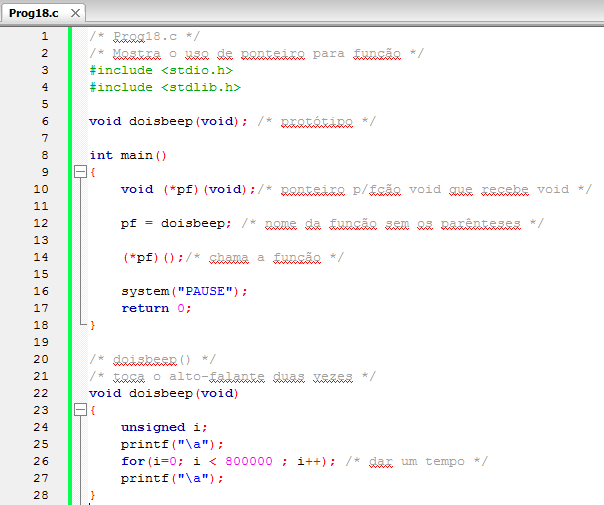

*Figura:* captura do editor com `Prog18.c` (**A05-08-P18**), linhas 1–28 da versão histórica do programa. Fonte revisado: [`src/Fontes_Aula_5_6_7_e_8/Prog18.c`](../../src/Fontes_Aula_5_6_7_e_8/Prog18.c); versão anterior à revisão de 2026 em texto: [commit `04ac409`](https://github.com/Lucas-Sperotto/falect-cc-011-algoritmos-e-laboratorio-de-programacao-ii/blob/04ac4094dba3c3812809dd433a7d3855c4bffdc9/src/Fontes_Aula_5_6_7_e_8/Prog18.c); explicação: [seção 6](#a05-08-p18).

### 3.3 Declarando o ponteiro para função (slides 5–7)

<a id="slide-5"></a>
**Slide 5 — Roteiro** · *repete o roteiro do [slide 2](#slide-2), sem destaque do tópico seguinte.*

<a id="slide-6"></a>
**Slide 6 — Declarando o Ponteiro Para Função**

> - A função main() começa declarando pf como um ponteiro para uma função void.
> - É claro que o tipo void é uma das possibilidades.
> - Se a função a ser apontada é do tipo float, por exemplo, o ponteiro para ela deve ser declarado como tal.
>
>   ```c
>   void (*pf)(void);
>   ```

<a id="slide-7"></a>
**Slide 7 — Declarando o Ponteiro Para Função**

> - Observe os parênteses envolvendo \*pf.
> - Esses parênteses são realmente necessários, pois, se omitidos
>
>   ```c
>   void *pf(void);
>   ```
>
> - Estaríamos declarando pf como sendo uma função que retorna um ponteiro void;
> - Em outras palavras, estaríamos escrevendo o protótipo da função pf.

*Nota de transcrição:* sem os parênteses, `void *pf(void);` declara uma **função** que devolve um ponteiro `void *`; ver [observação 8.1](#obs-7-1).

### 3.4 Endereços de funções (slides 8–9)

<a id="slide-8"></a>
**Slide 8 — Roteiro** · *repete o roteiro do [slide 2](#slide-2), sem destaque do tópico seguinte.*

<a id="slide-9"></a>
**Slide 9 — Endereços de Funções**

> - O nome de uma função desacompanhado de parenteses é o seu endereço.
> - A instrução:
>
>   ```c
>   pf = doisbeep;
>   ```
>
> - Atribui o endereço da função doisbeep() a pf.
> - Observe que não colocamos parenteses junto ao nome da função.
> - Se eles estivessem presentes, como em
>
>   ```c
>   pf = doisbeep();
>   ```
>
> - Estaríamos atribuindo a pf o valor de retorno da função, e não o seu endereço.

### 3.5 Executando a função por meio do ponteiro (slides 10–11)

<a id="slide-10"></a>
**Slide 10 — Roteiro** · *repete o roteiro do [slide 2](#slide-2), sem destaque do tópico seguinte.*

<a id="slide-11"></a>
**Slide 11 — Executando a Função por Meio do Ponteiro**

> - Da mesma forma que podemos substituir o nome de uma variável usando um ponteiro acompanhado do operador indireto \*, podemos substituir o nome da função usando o mesmo mecanismo.
> - A instrução
>
>   ```c
>   (*pf)();
>   ```
>
> - É equivalente a
>
>   ```c
>   doisbeep();
>   ```
>
> - E indica uma chamada à função doisbeep().

*Nota de transcrição:* em C, `pf()` também chama a função; `(*pf)()` é a forma explícita usada no material ([seção 4.1](#c-7-1)).

### 3.6 Operações ilegais com ponteiros para funções (slides 12–13)

<a id="slide-12"></a>
**Slide 12 — Roteiro** · *repete o roteiro do [slide 2](#slide-2), sem destaque do tópico seguinte.*

<a id="slide-13"></a>
**Slide 13 — Operações Ilegais com Ponteiros para Funções**

> - A aritmética com ponteiros para funções não é definida em C.
> - Por exemplo, você não pode incrementar ou decrementar ponteiros para funções.

*Nota de transcrição:* também não é definida pelo padrão a conversão entre ponteiro para função e `void *`; ver [observação 8.2](#obs-7-2).

### 3.7 Ponteiros para funções como argumentos (slides 14–17)

<a id="slide-14"></a>
**Slide 14 — Roteiro** · *repete o roteiro do [slide 2](#slide-2), sem destaque do tópico seguinte.*

<a id="slide-15"></a>
**Slide 15 — Ponteiros para Funções como Argumentos**

> - O exemplo a seguir cria um ponteiro para armazenar o endereço da função de biblioteca gets().
> - Essa função tem o seguinte protótipo:
>
>   ```c
>   char *gets(char *);
>   ```
>
> - Definido no arquivo stdio.h.
> - A função retorna um ponteiro para a cadeia de caracteres lida do teclado e armazenada no endereço recebido por ela como argumento.

*Nota de transcrição:* `gets()` foi removida no C11; ver [observação 8.3](#obs-7-3) e a [Aula 2](../aula-02/README.md#obs-2-4).

<a id="slide-16"></a>
**Slide 16 — Ponteiros para Funções como Argumentos**

> 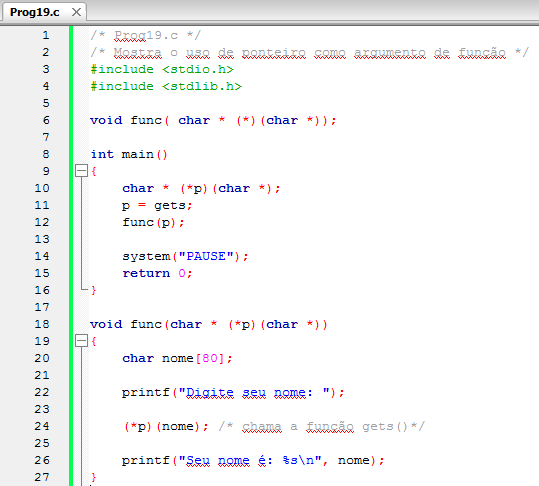

*Figura:* captura do editor com `Prog19.c` (**A05-08-P19**), linhas 1–27 da versão histórica do programa. Fonte revisado: [`src/Fontes_Aula_5_6_7_e_8/Prog19.c`](../../src/Fontes_Aula_5_6_7_e_8/Prog19.c); versão anterior à revisão de 2026 em texto: [commit `04ac409`](https://github.com/Lucas-Sperotto/falect-cc-011-algoritmos-e-laboratorio-de-programacao-ii/blob/04ac4094dba3c3812809dd433a7d3855c4bffdc9/src/Fontes_Aula_5_6_7_e_8/Prog19.c); explicação: [seção 6](#a05-08-p19). A captura guarda em `p` o endereço de `gets()`; o fonte revisado usa `ler_linha()`, com outro tipo de ponteiro; ver [observação 8.3](#obs-7-3).

<a id="slide-17"></a>
**Slide 17 — Ponteiros para Funções como Argumentos**

> - A declaração do ponteiro é a seguinte:
>
>   ```c
>   char * (*p)(char *);
>   ```
>
> - Essa instrução indica que p é um ponteiro para uma função do tipo char\* e recebe um char\* como argumento.
> - A função main() envia o ponteiro p como argumento para a função func().

### 3.8 Matrizes de ponteiros para funções (slides 18–25)

<a id="slide-18"></a>
**Slide 18 — Roteiro** · *repete o roteiro do [slide 2](#slide-2), sem destaque do tópico seguinte.*

<a id="slide-19"></a>
**Slide 19 — Matrizes de Ponteiros para Funções**

> - Os ponteiros oferecem uma maneira eficiente de executar uma função entre uma série delas, com base em alguma escolha dependente de parâmetros conhecidos somente em tempo de execução.
> - Por exemplo, suponhamos que você queira escrever um programa em que é apresentado um “menu” de opções ao usuário, e, para cada escolha, o programa deve executar uma chamada a uma função particular.

<a id="slide-20"></a>
**Slide 20 — Matrizes de Ponteiros para Funções**

> - Em vez de utilizar estruturas tradicionais de programação como switch ou if-else, ou qualquer outra estrutura de controle para decidir qual função deve ser chamada, você simplesmente cria uma matriz de ponteiros para funções e executa a função correta por meio de seu ponteiro.
> - Eis um esqueleto do programa:

<a id="slide-21"></a>
**Slide 21 — Matrizes de Ponteiros para Funções**

> 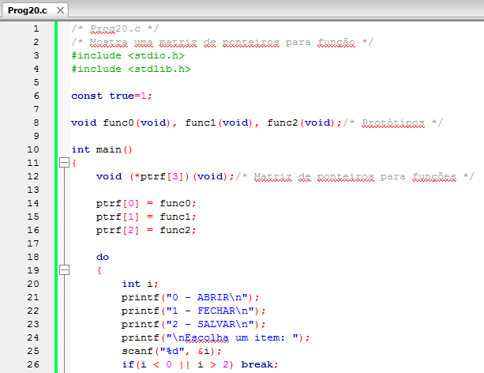

*Figura:* captura do editor com `Prog20.c` (**A05-08-P20**), linhas 1–26 da versão histórica do programa. Fonte revisado: [`src/Fontes_Aula_5_6_7_e_8/Prog20.c`](../../src/Fontes_Aula_5_6_7_e_8/Prog20.c); versão anterior à revisão de 2026 em texto: [commit `04ac409`](https://github.com/Lucas-Sperotto/falect-cc-011-algoritmos-e-laboratorio-de-programacao-ii/blob/04ac4094dba3c3812809dd433a7d3855c4bffdc9/src/Fontes_Aula_5_6_7_e_8/Prog20.c); explicação: [seção 6](#a05-08-p20). A linha 6, `const true=1;`, depende de “int implícito”, removido no C99; ver [observação 8.4](#obs-7-4).

<a id="slide-22"></a>
**Slide 22 — Matrizes de Ponteiros para Funções**

> 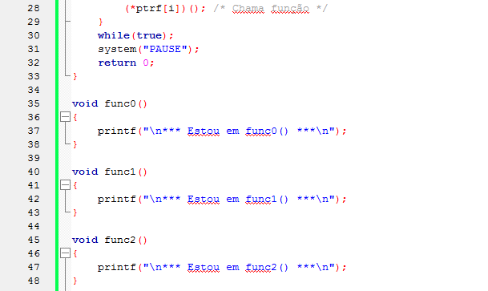

*Figura:* continuação de `Prog20.c` (**A05-08-P20**), linhas 28–48.

<a id="slide-23"></a>
**Slide 23 — Matrizes de Ponteiros para Funções**

> - A instrução:
>
>   ```c
>   void (*ptrf[3])(void);
>   ```
>
> - Declara uma matriz de três ponteiros para funções void.
> - O laço do-while em main() chama uma das três chama [sic] uma das três funções, dependendo da escolha do usuário.

<a id="slide-24"></a>
**Slide 24 — Matrizes de Ponteiros para Funções**

> - A instrução:
>
>   ```c
>   void (*ptrf[3])(void);
>   ```
>
> - Declara uma matriz de três ponteiros para funções void.
> - O laço do-while em main() chama uma das três chama [sic] uma das três funções, dependendo da escolha do usuário.

*Nota de transcrição:* os slides 23 e 24 são idênticos no PDF, inclusive a figura (o mesmo objeto de imagem).

<a id="slide-25"></a>
**Slide 25 — Matrizes de Ponteiros para Funções**

> - O programa termina se um número menos que zero [sic] ou maior que dois for digitado.
> - Matrizes de ponteiros para funções fornecem um mecanismo alternativo de mudar o controle do programa sem utilizar estruturas de controle convencionais.

### 3.9 Inicializando uma matriz de ponteiros para funções (slides 26–29)

<a id="slide-26"></a>
**Slide 26 — Roteiro** · *repete o roteiro do [slide 2](#slide-2), sem destaque do tópico seguinte.*

<a id="slide-27"></a>
**Slide 27 — Inicializando uma matriz de ponteiros para Funções**

> - O programa anterior poderia ter inicializado a matriz ptrf na mesma instrução de sua declaração.
> - Eis a modificação:

<a id="slide-28"></a>
**Slide 28 — Inicializando uma matriz de ponteiros para Funções**

> 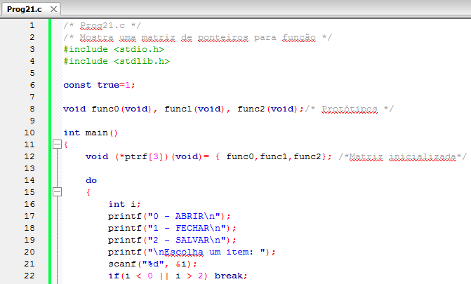

*Figura:* captura do editor com `Prog21.c` (**A05-08-P21**), linhas 1–22 da versão histórica do programa. Fonte revisado: [`src/Fontes_Aula_5_6_7_e_8/Prog21.c`](../../src/Fontes_Aula_5_6_7_e_8/Prog21.c); versão anterior à revisão de 2026 em texto: [commit `04ac409`](https://github.com/Lucas-Sperotto/falect-cc-011-algoritmos-e-laboratorio-de-programacao-ii/blob/04ac4094dba3c3812809dd433a7d3855c4bffdc9/src/Fontes_Aula_5_6_7_e_8/Prog21.c); explicação: [seção 6](#a05-08-p21).

<a id="slide-29"></a>
**Slide 29 — Inicializando uma matriz de ponteiros para Funções**

> 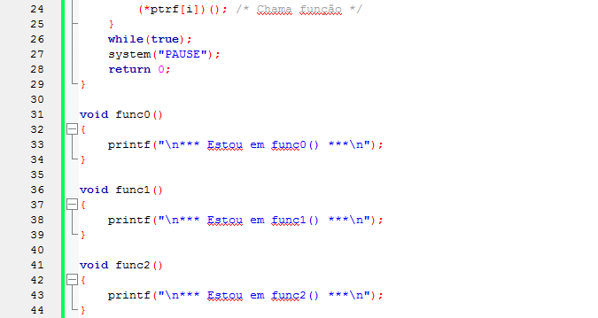

*Figura:* continuação de `Prog21.c` (**A05-08-P21**), linhas 24–44.

### 3.10 Usando typedef para declarar um ponteiro para função (slides 30–33)

<a id="slide-30"></a>
**Slide 30 — Roteiro** · *repete o roteiro do [slide 2](#slide-2), sem destaque do tópico seguinte.*

<a id="slide-31"></a>
**Slide 31 — Usando typedef para Declarar um Ponteiros [sic] para Funções**

> - É comum definir um nome para um tipo de dado que seja ponteiro para função.
> - Fazemos isso por meio de typedef.

<a id="slide-32"></a>
**Slide 32 — Usando typedef para Declarar um Ponteiros [sic] para Funções**

> 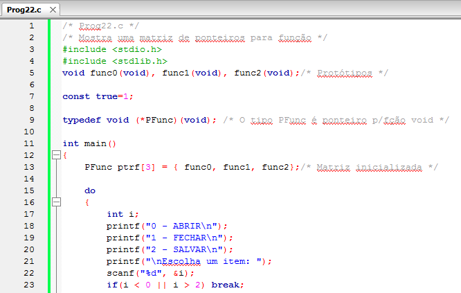

*Figura:* captura do editor com `Prog22.c` (**A05-08-P22**), linhas 1–23 da versão histórica do programa. Fonte revisado: [`src/Fontes_Aula_5_6_7_e_8/Prog22.c`](../../src/Fontes_Aula_5_6_7_e_8/Prog22.c); versão anterior à revisão de 2026 em texto: [commit `04ac409`](https://github.com/Lucas-Sperotto/falect-cc-011-algoritmos-e-laboratorio-de-programacao-ii/blob/04ac4094dba3c3812809dd433a7d3855c4bffdc9/src/Fontes_Aula_5_6_7_e_8/Prog22.c); explicação: [seção 6](#a05-08-p22).

<a id="slide-33"></a>
**Slide 33 — Usando typedef para Declarar um Ponteiros [sic] para Funções**

> 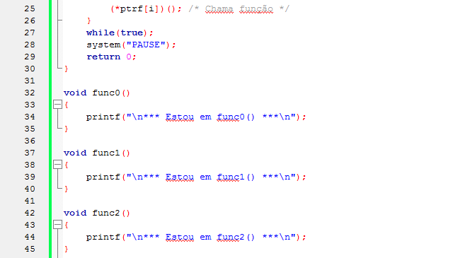

*Figura:* continuação de `Prog22.c` (**A05-08-P22**), linhas 25–45.

### 3.11 Ponteiros void (slides 34–40)

<a id="slide-34"></a>
**Slide 34 — Roteiro** · *repete o roteiro do [slide 2](#slide-2), sem destaque do tópico seguinte.*

<a id="slide-35"></a>
**Slide 35 — Ponteiros void**

> - Antes de prosseguir a explanação de ponteiros, vamos apresentar um ponteiro peculiar.
> - Quando queremos atribuir um endereço a um ponteiro, este deve ser do mesmo tipo daquele.
> - Por exemplo, não podemos atribuir um endereço de uma variável int a um ponteiro float.

*Nota de transcrição:* com conversão explícita, a atribuição compila, mas ler um `int` por meio de um `float *` continua inválido; ver [observação 8.5](#obs-7-5).

<a id="slide-36"></a>
**Slide 36 — Ponteiros void**

> - Entretanto, há uma exceção.
> - Há um tipo de ponteiro de propósito geral que pode apontar para qualquer tipo de dado.
> - Esse ponteiro é do tipo void, podendo ser declarado por meio da seguinte instrução:
>
>   ```c
>   void *p; /* p aponta para qualquer tipo de dado */
>   ```

<a id="slide-37"></a>
**Slide 37 — Ponteiros void**

> - Ponteiros do tipo void são usados em situações em que seja necessário que uma função receba ou retorne um ponteiro genérico e opere independentemente do tipo de dado apontado.
> - Observe que o conceito de ponteiros void não tem absolutamente nada a ver com o tipo void para funções.
> - Qualquer endereço pode ser atribuído a um ponteiro void:

<a id="slide-38"></a>
**Slide 38 — Ponteiros void**

> 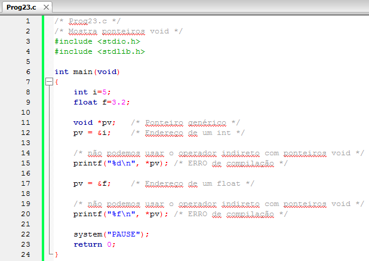

*Figura:* captura do editor com `Prog23.c` (**A05-08-P23**), linhas 1–24 da versão histórica do programa. Fonte revisado: [`src/Fontes_Aula_5_6_7_e_8/Prog23.c`](../../src/Fontes_Aula_5_6_7_e_8/Prog23.c); versão anterior à revisão de 2026 em texto: [commit `04ac409`](https://github.com/Lucas-Sperotto/falect-cc-011-algoritmos-e-laboratorio-de-programacao-ii/blob/04ac4094dba3c3812809dd433a7d3855c4bffdc9/src/Fontes_Aula_5_6_7_e_8/Prog23.c); explicação: [seção 6](#a05-08-p23). As duas linhas marcadas com `/* ERRO de compilação */` são erros intencionais; ver [seção 6](#a05-08-p23).

<a id="slide-39"></a>
**Slide 39 — Ponteiros void**

> - O conteúdo da variável apontada por um ponteiro void não pode ser acessado por meio desse ponteiro.
> - É necessário criar outro ponteiro e fazer a conversão de tipo na atribuição:

<a id="slide-40"></a>
**Slide 40 — Ponteiros void**

> 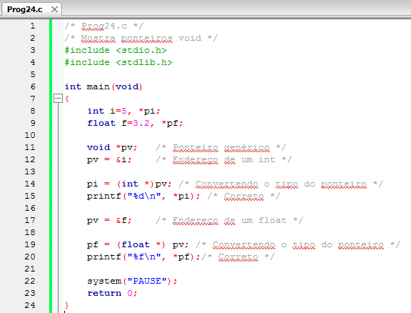

*Figura:* captura do editor com `Prog24.c` (**A05-08-P24**), linhas 1–24 da versão histórica do programa. Fonte revisado: [`src/Fontes_Aula_5_6_7_e_8/Prog24.c`](../../src/Fontes_Aula_5_6_7_e_8/Prog24.c); versão anterior à revisão de 2026 em texto: [commit `04ac409`](https://github.com/Lucas-Sperotto/falect-cc-011-algoritmos-e-laboratorio-de-programacao-ii/blob/04ac4094dba3c3812809dd433a7d3855c4bffdc9/src/Fontes_Aula_5_6_7_e_8/Prog24.c); explicação: [seção 6](#a05-08-p24).

### 3.12 A função qsort() (slides 41–44)

<a id="slide-41"></a>
**Slide 41 — Roteiro** · *repete o roteiro do [slide 2](#slide-2), sem destaque do tópico seguinte.*

<a id="slide-42"></a>
**Slide 42 — A Função qsort()**

> - A função de biblioteca-padrão qsort() executa a ordenação de uma matriz por meio da implementação do algoritmo “quick-sort”.

*Nota de transcrição:* o padrão não exige que `qsort()` use o algoritmo *quicksort*; ver [observação 8.7](#obs-7-7).

<a id="slide-43"></a>
**Slide 43 — A Função qsort()**

> - A função é do tipo void e recebe quatro argumentos:
>   - O primeiro é o endereço da matriz a ser ordenada, o segundo é um inteiro com o número de elementos da matriz, o terceiro é o tamanho em bytes de um elemento da matriz e o último é o endereço de uma função com o seguinte protótipo:
>
>     ```c
>     int compara(const void *, const void *);
>     ```

*Nota de transcrição:* o segundo e o terceiro argumentos têm tipo `size_t`; ver [observação 8.7](#obs-7-7).

<a id="slide-44"></a>
**Slide 44 — A Função qsort()**

> - A função compara() deve ser escrita pelo usuário de qsort() e compara dois elementos da matriz.
> - Retorna um valor que informa o resultado da comparação:
>
> | Valor retornado pela função compara() | Descrição |
> |---|---|
> | < 0 | elem1 menor que elem2 |
> | 0 | elem1 igual ao elem2 |
> | > 0 | elem1 maior que elem2 |

<details><summary>Imagem original (tabela, slide 44)</summary>

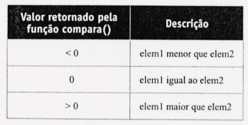

</details>

### 3.13 Ordenando números inteiros (slides 45–47)

<a id="slide-45"></a>
**Slide 45 — Roteiro** · *repete o roteiro do [slide 2](#slide-2), sem destaque do tópico seguinte.*

<a id="slide-46"></a>
**Slide 46 — Ordenando Números Inteiros**

> - Nosso primeiro exemplo mostra a ordenação de uma matriz de inteiros:
>
>   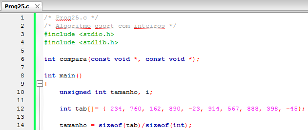

*Figura:* captura do editor com `Prog25.c` (**A05-08-P25**), linhas 1–14 da versão histórica do programa. Fonte revisado: [`src/Fontes_Aula_5_6_7_e_8/Prog25.c`](../../src/Fontes_Aula_5_6_7_e_8/Prog25.c); versão anterior à revisão de 2026 em texto: [commit `04ac409`](https://github.com/Lucas-Sperotto/falect-cc-011-algoritmos-e-laboratorio-de-programacao-ii/blob/04ac4094dba3c3812809dd433a7d3855c4bffdc9/src/Fontes_Aula_5_6_7_e_8/Prog25.c); explicação: [seção 6](#a05-08-p25).

<a id="slide-47"></a>
**Slide 47 — Ordenando Números Inteiros**

> 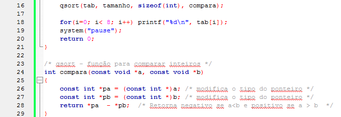

*Figura:* continuação de `Prog25.c` (**A05-08-P25**), linhas 16–29. O laço imprime só 8 dos 10 elementos (`i< 8`), e `return *pa - *pb;` pode transbordar; ver [observação 8.8](#obs-7-8).

### 3.14 O algoritmo de procura binária (slides 48–50)

<a id="slide-48"></a>
**Slide 48 — Roteiro** · *repete o roteiro do [slide 2](#slide-2), sem destaque do tópico seguinte.*

<a id="slide-49"></a>
**Slide 49 — O Algoritmo de Procura Binária**

> - O algoritmo de procura binária é, de modo geral, o mais eficiente (demora menos tempo para encontrar o valor), mas requer que a lista de itens esteja ordenada.
> - Ele primeiramente seleciona um valor no meio da lista e o compara ao valor que está sendo procurado.
> - Se o valor procurado for maior que o valor selecionado, repete-se o processo para a metade da lista posterior ao valor selecionado.

*Nota de transcrição:* a busca binária faz no máximo cerca de $\log_2 n$ comparações, mas exige o vetor ordenado; ver [seção 4.5](#c-7-5) e [observação 8.9](#obs-7-9).

<a id="slide-50"></a>
**Slide 50 — O Algoritmo de Procura Binária**

> - Se o valor procurado for menor que o valor selecionado, repete-se o processo da lista anterior ao valor selecionado.
> - O processo é repetido até um valor ser encontrado, ou até a metade em que a procura deverá ser feita seja esvaziada (neste caso o valor não está na lista).

### 3.15 Procura binária com números inteiros (slides 51–53)

<a id="slide-51"></a>
**Slide 51 — Roteiro** · *repete o roteiro do [slide 2](#slide-2), sem destaque do tópico seguinte.*

<a id="slide-52"></a>
**Slide 52 — Procura Binária com Números Inteiros**

> - O próximo exemplo implementa o algoritmo de procura binária com inteiros.
>
>   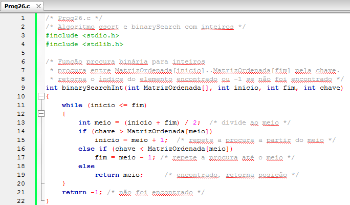

*Figura:* captura do editor com `Prog26.c` (**A05-08-P26**), linhas 1–22 da versão histórica do programa. Fonte revisado: [`src/Fontes_Aula_5_6_7_e_8/Prog26.c`](../../src/Fontes_Aula_5_6_7_e_8/Prog26.c); versão anterior à revisão de 2026 em texto: [commit `04ac409`](https://github.com/Lucas-Sperotto/falect-cc-011-algoritmos-e-laboratorio-de-programacao-ii/blob/04ac4094dba3c3812809dd433a7d3855c4bffdc9/src/Fontes_Aula_5_6_7_e_8/Prog26.c); explicação: [seção 6](#a05-08-p26).

*Nota de transcrição:* para índices muito grandes, `(inicio + fim) / 2` pode transbordar; ver [observação 8.10](#obs-7-10).

<a id="slide-53"></a>
**Slide 53 — Procura Binária com Números Inteiros**

> 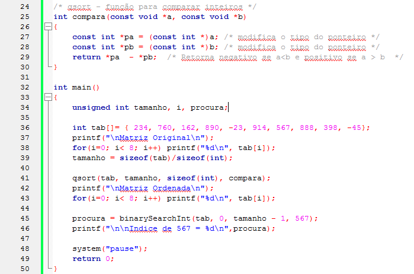

*Figura:* continuação de `Prog26.c` (**A05-08-P26**), linhas 24–50.

### 3.16 Procura binária com c-string (slides 54–56)

<a id="slide-54"></a>
**Slide 54 — Roteiro** · *repete o roteiro do [slide 2](#slide-2), sem destaque do tópico seguinte.*

<a id="slide-55"></a>
**Slide 55 — Procura Binária com c-string**

> 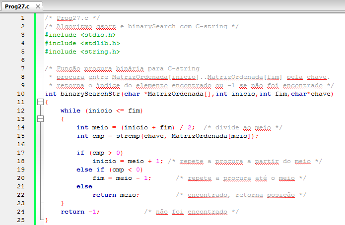

*Figura:* captura do editor com `Prog27.c` (**A05-08-P27**), linhas 1–25 da versão histórica do programa. Fonte revisado: [`src/Fontes_Aula_5_6_7_e_8/Prog27.c`](../../src/Fontes_Aula_5_6_7_e_8/Prog27.c); versão anterior à revisão de 2026 em texto: [commit `04ac409`](https://github.com/Lucas-Sperotto/falect-cc-011-algoritmos-e-laboratorio-de-programacao-ii/blob/04ac4094dba3c3812809dd433a7d3855c4bffdc9/src/Fontes_Aula_5_6_7_e_8/Prog27.c); explicação: [seção 6](#a05-08-p27).

<a id="slide-56"></a>
**Slide 56 — Procura Binária com c-string**

> 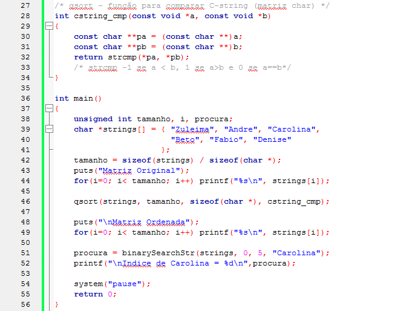

*Figura:* continuação de `Prog27.c` (**A05-08-P27**), linhas 27–56.

*Nota de transcrição:* o comentário sobre `strcmp` (“-1 se a < b, 1 se a>b”) só é garantido quanto ao sinal; ver [observação 8.11](#obs-7-11).

### 3.17 Ponteiros para estruturas (slides 57–60)

<a id="slide-57"></a>
**Slide 57 — Roteiro** · *repete o roteiro do [slide 2](#slide-2), sem destaque do tópico seguinte.*

<a id="slide-58"></a>
**Slide 58 — Ponteiro para Estruturas**

> - Existem diversos motivos para se usar ponteiros para estruturas.
> - Por exemplo, se você quiser usar a função qsort() para ordenar os dados de uma matriz de estruturas, deverá escrever a função de comparação que recebe ponteiros.

<a id="slide-59"></a>
**Slide 59 — Ponteiro para Estruturas**

> 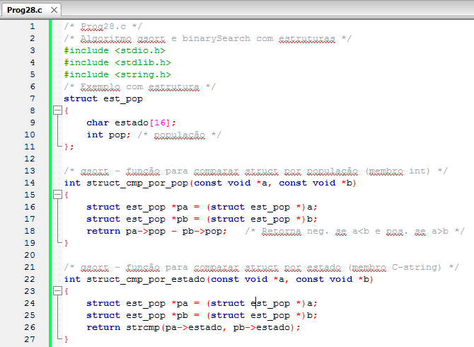

*Figura:* captura do editor com `Prog28.c` (**A05-08-P28**), linhas 1–27 da versão histórica do programa. Fonte revisado: [`src/Fontes_Aula_5_6_7_e_8/Prog28.c`](../../src/Fontes_Aula_5_6_7_e_8/Prog28.c); versão anterior à revisão de 2026 em texto: [commit `04ac409`](https://github.com/Lucas-Sperotto/falect-cc-011-algoritmos-e-laboratorio-de-programacao-ii/blob/04ac4094dba3c3812809dd433a7d3855c4bffdc9/src/Fontes_Aula_5_6_7_e_8/Prog28.c); explicação: [seção 6](#a05-08-p28).

*Nota de transcrição:* o comentário do programa cita *binarySearch*, mas `Prog28.c` só ordena; ver [observação 8.12](#obs-7-12).

<a id="slide-60"></a>
**Slide 60 — Ponteiro para Estruturas**

> 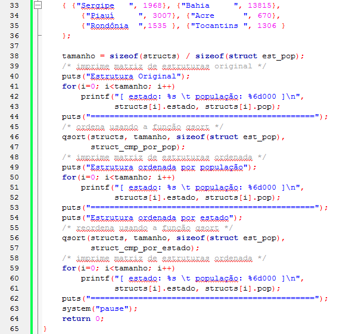

*Figura:* continuação de `Prog28.c` (**A05-08-P28**), linhas 33–65. As linhas 28–32 (início de `main()` e da inicialização do vetor) não aparecem em nenhuma das duas capturas.

### 3.18 Declarando um ponteiro para estrutura (slides 61–63)

<a id="slide-61"></a>
**Slide 61 — Roteiro** · *repete o roteiro do [slide 2](#slide-2), sem destaque do tópico seguinte.*

<a id="slide-62"></a>
**Slide 62 — Declarando um Ponteiro para Estrutura**

> - A novidade são as duas funções de comparação:
>
>   ```c
>   /* qsort - função para comparar struct por população (membro int) */
>   int struct_cmp_por_pop(const void *a, const void *b)
>   {
>       struct est_pop *pa = (struct est_pop *)a;
>       struct est_pop *pb = (struct est_pop *)b;
>       return pa->pop - pb->pop;   /* Retorna neg. se a<b e pos. se a>b */
>   }
>   /* qsort - função para comparar struct por estado (membro C-string) */
>   int struct_cmp_por_estado(const void *a, const void *b)
>   {
>       struct est_pop *pa = (struct est_pop *)a;
>       struct est_pop *pb = (struct est_pop *)b;
>       return strcmp(pa->estado, pb->estado);
>   }
>   ```
>
> - Na instrução:
>
>   ```c
>   struct est_pop *pa = (struct est_pop *)a;
>   ```

<a id="slide-63"></a>
**Slide 63 — Declarando um Ponteiro para Estrutura**

> - Declaramos o ponteiro para estrutura pa.
> - Primeiro a palavra struct seguida da etiqueta est_pop, então o operador indireto \* seguido do nome do ponteiro.
> - A sintaxe é a mesma de qualquer outra declaração de ponteiro que já vimos.

### 3.19 Acessando membros por meio de ponteiros (slides 64–68)

<a id="slide-64"></a>
**Slide 64 — Roteiro** · *repete o roteiro do [slide 2](#slide-2), sem destaque do tópico seguinte.*

<a id="slide-65"></a>
**Slide 65 — Acessando Membros Por Meio de Ponteiros**

> - Você já aprendeu que, se o nome de uma estrutura for conhecido, podemos acessar seus membros usando o operador ponto (.).
> - Será que uma construção análoga, usando um ponteiro em vez do nome da variável, poderia ser escrita?
> - Ou seja, seria possível escrever a construção seguinte?
>
>   ```c
>   pa.estado /*ERRO */
>   ```

<a id="slide-66"></a>
**Slide 66 — Acessando Membros Por Meio de Ponteiros**

> - A resposta é não, pois pa não é uma variável estrutura e sim um ponteiro para uma variável estrutura;
> - Além disso, o operador ponto (.) opera somente sobre o nome de uma estrutura.
> - C oferece dois métodos para resolver esse problema:
>   - o primeiro, menos elegante, é obter o nome da variável apontada por pa por meio do operador indireto (\*):
>
>     ```c
>     (*pa).estado /* OK */
>     ```

<a id="slide-67"></a>
**Slide 67 — Acessando Membros Por Meio de Ponteiros**

> - Entretanto, essa expressão é de visualização complexa por causa dos parênteses.
> - Os parênteses são necessários, pois o operador (.) tem precedência sobre o operador (\*).
>   - o segundo método, de uso mais comum, é por meio do operador de acesso a membros (->) que consiste no sinal de “menos” (-) seguido do sinal de “maior” (>). Esse operador opera sobre o endereço de uma variável estrutura e não sobre seu nome.
>
>     ```c
>     pa->estado /* Mais Usado */
>     ```

*Nota de transcrição:* como `.` tem precedência maior que `*`, `*pa.estado` seria lido como `*(pa.estado)`; daí os parênteses.

<a id="slide-68"></a>
**Slide 68 — Acessando Membros Por Meio de Ponteiros**

> - Um ponteiro para uma estrutura, seguido pelo operador (->) e pelo nome de um membro, trabalha da mesma maneira que o nome da estrutura seguido pelo operador (.) e pelo nome do membro.
> - O operador de acesso a membros (->) conecta o endereço de uma estrutura a um membro dela; o operador ponto (.) conecta o nome da estrutura a um membro dela.

### 3.20 Referências do material original (slide 69)

<a id="slide-69"></a>
**Slide 69 — Referências**

> - MIZRAHI, Victorine V. Treinamento em Linguagem C, São Paulo: Pearson Prentice Hall, 2008;

## 4. Explicações complementares

<a id="c-7-1"></a>
### 4.1 Ponteiros para funções: tipo, atribuição e chamada

O código de uma função também fica na memória e tem endereço. O **tipo** de um ponteiro para função inclui o tipo de retorno e os tipos dos parâmetros:

| Declaração | Leia como |
|---|---|
| `void (*pf)(void);` | `pf` é ponteiro para função sem parâmetros que não devolve valor |
| `void *pf(void);` | `pf` é **função** que devolve `void *` (sem os parênteses, muda tudo) |
| `int (*p)(char *, size_t);` | `p` é ponteiro para função que recebe `char *` e `size_t` e devolve `int` |
| `void (*ptrf[3])(void);` | `ptrf` é vetor de 3 ponteiros para função `void (void)` |

O nome de uma função, sem parênteses, é convertido no seu endereço (§6.3.2.1p4); por isso `pf = doisbeep;` e `pf = &doisbeep;` são equivalentes. Na chamada, `(*pf)()` e `pf()` também são equivalentes: o operador de chamada aceita um ponteiro para função (§6.5.2.2p1). O material usa sempre a forma `(*pf)()`, que deixa explícito que `pf` é um ponteiro.

<a id="c-7-2"></a>
### 4.2 Funções como argumento e tabelas de despacho

Passar uma função como argumento permite escrever código genérico, que delega uma parte do trabalho a quem chama. É o que fazem `func(p)` em `Prog19.c` e o comparador de `qsort()`. Um vetor de ponteiros para funções transforma uma escolha em indexação:

```c
void (*ptrf[3])(void) = { func0, func1, func2 };
if (i >= 0 && i <= 2)      /* o índice precisa ser validado */
    ptrf[i]();             /* chama func0, func1 ou func2 */
```

O teste de faixa não é opcional: `ptrf[7]()` leria um endereço qualquer como se fosse uma função, e o programa saltaria para lá. Os programas 20–22 encerram o laço quando a opção está fora de 0–2.

<a id="c-7-3"></a>
### 4.3 `typedef` para ponteiros de função

```c
typedef void (*PFunc)(void);                            /* Prog22.c */
typedef int (*Comparador)(const void *, const void *);  /* tipo do 4º argumento de qsort */
PFunc ptrf[3] = { func0, func1, func2 };
```

O sinônimo torna declarações compostas legíveis: compare `PFunc ptrf[3]` com `void (*ptrf[3])(void)`. A [Aula 4](../aula-04/README.md#c-4-3) mostrou o `typedef` de um tipo de **função**; aqui o tipo é **ponteiro** para função.

<a id="c-7-4"></a>
### 4.4 `void *`: endereço sem tipo

Um `void *` guarda qualquer endereço de objeto, mas não informa quantos bytes há nem como interpretá-los. Por isso não pode ser desreferenciado nem usado em aritmética no C padrão (o GCC aceita aritmética como extensão e avisa com `-Wpointer-arith`). Em C, a conversão entre `void *` e outros ponteiros para objeto é **implícita** (§6.3.2.3p1); o *cast* `(int *)pv` é permitido, mas não obrigatório (em C++ é). Os comparadores de `Prog27.c` e `Prog28.c` revisados usam essa conversão implícita:

```c
const struct est_pop *pa = a;   /* a é const void * */
```

O ponteiro genérico permite que `qsort`, `bsearch`, `memcpy` e `malloc` funcionem com qualquer tipo: quem conhece o tipo real é o programa, que converte o ponteiro de volta antes de usar o objeto.

<a id="c-7-5"></a>
### 4.5 Busca binária: invariante, rastreamento e custo

A busca mantém o **invariante**: se a chave estiver no vetor ordenado, ela está em `v[inicio..fim]`. A cada passo, compara-se com o elemento do meio e descarta-se metade do intervalo. Rastreamento de `binarySearchInt` procurando 567 no vetor ordenado de `Prog26.c`:

| Passo | `inicio` | `fim` | `meio` | `v[meio]` | Decisão |
|---:|---:|---:|---:|---:|---|
| 1 | 0 | 9 | 4 | 398 | 567 > 398 → `inicio = 5` |
| 2 | 5 | 9 | 7 | 888 | 567 < 888 → `fim = 6` |
| 3 | 5 | 6 | 5 | 567 | encontrado: devolve 5 |

Como o intervalo cai à metade a cada passo, a busca faz no máximo $\lfloor \log_2 n \rfloor + 1$ comparações com elementos do vetor: 4 para $n = 10$, 20 para $n = 10^6$. A busca linear faz até $n$. Mas a busca binária exige o vetor **ordenado**, e ordenar custa $O(n \log n)$; para uma única busca em dados desordenados, a busca linear é mais barata. A biblioteca padrão oferece `bsearch()`, com a mesma interface de comparador de `qsort()`.

<a id="c-7-6"></a>
### 4.6 Como escrever um comparador correto

`qsort` chama `compara(a, b)` com os endereços de dois elementos. O comparador deve devolver negativo, zero ou positivo de forma **consistente** (se `a < b` e `b < c`, então `a < c`), sem alterar os elementos.

| Elementos | Conversão correta | Comparação |
|---|---|---|
| `int` | `const int *pa = a;` | `(*pa > *pb) - (*pa < *pb)` |
| `char *` (vetor de strings) | `char *const *pa = a;` | `strcmp(*pa, *pb)` |
| `struct est_pop` | `const struct est_pop *pa = a;` | `(pa->pop > pb->pop) - (pa->pop < pb->pop)` |

Dois erros frequentes:

- **subtrair** (`return *pa - *pb;`): se os valores tiverem sinais opostos e grandes, a subtração transborda (comportamento indefinido) e pode devolver o sinal errado. Exemplo: `INT_MAX - (-1)`;
- **errar o nível de indireção** em vetores de strings: `qsort` passa o endereço do **elemento**, que é um `char *`; logo, `a` é na verdade um `char *const *`, e o texto é `*pa`. Passar `a` diretamente para `strcmp` compararia bytes de endereços.

Para ordenar por mais de um critério (por exemplo, por estado e, em caso de empate, por população), o comparador compara o primeiro campo e, se for igual, o segundo. `qsort` não é estável: elementos considerados iguais podem trocar de ordem.

<a id="c-7-7"></a>
### 4.7 O operador `->`

Para um ponteiro `pa` para estrutura, `pa->estado` é, por definição, `(*pa).estado` (§6.5.2.3p4). Os parênteses de `(*pa).estado` são necessários porque o operador ponto tem precedência maior que o `*` unário:

| Expressão | Interpretação |
|---|---|
| `pa->estado` | membro `estado` da estrutura apontada por `pa` |
| `(*pa).estado` | o mesmo |
| `*pa.estado` | `*(pa.estado)`: erro, `pa` não é estrutura |
| `pa->estado[0]` | primeiro caractere do membro: `(pa->estado)[0]` |

<a id="c-7-8"></a>
### 4.8 Recursividade: a busca binária recursiva

A ementa da disciplina inclui recursividade, que não tem aula própria no material. A busca binária é um bom primeiro exemplo, porque a definição já é recursiva: procurar em `v[inicio..fim]` é procurar em uma das metades. Toda função recursiva precisa de **casos base**, que resolvem o problema sem nova chamada, e de chamadas que **reduzem** o problema até atingi-los.

```c
/* Versão recursiva com a mesma interface de binarySearchInt (Prog26.c). */
int busca_rec(const int v[], int inicio, int fim, int chave)
{
    if (inicio > fim)
        return -1;                          /* caso base: intervalo vazio */
    int meio = inicio + (fim - inicio) / 2; /* evita estouro de inicio + fim */
    if (chave > v[meio])
        return busca_rec(v, meio + 1, fim, chave);
    if (chave < v[meio])
        return busca_rec(v, inicio, meio - 1, chave);
    return meio;                            /* caso base: encontrado */
}
```

Cada chamada ocupa um registro na pilha de execução com seus parâmetros e variáveis locais. Para a busca de 567, a pilha cresce até três chamadas e depois se desfaz, devolvendo o 5 encontrado:

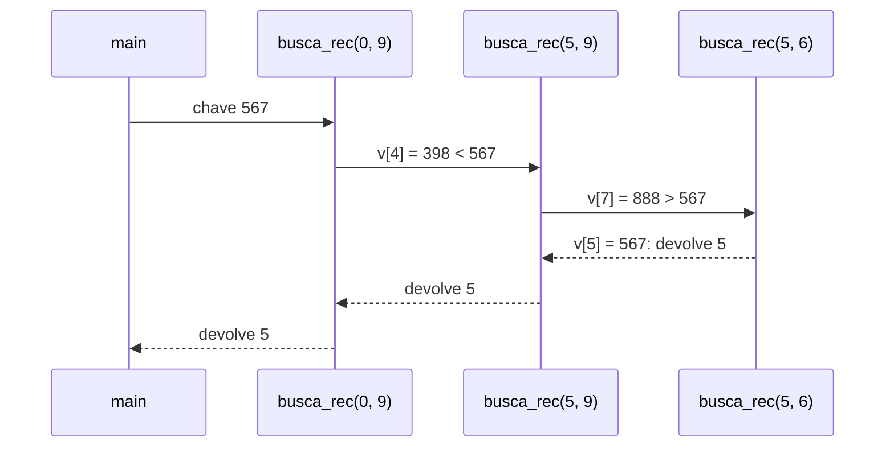

A profundidade máxima é $O(\log n)$, pequena; em problemas em que cada chamada reduz o tamanho em apenas uma unidade, a profundidade é $O(n)$ e pode esgotar a pilha. O próprio *quicksort*, algoritmo que dá nome a `qsort`, costuma ser descrito recursivamente: escolhe um pivô, separa os menores e os maiores e ordena cada parte recursivamente. O trecho acima não pertence aos fontes da disciplina; foi compilado e testado (`gcc -std=c11 -Wall -Wextra -Wpedantic`) com o vetor de `Prog26.c`, encontrando 567 no índice 5, −45 no índice 0 e devolvendo −1 para 1.

## 5. Conceitos fundamentais

| Conceito | Definição operacional | Onde aparece |
|---|---|---|
| Ponteiro para função | Variável que guarda o endereço de uma função de um tipo dado | slides 3–13 |
| *Callback* | Função passada como argumento para ser chamada por outra | slides 15–17 |
| Tabela de despacho | Vetor de ponteiros para funções indexado por uma escolha | slides 19–29 |
| `typedef` de ponteiro para função | Nome para o tipo `R (*)(P...)` | slides 31–33 |
| Ponteiro genérico (`void *`) | Guarda qualquer endereço de objeto; precisa de conversão para acesso | slides 35–40 |
| `qsort` | Ordenação genérica da biblioteca, com comparador fornecido | slides 42–47 |
| Comparador | Função que devolve negativo, zero ou positivo de forma consistente | slides 43–44 |
| Busca binária | Busca em vetor ordenado que descarta metade a cada passo | slides 49–56 |
| Ponteiro para estrutura | `struct T *p`; membros acessados com `->` | slides 58–68 |
| Recursão | Função que resolve o problema chamando a si mesma em instâncias menores | [4.8](#c-7-8) |

## 6. Programas C da aula

Fontes em [`src/Fontes_Aula_5_6_7_e_8/`](../../src/Fontes_Aula_5_6_7_e_8/), revisados em 2026 ([revisão por fonte](../../docs/auditorias/REVISAO_POR_FONTE.md#aulas-5-a-8--srcfontes_aula_5_6_7_e_8)).

| ID | Arquivo | SIGAA | Slides | Tema |
|---|---|---|---|---|
| [A05-08-P18](#a05-08-p18) | [`Prog18.c`](../../src/Fontes_Aula_5_6_7_e_8/Prog18.c) | Prog18.c | 3–13 | ponteiro para função |
| [A05-08-P19](#a05-08-p19) | [`Prog19.c`](../../src/Fontes_Aula_5_6_7_e_8/Prog19.c) | Prog19.c | 15–17 | ponteiro para função como argumento |
| [A05-08-P20](#a05-08-p20) | [`Prog20.c`](../../src/Fontes_Aula_5_6_7_e_8/Prog20.c) | Prog20.c | 19–25 | vetor de ponteiros para funções |
| [A05-08-P21](#a05-08-p21) | [`Prog21.c`](../../src/Fontes_Aula_5_6_7_e_8/Prog21.c) | Prog21.c | 27–29 | vetor inicializado |
| [A05-08-P22](#a05-08-p22) | [`Prog22.c`](../../src/Fontes_Aula_5_6_7_e_8/Prog22.c) | Prog22.c | 31–33 | `typedef` de ponteiro para função |
| [A05-08-P23](#a05-08-p23) | [`Prog23.c`](../../src/Fontes_Aula_5_6_7_e_8/Prog23.c) | Prog23.c | 35–38 | limites do `void *` |
| [A05-08-P24](#a05-08-p24) | [`Prog24.c`](../../src/Fontes_Aula_5_6_7_e_8/Prog24.c) | Prog24.c | 39–40 | conversão de `void *` |
| [A05-08-P25](#a05-08-p25) | [`Prog25.c`](../../src/Fontes_Aula_5_6_7_e_8/Prog25.c) | Prog25.c | 42–47 | `qsort` com inteiros |
| [A05-08-P26](#a05-08-p26) | [`Prog26.c`](../../src/Fontes_Aula_5_6_7_e_8/Prog26.c) | Prog26.c | 49–53 | busca binária em inteiros |
| [A05-08-P27](#a05-08-p27) | [`Prog27.c`](../../src/Fontes_Aula_5_6_7_e_8/Prog27.c) | Prog27.c | 55–56 | `qsort` e busca em strings |
| [A05-08-P28](#a05-08-p28) | [`Prog28.c`](../../src/Fontes_Aula_5_6_7_e_8/Prog28.c) | Prog28.c | 58–68 | `qsort` com estruturas, `->` |

<a id="a05-08-p18"></a>
### 6.1 A05-08-P18 — `Prog18.c`: ponteiro para função

- **Finalidade:** guardar o endereço de `doisbeep()` em `pf` e chamá-la por `(*pf)()`. **Entrada:** nenhuma. **Saída:** dois caracteres de alerta (`\a`, código 7), que o terminal pode transformar em som.
- **Observação:** o laço vazio `for(i=0; i < 800000 ; i++);` pretende “dar um tempo” entre os sinais. Ele depende da velocidade da máquina e pode ser eliminado por um compilador otimizador, porque não produz efeito observável ([8.13](#obs-7-13)).

<!-- codigo: src/Fontes_Aula_5_6_7_e_8/Prog18.c de=`void (*pf)(void);` ate=`(*pf)();` -->
<sub>Copiado de [`src/Fontes_Aula_5_6_7_e_8/Prog18.c`](../../src/Fontes_Aula_5_6_7_e_8/Prog18.c#L15-L19) (linhas 15–19) por `scripts/documentacao_aulas.py`; não edite este bloco à mão.</sub>

```c
    void (*pf)(void);/* ponteiro p/fção void que recebe void */

    pf = doisbeep; /* nome da função sem os parênteses */

    (*pf)();/* chama a função */
```
<!-- /codigo -->

<a id="a05-08-p19"></a>
### 6.2 A05-08-P19 — `Prog19.c`: função passada como argumento

- **Finalidade:** passar para `func()` o endereço da função de leitura que ela deve usar. **Entrada:** um nome. **Saída:** `Seu nome é: …`.
- **Diferença em relação ao slide 16:** o original guardava `gets` em um `char *(*)(char *)`. Como `gets()` não existe mais no C11, a versão revisada usa `ler_linha()`, cujo tipo é `int (*)(char *, size_t)`; por isso a declaração do ponteiro e a chamada `(*p)(nome, sizeof nome)` mudaram ([8.3](#obs-7-3)).

<!-- codigo: src/Fontes_Aula_5_6_7_e_8/Prog19.c funcao=func -->
<sub>Copiado de [`src/Fontes_Aula_5_6_7_e_8/Prog19.c`](../../src/Fontes_Aula_5_6_7_e_8/Prog19.c#L24-L33) (linhas 24–33) por `scripts/documentacao_aulas.py`; não edite este bloco à mão.</sub>

```c
void func(int (*p)(char *, size_t))
{
    char nome[80];

    printf("Digite seu nome: ");

    if (!(*p)(nome, sizeof nome)) return; /* Chama por ponteiro. */

    printf("Seu nome é: %s\n", nome);
}
```
<!-- /codigo -->

<a id="a05-08-p20"></a>
### 6.3 A05-08-P20 — `Prog20.c`: vetor de ponteiros para funções

- **Finalidade:** um menu (ABRIR, FECHAR, SALVAR) em que a opção escolhida indexa o vetor `ptrf` ([4.2](#c-7-2)). **Entrada:** números; fora de 0–2 encerra. **Saída:** a mensagem da função escolhida.
- **Diferença em relação aos slides 21–22:** `const true=1;` virou `const int true=1;` (o “int implícito” foi removido no C99) e a leitura é verificada ([8.4](#obs-7-4)).

<!-- codigo: src/Fontes_Aula_5_6_7_e_8/Prog20.c de=`void (*ptrf[3])(void);` ate=`while(true);` -->
<sub>Copiado de [`src/Fontes_Aula_5_6_7_e_8/Prog20.c`](../../src/Fontes_Aula_5_6_7_e_8/Prog20.c#L17-L35) (linhas 17–35) por `scripts/documentacao_aulas.py`; não edite este bloco à mão.</sub>

```c
    void (*ptrf[3])(void);/* Matriz de ponteiros para funções */

    ptrf[0] = func0;
    ptrf[1] = func1;
    ptrf[2] = func2;

    do
    {
        int i;
        printf("0 - ABRIR\n");
        printf("1 - FECHAR\n");
        printf("2 - SALVAR\n");
        printf("\nEscolha um item: ");
        if (scanf("%d", &i) != 1) return 1;
        if(i < 0 || i > 2) break;

        (*ptrf[i])(); /* Chama função */
    }
    while(true);
```
<!-- /codigo -->

<a id="a05-08-p21"></a>
### 6.4 A05-08-P21 — `Prog21.c`: vetor inicializado na declaração

- **Finalidade e comportamento:** iguais a `Prog20.c`, com `void (*ptrf[3])(void) = { func0, func1, func2 };`.

<!-- codigo: src/Fontes_Aula_5_6_7_e_8/Prog21.c de=`void (*ptrf[3])(void)=` ate=`/*Matriz inicializada*/` -->
<sub>Copiado de [`src/Fontes_Aula_5_6_7_e_8/Prog21.c`](../../src/Fontes_Aula_5_6_7_e_8/Prog21.c#L17-L17) (linha 17) por `scripts/documentacao_aulas.py`; não edite este bloco à mão.</sub>

```c
    void (*ptrf[3])(void)= { func0,func1,func2}; /*Matriz inicializada*/
```
<!-- /codigo -->

<a id="a05-08-p22"></a>
### 6.5 A05-08-P22 — `Prog22.c`: `typedef` de ponteiro para função

- **Finalidade e comportamento:** iguais a `Prog20.c`, com o tipo `PFunc` ([4.3](#c-7-3)).

<!-- codigo: src/Fontes_Aula_5_6_7_e_8/Prog22.c de=`typedef void (*PFunc)(void);` ate=`PFunc ptrf[3]` -->
<sub>Copiado de [`src/Fontes_Aula_5_6_7_e_8/Prog22.c`](../../src/Fontes_Aula_5_6_7_e_8/Prog22.c#L14-L18) (linhas 14–18) por `scripts/documentacao_aulas.py`; não edite este bloco à mão.</sub>

```c
typedef void (*PFunc)(void); /* O tipo PFunc é ponteiro p/fção void */

int main(void)
{
    PFunc ptrf[3] = { func0, func1, func2};/* Matriz inicializada */
```
<!-- /codigo -->

<a id="a05-08-p23"></a>
### 6.6 A05-08-P23 — `Prog23.c`: o que não se pode fazer com `void *`

- **Finalidade:** mostrar que `*pv` não é permitido. **Saída:** `5` e `3.200000`.
- **Característica didática preservada:** as duas linhas com `*pv` (erros de compilação no slide 38) permanecem como comentários marcados “ERRO intencional”; a versão executável converte o ponteiro antes de acessar (`*(int *)pv`), antecipando `Prog24.c`.

<!-- codigo: src/Fontes_Aula_5_6_7_e_8/Prog23.c de=`void *pv;` ate=`printf("%f\n", *(float *)pv);` -->
<sub>Copiado de [`src/Fontes_Aula_5_6_7_e_8/Prog23.c`](../../src/Fontes_Aula_5_6_7_e_8/Prog23.c#L16-L27) (linhas 16–27) por `scripts/documentacao_aulas.py`; não edite este bloco à mão.</sub>

```c
    void *pv;	/* Ponteiro genérico */
    pv = &i;	/* Endereço de um int */

    /* não podemos usar o operador indireto com ponteiros void */
    /* printf("%d\n", *pv); ERRO intencional: void não tem valor. */
    printf("%d\n", *(int *)pv); /* Converter antes de acessar, como em Prog24. */

    pv = &f;	/* Endereço de um float */

    /* não podemos usar o operador indireto com ponteiros void */
    /* printf("%f\n", *pv); ERRO intencional. */
    printf("%f\n", *(float *)pv);
```
<!-- /codigo -->

<a id="a05-08-p24"></a>
### 6.7 A05-08-P24 — `Prog24.c`: conversão de `void *`

- **Finalidade:** guardar o endereço em `pv` e convertê-lo para `int *` e `float *`. **Saída:** `5` e `3.200000`. Sem alterações de lógica em relação ao slide 40.
- **Observação:** `3.200000` é o valor de `3.2f` com seis casas; o `float` mais próximo de 3,2 vale 3,2000000477…

<!-- codigo: src/Fontes_Aula_5_6_7_e_8/Prog24.c de=`pi = (int *)pv;` ate=`printf("%f\n", *pf);` -->
<sub>Copiado de [`src/Fontes_Aula_5_6_7_e_8/Prog24.c`](../../src/Fontes_Aula_5_6_7_e_8/Prog24.c#L19-L25) (linhas 19–25) por `scripts/documentacao_aulas.py`; não edite este bloco à mão.</sub>

```c
    pi = (int *)pv; /* Convertendo o tipo do ponteiro */
    printf("%d\n", *pi); /* Correto */

    pv = &f;	/* Endereço de um float */

    pf = (float *) pv; /* Convertendo o tipo do ponteiro */
    printf("%f\n", *pf);/* Correto */
```
<!-- /codigo -->

<a id="a05-08-p25"></a>
### 6.8 A05-08-P25 — `Prog25.c`: `qsort` com inteiros

- **Finalidade:** ordenar 10 inteiros. **Saída:** os 10 valores em ordem crescente.
- **Diferença em relação aos slides 46–47:** o laço imprimia só 8 elementos (`i < 8`) e o comparador subtraía os valores; a versão revisada imprime `tamanho` elementos e compara por relações ([4.6](#c-7-6), [8.8](#obs-7-8)).

<!-- codigo: src/Fontes_Aula_5_6_7_e_8/Prog25.c funcao=compara -->
<sub>Copiado de [`src/Fontes_Aula_5_6_7_e_8/Prog25.c`](../../src/Fontes_Aula_5_6_7_e_8/Prog25.c#L28-L34) (linhas 28–34) por `scripts/documentacao_aulas.py`; não edite este bloco à mão.</sub>

```c
/* qsort - função para comparar inteiros */
int compara(const void *a, const void *b)
{
    const int *pa = (const int *)a; /* modifica o tipo do ponteiro */
    const int *pb = (const int *)b; /* modifica o tipo do ponteiro */
    return (*pa > *pb) - (*pa < *pb); 	/* Retorna negativo se a<b e positivo se a > b  */
}
```
<!-- /codigo -->

<a id="a05-08-p26"></a>
### 6.9 A05-08-P26 — `Prog26.c`: busca binária em inteiros

- **Finalidade:** ordenar o vetor e procurar 567. **Saída:** o vetor original, o ordenado e `Indice de 567 = 5`.
- **Diferença em relação aos slides 52–53:** o resultado da busca passou a ser guardado em `int` (antes `unsigned int`, que não representa −1) e todos os 10 elementos são impressos.
- **Cuidado:** `(inicio + fim) / 2` pode transbordar com índices próximos de `INT_MAX` ([8.10](#obs-7-10)); para os tamanhos do exemplo, não há risco.

<!-- codigo: src/Fontes_Aula_5_6_7_e_8/Prog26.c funcao=binarySearchInt -->
<sub>Copiado de [`src/Fontes_Aula_5_6_7_e_8/Prog26.c`](../../src/Fontes_Aula_5_6_7_e_8/Prog26.c#L11-L27) (linhas 11–27) por `scripts/documentacao_aulas.py`; não edite este bloco à mão.</sub>

```c
/* Função procura binária para inteiros
 * procura entre MatrizOrdenada[inicio]..MatrizOrdenada[fim] pela chave.
 * retorna o índice do elemento encontrado ou -1 se não foi encontrado */
int binarySearchInt(int MatrizOrdenada[], int inicio, int fim, int chave)
{
    while (inicio <= fim)
    {
        int meio = (inicio + fim) / 2;  /* divide ao meio */
        if (chave > MatrizOrdenada[meio])
            inicio = meio + 1;  /* repete a procura a partir do meio */
        else if (chave < MatrizOrdenada[meio])
            fim = meio - 1; /* repete a procura até o meio */
        else
            return meio;     /* encontrado, retorna posição */
    }
    return -1; /* não foi encontrado */
}
```
<!-- /codigo -->

<a id="a05-08-p27"></a>
### 6.10 A05-08-P27 — `Prog27.c`: `qsort` e busca binária em strings

- **Finalidade:** ordenar um vetor de `char *` e procurar “Carolina”. **Saída:** as listas e `Indice de Carolina = 2`.
- **Diferença em relação ao slide 56:** o comparador converte para `char *const *`, o tipo real do endereço de cada elemento, em vez de `const char **` ([8.11](#obs-7-11)).

<!-- codigo: src/Fontes_Aula_5_6_7_e_8/Prog27.c funcao=cstring_cmp -->
<sub>Copiado de [`src/Fontes_Aula_5_6_7_e_8/Prog27.c`](../../src/Fontes_Aula_5_6_7_e_8/Prog27.c#L32-L39) (linhas 32–39) por `scripts/documentacao_aulas.py`; não edite este bloco à mão.</sub>

```c
/* qsort - função para comparar C-string (matriz char) */
int cstring_cmp(const void *a, const void *b)
{
    char *const *pa = a;
    char *const *pb = b;
    return strcmp(*pa, *pb);
    /* strcmp retorna valor negativo, positivo ou zero, respectivamente. */
}
```
<!-- /codigo -->

<a id="a05-08-p28"></a>
### 6.11 A05-08-P28 — `Prog28.c`: `qsort` com estruturas

- **Finalidade:** ordenar seis estados por população e depois por nome, com dois comparadores. **Saída:** três tabelas.
- **Conceitos:** vetor de estruturas, comparador por membro `int` e por membro string, operador `->` ([4.7](#c-7-7)).
- **Diferença em relação aos slides 59–60:** comparador de população sem subtração; ponteiros `const` ([8.12](#obs-7-12)).
- **Observação:** os nomes são completados com espaços até 10 caracteres, o que alinha as colunas na tela; em UTF-8, “Piauí” e “Rondônia” ocupam 11 bytes cada, o que ainda cabe em `estado[16]` (lembre que a capacidade é contada em bytes, [Aula 2, 4.2](../aula-02/README.md#c-2-2)).

<!-- codigo: src/Fontes_Aula_5_6_7_e_8/Prog28.c funcao=struct_cmp_por_pop -->
<sub>Copiado de [`src/Fontes_Aula_5_6_7_e_8/Prog28.c`](../../src/Fontes_Aula_5_6_7_e_8/Prog28.c#L18-L24) (linhas 18–24) por `scripts/documentacao_aulas.py`; não edite este bloco à mão.</sub>

```c
/* qsort - função para comparar struct por população (membro int) */
int struct_cmp_por_pop(const void *a, const void *b)
{
    const struct est_pop *pa = a;
    const struct est_pop *pb = b;
    return (pa->pop > pb->pop) - (pa->pop < pb->pop);	/* Retorna neg. se a<b e pos. se a>b */
}
```
<!-- /codigo -->

## 7. Exemplos de execução

### 7.1 Chamada por ponteiro (`Prog18.c`)

Os dois caracteres de alerta (`\a`) aparecem como `␇`.

<!-- execucao: src/Fontes_Aula_5_6_7_e_8/Prog18.c cenario=ponteiro_funcao -->
Execução real do cenário revisado `ponteiro_funcao` ([manifesto](../../scripts/cenarios_fontes_c.json)), compilado com `gcc -std=c11 -Wall -Wextra -Wpedantic -O0`; bloco gerado por `scripts/documentacao_aulas.py`.

Comando: `./Prog18`

Entrada padrão: *(vazia)*

Saída padrão (sem quebra de linha final):

```text
␇␇
```

Código de saída: `0`.
<!-- /execucao -->

### 7.2 Função como argumento (`Prog19.c`)

<!-- execucao: src/Fontes_Aula_5_6_7_e_8/Prog19.c cenario=funcao_argumento -->
Execução real do cenário revisado `funcao_argumento` ([manifesto](../../scripts/cenarios_fontes_c.json)), compilado com `gcc -std=c11 -Wall -Wextra -Wpedantic -O0`; bloco gerado por `scripts/documentacao_aulas.py`.

Comando: `./Prog19`

Entrada padrão:

```text
Ana
```

Saída padrão:

```text
Digite seu nome: Seu nome é: Ana
```

Código de saída: `0`.
<!-- /execucao -->

### 7.3 Menu com tabela de funções (`Prog22.c`)

<!-- execucao: src/Fontes_Aula_5_6_7_e_8/Prog22.c cenario=despacho -->
Execução real do cenário revisado `despacho` ([manifesto](../../scripts/cenarios_fontes_c.json)), compilado com `gcc -std=c11 -Wall -Wextra -Wpedantic -O0`; bloco gerado por `scripts/documentacao_aulas.py`.

Comando: `./Prog22`

Entrada padrão:

```text
0
2
3
```

Saída padrão (sem quebra de linha final):

```text
0 - ABRIR
1 - FECHAR
2 - SALVAR

Escolha um item: 
*** Estou em func0() ***
0 - ABRIR
1 - FECHAR
2 - SALVAR

Escolha um item: 
*** Estou em func2() ***
0 - ABRIR
1 - FECHAR
2 - SALVAR

Escolha um item: 
```

Código de saída: `0`.
<!-- /execucao -->

### 7.4 Ponteiro genérico (`Prog24.c`)

<!-- execucao: src/Fontes_Aula_5_6_7_e_8/Prog24.c cenario=void_cast -->
Execução real do cenário revisado `void_cast` ([manifesto](../../scripts/cenarios_fontes_c.json)), compilado com `gcc -std=c11 -Wall -Wextra -Wpedantic -O0`; bloco gerado por `scripts/documentacao_aulas.py`.

Comando: `./Prog24`

Entrada padrão: *(vazia)*

Saída padrão:

```text
5
3.200000
```

Código de saída: `0`.
<!-- /execucao -->

### 7.5 Ordenação de inteiros (`Prog25.c`)

<!-- execucao: src/Fontes_Aula_5_6_7_e_8/Prog25.c cenario=ordena_inteiros -->
Execução real do cenário revisado `ordena_inteiros` ([manifesto](../../scripts/cenarios_fontes_c.json)), compilado com `gcc -std=c11 -Wall -Wextra -Wpedantic -O0`; bloco gerado por `scripts/documentacao_aulas.py`.

Comando: `./Prog25`

Entrada padrão: *(vazia)*

Saída padrão:

```text
-45
-23
162
234
398
567
760
888
890
914
```

Código de saída: `0`.
<!-- /execucao -->

### 7.6 Busca binária em inteiros (`Prog26.c`)

<!-- execucao: src/Fontes_Aula_5_6_7_e_8/Prog26.c cenario=busca_inteiros -->
Execução real do cenário revisado `busca_inteiros` ([manifesto](../../scripts/cenarios_fontes_c.json)), compilado com `gcc -std=c11 -Wall -Wextra -Wpedantic -O0`; bloco gerado por `scripts/documentacao_aulas.py`.

Comando: `./Prog26`

Entrada padrão: *(vazia)*

Saída padrão:

```text

Matriz Original
234
760
162
890
-23
914
567
888
398
-45

Matriz Ordenada
-45
-23
162
234
398
567
760
888
890
914


Indice de 567 = 5
```

Código de saída: `0`.
<!-- /execucao -->

### 7.7 Busca binária em strings (`Prog27.c`)

<!-- execucao: src/Fontes_Aula_5_6_7_e_8/Prog27.c cenario=busca_strings -->
Execução real do cenário revisado `busca_strings` ([manifesto](../../scripts/cenarios_fontes_c.json)), compilado com `gcc -std=c11 -Wall -Wextra -Wpedantic -O0`; bloco gerado por `scripts/documentacao_aulas.py`.

Comando: `./Prog27`

Entrada padrão: *(vazia)*

Saída padrão:

```text
Matriz Original
Zuleima
Andre
Carolina
Beto
Fabio
Denise

Matriz Ordenada
Andre
Beto
Carolina
Denise
Fabio
Zuleima

Indice de Carolina = 2
```

Código de saída: `0`.
<!-- /execucao -->

### 7.8 Ordenação de estruturas (`Prog28.c`)

<!-- execucao: src/Fontes_Aula_5_6_7_e_8/Prog28.c cenario=ordena_estruturas -->
Execução real do cenário revisado `ordena_estruturas` ([manifesto](../../scripts/cenarios_fontes_c.json)), compilado com `gcc -std=c11 -Wall -Wextra -Wpedantic -O0`; bloco gerado por `scripts/documentacao_aulas.py`.

Comando: `./Prog28`

Entrada padrão: *(vazia)*

Saída padrão:

```text
Estrutura Original
[ estado: Sergipe    	 população:   1968000 ]
[ estado: Bahia      	 população:  13815000 ]
[ estado: Piauí      	 população:   3007000 ]
[ estado: Acre       	 população:    670000 ]
[ estado: Rondônia   	 população:   1535000 ]
[ estado: Tocantins  	 população:   1306000 ]
===============================================
Estrutura ordenada por população
[ estado: Acre       	 população:    670000 ]
[ estado: Tocantins  	 população:   1306000 ]
[ estado: Rondônia   	 população:   1535000 ]
[ estado: Sergipe    	 população:   1968000 ]
[ estado: Piauí      	 população:   3007000 ]
[ estado: Bahia      	 população:  13815000 ]
===============================================
Estrutura ordenada por estado
[ estado: Acre       	 população:    670000 ]
[ estado: Bahia      	 população:  13815000 ]
[ estado: Piauí      	 população:   3007000 ]
[ estado: Rondônia   	 população:   1535000 ]
[ estado: Sergipe    	 população:   1968000 ]
[ estado: Tocantins  	 população:   1306000 ]
===============================================
```

Código de saída: `0`.
<!-- /execucao -->

## 8. Observações técnicas

<a id="obs-7-1"></a>
**8.1 `void *pf(void);` (slide 7).** A explicação do slide (“função que retorna um ponteiro void”) está correta, mas vale insistir: sem os parênteses, a linha é o protótipo de uma função chamada `pf`, e não a declaração de uma variável. A regra de leitura é que `()` e `[]` têm precedência sobre `*` nas declarações ([4.1](#c-7-1)).

<a id="obs-7-2"></a>
**8.2 Operações com ponteiros para funções (slide 13).** Além da aritmética, o C não define a conversão entre ponteiros para função e `void *` (§6.3.2.3 trata apenas de ponteiros para objetos); sistemas POSIX a garantem por conta própria, para permitir `dlsym`. Comparações de igualdade (`pf == doisbeep`) são permitidas.

<a id="obs-7-3"></a>
**8.3 `gets()` como exemplo de função (slides 15–17).** O exemplo é útil por usar uma função conhecida da biblioteca, mas `gets()` foi removida no C11 ([Aula 2, 8.4](../aula-02/README.md#obs-2-4)). O fonte revisado preserva a ideia (guardar uma função de leitura em um ponteiro e passá-lo a `func`) com `ler_linha()`; como o tipo da função mudou, mudaram também a declaração do ponteiro e a chamada.

<a id="obs-7-4"></a>
**8.4 `const true=1;` (slides 21, 28 e 32).** A declaração sem tipo dependia do “int implícito”, removido no C99. O fonte revisado declara `const int true=1;`, válido em C11. Atenção: no C23, `true` é palavra-chave, e o GCC 15 passou a usar C23 por padrão; quem compilar os programas 20–22 sem `-std=c11` obterá erro de sintaxe. A troca do nome (por exemplo, `VERDADEIRO`) ou o uso de `while (1)` resolve; a sugestão está nas [recomendações](../../docs/auditorias/CLAUDE_AUDIT.md#recomendacoes).

<a id="obs-7-5"></a>
**8.5 Endereço de `int` em ponteiro `float` (slide 35).** Sem conversão, a atribuição viola uma restrição e o compilador emite diagnóstico. Com conversão explícita, ela compila, mas ler um `int` através de um `float *` viola a regra de tipo efetivo (§6.5p7) e tem comportamento indefinido. O ponteiro `void *` não resolve isso: ele só transporta o endereço, e a conversão de volta deve ser para o tipo real do objeto.

<a id="obs-7-6"></a>
**8.6 `Prog23.c` (slide 38).** As duas chamadas `printf("%d\n", *pv)` não compilam (desreferência de `void *`), como o próprio comentário do slide indica. O fonte revisado as mantém comentadas, para que o programa compile e o erro continue visível ao estudante.

<a id="obs-7-7"></a>
**8.7 `qsort()` (slides 42–43).** O padrão exige apenas que `qsort` ordene (§7.22.5.2); a implementação pode usar outro algoritmo (a glibc, por exemplo, costuma usar ordenação por intercalação, *mergesort*, quando consegue alocar memória auxiliar). O segundo e o terceiro argumentos são `size_t`, e a ordenação não é estável.

<a id="obs-7-8"></a>
**8.8 `Prog25.c` histórico (slides 46–47).** O laço `for(i=0; i< 8; i++)` imprime apenas 8 dos 10 elementos, omitindo os dois maiores. O comparador `return *pa - *pb;` funciona para os valores do exemplo, mas transborda para valores de sinais opostos e grande magnitude ([4.6](#c-7-6)).

<a id="obs-7-9"></a>
**8.9 “O mais eficiente” (slide 49).** A busca binária é a mais eficiente entre as buscas por comparação em um vetor **ordenado**, com $O(\log n)$ comparações. Para dados desordenados e poucas buscas, ordenar antes custa mais do que uma busca linear; estruturas como tabelas de dispersão (*hash*) oferecem busca de custo médio constante.

<a id="obs-7-10"></a>
**8.10 Cálculo do meio (slides 52 e 55).** `(inicio + fim) / 2` transborda quando `inicio + fim` excede `INT_MAX`, algo possível em vetores com mais de um bilhão de elementos. A forma `inicio + (fim - inicio) / 2` evita o problema e é a usada na [seção 4.8](#c-7-8).

<a id="obs-7-11"></a>
**8.11 `cstring_cmp` (slide 56).** Converter `const void *a` para `const char **` descarta o qualificador `const` do nível intermediário: o elemento do vetor é `char *` constante (porque `a` é `const void *`), e o tipo adequado é `char *const *`, adotado no fonte revisado. O comentário “strcmp -1 se a < b, 1 se a>b” só vale quanto ao sinal ([Aula 2, 8.11](../aula-02/README.md#obs-2-11)).

<a id="obs-7-12"></a>
**8.12 `Prog28.c` (slides 59–62).** Os comparadores do slide descartam o `const` com *casts* (`(struct est_pop *)a`) e o de população subtrai inteiros. O comentário do programa (“qsort e binarySearch com estruturas”) promete uma busca binária que o programa não faz; o exercício 9.2.4 propõe completá-la.

<a id="obs-7-13"></a>
**8.13 Espera ativa em `Prog18.c` (slide 4).** O laço `for(i=0; i < 800000 ; i++);` não tem efeito observável e pode ser removido por otimização (compilado com `-O2`, o GCC 13 do ambiente de referência não gera instrução alguma para ele), além de durar tempos diferentes em cada máquina. Uma pausa real exige funções do sistema, como `nanosleep()` (POSIX) ou `thrd_sleep()` (C11, `<threads.h>`).

## 9. Exercícios relacionados

### 9.1 Tarefa do SIGAA

A tarefa [Aulas 06 e 07](../../atividades/aulas-06-e-07.md) inclui `Prog18.c` a `Prog28.c`. Para os programas 20–22, explique em comentário o que aconteceria sem o teste `if(i < 0 || i > 2) break;`.

### 9.2 Exercícios propostos (acréscimo desta documentação)

1. **Calculadora com tabela.** Crie `double (*op[4])(double, double)` com soma, subtração, multiplicação e divisão, e um menu que valide o índice. Trate a divisão por zero dentro da função.
2. **Ordem decrescente e por módulo.** Escreva dois comparadores para `Prog25.c`: um que ordena em ordem decrescente e outro que ordena pelo valor absoluto. Use as relações, sem subtração.
3. **Dois critérios.** Ordene o vetor de `Prog28.c` por população decrescente e, em caso de empate, por nome. Inclua dois estados com a mesma população para testar.
4. **`bsearch` em estruturas.** Depois de ordenar por estado, procure “Bahia” com `bsearch()` e um comparador que receba uma chave (`const char *`) e um elemento (`const struct est_pop *`). Por que a chave e o elemento têm tipos diferentes?
5. **Busca recursiva.** Escreva a versão recursiva de `binarySearchStr` de `Prog27.c`, seguindo o modelo da [seção 4.8](#c-7-8). Conte quantas chamadas são feitas para encontrar cada nome.
6. **Minha ordenação genérica.** Escreva `void ordena_generico(void *base, size_t n, size_t tam, int (*cmp)(const void *, const void *))` usando a ordenação por trocas da Aula 1 e `memcpy` para trocar elementos de `tam` bytes. Teste com os três vetores desta aula.

## 10. Referências e fontes consultadas

- SPEROTTO, Lucas Kriesel. *Aula 7 – Ponteiros – Parte 3 (nível avançado)*. Capacitação em C, 07/10/2022. 69 slides. [`aulas/Aula_7.pdf`](../Aula_7.pdf).
- MIZRAHI, Victorine Viviane. *Treinamento em Linguagem C*. São Paulo: Pearson Prentice Hall, 2008 (referência citada no slide 69).
- ISO/IEC 9899:2011 (C11), rascunho N1570: <https://www.open-std.org/jtc1/sc22/wg14/www/docs/n1570.pdf>. Seções citadas: §6.3.2.1 (conversão de designador de função), §6.3.2.3 (conversões de ponteiros), §6.5p7 (tipo efetivo), §6.5.2.2 (chamada de função), §6.5.2.3 (operador `->`), §7.22.5.1 (`bsearch`), §7.22.5.2 (`qsort`).
- cppreference.com — *qsort* (<https://en.cppreference.com/w/c/algorithm/qsort>) e *bsearch* (<https://en.cppreference.com/w/c/algorithm/bsearch>).
- GCC 15 Release Series — *Changes, New Features, and Fixes* (C23 como padrão): <https://gcc.gnu.org/gcc-15/changes.html>.
- KNUTH, Donald E. *The Art of Computer Programming*, v. 3: *Sorting and Searching*. 2. ed. Addison-Wesley, 1998 (busca binária e análise de custo).
- Fontes do repositório: [`src/Fontes_Aula_5_6_7_e_8/`](../../src/Fontes_Aula_5_6_7_e_8/), [cenários de teste](../../scripts/cenarios_fontes_c.json) e [revisão por fonte](../../docs/auditorias/REVISAO_POR_FONTE.md).
