# Aula 8 — Ponteiros (parte 4): alocação dinâmica, lista ligada e linha de comando

- **Material original:** [`aulas/Aula_8.pdf`](../Aula_8.pdf) — 66 slides, “AULA 8 – PONTEIROS - PARTE 4 (NÍVEL AVANÇADO)”, 07/10/2022, *Capacitação em C – Prof. Me. Lucas Kriesel Sperotto*.
- **Programas:** [`src/Fontes_Aula_5_6_7_e_8/`](../../src/Fontes_Aula_5_6_7_e_8/) — `Prog29.c` a `Prog35.c` (A05-08-P29 a A05-08-P35).
- **Tarefa do SIGAA:** [Aula 08](../../atividades/aula-08.md) (Prog29–Prog35).

**Como ler este documento.** A seção 3 reproduz o PDF slide a slide, na ordem original, dentro de blocos de citação (barra cinza à esquerda). Tudo o que está fora desses blocos foi acrescentado nesta documentação: notas de transcrição (em itálico), explicações, exemplos e exercícios. Trechos curtos de código que no PDF aparecem como imagem foram transcritos como texto; capturas de programas completos são reproduzidas como figura e remetem ao fonte do repositório. Palavras grafadas de forma errada no original estão marcadas com `[sic]`; omissões de acento foram mantidas sem marcação. O rodapé repetido em todos os slides (“07/10/2022 · Capacitação em C – Prof. Me. Lucas Kriesel Sperotto · número da página”) foi omitido.

## Sumário

1. [Identificação da aula](#1-identificação-da-aula)
2. [Objetivos de aprendizagem](#2-objetivos-de-aprendizagem)
3. [Conteúdo transcrito do material original](#3-conteúdo-transcrito-do-material-original)
4. [Explicações complementares](#4-explicações-complementares)
5. [Conceitos fundamentais](#5-conceitos-fundamentais)
6. [Programas C da aula](#6-programas-c-da-aula)
7. [Exemplos de execução](#7-exemplos-de-execução)
8. [Observações técnicas](#8-observações-técnicas)
9. [Exercícios relacionados](#9-exercícios-relacionados)
10. [Referências e fontes consultadas](#10-referências-e-fontes-consultadas)

## 1. Identificação da aula

| Item | Descrição |
|---|---|
| Disciplina | FALECT-CC-011 — Algoritmos e Laboratório de Programação II (UNEMAT, Alto Araguaia), oferta 2026.2 |
| Posição no plano 2026.2 | Módulo 2 (21/09 a 25/09/2026): **ponteiros** e manipulação de arquivos |
| Ementa contemplada | Variáveis dinâmicas; conceito de estrutura de dados (lista ligada); ponteiros |
| Material original | `Aula_8.pdf`, 66 páginas, baseado em Mizrahi (2008) |
| Correspondência | Slides 8–65 → `Prog29.c`–`Prog35.c`; ver a [matriz de rastreabilidade](../../docs/MATRIZ_RASTREABILIDADE.md#aula-8) |
| Pré-requisito | [Aula 7](../aula-07/README.md) (`void *`, ponteiros para estruturas e `->`) |

## 2. Objetivos de aprendizagem

Ao final da aula, o estudante deve ser capaz de:

1. distinguir as regiões de memória de um programa (estática, pilha e *heap*) e a duração de cada tipo de variável;
2. alocar e liberar memória com `malloc`, `calloc` e `free`, verificando sempre a falha de alocação;
3. dimensionar vetores e matrizes em tempo de execução e liberá-los corretamente;
4. reconhecer e evitar vazamentos de memória, ponteiros pendentes e dupla liberação;
5. construir, percorrer e liberar uma lista ligada simples, comparando-a com um vetor;
6. ler argumentos da linha de comando com `argc` e `argv`.

## 3. Conteúdo transcrito do material original

### 3.1 Capa e roteiro (slides 1–2)

<a id="slide-1"></a>
**Slide 1 — Capa**

> ALGORITMO E LABORATÓRIO DE PROGRAMAÇÃO II
>
> AULA 8 – PONTEIROS -PARTE 4 (NÍVEL AVANÇADO)
>
> 07/10/2022 · Capacitação em C – Prof. Me. Lucas Kriesel Sperotto

<a id="slide-2"></a>
**Slide 2 — Roteiro**

> - Área de alocação dinâmica: heap
> - Alocando e desalocando memória do heap
> - A função malloc()
> - A função calloc()
> - A função free()
> - Alocação de tipos básicos usando memória dinâmica
> - Dimensionando matrizes em tempo de execução
> - Criando uma lista ligada
> - Adicionando um livro à lista
> - Argumentos da linha de comando
> - Atribuindo múltiplos argumentos a teclas de função
> - Alocando matrizes e vetores

*Nota de transcrição:* o roteiro anuncia o tópico “Alocando e desalocando memória do heap”, mas nenhum slide tem esse título; o assunto é tratado pelos slides 7 a 14.

### 3.2 Área de alocação dinâmica: heap (slides 3–5)

<a id="slide-3"></a>
**Slide 3 — Área de alocação dinâmica: heap**

> - Suponhamos que você vá escrever um programa interativo e não conheça de antemão quantas entradas de dados serão fornecidas.
> - O cadastro de livros de uma biblioteca é um bom exemplo.
> - Você pode reservar uma quantidade de memória que pensa ser razoável, como, por exemplo, declarar uma matriz para armazenar 50 estruturas do tipo Livro.

<a id="slide-4"></a>
**Slide 4 — Área de alocação dinâmica: heap**

> - Nesse caso, o compilador aloca memória para armazenar toda a matriz, e isso se torna ineficiente caso não ocupemos todo o espaço reservado.
> - Por outro lado, poderia ser necessário armazenar mais de 50 livros, e a matriz não atenderá a esse requisito.
> - A solução para esse tipo de problema é solicitar memória toda vez que se fizer necessário.

<a id="slide-5"></a>
**Slide 5 — Área de alocação dinâmica: heap**

> - O mecanismo para aquisição de memória em tempo de execução se dá por meio da função de biblioteca-padrão malloc().

*Nota de transcrição:* sobre a organização da memória de um processo (pilha, *heap*, dados), ver [seção 4.1](#c-8-1).

### 3.3 A função malloc() (slides 6–8)

<a id="slide-6"></a>
**Slide 6 — Roteiro** · *repete o roteiro do [slide 2](#slide-2), sem destaque do tópico seguinte.*

<a id="slide-7"></a>
**Slide 7 — A Função malloc()**

> - A função malloc() recebe como argumento um número inteiro positivo que representa a quantidade de bytes de memória desejada.
> - Solicita memória ao sistema operacional e retorna um ponteiro void para o primeiro byte do novo bloco de memória que foi alocado.

*Nota de transcrição:* o argumento de `malloc()` tem tipo `size_t`; ver [observação 8.1](#obs-8-1).

<a id="slide-8"></a>
**Slide 8 — A Função malloc()**

> - Se não houver memória suficiente para satisfazer a exigência, malloc() retornará um ponteiro com o valor NULL.
> - Os bytes alocados são inicializados com lixo.
> - O fragmento de programa a seguir aloca memória para uma variável estrutura do tipo data.
>
>   ```c
>   struct Data *ptr;
>   ptr = (struct Data *)(malloc(sizeof(struct Data)));
>   ```

*Nota de transcrição:* em C, o *cast* do resultado de `malloc()` é desnecessário; ver [seção 4.2](#c-8-2).

### 3.4 A função calloc() (slides 9–11)

<a id="slide-9"></a>
**Slide 9 — Roteiro** · *repete o roteiro do [slide 2](#slide-2), sem destaque do tópico seguinte.*

<a id="slide-10"></a>
**Slide 10 — A Função calloc()**

> - A função calloc() aloca uma matriz de elementos inicializados com zero (0).
> - Internamente, a função calloc() chama a função malloc().
> - A nova função recebe dois números inteiros como argumentos:
>   - O primeiro indica o número de itens desejados
>   - O segundo o tamanho de cada item.

*Nota de transcrição:* “calloc() chama malloc()” é um detalhe de implementação, não uma regra; ver [observação 8.2](#obs-8-2).

<a id="slide-11"></a>
**Slide 11 — A Função calloc()**

> - Então, retorna um ponteiro void apontando para o primeiro byte do bloco solicitado.
> - O fragmento de programa a seguir aloca memória para uma matriz de 100 inteiros:
>
>   ```c
>   int *memnova;
>   memnova = (int *) calloc(100, sizeof(int));
>   ```

### 3.5 A função free() (slides 12–14)

<a id="slide-12"></a>
**Slide 12 — Roteiro** · *repete o roteiro do [slide 2](#slide-2), sem destaque do tópico seguinte.*

<a id="slide-13"></a>
**Slide 13 — A Função free()**

> - Uma vez alocada memória dinamicamente, ela continuará ocupada até que seja desalocada explicitamente pela função free().
> - Em outras palavras, uma variável criada com a função malloc() ou calloc() existirá e poderá ser acessada em qualquer parte do programa enquanto não for liberada por meio da função free() e seu espaço de memória devolvido ao sistema operacional.

*Nota de transcrição:* `free()` devolve a memória ao alocador da biblioteca, que pode ou não devolvê-la ao sistema; ver [observação 8.2](#obs-8-2).

<a id="slide-14"></a>
**Slide 14 — A Função free()**

> - A função free() recebe como argumento um ponteiro para uma área de memória previamente alocada por malloc() ou calloc(), e então libera essa área para uma possível utilização futura.

### 3.6 Alocação de tipos básicos e dimensionamento em tempo de execução (slides 15–19)

<a id="slide-15"></a>
**Slide 15 — Roteiro** · *repete o roteiro do [slide 2](#slide-2), sem destaque do tópico seguinte.*

<a id="slide-16"></a>
**Slide 16 — Alocação de Tipos Básicos Usando Memória Dinâmica**

> - O nosso primeiro exemplo mostra como criar uma variável dinamicamente.
>
>   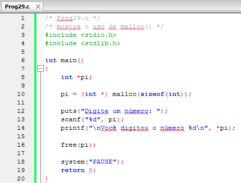

*Figura:* captura do editor com `Prog29.c` (**A05-08-P29**), linhas 1–20 da versão histórica do programa. Fonte revisado: [`src/Fontes_Aula_5_6_7_e_8/Prog29.c`](../../src/Fontes_Aula_5_6_7_e_8/Prog29.c); versão anterior à revisão de 2026 em texto: [commit `04ac409`](https://github.com/Lucas-Sperotto/falect-cc-011-algoritmos-e-laboratorio-de-programacao-ii/blob/04ac4094dba3c3812809dd433a7d3855c4bffdc9/src/Fontes_Aula_5_6_7_e_8/Prog29.c); explicação: [seção 6](#a05-08-p29). O resultado de `malloc()` é usado sem verificar se vale `NULL`; ver [observação 8.3](#obs-8-3).

<a id="slide-17"></a>
**Slide 17 — Dimensionamento de Matrizes em Tempo de Execução**

> - A determinação do tamanho de uma matriz pode ser feita em tempo de execução.
> - Vamos modificar o programa que calcula média para que o usuário indique quantas notas serão inseridas.

<a id="slide-18"></a>
**Slide 18 — Dimensionamento de Matrizes em Tempo de Execução**

> 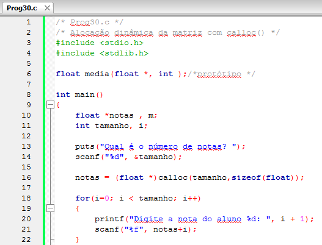

*Figura:* captura do editor com `Prog30.c` (**A05-08-P30**), linhas 1–22 da versão histórica do programa. Fonte revisado: [`src/Fontes_Aula_5_6_7_e_8/Prog30.c`](../../src/Fontes_Aula_5_6_7_e_8/Prog30.c); versão anterior à revisão de 2026 em texto: [commit `04ac409`](https://github.com/Lucas-Sperotto/falect-cc-011-algoritmos-e-laboratorio-de-programacao-ii/blob/04ac4094dba3c3812809dd433a7d3855c4bffdc9/src/Fontes_Aula_5_6_7_e_8/Prog30.c); explicação: [seção 6](#a05-08-p30).

<a id="slide-19"></a>
**Slide 19 — Dimensionamento de Matrizes em Tempo de Execução**

> 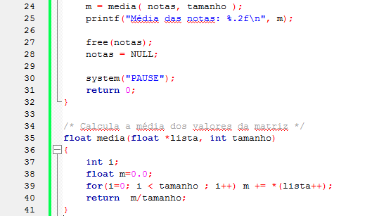

*Figura:* continuação de `Prog30.c` (**A05-08-P30**), linhas 24–41.

### 3.7 Criando uma lista ligada (slides 20–31)

<a id="slide-20"></a>
**Slide 20 — Roteiro** · *repete o roteiro do [slide 2](#slide-2), sem destaque do tópico seguinte.*

<a id="slide-21"></a>
**Slide 21 — Criando uma Lista Ligada**

> - Lista ligada é um algoritmo de armazenamento de dados que muitas vezes supera o uso de uma matriz ou de uma matriz de ponteiros.
> - A lista ligada assemelha-se a uma corrente em que os registros de dados estão pendurados sequencialmente.
> - O espaço de memória para cada registro é obtido pela função malloc(), conforme sugere a necessidade de adicionar itens à lista.

*Nota de transcrição:* uma lista ligada é uma **estrutura de dados**, e não um algoritmo; ver [seção 4.4](#c-8-4).

<a id="slide-22"></a>
**Slide 22 — Criando uma Lista Ligada**

> - Cada registro é conectado ao próximo por meio de um ponteiro.
> - O último registro contém um ponteiro com o valor NULL, e cada registro anterior contém um ponteiro apontando para o próximo.
> - Cada registro é representado por uma variável estrutura do tipo Livro.

<a id="slide-23"></a>
**Slide 23 — Criando uma Lista Ligada**

> - Cada estrutura contém um conjunto de membros para armazenar os dados de um livro: título, autor, número do registro e preço.
> - Há um membro a mais, um ponteiro, para armazenar o endereço do próximo registro.
> - A lista, como um todo, é acessada por meio de um ponteiro para a primeira estrutura, chamado cabeça.

<a id="slide-24"></a>
**Slide 24 — Criando uma Lista Ligada**

> - Esquema de uma lista ligada:
>
>   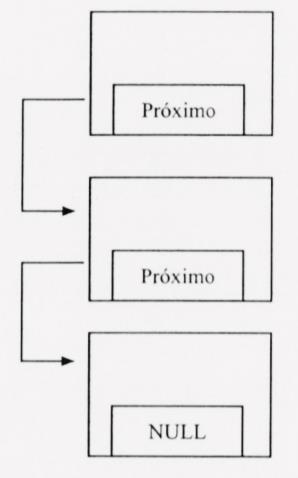

*Descrição da figura:* três retângulos empilhados, cada um representando um registro (estrutura `Livro`). Na parte de baixo de cada um há um campo: nos dois primeiros, o campo se chama “Próximo” e uma seta sai dele até o registro seguinte; no terceiro, o campo contém “NULL”, indicando o fim da lista. A figura não mostra o ponteiro `primeiro` (cabeça da lista), descrito nos slides 23 e 29; a [seção 4.4](#c-8-4) traz o esquema completo.

<a id="slide-25"></a>
**Slide 25 — O Programa**

> 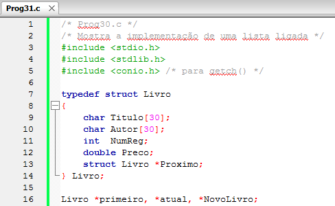

*Figura:* captura do editor com `Prog31.c` (**A05-08-P31**), linhas 1–16 da versão histórica do programa. Fonte revisado: [`src/Fontes_Aula_5_6_7_e_8/Prog31.c`](../../src/Fontes_Aula_5_6_7_e_8/Prog31.c); versão anterior à revisão de 2026 em texto: [commit `04ac409`](https://github.com/Lucas-Sperotto/falect-cc-011-algoritmos-e-laboratorio-de-programacao-ii/blob/04ac4094dba3c3812809dd433a7d3855c4bffdc9/src/Fontes_Aula_5_6_7_e_8/Prog31.c); explicação: [seção 6](#a05-08-p31). O comentário da primeira linha da captura diz `/* Prog30.c */`, embora a aba do editor mostre `Prog31.c`.

<a id="slide-26"></a>
**Slide 26 — O Programa**

> 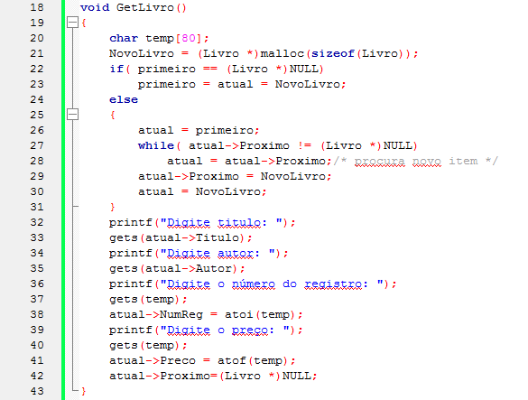

*Figura:* continuação de `Prog31.c` (**A05-08-P31**), linhas 18–43. Os campos são lidos com `gets()` e o novo nó é ligado à lista antes de ser preenchido; ver [observação 8.6](#obs-8-6).

<a id="slide-27"></a>
**Slide 27 — O Programa**

> 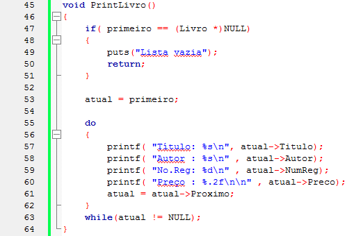

*Figura:* continuação de `Prog31.c` (**A05-08-P31**), linhas 45–64.

<a id="slide-28"></a>
**Slide 28 — O Programa**

> 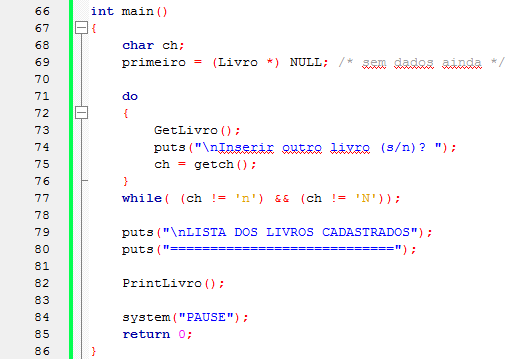

*Figura:* continuação de `Prog31.c` (**A05-08-P31**), linhas 66–86. O programa termina sem liberar os nós da lista; ver [observação 8.6](#obs-8-6).

<a id="slide-29"></a>
**Slide 29 — O Programa**

> - Se você observou bem, a ideia básica é que cada variável estrutura contenha um ponteiro para a próxima estrutura da lista; e que o ponteiro da última estrutura contenha um ponteiro nulo (NULL).
> - O ponteiro primeiro será usado para armazenar o endereço da primeira estrutura da lista.
> - Esse é um endereço “chave”, visto que indica onde encontrar a lista.

<a id="slide-30"></a>
**Slide 30 — O Programa**

> - O ponteiro é inicializado com NULL por ser externo.
> - NULL é uma constante definida no arquivo stdio.h como o valor zero.
> - A linguagem C garante que um ponteiro que aponta para algum endereço válido nunca terá o valor zero, de forma que esse valor pode ser retornado para sinalizar um evento anormal, nesse caso, o fim da lista.

*Nota de transcrição:* sobre `NULL` e a conversão `(Livro *)`, ver [observação 8.5](#obs-8-5).

<a id="slide-31"></a>
**Slide 31 — O Programa**

> - Escrevemos NULL em vez de zero para indicar mais claramente que esse é um valor especial para um ponteiro.
> - Como ele é inteiro e será atribuído a um ponteiro, devemos usar o operador de conversão de tipo (Livro\*).

### 3.8 Adicionando um livro à lista e imprimindo a lista (slides 32–40)

<a id="slide-32"></a>
**Slide 32 — Roteiro** · *repete o roteiro do [slide 2](#slide-2), sem destaque do tópico seguinte.*

<a id="slide-33"></a>
**Slide 33 — Adicionando um Livro à Lista**

> - A função Getivro() [sic] adiciona um livro à lista na instrução:
>
>   ```c
>   NovoLivro = (Livro *)malloc(sizeof(Livro));
>   ```
>
> - Em seguida, a função verifica se esse é o primeiro item a ser colocado na lista:
>
>   ```c
>   if( primeiro == (Livro *)NULL)
>       primeiro = atual = NovoLivro;
>   ```
>
> - Em caso positivo, o novo endereço é atribuído aos ponteiros primeiro e a atual [sic].

<a id="slide-34"></a>
**Slide 34 — Adicionando um Livro à Lista**

> - Cada membro individual é acessado por meio do operador ->.
> - Finalmente, é atribuido NULL ao membro Proximo.
> - Entretanto, se esse não for o primeiro item da lista, o programa usa um laço while para encontrar o fim da lista.

<a id="slide-35"></a>
**Slide 35 — Adicionando um Livro à Lista**

> - Começa atribuindo primeiro a atual pela expressão:
>
>   ```c
>   atual = primeiro;
>   ```
>
> - E em seguida, o laço while e verifica [sic] se o ponteiro da estrutura atual é NULL. Se não for, o laço while atribui o endereço em atual->Proximo a atual e volta ao teste.
>
>   ```c
>   while( atual->Proximo != (Livro *)NULL)
>       atual = atual->Proximo;/* procura novo item */
>   ```
>
> - O ciclo termina quando é encontrada a última estrutura.

<a id="slide-36"></a>
**Slide 36 — Adicionando um Livro à Lista**

> - Ao seu membro ponteiro, atribuímos o endereço da nova estrutura.
>
>   ```c
>   atual->Proximo = NovoLivro;
>   atual = NovoLivro;
>   ```
>
> - Em seguida, os membros da nova estrutura são preenchidos com os dados digitados pelo usuário, com exceção do membro ponteiro.
> - A ele atribuímos NULL.
>
>   ```c
>   atual->Proximo=(Livro *)NULL;
>   ```
>
> - O novo livro é inserido no final da lista.

<a id="slide-37"></a>
**Slide 37 — Imprimindo os Dados da Lista**

> - Para imprimir os dados dos livros cadastrados devemos seguir a cadeia de ponteiros, da primeira estrutura para a próxima, até encontrar NULL.
> - A função PrintLivro() inicia verificando se a lista está vazia.
> - Se não estiver, atribui o valor do ponteiro primeiro ao ponteiro atual, que irá varrer a lista.
>
>   ```c
>   atual = primeiro;
>   ```

<a id="slide-38"></a>
**Slide 38 — Imprimindo os Dados da Lista**

> - Em seguida, entra no laço e imprime os valores dos membros da estrutura apontada por atual; em seguida, acerta o ponteiro atual para que aponte para a próxima estrutura:
>
>   ```c
>   atual = atual->Proximo;
>   ```
>
> - O laço termina quando a última estrutura for atingida.

<a id="slide-39"></a>
**Slide 39 — Implementações Adicionais**

> - Podem ser feitos vários refinamentos no uso de listas encadeadas, como guardar o endereço do último item da lista no primeiro.
> - Dessa maneira, se quisermos adicionar um novo item na lista, o programa poderá ir diretamente ao último item.
> - Igualmente, a lista pode ser encadeada para trás ou para a frente (como mostramos), ou ainda de modo circular.

*Nota de transcrição:* guardar o endereço do último elemento (ponteiro de cauda) torna a inserção no fim independente do tamanho da lista; ver [seção 4.5](#c-8-5).

<a id="slide-40"></a>
**Slide 40 — Implementações Adicionais**

> - Eliminar um item da lista é, razoavelmente, fácil.
> - Se o registro a res eliminado [sic] for B, então o ponteiro da estrutura anterior A será alterado para que aponte para a estrutura C.
> - Se for desejado liberar a memória usada por estruturas apagadas, a função de biblioteca free() deverá ser usada.

*Nota de transcrição:* a [seção 4.5](#c-8-5) mostra a remoção de um nó com `free()`.

### 3.9 Argumentos da linha de comando (slides 41–48)

<a id="slide-41"></a>
**Slide 41 — Roteiro** · *repete o roteiro do [slide 2](#slide-2), sem destaque do tópico seguinte.*

<a id="slide-42"></a>
**Slide 42 — Argumentos da Linha de Comando**

> - Se você já trabalhou com os sistemas operacionais Unix, Linux ou DOS, com certeza já deve estar acostumado a usar argumentos da linha de comando.
> - Por exemplo:
>
>   ```text
>   C:\>FORMAT D: /s /u
>   ```
>
> - Nesse exemplo, D: é um argumento da linha de comando, /s e /u são outros dois .
> - Os itens digitados na linha de comando do DOS são chamados argumentos da linha de comando.

<a id="slide-43"></a>
**Slide 43 — Argumentos da Linha de Comando**

> - Usuários do Windows podem entrar argumentos da linha de comando após o nome do programa na opção Executar do menu Iniciar.
> - Como podemos escrever programas em C que acessem esses argumentos?
> - Os argumentos digitados na linha de comando são enviados pelo sistema operacional como argumentos da função main().

*Nota de transcrição:* no WSL e no Linux, os argumentos são escritos depois do nome do programa no terminal (por exemplo, `./prog32 alfa beta`).

<a id="slide-44"></a>
**Slide 44 — Argumentos da Linha de Comando**

> - Para que essa função possa reconhecê-los, é necessário declará-los como é feito em qualquer função C.
> - Eis um exemplo:

<a id="slide-45"></a>
**Slide 45 — Argumentos da Linha de Comando**

> 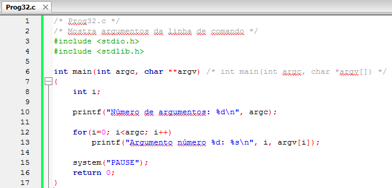

*Figura:* captura do editor com `Prog32.c` (**A05-08-P32**), linhas 1–17 da versão histórica do programa. Fonte revisado: [`src/Fontes_Aula_5_6_7_e_8/Prog32.c`](../../src/Fontes_Aula_5_6_7_e_8/Prog32.c); versão anterior à revisão de 2026 em texto: [commit `04ac409`](https://github.com/Lucas-Sperotto/falect-cc-011-algoritmos-e-laboratorio-de-programacao-ii/blob/04ac4094dba3c3812809dd433a7d3855c4bffdc9/src/Fontes_Aula_5_6_7_e_8/Prog32.c); explicação: [seção 6](#a05-08-p32).

<a id="slide-46"></a>
**Slide 46 — Argumentos da Linha de Comando**

> - A função main() recebe dois argumentos: argc e argv.
>
>   ```c
>   int main(int argc, char **argv) /* int main(int argc, char *argv[]) */
>   ```
>
> - O primeiro argumento representa o número de argumentos digitados na linha de comando, neste caso sete.
> - O segundo argumento corresponde a uma matriz de ponteiros para strings, as quais representam argumentos da linha de comando.

*Nota de transcrição:* “neste caso sete” refere-se a uma linha de comando que não aparece no slide.

<a id="slide-47"></a>
**Slide 47 — Argumentos da Linha de Comando**

> - As cadeias de caracteres podem ser acessadas por meio da notção [sic] matriz, argv[0], argv[1] etc. ou por meio da notação ponteiro, \*(argv + 0), \*(argv + 1) etc.
> - A primeira cadeia, argv[0], é sempre o nome do programa sendo executado e o seu caminho de localização no disco.
> - O sistema operacional entende o espaço em branco como separador dos argumentos.

*Nota de transcrição:* sobre `argv[0]`, ver [observação 8.7](#obs-8-7).

<a id="slide-48"></a>
**Slide 48 — Argumentos da Linha de Comando**

> - Os nomes argc (ARGument Count) e argv (ARGument Values) são tradicionalmente usados para esse fim, mas qualquer outro nome poderia ser usado por você.

### 3.10 Atribuindo múltiplos argumentos a teclas de função (slides 49–55)

<a id="slide-49"></a>
**Slide 49 — Roteiro** · *repete o roteiro do [slide 2](#slide-2), sem destaque do tópico seguinte.*

<a id="slide-50"></a>
**Slide 50 — Atribuindo Múltiplos Argumentos e Teclas de Função**

> - O proximo exemplo, usa um comando do driver Ansi.sys para programar uma tecla de função.
> - Para executar o programa, o driver Ansi.sys deve estar instalado e rodando no prompt ativo do DOS. Siga os passos da aula correspondente no curso de C básico e Intermediário.

*Nota de transcrição:* o driver ANSI.SYS e a redefinição de teclas não existem em terminais atuais; ver [observação 8.8](#obs-8-8). O “curso de C básico e intermediário” citado não faz parte do repositório.

<a id="slide-51"></a>
**Slide 51 — Atribuindo Múltiplos Argumentos e Teclas de Função**

> - Embora o que você digite na linha de comando tenha a aparência de uma cadeia de caracteres, o sistema operacional interpreta-o como uma série de variáveis separadas por espaços em branco.
> - Para atribuir uma cadeia de caracteres de múltiplas palavras para uma tecla de função, é necessário combinar os diversos argumentos da linha de comando em uma única matriz.

<a id="slide-52"></a>
**Slide 52 — Atribuindo Múltiplos Argumentos e Teclas de Função**

> - O programa seguinte faz isso usando a função strcpy() para colocar o primeiro argumento na matriz vazia, e então usa strcat() para concatenar cada um dos argumentos seguintes, colocando um espaço entre eles.

<a id="slide-53"></a>
**Slide 53 — Atribuindo Múltiplos Argumentos e Teclas de Função**

> 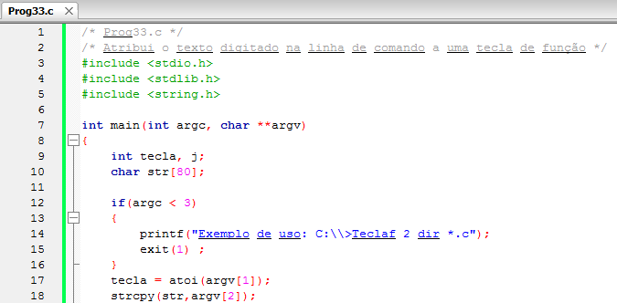

*Figura:* captura do editor com `Prog33.c` (**A05-08-P33**), linhas 1–18 da versão histórica do programa. Fonte revisado: [`src/Fontes_Aula_5_6_7_e_8/Prog33.c`](../../src/Fontes_Aula_5_6_7_e_8/Prog33.c); versão anterior à revisão de 2026 em texto: [commit `04ac409`](https://github.com/Lucas-Sperotto/falect-cc-011-algoritmos-e-laboratorio-de-programacao-ii/blob/04ac4094dba3c3812809dd433a7d3855c4bffdc9/src/Fontes_Aula_5_6_7_e_8/Prog33.c); explicação: [seção 6](#a05-08-p33).

<a id="slide-54"></a>
**Slide 54 — Atribuindo Múltiplos Argumentos e Teclas de Função**

> 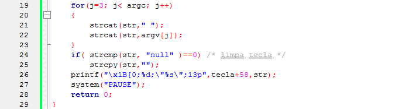

*Figura:* continuação de `Prog33.c` (**A05-08-P33**), linhas 19–29. A concatenação em `str[80]` não verifica a capacidade; ver [observação 8.9](#obs-8-9).

<a id="slide-55"></a>
**Slide 55 — Atribuindo Múltiplos Argumentos e Teclas de Função**

> - Vamos ver o que ocorre quando executamos o programa no prompt de comando da console, digitando o seguinte texto:
>
>   ```text
>   C:\>MeusProjetos\>Prog33 2 dir *.*
>   ```
>
> - Após a execução, pressione a tecla F2 e você verá impressos os nomes dos arquivos gravados na pasta.
> - Se você quiser limpar o que foi atribuído à tecla de função 2, digite a seguinte instrução:
>
>   ```text
>   C:\>MeusProjetos\>Prog33 2 null
>   ```

### 3.11 Alocando matrizes e vetores (slides 56–65)

<a id="slide-56"></a>
**Slide 56 — Roteiro** · *repete o roteiro do [slide 2](#slide-2), sem destaque do tópico seguinte.*

<a id="slide-57"></a>
**Slide 57 — Alocando Matrizes e Vetores**

> - Veremos agora dois exemplos de como criar funções que aloquem e desaloquem matrizes e vetores na memória do computador.
> - Para a alocação devemos usar a função malloc() e para liberar a memória usaremos a função free();
> - SEMPRE deve-se atribuir o valor NULL para um ponteiro que não é mais utilizado, isso evita falhas graves de acesso indevido à memória em softwares grandes e complexos.

*Nota de transcrição:* atribuir `NULL` evita usar por engano o ponteiro liberado, mas não protege outras cópias do mesmo endereço; ver [seção 4.3](#c-8-3).

<a id="slide-58"></a>
**Slide 58 — Alocando Matrizes e Vetores**

> 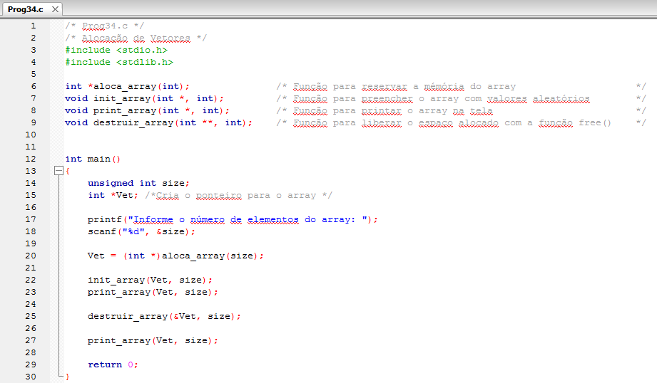

*Figura:* captura do editor com `Prog34.c` (**A05-08-P34**), linhas 1–30 da versão histórica do programa. Fonte revisado: [`src/Fontes_Aula_5_6_7_e_8/Prog34.c`](../../src/Fontes_Aula_5_6_7_e_8/Prog34.c); versão anterior à revisão de 2026 em texto: [commit `04ac409`](https://github.com/Lucas-Sperotto/falect-cc-011-algoritmos-e-laboratorio-de-programacao-ii/blob/04ac4094dba3c3812809dd433a7d3855c4bffdc9/src/Fontes_Aula_5_6_7_e_8/Prog34.c); explicação: [seção 6](#a05-08-p34).

<a id="slide-59"></a>
**Slide 59 — Alocando Matrizes e Vetores**

> 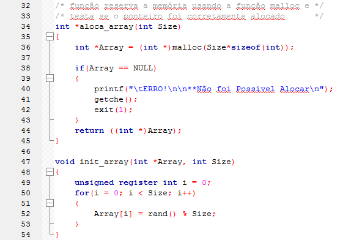

*Figura:* continuação de `Prog34.c` (**A05-08-P34**), linhas 32–54.

<a id="slide-60"></a>
**Slide 60 — Alocando Matrizes e Vetores**

> 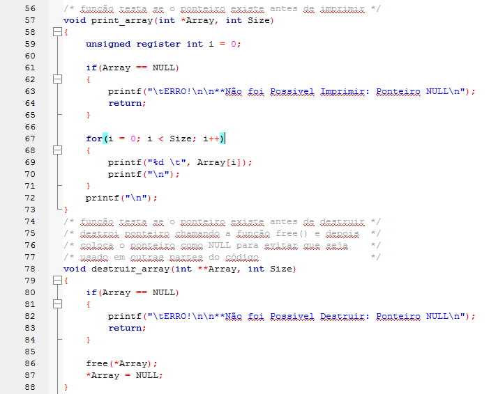

*Figura:* continuação de `Prog34.c` (**A05-08-P34**), linhas 56–88.

<a id="slide-61"></a>
**Slide 61 — Alocando Matrizes e Vetores**

> - Note como a função destruir_array() funciona;
> - O ponteiro quando passado para uma função é passado por valor, ou seja, na função é gerada uma cópia do ponteiro.
> - Sendo assim devemos passar para a função o endereço da variável ponteiro e receber na função um ponteiro de ponteiro para alterar o ponteiro original.

*Nota de transcrição:* é a mesma ideia da troca da [Aula 5](../aula-05/README.md#c-5-3): para alterar o ponteiro do chamador, passa-se o endereço do ponteiro.

<a id="slide-62"></a>
**Slide 62 — Alocando Matrizes e Vetores**

> 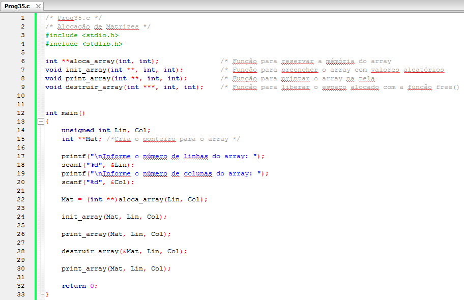

*Figura:* captura do editor com `Prog35.c` (**A05-08-P35**), linhas 1–33 da versão histórica do programa. Fonte revisado: [`src/Fontes_Aula_5_6_7_e_8/Prog35.c`](../../src/Fontes_Aula_5_6_7_e_8/Prog35.c); versão anterior à revisão de 2026 em texto: [commit `04ac409`](https://github.com/Lucas-Sperotto/falect-cc-011-algoritmos-e-laboratorio-de-programacao-ii/blob/04ac4094dba3c3812809dd433a7d3855c4bffdc9/src/Fontes_Aula_5_6_7_e_8/Prog35.c); explicação: [seção 6](#a05-08-p35).

<a id="slide-63"></a>
**Slide 63 — Alocando Matrizes e Vetores**

> 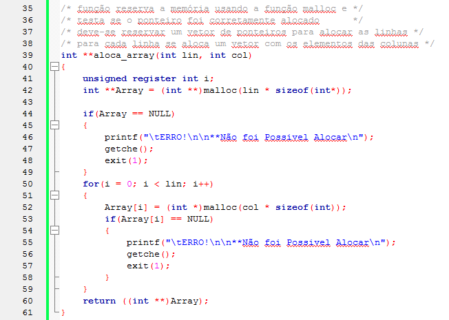

*Figura:* continuação de `Prog35.c` (**A05-08-P35**), linhas 35–61. Se a alocação de uma linha falhar, as linhas já alocadas não são liberadas antes de `exit(1)`; ver [observação 8.10](#obs-8-10).

<a id="slide-64"></a>
**Slide 64 — Alocando Matrizes e Vetores**

> 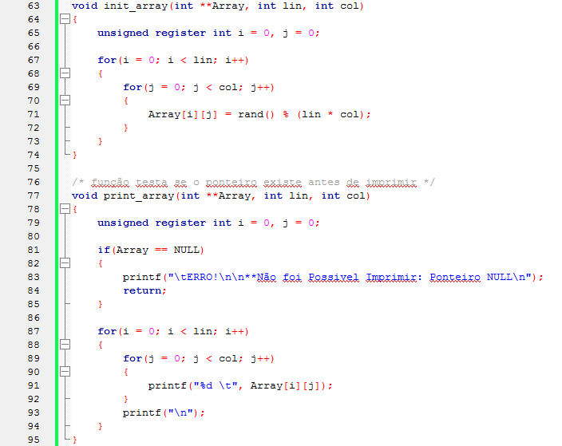

*Figura:* continuação de `Prog35.c` (**A05-08-P35**), linhas 63–95.

<a id="slide-65"></a>
**Slide 65 — Alocando Matrizes e Vetores**

> 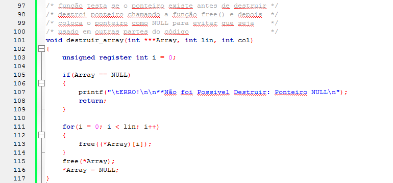

*Figura:* continuação de `Prog35.c` (**A05-08-P35**), linhas 97–117.

### 3.12 Referências do material original (slide 66)

<a id="slide-66"></a>
**Slide 66 — Referências**

> - MIZRAHI, Victorine V. Treinamento em Linguagem C, São Paulo: Pearson Prentice Hall, 2008;

## 4. Explicações complementares

<a id="c-8-1"></a>
### 4.1 Onde ficam as variáveis: estática, pilha e *heap*

| Região | O que guarda | Quando nasce e morre | Exemplo |
|---|---|---|---|
| Dados estáticos | variáveis globais e `static` | durante toda a execução; começam com zero | `Livro *primeiro;` em `Prog31.c` |
| Pilha (*stack*) | variáveis locais e parâmetros | ao entrar e ao sair do bloco ou da função | `char temp[80];` em `GetLivro()` |
| *Heap* (memória dinâmica) | blocos pedidos com `malloc`/`calloc`/`realloc` | do pedido até o `free` | os nós da lista de `Prog31.c` |

O padrão chama essas três possibilidades de duração **estática**, **automática** e **alocada** (§6.2.4 e §7.22.3). A pilha é pequena (8 MiB por padrão no Linux, conforme `ulimit -s`) e é liberada automaticamente; o *heap* é grande, mas o programa é responsável por devolver cada bloco. A memória dinâmica resolve o problema dos slides 3–5: o tamanho e a quantidade de dados podem ser decididos durante a execução, e os dados podem sobreviver à função que os criou.

<a id="c-8-2"></a>
### 4.2 As funções de alocação

| Chamada | Efeito | Em caso de falha |
|---|---|---|
| `p = malloc(n * sizeof *p);` | bloco de `n` elementos, conteúdo **indeterminado** | devolve `NULL` |
| `p = calloc(n, sizeof *p);` | bloco de `n` elementos, todos os bytes **zerados**; detecta estouro em `n * tamanho` | devolve `NULL` |
| `q = realloc(p, novo);` | muda o tamanho, preservando o conteúdo (pode mover o bloco) | devolve `NULL` e **mantém** `p` válido |
| `free(p);` | devolve o bloco; `free(NULL)` não faz nada | — |

Três hábitos tornam o código mais seguro:

```c
int *v = malloc(n * sizeof *v);   /* sizeof *v acompanha o tipo de v, sem repetir "int" */
if (v == NULL) {                  /* sempre testar antes de usar */
    fputs("Memória insuficiente.\n", stderr);
    return 1;
}
/* ... uso de v[0] a v[n-1] ... */
free(v);
v = NULL;                         /* evita reutilizar este ponteiro por engano */
```

Em C, o resultado `void *` de `malloc` é convertido implicitamente; o *cast* `(int *)` dos slides é necessário apenas em C++. Os fontes revisados usam `malloc(sizeof *pi)` e `calloc((size_t)tamanho, sizeof *notas)`.

<a id="c-8-3"></a>
### 4.3 Erros de memória e como detectá-los

| Erro | Exemplo | Consequência |
|---|---|---|
| Vazamento (*leak*) | perder o último ponteiro para um bloco sem `free` | memória ocupada até o fim do programa |
| Ponteiro pendente (*dangling*) | usar `p` depois de `free(p)` | comportamento indefinido |
| Dupla liberação | `free(p); free(p);` | comportamento indefinido; corrompe o alocador |
| Acesso fora do bloco | `v[n]` em um bloco de `n` elementos | comportamento indefinido |
| Liberar o que não veio do *heap* | `free(&x)` | comportamento indefinido |

Atribuir `NULL` depois de `free` (slide 57) protege apenas aquela variável: se outro ponteiro guardava o mesmo endereço, ele continua pendente. O AddressSanitizer detecta esses erros durante a execução, e o LeakSanitizer lista os blocos não liberados ao fim. A infraestrutura do repositório executa todos os cenários com ambos (`bash script.sh --executar --sanitizers`); para um programa isolado:

```bash
gcc -std=c11 -g -fsanitize=address,undefined src/Fontes_Aula_5_6_7_e_8/Prog31.c -o /tmp/prog31
/tmp/prog31
```

<a id="c-8-4"></a>
### 4.4 Lista ligada: estrutura e percurso

Cada nó guarda os dados e o endereço do próximo; o último guarda `NULL`; o ponteiro `primeiro` (a **cabeça**) dá acesso à lista inteira. É uma **estrutura de dados** (e não um algoritmo, como diz o slide 21): uma forma de organizar dados na memória, sobre a qual se escrevem algoritmos de inserção, busca e remoção.


O percurso segue a cadeia de ponteiros: `for (p = primeiro; p != NULL; p = p->Proximo)`. Comparação com um vetor:

| Operação | Vetor de `n` elementos | Lista ligada de `n` nós |
|---|---|---|
| Acessar o elemento `i` | $O(1)$: `v[i]` | $O(i)$: seguir `i` ponteiros |
| Inserir no início | $O(n)$: deslocar todos | $O(1)$ |
| Inserir no fim | $O(1)$ se houver espaço | $O(n)$ sem ponteiro de cauda; $O(1)$ com ele |
| Remover um elemento já localizado | $O(n)$: deslocar | $O(1)$: religar os vizinhos |
| Crescer | realocar e copiar | alocar um nó |
| Memória extra | nenhuma | um ponteiro por nó, mais o custo de cada bloco no alocador |

<a id="c-8-5"></a>
### 4.5 Inserir no início, remover e liberar

O trecho abaixo não faz parte dos fontes da disciplina; foi compilado com `-std=c11 -Wall -Wextra -Wpedantic -fsanitize=address,undefined` e executado sem erros nem vazamentos. As funções recebem `No **cabeca` porque precisam alterar o ponteiro de cabeça do chamador, a mesma ideia de `destruir_array(&Vet)` em `Prog34.c`.

```c
typedef struct No {
    int valor;
    struct No *proximo;
} No;

/* Insere no início: O(1). Devolve 0 se faltar memória. */
int insere_inicio(No **cabeca, int valor)
{
    No *novo = malloc(sizeof *novo);
    if (novo == NULL)
        return 0;
    novo->valor = valor;
    novo->proximo = *cabeca;   /* o antigo primeiro passa a ser o segundo */
    *cabeca = novo;            /* a cabeça do chamador muda: por isso No ** */
    return 1;
}

/* Remove o primeiro nó com o valor dado. Devolve 1 se removeu. */
int remove_valor(No **cabeca, int valor)
{
    No **elo = cabeca;                 /* endereço do ponteiro que aponta para o nó atual */
    while (*elo != NULL && (*elo)->valor != valor)
        elo = &(*elo)->proximo;
    if (*elo == NULL)
        return 0;
    No *alvo = *elo;
    *elo = alvo->proximo;              /* o anterior passa a apontar para o seguinte */
    free(alvo);
    return 1;
}

void libera(No **cabeca)
{
    while (*cabeca != NULL) {
        No *seguinte = (*cabeca)->proximo;   /* guardar antes de liberar */
        free(*cabeca);
        *cabeca = seguinte;
    }
}
```

A remoção corresponde ao slide 40: o ponteiro que apontava para B (o `proximo` de A, ou a própria cabeça) passa a apontar para C, e B é liberado. Na liberação, o endereço do próximo nó precisa ser lido **antes** do `free`; ler `(*cabeca)->proximo` depois seria usar memória já liberada. O `Prog31.c` revisado tem a função `LiberaLivros()`, que segue o mesmo raciocínio.

<a id="c-8-6"></a>
### 4.6 `argc` e `argv`

Ao executar `./prog32 alfa beta`, o sistema monta um vetor de strings e o entrega a `main` (§5.1.2.2.1):

| Elemento | Conteúdo |
|---|---|
| `argc` | 3 |
| `argv[0]` | `"./prog32"` (o nome usado para chamar o programa) |
| `argv[1]` | `"alfa"` |
| `argv[2]` | `"beta"` |
| `argv[3]` | `NULL` (o padrão garante `argv[argc] == NULL`) |

Diferença importante em relação ao DOS dos slides: no Linux, é o **shell** que expande curingas antes de iniciar o programa. Em `./prog33 2 dir *.c`, o programa recebe os nomes dos arquivos `.c` do diretório, e não o texto `*.c`; para passar o texto literal, use aspas: `./prog33 2 dir '*.c'`. Todos os argumentos chegam como strings: o número da tecla em `Prog33.c` é convertido com `strtol`.

<a id="c-8-7"></a>
### 4.7 Matrizes dinâmicas: duas organizações

`Prog35.c` aloca um vetor de `lin` ponteiros e, para cada linha, um vetor de `col` inteiros. Cada linha é um bloco separado, por isso `Mat[i][j]` funciona e as linhas podem até ter tamanhos diferentes:

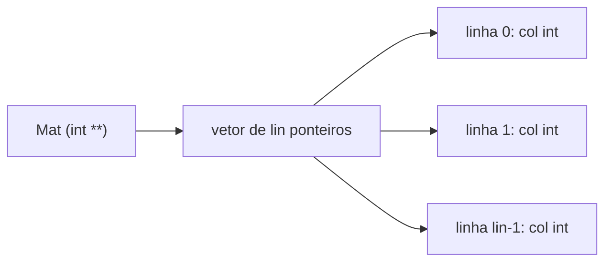

São `lin + 1` alocações e `lin + 1` liberações, e as linhas podem ficar espalhadas pelo *heap*. Quando todas as linhas têm o mesmo tamanho, um único bloco contíguo é mais simples e costuma ser mais rápido:

```c
size_t lin = 2, col = 3;
int (*m)[3] = malloc(lin * sizeof *m);   /* lin linhas de 3 int em um só bloco */
if (m == NULL) return 1;
m[1][2] = 5;                              /* indexação normal de matriz */
free(m);                                  /* uma única liberação */
```

Se o número de colunas só for conhecido na execução, usa-se `int *m = malloc(lin * col * sizeof *m);` e o elemento `(i, j)` fica em `m[i * col + j]`, a mesma fórmula da [Aula 1](../aula-01/README.md#c-1-4). Nos dois casos, é preciso garantir que `lin * col * sizeof(int)` não transborde, o que os fontes revisados fazem limitando as dimensões.

## 5. Conceitos fundamentais

| Conceito | Definição operacional | Onde aparece |
|---|---|---|
| *Heap* | Região de memória para blocos alocados durante a execução | slides 3–5 |
| `malloc` | Aloca um bloco de bytes não inicializado; `NULL` em falha | slides 7–8 |
| `calloc` | Aloca `n` elementos zerados | slides 10–11 |
| `free` | Devolve um bloco obtido do alocador | slides 13–14 |
| Duração alocada | O objeto existe do `malloc` ao `free`, independentemente de escopo | slide 13 |
| Vazamento de memória | Bloco que não pode mais ser liberado por falta de ponteiro | [4.3](#c-8-3) |
| Ponteiro pendente | Ponteiro para memória já liberada | slide 57; [4.3](#c-8-3) |
| Lista ligada | Nós encadeados por ponteiros, terminados por `NULL` | slides 21–40 |
| Cabeça da lista | Ponteiro para o primeiro nó | slides 23, 29 |
| `argc`/`argv` | Contagem e vetor de strings dos argumentos da linha de comando | slides 42–55 |
| Matriz dinâmica | Vetor de ponteiros para linhas ou bloco contíguo indexado | slides 57–65 |

## 6. Programas C da aula

Fontes em [`src/Fontes_Aula_5_6_7_e_8/`](../../src/Fontes_Aula_5_6_7_e_8/), revisados em 2026 ([revisão por fonte](../../docs/auditorias/REVISAO_POR_FONTE.md#aulas-5-a-8--srcfontes_aula_5_6_7_e_8)). Todas as alocações passaram a ser verificadas e toda memória é liberada, inclusive nos caminhos de erro.

| ID | Arquivo | SIGAA | Slides | Tema |
|---|---|---|---|---|
| [A05-08-P29](#a05-08-p29) | [`Prog29.c`](../../src/Fontes_Aula_5_6_7_e_8/Prog29.c) | Prog29.c | 7–8, 16 | `malloc` de um inteiro |
| [A05-08-P30](#a05-08-p30) | [`Prog30.c`](../../src/Fontes_Aula_5_6_7_e_8/Prog30.c) | Prog30.c | 10–11, 17–19 | vetor com `calloc` |
| [A05-08-P31](#a05-08-p31) | [`Prog31.c`](../../src/Fontes_Aula_5_6_7_e_8/Prog31.c) | Prog31.c | 21–40 | lista ligada de livros |
| [A05-08-P32](#a05-08-p32) | [`Prog32.c`](../../src/Fontes_Aula_5_6_7_e_8/Prog32.c) | Prog32.c | 42–48 | `argc` e `argv` |
| [A05-08-P33](#a05-08-p33) | [`Prog33.c`](../../src/Fontes_Aula_5_6_7_e_8/Prog33.c) | Prog33.c | 50–55 | argumentos e teclas de função |
| [A05-08-P34](#a05-08-p34) | [`Prog34.c`](../../src/Fontes_Aula_5_6_7_e_8/Prog34.c) | Prog34.c | 57–61 | vetor dinâmico em funções |
| [A05-08-P35](#a05-08-p35) | [`Prog35.c`](../../src/Fontes_Aula_5_6_7_e_8/Prog35.c) | Prog35.c | 62–65 | matriz dinâmica em funções |

<a id="a05-08-p29"></a>
### 6.1 A05-08-P29 — `Prog29.c`: um inteiro no *heap*

- **Finalidade:** criar uma variável `int` dinamicamente. **Entrada:** um inteiro. **Saída:** o mesmo inteiro.
- **Conceitos:** `malloc(sizeof *pi)`, `scanf("%d", pi)` (já é um endereço), `free`.
- **Diferença em relação ao slide 16:** o resultado de `malloc` é testado; em caso de leitura inválida, a memória é liberada antes de sair.

<!-- codigo: src/Fontes_Aula_5_6_7_e_8/Prog29.c de=`int *pi;` ate=`free(pi);` -->
<sub>Copiado de [`src/Fontes_Aula_5_6_7_e_8/Prog29.c`](../../src/Fontes_Aula_5_6_7_e_8/Prog29.c#L13-L19) (linhas 13–19) por `scripts/documentacao_aulas.py`; não edite este bloco à mão.</sub>

```c
    int *pi;

    pi = malloc(sizeof *pi);
    if (pi == NULL) return 1;

    puts("Digite um número: ");
    if (scanf("%d", pi) != 1) { free(pi); return 1; }
```
<!-- /codigo -->

<a id="a05-08-p30"></a>
### 6.2 A05-08-P30 — `Prog30.c`: vetor de tamanho escolhido na execução

- **Finalidade:** perguntar quantas notas serão digitadas e alocar exatamente esse vetor. **Entrada:** a quantidade (1 a 100000) e as notas. **Saída:** a média.
- **Diferença em relação aos slides 18–19:** validação do tamanho e das leituras, teste de `NULL` e liberação em todos os caminhos ([Aula 1, 8.2](../aula-01/README.md#obs-1-2) discute a alternativa VLA).

<!-- codigo: src/Fontes_Aula_5_6_7_e_8/Prog30.c de=`puts("Qual é o número de notas? ");` ate=`notas = NULL;` -->
<sub>Copiado de [`src/Fontes_Aula_5_6_7_e_8/Prog30.c`](../../src/Fontes_Aula_5_6_7_e_8/Prog30.c#L18-L35) (linhas 18–35) por `scripts/documentacao_aulas.py`; não edite este bloco à mão.</sub>

```c
    puts("Qual é o número de notas? ");
    if (scanf("%d", &tamanho) != 1 || tamanho <= 0 || tamanho > 100000)
        return 1; /* Limite didático para não alocar volumes excessivos. */

    notas = calloc((size_t)tamanho, sizeof *notas);
    if (notas == NULL) return 1;

    for(i=0; i < tamanho; i++)
    {
        printf("Digite a nota do aluno %d: ", i + 1);
        if (scanf("%f", notas+i) != 1) { free(notas); return 1; }
    }

    m = media( notas, tamanho );
    printf("Média das notas: %.2f\n", m);

    free(notas);
    notas = NULL;
```
<!-- /codigo -->

<a id="a05-08-p31"></a>
### 6.3 A05-08-P31 — `Prog31.c`: lista ligada de livros

- **Finalidade:** cadastrar livros em uma lista ligada e imprimi-los na ordem de inserção.
- **Entrada:** título, autor, número de registro e preço de cada livro; depois `s` ou `n`. **Saída:** a lista dos livros.
- **Conceitos:** estrutura autorreferente (`struct Livro *Proximo`), alocação de um nó por livro, inserção no fim com percurso, liberação da lista ([4.4](#c-8-4), [4.5](#c-8-5)).
- **Diferenças em relação aos slides 25–28:** (1) `gets` e `getch` foram trocadas por `ler_linha`; (2) número e preço são convertidos com `strtol`/`strtod`, recusando texto inválido; (3) o nó só é ligado à lista **depois** de todos os campos lidos, de modo que um erro não deixa um livro incompleto na lista; (4) `LiberaLivros()` libera todos os nós no fim e nas falhas ([8.6](#obs-8-6)).
- **Cuidado:** a inserção percorre a lista inteira a cada livro; para muitos livros, um ponteiro para o último nó (sugerido no slide 39) evitaria esse custo.

<!-- codigo: src/Fontes_Aula_5_6_7_e_8/Prog31.c funcao=GetLivro -->
<sub>Copiado de [`src/Fontes_Aula_5_6_7_e_8/Prog31.c`](../../src/Fontes_Aula_5_6_7_e_8/Prog31.c#L26-L65) (linhas 26–65) por `scripts/documentacao_aulas.py`; não edite este bloco à mão.</sub>

```c
int GetLivro(void)
{
    char temp[80], *fim;
    long registro;
    NovoLivro = malloc(sizeof *NovoLivro);
    if (NovoLivro == NULL) return 0;
    /* Só encadeia o livro depois de completar todas as leituras. */
    printf("Digite titulo: ");
    if (!ler_linha(NovoLivro->Titulo, sizeof NovoLivro->Titulo)) goto falha;
    printf("Digite autor: ");
    if (!ler_linha(NovoLivro->Autor, sizeof NovoLivro->Autor)) goto falha;
    printf("Digite o número do registro: ");
    if (!ler_linha(temp, sizeof temp)) goto falha;
    errno = 0;
    registro = strtol(temp, &fim, 10);
    if (errno || fim == temp || *fim || registro < INT_MIN || registro > INT_MAX)
        goto falha;
    NovoLivro->NumReg = (int)registro;
    printf("Digite o preço: ");
    if (!ler_linha(temp, sizeof temp)) goto falha;
    errno = 0;
    NovoLivro->Preco = strtod(temp, &fim);
    if (errno || fim == temp || *fim || !isfinite(NovoLivro->Preco)) goto falha;
    NovoLivro->Proximo = NULL;
    if (primeiro == NULL)
        primeiro = atual = NovoLivro;
    else
    {
        atual = primeiro;
        while (atual->Proximo != NULL)
            atual = atual->Proximo;
        atual->Proximo = NovoLivro;
        atual = NovoLivro;
    }
    return 1;
falha:
    free(NovoLivro);
    NovoLivro = NULL;
    return 0;
}
```
<!-- /codigo -->

<!-- codigo: src/Fontes_Aula_5_6_7_e_8/Prog31.c funcao=LiberaLivros -->
<sub>Copiado de [`src/Fontes_Aula_5_6_7_e_8/Prog31.c`](../../src/Fontes_Aula_5_6_7_e_8/Prog31.c#L86-L95) (linhas 86–95) por `scripts/documentacao_aulas.py`; não edite este bloco à mão.</sub>

```c
void LiberaLivros(void)
{
    while (primeiro != NULL)
    {
        atual = primeiro;
        primeiro = primeiro->Proximo;
        free(atual);
    }
    atual = NovoLivro = NULL;
}
```
<!-- /codigo -->

<a id="a05-08-p32"></a>
### 6.4 A05-08-P32 — `Prog32.c`: argumentos da linha de comando

- **Finalidade:** imprimir `argc` e cada `argv[i]`. **Entrada:** os argumentos. **Saída:** a contagem e uma linha por argumento, começando pelo nome do programa ([4.6](#c-8-6)).

<!-- codigo: src/Fontes_Aula_5_6_7_e_8/Prog32.c de=`int main(int argc` ate=`argv[i]);` -->
<sub>Copiado de [`src/Fontes_Aula_5_6_7_e_8/Prog32.c`](../../src/Fontes_Aula_5_6_7_e_8/Prog32.c#L11-L18) (linhas 11–18) por `scripts/documentacao_aulas.py`; não edite este bloco à mão.</sub>

```c
int main(int argc, char **argv) /* int main(int argc, char *argv[]) */
{
    int i;

    printf("Número de argumentos: %d\n", argc);

    for(i=0; i<argc; i++)
        printf("Argumento número %d: %s\n", i, argv[i]);
```
<!-- /codigo -->

<a id="a05-08-p33"></a>
### 6.5 A05-08-P33 — `Prog33.c`: argumentos reunidos em uma string

- **Finalidade:** juntar os argumentos a partir do segundo em uma única string, separados por espaço, e emitir a sequência de escape que, no DOS com ANSI.SYS, programava uma tecla de função.
- **Entrada:** o número da tecla (1 a 10) e o texto. **Saída:** a sequência `ESC[0;<tecla+58>;"<texto>";13p`.
- **Diferença em relação aos slides 53–54:** a tecla é validada com `strtol`; a concatenação verifica a capacidade de `str[80]` antes de cada cópia ([8.9](#obs-8-9)). A sequência histórica é preservada e documentada; terminais atuais a ignoram ([8.8](#obs-8-8)).

<!-- codigo: src/Fontes_Aula_5_6_7_e_8/Prog33.c de=`for (j=2; j<argc; j++)` ate=`usado += tamanho;` -->
<sub>Copiado de [`src/Fontes_Aula_5_6_7_e_8/Prog33.c`](../../src/Fontes_Aula_5_6_7_e_8/Prog33.c#L31-L39) (linhas 31–39) por `scripts/documentacao_aulas.py`; não edite este bloco à mão.</sub>

```c
    for (j=2; j<argc; j++)
    {
        size_t tamanho = strlen(argv[j]);
        size_t separador = j > 2 ? 1u : 0u;
        if (separador > sizeof str - 1 - usado ||
            tamanho > sizeof str - 1 - usado - separador) return 1;
        if (separador) str[usado++] = ' ';
        memcpy(str+usado, argv[j], tamanho+1);
        usado += tamanho;
```
<!-- /codigo -->

<a id="a05-08-p34"></a>
### 6.6 A05-08-P34 — `Prog34.c`: vetor dinâmico com funções

- **Finalidade:** organizar alocação, preenchimento, impressão e liberação de um vetor em funções. **Entrada:** o tamanho (1 a 100000). **Saída:** os valores sorteados, um por linha, e depois a mensagem de erro de `print_array` ao receber o ponteiro já anulado.
- **Conceitos:** função que devolve ponteiro para memória alocada, `destruir_array(&Vet)` com parâmetro `int **` para anular o ponteiro do chamador (slide 61), teste de `NULL`.
- **Característica didática preservada:** a segunda chamada a `print_array` depois de `destruir_array` é intencional: mostra que o ponteiro foi anulado e que a função se protege.
- **Diferença em relação aos slides 58–60:** validação do tamanho e tipos coerentes (`int size` com `%d`); `getche()` foi removido.

<!-- codigo: src/Fontes_Aula_5_6_7_e_8/Prog34.c funcao=destruir_array -->
<sub>Copiado de [`src/Fontes_Aula_5_6_7_e_8/Prog34.c`](../../src/Fontes_Aula_5_6_7_e_8/Prog34.c#L82-L97) (linhas 82–97) por `scripts/documentacao_aulas.py`; não edite este bloco à mão.</sub>

```c
/* função testa se o ponteiro existe antes de destruir */
/* destroi ponteiro chamando a função free() e depois  */
/* coloca o ponteiro como NULL para evitar que seja    */
/* usado em outras partes do código                    */
void destruir_array(int **Array, int Size)
{
    (void)Size; /* A quantidade não é necessária para free de um vetor. */
    if(Array == NULL)
    {
        printf("\tERRO!\n\n**Não foi Possivel Destruir: Ponteiro NULL\n");
        return;
    }

    free(*Array);
    *Array = NULL;
}
```
<!-- /codigo -->

<a id="a05-08-p35"></a>
### 6.7 A05-08-P35 — `Prog35.c`: matriz dinâmica com funções

- **Finalidade:** o mesmo roteiro de `Prog34.c` para uma matriz de `Lin × Col` inteiros, com vetor de ponteiros para as linhas ([4.7](#c-8-7)). **Entrada:** linhas e colunas (1 a 1000 cada). **Saída:** a matriz e, depois da destruição, a mensagem de ponteiro nulo.
- **Diferença em relação aos slides 62–65:** dimensões validadas; se a alocação de uma linha falhar, as anteriores são liberadas antes de encerrar ([8.10](#obs-8-10)).

<!-- codigo: src/Fontes_Aula_5_6_7_e_8/Prog35.c funcao=aloca_array -->
<sub>Copiado de [`src/Fontes_Aula_5_6_7_e_8/Prog35.c`](../../src/Fontes_Aula_5_6_7_e_8/Prog35.c#L41-L70) (linhas 41–70) por `scripts/documentacao_aulas.py`; não edite este bloco à mão.</sub>

```c
/* função reserva a memória usando a função malloc e */
/* testa se o ponteiro foi corretamente alocado      */
/* deve-se reservar um vetor de ponteiros para alocar as linhas */
/* para cada linha se aloca um vetor com os elementos das colunas */
int **aloca_array(int lin, int col)
{
    int i;
    int **Array;
    if (lin <= 0 || col <= 0 || lin > 1000 || col > 1000) return NULL;
    Array = malloc((size_t)lin * sizeof *Array);

    if(Array == NULL)
    {
        printf("\tERRO!\n\n**Não foi Possivel Alocar\n");
        exit(1);
    }
    for(i = 0; i < lin; i++)
    {
        Array[i] = malloc((size_t)col * sizeof *Array[i]);
        if(Array[i] == NULL)
        {
            printf("\tERRO!\n\n**Não foi Possivel Alocar\n");
                /* Libera as linhas anteriores se a alocação for parcial. */
            while (i > 0) free(Array[--i]);
            free(Array);
            exit(1);
        }
    }
    return ((int **)Array);
}
```
<!-- /codigo -->

## 7. Exemplos de execução

### 7.1 Inteiro alocado (`Prog29.c`)

<!-- execucao: src/Fontes_Aula_5_6_7_e_8/Prog29.c cenario=malloc -->
Execução real do cenário revisado `malloc` ([manifesto](../../scripts/cenarios_fontes_c.json)), compilado com `gcc -std=c11 -Wall -Wextra -Wpedantic -O0`; bloco gerado por `scripts/documentacao_aulas.py`.

Comando: `./Prog29`

Entrada padrão:

```text
42
```

Saída padrão:

```text
Digite um número: 

Você digitou o número 42
```

Código de saída: `0`.
<!-- /execucao -->

### 7.2 Vetor com `calloc` (`Prog30.c`)

<!-- execucao: src/Fontes_Aula_5_6_7_e_8/Prog30.c cenario=calloc -->
Execução real do cenário revisado `calloc` ([manifesto](../../scripts/cenarios_fontes_c.json)), compilado com `gcc -std=c11 -Wall -Wextra -Wpedantic -O0`; bloco gerado por `scripts/documentacao_aulas.py`.

Comando: `./Prog30`

Entrada padrão:

```text
2
6
8
```

Saída padrão:

```text
Qual é o número de notas? 
Digite a nota do aluno 1: Digite a nota do aluno 2: Média das notas: 7.00
```

Código de saída: `0`.
<!-- /execucao -->

### 7.3 Falha de leitura no meio do vetor (`Prog30.c`)

A memória é liberada antes de encerrar com código 1.

<!-- execucao: src/Fontes_Aula_5_6_7_e_8/Prog30.c cenario=falha_no_meio -->
Execução real do cenário revisado `falha_no_meio` ([manifesto](../../scripts/cenarios_fontes_c.json)), compilado com `gcc -std=c11 -Wall -Wextra -Wpedantic -O0`; bloco gerado por `scripts/documentacao_aulas.py`.

Comando: `./Prog30`

Entrada padrão:

```text
2
8
x
```

Saída padrão (sem quebra de linha final):

```text
Qual é o número de notas? 
Digite a nota do aluno 1: Digite a nota do aluno 2: 
```

Código de saída: `1`.
<!-- /execucao -->

### 7.4 Lista com dois livros (`Prog31.c`)

<!-- execucao: src/Fontes_Aula_5_6_7_e_8/Prog31.c cenario=dois_livros -->
Execução real do cenário revisado `dois_livros` ([manifesto](../../scripts/cenarios_fontes_c.json)), compilado com `gcc -std=c11 -Wall -Wextra -Wpedantic -O0`; bloco gerado por `scripts/documentacao_aulas.py`.

Comando: `./Prog31`

Entrada padrão:

```text
Livro A
Autor A
10
12.50
s
Livro B
Autor B
20
30.25
n
```

Saída padrão:

```text
Digite titulo: Digite autor: Digite o número do registro: Digite o preço: 
Inserir outro livro (s/n)? 
Digite titulo: Digite autor: Digite o número do registro: Digite o preço: 
Inserir outro livro (s/n)? 

LISTA DOS LIVROS CADASTRADOS
============================
Título: Livro A
Autor : Autor A
No.Reg: 10
Preço : 12.50

Título: Livro B
Autor : Autor B
No.Reg: 20
Preço : 30.25

```

Código de saída: `0`.
<!-- /execucao -->

### 7.5 Número de registro inválido (`Prog31.c`)

<!-- execucao: src/Fontes_Aula_5_6_7_e_8/Prog31.c cenario=registro_excessivo -->
Execução real do cenário revisado `registro_excessivo` ([manifesto](../../scripts/cenarios_fontes_c.json)), compilado com `gcc -std=c11 -Wall -Wextra -Wpedantic -O0`; bloco gerado por `scripts/documentacao_aulas.py`.

Comando: `./Prog31`

Entrada padrão:

```text
Livro
Autor
9999999999999999999999999999999999999
```

Saída padrão (sem quebra de linha final):

```text
Digite titulo: Digite autor: Digite o número do registro: 
```

Código de saída: `1`.
<!-- /execucao -->

### 7.6 Argumentos (`Prog32.c`)

<!-- execucao: src/Fontes_Aula_5_6_7_e_8/Prog32.c cenario=argv -->
Execução real do cenário revisado `argv` ([manifesto](../../scripts/cenarios_fontes_c.json)), compilado com `gcc -std=c11 -Wall -Wextra -Wpedantic -O0`; bloco gerado por `scripts/documentacao_aulas.py`.

Comando: `./Prog32 alfa beta`

Entrada padrão: *(vazia)*

Saída padrão:

```text
Número de argumentos: 3
Argumento número 0: ./Prog32
Argumento número 1: alfa
Argumento número 2: beta
```

Código de saída: `0`.
<!-- /execucao -->

### 7.7 Sequência ANSI histórica (`Prog33.c`)

O caractere ESC (27) aparece como `␛`.

<!-- execucao: src/Fontes_Aula_5_6_7_e_8/Prog33.c cenario=ansi_historico -->
Execução real do cenário revisado `ansi_historico` ([manifesto](../../scripts/cenarios_fontes_c.json)), compilado com `gcc -std=c11 -Wall -Wextra -Wpedantic -O0`; bloco gerado por `scripts/documentacao_aulas.py`.

Comando: `./Prog33 2 dir *.c`

Entrada padrão: *(vazia)*

Saída padrão (sem quebra de linha final):

```text
␛[0;60;"dir *.c";13p
```

Código de saída: `0`.
<!-- /execucao -->

### 7.8 Vetor dinâmico (`Prog34.c`)

<!-- execucao: src/Fontes_Aula_5_6_7_e_8/Prog34.c cenario=aloca_vetor -->
Execução real do cenário revisado `aloca_vetor` ([manifesto](../../scripts/cenarios_fontes_c.json)), compilado com `gcc -std=c11 -Wall -Wextra -Wpedantic -O0`; bloco gerado por `scripts/documentacao_aulas.py`.

Comando: `./Prog34`

Entrada padrão:

```text
3
```

Saída padrão:

```text
Informe o número de elementos do array: 1 	
1 	
0 	

	ERRO!

**Não foi Possivel Imprimir: Ponteiro NULL
```

Código de saída: `0`.
<!-- /execucao -->

### 7.9 Matriz dinâmica (`Prog35.c`)

<!-- execucao: src/Fontes_Aula_5_6_7_e_8/Prog35.c cenario=aloca_matriz -->
Execução real do cenário revisado `aloca_matriz` ([manifesto](../../scripts/cenarios_fontes_c.json)), compilado com `gcc -std=c11 -Wall -Wextra -Wpedantic -O0`; bloco gerado por `scripts/documentacao_aulas.py`.

Comando: `./Prog35`

Entrada padrão:

```text
2
3
```

Saída padrão:

```text

Informe o número de linhas do array: 
Informe o número de colunas do array: 1 	4 	3 	
1 	5 	1 	
	ERRO!

**Não foi Possivel Imprimir: Ponteiro NULL
```

Código de saída: `0`.
<!-- /execucao -->

## 8. Observações técnicas

<a id="obs-8-1"></a>
**8.1 Argumento de `malloc` (slide 7).** O argumento é `size_t`, e não “um número inteiro positivo” qualquer: um `int` negativo convertido para `size_t` vira um valor enorme e a alocação falha. `malloc(0)` pode devolver `NULL` ou um ponteiro que não deve ser acessado. Por isso os fontes revisados recusam tamanhos menores ou iguais a zero.

<a id="obs-8-2"></a>
**8.2 Detalhes de implementação (slides 10 e 13).** O padrão não exige que `calloc` chame `malloc` (implementações costumam obter memória já zerada diretamente do sistema), mas exige que ela detecte o estouro em `n * tamanho`. `free` devolve o bloco ao **alocador** da biblioteca; se ele devolve a memória ao sistema operacional depende da implementação e do tamanho do bloco.

<a id="obs-8-3"></a>
**8.3 `malloc` sem teste (slides 8, 16 e 18).** Os exemplos históricos usam o ponteiro sem verificar `NULL`. Em programas pequenos a falha é rara, mas o teste é obrigatório: escrever em `*pi` com `pi == NULL` é comportamento indefinido (no Linux, falha de segmentação).

<a id="obs-8-4"></a>
**8.4 Os bytes “inicializados com lixo” (slide 8).** O conteúdo de um bloco de `malloc` é indeterminado; ler antes de gravar é erro. `calloc` garante zeros em todos os bytes, o que representa 0 para inteiros e, nas plataformas comuns, `0.0` e `NULL` para pontos flutuantes e ponteiros.

<a id="obs-8-5"></a>
**8.5 `NULL` (slides 30–31).** “NULL é uma constante definida no arquivo stdio.h como o valor zero” é uma simplificação: `NULL` é uma **constante de ponteiro nulo** (por exemplo, `((void *)0)`), definida em `<stddef.h>` e em vários outros cabeçalhos (§7.19). Ela é convertida implicitamente para qualquer tipo de ponteiro; o *cast* `(Livro *)NULL` é desnecessário. A frase do slide 30 está correta quanto à inicialização: `primeiro`, por ser global, começa com o ponteiro nulo.

<a id="obs-8-6"></a>
**8.6 `Prog31.c` histórico (slides 25–28).** O comentário inicial diz `/* Prog30.c */`. A função `GetLivro` ligava o novo nó à lista antes de preenchê-lo e lia os campos com `gets()` (sem limite para `Titulo[30]` e `Autor[30]`); `atoi`/`atof` aceitavam texto inválido como 0; e o programa terminava sem liberar a lista. Nada disso afeta uma execução comum com entradas curtas, mas são erros que a versão revisada corrige ([6.3](#a05-08-p31)).

<a id="obs-8-7"></a>
**8.7 `argv[0]` (slide 47).** “A primeira cadeia, argv[0], é sempre o nome do programa … e o seu caminho de localização no disco” depende do sistema e da forma como o programa foi chamado: no Linux, `argv[0]` é o texto usado para invocá-lo (`./prog32`, por exemplo), e pode até ser uma string vazia (§5.1.2.2.1). O nome tradicional `argv` vem de *argument vector* (vetor de argumentos).

<a id="obs-8-8"></a>
**8.8 ANSI.SYS e teclas de função (slides 50–55).** O driver ANSI.SYS do DOS interpretava a sequência `ESC[0;<código>;"texto";13p` como redefinição de tecla. Ele não existe no Windows atual nem no Linux, e terminais modernos ignoram a sequência (ou exibem caracteres estranhos). O exemplo continua útil para estudar `argc`, `argv`, `strcpy` e `strcat`, que é o objetivo da aula.

<a id="obs-8-9"></a>
**8.9 Capacidade em `Prog33.c` (slides 53–54).** O original copia `argv[2]` com `strcpy` e concatena os demais com `strcat` em `str[80]` sem verificar o espaço: uma linha de comando longa transborda o vetor. A versão revisada calcula o espaço restante antes de cada cópia e encerra com código 1 se o texto não couber (cenários `texto_longo` e `fronteira_buffer`).

<a id="obs-8-10"></a>
**8.10 `Prog34.c` e `Prog35.c` históricos (slides 58–65).** Nos originais: `scanf("%d", &size)` lia em uma variável `unsigned int` (formato e tipo incompatíveis); `getche()` não existe fora de `conio.h`; não havia limite para o tamanho, de modo que `Size * sizeof(int)` podia transbordar; e, em `Prog35.c`, uma falha na alocação de uma linha encerrava o programa sem liberar as linhas anteriores (o sistema recupera a memória no fim do processo, mas o padrão do código deve ser liberar). A recomendação “SEMPRE deve-se atribuir o valor NULL” do slide 57 é uma boa prática defensiva, com o limite discutido na [seção 4.3](#c-8-3).

## 9. Exercícios relacionados

### 9.1 Tarefa do SIGAA

A [tarefa da Aula 08](../../atividades/aula-08.md) pede `Prog29.c` a `Prog35.c`. Compile cada um com `-fsanitize=address` e confirme que não há vazamentos; em seguida, remova um `free` de propósito e registre a mensagem do LeakSanitizer.

### 9.2 Exercícios propostos (acréscimo desta documentação)

1. **Vetor que cresce.** Leia inteiros até o fim da entrada, guardando-os em um vetor dinâmico que começa com capacidade 4 e dobra com `realloc` quando enche. Use um ponteiro temporário para não perder o bloco se `realloc` falhar. Quantas realocações são feitas para 1000 números?
2. **Lista com cauda.** Modifique `Prog31.c` para manter um ponteiro `ultimo` e inserir no fim sem percorrer a lista. Garanta que `ultimo` seja atualizado também quando a lista estiver vazia.
3. **Busca e remoção.** Acrescente a `Prog31.c` a remoção de um livro pelo número de registro, liberando o nó, como na [seção 4.5](#c-8-5). Teste a remoção do primeiro, de um do meio, do último e de um inexistente.
4. **Lista ordenada.** Insira cada livro já na posição correta, em ordem alfabética de título, usando `strcmp`.
5. **Matriz contígua.** Reescreva `Prog35.c` com um único bloco `int *m` e a indexação `m[i * col + j]`. Compare o número de chamadas a `malloc` e `free` nas duas versões.
6. **Soma da linha de comando.** Escreva um programa que receba números como argumentos (`./soma 3 4.5 -2`), converta cada um com `strtod` (recusando texto inválido) e imprima a soma.

## 10. Referências e fontes consultadas

- SPEROTTO, Lucas Kriesel. *Aula 8 – Ponteiros – Parte 4 (nível avançado)*. Capacitação em C, 07/10/2022. 66 slides. [`aulas/Aula_8.pdf`](../Aula_8.pdf).
- MIZRAHI, Victorine Viviane. *Treinamento em Linguagem C*. São Paulo: Pearson Prentice Hall, 2008 (referência citada no slide 66).
- ISO/IEC 9899:2011 (C11), rascunho N1570: <https://www.open-std.org/jtc1/sc22/wg14/www/docs/n1570.pdf>. Seções citadas: §5.1.2.2.1 (`argc` e `argv`), §6.2.4 (duração de armazenamento), §7.19 (`NULL`), §7.22.1.3–7.22.1.4 (`strtod`, `strtol`), §7.22.3 (`malloc`, `calloc`, `realloc`, `free`).
- Biblioteca GNU C (glibc) — *Memory Allocation*: <https://www.gnu.org/software/libc/manual/html_node/Memory-Allocation.html>.
- GCC — *Program Instrumentation Options* (AddressSanitizer e LeakSanitizer): <https://gcc.gnu.org/onlinedocs/gcc/Instrumentation-Options.html>.
- CORMEN, Thomas H. et al. *Algoritmos: teoria e prática*. 3. ed. Rio de Janeiro: Elsevier, 2012, cap. 10 (listas ligadas).
- Fontes do repositório: [`src/Fontes_Aula_5_6_7_e_8/`](../../src/Fontes_Aula_5_6_7_e_8/), [cenários de teste](../../scripts/cenarios_fontes_c.json) e [revisão por fonte](../../docs/auditorias/REVISAO_POR_FONTE.md).
