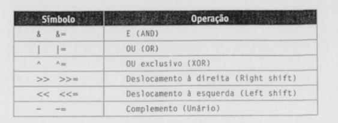
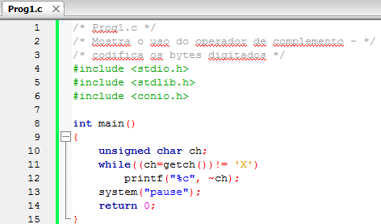
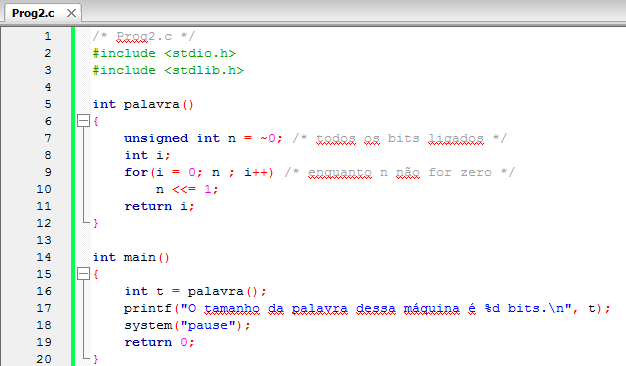
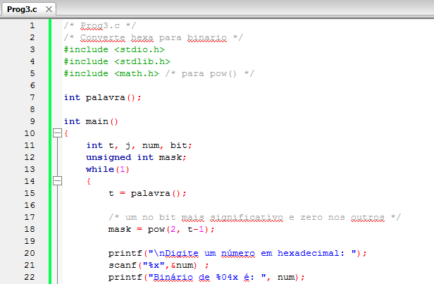
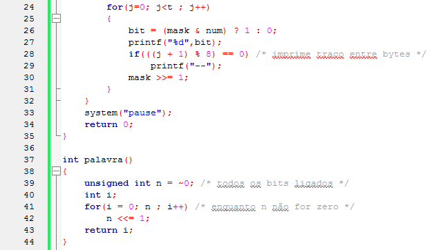
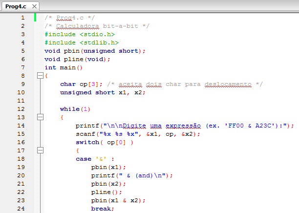
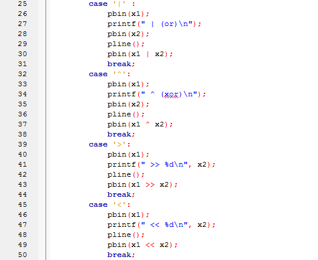
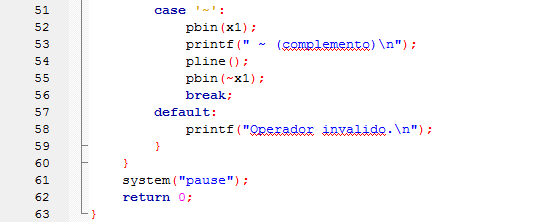
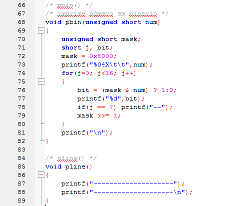

# Aula 9 — Operadores bit a bit

- **Material original:** [`aulas/Aula_9.pdf`](../Aula_9.pdf) — 33 slides, “AULA 9 – PONTEIROS AVANÇADOS (NÍVEL AVANÇADO)”, 07/10/2022, *Capacitação em C – Prof. Me. Lucas Kriesel Sperotto*. Apesar do título, o conteúdo é sobre **operadores bit a bit** ([observação 8.1](#obs-9-1)).
- **Programas:** [`src/Fontes_Aula_9/`](../../src/Fontes_Aula_9/) — `Prog1.c` a `Prog4.c` (A09-P01 a A09-P04).
- **Tarefa do SIGAA:** não há tarefa transcrita para esta aula no repositório ([índice de tarefas](../../atividades/README.md)).

**Como ler este documento.** A seção 3 reproduz o PDF slide a slide, na ordem original, dentro de blocos de citação (barra cinza à esquerda). Tudo o que está fora desses blocos foi acrescentado nesta documentação: notas de transcrição (em itálico), explicações, exemplos e exercícios. Trechos curtos de código que no PDF aparecem como imagem foram transcritos como texto; capturas de programas completos são reproduzidas como figura e remetem ao fonte do repositório. Palavras grafadas de forma errada no original estão marcadas com `[sic]`; omissões de acento foram mantidas sem marcação. O rodapé repetido em todos os slides (“07/10/2022 · Capacitação em C – Prof. Me. Lucas Kriesel Sperotto · número da página”) foi omitido.

## Sumário

1. [Identificação da aula](#1-identificação-da-aula)
2. [Objetivos de aprendizagem](#2-objetivos-de-aprendizagem)
3. [Conteúdo transcrito do material original](#3-conteúdo-transcrito-do-material-original)
4. [Explicações complementares](#4-explicações-complementares)
5. [Conceitos fundamentais](#5-conceitos-fundamentais)
6. [Programas C da aula](#6-programas-c-da-aula)
7. [Exemplos de execução](#7-exemplos-de-execução)
8. [Observações técnicas](#8-observações-técnicas)
9. [Exercícios relacionados](#9-exercícios-relacionados)
10. [Referências e fontes consultadas](#10-referências-e-fontes-consultadas)

## 1. Identificação da aula

| Item | Descrição |
|---|---|
| Disciplina | FALECT-CC-011 — Algoritmos e Laboratório de Programação II (UNEMAT, Alto Araguaia), oferta 2026.2 |
| Posição no plano 2026.2 | Módulo 2 (21/09 a 25/09/2026); complementa a representação de dados das Aulas 3 e 4 |
| Ementa contemplada | Relação entre tipos e representação de dados (bits de inteiros); não há item específico da ementa para operadores bit a bit |
| Material original | `Aula_9.pdf`, 33 páginas, baseado em Mizrahi (2008) |
| Correspondência | Slides 13–30 → `Prog1.c`–`Prog4.c`; ver a [matriz de rastreabilidade](../../docs/MATRIZ_RASTREABILIDADE.md#aula-9) |
| Pré-requisito | [Aula 4](../aula-04/README.md) (campos de bits e representação) |

## 2. Objetivos de aprendizagem

Ao final da aula, o estudante deve ser capaz de:

1. converter entre binário e hexadecimal e ler valores de 16 e 32 bits nessas bases;
2. aplicar `&`, `|`, `^` e `~` para testar, ligar, desligar e inverter bits específicos;
3. usar deslocamentos (`<<`, `>>`) e relacioná-los com multiplicação e divisão por potências de 2, conhecendo seus limites;
4. explicar o efeito das promoções inteiras em operações com `char` e `unsigned short`;
5. imprimir um inteiro em binário com uma máscara deslocada.

## 3. Conteúdo transcrito do material original

### 3.1 Capa e roteiro (slides 1–2)

<a id="slide-1"></a>
**Slide 1 — Capa**

> ALGORITMO E LABORATÓRIO DE PROGRAMAÇÃO II
>
> AULA 9 – PONTEIROS AVANÇADOS (NÍVEL AVANÇADO)
>
> 07/10/2022 · Capacitação em C – Prof. Me. Lucas Kriesel Sperotto

*Nota de transcrição:* o título “Ponteiros avançados” não corresponde ao conteúdo, que trata de operadores bit a bit; ver [observação 8.1](#obs-9-1).

<a id="slide-2"></a>
**Slide 2 — Roteiro**

> - Os operadores bit-a-bit
> - O operador and: & e &=
> - O operador or: | e |=
> - O operador xor: ^ e ^=
> - O operador unário de complemento: \~ e \~=
> - O operador shift esquerdo: << e <<=
> - O operador shift direito: >> e >>=
> - A calculadora bit-a-bit

### 3.2 Os operadores bit a bit (slides 3–5)

<a id="slide-3"></a>
**Slide 3 — Os operadores bit-a-bit**

> - Vários programas precisam manipular bits individuais dentro de um byte.
> - Quando mostramos os tipos de dados básicos de C, não fizemos nenhuma observação sobre como olhar dentro desses dados para saber como eles são construídos em bits individuais e como podem ser manipulados.

<a id="slide-4"></a>
**Slide 4 — Os operadores bit-a-bit**

> - Ser capaz de operar no nível dos bits é especialmente importante quando o programa deve atuar diretamente no hardware da máquina.
> - A linguagem C oferece seis operadores bit-a-bit, que permitem operar em bits individuais de variáveis do tipo char ou int.
> - São eles:

*Nota de transcrição:* os operadores bit a bit se aplicam a qualquer tipo inteiro, não apenas a `char` e `int`; ver [observação 8.2](#obs-9-2).

<a id="slide-5"></a>
**Slide 5 — Os operadores bit-a-bit**

> - São eles:
>
> | Símbolo | Operação |
> |---|---|
> | `&` `&=` | E (AND) |
> | `\|` `\|=` | OU (OR) |
> | `^` `^=` | OU exclusivo (XOR) |
> | `>>` `>>=` | Deslocamento à direita (Right shift) |
> | `<<` `<<=` | Deslocamento à esquerda (Left shift) |
> | `~` `~=` | Complemento (Unário) |
>
> - Os operadores bit-a-bit operam somente com valores inteiros.

<details><summary>Imagem original (tabela, slide 5)</summary>



</details>

*Nota de transcrição:* a última linha lista `~=`, que não existe em C; ver [observação 8.3](#obs-9-3).

### 3.3 O operador and: & e &= (slides 6–7)

<a id="slide-6"></a>
**Slide 6 — Roteiro** · *repete o roteiro do [slide 2](#slide-2), sem destaque do tópico seguinte.*

<a id="slide-7"></a>
**Slide 7 — O operador and: & e &=**

> - É um operador binário que executa um AND com cada par de bits dos operandos.
> - Cada bit do resultado é 1 somente quando os dois operandos são 1; em qualquer outra situação, o resultado é 0;
>
>   ```c
>   unsigned short x=5;   /* 00000000 00000101 */
>   unsigned short y=9;   /* 00000000 00001001 */
>                         /*------------------- */
>   unsigned short z=x&y; /* 00000000 00000001 */
>   ```

### 3.4 O operador or: | e |= (slides 8–9)

<a id="slide-8"></a>
**Slide 8 — Roteiro** · *repete o roteiro do [slide 2](#slide-2), sem destaque do tópico seguinte.*

<a id="slide-9"></a>
**Slide 9 — O operador or: | e |=**

> - Trata-se de um operador binário que executa um OR com cada par de bits dos operandos.
> - Cada bit do resultado é 0 somente quando os dois bits operandos são 0; em qualquer outra situação, o resultado é 1.
>
>   ```c
>   unsigned short x=5;     /* 00000000 00000101 */
>   unsigned short y=9;     /* 00000000 00001001 */
>                           /*------------------- */
>   unsigned short z=x | y; /* 00000000 00001101 */
>   ```

### 3.5 O operador xor: ^ e ^= (slides 10–11)

<a id="slide-10"></a>
**Slide 10 — Roteiro** · *repete o roteiro do [slide 2](#slide-2), sem destaque do tópico seguinte.*

<a id="slide-11"></a>
**Slide 11 — O operador xor: ^ e ^=**

> - É um operador binário que executa um XOR com cada par de bits dos operandos.
> - Cada bit do resultado é 1 somente quando os dois bits operandos são diferentes; quando são iguais, o resultado é 0.
>
>   ```c
>   unsigned short x=5;   /* 00000000 00000101 */
>   unsigned short y=9;   /* 00000000 00001001 */
>                         /*------------------- */
>   unsigned short z=x^y; /* 00000000 00001100 */
>   ```

### 3.6 O operador unário de complemento: ~ e ~= (slides 12–14)

<a id="slide-12"></a>
**Slide 12 — Roteiro** · *repete o roteiro do [slide 2](#slide-2), sem destaque do tópico seguinte.*

<a id="slide-13"></a>
**Slide 13 — O operador unário de complemento: \~ e \~=**

> - O operador de complemento opera um único operando; resulta um valor com todos os bits invertidos (todo bit 0 passa para 1 e todo bit 1 passa para 0).
> - A aplicação do operador \~ duas vezes no mesmo operando resulta sempre o número original.
> - Para mostrar o uso do operador \~ vamos escrever um programa que cria um teclado de caracteres gráficos.

*Nota de transcrição:* não existe o operador `~=` (o complemento é unário); ver [observação 8.3](#obs-9-3).

<a id="slide-14"></a>
**Slide 14 — O operador unário de complemento: \~ e \~=**

> 

*Figura:* captura do editor com `Prog1.c` (**A09-P01**), linhas 1–15 da versão histórica do programa. Fonte revisado: [`src/Fontes_Aula_9/Prog1.c`](../../src/Fontes_Aula_9/Prog1.c); versão anterior à revisão de 2026 em texto: [commit `04ac409`](https://github.com/Lucas-Sperotto/falect-cc-011-algoritmos-e-laboratorio-de-programacao-ii/blob/04ac4094dba3c3812809dd433a7d3855c4bffdc9/src/Fontes_Aula_9/Prog1.c); explicação: [seção 6](#a09-p01). A captura usa `getch()` de `conio.h` e imprime `~ch` com `%c`; ver [observação 8.4](#obs-9-4).

### 3.7 O operador shift esquerdo: << e <<= (slides 15–18)

<a id="slide-15"></a>
**Slide 15 — Roteiro** · *repete o roteiro do [slide 2](#slide-2), sem destaque do tópico seguinte.*

<a id="slide-16"></a>
**Slide 16 — O operador shift esquerdo: << e <<=**

> - Trata-se de um operador binário, mas que age somente no operando da esquerda.
> - Executa um deslocamento para a esquerda, conforme o número de posições especificado no segundo operando.
>
>   ```c
>   unsigned short x=5;      /* 00000000 00000101 */
>                            /*------------------- */
>   unsigned short z=x<<1;   /* 00000000 00001010 */
>   ```
>
> - Toda vez que empurramos um bit à esquerda multiplicamos o número por 2.
>
>   ```c
>   x <<= 1;  /* É a mesma coisa que x *= 2; */
>   x <<= 2;  /* É a mesma coisa que x *= 4; */
>   ```

*Nota de transcrição:* o operando da direita indica quantas posições deslocar; a equivalência com a multiplicação por 2 vale enquanto o resultado couber no tipo. Ver [seção 4.4](#c-9-4) e [observação 8.5](#obs-9-5).

<a id="slide-17"></a>
**Slide 17 — O operador shift esquerdo: << e <<=**

> - Para exemplificar o uso desse operador, vamos escrever uma função que retorna o tamanho da palavra da máquina em que o programa estiver sendo executado.

*Nota de transcrição:* a função mede a largura de `unsigned int`, que não é necessariamente a “palavra da máquina”; ver [observação 8.6](#obs-9-6).

<a id="slide-18"></a>
**Slide 18 — O operador shift esquerdo: << e <<=**

> 

*Figura:* captura do editor com `Prog2.c` (**A09-P02**), linhas 1–20 da versão histórica do programa. Fonte revisado: [`src/Fontes_Aula_9/Prog2.c`](../../src/Fontes_Aula_9/Prog2.c); versão anterior à revisão de 2026 em texto: [commit `04ac409`](https://github.com/Lucas-Sperotto/falect-cc-011-algoritmos-e-laboratorio-de-programacao-ii/blob/04ac4094dba3c3812809dd433a7d3855c4bffdc9/src/Fontes_Aula_9/Prog2.c); explicação: [seção 6](#a09-p02).

### 3.8 O operador shift direito: >> e >>= (slides 19–24)

<a id="slide-19"></a>
**Slide 19 — Roteiro** · *repete o roteiro do [slide 2](#slide-2), sem destaque do tópico seguinte.*

<a id="slide-20"></a>
**Slide 20 — O operador shift direito: >> e >>=**

> - É um operador binário, mas que age somente no operando da esquerda.
> - Executa um deslocamento para a direita, conforme o número de posições especificado no segundo operando.
>
>   ```c
>   unsigned short x=5;      /* 00000000 00000101 */
>                            /*------------------- */
>   unsigned short z= x>>1;  /* 00000000 00000010 */
>   ```
>
> - Toda vez que empurramos um bit à direita estaremos dividindo o número por 2.
>
>   ```c
>   x >>= 1; /* É a mesma coisa que x /= 2; */
>
>   x >>= 2; /* É a mesma coisa que x /= 4; */
>   ```

*Nota de transcrição:* a equivalência com a divisão por 2 vale para valores sem sinal ou não negativos; ver [seção 4.4](#c-9-4).

<a id="slide-21"></a>
**Slide 21 — O operador shift direito: >> e >>=**

> - Para exemplificar o uso desse operador, vamos escrever um programa que pede a entrada de um número em hexadecimal e o converte para binário.

<a id="slide-22"></a>
**Slide 22 — O operador shift direito: >> e >>=**

> 

*Figura:* captura do editor com `Prog3.c` (**A09-P03**), linhas 1–22 da versão histórica do programa. Fonte revisado: [`src/Fontes_Aula_9/Prog3.c`](../../src/Fontes_Aula_9/Prog3.c); versão anterior à revisão de 2026 em texto: [commit `04ac409`](https://github.com/Lucas-Sperotto/falect-cc-011-algoritmos-e-laboratorio-de-programacao-ii/blob/04ac4094dba3c3812809dd433a7d3855c4bffdc9/src/Fontes_Aula_9/Prog3.c); explicação: [seção 6](#a09-p03). A máscara é calculada com `pow(2, t-1)` e o número é lido com `scanf("%x",&num)` em uma variável `int`; ver [observação 8.7](#obs-9-7).

<a id="slide-23"></a>
**Slide 23 — O operador shift direito: >> e >>=**

> 

*Figura:* continuação de `Prog3.c` (**A09-P03**), linhas 24–44.

<a id="slide-24"></a>
**Slide 24 — A calculadora bit-a-bit**

> - A variável mask tem o tamanho da palavra da maquina.
> - Usamos a função de biblioteca pow() para criar uma máscara de um único bit ligado, aquele mais significativo.
> - O número será impresso a partir do bit mais significativo até o bit zero.
> - A cada iteração, deslocamos o bit ligado de mask uma posição à direita, e o processo de teste e impressão é repetido para o próximo bit.

*Nota de transcrição:* este slide explica a conversão para binário de `Prog3.c` (slides 21–23), mas traz o título da seção seguinte; o roteiro do slide 25 só depois anuncia a calculadora.

### 3.9 A calculadora bit a bit (slides 25–32)

<a id="slide-25"></a>
**Slide 25 — Roteiro** · *repete o roteiro do [slide 2](#slide-2), sem destaque do tópico seguinte.*

<a id="slide-26"></a>
**Slide 26 — A calculadora bit-a-bit**

> - O programa seguinte funciona como uma calculadora bit-a-bit, na qual você digita qualquer expressão simples envolvendo um operador bit-a-bit e ele imprime o resultado.

<a id="slide-27"></a>
**Slide 27 — A calculadora bit-a-bit**

> 

*Figura:* captura do editor com `Prog4.c` (**A09-P04**), linhas 1–24 da versão histórica do programa. Fonte revisado: [`src/Fontes_Aula_9/Prog4.c`](../../src/Fontes_Aula_9/Prog4.c); versão anterior à revisão de 2026 em texto: [commit `04ac409`](https://github.com/Lucas-Sperotto/falect-cc-011-algoritmos-e-laboratorio-de-programacao-ii/blob/04ac4094dba3c3812809dd433a7d3855c4bffdc9/src/Fontes_Aula_9/Prog4.c); explicação: [seção 6](#a09-p04). A leitura `scanf("%x %s %x", &x1, op, &x2);` usa `%x` com variáveis `unsigned short` e `%s` sem limite; ver [observação 8.8](#obs-9-8).

<a id="slide-28"></a>
**Slide 28 — A calculadora bit-a-bit**

> 

*Figura:* continuação de `Prog4.c` (**A09-P04**), linhas 25–50.

<a id="slide-29"></a>
**Slide 29 — A calculadora bit-a-bit**

> 

*Figura:* continuação de `Prog4.c` (**A09-P04**), linhas 51–63.

<a id="slide-30"></a>
**Slide 30 — A calculadora bit-a-bit**

> 

*Figura:* continuação de `Prog4.c` (**A09-P04**), linhas 66–89.

<a id="slide-31"></a>
**Slide 31 — A calculadora bit-a-bit**

> - O programa consiste , principalmente em um comando switch que contém todos os operadores bit-a-bit.
> - O usuário fornece um operando em hexadecimal, um operador bit-a-bit e um outro operando, e o programa imprime o resultado.

<a id="slide-32"></a>
**Slide 32 — A calculadora bit-a-bit**

> - A única irregularidade é com o operador de complemento, que é unário, e o programa solicita um segundo operando para satisfazer a função scanf() (qualquer número pode ser digitado).

*Nota de transcrição:* no fonte revisado, o complemento continua exigindo um segundo operando fictício: a entrada é escrita como `FFFF ~ 0` ([seção 6](#a09-p04)).

### 3.10 Referências do material original (slide 33)

<a id="slide-33"></a>
**Slide 33 — Referências**

> - MIZRAHI, Victorine V. Treinamento em Linguagem C, São Paulo: Pearson Prentice Hall, 2008;

## 4. Explicações complementares

<a id="c-9-1"></a>
### 4.1 Binário e hexadecimal

Cada dígito hexadecimal corresponde a exatamente 4 bits, por isso o hexadecimal é a forma usual de escrever padrões de bits:

| Hexa | 0 | 1 | 2 | 3 | 4 | 5 | 6 | 7 | 8 | 9 | A | B | C | D | E | F |
|---|---|---|---|---|---|---|---|---|---|---|---|---|---|---|---|---|
| Binário | 0000 | 0001 | 0010 | 0011 | 0100 | 0101 | 0110 | 0111 | 1000 | 1001 | 1010 | 1011 | 1100 | 1101 | 1110 | 1111 |

Assim, `0xA23C` = `1010 0010 0011 1100`, e o valor `0x8B41` da [Aula 3](../aula-03/README.md#c-3-9) se lê `1000 1011 0100 0001`. Em C, constantes hexadecimais começam com `0x`; `printf` usa `%x` ou `%X`, e `scanf`/`strtoul` leem hexadecimal com `%x` ou base 16.

<a id="c-9-2"></a>
### 4.2 Tabelas-verdade e usos típicos

| `a` | `b` | `a & b` | `a \| b` | `a ^ b` | `~a` |
|---|---|---|---|---|---|
| 0 | 0 | 0 | 0 | 0 | 1 |
| 0 | 1 | 0 | 1 | 1 | 1 |
| 1 | 0 | 0 | 1 | 1 | 0 |
| 1 | 1 | 1 | 1 | 0 | 0 |

As operações são aplicadas a cada posição de bit, independentemente das demais. Com uma **máscara** `m = 1u << k` (só o bit `k` ligado):

| Objetivo | Expressão | Ideia |
|---|---|---|
| testar o bit `k` | `(x & m) != 0` | o E zera todos os outros bits |
| ligar o bit `k` | `x \|= m` | OU com 1 liga |
| desligar o bit `k` | `x &= ~m` | E com 0 desliga |
| inverter o bit `k` | `x ^= m` | OU exclusivo com 1 inverte |
| extrair os 4 bits baixos | `x & 0xFu` | máscara de vários bits |

Não confunda com os operadores **lógicos** `&&`, `||` e `!`, que tratam o valor inteiro como verdadeiro ou falso e devolvem 0 ou 1: `5 & 2` vale 0, mas `5 && 2` vale 1.

<a id="c-9-3"></a>
### 4.3 Promoções inteiras: por que os fontes fazem conversões

Antes de uma operação aritmética ou bit a bit, valores de tipos menores que `int` (`char`, `short` e suas versões sem sinal) são convertidos para `int` (§6.3.1.1). Consequências:

- em `Prog1.c`, `~ch` com `ch = 'A'` (0x41) é calculado em `int` e vale `0xFFFFFFBE`; o fonte revisado converte o resultado para `unsigned char` (0xBE) antes de `putchar`;
- em `Prog4.c`, `~x1` com `x1 = 0xFFFF` dá `0xFFFF0000` em `int` (32 bits), e não `0x0000`; por isso o resultado é convertido de volta para `unsigned short` antes de imprimir os 16 bits.

Para manipular bits, prefira tipos **sem sinal** (`unsigned int`, `uint16_t`, `uint32_t` de `<stdint.h>`): o resultado das operações é definido para todos os valores.

<a id="c-9-4"></a>
### 4.4 Deslocamentos

Para `x` sem sinal de $n$ bits:

$$x \ll k = (x \cdot 2^k) \bmod 2^n, \qquad x \gg k = \left\lfloor \frac{x}{2^k} \right\rfloor .$$

Os bits que saem por um lado são descartados; do outro lado entram zeros. As regras do padrão (§6.5.7):

| Situação | Resultado |
|---|---|
| `k` negativo ou `k` ≥ largura do tipo (após promoção) | comportamento indefinido |
| `<<` em valor com sinal negativo, ou que não caiba no tipo | comportamento indefinido |
| `>>` em valor com sinal negativo | definido pela implementação (o GCC replica o bit de sinal) |
| operandos sem sinal com `0 ≤ k < largura` | sempre definido |

Por isso `Prog4.c` aceita deslocamentos de 0 a 15 (a saída tem 16 bits), e a frase dos slides 16 e 20 (“multiplicamos o número por 2”, “dividindo o número por 2”) vale para valores sem sinal e sem perda de bits.

<a id="c-9-5"></a>
### 4.5 Como `Prog2.c` mede a largura de `unsigned int`

`n = ~0u` liga todos os bits. Cada `n <<= 1` empurra um zero pela direita e descarta um bit à esquerda; depois de tantas iterações quantos forem os bits, `n` vale 0. A contagem é a largura de `unsigned int`: 32 no GCC para x86-64, mesmo sendo uma máquina de 64 bits. A mesma informação se obtém com `CHAR_BIT * sizeof(unsigned int)` (supondo, como em todas as plataformas comuns, que não há bits de preenchimento) e, no C23, com `UINT_WIDTH`.

<a id="c-9-6"></a>
### 4.6 Imprimir em binário com uma máscara

`Prog3.c` e a função `pbin()` de `Prog4.c` usam a mesma técnica: a máscara começa com o bit mais significativo ligado e é deslocada uma posição para a direita a cada iteração; o E com o número diz se o bit correspondente vale 0 ou 1. Para `0x00FF` em 16 bits:

| Iteração `j` | Máscara | `num & mascara` | Dígito impresso |
|---:|---|---|---|
| 0 | `1000 0000 0000 0000` | 0 | 0 |
| 7 | `0000 0001 0000 0000` | 0 | 0 |
| 8 | `0000 0000 1000 0000` | ≠ 0 | 1 |
| 15 | `0000 0000 0000 0001` | ≠ 0 | 1 |

A versão original de `Prog3.c` criava a máscara com `pow(2, t-1)`, um cálculo em ponto flutuante; a revisada usa `1U << (t - 1)`, exato e sem depender da biblioteca matemática.

## 5. Conceitos fundamentais

| Conceito | Definição operacional | Onde aparece |
|---|---|---|
| Operador bit a bit | Aplica uma operação lógica a cada posição de bit | slides 3–5 |
| E (`&`) | Bit 1 só quando os dois bits são 1; usado para testar e limpar | slide 7 |
| OU (`\|`) | Bit 0 só quando os dois são 0; usado para ligar bits | slide 9 |
| OU exclusivo (`^`) | Bit 1 quando os bits diferem; usado para inverter | slide 11 |
| Complemento (`~`) | Inverte todos os bits do operando (após promoção) | slides 13–14 |
| Deslocamento (`<<`, `>>`) | Move os bits `k` posições, descartando os que saem | slides 16–23 |
| Máscara | Valor com bits escolhidos ligados, usado com `&`, `\|`, `^` | slides 22–24, 30 |
| Promoção inteira | Conversão de tipos menores que `int` antes da operação | [4.3](#c-9-3) |
| Largura de um tipo | Número de bits de valor (32 para `unsigned int` no GCC x86-64) | slides 17–18 |

## 6. Programas C da aula

Fontes em [`src/Fontes_Aula_9/`](../../src/Fontes_Aula_9/), revisados em 2026 ([revisão por fonte](../../docs/auditorias/REVISAO_POR_FONTE.md#aulas-9-a-11--srcfontes_aula_9-e-srcfontes_aula_10_e_11)). Os quatro programas trocaram `conio.h` pela entrada padrão (com confirmação por ENTER) e passaram a validar as leituras. Compile com `bash script.sh --source src/Fontes_Aula_9/Prog4.c` (acrescente `--executar` para rodar os cenários revisados).

| ID | Arquivo | SIGAA | Slides | Tema |
|---|---|---|---|---|
| [A09-P01](#a09-p01) | [`Prog1.c`](../../src/Fontes_Aula_9/Prog1.c) | — | 13–14 | complemento dos bytes digitados |
| [A09-P02](#a09-p02) | [`Prog2.c`](../../src/Fontes_Aula_9/Prog2.c) | — | 17–18 | largura de `unsigned int` |
| [A09-P03](#a09-p03) | [`Prog3.c`](../../src/Fontes_Aula_9/Prog3.c) | — | 21–24 | hexadecimal para binário |
| [A09-P04](#a09-p04) | [`Prog4.c`](../../src/Fontes_Aula_9/Prog4.c) | — | 26–32 | calculadora bit a bit de 16 bits |

<a id="a09-p01"></a>
### 6.1 A09-P01 — `Prog1.c`: complemento dos bytes digitados

- **Finalidade:** “codificar” o texto digitado, imprimindo o complemento de cada byte, até ler `X` ou o fim da entrada.
- **Entrada:** texto. **Saída:** um byte (`~ch`) para cada byte lido.
- **Conceitos:** operador `~`, promoção para `int`, conversão para `unsigned char` ([4.3](#c-9-3)).
- **Diferença em relação ao slide 14:** `getch()` (sem eco e sem ENTER) virou `getchar()`, guardado em `int` para distinguir `EOF`; erros de leitura e escrita definem o código de saída.
- **Observação:** os bytes produzidos para texto ASCII ficam entre 0x80 e 0xFF. Na página de código 437 do DOS eles eram “caracteres gráficos”; em um terminal UTF-8, bytes isolados nessa faixa são inválidos, por isso o exemplo 7.1 mostra a saída em hexadecimal.

<!-- codigo: src/Fontes_Aula_9/Prog1.c de=`int ch;` ate=`return 1;` -->
<sub>Copiado de [`src/Fontes_Aula_9/Prog1.c`](../../src/Fontes_Aula_9/Prog1.c#L12-L16) (linhas 12–16) por `scripts/documentacao_aulas.py`; não edite este bloco à mão.</sub>

```c
    int ch;
    /* getchar() permite distinguir todos os bytes de EOF; conio.h era Windows. */
    while ((ch = getchar()) != EOF && ch != 'X')
        if (putchar((unsigned char)~(unsigned char)ch) == EOF)
            return 1;
```
<!-- /codigo -->

<a id="a09-p02"></a>
### 6.2 A09-P02 — `Prog2.c`: largura de `unsigned int`

- **Finalidade:** contar os bits de `unsigned int` por deslocamentos ([4.5](#c-9-5)). **Entrada:** nenhuma. **Saída:** `O tamanho de unsigned int nessa máquina é 32 bits.` no GCC x86-64.
- **Diferença em relação ao slide 18:** a mensagem passou a dizer “unsigned int” em vez de “palavra dessa máquina” ([8.6](#obs-9-6)).

<!-- codigo: src/Fontes_Aula_9/Prog2.c funcao=palavra -->
<sub>Copiado de [`src/Fontes_Aula_9/Prog2.c`](../../src/Fontes_Aula_9/Prog2.c#L10-L17) (linhas 10–17) por `scripts/documentacao_aulas.py`; não edite este bloco à mão.</sub>

```c
int palavra(void)
{
    unsigned int n = ~0; /* todos os bits ligados */
    int i;
    for(i = 0; n ; i++) /* enquanto n não for zero */
        n <<= 1;
    return i;
}
```
<!-- /codigo -->

<a id="a09-p03"></a>
### 6.3 A09-P03 — `Prog3.c`: hexadecimal para binário

- **Finalidade:** ler números em hexadecimal e imprimi-los em binário, com `--` entre os bytes. **Entrada:** um número por linha, até o fim da entrada. **Saída:** os 32 bits de cada número.
- **Diferença em relação aos slides 22–23:** leitura por linha convertida com `strtoul` (recusa texto inválido, sinal negativo e valores acima de `UINT_MAX`); máscara `1U << (t - 1)` no lugar de `pow`; o laço termina no fim da entrada ([8.7](#obs-9-7)).

<!-- codigo: src/Fontes_Aula_9/Prog3.c de=`mask = 1U << (t - 1);` ate=`mask >>= 1;` -->
<sub>Copiado de [`src/Fontes_Aula_9/Prog3.c`](../../src/Fontes_Aula_9/Prog3.c#L34-L39) (linhas 34–39) por `scripts/documentacao_aulas.py`; não edite este bloco à mão.</sub>

```c
        mask = 1U << (t - 1);
        printf("Binário de %04x é: ", num);
        for (int j = 0; j < t; j++) {
            printf("%d", (mask & num) ? 1 : 0);
            if ((j + 1) % 8 == 0) printf("--");
            mask >>= 1;
```
<!-- /codigo -->

<a id="a09-p04"></a>
### 6.4 A09-P04 — `Prog4.c`: calculadora bit a bit

- **Finalidade:** ler expressões como `FF00 & A23C` e mostrar operandos e resultado em binário.
- **Entrada:** uma expressão por linha, no formato `operando operador operando`, com operandos hexadecimais de até 16 bits. Operadores: `&`, `|`, `^`, `<<`, `>>` (deslocamento de 0 a 15) e `~`. Como no original, o complemento exige um segundo operando, ignorado: `FFFF ~ 0`.
- **Saída:** para cada expressão, os operandos e o resultado em hexadecimal e binário (16 bits, com `--` entre os bytes).
- **Diferença em relação aos slides 27–30:** a leitura com `scanf("%x %s %x", ...)` (tipos incompatíveis e `%s` sem limite) foi substituída por uma linha lida com `ler_linha`, separada com `sscanf` limitado e convertida com `strtoul`; operandos acima de `FFFF`, operadores desconhecidos e deslocamentos fora de 0–15 encerram com código 1 ([8.8](#obs-9-8)). O resultado de `~` é convertido para `unsigned short` ([4.3](#c-9-3)).

<!-- codigo: src/Fontes_Aula_9/Prog4.c funcao=pbin -->
<sub>Copiado de [`src/Fontes_Aula_9/Prog4.c`](../../src/Fontes_Aula_9/Prog4.c#L65-L75) (linhas 65–75) por `scripts/documentacao_aulas.py`; não edite este bloco à mão.</sub>

```c
void pbin(unsigned short num)
{
    unsigned short mask = 0x8000;
    printf("%04X\t\t", (unsigned int)num);
    for (int j = 0; j < 16; j++) {
        printf("%d", (mask & num) ? 1 : 0);
        if (j == 7) printf("--");
        mask >>= 1;
    }
    printf("\n");
}
```
<!-- /codigo -->

## 7. Exemplos de execução

### 7.1 Complemento de bytes (`Prog1.c`)

A entrada `AX` faz o programa complementar `A` (0x41 → 0xBE) e parar no `X`.

<!-- execucao: src/Fontes_Aula_9/Prog1.c cenario=complemento -->
Execução real do cenário revisado `complemento` ([manifesto](../../scripts/cenarios_fontes_c.json)), compilado com `gcc -std=c11 -Wall -Wextra -Wpedantic -O0`; bloco gerado por `scripts/documentacao_aulas.py`.

Comando: `./Prog1`

Entrada padrão (sem quebra de linha final):

```text
AX
```

Saída padrão (bytes que não são UTF-8 válido, exibidos em hexadecimal):

```text
00000000  be                                               |.|
```

Código de saída: `0`.
<!-- /execucao -->

### 7.2 Largura de `unsigned int` (`Prog2.c`)

<!-- execucao: src/Fontes_Aula_9/Prog2.c cenario=tamanho-unsigned -->
Execução real do cenário revisado `tamanho-unsigned` ([manifesto](../../scripts/cenarios_fontes_c.json)), compilado com `gcc -std=c11 -Wall -Wextra -Wpedantic -O0`; bloco gerado por `scripts/documentacao_aulas.py`.

Comando: `./Prog2`

Entrada padrão: *(vazia)*

Saída padrão:

```text
O tamanho de unsigned int nessa máquina é 32 bits.
```

Código de saída: `0`.
<!-- /execucao -->

### 7.3 Hexadecimal para binário (`Prog3.c`)

<!-- execucao: src/Fontes_Aula_9/Prog3.c cenario=hex-binario -->
Execução real do cenário revisado `hex-binario` ([manifesto](../../scripts/cenarios_fontes_c.json)), compilado com `gcc -std=c11 -Wall -Wextra -Wpedantic -O0`; bloco gerado por `scripts/documentacao_aulas.py`.

Comando: `./Prog3`

Entrada padrão:

```text
ff
```

Saída padrão (sem quebra de linha final):

```text

Digite um número em hexadecimal (EOF para sair): Binário de 00ff é: 00000000--00000000--00000000--11111111--
Digite um número em hexadecimal (EOF para sair): 
```

Código de saída: `0`.
<!-- /execucao -->

### 7.4 Entrada que não é hexadecimal (`Prog3.c`)

<!-- execucao: src/Fontes_Aula_9/Prog3.c cenario=hex-invalido -->
Execução real do cenário revisado `hex-invalido` ([manifesto](../../scripts/cenarios_fontes_c.json)), compilado com `gcc -std=c11 -Wall -Wextra -Wpedantic -O0`; bloco gerado por `scripts/documentacao_aulas.py`.

Comando: `./Prog3`

Entrada padrão:

```text
invalido
```

Saída padrão (sem quebra de linha final):

```text

Digite um número em hexadecimal (EOF para sair): 
```

Código de saída: `1`.
<!-- /execucao -->

### 7.5 E bit a bit (`Prog4.c`)

<!-- execucao: src/Fontes_Aula_9/Prog4.c cenario=calculadora-and -->
Execução real do cenário revisado `calculadora-and` ([manifesto](../../scripts/cenarios_fontes_c.json)), compilado com `gcc -std=c11 -Wall -Wextra -Wpedantic -O0`; bloco gerado por `scripts/documentacao_aulas.py`.

Comando: `./Prog4`

Entrada padrão:

```text
FF00 & A23C
```

Saída padrão (sem quebra de linha final):

```text


Digite uma expressão (ex. 'FF00 & A23C'; EOF para sair): FF00		11111111--00000000
 & (and)
A23C		10100010--00111100
----------------------------------------
A200		10100010--00000000


Digite uma expressão (ex. 'FF00 & A23C'; EOF para sair): 
```

Código de saída: `0`.
<!-- /execucao -->

### 7.6 Deslocamento à esquerda (`Prog4.c`)

<!-- execucao: src/Fontes_Aula_9/Prog4.c cenario=calculadora-shift -->
Execução real do cenário revisado `calculadora-shift` ([manifesto](../../scripts/cenarios_fontes_c.json)), compilado com `gcc -std=c11 -Wall -Wextra -Wpedantic -O0`; bloco gerado por `scripts/documentacao_aulas.py`.

Comando: `./Prog4`

Entrada padrão:

```text
0001 << F
```

Saída padrão (sem quebra de linha final):

```text


Digite uma expressão (ex. 'FF00 & A23C'; EOF para sair): 0001		00000000--00000001
 << 15
----------------------------------------
8000		10000000--00000000


Digite uma expressão (ex. 'FF00 & A23C'; EOF para sair): 
```

Código de saída: `0`.
<!-- /execucao -->

### 7.7 Deslocamento fora do limite (`Prog4.c`)

<!-- execucao: src/Fontes_Aula_9/Prog4.c cenario=calculadora-shift-invalido -->
Execução real do cenário revisado `calculadora-shift-invalido` ([manifesto](../../scripts/cenarios_fontes_c.json)), compilado com `gcc -std=c11 -Wall -Wextra -Wpedantic -O0`; bloco gerado por `scripts/documentacao_aulas.py`.

Comando: `./Prog4`

Entrada padrão:

```text
0001 << 10
```

Saída padrão:

```text


Digite uma expressão (ex. 'FF00 & A23C'; EOF para sair): 0001		00000000--00000001
Deslocamento inválido (use de 0 a 15).
```

Código de saída: `1`.
<!-- /execucao -->

## 8. Observações técnicas

<a id="obs-9-1"></a>
**8.1 Título e posição da aula.** A capa anuncia “Ponteiros avançados”, mas todos os slides tratam de operadores bit a bit; provavelmente o título foi herdado de outra apresentação. O assunto não aparece explicitamente na ementa 2026.2, e não há tarefa do SIGAA transcrita para esta aula. Os registros estão no [relatório de lacunas](../../docs/auditorias/CLAUDE_AUDIT.md#lacunas).

<a id="obs-9-2"></a>
**8.2 Tipos dos operandos (slide 4).** Os seis operadores se aplicam a qualquer tipo inteiro (`char`, `short`, `int`, `long`, `long long`, com ou sem sinal), sempre depois das promoções ([4.3](#c-9-3)). Não se aplicam a `float`, `double` nem a ponteiros.

<a id="obs-9-3"></a>
**8.3 `~=` não existe (slides 2, 5 e 13).** Os operadores de atribuição composta são `&=`, `|=`, `^=`, `<<=` e `>>=` (§6.5.16.2). O complemento é unário: para complementar uma variável, escreve-se `x = ~x;`.

<a id="obs-9-4"></a>
**8.4 `Prog1.c` histórico (slides 13–14).** `getch()` é de `conio.h` (DOS/Windows). Em `printf("%c", ~ch)`, `~ch` é um `int` (promoção de `unsigned char`), convertido de volta para `unsigned char` por `%c`; o resultado era o desejado, mas por um caminho implícito. A frase “cria um teclado de caracteres gráficos” depende da página de código 437 do console do DOS ([6.1](#a09-p01)).

<a id="obs-9-5"></a>
**8.5 Deslocamentos (slides 16 e 20).** “Age somente no operando da esquerda” quer dizer que só o primeiro operando é deslocado; o segundo é a quantidade de posições. As equivalências com multiplicação e divisão por 2 valem para valores sem sinal enquanto nenhum bit significativo for descartado; deslocar por uma quantidade maior ou igual à largura do tipo é comportamento indefinido ([4.4](#c-9-4)).

<a id="obs-9-6"></a>
**8.6 “Tamanho da palavra da máquina” (slides 17–18).** A função mede a largura de `unsigned int`. Em plataformas de 64 bits comuns (Linux x86-64, Windows x64), `unsigned int` tem 32 bits, embora os registradores e ponteiros tenham 64. O fonte revisado ajustou a mensagem impressa.

<a id="obs-9-7"></a>
**8.7 `Prog3.c` histórico (slides 22–24).** A máscara `pow(2, t-1)` era calculada em `double` e convertida para `unsigned int` (exata neste caso, mas dependente da biblioteca matemática e de `-lm`); `scanf("%x", &num)` lia em uma variável `int`, quando `%x` espera `unsigned int *`; e o laço `while(1)` não tinha saída. O slide 24, que explica essa máscara, traz o título “A calculadora bit-a-bit”, da seção seguinte.

<a id="obs-9-8"></a>
**8.8 `Prog4.c` histórico (slides 27–30).** `scanf("%x %s %x", &x1, op, &x2)` usa `%x` (que espera `unsigned int *`) com variáveis `unsigned short`, gravando 4 bytes em variáveis de 2 (o correto seria `%hx`), e `%s` sem largura em `op[3]` (um operador com mais de dois caracteres transbordaria o vetor). Deslocamentos de 16 posições ou mais não eram recusados. O laço `while(1)` também não tinha saída.

## 9. Exercícios relacionados

### 9.1 Tarefa do SIGAA

Não há tarefa desta aula transcrita no repositório. Uma atividade possível é reproduzir `Prog1.c` a `Prog4.c` e, em cada um, comentar uma linha que dependa da largura dos tipos.

### 9.2 Exercícios propostos (acréscimo desta documentação)

1. **Contar bits ligados.** Escreva `int conta_bits(unsigned int x)` de duas formas: testando cada bit com uma máscara e usando `x &= x - 1` (que desliga o bit 1 mais baixo). Explique por que a segunda faz tantas iterações quantos forem os bits ligados.
2. **Potência de 2.** Mostre que `x != 0 && (x & (x - 1)) == 0` é verdadeiro exatamente quando `x` (sem sinal) é potência de 2.
3. **Conjunto de dias.** Represente os dias da semana em que uma disciplina tem aula como bits de um `unsigned char` (bit 0 = domingo). Escreva funções para incluir, retirar e testar um dia, e para imprimir os nomes dos dias do conjunto (use a tabela de nomes da [Aula 6](../aula-06/README.md#a05-08-p15)).
4. **Atributo de vídeo sem campos de bits.** Monte e desmonte a palavra `Int16Bits` da [Aula 3](../aula-03/README.md#c-3-9) com máscaras e deslocamentos, sem `struct` de campos de bits. Confira que `'A'`, cor 3, intenso, fundo 0 e piscante dão `0x8B41`.
5. **Cifra com XOR.** Aplique `^ 0x5A` a cada byte de uma linha e imprima o resultado em hexadecimal; aplique de novo e recupere o texto. Por que isso funciona, e por que não é uma criptografia segura?

## 10. Referências e fontes consultadas

- SPEROTTO, Lucas Kriesel. *Aula 9 – Ponteiros avançados (nível avançado)*. Capacitação em C, 07/10/2022. 33 slides. [`aulas/Aula_9.pdf`](../Aula_9.pdf).
- MIZRAHI, Victorine Viviane. *Treinamento em Linguagem C*. São Paulo: Pearson Prentice Hall, 2008 (referência citada no slide 33).
- ISO/IEC 9899:2011 (C11), rascunho N1570: <https://www.open-std.org/jtc1/sc22/wg14/www/docs/n1570.pdf>. Seções citadas: §6.3.1.1 (promoções inteiras), §6.5.3.3 (`~`), §6.5.7 (deslocamentos), §6.5.10–6.5.12 (`&`, `^`, `|`), §6.5.16.2 (atribuição composta), §7.22.1.4 (`strtoul`).
- cppreference.com — *Arithmetic operators* (inclui os operadores bit a bit e de deslocamento): <https://en.cppreference.com/w/c/language/operator_arithmetic>.
- WARREN, Henry S. *Hacker's Delight*. 2. ed. Addison-Wesley, 2012 (técnicas com máscaras, como `x & (x - 1)`).
- Fontes do repositório: [`src/Fontes_Aula_9/`](../../src/Fontes_Aula_9/), [cenários de teste](../../scripts/cenarios_fontes_c.json) e [revisão por fonte](../../docs/auditorias/REVISAO_POR_FONTE.md).
