# Aula 10 — Operações com arquivos (parte 1): fluxos de alto nível

- **Material original:** [`aulas/Aula_10.pdf`](../Aula_10.pdf) — 79 slides, “AULA 10 – OPERAÇÕES COM ARQUIVOS – PARTE 1 (NÍVEL AVANÇADO)”, 07/10/2022, *Capacitação em C – Prof. Me. Lucas Kriesel Sperotto*.
- **Programas:** [`src/Fontes_Aula_10_e_11/`](../../src/Fontes_Aula_10_e_11/) — `Prog1.c` a `Prog10.c` (A10-11-P01 a A10-11-P10). Os programas 11 a 20 da mesma pasta pertencem à [Aula 11](../aula-11/README.md).
- **Tarefa do SIGAA:** [Aula 10](../../atividades/aula-10.md) (Prog01–Prog10).

**Como ler este documento.** A seção 3 reproduz o PDF slide a slide, na ordem original, dentro de blocos de citação (barra cinza à esquerda). Tudo o que está fora desses blocos foi acrescentado nesta documentação: notas de transcrição (em itálico), explicações, exemplos e exercícios. Trechos curtos de código que no PDF aparecem como imagem foram transcritos como texto; capturas de programas completos são reproduzidas como figura e remetem ao fonte do repositório. Palavras grafadas de forma errada no original estão marcadas com `[sic]`; omissões de acento foram mantidas sem marcação. O rodapé repetido em todos os slides (“07/10/2022 · Capacitação em C – Prof. Me. Lucas Kriesel Sperotto · número da página”) foi omitido.

## Sumário

1. [Identificação da aula](#1-identificação-da-aula)
2. [Objetivos de aprendizagem](#2-objetivos-de-aprendizagem)
3. [Conteúdo transcrito do material original](#3-conteúdo-transcrito-do-material-original)
4. [Explicações complementares](#4-explicações-complementares)
5. [Conceitos fundamentais](#5-conceitos-fundamentais)
6. [Programas C da aula](#6-programas-c-da-aula)
7. [Exemplos de execução](#7-exemplos-de-execução)
8. [Observações técnicas](#8-observações-técnicas)
9. [Exercícios relacionados](#9-exercícios-relacionados)
10. [Referências e fontes consultadas](#10-referências-e-fontes-consultadas)

## 1. Identificação da aula

| Item | Descrição |
|---|---|
| Disciplina | FALECT-CC-011 — Algoritmos e Laboratório de Programação II (UNEMAT, Alto Araguaia), oferta 2026.2 |
| Posição no plano 2026.2 | Módulo 2 (21/09 a 25/09/2026): ponteiros e **manipulação de arquivos** |
| Ementa contemplada | Manipulação de arquivos (texto e binário) |
| Material original | `Aula_10.pdf`, 79 páginas, baseado em Mizrahi (2008) |
| Correspondência | Slides 17–73 → `Prog1.c`–`Prog10.c`; ver a [matriz de rastreabilidade](../../docs/MATRIZ_RASTREABILIDADE.md#aula-10) |
| Ambiente | Os exemplos do material foram feitos no Windows; os fontes revisados e os exemplos desta página usam GCC no Linux/WSL |

## 2. Objetivos de aprendizagem

Ao final da aula, o estudante deve ser capaz de:

1. abrir e fechar arquivos com `fopen` e `fclose`, tratando a falha de abertura;
2. ler e gravar arquivos caractere a caractere, linha a linha, com formatação e em blocos, escolhendo a função adequada a cada caso;
3. detectar corretamente o fim de arquivo (testando o valor devolvido pela leitura, e não `feof` antes dela);
4. explicar a diferença entre os modos texto e binário, e por que ela não existe no Linux;
5. reconhecer o papel do *buffer* e dos fluxos padrão `stdin`, `stdout` e `stderr`.

## 3. Conteúdo transcrito do material original

### 3.1 Capa e roteiro (slides 1–2)

<a id="slide-1"></a>
**Slide 1 — Capa**

> ALGORITMO E LABORATÓRIO DE PROGRAMAÇÃO II
>
> AULA 10 – OPERAÇÕES COM ARQUIVOS – PARTE 1 (NÍVEL AVANÇADO)
>
> 07/10/2022 · Capacitação em C – Prof. Me. Lucas Kriesel Sperotto

<a id="slide-2"></a>
**Slide 2 — Roteiro**

> - Arquivos
> - Leitura e gravação em alto-nível
> - Abrindo arquivos com fopen()
> - Gravar e ler um caractere por vez
> - A função feof()
> - Fim de arquivo e a constante EOF
> - Cuidados ao abrir o arquivo
> - Ler e gravar linha a linha
> - Ler e gravar dados formatados
> - Modos de abertura de arquivos
> - Modo texto e modo binário
> - Ler e gravar blocos de bytes
> - Os ponteiros de arquivos stdin, stdout e stderr

### 3.2 Introdução (slide 3)

<a id="slide-3"></a>
**Slide 3 — Introdução**

> - Nesta aula, você aprenderá os recursos da linguagem C para operações de leitura e gravação em discos.
> - Começaremos com uma breve descrição das funções usadas para executar essas tarefas, conhecidas como funções de io.
> - Em seguida, mostraremos como elas podem ser aplicadas a programas que necessitam manipular arquivos, com exemplo de diferentes situações.

### 3.3 Arquivos (slides 4–7)

<a id="slide-4"></a>
**Slide 4 — Roteiro** · *repete o roteiro do [slide 2](#slide-2), sem destaque do tópico seguinte.*

<a id="slide-5"></a>
**Slide 5 — Arquivos**

> - A palavra arquivo será usada para indicar um ‘fluxo de bytes’ (stream).
> - Todo lugar que tem capacidade para receber bytes da memória do computador ou transferi-los para ela recebe o nome de arquivo.
> - Como exemplos, arquivos em disco, teclado, vídeo, impressora, portas de comunicação, etc.

<a id="slide-6"></a>
**Slide 6 — Arquivos**

> - Assim, o conceito de arquivo é ampliado no sentido de considerar arquivos não somente os que existem em discos.
> - Em C, podemos trabalhar com arquivos por meio de acesso em alto-nível ou em baixo-nível.

<a id="slide-7"></a>
**Slide 7 — Arquivos**

> - O conjunto de funções que interagem com arquivos em alto-nível são bufferizadas, isto é, mantém uma área de memória para manipular os bytes antes de serem gravados ou para manipular bytes lidos antes de serem enviados ao programa.
> - As funções de acesso em baixo-nível não são bufferizadas.

*Nota de transcrição:* as funções de baixo nível não usam o *buffer* da biblioteca C, mas o sistema operacional mantém seu próprio *cache*; ver [observação 8.1](#obs-10-1) e a [Aula 11](../aula-11/README.md).

### 3.4 Leitura e gravação em alto nível (slides 8–12)

<a id="slide-8"></a>
**Slide 8 — Roteiro** · *repete o roteiro do [slide 2](#slide-2), sem destaque do tópico seguinte.*

<a id="slide-9"></a>
**Slide 9 — Leitura e Gravação em Alto-Nível**

> - Para trabalharmos com um arquivo em disco, o nosso programa e o sistema operacional devem participar conjuntamente de certas informações sobre o arquivo.
> - Em outras palavras, informações específicas sobre o arquivo devem estar presentes antes que o programa possa acessá-lo.
> - Em C, as informações necessárias são guardadas em uma estrutura do tipo FILE.

<a id="slide-10"></a>
**Slide 10 — Leitura e Gravação em Alto-Nível**

> - A definição dessa estrutura está contida no arquivo stdio.h.
> - Se você examinar seu arquivo stdio.h, provavelmente encontrará algo semelhante ao mostrado a seguir:
>
>   ```c
>   #define FOPEN_MAX    (20)
>
>   typedef struct _iobuf
>   {
>       char*   _ptr;
>       int _cnt;
>       char*   _base;
>       int _flag;
>       int _file;
>       int _charbuf;
>       int _bufsiz;
>       char*   _tmpfname;
>   } FILE;
>   ```

*Nota de transcrição:* a figura é uma captura das linhas 138–150 de um `stdio.h` aberto no editor (cabeçalho de um compilador para Windows); na glibc, `FILE` tem outra definição. Ver [observação 8.2](#obs-10-2).

<a id="slide-11"></a>
**Slide 11 — Leitura e Gravação em Alto-Nível**

> - Cada arquivo necessita de informações similares, stdio.h declara uma matriz de estruturas FILE.
> - A constante FOPEN_MAX determina a dimensão da matriz e representa o número máximo de arquivos que podem ser abertos simultaneamente por um programa.
> - O número para FOPEN_MAX depende das considerações tomadas no projeto do compilador e das restrições do sistema operacional.

*Nota de transcrição:* `FOPEN_MAX` é o número **mínimo** de arquivos que a implementação garante poder abrir simultaneamente; ver [observação 8.2](#obs-10-2).

<a id="slide-12"></a>
**Slide 12 — Leitura e Gravação em Alto-Nível**

> - Os membros da estrutura FILE contêm informações do arquivo, tais como: seu atual tamanho, a localização de seus buffers de dados, se o arquivo está sendo lido ou gravado etc.
> - O programador não deve se preocupar com o conteúdo dos membros da estrutura FILE, e sim voltar seu interesse para a abertura de um arquivo e como trabalhar com ele.

### 3.5 Abrindo arquivos com fopen() (slides 13–15)

<a id="slide-13"></a>
**Slide 13 — Roteiro** · *repete o roteiro do [slide 2](#slide-2), sem destaque do tópico seguinte.*

<a id="slide-14"></a>
**Slide 14 — Abrindo Arquivos com fopen()**

> - A função fopen() executa duas tarefas.
> - Em primeiro lugar, cria e preenche uma estrutura FILE com as informações necessárias para o programa e para o sistema operacional, de maneira que possam se comunicar.
> - Em seguida, retorna um ponteiro do tipo FILE que aponta para a localização na memória dessa estrutura criada.

<a id="slide-15"></a>
**Slide 15 — Abrindo Arquivos com fopen()**

> - Para trabalhar com arquivos em alto-nível, a linguagem C oferece um pacote de funções de biblioteca divididas em quatro grupos, a saber:
>   - Grupo 1: Gravar e ler um caractere por vez – As funções fputc() e fgetc();
>   - Grupo 2: Ler e gravar linha a linha – As funções fputs() e fgets();
>   - Grupo 3: Ler e gravar dados formatados – As funções fprintf() e fscanf();
>   - Grupo 4: Ler e gravar blocos de bytes – AS funções fwrite() e fread();

### 3.6 Gravar e ler um caractere por vez (slides 16–28)

<a id="slide-16"></a>
**Slide 16 — Roteiro** · *repete o roteiro do [slide 2](#slide-2), sem destaque do tópico seguinte.*

<a id="slide-17"></a>
**Slide 17 — Gravar e ler um caractere por vez**

> - As funções fputc() e fgetc() gravam e leem um caractere por vez.
> - São análogas às funções putc() e getc(); a única diferença é que, ao contrario daquelas, estas têm implementação como macros.
> - Nosso primeiro exemplo lê, do teclado, um caractere por vez e o grava no arquivo.

*Nota de transcrição:* o slide inverte as funções: `putc()` e `getc()` é que podem ser implementadas como macros; `fputc()` e `fgetc()` são sempre funções. Ver [observação 8.3](#obs-10-3).

<a id="slide-18"></a>
**Slide 18 — Gravar e ler um caractere por vez**

> 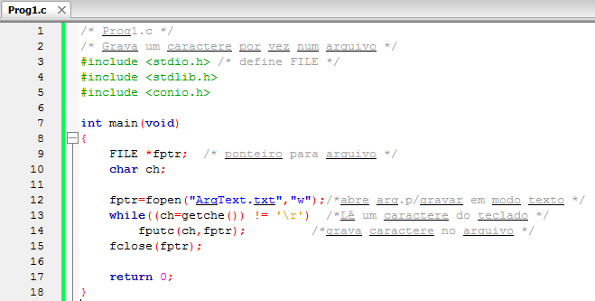

*Figura:* captura do editor com `Prog1.c` (**A10-11-P01**), linhas 1–18 da versão histórica do programa. Fonte revisado: [`src/Fontes_Aula_10_e_11/Prog1.c`](../../src/Fontes_Aula_10_e_11/Prog1.c); versão anterior à revisão de 2026 em texto: [commit `04ac409`](https://github.com/Lucas-Sperotto/falect-cc-011-algoritmos-e-laboratorio-de-programacao-ii/blob/04ac4094dba3c3812809dd433a7d3855c4bffdc9/src/Fontes_Aula_10_e_11/Prog1.c); explicação: [seção 6](#a10-11-p01). O laço lê com `getche()` até `'\r'` (ENTER no console do Windows) e não verifica se `fopen()` funcionou; ver [observação 8.4](#obs-10-4).

<a id="slide-19"></a>
**Slide 19 — Gravar e ler um caractere por vez**

> - Execute o programa e digite uma frase.
> - A leitura do teclado termina quando você pressiona a tecla ENTER.
> - A linha que você digitou será gravada no arquivo chamado arqtext.txt da pasta corrente.
> - Para verificar se o arquivo foi realmente criado, use o Bloco de Notas do Windows para ler seu conteúdo.

*Nota de transcrição:* no Linux e no WSL, use `cat ArqText.txt` para ver o conteúdo do arquivo; ver [observação 8.4](#obs-10-4).

<a id="slide-20"></a>
**Slide 20 — Gravar e ler um caractere por vez**

> - Abrindo arquivos com fopen():
>   - Para abrir um arquivo em alto-nível devemos usar a função fopen():
>
>     ```c
>     fptr=fopen("ArqText.txt","w");
>     ```
>
>   - Nosso programa cria o arquivo texto arqdest.txt para gravação (“w”).

*Nota de transcrição:* o texto cita “arqdest.txt”, mas o programa cria `ArqText.txt`; ver [observação 8.4](#obs-10-4).

<a id="slide-21"></a>
**Slide 21 — Gravar e ler um caractere por vez**

> - Gravando no arquivo com fputc():
>   - Uma vez estabelecida uma linha de comunicação com um arquivo particular por meio de sua abertura, podemos escrever nele.
>   - A função fputc() recebe dois argumentos: o caractere a ser gravado e o ponteiro para a estrutura FILE do arquivo.
>   - Ela retorna o caractere gravado ou EOF se acontecer algum erro:
>
>     ```c
>     fputc(ch,fptr);
>     ```

<a id="slide-22"></a>
**Slide 22 — Gravar e ler um caractere por vez**

> - Gravando no arquivo com fputc():
>   - O processo de gravação continua a cada interação [sic] do laço while;
>   - Toda vez que a função fputc() é executada, mais um caractere é gravado no arquivo.
>   - Quando o usuário pressionar ENTER, o laço termina.

<a id="slide-23"></a>
**Slide 23 — Gravar e ler um caractere por vez**

> - Fechando o arquivo com fclose():
>   - Quando terminamos a gravação do arquivo, precisamos fechá-lo.
>
>     ```c
>     fclose(fptr);
>     ```
>
>   - Fechar um arquivo significa, em primeiro lugar, esvaziar o seu buffer, gravando nele os caracteres remanescentes.
>   - Não falamos sobre buffer antes porque, quando se usa alto-nível, ele é invisível para o programador.

<a id="slide-24"></a>
**Slide 24 — Gravar e ler um caractere por vez**

> - Fechando o arquivo com fclose():
>   - Entretanto, o buffer é necessário, mesmo que invisível.
>   - Considere, por exemplo, quão ineficiente seria acessar o disco somente para gravar um caractere.
>   - Isto tomaria tempo para que o sistema de disco encontrasse a posição de gravação correta e, ainda, demoraria para que encontrasse o setor exato da trilha para cada caractere gravado.

<a id="slide-25"></a>
**Slide 25 — Gravar e ler um caractere por vez**

> - Fechando o arquivo com fclose():
>   - Se você digitar vários caracteres rapidamente e cada um necessitar de um acesso completo ao disco, vários deles serão, provavelmente, perdidos.
>   - Eis como o buffer funciona: quando você envia um caractere para um arquivo com fputc(), ele é armazenado, temporariamente, numa área de memória reservada para essa tarefa.
>   - Essa área de memória chama-se buffer.
>   - Quando ele estiver lotado, seu conteúdo será gravado no arquivo de uma única vez.

<a id="slide-26"></a>
**Slide 26 — Gravar e ler um caractere por vez**

> - Fechando o arquivo com fclose():
>   - Uma das razões para fechar arquivos é que, nesse momento, o programa força a gravação do buffer nele.
>   - Outra razão para fechar o arquivo é liberar as áreas de comunicação usadas, para que estejam disponíveis a outros arquivos.
>   - Essas áreas incluem a estrutura FILE e o buffer.

<a id="slide-27"></a>
**Slide 27 — Gravar e ler um caractere por vez**

> - Fechando o arquivo com fclose():
>   - Outra função que fecha arquivos é a exit().
>   - Ela difere da função fclose() em vários pontos.
>   - Primeiro, exit() fecha todos os arquivos abertos.
>   - Segundo, encerra o programa e devolve o controle ao sistema operacional.
>   - A função fclose() simplesmente fecha o arquivo associado ao ponteiro FILE enviado como argumento.

<a id="slide-28"></a>
**Slide 28 — Gravar e ler um caractere por vez**

> - Lendo o arquivo:
>   - O próximo exemplo lê, do arquivo, um caractere por vez e o imprime no vídeo.
>
>     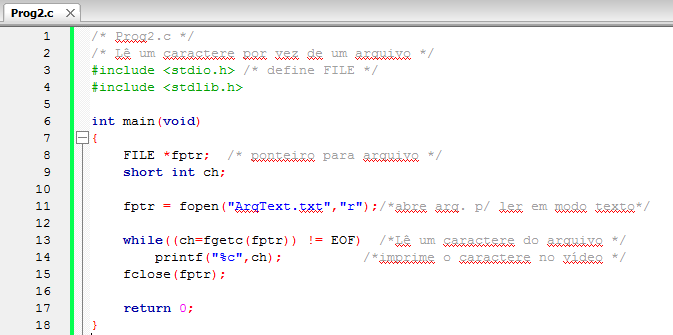

*Figura:* captura do editor com `Prog2.c` (**A10-11-P02**), linhas 1–18 da versão histórica do programa. Fonte revisado: [`src/Fontes_Aula_10_e_11/Prog2.c`](../../src/Fontes_Aula_10_e_11/Prog2.c); versão anterior à revisão de 2026 em texto: [commit `04ac409`](https://github.com/Lucas-Sperotto/falect-cc-011-algoritmos-e-laboratorio-de-programacao-ii/blob/04ac4094dba3c3812809dd433a7d3855c4bffdc9/src/Fontes_Aula_10_e_11/Prog2.c); explicação: [seção 6](#a10-11-p02).

### 3.7 A função feof() (slides 29–31)

<a id="slide-29"></a>
**Slide 29 — Roteiro** · *repete o roteiro do [slide 2](#slide-2), sem destaque do tópico seguinte.*

<a id="slide-30"></a>
**Slide 30 — A Função feof()**

> - Essa função retorna verdadeiro se o final do arquivo tiver sido atingido; caso contrário, retorna falso:
>
>   ```c
>   int feof(FILE *fp);
>   ```
>
> - Como exemplo, observe a mudança no pedaço de código do programa anterior:
>
>   ```c
>   while(!feof(fptr))
>   {
>       ch = fgetc(fptr);
>       printf("%c",ch);
>   }
>   ```

*Nota de transcrição:* este laço processa um caractere a mais depois do fim do arquivo; ver [observação 8.5](#obs-10-5).

*Nota de transcrição:* a forma correta de ler até o fim é testar o valor devolvido por `fgetc()`; `feof()` só serve para descobrir, **depois** da leitura falhar, se a causa foi o fim do arquivo. Ver [seção 4.3](#c-10-3).

<a id="slide-31"></a>
**Slide 31 — A Função feof()**

> - Abrindo arquivo para leitura:
>   - Nosso programa abre o arquivo arqtext.txt para leitura (“r”).
>
>     ```c
>     fptr = fopen("ArqText.txt","r");
>     ```
>
> - Lendo qrquivo [sic] com fgetc():
>   - A função fgetc() recebe como argumento o ponteiro para a estrutura FILE do arquivo.
>   - Retorna o caractere lido ou EOF se encontrar o fim do arquivo.
>
>     ```c
>     fgetc(fptr)
>     ```

### 3.8 Fim de arquivo e a constante EOF (slides 32–37)

<a id="slide-32"></a>
**Slide 32 — Roteiro** · *repete o roteiro do [slide 2](#slide-2), sem destaque do tópico seguinte.*

<a id="slide-33"></a>
**Slide 33 — Fim de Arquivo e a Constante EOF**

> - A maior diferença o segundo [sic] programa e o primeiro é que este deve reconhecer quando o arquivo terminou.
> - O que é EOF?
> - É importante entender que EOF não é um caractere pertencente ao arquivo e sim uma constante, do tipo short int, definida no arquivo stdio.h com valor 0xFFFF ou -1.

*Nota de transcrição:* `EOF` é uma constante inteira negativa do tipo `int` (na prática, −1); ver [observação 8.6](#obs-10-6).

<a id="slide-34"></a>
**Slide 34 — Fim de Arquivo e a Constante EOF**

> - O fim de um arquivo é reconhecido pelo sistema operacional, o Windows envia 0xFFFF aos nossos programas para avisar que o arquivo acabou.
> - Como podemos reconhecer que o arquivo terminou?
> - Se utilizarmos uma variável do tipo char para receber bytes lidos do arquivo, o caractere de código ASCII 255 decimal (0xFF), se existir dentro do arquivo, será interpretado como EOF e a leitura terminará antecipadamente.

*Nota de transcrição:* o raciocínio sobre `char` está correto, mas o fim de arquivo não é um valor “enviado” pelo Windows; ver [observação 8.6](#obs-10-6).

<a id="slide-35"></a>
**Slide 35 — Fim de Arquivo e a Constante EOF**

> - Por causa disso criamos a variável ch do tipo short int.
> - Dessa forma, não haverá confusão entre o caractere 0xFF e EOF.
> - O primeiro será armazenado em ch como 0x00FF, e o segundo, como 0xFFFF.

*Nota de transcrição:* o tipo apropriado é `int`, que é o tipo devolvido por `fgetc()`; ver [seção 4.3](#c-10-3).

<a id="slide-36"></a>
**Slide 36 — Fim de Arquivo e a Constante EOF**

> - A mensagem enviada pelo sistema operacional indicando o fim de arquivo pode ser diferente para sistemas operacionais distintos.
> - O arquivo stdio.h define EOF com o valor correto para o seu sistema operacional; assim, em seus programas, use essa constante para testar o fim de arquivo.

<a id="slide-37"></a>
**Slide 37 — Fim de Arquivo e a Constante EOF**

> - Valer-se de um número mágico (por exemplo -1), em vez de EOF, pode causar problemas se o programa for transportado para outro sistema operacional.

### 3.9 Cuidados ao abrir o arquivo (slides 38–41)

<a id="slide-38"></a>
**Slide 38 — Roteiro** · *repete o roteiro do [slide 2](#slide-2), sem destaque do tópico seguinte.*

<a id="slide-39"></a>
**Slide 39 — Cuidados Ao Abrir Arquivo**

> - Os dois programas que apresentamos têm uma falha.
> - Se o arquivo especificado em fopen() não puder ser aberto, o programa irá parar.
> - Por que um arquivo pode não ser aberto?
> - Se você tiver pedido para abrir um arquivo para gravação, é provável que não abra por não haver mais espaço no disco.
> - E se foi para leitura, talvez o arquivo não abra por ainda não ter sido criado.

*Nota de transcrição:* o programa não “para” por conta própria: sem o teste, ele usaria um ponteiro nulo; ver [observação 8.7](#obs-10-7).

<a id="slide-40"></a>
**Slide 40 — Cuidados Ao Abrir Arquivo**

> - Então, é importante que todos os programas que acessem arquivos em disco verifiquem se o arquivo foi aberto com sucesso, antes de ler ou escrever neles.
> - Se o arquivo não pôde ser aberto, a função fopen() retorna um ponteiro com o valor NULL.
> - Vamos mostrar como alterar a instrução de abertura do arquivo para testar se foi aberto com sucesso.

<a id="slide-41"></a>
**Slide 41 — Cuidados Ao Abrir Arquivo**

> 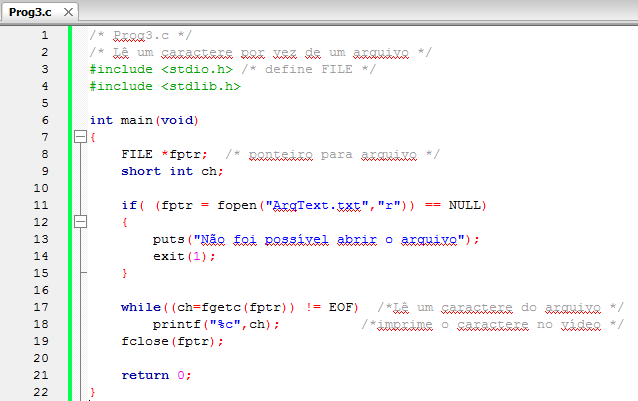

*Figura:* captura do editor com `Prog3.c` (**A10-11-P03**), linhas 1–22 da versão histórica do programa. Fonte revisado: [`src/Fontes_Aula_10_e_11/Prog3.c`](../../src/Fontes_Aula_10_e_11/Prog3.c); versão anterior à revisão de 2026 em texto: [commit `04ac409`](https://github.com/Lucas-Sperotto/falect-cc-011-algoritmos-e-laboratorio-de-programacao-ii/blob/04ac4094dba3c3812809dd433a7d3855c4bffdc9/src/Fontes_Aula_10_e_11/Prog3.c); explicação: [seção 6](#a10-11-p03).

### 3.10 Ler e gravar linha a linha (slides 42–49)

<a id="slide-42"></a>
**Slide 42 — Roteiro** · *repete o roteiro do [slide 2](#slide-2), sem destaque do tópico seguinte.*

<a id="slide-43"></a>
**Slide 43 — Ler e Gravar Linha a Linha**

> - As funções fputs() e fgets() gravam ou leem os dados linha a linha (como strings).
> - O próximo exemplo cria um arquivo texto e grava nele uma string por vez.

<a id="slide-44"></a>
**Slide 44 — Ler e Gravar Linha a Linha**

> 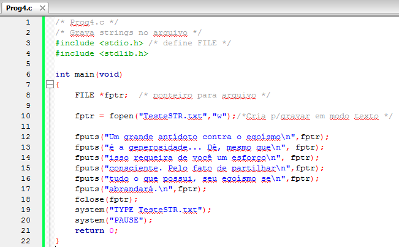

*Figura:* captura do editor com `Prog4.c` (**A10-11-P04**), linhas 1–22 da versão histórica do programa. Fonte revisado: [`src/Fontes_Aula_10_e_11/Prog4.c`](../../src/Fontes_Aula_10_e_11/Prog4.c); versão anterior à revisão de 2026 em texto: [commit `04ac409`](https://github.com/Lucas-Sperotto/falect-cc-011-algoritmos-e-laboratorio-de-programacao-ii/blob/04ac4094dba3c3812809dd433a7d3855c4bffdc9/src/Fontes_Aula_10_e_11/Prog4.c); explicação: [seção 6](#a10-11-p04).

<a id="slide-45"></a>
**Slide 45 — Ler e Gravar Linha a Linha**

> - Para verificar se o arquivo foi gravado corretamente, você pode utilizar algum processador de textos ou comando type do DOS na chamada da função system().
>
>   ```c
>   system("TYPE TesteSTR.txt");
>   ```

*Nota de transcrição:* `TYPE` é um comando do `cmd.exe`; no Linux, o equivalente é `cat`. O fonte revisado exibe o arquivo com a própria biblioteca C ([seção 6](#a10-11-p04)).

<a id="slide-46"></a>
**Slide 46 — Ler e Gravar Linha a Linha**

> - Gravando no arquivo com fputs():
>   - A função fputs() recebe dois argumentos: o ponteiro char para a cadeia de caracteres a ser gravada, e o ponteiro para a estrutura FILE do arquivo.
>   - Retorna um número positivo ou EOF se acontecer algum erro.
>
>     ```c
>     fputs("Um grande antídoto contra o egoísmo\n",fptr);
>     ```
>
>   - A função fputs() não coloca automaticamente o caractere de nova linha no fim dela.
>   - Devemos adicioná-lo explicitamente.

<a id="slide-47"></a>
**Slide 47 — Ler e Gravar Linha a Linha**

> - Lendo do arquivo:
>   - O próximo exemplo lê o arquivo testestr.txt, criado pelo programa anterior, uma linha por vez.

<a id="slide-48"></a>
**Slide 48 — Ler e Gravar Linha a Linha**

> 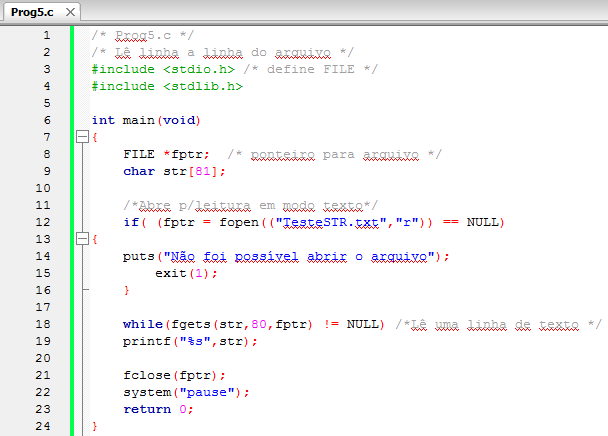

*Figura:* captura do editor com `Prog5.c` (**A10-11-P05**), linhas 1–24 da versão histórica do programa. Fonte revisado: [`src/Fontes_Aula_10_e_11/Prog5.c`](../../src/Fontes_Aula_10_e_11/Prog5.c); versão anterior à revisão de 2026 em texto: [commit `04ac409`](https://github.com/Lucas-Sperotto/falect-cc-011-algoritmos-e-laboratorio-de-programacao-ii/blob/04ac4094dba3c3812809dd433a7d3855c4bffdc9/src/Fontes_Aula_10_e_11/Prog5.c); explicação: [seção 6](#a10-11-p05). Na linha 12 da captura, `fopen(("TesteSTR.txt","r"))` tem parênteses a mais e desbalanceados, o que impede a compilação; ver [observação 8.8](#obs-10-8).

<a id="slide-49"></a>
**Slide 49 — Ler e Gravar Linha a Linha**

> - Lendo do arquivo com fgets():
>   - A função fgets recebe três argumentos: o ponteiro char para a cadeia de caracteres em que os dados lidos do arquivo serão colocados, o número máximo de caracteres a serem lidos, e o ponteiro para a estrutura FILE do arquivo.
>   - Retorna um ponteiro para a cadeia de caracteres lida ou NULL se encontrar algum erro ou o fim do arquivo.
>
>     ```c
>     fgets(str,80,fptr)
>     ```

### 3.11 Ler e gravar dados formatados (slides 50–55)

<a id="slide-50"></a>
**Slide 50 — Roteiro** · *repete o roteiro do [slide 2](#slide-2), sem destaque do tópico seguinte.*

<a id="slide-51"></a>
**Slide 51 — Ler e Gravar Dados Formatados**

> - As funções fprintf() e fscanf() gravam ou leem os dados de modo formatado.
> - Os exemplos anteriores mostraram como ler e gravar caracteres e textos em um arquivo.
> - A pergunta é: como manusear dados numéricos em arquivos em disco?
> - Para mostrar como trabalhar com dados numéricos, usaremos três itens relativos a livros de uma livraria: título (string), número de registro (inteiro) e preço (ponto flutuante)

<a id="slide-52"></a>
**Slide 52 — Ler e Gravar Dados Formatados**

> 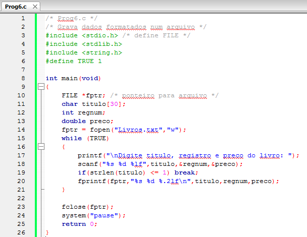

*Figura:* captura do editor com `Prog6.c` (**A10-11-P06**), linhas 1–26 da versão histórica do programa. Fonte revisado: [`src/Fontes_Aula_10_e_11/Prog6.c`](../../src/Fontes_Aula_10_e_11/Prog6.c); versão anterior à revisão de 2026 em texto: [commit `04ac409`](https://github.com/Lucas-Sperotto/falect-cc-011-algoritmos-e-laboratorio-de-programacao-ii/blob/04ac4094dba3c3812809dd433a7d3855c4bffdc9/src/Fontes_Aula_10_e_11/Prog6.c); explicação: [seção 6](#a10-11-p06).

<a id="slide-53"></a>
**Slide 53 — Ler e Gravar Dados Formatados**

> - O ponto principal desse programa é a função fprintf(), que escreve os valores das três variáveis no arquivo.
> - Essa função é similar a printf(), exceto pelo fato de que o ponteiro para file é tomado como primeiro argumento.
> - Todas as possibilidades de formato de printf() operam com fprintf().
> - As informações inseridas ao executar o código estão no arquivo livros.txt.

<a id="slide-54"></a>
**Slide 54 — Ler e Gravar Dados Formatados**

> - Lendo do arquivo:
>
>   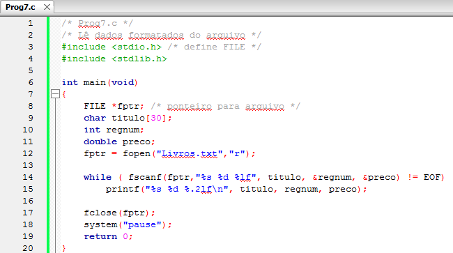

*Figura:* captura do editor com `Prog7.c` (**A10-11-P07**), linhas 1–20 da versão histórica do programa. Fonte revisado: [`src/Fontes_Aula_10_e_11/Prog7.c`](../../src/Fontes_Aula_10_e_11/Prog7.c); versão anterior à revisão de 2026 em texto: [commit `04ac409`](https://github.com/Lucas-Sperotto/falect-cc-011-algoritmos-e-laboratorio-de-programacao-ii/blob/04ac4094dba3c3812809dd433a7d3855c4bffdc9/src/Fontes_Aula_10_e_11/Prog7.c); explicação: [seção 6](#a10-11-p07). O laço termina quando `fscanf` devolve `EOF`, mas não quando converte só parte dos campos; ver [observação 8.8](#obs-10-8).

<a id="slide-55"></a>
**Slide 55 — Ler e Gravar Dados Formatados**

> - Lendo do arquivo:
>   - O programa usa a função fscanf() para ler os dados do disco.
>   - Essa função é similar à função scanf(), exceto pelo fato de que, como em printf(), um ponteiro para file deverá ser incluído como primeiro argumento.
>   - O programa imprime os dados lidos com printf().

### 3.12 Modos de abertura de arquivos (slides 56–58)

<a id="slide-56"></a>
**Slide 56 — Roteiro** · *repete o roteiro do [slide 2](#slide-2), sem destaque do tópico seguinte.*

<a id="slide-57"></a>
**Slide 57 — Modos de Abertura de Arquivos**

> | Modo | Significado |
> |---|---|
> | "r" | Abre um arquivo para leitura em modo texto. Se o arquivo não existir, a operação irá falhar e fopen() retornará NULL. |
> | "w" | Cria um arquivo em modo texto para gravação. Se o arquivo já existir, elimina seu conteúdo e recomeça a gravação a partir de seu início. |
> | "a" | Abre um arquivo em modo texto para gravação, a partir de seu final. Se o arquivo não existir, ele será criado. |
> | "r+" | Abre um arquivo em modo texto para atualização, ou seja, tanto para leitura como para gravação. Se o arquivo não existir, a operação irá falhar e fopen() retornará NULL. |
> | "w+" | Cria um arquivo em modo texto para atualização, ou seja, tanto para leitura como para gravação. Se o arquivo já existir, seu conteúdo será destruído. |
> | "a+" | Abre um arquivo em modo texto para atualização, gravando novos dados a partir do final do arquivo. Se o arquivo não existir, ele será criado. |
> | "rb" | Abre um arquivo para leitura em modo binário. Se o arquivo não existir, a operação irá falhar e fopen() retornará NULL. |

<details><summary>Imagem original (tabela, slide 57)</summary>

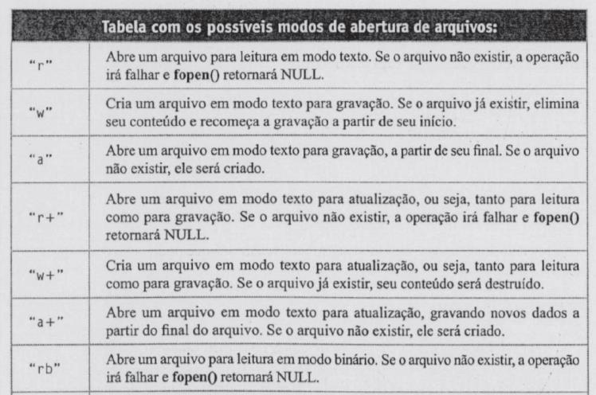

</details>

*Nota de transcrição:* a figura traz o título “Tabela com os possíveis modos de abertura de arquivos:”; a coluna “Modo” não tem cabeçalho no original.

<a id="slide-58"></a>
**Slide 58 — Modos de Abertura de Arquivos**

> | Modo | Significado |
> |---|---|
> | "rb" | Abre um arquivo para leitura em modo binário. Se o arquivo não existir, a operação irá falhar e fopen() retornará NULL. |
> | "wb" | Cria um arquivo em modo binário para gravação. Se o arquivo já existir, elimina seu conteúdo e recomeça a gravação a partir de seu início. |
> | "ab" | Abre um arquivo em modo binário para gravação, a partir de seu final. Se o arquivo não existir, será criado. |
> | "rb+" | Abre um arquivo em modo binário para atualização, ou seja, tanto para leitura como para gravação. Se o arquivo não existir, a operação irá falhar e fopen() retornará NULL. |
>
> | Modo | Significado |
> |---|---|
> | "wb+" | Cria um arquivo em modo binário para atualização, ou seja, tanto para leitura como para gravação. Se o arquivo já existir, seu conteúdo será destruído. |
> | "ab+" | Abre um arquivo em modo binário para atualização, gravando novos dados a partir do final do arquivo. Se o arquivo não existir, ele será criado. |

<details><summary>Imagem original (tabela, slide 58)</summary>

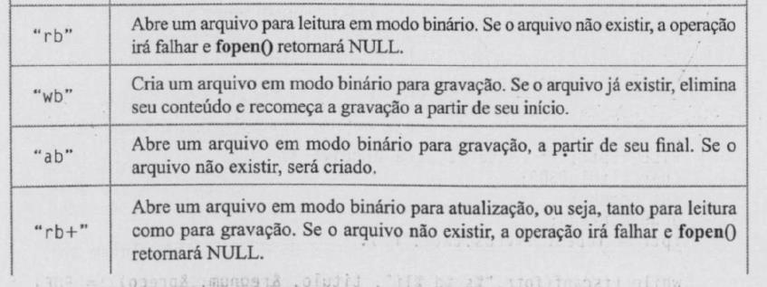

</details>

*Nota de transcrição:* a linha “rb” repete a última linha do slide 57.

<details><summary>Imagem original (tabela, slide 58)</summary>

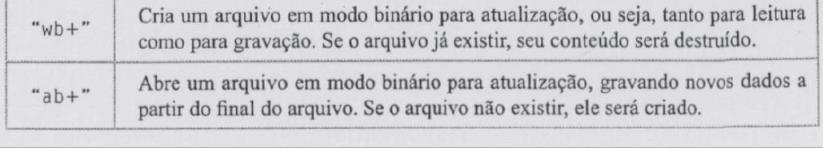

</details>

### 3.13 Modo texto e modo binário (slides 59–67)

<a id="slide-59"></a>
**Slide 59 — Roteiro** · *repete o roteiro do [slide 2](#slide-2), sem destaque do tópico seguinte.*

<a id="slide-60"></a>
**Slide 60 — Modo Texto e Modo Binário**

> - São três as diferenças de trabalhar com um arquivo em modo texto e em modo binário:
>   - O caractere \n ou \r: Em uma operação de gravação em arquivos abertos em modo texto (padrão), o caractere \n ou \r é expandido em dois bytes, carriagereturn e linefeed (\r e \n), antes de ser gravado. Em operações de leitura, o par de bytes CR/LF é convertido para um único byte \n. Se o arquivo é aberto em modo binário, não há essa conversão.

*Nota de transcrição:* no Linux não há tradução de fim de linha: os modos texto e binário são idênticos; ver [seção 4.5](#c-10-5).

<a id="slide-61"></a>
**Slide 61 — Modo Texto e Modo Binário**

>   - O caractere \x1A (Ctrl-Z): Em modo texto, é interpretado como fim do arquivo. Em modo binário, é mais um caractere pertencente ao arquivo.
>   - Números: Em modo binário podem ser gravados ou lidos exatamente como se apresentam na memória. Por exemplo, o número 25.678 é armazenado, na memória do computador, ocupando dois bytes (short int). Em modo texto, ocuparia 5 bytes e seria armazenado na forma ASCII.

*Nota de transcrição:* o Ctrl-Z como fim de arquivo é uma convenção do DOS e do Windows; e “25.678” deve ser lido como o inteiro 25678 (o ponto separa milhares). Ver [observação 8.9](#obs-10-9).

<a id="slide-62"></a>
**Slide 62 — Modo Texto e Modo Binário**

> - Para verificar essa diferença, vamos escrever um programa que conta os caracteres de um arquivo.

<a id="slide-63"></a>
**Slide 63 — Modo Texto e Modo Binário**

> 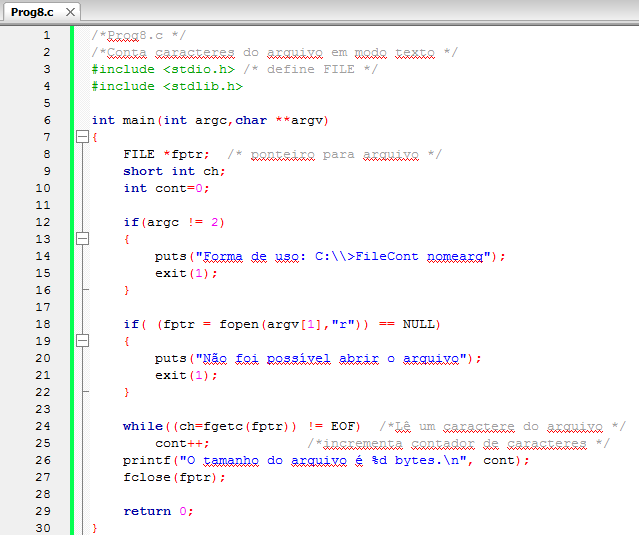

*Figura:* captura do editor com `Prog8.c` (**A10-11-P08**), linhas 1–30 da versão histórica do programa. Fonte revisado: [`src/Fontes_Aula_10_e_11/Prog8.c`](../../src/Fontes_Aula_10_e_11/Prog8.c); versão anterior à revisão de 2026 em texto: [commit `04ac409`](https://github.com/Lucas-Sperotto/falect-cc-011-algoritmos-e-laboratorio-de-programacao-ii/blob/04ac4094dba3c3812809dd433a7d3855c4bffdc9/src/Fontes_Aula_10_e_11/Prog8.c); explicação: [seção 6](#a10-11-p08).

<a id="slide-64"></a>
**Slide 64 — Modo Texto e Modo Binário**

> - Começamos verificando o número de argumentos da linha de comandos; se forem dois, então argv[1] será o nome do arquivo a ser aberto, caso contrário, o programa apresentará uma mensagem e terminará.
> - O arquivo é aberto usando o modo texto (padrão).
> - O laço while é executado, lê um caractere por vez e incrementa o contador de caracteres.

<a id="slide-65"></a>
**Slide 65 — Modo Texto e Modo Binário**

> - Finalmente, o programa imprime o número de caracteres contados.
> - Execute esse programa e depois use o comando DIR da console e compare o tamanho do arquivo apresentado pelo programa com o tamanho apresentado pelo sistema.
> - A razão dessa diferença está no tratamento do caractere /n [sic].

*Nota de transcrição:* no Linux, use `ls -l` ou `wc -c` para ver o tamanho do arquivo; os dois programas mostram o mesmo número ([exemplos 7.8 e 7.9](#78-contagem-em-modo-texto-prog8c)).

<a id="slide-66"></a>
**Slide 66 — Modo Texto e Modo Binário**

> - Modificaremos o programa para que o arquivo seja aberto em modo binário:

<a id="slide-67"></a>
**Slide 67 — Modo Texto e Modo Binário**

> 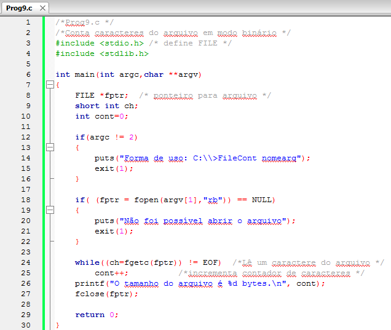

*Figura:* captura do editor com `Prog9.c` (**A10-11-P09**), linhas 1–30 da versão histórica do programa. Fonte revisado: [`src/Fontes_Aula_10_e_11/Prog9.c`](../../src/Fontes_Aula_10_e_11/Prog9.c); versão anterior à revisão de 2026 em texto: [commit `04ac409`](https://github.com/Lucas-Sperotto/falect-cc-011-algoritmos-e-laboratorio-de-programacao-ii/blob/04ac4094dba3c3812809dd433a7d3855c4bffdc9/src/Fontes_Aula_10_e_11/Prog9.c); explicação: [seção 6](#a10-11-p09).

### 3.14 Ler e gravar blocos de bytes (slides 68–73)

<a id="slide-68"></a>
**Slide 68 — Roteiro** · *repete o roteiro do [slide 2](#slide-2), sem destaque do tópico seguinte.*

<a id="slide-69"></a>
**Slide 69 — Ler e gravar blocos de bytes**

> - Muitas vezes não desejamos gravar ou ler um caractere ou uma linha por vez.
> - Gostaríamos de gravar ou ler uma quantidade maior de caracteres.
> - As funções apropriadas para o processo de gravação e leitura de matrizes de bytes ou estruturas são fwrite() e fread().

<a id="slide-70"></a>
**Slide 70 — Ler e gravar blocos de bytes**

> 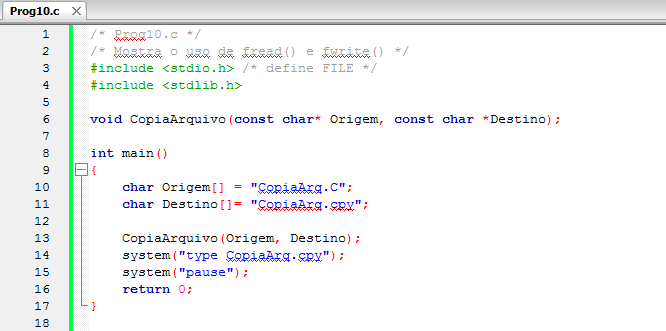

*Figura:* captura do editor com `Prog10.c` (**A10-11-P10**), linhas 1–18 da versão histórica do programa. Fonte revisado: [`src/Fontes_Aula_10_e_11/Prog10.c`](../../src/Fontes_Aula_10_e_11/Prog10.c); versão anterior à revisão de 2026 em texto: [commit `04ac409`](https://github.com/Lucas-Sperotto/falect-cc-011-algoritmos-e-laboratorio-de-programacao-ii/blob/04ac4094dba3c3812809dd433a7d3855c4bffdc9/src/Fontes_Aula_10_e_11/Prog10.c); explicação: [seção 6](#a10-11-p10).

<a id="slide-71"></a>
**Slide 71 — Ler e gravar blocos de bytes**

> 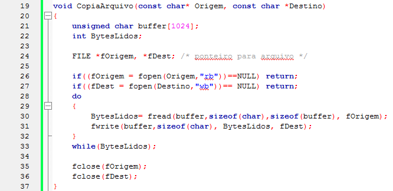

*Figura:* continuação de `Prog10.c` (**A10-11-P10**), linhas 19–37. Se a abertura do destino falhar, a função retorna sem fechar `fOrigem`, e o resultado de `fwrite` não é verificado; ver [observação 8.10](#obs-10-10).

<a id="slide-72"></a>
**Slide 72 — Ler e gravar blocos de bytes**

> - Para ler um bloco de dados usamos fread()
> - Em nosso exemplo queremos ler 1.024 bytes por vez:
>
>   ```c
>   BytesLidos= fread(buffer,sizeof(char),sizeof(buffer), fOrigem);
>   ```
>
> - A função retorna o número de unidades efetivamente lidas.
> - Esse número pode ser menor que 1.024 quando o fim do arquivo for encontrado ou ocorrer um erro.

<a id="slide-73"></a>
**Slide 73 — Ler e gravar blocos de bytes**

> - Para gravar blocos de bytes usamos fwrite().
> - Em nosso exemplo queremos gravar BytesLidos a cada vez:
>
>   ```c
>   fwrite(buffer,sizeof(char), BytesLidos, fDest);
>   ```
>
> - A função que retorna [sic] o número de itens gravados. Esse valor será igual a BytesLidos, a menos que ocorra algum erro.
> - Observe que os nossos arquivos foram abertos em modo binário. As funções fread() e fwrite() só trabalham corretamente em modo binário.

*Nota de transcrição:* `fread()` e `fwrite()` funcionam nos dois modos; ver [observação 8.10](#obs-10-10).

### 3.15 Os ponteiros de arquivos stdin, stdout e stderr (slides 74–78)

<a id="slide-74"></a>
**Slide 74 — Roteiro** · *repete o roteiro do [slide 2](#slide-2), sem destaque do tópico seguinte.*

<a id="slide-75"></a>
**Slide 75 — Os ponteiros de arquivos stdin, stdout e stderr**

> - Se você analisar o seu arquivo stdio.h, encontrará as seguintes definições de constantes:
>
>   ```c
>   #define stdin  (&__iob_func()[0])
>   #define stdout (&__iob_func()[1])
>   #define stderr (&__iob_func()[2])
>   ```
>
> - São os três primeiros elementos da matriz de estruturas FILE.
> - Essas constantes podem ser usadas para acessar qualquer um dos três arquivos ‘standard’ predefinidos pelo sistema operacional (leitura, gravação e saída de erro)

<a id="slide-76"></a>
**Slide 76 — Os ponteiros de arquivos stdin, stdout e stderr**

> - Cada uma delas pode ser tratada como um ponteiro para uma estrutura FILE:
>
>   ```c
>   FILE *stdin;
>   FILE *stdout;
>   FILE *stderr;
>   ```
>
> - Por padrão, a leitura é do teclado, a gravação e a saída de erro são o vídeo.
>
> | Ponteiro | Stream |
> |---|---|
> | stdin | Entrada padrão (teclado) |
> | stdout | Saída padrão (vídeo) |
> | stderr | Saída de erro (vídeo) |

<details><summary>Imagem original (tabela, slide 76)</summary>

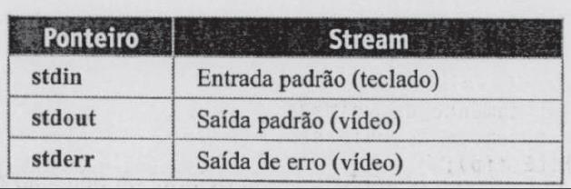

</details>

<a id="slide-77"></a>
**Slide 77 — Os ponteiros de arquivos stdin, stdout e stderr**

> - Esses ponteiros são constantes; seus valores não podem ser alterados, mas podem ser usados como argumentos de funções.
> - Algumas funções, como getchar e putchar, usam stdin e stdout automaticamente.
> - Você pode usar os ponteiros FILE definidos em stdio.h para acessar os arquivos de entrada e saída padrão. Como exemplo , a instrução:

*Nota de transcrição:* os nomes `stdin`, `stdout` e `stderr` são expressões do tipo `FILE *` e podem ser redirecionados; ver [observação 8.11](#obs-10-11).

<a id="slide-78"></a>
**Slide 78 — Os ponteiros de arquivos stdin, stdout e stderr**

> ```c
> fgets(string, 80, stdin);
> ```
>
> lê uma cadeia de caracteres do teclado.
> A instrução:
>
> ```c
> fputs(string, stdout);
> ```
>
> imprimirá string no vídeo.

<details><summary>Imagem original (texto digitalizado, slide 78)</summary>

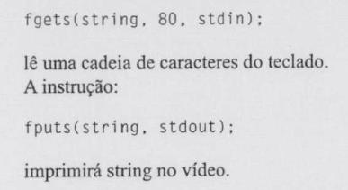

</details>

*Nota de transcrição:* o slide contém apenas esta figura, um trecho digitalizado do livro-base, que completa a frase do slide 77.

### 3.16 Referências do material original (slide 79)

<a id="slide-79"></a>
**Slide 79 — Referências**

> - MIZRAHI, Victorine V. Treinamento em Linguagem C, São Paulo: Pearson Prentice Hall, 2008;

## 4. Explicações complementares

<a id="c-10-1"></a>
### 4.1 Fluxo, `FILE *` e *buffer*

Um **fluxo** (*stream*) é uma sequência de bytes lida ou gravada em ordem. `fopen` devolve um `FILE *`, um ponteiro para a estrutura que a biblioteca usa para controlar o fluxo: o descritor do sistema, a posição, os indicadores de erro e de fim e o *buffer*. O conteúdo de `FILE` é privado da biblioteca e muda de uma implementação para outra (a do slide 10 é de um compilador para Windows).


Cada chamada de sistema tem um custo fixo; o *buffer* junta muitos bytes pequenos em poucas transferências. A consequência prática: dados gravados só estão garantidos no arquivo depois de `fflush` ou `fclose`. Um programa que termina com `exit` ou retorno de `main` descarrega os fluxos; um programa que falha abruptamente pode perder o que estava no *buffer*.

<a id="c-10-2"></a>
### 4.2 O ciclo de vida de um arquivo

```c
FILE *f = fopen("dados.txt", "r");
if (f == NULL) {                 /* arquivo inexistente, sem permissão etc. */
    perror("dados.txt");         /* imprime o motivo, por exemplo: No such file or directory */
    return 1;
}
/* ... leituras ... */
if (ferror(f))                   /* houve erro de leitura? */
    status = 1;
if (fclose(f) == EOF)            /* o fechamento também pode falhar */
    status = 1;
```

`perror` acrescenta à mensagem a descrição do erro registrado em `errno` (§7.21.10.4). Todos os fontes revisados desta aula seguem esse roteiro, como mostra o [exemplo 7.3](#73-arquivo-inexistente-prog3c).

<a id="c-10-3"></a>
### 4.3 Ler até o fim: `EOF`, `int` e `feof`

`fgetc` devolve um `int`: um valor entre 0 e 255 (o byte lido, como `unsigned char`) ou `EOF`, uma constante negativa. Por isso a variável que recebe o resultado deve ser `int`:

| Tipo de `ch` | O que acontece |
|---|---|
| `int` | correto: os 256 bytes e `EOF` são todos distinguíveis |
| `char` com sinal (GCC x86) | o byte 0xFF vira −1 e é confundido com `EOF`: a leitura para antes do fim |
| `char` sem sinal | `EOF` vira 255 e nunca é detectado: o laço não termina |

O padrão correto testa o valor devolvido e só depois investiga a causa:

```c
int ch;
while ((ch = fgetc(f)) != EOF)
    putchar(ch);
if (ferror(f))   /* EOF por erro, e não por fim de arquivo */
    status = 1;
```

`feof(f)` informa se uma leitura **já falhou** por ter chegado ao fim; ele não prevê o futuro. No laço do slide 30, `while(!feof(fptr))`, a última chamada a `fgetc` devolve `EOF`, que é impresso como um caractere a mais (normalmente `ÿ` ou um byte inválido) antes de `feof` ficar verdadeiro.

<a id="c-10-4"></a>
### 4.4 As quatro famílias de funções

| Grupo | Leitura | Gravação | Valor devolvido em caso de fim ou erro |
|---|---|---|---|
| Caractere | `fgetc(f)` | `fputc(c, f)` | `EOF` |
| Linha (string) | `fgets(s, n, f)`: até `n-1` bytes, **inclui** o `'\n'` | `fputs(s, f)`: não acrescenta `'\n'` | `NULL` (`fgets`) ou `EOF` (`fputs`) |
| Formatado | `fscanf(f, fmt, ...)`: número de itens convertidos | `fprintf(f, fmt, ...)`: número de caracteres | `EOF` antes de qualquer conversão; valor negativo em erro |
| Bloco | `fread(p, tam, n, f)`: número de **itens** lidos | `fwrite(p, tam, n, f)`: número de itens gravados | um número menor que `n` |

Com `fscanf`, compare o retorno com a quantidade esperada de campos (`== 3`), e não apenas com `EOF`: uma linha com um campo inválido devolve um número entre 0 e 2 e, testada só contra `EOF`, faria o laço repetir o mesmo erro indefinidamente ou usar valores antigos.

<a id="c-10-5"></a>
### 4.5 Modo texto e modo binário

A distinção existe para sistemas em que o fim de linha no arquivo não é um único byte. No Windows, uma linha termina com CR LF (`\r\n`): em modo texto, a biblioteca converte `'\n'` em CR LF ao gravar e CR LF em `'\n'` ao ler. No Linux e em outros sistemas POSIX, o fim de linha é só LF e o `b` do modo é ignorado.

| Conteúdo gravado com `fputs("abc\n", f)` | Bytes no arquivo | Contagem em modo texto | Contagem em modo binário |
|---|---|---:|---:|
| Windows, modo texto | `61 62 63 0D 0A` | 4 | 5 |
| Linux, qualquer modo | `61 62 63 0A` | 4 | 4 |

É por isso que, no Windows, `Prog8.c` e `Prog9.c` dão números diferentes (slides 62–67), enquanto no Linux dão o mesmo ([exemplos 7.8 e 7.9](#78-contagem-em-modo-texto-prog8c)). Para escrever programas portáveis: use modo texto para texto e modo binário para todo o resto (imagens, estruturas, dados que podem conter qualquer byte).

<a id="c-10-6"></a>
### 4.6 Números como texto ou como bytes

O slide 61 compara dois jeitos de guardar o número 25678 (que o slide escreve “25.678”, com ponto separando os milhares):

| Forma | Como gravar | Bytes no arquivo |
|---|---|---|
| Texto | `fprintf(f, "%d", 25678)` | `32 35 36 37 38` (“25678”, 5 bytes) |
| Binário, `short` de 2 bytes | `fwrite(&n, sizeof n, 1, f)` | `4E 64` em máquinas *little-endian*, como x86 |

O texto é legível, portável e independe da máquina, mas precisa ser convertido (`fscanf`, `strtol`). O binário é compacto e rápido, mas depende do tamanho dos tipos e da ordem dos bytes da máquina que gravou: um arquivo gravado em uma arquitetura pode ser lido errado em outra. A [Aula 11](../aula-11/README.md) volta a esse ponto ao gravar estruturas inteiras.

<a id="c-10-7"></a>
### 4.7 Copiar em blocos

`Prog10.c` lê até 1024 bytes por vez e grava exatamente o que leu:

```c
while ((BytesLidos = fread(buffer, 1, sizeof buffer, fOrigem)) > 0)
    if (fwrite(buffer, 1, BytesLidos, fDest) != BytesLidos)
        break;   /* erro de gravação: disco cheio, por exemplo */
```

A última leitura costuma devolver menos que 1024 bytes, e a seguinte devolve 0. Gravar `sizeof buffer` em vez de `BytesLidos` acrescentaria lixo ao final da cópia. Com `fread(p, tam, n, f)`, o valor devolvido conta **itens** de `tam` bytes; com `tam = 1`, conta bytes.

<a id="c-10-8"></a>
### 4.8 Fluxos padrão e redirecionamento

Todo programa começa com três fluxos abertos: `stdin` (entrada padrão), `stdout` (saída padrão) e `stderr` (saída de erro). Por padrão eles estão ligados ao terminal, mas o shell pode redirecioná-los sem que o programa perceba:

```bash
./prog2 < entrada.txt            # stdin vem de um arquivo
./prog4 > saida.txt              # stdout vai para um arquivo
./prog3 2> erros.txt             # stderr vai para outro arquivo
./prog4 | wc -l                  # stdout de um programa vira stdin de outro
```

Separar `stdout` de `stderr` permite redirecionar os resultados e continuar vendo as mensagens de erro, por isso os fontes revisados escrevem erros com `perror` ou `fprintf(stderr, ...)`. Os exemplos de execução desta documentação usam exatamente esse mecanismo: a entrada de cada cenário é redirecionada a partir de um arquivo, e `stdout` e `stderr` são capturados separadamente.

## 5. Conceitos fundamentais

| Conceito | Definição operacional | Onde aparece |
|---|---|---|
| Arquivo / fluxo | Sequência de bytes lida ou gravada em ordem | slides 5–7 |
| `FILE *` | Ponteiro para a estrutura de controle de um fluxo | slides 9–14 |
| Alto nível × baixo nível | Funções com *buffer* da biblioteca × chamadas diretas ao sistema | slides 6–7 |
| *Buffer* | Área de memória que acumula bytes antes de transferi-los | slides 23–26 |
| `EOF` | Constante negativa devolvida quando não há mais dados ou ocorre erro | slides 33–37 |
| Modo de abertura | Cadeia `"r"`, `"w"`, `"a"`, com `+` e `b` opcionais | slides 57–58 |
| Modo texto × binário | Com ou sem tradução de fim de linha (só no Windows) | slides 60–67 |
| Leitura em blocos | `fread`/`fwrite` com contagem de itens | slides 69–73 |
| Fluxos padrão | `stdin`, `stdout`, `stderr`, abertos desde o início | slides 75–78 |

## 6. Programas C da aula

Fontes em [`src/Fontes_Aula_10_e_11/`](../../src/Fontes_Aula_10_e_11/), revisados em 2026 ([revisão por fonte](../../docs/auditorias/REVISAO_POR_FONTE.md#aulas-9-a-11--srcfontes_aula_9-e-srcfontes_aula_10_e_11)). Em todos, a abertura, as leituras, as gravações e o fechamento passaram a ser verificados, e a variável que recebe `fgetc` é `int`. Os programas leem e gravam arquivos no **diretório corrente**; execute-os em uma pasta de trabalho.

| ID | Arquivo | SIGAA | Slides | Tema |
|---|---|---|---|---|
| [A10-11-P01](#a10-11-p01) | [`Prog1.c`](../../src/Fontes_Aula_10_e_11/Prog1.c) | Prog01.c | 17–27 | gravar caractere a caractere |
| [A10-11-P02](#a10-11-p02) | [`Prog2.c`](../../src/Fontes_Aula_10_e_11/Prog2.c) | Prog02.c | 28–37 | ler caractere a caractere |
| [A10-11-P03](#a10-11-p03) | [`Prog3.c`](../../src/Fontes_Aula_10_e_11/Prog3.c) | Prog03.c | 39–41 | verificar a abertura |
| [A10-11-P04](#a10-11-p04) | [`Prog4.c`](../../src/Fontes_Aula_10_e_11/Prog4.c) | Prog04.c | 43–46 | gravar strings |
| [A10-11-P05](#a10-11-p05) | [`Prog5.c`](../../src/Fontes_Aula_10_e_11/Prog5.c) | Prog05.c | 47–49 | ler linha a linha |
| [A10-11-P06](#a10-11-p06) | [`Prog6.c`](../../src/Fontes_Aula_10_e_11/Prog6.c) | Prog06.c | 51–53 | gravar com `fprintf` |
| [A10-11-P07](#a10-11-p07) | [`Prog7.c`](../../src/Fontes_Aula_10_e_11/Prog7.c) | Prog07.c | 54–55 | ler com `fscanf` |
| [A10-11-P08](#a10-11-p08) | [`Prog8.c`](../../src/Fontes_Aula_10_e_11/Prog8.c) | Prog08.c | 62–65 | contar bytes em modo texto |
| [A10-11-P09](#a10-11-p09) | [`Prog9.c`](../../src/Fontes_Aula_10_e_11/Prog9.c) | Prog09.c | 66–67 | contar bytes em modo binário |
| [A10-11-P10](#a10-11-p10) | [`Prog10.c`](../../src/Fontes_Aula_10_e_11/Prog10.c) | Prog10.c | 69–73 | copiar com `fread`/`fwrite` |

<a id="a10-11-p01"></a>
### 6.1 A10-11-P01 — `Prog1.c`: gravar um caractere por vez

- **Finalidade:** gravar em `ArqText.txt` a linha digitada. **Entrada:** uma linha. **Saída:** nenhuma na tela; o arquivo com o texto (sem a quebra de linha).
- **Diferença em relação ao slide 18:** `getche()` e o teste de `'\r'` (ENTER no console do Windows) viraram `getchar()` com teste de `'\n'`, `'\r'` e `EOF`; a abertura e as gravações são verificadas ([8.4](#obs-10-4)).

<!-- codigo: src/Fontes_Aula_10_e_11/Prog1.c de=`FILE *fptr` ate=`return status;` -->
<sub>Copiado de [`src/Fontes_Aula_10_e_11/Prog1.c`](../../src/Fontes_Aula_10_e_11/Prog1.c#L12-L21) (linhas 12–21) por `scripts/documentacao_aulas.py`; não edite este bloco à mão.</sub>

```c
    FILE *fptr = fopen("ArqText.txt", "w");
    int ch, status = 0;
    if (fptr == NULL) { perror("ArqText.txt"); return 1; }
    /* Enter termina a linha no terminal Linux; EOF também encerra a entrada. */
    while ((ch = getchar()) != EOF && ch != '\n' && ch != '\r') {
        if (fputc(ch, fptr) == EOF) { status = 1; break; }
    }
    if (ferror(stdin)) status = 1;
    if (fclose(fptr) == EOF) status = 1;
    return status;
```
<!-- /codigo -->

<a id="a10-11-p02"></a>
### 6.2 A10-11-P02 — `Prog2.c`: ler um caractere por vez

- **Finalidade:** mostrar na tela o conteúdo de `ArqText.txt`. **Entrada:** o arquivo. **Saída:** o texto.
- **Diferença em relação ao slide 28:** `short int ch` virou `int ch`; a abertura passou a ser verificada.
- **Observação didática:** nos slides, `Prog2.c` **não** verifica a abertura e `Prog3.c` mostra a correção (slides 39–41). Na versão revisada, os dois arquivos ficaram idênticos, e o contraste deixou de ser visível no código; ver [recomendações](../../docs/auditorias/CLAUDE_AUDIT.md#recomendacoes).

<!-- codigo: src/Fontes_Aula_10_e_11/Prog2.c de=`FILE *fptr` ate=`return status;` -->
<sub>Copiado de [`src/Fontes_Aula_10_e_11/Prog2.c`](../../src/Fontes_Aula_10_e_11/Prog2.c#L12-L21) (linhas 12–21) por `scripts/documentacao_aulas.py`; não edite este bloco à mão.</sub>

```c
    FILE *fptr = fopen("ArqText.txt", "r");
    /* fgetc() retorna int para representar tanto um byte quanto EOF. */
    int ch, status = 0;
    if (fptr == NULL) { perror("ArqText.txt"); return 1; }
    while ((ch = fgetc(fptr)) != EOF) {
        if (putchar(ch) == EOF) { status = 1; break; }
    }
    if (ferror(fptr)) status = 1;
    if (fclose(fptr) == EOF) status = 1;
    return status;
```
<!-- /codigo -->

<a id="a10-11-p03"></a>
### 6.3 A10-11-P03 — `Prog3.c`: verificar a abertura

- **Finalidade:** a mesma leitura de `Prog2.c`, encerrando com mensagem se o arquivo não puder ser aberto. **Saída sem o arquivo:** `ArqText.txt: No such file or directory` em `stderr` e código 1.
- **Diferença em relação ao slide 41:** `puts("Não foi possível abrir o arquivo")` virou `perror`, que informa o motivo.

<!-- codigo: src/Fontes_Aula_10_e_11/Prog3.c de=`if (fptr == NULL)` ate=`if (fptr == NULL)` -->
<sub>Copiado de [`src/Fontes_Aula_10_e_11/Prog3.c`](../../src/Fontes_Aula_10_e_11/Prog3.c#L15-L15) (linha 15) por `scripts/documentacao_aulas.py`; não edite este bloco à mão.</sub>

```c
    if (fptr == NULL) { perror("ArqText.txt"); return 1; }
```
<!-- /codigo -->

<a id="a10-11-p04"></a>
### 6.4 A10-11-P04 — `Prog4.c`: gravar strings

- **Finalidade:** gravar seis linhas em `TesteSTR.txt` e exibir o arquivo. **Saída:** o texto gravado.
- **Diferença em relação ao slide 44:** as seis chamadas `fputs` viraram uma só (com literais concatenados pelo compilador); `system("TYPE TesteSTR.txt")`, que só existe no Windows, foi substituído pela releitura do arquivo com `fgetc` ([8.8](#obs-10-8)).

<!-- codigo: src/Fontes_Aula_10_e_11/Prog4.c de=`if (fputs("Um grande` ate=`"abrandará.\n", fptr)` -->
<sub>Copiado de [`src/Fontes_Aula_10_e_11/Prog4.c`](../../src/Fontes_Aula_10_e_11/Prog4.c#L15-L20) (linhas 15–20) por `scripts/documentacao_aulas.py`; não edite este bloco à mão.</sub>

```c
    if (fputs("Um grande antídoto contra o egoísmo\n"
              "é a generosidade... Dê, mesmo que\n"
              "isso requeira de você um esforço\n"
              "consciente. Pelo fato de partilhar\n"
              "tudo o que possui, seu egoísmo se\n"
              "abrandará.\n", fptr) == EOF) status = 1;
```
<!-- /codigo -->

<a id="a10-11-p05"></a>
### 6.5 A10-11-P05 — `Prog5.c`: ler linha a linha

- **Finalidade:** ler `TesteSTR.txt` com `fgets` e imprimir cada linha. **Saída:** o texto.
- **Diferença em relação ao slide 48:** a linha de abertura não compilava (parênteses desbalanceados); `fgets(str, sizeof str, fptr)` usa toda a capacidade de `str[81]`; a impressão usa `fputs`, que não interpreta `%` como `printf("%s")` faria se o texto fosse passado como formato.
- **Observação:** `fgets` mantém o `'\n'` lido; por isso a impressão não acrescenta outra quebra.

<!-- codigo: src/Fontes_Aula_10_e_11/Prog5.c de=`while (fgets(` ate=`}` -->
<sub>Copiado de [`src/Fontes_Aula_10_e_11/Prog5.c`](../../src/Fontes_Aula_10_e_11/Prog5.c#L16-L17) (linhas 16–17) por `scripts/documentacao_aulas.py`; não edite este bloco à mão.</sub>

```c
    while (fgets(str, sizeof str, fptr) != NULL) {
        if (fputs(str, stdout) == EOF) { status = 1; break; }
```
<!-- /codigo -->

<a id="a10-11-p06"></a>
### 6.6 A10-11-P06 — `Prog6.c`: gravar dados formatados

- **Finalidade:** gravar em `Livros.txt` título, registro e preço de cada livro, um por linha.
- **Entrada:** linhas `título registro preço` (o título não pode ter espaços); um título de um caractere ou o fim da entrada encerra. **Saída:** o arquivo.
- **Diferença em relação ao slide 52:** `%29s` limita o título a `titulo[30]`; registro e preço são lidos como texto e convertidos com `strtol`/`strtod`, que detectam valores fora da faixa; entrada incompleta encerra com código 1.

<!-- codigo: src/Fontes_Aula_10_e_11/Prog6.c funcao=converte -->
<sub>Copiado de [`src/Fontes_Aula_10_e_11/Prog6.c`](../../src/Fontes_Aula_10_e_11/Prog6.c#L15-L27) (linhas 15–27) por `scripts/documentacao_aulas.py`; não edite este bloco à mão.</sub>

```c
/* scanf/fscanf limitam os tokens; as conversões numéricas verificam a faixa. */
static int converte(const char *registro, const char *valor, int *regnum, double *preco)
{
    char *fim;
    errno = 0;
    long numero = strtol(registro, &fim, 10);
    if (fim == registro || *fim != '\0' || errno || numero < INT_MIN || numero > INT_MAX)
        return 0;
    *regnum = (int)numero;
    errno = 0;
    *preco = strtod(valor, &fim);
    return fim != valor && *fim == '\0' && errno == 0 && isfinite(*preco);
}
```
<!-- /codigo -->

<a id="a10-11-p07"></a>
### 6.7 A10-11-P07 — `Prog7.c`: ler dados formatados

- **Finalidade:** ler `Livros.txt` com `fscanf` e imprimir cada registro. **Saída:** uma linha por livro.
- **Diferença em relação ao slide 54:** o laço continua apenas enquanto `fscanf` converte os **três** campos; terminar com outro valor que não `EOF` indica registro inválido e encerra com código 1 ([4.4](#c-10-4)).

<!-- codigo: src/Fontes_Aula_10_e_11/Prog7.c de=`while ((lidos = fscanf(` ate=`if (lidos != EOF` -->
<sub>Copiado de [`src/Fontes_Aula_10_e_11/Prog7.c`](../../src/Fontes_Aula_10_e_11/Prog7.c#L36-L42) (linhas 36–42) por `scripts/documentacao_aulas.py`; não edite este bloco à mão.</sub>

```c
    while ((lidos = fscanf(fptr, "%29s %79s %79s", titulo, registro, valor)) == 3) {
        if (!converte(registro, valor, &regnum, &preco)) { status = 1; break; }
        if (printf("%s %d %.2f\n", titulo, regnum, preco) < 0) {
            status = 1; break;
        }
    }
    if (lidos != EOF || ferror(fptr)) status = 1;
```
<!-- /codigo -->

<a id="a10-11-p08"></a>
### 6.8 A10-11-P08 — `Prog8.c`: contar bytes em modo texto

- **Finalidade:** contar os caracteres de um arquivo informado na linha de comando, aberto em modo texto. **Entrada:** `./Prog8 arquivo`. **Saída:** `O tamanho do arquivo é N bytes.`
- **Diferença em relação ao slide 63:** contador `size_t` com teste de estouro, mensagens de uso e de erro em `stderr`. O comentário do fonte registra que o Linux não traduz CR LF ([4.5](#c-10-5)).

<!-- codigo: src/Fontes_Aula_10_e_11/Prog8.c de=`fptr = fopen(argv[1], "r");` ate=`printf("O tamanho` -->
<sub>Copiado de [`src/Fontes_Aula_10_e_11/Prog8.c`](../../src/Fontes_Aula_10_e_11/Prog8.c#L17-L26) (linhas 17–26) por `scripts/documentacao_aulas.py`; não edite este bloco à mão.</sub>

```c
    fptr = fopen(argv[1], "r");
    if (fptr == NULL) { perror(argv[1]); return 1; }
    /* Linux não traduz CRLF em modo texto; cada fgetc conta um byte. */
    while ((ch = fgetc(fptr)) != EOF) {
        if (cont == SIZE_MAX) { status = 1; break; }
        cont++;
    }
    if (ferror(fptr)) status = 1;
    if (fclose(fptr) == EOF) status = 1;
    if (!status) printf("O tamanho do arquivo é %zu bytes.\n", cont);
```
<!-- /codigo -->

<a id="a10-11-p09"></a>
### 6.9 A10-11-P09 — `Prog9.c`: contar bytes em modo binário

- **Finalidade:** o mesmo de `Prog8.c`, com `fopen(argv[1], "rb")`. No Windows, a contagem inclui os `\r`; no Linux, é igual à de `Prog8.c`.
- **Observação:** o comentário do laço, antes copiado de `Prog8.c` (“Linux não traduz CRLF em modo texto”), foi ajustado para o modo binário na revisão de comentários desta documentação.

<!-- codigo: src/Fontes_Aula_10_e_11/Prog9.c de=`fptr = fopen(argv[1], "rb");` ate=`fptr = fopen(argv[1], "rb");` -->
<sub>Copiado de [`src/Fontes_Aula_10_e_11/Prog9.c`](../../src/Fontes_Aula_10_e_11/Prog9.c#L17-L17) (linha 17) por `scripts/documentacao_aulas.py`; não edite este bloco à mão.</sub>

```c
    fptr = fopen(argv[1], "rb");
```
<!-- /codigo -->

<a id="a10-11-p10"></a>
### 6.10 A10-11-P10 — `Prog10.c`: copiar com `fread` e `fwrite`

- **Finalidade:** copiar `CopiaArq.C` para `CopiaArq.cpy` em blocos de 1024 bytes e exibir a cópia ([4.7](#c-10-7)).
- **Entrada:** o arquivo `CopiaArq.C` no diretório corrente. **Saída:** o conteúdo da cópia.
- **Diferença em relação aos slides 70–71:** `CopiaArquivo` devolve sucesso ou falha, fecha a origem quando o destino não pode ser aberto, confere cada `fwrite` e fecha os dois arquivos; `system("type CopiaArq.cpy")` foi substituído pela leitura em C ([8.10](#obs-10-10)).

<!-- codigo: src/Fontes_Aula_10_e_11/Prog10.c funcao=CopiaArquivo -->
<sub>Copiado de [`src/Fontes_Aula_10_e_11/Prog10.c`](../../src/Fontes_Aula_10_e_11/Prog10.c#L28-L46) (linhas 28–46) por `scripts/documentacao_aulas.py`; não edite este bloco à mão.</sub>

```c
int CopiaArquivo(const char *Origem, const char *Destino)
{
    unsigned char buffer[1024];
    size_t BytesLidos;
    int sucesso = 1;
    FILE *fOrigem = fopen(Origem, "rb"), *fDest;
    if (fOrigem == NULL) { perror(Origem); return 0; }
    fDest = fopen(Destino, "wb");
    if (fDest == NULL) { perror(Destino); fclose(fOrigem); return 0; }
    while ((BytesLidos = fread(buffer, 1, sizeof buffer, fOrigem)) > 0) {
        if (fwrite(buffer, 1, BytesLidos, fDest) != BytesLidos) {
            sucesso = 0; break;
        }
    }
    if (ferror(fOrigem)) sucesso = 0;
    if (fclose(fOrigem) == EOF) sucesso = 0;
    if (fclose(fDest) == EOF) sucesso = 0;
    return sucesso;
}
```
<!-- /codigo -->

## 7. Exemplos de execução

Cada cenário roda em um diretório temporário próprio; quando o programa lê um arquivo, o conteúdo preparado é mostrado antes da execução, e quando grava, o arquivo resultante é mostrado depois.

### 7.1 Gravar caracteres (`Prog1.c`)

<!-- execucao: src/Fontes_Aula_10_e_11/Prog1.c cenario=gravar-caracteres -->
Execução real do cenário revisado `gravar-caracteres` ([manifesto](../../scripts/cenarios_fontes_c.json)), compilado com `gcc -std=c11 -Wall -Wextra -Wpedantic -O0`; bloco gerado por `scripts/documentacao_aulas.py`.

Comando: `./Prog1`

Entrada padrão:

```text
abc
```

Saída padrão: *(vazia)*

Arquivo resultante `ArqText.txt` (sem quebra de linha final):

```text
abc
```

Código de saída: `0`.
<!-- /execucao -->

### 7.2 Ler caracteres (`Prog2.c`)

<!-- execucao: src/Fontes_Aula_10_e_11/Prog2.c cenario=ler-caracteres -->
Execução real do cenário revisado `ler-caracteres` ([manifesto](../../scripts/cenarios_fontes_c.json)), compilado com `gcc -std=c11 -Wall -Wextra -Wpedantic -O0`; bloco gerado por `scripts/documentacao_aulas.py`.

Arquivo preparado `ArqText.txt`:

```text
abc
```

Comando: `./Prog2`

Entrada padrão: *(vazia)*

Saída padrão:

```text
abc
```

Código de saída: `0`.
<!-- /execucao -->

### 7.3 Arquivo inexistente (`Prog3.c`)

<!-- execucao: src/Fontes_Aula_10_e_11/Prog3.c cenario=arquivo-ausente -->
Execução real do cenário revisado `arquivo-ausente` ([manifesto](../../scripts/cenarios_fontes_c.json)), compilado com `gcc -std=c11 -Wall -Wextra -Wpedantic -O0`; bloco gerado por `scripts/documentacao_aulas.py`.

Comando: `./Prog3`

Entrada padrão: *(vazia)*

Saída padrão: *(vazia)*

Saída de erro:

```text
ArqText.txt: No such file or directory
```

Código de saída: `1`.
<!-- /execucao -->

### 7.4 Gravar e exibir strings (`Prog4.c`)

<!-- execucao: src/Fontes_Aula_10_e_11/Prog4.c cenario=gravar-strings -->
Execução real do cenário revisado `gravar-strings` ([manifesto](../../scripts/cenarios_fontes_c.json)), compilado com `gcc -std=c11 -Wall -Wextra -Wpedantic -O0`; bloco gerado por `scripts/documentacao_aulas.py`.

Comando: `./Prog4`

Entrada padrão: *(vazia)*

Saída padrão:

```text
Um grande antídoto contra o egoísmo
é a generosidade... Dê, mesmo que
isso requeira de você um esforço
consciente. Pelo fato de partilhar
tudo o que possui, seu egoísmo se
abrandará.
```

Arquivo resultante `TesteSTR.txt`:

```text
Um grande antídoto contra o egoísmo
é a generosidade... Dê, mesmo que
isso requeira de você um esforço
consciente. Pelo fato de partilhar
tudo o que possui, seu egoísmo se
abrandará.
```

Código de saída: `0`.
<!-- /execucao -->

### 7.5 Gravar dados formatados (`Prog6.c`)

O título `x`, de um caractere, encerra a entrada.

<!-- execucao: src/Fontes_Aula_10_e_11/Prog6.c cenario=gravar-formatado -->
Execução real do cenário revisado `gravar-formatado` ([manifesto](../../scripts/cenarios_fontes_c.json)), compilado com `gcc -std=c11 -Wall -Wextra -Wpedantic -O0`; bloco gerado por `scripts/documentacao_aulas.py`.

Comando: `./Prog6`

Entrada padrão:

```text
Algoritmos 7 12.5
x 0 0
```

Saída padrão (sem quebra de linha final):

```text

Digite titulo, registro e preco do livro (EOF encerra): 
Digite titulo, registro e preco do livro (EOF encerra): 
```

Arquivo resultante `Livros.txt`:

```text
Algoritmos 7 12.50
```

Código de saída: `0`.
<!-- /execucao -->

### 7.6 Ler dados formatados (`Prog7.c`)

<!-- execucao: src/Fontes_Aula_10_e_11/Prog7.c cenario=ler-formatado -->
Execução real do cenário revisado `ler-formatado` ([manifesto](../../scripts/cenarios_fontes_c.json)), compilado com `gcc -std=c11 -Wall -Wextra -Wpedantic -O0`; bloco gerado por `scripts/documentacao_aulas.py`.

Arquivo preparado `Livros.txt`:

```text
Algoritmos 7 12.50
```

Comando: `./Prog7`

Entrada padrão: *(vazia)*

Saída padrão:

```text
Algoritmos 7 12.50
```

Código de saída: `0`.
<!-- /execucao -->

### 7.7 Registro inválido no arquivo (`Prog7.c`)

<!-- execucao: src/Fontes_Aula_10_e_11/Prog7.c cenario=registro-formatado-invalido -->
Execução real do cenário revisado `registro-formatado-invalido` ([manifesto](../../scripts/cenarios_fontes_c.json)), compilado com `gcc -std=c11 -Wall -Wextra -Wpedantic -O0`; bloco gerado por `scripts/documentacao_aulas.py`.

Arquivo preparado `Livros.txt`:

```text
Algoritmos erro 12.5
```

Comando: `./Prog7`

Entrada padrão: *(vazia)*

Saída padrão: *(vazia)*

Código de saída: `1`.
<!-- /execucao -->

### 7.8 Contagem em modo texto (`Prog8.c`)

O arquivo preparado contém um byte nulo (`␀`), que também é contado.

<!-- execucao: src/Fontes_Aula_10_e_11/Prog8.c cenario=contar-bytes -->
Execução real do cenário revisado `contar-bytes` ([manifesto](../../scripts/cenarios_fontes_c.json)), compilado com `gcc -std=c11 -Wall -Wextra -Wpedantic -O0`; bloco gerado por `scripts/documentacao_aulas.py`.

Arquivo preparado `input.bin`:

```text
abc␀
```

Comando: `./Prog8 input.bin`

Entrada padrão: *(vazia)*

Saída padrão:

```text
O tamanho do arquivo é 5 bytes.
```

Código de saída: `0`.
<!-- /execucao -->

### 7.9 Contagem em modo binário (`Prog9.c`)

<!-- execucao: src/Fontes_Aula_10_e_11/Prog9.c cenario=contar-bytes -->
Execução real do cenário revisado `contar-bytes` ([manifesto](../../scripts/cenarios_fontes_c.json)), compilado com `gcc -std=c11 -Wall -Wextra -Wpedantic -O0`; bloco gerado por `scripts/documentacao_aulas.py`.

Arquivo preparado `input.bin`:

```text
abc␀
```

Comando: `./Prog9 input.bin`

Entrada padrão: *(vazia)*

Saída padrão:

```text
O tamanho do arquivo é 5 bytes.
```

Código de saída: `0`.
<!-- /execucao -->

### 7.10 Cópia em blocos (`Prog10.c`)

<!-- execucao: src/Fontes_Aula_10_e_11/Prog10.c cenario=copiar-binario -->
Execução real do cenário revisado `copiar-binario` ([manifesto](../../scripts/cenarios_fontes_c.json)), compilado com `gcc -std=c11 -Wall -Wextra -Wpedantic -O0`; bloco gerado por `scripts/documentacao_aulas.py`.

Arquivo preparado `CopiaArq.C`:

```text
ab␀c
```

Comando: `./Prog10`

Entrada padrão: *(vazia)*

Saída padrão:

```text
ab␀c
```

Arquivo resultante `CopiaArq.cpy`:

```text
ab␀c
```

Código de saída: `0`.
<!-- /execucao -->

## 8. Observações técnicas

<a id="obs-10-1"></a>
**8.1 “As funções de acesso em baixo nível não são bufferizadas” (slide 7).** Elas não usam o *buffer* da biblioteca C: cada `read` ou `write` é uma chamada ao sistema operacional. O núcleo do sistema, porém, mantém um *cache* de disco, de modo que uma gravação com `write` também pode não ter chegado ao disco quando a função retorna (para isso existe `fsync`).

<a id="obs-10-2"></a>
**8.2 `FILE` e `FOPEN_MAX` (slides 10–12).** A estrutura mostrada é a de um `stdio.h` para Windows; a glibc a define de outro modo, e o padrão não especifica seus membros. “stdio.h declara uma matriz de estruturas FILE” descreve implementações antigas. `FOPEN_MAX` é o número **mínimo** de arquivos que a implementação garante poder manter abertos ao mesmo tempo (pelo menos 8, incluindo os três fluxos padrão; §7.21.3), e não necessariamente o máximo; no Linux, o limite real vem do sistema (`ulimit -n`).

<a id="obs-10-3"></a>
**8.3 `putc`/`getc` × `fputc`/`fgetc` (slide 17).** O slide inverte a relação. O padrão permite que `getc` e `putc` sejam implementadas como **macros** que avaliam o argumento do fluxo mais de uma vez (§7.21.7.5 e §7.21.7.8); `fgetc` e `fputc` são sempre funções. O comportamento das duas é o mesmo nos demais aspectos.

<a id="obs-10-4"></a>
**8.4 Nomes de arquivo e `getche` (slides 18–20).** O programa grava `ArqText.txt`, mas o slide 19 cita “arqtext.txt” e o slide 20 “arqdest.txt”. No Windows, nomes de arquivo não distinguem maiúsculas de minúsculas; no Linux, `ArqText.txt` e `arqtext.txt` são arquivos diferentes. `getche()` (de `conio.h`) lia cada tecla sem esperar ENTER e devolvia `'\r'` ao pressioná-lo; no terminal Linux, a entrada chega por linhas e o ENTER produz `'\n'`. O Bloco de Notas citado no slide 19 corresponde a `cat` ou a um editor no Linux.

<a id="obs-10-5"></a>
**8.5 `while(!feof(fptr))` (slide 30).** O trecho apresentado como alternativa ao teste de `EOF` está errado: processa um caractere a mais. A explicação está na [seção 4.3](#c-10-3); o mesmo erro aparece no `Prog16.c` da [Aula 11](../aula-11/README.md).

<a id="obs-10-6"></a>
**8.6 A natureza de `EOF` (slides 33–37).** `EOF` é uma expressão constante inteira, de tipo `int` e valor negativo (§7.21.1p3); na glibc vale −1. Não é do tipo `short int`, não vale “0xFFFF” e não é “enviado” pelo sistema operacional: é o valor que as funções de leitura devolvem quando não há mais dados (ou houve erro). A recomendação final dos slides está correta: use sempre a constante `EOF`, e nunca −1 diretamente. Usar `short int` para `ch`, como no `Prog2.c` histórico, funciona na prática, mas o tipo apropriado é `int`.

<a id="obs-10-7"></a>
**8.7 “O programa irá parar” (slide 39).** Se `fopen` falha, ela devolve `NULL`; o programa não para sozinho. Passar `NULL` para `fgetc` ou `fputc` é comportamento indefinido, que no Linux costuma terminar o processo com falha de segmentação. Os motivos de falha também são outros além de disco cheio e arquivo inexistente: falta de permissão, diretório inexistente, limite de arquivos abertos. `perror` informa qual foi ([4.2](#c-10-2)).

<a id="obs-10-8"></a>
**8.8 `Prog4.c`, `Prog5.c` e `Prog7.c` históricos (slides 44–55).** `system("TYPE …")` e o comando `DIR` do slide 65 dependem do `cmd.exe` do Windows. A linha `if( (fptr = fopen(("TesteSTR.txt","r")) == NULL)` de `Prog5.c` não compila. Em `Prog7.c`, `while (fscanf(...) != EOF)` aceita registros com campos inválidos e, em um arquivo com uma linha mal formatada, repete o laço sem avançar.

<a id="obs-10-9"></a>
**8.9 Modo texto (slides 60–61).** Só o `'\n'` é traduzido (para CR LF) no modo texto do Windows; o `'\r'` não é “expandido”. O Ctrl-Z (`0x1A`) como marca de fim de arquivo é uma convenção herdada do CP/M e do DOS, mantida pela biblioteca do Windows; no Linux ele é um byte comum. Em “o número 25.678 … ocupando dois bytes (short int)”, o ponto separa milhares: trata-se do inteiro 25678 ([4.6](#c-10-6)).

<a id="obs-10-10"></a>
**8.10 `fread`/`fwrite` (slides 70–73).** “As funções fread() e fwrite() só trabalham corretamente em modo binário” é forte demais: elas funcionam em qualquer modo, mas em modo texto no Windows a tradução de fim de linha altera dados binários. No `Prog10.c` original, se `fopen` do destino falhasse, a função retornava sem fechar a origem, e o resultado de `fwrite` não era verificado.

<a id="obs-10-11"></a>
**8.11 `stdin`, `stdout`, `stderr` (slides 75–77).** As definições com `__iob_func()` são de uma implementação para Windows. O padrão diz apenas que `stdin`, `stdout` e `stderr` são expressões do tipo `FILE *` (§7.21.1p3). Dizer que “seus valores não podem ser alterados” é verdade na maioria das implementações, mas o fluxo associado pode ser trocado com `freopen`, e o shell pode redirecioná-los ([4.8](#c-10-8)).

## 9. Exercícios relacionados

### 9.1 Tarefa do SIGAA

A [tarefa da Aula 10](../../atividades/aula-10.md) pede `Prog01.c` a `Prog10.c`. Execute-os em uma pasta de trabalho separada e, para cada programa que lê um arquivo, teste também o caso de arquivo inexistente.

### 9.2 Exercícios propostos (acréscimo desta documentação)

1. **`wc` simplificado.** Leia um arquivo informado na linha de comando e conte bytes, linhas (`'\n'`) e palavras (sequências separadas por espaço, tabulação ou quebra de linha). Compare com `wc` no terminal.
2. **Numerar linhas.** Copie um arquivo texto para outro, acrescentando o número de cada linha no início. Use `fgets` e trate linhas maiores que o *buffer* (que chegam em mais de uma leitura, sem `'\n'` no fim).
3. **Médias por aluno.** Grave com `fprintf` um arquivo com `matrícula nota1 nota2 nota3` por linha e escreva outro programa que leia esse arquivo com `fscanf`, verificando que cada linha tem 4 campos, e imprima a média de cada aluno.
4. **Comparar arquivos.** Escreva `./compara a b` que informe a posição (em bytes) da primeira diferença entre dois arquivos, ou que são iguais. Use modo binário e leitura em blocos.
5. **Ver bytes.** Escreva um programa que mostre um arquivo em hexadecimal, 16 bytes por linha, como os blocos “hexadecimal” desta documentação. Use-o para comparar o mesmo texto salvo com fim de linha do Windows (CR LF) e do Linux (LF).

## 10. Referências e fontes consultadas

- SPEROTTO, Lucas Kriesel. *Aula 10 – Operações com arquivos – Parte 1 (nível avançado)*. Capacitação em C, 07/10/2022. 79 slides. [`aulas/Aula_10.pdf`](../Aula_10.pdf).
- MIZRAHI, Victorine Viviane. *Treinamento em Linguagem C*. São Paulo: Pearson Prentice Hall, 2008 (referência citada no slide 79).
- ISO/IEC 9899:2011 (C11), rascunho N1570: <https://www.open-std.org/jtc1/sc22/wg14/www/docs/n1570.pdf>. Seções citadas: §7.21.1 (`EOF`, fluxos padrão), §7.21.2 (fluxos texto e binário), §7.21.3 (arquivos, `FOPEN_MAX`), §7.21.5.3 (`fopen`), §7.21.7 (entrada e saída de caracteres), §7.21.8 (`fread`, `fwrite`), §7.21.10 (`feof`, `ferror`, `perror`).
- Biblioteca GNU C (glibc) — *Input/Output on Streams*: <https://www.gnu.org/software/libc/manual/html_node/I_002fO-on-Streams.html>.
- Microsoft Learn — *fopen, _wfopen* (modos texto e binário no Windows): <https://learn.microsoft.com/en-us/cpp/c-runtime-library/reference/fopen-wfopen>.
- Fontes do repositório: [`src/Fontes_Aula_10_e_11/`](../../src/Fontes_Aula_10_e_11/), [cenários de teste](../../scripts/cenarios_fontes_c.json) e [revisão por fonte](../../docs/auditorias/REVISAO_POR_FONTE.md).
