# Aula 11 — Operações com arquivos (parte 2): registros binários e E/S de baixo nível

- **Material original:** [`aulas/Aula_11.pdf`](../Aula_11.pdf) — 107 slides, “AULA 11 – OPERAÇÕES COM ARQUIVOS – PARTE 2 (NÍVEL AVANÇADO)”, 07/10/2022, *Capacitação em C – Prof. Me. Lucas Kriesel Sperotto*.
- **Programas:** [`src/Fontes_Aula_10_e_11/`](../../src/Fontes_Aula_10_e_11/) — `Prog11.c` e `Prog13.c` a `Prog20.c` (A10-11-P11 e A10-11-P13 a A10-11-P20). `Prog12.c` (A10-11-P12) repete `Prog11.c` e não aparece nos slides. Os programas 1 a 10 da mesma pasta pertencem à [Aula 10](../aula-10/README.md).
- **Tarefa do SIGAA:** [Aula 11](../../atividades/aula-11.md) (Prog11–Prog20).

**Como ler este documento.** A seção 3 reproduz o PDF slide a slide, na ordem original, dentro de blocos de citação (barra cinza à esquerda). Tudo o que está fora desses blocos foi acrescentado nesta documentação: notas de transcrição (em itálico), explicações, exemplos e exercícios. Trechos curtos de código que no PDF aparecem como imagem foram transcritos como texto; capturas de programas completos são reproduzidas como figura e remetem ao fonte do repositório. Palavras grafadas de forma errada no original estão marcadas com `[sic]`; omissões de acento foram mantidas sem marcação. O rodapé repetido em todos os slides (“07/10/2022 · Capacitação em C – Prof. Me. Lucas Kriesel Sperotto · número da página”) foi omitido. Quatro figuras do PDF estão em branco ou cortadas (slides 16, 18, 20 e 24); cada uma está marcada como *Lacuna*.

## Sumário

1. [Identificação da aula](#1-identificação-da-aula)
2. [Objetivos de aprendizagem](#2-objetivos-de-aprendizagem)
3. [Conteúdo transcrito do material original](#3-conteúdo-transcrito-do-material-original)
4. [Explicações complementares](#4-explicações-complementares)
5. [Conceitos fundamentais](#5-conceitos-fundamentais)
6. [Programas C da aula](#6-programas-c-da-aula)
7. [Exemplos de execução](#7-exemplos-de-execução)
8. [Observações técnicas](#8-observações-técnicas)
9. [Exercícios relacionados](#9-exercícios-relacionados)
10. [Referências e fontes consultadas](#10-referências-e-fontes-consultadas)

## 1. Identificação da aula

| Item | Descrição |
|---|---|
| Disciplina | FALECT-CC-011 — Algoritmos e Laboratório de Programação II (UNEMAT, Alto Araguaia), oferta 2026.2 |
| Posição no plano 2026.2 | Módulo 2 (21/09 a 25/09/2026): ponteiros e **manipulação de arquivos** |
| Ementa contemplada | Manipulação de arquivos (texto e binário) |
| Material original | `Aula_11.pdf`, 107 páginas, baseado em Mizrahi (2008) |
| Correspondência | Slides 3–102 → `Prog11.c` e `Prog13.c`–`Prog20.c`; ver a [matriz de rastreabilidade](../../docs/MATRIZ_RASTREABILIDADE.md#aula-11) |
| Ambiente | Os exemplos do material foram feitos no Windows (`io.h`, `O_BINARY`, impressora `PRN`); os fontes revisados e os exemplos desta página usam GCC e as chamadas POSIX do Linux/WSL |
| Lacunas do PDF | Figuras em branco nos slides 16, 20 e 24 e figura cortada no slide 18; ver o [relatório de lacunas](../../docs/auditorias/CLAUDE_AUDIT.md#lacunas) |

## 2. Objetivos de aprendizagem

Ao final da aula, o estudante deve ser capaz de:

1. gravar e ler estruturas inteiras com `fwrite` e `fread`, e explicar por que o tamanho de um registro depende do compilador;
2. calcular o número de registros de um arquivo com `fseek` e `ftell` e posicionar-se em qualquer um deles;
3. alternar corretamente entre gravação e leitura no mesmo arquivo;
4. detectar e relatar erros com `ferror`, `perror` e `errno`;
5. usar as chamadas de baixo nível `open`, `read`, `write`, `lseek` e `close`, tratando transferências parciais;
6. procurar dados em um *buffer* com `memchr` e `memcmp` sem ultrapassar seus limites;
7. escolher entre entrada e saída de alto e de baixo nível, sem misturá-las no mesmo arquivo.

## 3. Conteúdo transcrito do material original

### 3.1 Capa e roteiro (slides 1–2)

<a id="slide-1"></a>
**Slide 1 — Capa**

> ALGORITMO E LABORATÓRIO DE PROGRAMAÇÃO II
>
> AULA 11 – OPERAÇÕES COM ARQUIVOS – PARTE 2 (NÍVEL AVANÇADO)
>
> 07/10/2022 · Capacitação em C – Prof. Me. Lucas Kriesel Sperotto

<a id="slide-2"></a>
**Slide 2 — Roteiro**

> - Gravando estruturas em disco
> - A função rewind()
> - Gravando e lendo de um mesmo arquivo
> - A função fflush()
> - A função fseek()
> - A função ftell()
> - Imprimindo na impressora
> - Condições de erro
> - Leitura e gravação em baixo-nível
> - A função write()
> - A função read()
> - Fixando o tamanho do bufer [sic]
> - A função open()
> - O descritor de arquivo
> - A função close()
> - Mensagens de erros
> - A função lseek()
> - A função tell()
> - Operando buffers
> - Funções para manipulação de buffers: memchr() e memcmp()
> - Gravando arquivos em baixo-nível
> - Quando usar o quê?

### 3.2 Gravando estruturas em disco (slides 3–5)

<a id="slide-3"></a>
**Slide 3 — Gravando estruturas em disco**

> - Se o arquivo conterá estruturas, gostaríamos de gravar ou ler uma por vez.
> - Para gravar ou ler estruturas, utilizaremos as mesmas funções do exemplo anterior, fread() e fwrite().
> - Criaremos um programa para gravar registros de livros de uma biblioteca.

<a id="slide-4"></a>
**Slide 4 — Gravando estruturas em disco**

> 

*Figura:* captura do editor com `Prog11.c` (**A10-11-P11**), linhas 1–28 da versão histórica do programa. Fonte revisado: [`src/Fontes_Aula_10_e_11/Prog11.c`](../../src/Fontes_Aula_10_e_11/Prog11.c); versão anterior à revisão de 2026 em texto: [commit `04ac409`](https://github.com/Lucas-Sperotto/falect-cc-011-algoritmos-e-laboratorio-de-programacao-ii/blob/04ac4094dba3c3812809dd433a7d3855c4bffdc9/src/Fontes_Aula_10_e_11/Prog11.c); explicação: [seção 6](#a10-11-p11). A função `GetLivro()` lê os textos com `gets()` e usa `rewind(stdin)` para “limpar” o teclado; ver [observação 8.1](#obs-11-1).

<a id="slide-5"></a>
**Slide 5 — Gravando estruturas em disco**

> 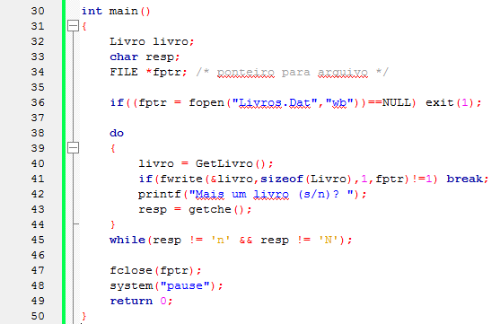

*Figura:* continuação de `Prog11.c` (**A10-11-P11**), linhas 30–50.

### 3.3 A função rewind() (slides 6–11)

<a id="slide-6"></a>
**Slide 6 — Roteiro** · *repete o roteiro do [slide 2](#slide-2), sem destaque do tópico seguinte.*

<a id="slide-7"></a>
**Slide 7 — A Função rwind() [sic]**

> - Usamos essa função em GetLivro() para limpar alguma sobra de bytes no teclado antes da próxima leitura.
> - Seu protótipo é o seguinte:
>
>   ```c
>   void rewind(FILE *stream);
>   ```
>
> - Essa função reposiciona o indicador de posição de arquivo no início do arquivo especificado pelo argumento.

*Nota de transcrição:* `rewind(stdin)` não esvazia o teclado no C padrão; o efeito descrito era particular da biblioteca do Windows. Ver [observação 8.1](#obs-11-1).

<a id="slide-8"></a>
**Slide 8 — A Função rwind() [sic]**

> - A instrução:
>
>   ```c
>   rewind(stdin);
>   ```
>
> - Usa o ponteiro FILE stdin associado ao teclado.
> - Lendo Estruturas do Disco:
>   - O programa a seguir lê objetos gravados pelo programa anterior:

<a id="slide-9"></a>
**Slide 9 — A Função rwind() [sic]**

> 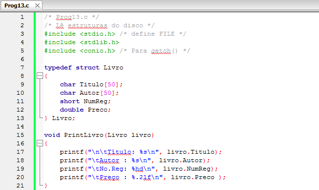

*Figura:* captura do editor com `Prog13.c` (**A10-11-P13**), linhas 1–21 da versão histórica do programa. Fonte revisado: [`src/Fontes_Aula_10_e_11/Prog13.c`](../../src/Fontes_Aula_10_e_11/Prog13.c); versão anterior à revisão de 2026 em texto: [commit `04ac409`](https://github.com/Lucas-Sperotto/falect-cc-011-algoritmos-e-laboratorio-de-programacao-ii/blob/04ac4094dba3c3812809dd433a7d3855c4bffdc9/src/Fontes_Aula_10_e_11/Prog13.c); explicação: [seção 6](#a10-11-p13).

<a id="slide-10"></a>
**Slide 10 — A Função rwind() [sic]**

> 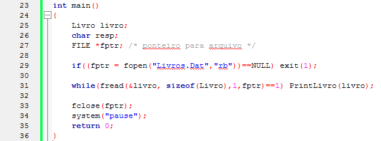

*Figura:* continuação de `Prog13.c` (**A10-11-P13**), linhas 23–36.

<a id="slide-11"></a>
**Slide 11 — A Função rwind() [sic]**

> - Lendo Estruturas do Disco:
>   - Para que os programas de leitura e gravação de objetos trabalhem corretamente é necessário que a seção de dados seja a mesma tanto na leitura quanto na gravação.
>   - As variáveis do tipo Livro dos nossos exemplos têm exatamente 110 bytes de tamanho, sendo que os primeiros 50 bytes são ocupados por uma cadeia de caracteres que representam o título de um livro, os proximos 50 bytes representam o nome do autor, os outros dois, o número do registro do livro e os últimos oito, o preço do livro.

*Nota de transcrição:* no GCC para Linux x86-64, `sizeof(Livro)` é 112, e não 110: o compilador insere 2 bytes de preenchimento antes de `Preco`. Ver [seção 4.1](#c-11-1) e [observação 8.2](#obs-11-2).

### 3.4 Gravando e lendo de um mesmo arquivo (slides 12–18)

<a id="slide-12"></a>
**Slide 12 — Roteiro** · *repete o roteiro do [slide 2](#slide-2), sem destaque do tópico seguinte.*

<a id="slide-13"></a>
**Slide 13 — Gravando e Lendo de Um Mesmo Arquivo**

> - O nosso próximo programa trabalha no mesmo arquivo tanto para gravação como para leitura.
> - O programa adiciona quantos livros o usuário desejar e depois lê e imprime o conteúdo total do arquivo.
> - Eis a listagem:

<a id="slide-14"></a>
**Slide 14 — Gravando e Lendo de Um Mesmo Arquivo**

> 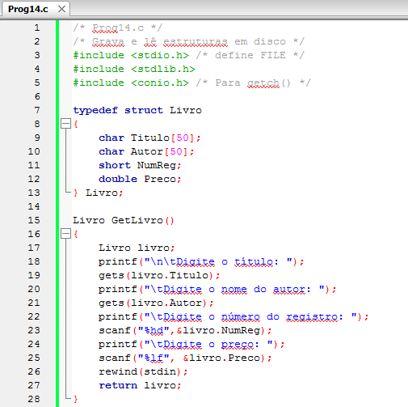

*Figura:* captura do editor com `Prog14.c` (**A10-11-P14**), linhas 1–28 da versão histórica do programa. Fonte revisado: [`src/Fontes_Aula_10_e_11/Prog14.c`](../../src/Fontes_Aula_10_e_11/Prog14.c); versão anterior à revisão de 2026 em texto: [commit `04ac409`](https://github.com/Lucas-Sperotto/falect-cc-011-algoritmos-e-laboratorio-de-programacao-ii/blob/04ac4094dba3c3812809dd433a7d3855c4bffdc9/src/Fontes_Aula_10_e_11/Prog14.c); explicação: [seção 6](#a10-11-p14).

<a id="slide-15"></a>
**Slide 15 — Gravando e Lendo de Um Mesmo Arquivo**

> 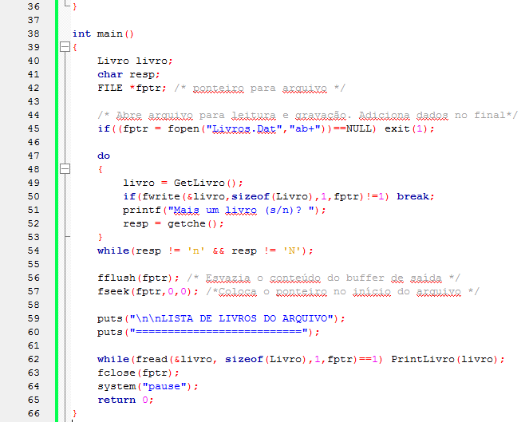

*Figura:* continuação de `Prog14.c` (**A10-11-P14**), linhas 36–66. As linhas 29–35 (função `PrintLivro`) não aparecem nas capturas.

<a id="slide-16"></a>
**Slide 16 — Gravando e Lendo de Um Mesmo Arquivo**

> - A primeira novidade nesse programa é o modo usado para abrir o arquivo.
> - A instrução:
>
>   *\[figura em branco no PDF original\]*
>
> - Abre o arquivo para leitura e gravação.
> - Usamos a para preservar as estruturas que já existem no arquivo e acrescentar novas ao final dele.

*Lacuna:* a figura que deveria mostrar a instrução está **em branco** no PDF original (imagem de 204 × 16 pixels, todos brancos). Pela captura do slide 15 (linha 45), a instrução é `if((fptr = fopen("Livros.Dat","ab+"))==NULL) exit(1);`; isso é uma inferência a partir do programa, e não uma transcrição do slide.

*Nota de transcrição:* ao passar da gravação para a leitura no mesmo arquivo, o padrão exige `fflush` ou um reposicionamento (`fseek`, `rewind`) entre as operações; ver [seção 4.3](#c-11-3).

<a id="slide-17"></a>
**Slide 17 — Gravando e Lendo de Um Mesmo Arquivo**

> - Se o arquivo não existir, será criado.
> - Usamos + pois queremos executar as duas operações: de gravação e de leitura.
> - Usamos b para trabalhar em modo binário.
> - O programa grava uma estrutura por vez usando a função fwrite().

<a id="slide-18"></a>
**Slide 18 — Gravando e Lendo de Um Mesmo Arquivo**

> - Após o termino da gravação das estruturas digitadas, desejamos ler o arquivo inteiro e imprimir seus dados.
> - Antes da leitura, esvaziamos o buffer de saída por meio da instrução:
>
>   ```c
>   fseek(fptr,0,
>   ```
>
>   *\[figura cortada no PDF original; transcrito apenas o trecho visível\]*

*Lacuna:* a figura está **cortada** no PDF original e mostra apenas o início de `fseek(fptr,0,`. O texto anuncia a instrução que esvazia o *buffer*, que no programa é `fflush(fptr);` (linha 56 da captura do slide 15); a figura parece ter sido trocada pela do `fseek`, apresentado nos slides 20 e 24.

### 3.5 A função fflush() (slides 19–20)

<a id="slide-19"></a>
**Slide 19 — Roteiro** · *repete o roteiro do [slide 2](#slide-2), sem destaque do tópico seguinte.*

<a id="slide-20"></a>
**Slide 20 — A Função fflush()**

> - A função fflush() grava o conteúdo de qualquer dado existente no buffer para o arquivo associado ao ponteiro que recebe como argumento.
> - Retorna 0 para indicar sucesso, caso contrário, retorna EOF.
> - Após esvaziar o buffer, devemos modificar a posição corrente do arquivo para o seu inicio.
> - Fazemos isso na instrução:
>
>   *\[figura em branco no PDF original\]*

*Lacuna:* figura **em branco** no PDF original (132 × 17 pixels). Pela captura do slide 15 (linha 57), a instrução é `fseek(fptr,0,0); /*Coloca o ponteiro no inicio do arquivo */` (inferência, não transcrição).

### 3.6 A função fseek() (slides 21–27)

<a id="slide-21"></a>
**Slide 21 — Roteiro** · *repete o roteiro do [slide 2](#slide-2), sem destaque do tópico seguinte.*

<a id="slide-22"></a>
**Slide 22 — A Função fseek()**

> - Para que você possa compreender como esse programa trabalha, é necessário familiarizar-se com o conceito de ponteiros para arquivos.
> - Um ponteiro para um arquivo aponta para um byte particular chamado posição atual.
> - Todas as funções que mostramos neste capítulo precisam conhecer o ponteiro para o arquivo que desejamos manipular.

*Nota de transcrição:* o texto chama de “ponteiro para arquivo” o **indicador de posição**, que é diferente do `FILE *`; ver [observação 8.3](#obs-11-3).

<a id="slide-23"></a>
**Slide 23 — A Função fseek()**

> - A cada tempo em que gravamos ou lemos qualquer coisa no arquivo, o ponteiro é movido para o fim dessa coisa e a próxima leitura ou gravação começará nesse ponto.
> - Quando o arquivo é aberto, o ponteiro é fixado em seu primeiro byte; então, se quisermos ler ou gravar nele estaremos no seu início.

<a id="slide-24"></a>
**Slide 24 — A Função fseek()**

> - Se abrirmos o arquivo usando a opção a (append), o seu ponteiro será posicionado no fim do arquivo.
> - A função fseek() permite movimentar a posição corrente de leitura e gravação do arquivo para uma posição escolhida.
> - A instrução:
>
>   *\[figura em branco no PDF original\]*
>
> - Fixa o ponteiro no primeiro byte do arquivo.

*Lacuna:* figura **em branco** no PDF original, idêntica byte a byte à do slide 20. Pelo texto do slide 25 (“deslocar zero bytes a partir do início do arquivo”), a instrução é `fseek(fptr,0,0);` (inferência, não transcrição).

<a id="slide-25"></a>
**Slide 25 — A Função fseek()**

> - Como a leitura do nosso arquivo deve começar no seu início, queremos deslocar zero bytes a partir do início do arquivo.
> - A função fseek() aceita três argumentos.
> - O primeiro é um ponteiro para a estrutura FILE do arquivo. Após a chamada a fseek(), esse ponteiro será movimentado para a posição que desejarmos.

<a id="slide-26"></a>
**Slide 26 — A Função fseek()**

> - O segundo argumento é chamado deslocamento, e consiste no número de bytes que desejamos deslocar a partir da posição especificada pelo terceiro argumento.

<a id="slide-27"></a>
**Slide 27 — A Função fseek()**

> - O terceiro argumento chama-se posição. Existem três possibilidades para esse número, as quais determinam de onde o deslocamento começará a ser medido, a saber:
>
> | Posição | Significado |
> |---|---|
> | 0 | Início do arquivo |
> | 1 | Posição atual |
> | 2 | Fim do arquivo |

<details><summary>Imagem original (tabela, slide 27)</summary>

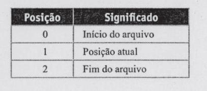

</details>

*Nota de transcrição:* em vez de 0, 1 e 2, use as constantes `SEEK_SET`, `SEEK_CUR` e `SEEK_END` de `<stdio.h>`.

### 3.7 A função ftell() (slides 28–34)

<a id="slide-28"></a>
**Slide 28 — Roteiro** · *repete o roteiro do [slide 2](#slide-2), sem destaque do tópico seguinte.*

<a id="slide-29"></a>
**Slide 29 — A Função ftell()**

> - A função ftell() retorna a posição corrente do ponteiro de um arquivo (em bytes), sempre a partir do início do arquivo.
> - Essa função aceita um único argumento, que é o ponteiro para a estrutura FILE do arquivo, e retorna um valor do tipo long, que representa o número de bytes do começo do arquivo até a posição atual.

<a id="slide-30"></a>
**Slide 30 — A Função ftell()**

> - A função ftell() pode não retornar o número exato de bytes se for usada com arquivos em modo texto.
> - Lembre-se de que, em modo texto, a combinação CR/LF é representada por um único caractere em C.

*Nota de transcrição:* em modo texto, o valor de `ftell` só tem garantia de servir para um `fseek` posterior; ver [observação 8.4](#obs-11-4).

<a id="slide-31"></a>
**Slide 31 — A Função ftell()**

> - Calculando o número de registros do arquivo:
>   - Para mostrar o uso das funções fseek() e ftell(), escreveremos um programa que calcula o número de registros do arquivo.
>   - O programa pergunta para o usuário qual é o número de registro que ele quer ver, procura os dados do registro escolhido no arquivo e imprime o seu conteúdo.
>   - Veja a listagem:

<a id="slide-32"></a>
**Slide 32 — A Função ftell()**

> 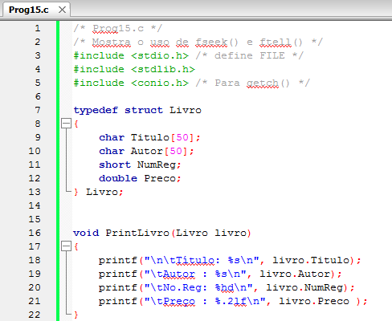

*Figura:* captura do editor com `Prog15.c` (**A10-11-P15**), linhas 1–22 da versão histórica do programa. Fonte revisado: [`src/Fontes_Aula_10_e_11/Prog15.c`](../../src/Fontes_Aula_10_e_11/Prog15.c); versão anterior à revisão de 2026 em texto: [commit `04ac409`](https://github.com/Lucas-Sperotto/falect-cc-011-algoritmos-e-laboratorio-de-programacao-ii/blob/04ac4094dba3c3812809dd433a7d3855c4bffdc9/src/Fontes_Aula_10_e_11/Prog15.c); explicação: [seção 6](#a10-11-p15).

<a id="slide-33"></a>
**Slide 33 — A Função ftell()**

> 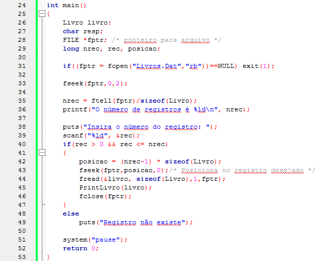

*Figura:* continuação de `Prog15.c` (**A10-11-P15**), linhas 24–53. A linha 42, `posicao = (nrec-1) * sizeof(Livro);`, usa o total de registros (`nrec`) em vez do registro pedido (`rec`): o programa sempre mostra o último livro. Ver [observação 8.5](#obs-11-5).

<a id="slide-34"></a>
**Slide 34 — A Função ftell()**

> - Calculando o número de registros do arquivo:
>   - Observe que o número de registros começa em 1 para o usuário e em 0 para o programa.
>   - Assim, na instrução:
>
>     ```c
>     posicao = (nrec-1) * sizeof(Livro);
>     ```
>
>   - Corrigimos a diferença.

*Nota de transcrição:* a correção descrita (“começa em 1 para o usuário e em 0 para o programa”) exige `rec - 1`; com `nrec - 1`, o programa sempre posiciona no último registro. Ver [observação 8.5](#obs-11-5).

### 3.8 Imprimindo na impressora (slides 35–38)

<a id="slide-35"></a>
**Slide 35 — Roteiro** · *repete o roteiro do [slide 2](#slide-2), sem destaque do tópico seguinte.*

<a id="slide-36"></a>
**Slide 36 — Imprimindo na Impressora**

> - Imprimir dados na impressora é exatamente a mesma coisa que gravar dados num arquivo em disco.
> - O sistema operacional define o nome de alguns periféricos ligados ao computador.
> - Qualquer um deles pode ser usado em nossos programas como nomes de arquivos.

<a id="slide-37"></a>
**Slide 37 — Imprimindo na Impressora**

> - A tabela seguinte descreve estes nomes:
>
> | Nome | Descrição |
> |---|---|
> | COM | Console (teclado e vídeo). |
> | AUX ou COM1 | Primeira porta serial. |
> | COM2 | Segunda porta serial. |
> | PRN ou LPT1 | Primeira impressora paralela. |
> | LPT2 | Segunda impressora paralela. |
> | LPT3 | Terceira impressora paralela. |
> | NULL | Periférico inexistente. |
>
> - O programa seguinte usa o nome PRN para abrir a primeira impressora paralela e imprime nela o conteúdo do arquivo especificado na linha de comando.

<details><summary>Imagem original (tabela, slide 37)</summary>

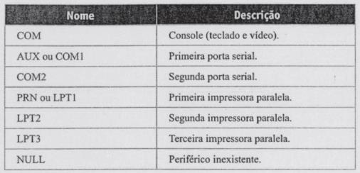

</details>

*Nota de transcrição:* nos sistemas DOS e Windows, os nomes reservados são CON (console) e NUL (dispositivo nulo); “COM” e “NULL” na tabela parecem erros de digitação. Ver [observação 8.6](#obs-11-6).

<a id="slide-38"></a>
**Slide 38 — Imprimindo na Impressora**

> 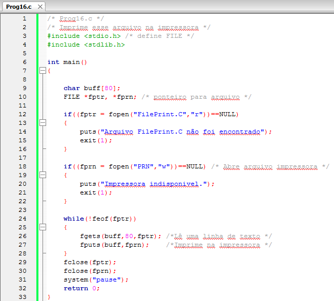

*Figura:* captura do editor com `Prog16.c` (**A10-11-P16**), linhas 1–33 da versão histórica do programa. Fonte revisado: [`src/Fontes_Aula_10_e_11/Prog16.c`](../../src/Fontes_Aula_10_e_11/Prog16.c); versão anterior à revisão de 2026 em texto: [commit `04ac409`](https://github.com/Lucas-Sperotto/falect-cc-011-algoritmos-e-laboratorio-de-programacao-ii/blob/04ac4094dba3c3812809dd433a7d3855c4bffdc9/src/Fontes_Aula_10_e_11/Prog16.c); explicação: [seção 6](#a10-11-p16). O programa abre o arquivo fixo `FilePrint.C` (e não o informado na linha de comando, como diz o slide 37) e lê com `while(!feof(fptr))`; ver [observação 8.6](#obs-11-6).

### 3.9 Condições de erro (slides 39–45)

<a id="slide-39"></a>
**Slide 39 — Roteiro** · *repete o roteiro do [slide 2](#slide-2), sem destaque do tópico seguinte.*

<a id="slide-40"></a>
**Slide 40 — Condições de Erro**

> - Na maioria dos casos, se um arquivo for aberto com sucesso, poderemos ler ou escrever nele.
> - Existem situações, entretanto, em que isso não acontece.
> - Um problema de hardware pode ocorrer enquanto a leitura ou gravação estiver sendo executada;

<a id="slide-41"></a>
**Slide 41 — Condições de Erro**

> - O espaço final em disco, enquanto gravamos, pode ser insuficiente ou pode ocorrer qualquer outro problema.
> - Em nossos programas, assumimos que semelhantes erros de leitura e gravação não ocorrem.
> - Mas em situações reais, como programas em que a integridade dos dados é crítica, pode ser desejável a verificação explícita de erros.

<a id="slide-42"></a>
**Slide 42 — Condições de Erro**

> - Várias funções de E/S não retornam um erro explícito.
> - Por exemplo, se fputc() retornar EOF, isso pode indicar tanto um EOF como um erro.
> - Para determinar se um erro ocorreu, podemos usar a função ferror().
> - Tal função retorna verdadeiro se tiver ocorrido um erro durante a última operação no arquivo ou, caso contrário, retorna zero (falso).

*Nota de transcrição:* para `fputc`, o retorno `EOF` sempre indica erro; a ambiguidade entre fim e erro é das funções de leitura. Ver [observação 8.7](#obs-11-7).

<a id="slide-43"></a>
**Slide 43 — Condições de Erro**

> - O seu único argumento é um ponteiro file.
> - Outra função útil em conjunto com ferror() é perror().
> - Seu único argumento é uma mensagem de erro que indica em que parte do programa ocorreu.
> - A mensagem é impressa seguida de vírgula e da mensagem de erro do sistema.

*Nota de transcrição:* `perror` imprime a mensagem, dois-pontos, um espaço e a descrição do erro.

<a id="slide-44"></a>
**Slide 44 — Condições de Erro**

> - Se um arquivo foi aberto para gravação, podemos implementar o seguinte trecho de código:
>
>   ```c
>   if (ferror(fptr)){
>       /* Verifica erro */
>       perror("Erro de Gravação: ");
>       fclose(fptr);
>       exit(1);
>   }
>   ```
>
> - Se, por exemplo, for detectado um erro de disco, ferror() retornará um valor verdadeiro (não zero) e perror() imprimirá a seguinte mensagem
>
>   **Erro de gravação: Bad data**

<a id="slide-45"></a>
**Slide 45 — Condições de Erro**

> - A primeira parte da mensagem é fornecida pelo programa, e a segunda, pelo sistema operacional.
> - Mensagens de erros explicitas podem ser informativas para o usuário e para o programador durante o desenvolvimento do programa.

### 3.10 Leitura e gravação em baixo nível (slides 46–51)

<a id="slide-46"></a>
**Slide 46 — Roteiro** · *repete o roteiro do [slide 2](#slide-2), sem destaque do tópico seguinte.*

<a id="slide-47"></a>
**Slide 47 — Leitura e Gravação em Baixo-Nível**

> - A leitura e gravação em baixo-nível oferece somente duas funções: read() e write().
> - Em baixo-nível, os dados não podem ser lidos ou gravados como caracteres individuais, strings ou formatados como em alto-nível.
> - Existem somente um modo [sic] de ler e gravar dados: por meio de um buffer cheio de dados.

*Nota de transcrição:* `read`, `write`, `open`, `close` e `lseek` pertencem ao padrão POSIX (sistema operacional), e não à biblioteca padrão do C; ver [observação 8.8](#obs-11-8).

<a id="slide-48"></a>
**Slide 48 — Leitura e Gravação em Baixo-Nível**

> - Gravar ou ler um buffer completo de dados se assemelha à maneira de ler e gravar blocos de bytes em alto-nível ou também chamado leitura e gravação bufferizada.
> - Entretanto, a leitura e gravação não bufferizada, ou baixo-nível, obriga o programador a criar e manter o buffer de dados.
> - As funções não farão essa manutenção.

<a id="slide-49"></a>
**Slide 49 — Leitura e Gravação em Baixo-Nível**

> - Há algumas vantagens em usar o modo não bufferizado, pois possibilita a criação de funções menores e mais rápidas.
> - As funções de alto-nível foram criadas usando as funções de baixo-nível.
> - Baixo-nível é o método básico de leitura e gravação, então, as funções de baixo-nível são usadas para a criação de funções de alto-nível.

<a id="slide-50"></a>
**Slide 50 — Leitura e Gravação em Baixo-Nível**

> - As funções de baixo-nível podem acessar os arquivos de entrada padrão, saída padrão e a saída de erros usando os seguintes descritores de arquivos:
>   - Stdin 0
>   - Stdout 1
>   - Stderr 2
> - Imprimindo no vídeo e lendo do teclado em baixo-nível:

*Nota de transcrição:* no POSIX, esses números têm nomes: `STDIN_FILENO`, `STDOUT_FILENO` e `STDERR_FILENO` (`<unistd.h>`).

<a id="slide-51"></a>
**Slide 51 — Leitura e Gravação em Baixo-Nível**

> 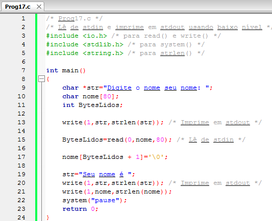

*Figura:* captura do editor com `Prog17.c` (**A10-11-P17**), linhas 1–24 da versão histórica do programa. Fonte revisado: [`src/Fontes_Aula_10_e_11/Prog17.c`](../../src/Fontes_Aula_10_e_11/Prog17.c); versão anterior à revisão de 2026 em texto: [commit `04ac409`](https://github.com/Lucas-Sperotto/falect-cc-011-algoritmos-e-laboratorio-de-programacao-ii/blob/04ac4094dba3c3812809dd433a7d3855c4bffdc9/src/Fontes_Aula_10_e_11/Prog17.c); explicação: [seção 6](#a10-11-p17). A linha 17, `nome[BytesLidos + 1]='\0';`, grava o terminador uma posição adiante do correto; ver [observação 8.9](#obs-11-9).

### 3.11 A função write() (slides 52–53)

<a id="slide-52"></a>
**Slide 52 — Roteiro** · *repete o roteiro do [slide 2](#slide-2), sem destaque do tópico seguinte.*

<a id="slide-53"></a>
**Slide 53 — A função write()**

> - A função write() recebe três argumentos: o descritor do arquivo no qual iremos gravar, o endereço do início do buffer que queremos gravar e o número de bytes a serem gravados. Nosso programa grava no arquivo stdout (video) por meio da instrução:
>
>   ```c
>   write(1,str,strlen(str)); /* Imprime em stdout */
>   ```
>
> - A função write() retorna o número de bytes realmente gravados.

### 3.12 A função read() (slides 54–59)

<a id="slide-54"></a>
**Slide 54 — Roteiro** · *repete o roteiro do [slide 2](#slide-2), sem destaque do tópico seguinte.*

<a id="slide-55"></a>
**Slide 55 — A função read()**

> - A função read() recebe três argumentos: o descritor do arquivo no queremos [sic] ler, o endereço do início do buffer em que iremos colocar os dados lidos e o número máximo de bytes a serem lidos. Nosso programa lê arquivo stdin (teclado) por meio da instrução:
>
>   ```c
>   BytesLidos=read(0,nome,80); /* Lê de stdin */
>   ```
>
> - A função read() retorna o número de bytes realmente lidos.

<a id="slide-56"></a>
**Slide 56 — A função read()**

> - Esse é um número importante, visto que pode muito bem ser menor que o número de bytes especificado no terceiro argumento.
> - Precisamos saber justamente quanto foi lido antes de podermos fazer qualquer coisa com seu conteúdo.
> - Atribuímos esse número à variável BytesLidos.
> - O caractere \0 não é adicionado, fazemos isso na instrução:
>
>   ```c
>   nome[BytesLidos + 1]='\0';
>   ```

*Nota de transcrição:* o terminador deve ficar em `nome[BytesLidos]`, e a leitura deve pedir no máximo `sizeof nome - 1` bytes; ver [observação 8.9](#obs-11-9).

<a id="slide-57"></a>
**Slide 57 — A função read()**

> - Lendo em baixo-nível de arquivos em disco:
>   - O nosso primeiro exemplo é um programa que abre e lê um arquivo em disco e, em seguida, imprime-o no vídeo.
>   - Usaremos o arquivo informado na linha de comandos:

<a id="slide-58"></a>
**Slide 58 — A função read()**

> 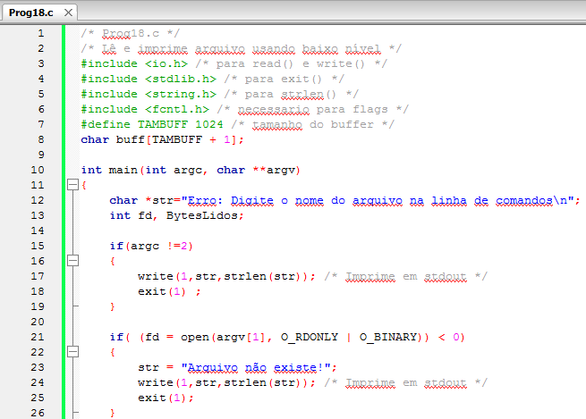

*Figura:* captura do editor com `Prog18.c` (**A10-11-P18**), linhas 1–26 da versão histórica do programa. Fonte revisado: [`src/Fontes_Aula_10_e_11/Prog18.c`](../../src/Fontes_Aula_10_e_11/Prog18.c); versão anterior à revisão de 2026 em texto: [commit `04ac409`](https://github.com/Lucas-Sperotto/falect-cc-011-algoritmos-e-laboratorio-de-programacao-ii/blob/04ac4094dba3c3812809dd433a7d3855c4bffdc9/src/Fontes_Aula_10_e_11/Prog18.c); explicação: [seção 6](#a10-11-p18).

<a id="slide-59"></a>
**Slide 59 — A função read()**

> 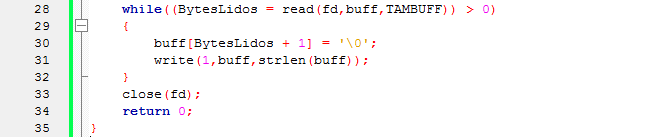

*Figura:* continuação de `Prog18.c` (**A10-11-P18**), linhas 28–35.

### 3.13 Fixando o tamanho do buffer (slides 60–62)

<a id="slide-60"></a>
**Slide 60 — Roteiro** · *repete o roteiro do [slide 2](#slide-2), sem destaque do tópico seguinte.*

<a id="slide-61"></a>
**Slide 61 — Fixando o Tamanho do Buffer**

> - Em baixo-nível, nossos programas devem manter a área de memória em que os dados lidos do arquivo serão colocados.
> - Essa área de memória é chamada de buffer.
> - As instruções para criar o buffer de caracteres são:
>
>   ```c
>   #define TAMBUFF 1024 /* tamanho do buffer */
>   char buff[TAMBUFF + 1];
>   ```

<a id="slide-62"></a>
**Slide 62 — Fixando o Tamanho do Buffer**

> - O tamanho do buffer é importante para uma operação eficiente.
> - Dependendo do sistema operacional, buffers de certos tamanhos são manuseados de modo mais eficiente que outros.
> - Geralmente, o tamanho ótimo de buffer é múltiplo de 512 bytes.
> - Portanto 512, 1024, 2048, ou 4096 podem ser usados.

*Nota de transcrição:* sobre o tamanho do *buffer*, ver [observação 8.10](#obs-11-10).

### 3.14 A função open() (slides 63–69)

<a id="slide-63"></a>
**Slide 63 — Roteiro** · *repete o roteiro do [slide 2](#slide-2), sem destaque do tópico seguinte.*

<a id="slide-64"></a>
**Slide 64 — A Função open()**

> - Antes de poder acessar um arquivo em baixo-nível, você deve abri-lo usando a função open().
> - Seu primeiro argumento é o nome completo (com caminho) do arquivo que queremos abrir.
> - Já o segundo argumento indica o modo em que o arquivo será acessado.

<a id="slide-65"></a>
**Slide 65 — A Função open()**

> - Cada modo é indicado por uma constante chamada flag, cujo valor está definido no arquivo fcntl.h.
> - Para informar as nossas opções entre as possibilidades de abertura do arquivo (leitura, gravação, modo texto, modo binário) devemos combinar múltiplos flags por meio do operador OR (|) bit-a-bit.

*Nota de transcrição:* `fcntl.h` define os *flags* no POSIX; `O_BINARY` e `O_TEXT` só existem no Windows. Ver [observação 8.11](#obs-11-11).

<a id="slide-66"></a>
**Slide 66 — A Função open()**

> - A tabela seguinte descreve essas combinações de flags:
>
> | Flag | Significado |
> |---|---|
> | O_APPEND | Posiciona o ponteiro de arquivo no fim dele. |
> | O_CREAT | Cria o arquivo, caso não exista. |
> | O_RDONLY | Abre o arquivo somente para leitura. |
> | O_WRONLY | Abre o arquivo somente para gravação. |
> | O_RDWR | Abre o arquivo somente para leitura e gravação. |
> | O_TRUNC | Abre e trunca o conteúdo de um arquivo existente para o tamanho zero. |
> | O_BINARY | Abre arquivo no modo binário. |
> | O_TEXT | Abre arquivo no modo texto. |

<details><summary>Imagem original (tabela, slide 66)</summary>


</details>

*Nota de transcrição:* `O_BINARY` e `O_TEXT` existem apenas no Windows; ver [observação 8.11](#obs-11-11).

<a id="slide-67"></a>
**Slide 67 — A Função open()**

> - Algumas das possibilidades listadas são mutuamente exclusivas, por exemplo, você não pode abrir o arquivo para somente-leitura e somente-gravação ao mesmo tempo.
> - O terceiro argumento é requerido somente quando O_CREAT é especificado.

<a id="slide-68"></a>
**Slide 68 — A Função open()**

> - Se o arquivo já existir, esse argumento é ignorado.
> - Caso contrário, especifica os flags de permissão que serão selecionados quando o novo arquivo for gravado pela primeira vez.
> - Quando abrimos um arquivo com open(), as permissões selecionadas na criação do arquivo são aplicadas.
> - Essas permissões estão definidas no arquivo sys\stat.h.

<a id="slide-69"></a>
**Slide 69 — A Função open()**

> - S_IREAD: Permissão somente para leitura.
> - S_IWRITE: Permissão para gravação.
> - S_IREAD|S_IWRITE: Permissão para leitura e gravação.

*Nota de transcrição:* no POSIX, as permissões usam `S_IRUSR`, `S_IWUSR` etc. (ou números octais como `0600`); ver [observação 8.11](#obs-11-11).

### 3.15 O descritor de arquivo (slides 70–73)

<a id="slide-70"></a>
**Slide 70 — Roteiro** · *repete o roteiro do [slide 2](#slide-2), sem destaque do tópico seguinte.*

<a id="slide-71"></a>
**Slide 71 — O descritor de arquivo**

> - Observe que o arquivo stdio.h, que era necessário em alto-nível, não o é aqui.
> - Ao contrário de arquivos em alto-nível que usam um ponteiro FILE para a comunicação entre o sistema operacional e o seu arquivo, em baixo-nível requer-se um descritor de arquivo.

<a id="slide-72"></a>
**Slide 72 — O descritor de arquivo**

> - Se tudo ocorrer com sucesso, a função open() retornará um número inteiro chamado descritor de arquivo.
> - Caso ocorra um erro, retornará -1 e definirá a variável global errno com um dos seguintes valores:
>   - EACCES: Permissão de acesso negada.
>   - EEXIST: Arquivo já existe.
>   - EINVAL: código de acesso (flags) inválido.
>   - EMFILE: Arquivos demais abertos.
>   - ENOENT: Arquivo não existe.

*Nota de transcrição:* `errno` é uma macro de `<errno.h>`, e não necessariamente uma variável global; ver [observação 8.12](#obs-11-12).

<a id="slide-73"></a>
**Slide 73 — O descritor de arquivo**

> - Lendo com read()
>   - Nosso arquivo foi aberto para leitura em binário.
>   - Depois de aberto, o programa lê seus dados por meio da instrução:
>
>     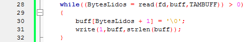
>
>   - O programa coloca as informações contidas no arquivo na matriz buff[].
>   - Após cada leitura, adicionamos o caractere zero na matriz e imprimimos o seu conteúdo no vídeo.

*Figura:* continuação de `Prog18.c` (**A10-11-P18**), linhas 28–32. Repete o laço de leitura já mostrado no slide 59.

### 3.16 A função close() (slides 74–75)

<a id="slide-74"></a>
**Slide 74 — Roteiro** · *repete o roteiro do [slide 2](#slide-2), sem destaque do tópico seguinte.*

<a id="slide-75"></a>
**Slide 75 — A função close()**

> - Usamos close() para fechar o arquivo, liberando, assim, as áreas de comunicação para serem usadas por outros arquivos.
> - A função close() é chamada com um único argumento: o descritor do arquivo.

### 3.17 Mensagens de erros (slides 76–77)

<a id="slide-76"></a>
**Slide 76 — Roteiro** · *repete o roteiro do [slide 2](#slide-2), sem destaque do tópico seguinte.*

<a id="slide-77"></a>
**Slide 77 — Mensagens de erros**

> - Podemos usar a função perror() para verificar o tipo de erro ocorrido:
>
>   ```c
>   if( (fd = open(argv[1], O_RDONLY | O_BINARY)) < 0)
>   {
>       perror("Não foi possível abrir o arquivo para leitura!");
>       exit(1);
>   }
>   ```

### 3.18 A função lseek() (slides 78–81)

<a id="slide-78"></a>
**Slide 78 — Roteiro** · *repete o roteiro do [slide 2](#slide-2), sem destaque do tópico seguinte.*

<a id="slide-79"></a>
**Slide 79 — A função lseek()**

> - Nossos exemplos acessam arquivos para leitura e gravação de modo sequencial, usando as técnicas de baixo-nível.
> - Programas mais sofisticados precisam ser capazes de ler e gravar arquivos de modo aleatório.
> - A função lseek() é semelhante à função fseek(), que permite movimentar a posição corrente de leitura e gravação do arquivo para uma posição escolhida.

<a id="slide-80"></a>
**Slide 80 — A função lseek()**

> - A função lseek() aceita três argumentos.
> - O primeiro argumento é o descritor do arquivo.
> - O segundo é o número de bytes que desejamos deslocar a partir da posição especificada pelo terceiro argumento; e este, por sua vez, é chamado posição.

<a id="slide-81"></a>
**Slide 81 — A função lseek()**

> - Existem três possibilidades para esse número que determinam de onde o deslocamento começará a ser medido.
>
> | Posição | Significado |
> |---|---|
> | 0 | Início do arquivo |
> | 1 | Posição atual |
> | 2 | Fim do arquivo |

<details><summary>Imagem original (tabela, slide 81)</summary>

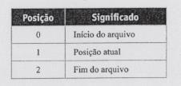

</details>

### 3.19 A função tell() (slides 82–83)

<a id="slide-82"></a>
**Slide 82 — Roteiro** · *repete o roteiro do [slide 2](#slide-2), sem destaque do tópico seguinte.*

<a id="slide-83"></a>
**Slide 83 — A função tell()**

> - A função tell() retorna a posição corrente de um arquivo (em bytes), sempre a partir do inicio do arquivo.
> - Essa função aceita um único argumento – o descritor do arquivo - e retorna um valor do tipo long, que representa o número de bytes do começo do arquivo até a posição atual.

*Nota de transcrição:* `tell()` não é POSIX nem C padrão; no Linux usa-se `lseek(fd, 0, SEEK_CUR)`. Ver [observação 8.13](#obs-11-13).

### 3.20 Operando com buffers (slides 84–90)

<a id="slide-84"></a>
**Slide 84 — Roteiro** · *repete o roteiro do [slide 2](#slide-2), sem destaque do tópico seguinte.*

<a id="slide-85"></a>
**Slide 85 — Operando com buffers**

> - A técnica de guardar o conteúdo de um arquivo em um buffer proporciona várias vantagens.
> - Por exemplo, podemos executar várias operações nos dados do buffer sem ter de acessar o arquivo novamente.
> - A biblioteca C oferece algumas funções com a finalidade de otimizar operações em dados bufferizados.

<a id="slide-86"></a>
**Slide 86 — Operando com buffers**

> - O programa procura uma palavra, fornecida pelo usuário na linha de comandos, em um arquivo-texto em disco.
>
>   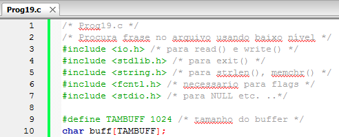

*Figura:* captura do editor com `Prog19.c` (**A10-11-P19**), linhas 1–10 da versão histórica do programa. Fonte revisado: [`src/Fontes_Aula_10_e_11/Prog19.c`](../../src/Fontes_Aula_10_e_11/Prog19.c); versão anterior à revisão de 2026 em texto: [commit `04ac409`](https://github.com/Lucas-Sperotto/falect-cc-011-algoritmos-e-laboratorio-de-programacao-ii/blob/04ac4094dba3c3812809dd433a7d3855c4bffdc9/src/Fontes_Aula_10_e_11/Prog19.c); explicação: [seção 6](#a10-11-p19).

<a id="slide-87"></a>
**Slide 87 — Operando com buffers**

> 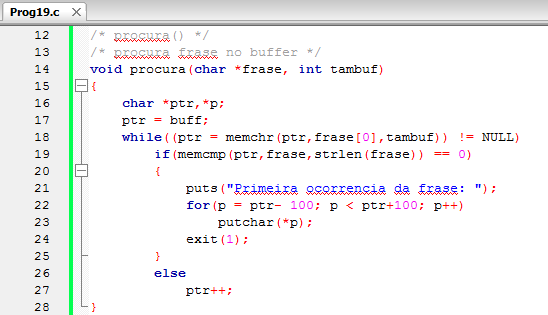

*Figura:* continuação de `Prog19.c` (**A10-11-P19**), linhas 12–28. A busca não reduz o limite `tambuf` ao avançar `ptr` e imprime 100 bytes antes e depois da frase sem verificar os limites do *buffer*; ver [observação 8.14](#obs-11-14).

<a id="slide-88"></a>
**Slide 88 — Operando com buffers**

> 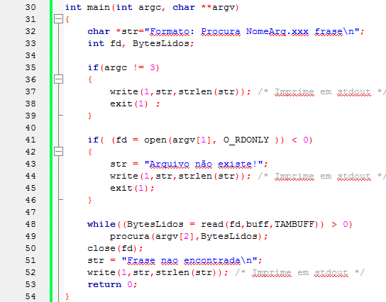

*Figura:* continuação de `Prog19.c` (**A10-11-P19**), linhas 30–54.

<a id="slide-89"></a>
**Slide 89 — Operando com buffers**

> - O programa requer que o usuário digite três argumentos na linha de comando: o nome do programa, o nome do arquivo em que quer procurar e a frase a ser procurada.
> - A frase, na verdade, é uma única palavra, mas o programa pode ser modificado para aceitar uma frase, desde que se concatenem os argumentos da linha de comando que a representam.

<a id="slide-90"></a>
**Slide 90 — Operando com buffers**

> - O programa procura a primeira ocorrência da frase.
> - Para mostrar onde a frase se encontra no arquivo, são impressos 100 caracteres de cada lado da frase.
> - O nosso arquivo é aberto em modo texto, que é o modo padrão e não necessita ser especificado.

*Nota de transcrição:* no Linux, `open()` não tem modo texto: os bytes são lidos sem tradução.

### 3.21 Funções para manipulação de buffers: memchr() e memcmp() (slides 91–96)

<a id="slide-91"></a>
**Slide 91 — Roteiro** · *repete o roteiro do [slide 2](#slide-2), sem destaque do tópico seguinte.*

<a id="slide-92"></a>
**Slide 92 — Funções para manipulação de buffers: memchr() e memcmp()**

> - A função procura() chama duas funções de manipulação de buffer.
> - A primeira delas é memchr().
> - Essa função procura no buffer por um caractere específico.
>
>   ```c
>   (ptr = memchr(ptr,frase[0],tambuf))
>   ```
>
> - Essa instrução mostra os três argumentos necessários para a chamada a memchr().

<a id="slide-93"></a>
**Slide 93 — Funções para manipulação de buffers: memchr() e memcmp()**

> - O primeiro argumento é o endereço do buffer onde queremos procurar.
> - O segundo, é o caractere a ser procurado, neste caso o primeiro caractere da frase que o usuário digitou na linha de comandos (argv[2]).
> - O terceiro parâmetro é o tamanho do buffer a ser procurado.

<a id="slide-94"></a>
**Slide 94 — Funções para manipulação de buffers: memchr() e memcmp()**

> - A função memchr() retorna NULL, se não tiver encontrado o caractere; caso contrário, retorna um ponteiro para o caractere no buffer.
> - Aqui, o ponteiro é atribuído à variável ptr.
> - A função procura() executa então um comando if para verificar se o caractere marca, de fato, o começo da frase.

<a id="slide-95"></a>
**Slide 95 — Funções para manipulação de buffers: memchr() e memcmp()**

> - Esta comparação é executada pela função memcmp(), na expressão:
>
>   ```c
>   if(memcmp(ptr,frase,strlen(frase)) == 0)
>   ```
>
> - Esta função também recebe três argumentos: o ponteiro para o lugar do buffer onde a comparação deve começar, o endereço da frase a ser comparada e o comprimento da frase.
> - A função compara, então, a frase com os caracteres do buffer e, se for igual, retorna 0.

<a id="slide-96"></a>
**Slide 96 — Funções para manipulação de buffers: memchr() e memcmp()**

> - Se a frase for encontrada, procura() imprime caracteres dos dois lados da frase e termina.
> - Caso contrário, o processo é repetido.
> - As funções de manipulação de buffer requerem que o arquivo string.h seja inserido no programa.

### 3.22 Gravando arquivos em baixo nível (slides 97–102)

<a id="slide-97"></a>
**Slide 97 — Roteiro** · *repete o roteiro do [slide 2](#slide-2), sem destaque do tópico seguinte.*

<a id="slide-98"></a>
**Slide 98 — Gravando Arquivos em baixo-nível**

> - Gravar arquivos em baixo-nível é um pouco mais complicado que ler arquivos.
> - Como exemplo, escreveremos um programa que copia um arquivo em outro, isto é, que imita o comando COPY da console.
> - O usuário digita na linha de comandos o nome do arquivo de origem, que deve existir em disco, e o nome do arquivo destino, que será criado.
>
>   ```text
>   C>fcopy origem.txt dest.txt
>   ```

<a id="slide-99"></a>
**Slide 99 — Gravando Arquivos em baixo-nível**

> - Visto que arquivos são abertos em modo binário, qualquer arquivo pode ser copiado: tanto arquivos-texto como programas executáveis, ou arquivos em binário.
>
>   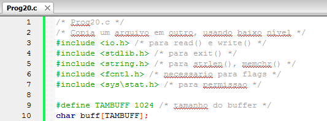

*Figura:* captura do editor com `Prog20.c` (**A10-11-P20**), linhas 1–10 da versão histórica do programa. Fonte revisado: [`src/Fontes_Aula_10_e_11/Prog20.c`](../../src/Fontes_Aula_10_e_11/Prog20.c); versão anterior à revisão de 2026 em texto: [commit `04ac409`](https://github.com/Lucas-Sperotto/falect-cc-011-algoritmos-e-laboratorio-de-programacao-ii/blob/04ac4094dba3c3812809dd433a7d3855c4bffdc9/src/Fontes_Aula_10_e_11/Prog20.c); explicação: [seção 6](#a10-11-p20).

<a id="slide-100"></a>
**Slide 100 — Gravando Arquivos em baixo-nível**

> 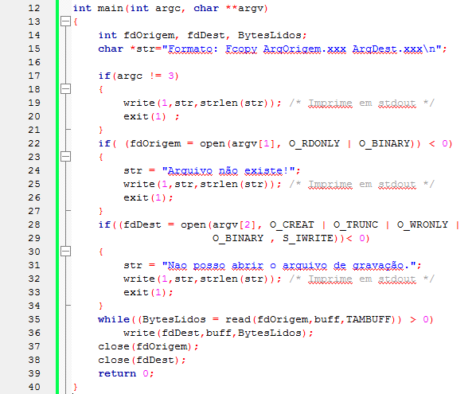

*Figura:* continuação de `Prog20.c` (**A10-11-P20**), linhas 12–40. Com `O_TRUNC`, copiar um arquivo sobre ele mesmo apaga a origem antes da leitura; ver [observação 8.15](#obs-11-15).

<a id="slide-101"></a>
**Slide 101 — Gravando Arquivos em baixo-nível**

> - Dois arquivos são abertos.
> - Um é aquele do qual leremos, e o outro é arquivo que será criado e gravado.
> - Seus descritores são, respectivamente, as variáveis fdOrigem e fdDest.
> - A expressão que abre o arquivo origem é familiar, mas a que abre o arquivo destino tem aspecto diferente.

<a id="slide-102"></a>
**Slide 102 — Gravando Arquivos em baixo-nível**

> ```c
> if((fdDest = open(argv[2], O_CREAT | O_TRUNC | O_WRONLY |
>                   O_BINARY , S_IWRITE))< 0)
> ```
>
> - Para criar um novo arquivo, usamos a flag O_CREAT.
> - Desse modo, a função open() requer um terceiro argumento, a permissão.
> - Queremos a permissão para gravar, assim usamos S_IWRITE.

*Nota de transcrição:* com apenas `S_IWRITE`, o arquivo criado no Linux não teria permissão de leitura nem para o dono; ver [observação 8.11](#obs-11-11).

### 3.23 Quando usar o quê? (slides 103–106)

<a id="slide-103"></a>
**Slide 103 — Roteiro** · *repete o roteiro do [slide 2](#slide-2), sem destaque do tópico seguinte.*

<a id="slide-104"></a>
**Slide 104 — Quando usar o quê?**

> - Pela multiplicidade de funções oferecidas para acessar arquivos em C, é, às vezes, difícil saber que método usar.
> - Leitura e gravação em alto-nível é, provavelmente, o mais valioso quando manuseamos dados como caracteres, strings ou formatados, como em printf().
> - Leitura e gravação em baixo-nível é um método mais natural em situações em que blocos são trabalhados, como matrizes, por exemplo.

<a id="slide-105"></a>
**Slide 105 — Quando usar o quê?**

> - Em muitos casos, alto-nível é mais facil de programar, enquanto baixo-nível gera um código mais eficiente em termos de rapidez e tamanho de código executável.
> - É importante não misturar funções de alto-nível com funções de baixo-nível.

*Nota de transcrição:* a recomendação de não misturar os dois níveis no mesmo arquivo está correta: cada nível tem sua própria posição e seu próprio *buffer*. Ver [seção 4.9](#c-11-9).

<a id="slide-106"></a>
**Slide 106 — Quando usar o quê?**

> - Se um arquivo foi aberto com fopen(), não use read() ou write() com ele e vice-versal [sic], porque, enquanto baixo-nível é usado para ler ou gravar blocos de dados, fread() e fwrite() são usadas em arquivos que são trabalhados por outras funções de alto-nível.
> - Modo texto é usado quando o arquivo contém texto; e modo binário, quando o arquivo pode conter números e outros códigos ASCII. Isso evita problemas de transformação errada de dados numéricos.

### 3.24 Referências do material original (slide 107)

<a id="slide-107"></a>
**Slide 107 — Referências**

> - MIZRAHI, Victorine V. Treinamento em Linguagem C, São Paulo: Pearson Prentice Hall, 2008;

## 4. Explicações complementares

<a id="c-11-1"></a>
### 4.1 Registros binários e o tamanho de `Livro`

`fwrite(&livro, sizeof livro, 1, fptr)` copia para o arquivo os bytes da variável exatamente como estão na memória. O arquivo passa a ser uma sequência de registros de tamanho fixo, e `fread` faz o caminho inverso. A estrutura dos programas é esta:

<!-- codigo: src/Fontes_Aula_10_e_11/Prog11.c de=`/* Formato didático nativo` ate=`} Livro;` -->
<sub>Copiado de [`src/Fontes_Aula_10_e_11/Prog11.c`](../../src/Fontes_Aula_10_e_11/Prog11.c#L15-L22) (linhas 15–22) por `scripts/documentacao_aulas.py`; não edite este bloco à mão.</sub>

```c
/* Formato didático nativo: padding, endian e tamanhos dependem da ABI.
 * Leia somente arquivos gerados por estes exemplos na mesma plataforma. */
typedef struct Livro {
    char Titulo[50];
    char Autor[50];
    short NumReg;
    double Preco;
} Livro;
```
<!-- /codigo -->

A soma dos membros dá 110 bytes (50 + 50 + 2 + 8), o número citado no slide 11. O compilador, porém, pode inserir bytes de **preenchimento** (*padding*) entre os membros para que cada um comece em um endereço adequado ao seu tipo (§6.7.2.1). No GCC para Linux x86-64, `double` precisa começar em múltiplo de 8, e o resultado é:

| Bytes | Membro | Tamanho | Observação |
|---|---|---:|---|
| 0–49 | `Titulo` | 50 | `char[50]` |
| 50–99 | `Autor` | 50 | `char[50]` |
| 100–101 | `NumReg` | 2 | `short` |
| 102–103 | *(preenchimento)* | 2 | para `Preco` começar em 104, múltiplo de 8 |
| 104–111 | `Preco` | 8 | `double` |
| | **total** | **112** | `sizeof(Livro)` |

O próprio programa pode conferir esses números:

```c
#include <stddef.h>   /* offsetof */
printf("%zu %zu %zu\n", sizeof(Livro), offsetof(Livro, NumReg), offsetof(Livro, Preco));
/* GCC, Linux x86-64: 112 100 104 */
```

O [exemplo 7.1](#71-gravar-um-livro-prog11c) mostra o arquivo gravado byte a byte: o título no início, o autor no byte 50 (`0x32`), o registro 7 nos bytes 100–101 (`07 00`, com o byte menos significativo primeiro), dois bytes de preenchimento e o preço 12,5 nos bytes 104–111 (`00 00 00 00 00 00 29 40`, o `double` 0x4029000000000000 em ordem *little-endian*).

Consequências práticas:

- **Use sempre `sizeof`**, nunca o número 110 ou 112 escrito à mão. Os programas desta aula calculam a posição de um registro com `sizeof(Livro)`.
- **O arquivo depende da plataforma.** Tamanho dos tipos, preenchimento, ordem dos bytes e formato do `double` fazem parte do arquivo. Um `Livros.Dat` gravado por outro compilador ou arquitetura pode ser lido errado, e o comentário dos fontes revisados registra isso. Para trocar dados entre sistemas, grave texto (como `fprintf` na [Aula 10](../aula-10/README.md)) ou grave campo a campo com tamanho e ordem de bytes definidos.
- **Bytes não usados também vão para o disco.** Nos fontes revisados, `GetLivro` zera a estrutura com `memset` antes de preenchê-la; por isso o preenchimento e o resto das strings aparecem como zeros. Na versão dos slides, esses bytes guardavam o que estivesse antes na memória.

<a id="c-11-2"></a>
### 4.2 Acesso direto: a posição de um registro

Como todos os registros têm o mesmo tamanho, o registro *k* (contando a partir de 1, como o usuário) começa no byte (*k* − 1) × `sizeof(Livro)`:

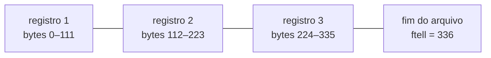

O roteiro de `Prog15.c` é:

```c
fseek(fptr, 0, SEEK_END);                            /* vai para o fim */
tamanho = ftell(fptr);                               /* bytes do início até o fim */
nrec = tamanho / (long)sizeof(Livro);                /* quantidade de registros */
fseek(fptr, (rec - 1) * (long)sizeof(Livro), SEEK_SET);
fread(&livro, sizeof(Livro), 1, fptr);               /* lê o registro rec */
```

O fonte revisado ([seção 6](#a10-11-p15)) confere cada uma dessas chamadas e rejeita um arquivo cujo tamanho não seja múltiplo de `sizeof(Livro)`. Três detalhes:

- o terceiro argumento de `fseek` deve ser escrito com as constantes `SEEK_SET`, `SEEK_CUR` e `SEEK_END`, e não com 0, 1 e 2;
- `ftell` devolve `long`, que no Windows tem 32 bits e limita os arquivos a 2 GiB; para arquivos maiores existem `fgetpos`/`fsetpos` (C padrão) e `ftello`/`fseeko` (POSIX);
- o padrão C não obriga um fluxo binário a aceitar `SEEK_END` de forma significativa (§7.21.9.2), mas no Linux e no Windows ele funciona como esperado.

Para **alterar** um registro sem reescrever o arquivo, abre-se o arquivo em `"rb+"`, posiciona-se com `fseek`, lê-se o registro, posiciona-se de novo e grava-se a versão alterada com `fwrite` ([exercício 1](#92-exercícios-propostos-acréscimo-desta-documentação)).

<a id="c-11-3"></a>
### 4.3 Ler e gravar no mesmo fluxo

Os modos com `+` permitem as duas operações no mesmo `FILE *`, mas a biblioteca usa um único *buffer* para elas. Por isso o padrão impõe uma regra (§7.21.5.3p7): depois de uma **gravação**, só se pode ler após chamar `fflush` ou uma função de posicionamento (`fseek`, `fsetpos` ou `rewind`); depois de uma **leitura**, só se pode gravar após uma função de posicionamento, a menos que a leitura tenha chegado ao fim do arquivo. Sem isso, o comportamento é indefinido.

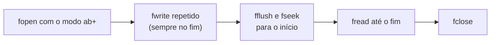

É o que `Prog14.c` faz entre a gravação e a listagem: `fflush(fptr)` seguido de `fseek(fptr, 0, SEEK_SET)`. O `fseek` sozinho já bastaria, porque a regra aceita uma função de posicionamento no lugar de `fflush`.

O modo `a` (*append*) tem uma propriedade que os slides 16 e 24 não mencionam: **toda** gravação vai para o fim do arquivo, mesmo que o programa tenha chamado `fseek` antes (§7.21.5.3p6). As leituras podem acontecer em qualquer posição, mas a posição inicial de leitura no modo `"a+"` varia: a glibc começa no início do arquivo, outros sistemas começam no fim. Posicionar explicitamente com `fseek` antes de ler, como faz `Prog14.c`, evita depender disso.

<a id="c-11-4"></a>
### 4.4 Erros: `ferror`, `feof`, `perror` e `errno`

Cada `FILE` guarda dois indicadores, o de **erro** e o de **fim de arquivo**, ligados pela operação que falhou e mantidos até que o programa os apague.

| Função | O que informa ou faz | Observação |
|---|---|---|
| `ferror(f)` | se alguma operação anterior com `f` falhou | o indicador permanece até `clearerr(f)` ou `rewind(f)` |
| `feof(f)` | se uma leitura já encontrou o fim | não prevê o fim; ver a [Aula 10](../aula-10/README.md#c-10-3) |
| `clearerr(f)` | apaga os dois indicadores | — |
| `errno` | código numérico do último erro (`<errno.h>`) | só tem significado logo após uma chamada que **falhou** |
| `perror(s)` | imprime em `stderr` a mensagem `s`, dois-pontos, um espaço e a descrição de `errno` | `perror("Livros.Dat")` imprime, por exemplo, `Livros.Dat: No such file or directory` |
| `strerror(n)` | devolve o texto da descrição do código `n` (`<string.h>`) | útil para montar mensagens próprias |

Dois cuidados completam o quadro. Primeiro, em uma gravação, os dados podem ficar no *buffer* e só ir para o disco em `fclose`; um erro de disco cheio pode aparecer apenas ali. Por isso os fontes revisados conferem também o retorno de `fclose`:

```c
if (fclose(fptr) == EOF)   /* grava o que restava no buffer; pode falhar */
    status = 1;
```

Segundo, o programa deve terminar com código diferente de zero quando algo falha (`return 1` ou `exit(1)`). É assim que o terminal, um *script* ou outro programa sabem que houve erro; os [exemplos de execução](#7-exemplos-de-execução) mostram esse código em cada caso.

<a id="c-11-5"></a>
### 4.5 Entrada e saída de baixo nível no Linux (POSIX)

As funções da segunda parte da aula não pertencem à biblioteca padrão do C: são chamadas do sistema operacional, padronizadas pelo **POSIX** ([8.8](#obs-11-8)). No Linux, no macOS e no WSL, elas estão nestes cabeçalhos:

| Cabeçalho | Declara |
|---|---|
| `<fcntl.h>` | `open` e os *flags* `O_RDONLY`, `O_WRONLY`, `O_RDWR`, `O_CREAT`, `O_TRUNC`, `O_APPEND` |
| `<unistd.h>` | `read`, `write`, `lseek`, `close` e as constantes `STDIN_FILENO` (0), `STDOUT_FILENO` (1), `STDERR_FILENO` (2) |
| `<sys/stat.h>` | as permissões `S_IRUSR`, `S_IWUSR` etc. e `fstat` |
| `<sys/types.h>` | os tipos `ssize_t` (resultado de `read`/`write`) e `off_t` (posição para `lseek`) |

As adaptações entre o material, feito no Windows, e os fontes revisados são estas:

| No material (Windows) | No Linux (POSIX) |
|---|---|
| `#include <io.h>` | `#include <unistd.h>` |
| `#include <sys\stat.h>` | `#include <sys/stat.h>` (a barra normal funciona também no Windows) |
| `O_BINARY`, `O_TEXT` | não existem: não há tradução de fim de linha |
| `S_IREAD`, `S_IWRITE` | `S_IRUSR`, `S_IWUSR` (ou os números octais `0400`, `0200`) |
| `tell(fd)` | `lseek(fd, 0, SEEK_CUR)` |
| `int BytesLidos` | `ssize_t BytesLidos` |

Um **descritor de arquivo** é um inteiro pequeno que identifica, dentro do processo, um arquivo aberto. Os descritores 0, 1 e 2 já estão abertos quando o programa começa, e `open` devolve o menor número livre. Nos sistemas POSIX, as funções de alto nível são construídas sobre eles: cada `FILE *` guarda um descritor e um *buffer*.


O que `read` e `write` devolvem precisa ser examinado sempre:

| Valor devolvido | `read(fd, buf, n)` | `write(fd, buf, n)` |
|---|---|---|
| maior que 0 | bytes lidos; pode ser **menos** que `n` | bytes gravados; pode ser **menos** que `n` |
| 0 | fim do arquivo | nada gravado (normal só quando `n` é 0) |
| −1 | erro, com o código em `errno`; `EINTR` indica interrupção por um sinal, e a chamada pode ser repetida | idem |

Uma leitura de terminal devolve uma linha por vez; uma leitura de *pipe* devolve o que já chegou; uma gravação em *pipe* ou em disco quase cheio pode ser parcial. Por isso os fontes revisados gravam com um laço que só termina quando todos os bytes foram transferidos:

<!-- codigo: src/Fontes_Aula_10_e_11/Prog17.c funcao=escreve_tudo -->
<sub>Copiado de [`src/Fontes_Aula_10_e_11/Prog17.c`](../../src/Fontes_Aula_10_e_11/Prog17.c#L13-L25) (linhas 13–25) por `scripts/documentacao_aulas.py`; não edite este bloco à mão.</sub>

```c
/* write() pode transferir menos bytes que o solicitado, ou ser interrompida. */
static int escreve_tudo(int fd, const void *dados, size_t tamanho)
{
    const unsigned char *p = dados;
    while (tamanho > 0) {
        ssize_t enviados = write(fd, p, tamanho);
        if (enviados < 0 && errno == EINTR) continue;
        if (enviados <= 0) return 0;
        p += (size_t)enviados;
        tamanho -= (size_t)enviados;
    }
    return 1;
}
```
<!-- /codigo -->

<a id="c-11-6"></a>
### 4.6 `read` lê bytes, não strings

`read` copia bytes para a memória e informa quantos copiou; não acrescenta `'\0'`, e os dados podem conter bytes nulos. Para tratar o resultado como string, é preciso reservar um byte e colocar o terminador **logo depois do último byte lido**:

```c
char nome[80];
ssize_t n = read(STDIN_FILENO, nome, sizeof nome - 1);   /* reserva 1 byte */
if (n >= 0)
    nome[n] = '\0';                                        /* posição n, e não n + 1 */
```

Os programas dos slides 51 e 58 usam `nome[BytesLidos + 1]` e `buff[BytesLidos + 1]`, uma posição adiante. O byte da posição `BytesLidos` fica com o valor que tinha antes, e `strlen` passa a contá-lo. Num teste com GCC no Linux, a versão dos slides de `Prog18.c` (adaptando apenas `io.h` e `O_BINARY`) exibiu 1030 bytes para um arquivo de 1029: depois do último bloco, de 5 bytes, apareceu um byte que sobrou do bloco anterior. Além disso, quando `read` preenche o vetor inteiro, `BytesLidos + 1` aponta para fora dele.

Quando os dados não são texto, o certo é não usar strings: grava-se exatamente o número de bytes lidos, como faz o `Prog18.c` revisado com `escreve_tudo(STDOUT_FILENO, buff, BytesLidos)`. Assim, bytes nulos no meio do arquivo também são copiados.

<a id="c-11-7"></a>
### 4.7 Procurar em blocos com `memchr` e `memcmp`

`memchr(p, c, n)` procura o byte `c` nos `n` bytes a partir de `p`; `memcmp(a, b, n)` compara `n` bytes. Ao contrário das funções de string, elas não param em `'\0'`: **o limite é sempre o `n` informado**, e ele não pode ultrapassar os dados válidos. Na versão dos slides, `procura()` avança `ptr` mas continua passando o tamanho total do bloco, de modo que a busca pode sair do vetor ([8.14](#obs-11-14)).

A versão revisada só procura em posições onde a frase inteira ainda cabe:

<!-- codigo: src/Fontes_Aula_10_e_11/Prog19.c funcao=procura -->
<sub>Copiado de [`src/Fontes_Aula_10_e_11/Prog19.c`](../../src/Fontes_Aula_10_e_11/Prog19.c#L18-L38) (linhas 18–38) por `scripts/documentacao_aulas.py`; não edite este bloco à mão.</sub>

```c
static int procura(const char *frase, size_t tambuf)
{
    size_t tamanho = strlen(frase), pos = 0;
    while (pos + tamanho <= tambuf) {
        /* Só procurar posições em que a frase inteira ainda cabe. */
        char *ptr = memchr(buff + pos, (unsigned char)frase[0], tambuf - pos - tamanho + 1);
        if (ptr == NULL) return 0;
        size_t inicio = (size_t)(ptr - buff);
        if (memcmp(ptr, frase, tamanho) == 0) {
            size_t de = inicio > 100 ? inicio - 100 : 0;
            size_t ate = inicio + tamanho + 100;
            if (ate > tambuf) ate = tambuf;
            puts("Primeira ocorrência da frase: ");
            if (fwrite(buff + de, 1, ate - de, stdout) != ate - de || putchar('\n') == EOF)
                return -1;
            return 1;
        }
        pos = inicio + 1;
    }
    return 0;
}
```
<!-- /codigo -->

Há um segundo problema na leitura em blocos: a frase pode começar no fim de um bloco e terminar no início do seguinte. O `Prog19.c` revisado resolve isso com uma **janela**: depois de cada busca sem sucesso, guarda os últimos `tamanho − 1 + 100` bytes (o suficiente para uma frase incompleta e para o contexto anterior), move-os para o início do *buffer* com `memmove` (as regiões de origem e destino podem se sobrepor, por isso não `memcpy`) e lê o bloco seguinte depois deles:

```text
leitura 1:  [ bytes 0 … 1023 ]                       busca: não encontrou
guarda:                       [ últimos 105 bytes ]   (frase de 6 bytes: 6 − 1 + 100)
leitura 2:  [ 105 bytes guardados | bytes 1024 … ]   busca de novo
```

O [exemplo 7.11](#711-frase-dividida-entre-dois-blocos-prog19c) encontra uma frase que começa no byte 1022 e termina no byte 1027, atravessando o limite entre a primeira e a segunda leitura.

<a id="c-11-8"></a>
### 4.8 Copiar sem destruir a origem

A versão dos slides de `Prog20.c` abre o destino com `O_CREAT | O_TRUNC`. Se o usuário digitar o mesmo arquivo como origem e destino, `O_TRUNC` apaga o conteúdo **antes** da primeira leitura, e a "cópia" termina com o arquivo vazio. Comparar os nomes não basta: `dados.bin`, `./dados.bin` e um *hard link* para ele são nomes diferentes do mesmo arquivo. O que identifica um arquivo no Linux é o par (dispositivo, *inode*), que `fstat` informa. O fonte revisado abre o destino sem truncar, compara esse par e só então esvazia o destino com `ftruncate` ([seção 6](#a10-11-p20) e [exemplo 7.14](#714-origem-igual-ao-destino-prog20c)).

O terceiro argumento de `open` (as permissões) só é usado quando o arquivo é criado, e o sistema ainda retira dele os bits da `umask` do usuário:

| Constante | Octal | Permissão |
|---|---|---|
| `S_IRUSR` | `0400` | leitura pelo dono |
| `S_IWUSR` | `0200` | gravação pelo dono |
| `S_IRGRP` | `0040` | leitura pelo grupo |
| `S_IROTH` | `0004` | leitura pelos demais |

Com só `S_IWRITE` (`0200`), como no slide 102, o arquivo copiado nasce sem permissão de leitura nem para o dono. O fonte revisado usa `S_IRUSR | S_IWUSR` (`0600`).

<a id="c-11-9"></a>
### 4.9 Alto nível × baixo nível

| Aspecto | Alto nível (`stdio.h`) | Baixo nível (POSIX) |
|---|---|---|
| Identifica o arquivo por | `FILE *` | descritor `int` |
| *Buffer* | mantido pela biblioteca | o programa cria o seu, se quiser |
| Funções | `fopen`, `fread`/`fwrite`, `fgets`/`fputs`, `fprintf`/`fscanf`, `fseek`/`ftell`, `fclose` | `open`, `read`/`write`, `lseek`, `close` |
| Formatação de texto | sim | não: só bytes |
| Modo texto | sim (traduz fim de linha no Windows) | não |
| Erros | valor devolvido especial, `ferror`/`feof`, `errno` | −1 e `errno` |
| Portabilidade | qualquer compilador C | sistemas POSIX (Linux, macOS, WSL) |

O slide 105 recomenda não misturar os dois níveis no mesmo arquivo, e a razão é o *buffer*: o que foi gravado com `fputs` pode ainda estar na memória do processo quando um `write` no mesmo arquivo já chegou ao sistema. O programa abaixo, testado com GCC no Linux, grava “primeiro” e depois “segundo”, mas o arquivo termina na ordem inversa:

```c
#define _POSIX_C_SOURCE 200809L   /* declara fileno() com -std=c11 */
#include <stdio.h>
#include <unistd.h>

int main(void)
{
    FILE *f = fopen("log.txt", "w");
    if (f == NULL) return 1;
    fputs("primeiro\n", f);              /* fica no buffer de f */
    write(fileno(f), "segundo\n", 8);    /* vai direto ao arquivo */
    fclose(f);                           /* só agora "primeiro" é gravado */
    return 0;
}
/* conteúdo de log.txt: "segundo\nprimeiro\n" */
```

Se for inevitável alternar, chame `fflush(f)` antes de usar o descritor. Na prática, escolha um nível por arquivo: alto nível para texto e dados formatados, baixo nível para cópias e blocos grandes de bytes, quando se quer controlar o *buffer*.

## 5. Conceitos fundamentais

| Conceito | Definição operacional | Onde aparece |
|---|---|---|
| Registro binário | Estrutura gravada e lida byte a byte com `fwrite`/`fread` | slides 3–11 |
| Preenchimento (*padding*) | Bytes que o compilador insere entre membros de uma estrutura | slide 11 (110 × 112) |
| Indicador de posição | Byte do arquivo em que começa a próxima leitura ou gravação | slides 22–27 |
| Acesso direto | Ir ao registro *k* com `fseek` para (*k* − 1) × tamanho do registro | slides 31–34 |
| Modo de atualização (`+`) | Ler e gravar no mesmo fluxo, com `fflush` ou `fseek` entre as operações | slides 13–20 |
| Indicadores de erro e de fim | Estados de um `FILE` consultados por `ferror` e `feof` | slides 40–45 |
| `errno` e `perror` | Código do último erro e sua descrição em texto | slides 43–45, 72, 77 |
| Descritor de arquivo | Inteiro que identifica um arquivo aberto no processo | slides 50, 70–75 |
| Chamada de sistema | `open`, `read`, `write`, `lseek`, `close`: pedidos diretos ao sistema operacional | slides 47–83 |
| Transferência parcial | `read` e `write` podem transferir menos bytes que o pedido | slides 55–56 |
| Funções de memória | `memchr`, `memcmp`, `memmove`: trabalham com um tamanho explícito, sem `'\0'` | slides 92–96 |
| Permissões de arquivo | Quem pode ler e gravar um arquivo criado com `O_CREAT` | slides 68–69, 102 |

## 6. Programas C da aula

Fontes em [`src/Fontes_Aula_10_e_11/`](../../src/Fontes_Aula_10_e_11/), revisados em 2026 ([revisão por fonte](../../docs/auditorias/REVISAO_POR_FONTE.md#aulas-9-a-11--srcfontes_aula_9-e-srcfontes_aula_10_e_11)). `Prog11.c` a `Prog16.c` usam a biblioteca padrão; `Prog17.c` a `Prog20.c` usam chamadas POSIX ([4.5](#c-11-5)). Os programas que gravam `Livros.Dat` (11, 12 e 14) e os que o leem (13 e 15) compartilham o mesmo formato binário: execute-os na mesma pasta de trabalho e na mesma plataforma ([4.1](#c-11-1)).

| ID | Arquivo | SIGAA | Slides | Tema |
|---|---|---|---|---|
| [A10-11-P11](#a10-11-p11) | [`Prog11.c`](../../src/Fontes_Aula_10_e_11/Prog11.c) | Prog11.c | 3–8 | gravar estruturas |
| [A10-11-P12](#a10-11-p12) | [`Prog12.c`](../../src/Fontes_Aula_10_e_11/Prog12.c) | Prog12.c | — | repetição de `Prog11.c` |
| [A10-11-P13](#a10-11-p13) | [`Prog13.c`](../../src/Fontes_Aula_10_e_11/Prog13.c) | Prog13.c | 8–11 | ler estruturas |
| [A10-11-P14](#a10-11-p14) | [`Prog14.c`](../../src/Fontes_Aula_10_e_11/Prog14.c) | Prog14.c | 13–27 | gravar e ler no mesmo arquivo |
| [A10-11-P15](#a10-11-p15) | [`Prog15.c`](../../src/Fontes_Aula_10_e_11/Prog15.c) | Prog15.c | 29–34 | `fseek`/`ftell` e acesso direto |
| [A10-11-P16](#a10-11-p16) | [`Prog16.c`](../../src/Fontes_Aula_10_e_11/Prog16.c) | Prog16.c | 36–38 | enviar um arquivo à impressora |
| [A10-11-P17](#a10-11-p17) | [`Prog17.c`](../../src/Fontes_Aula_10_e_11/Prog17.c) | Prog17.c | 47–56 | `read`/`write` no teclado e no vídeo |
| [A10-11-P18](#a10-11-p18) | [`Prog18.c`](../../src/Fontes_Aula_10_e_11/Prog18.c) | Prog18.c | 57–77 | ler um arquivo em baixo nível |
| [A10-11-P19](#a10-11-p19) | [`Prog19.c`](../../src/Fontes_Aula_10_e_11/Prog19.c) | Prog19.c | 85–96 | procurar com `memchr`/`memcmp` |
| [A10-11-P20](#a10-11-p20) | [`Prog20.c`](../../src/Fontes_Aula_10_e_11/Prog20.c) | Prog20.c | 98–102 | copiar em baixo nível |

<a id="a10-11-p11"></a>
### 6.1 A10-11-P11 — `Prog11.c`: gravar estruturas

- **Finalidade:** ler livros do teclado e gravá-los em `Livros.Dat`, um registro de `sizeof(Livro)` bytes por livro. O modo `"wb"` recria o arquivo a cada execução.
- **Entrada:** título, autor, número do registro, preço e a resposta `s`/`n`, uma informação por linha. **Saída:** as perguntas na tela e o arquivo binário ([exemplo 7.1](#71-gravar-um-livro-prog11c)).
- **Diferença em relação aos slides 4–5:** `gets`, removida do C11, e `scanf` seguidos de `rewind(stdin)` deram lugar a `ler_linha` (de [`src/entrada_segura.h`](../../src/entrada_segura.h)) e às conversões `strtol` e `strtod`, que rejeitam registro fora da faixa de `short` e preço não numérico; `getche()` virou a leitura de uma linha; `GetLivro` recebe um ponteiro, zera a estrutura e informa se a leitura deu certo; entrada inválida encerra com código 1 ([8.1](#obs-11-1)).

<!-- codigo: src/Fontes_Aula_10_e_11/Prog11.c funcao=GetLivro -->
<sub>Copiado de [`src/Fontes_Aula_10_e_11/Prog11.c`](../../src/Fontes_Aula_10_e_11/Prog11.c#L24-L46) (linhas 24–46) por `scripts/documentacao_aulas.py`; não edite este bloco à mão.</sub>

```c
/* gets() foi removida em C11; cada campo recebe uma linha limitada. */
int GetLivro(Livro *livro)
{
    char linha[80], *fim;
    long registro;
    memset(livro, 0, sizeof *livro);
    printf("\n\tDigite o título: ");
    if (!ler_linha(livro->Titulo, sizeof livro->Titulo)) return 0;
    printf("\tDigite o nome do autor: ");
    if (!ler_linha(livro->Autor, sizeof livro->Autor)) return 0;
    printf("\tDigite o número do registro: ");
    if (!ler_linha(linha, sizeof linha)) return 0;
    errno = 0;
    registro = strtol(linha, &fim, 10);
    if (fim == linha || *fim != '\0' || errno || registro < SHRT_MIN || registro > SHRT_MAX)
        return 0;
    livro->NumReg = (short)registro;
    printf("\tDigite o preço: ");
    if (!ler_linha(linha, sizeof linha)) return 0;
    errno = 0;
    livro->Preco = strtod(linha, &fim);
    return fim != linha && *fim == '\0' && errno == 0 && isfinite(livro->Preco);
}
```
<!-- /codigo -->

<a id="a10-11-p12"></a>
### 6.2 A10-11-P12 — `Prog12.c`: repetição de `Prog11.c`

O SIGAA descreve `Prog12.c` como “Mostra a gravação de estruturas em um arquivo binário”, mas o arquivo é igual a `Prog11.c`, exceto pelo identificador e pelo comentário inicial, e não aparece nos slides (que passam de `Prog11.c` para `Prog13.c`). O código não é repetido aqui; ver [`Prog12.c`](../../src/Fontes_Aula_10_e_11/Prog12.c) e as [recomendações](../../docs/auditorias/CLAUDE_AUDIT.md#recomendacoes).

<a id="a10-11-p13"></a>
### 6.3 A10-11-P13 — `Prog13.c`: ler estruturas

- **Finalidade:** ler `Livros.Dat` e imprimir todos os registros. **Entrada:** o arquivo. **Saída:** título, autor, registro e preço de cada livro ([exemplo 7.2](#72-ler-os-registros-prog13c)).
- **Diferença em relação aos slides 9–10:** `fread` lê `sizeof livro` itens de 1 byte, para distinguir um registro completo de um pedaço no fim do arquivo; um registro incompleto ou um erro de leitura encerram com código 1 ([exemplo 7.3](#73-registro-incompleto-prog13c)); `PrintLivro` garante o terminador das strings antes de imprimi-las, porque o arquivo pode ter sido gravado por outro programa.

<!-- codigo: src/Fontes_Aula_10_e_11/Prog13.c de=`while ((lidos = fread(` ate=`if (lidos != 0 || ferror(fptr))` -->
<sub>Copiado de [`src/Fontes_Aula_10_e_11/Prog13.c`](../../src/Fontes_Aula_10_e_11/Prog13.c#L37-L40) (linhas 37–40) por `scripts/documentacao_aulas.py`; não edite este bloco à mão.</sub>

```c
    while ((lidos = fread(&livro, 1, sizeof livro, fptr)) == sizeof livro)
        PrintLivro(livro);
    /* Registro parcial não deve ser interpretado como uma estrutura completa. */
    if (lidos != 0 || ferror(fptr)) status = 1;
```
<!-- /codigo -->

<a id="a10-11-p14"></a>
### 6.4 A10-11-P14 — `Prog14.c`: gravar e ler no mesmo arquivo

- **Finalidade:** acrescentar livros ao fim de `Livros.Dat` (modo `"ab+"`) e depois listar o arquivo inteiro ([4.3](#c-11-3) e [exemplo 7.4](#74-gravar-e-listar-no-mesmo-arquivo-prog14c)).
- **Diferença em relação aos slides 14–15:** a entrada é lida como em `Prog11.c`; `fflush` e `fseek(fptr, 0, SEEK_SET)` são conferidos, e a listagem só acontece se a gravação deu certo.

<!-- codigo: src/Fontes_Aula_10_e_11/Prog14.c de=`/* Uma mudança de escrita para leitura` ate=`if (fclose(fptr) == EOF) status = 1;` -->
<sub>Copiado de [`src/Fontes_Aula_10_e_11/Prog14.c`](../../src/Fontes_Aula_10_e_11/Prog14.c#L78-L89) (linhas 78–89) por `scripts/documentacao_aulas.py`; não edite este bloco à mão.</sub>

```c
    /* Uma mudança de escrita para leitura exige posicionamento bem-sucedido. */
    if (!status && (fflush(fptr) == EOF || fseek(fptr, 0, SEEK_SET) != 0)) status = 1;
    if (!status) {
        size_t lidos;
        puts("\n\nLISTA DE LIVROS DO ARQUIVO");
        puts("==========================");
        while ((lidos = fread(&livro, 1, sizeof livro, fptr)) == sizeof livro)
            PrintLivro(livro);
        if (lidos != 0 || ferror(fptr)) status = 1;
    }

    if (fclose(fptr) == EOF) status = 1;
```
<!-- /codigo -->

<a id="a10-11-p15"></a>
### 6.5 A10-11-P15 — `Prog15.c`: `fseek`, `ftell` e acesso direto

- **Finalidade:** informar quantos registros há em `Livros.Dat` e mostrar o registro pedido ([4.2](#c-11-2)). **Entrada:** o número do registro, de 1 até o total. **Saída:** os dados do livro, ou `Registro não existe` com código 1 ([exemplos 7.5 e 7.6](#75-acesso-direto-ao-segundo-registro-prog15c)).
- **Diferença em relação aos slides 32–34:** a posição passou a ser `(rec - 1) * sizeof livro`; a versão dos slides usava `nrec - 1` e mostrava sempre o último registro ([8.5](#obs-11-5)). Os números 2 e 0 de `fseek` viraram `SEEK_END` e `SEEK_SET`; o tamanho do arquivo precisa ser múltiplo do tamanho do registro; o arquivo é fechado em todos os caminhos.

<!-- codigo: src/Fontes_Aula_10_e_11/Prog15.c de=`if (fseek(fptr, 0, SEEK_END) != 0` ate=`if (fclose(fptr) == EOF)` -->
<sub>Copiado de [`src/Fontes_Aula_10_e_11/Prog15.c`](../../src/Fontes_Aula_10_e_11/Prog15.c#L40-L59) (linhas 40–59) por `scripts/documentacao_aulas.py`; não edite este bloco à mão.</sub>

```c
    if (fseek(fptr, 0, SEEK_END) != 0 || (tamanho = ftell(fptr)) < 0 ||
        tamanho % (long)sizeof livro != 0) {
        fclose(fptr); return 1;
    }
    nrec = tamanho / (long)sizeof livro;
    printf("O número de registros é %ld\n", nrec);
    puts("Insira o número do registro: ");
    if (!ler_linha(linha, sizeof linha)) { fclose(fptr); return 1; }
    errno = 0;
    rec = strtol(linha, &fim, 10);
    if (fim == linha || *fim != '\0' || errno || rec <= 0 || rec > nrec) {
        puts("Registro não existe"); status = 1;
    } else {
        /* rec identifica o registro pedido; nrec é apenas a quantidade total. */
        posicao = (rec - 1) * (long)sizeof livro;
        if (fseek(fptr, posicao, SEEK_SET) != 0 ||
            fread(&livro, sizeof livro, 1, fptr) != 1) status = 1;
        else PrintLivro(livro);
    }
    if (fclose(fptr) == EOF) status = 1;
```
<!-- /codigo -->

<a id="a10-11-p16"></a>
### 6.6 A10-11-P16 — `Prog16.c`: enviar um arquivo à impressora

- **Finalidade:** copiar as linhas de `FilePrint.C` para a saída padrão. No original, o destino era a impressora, aberta como o arquivo `PRN`. **Entrada:** o arquivo `FilePrint.C` no diretório corrente. **Saída:** o conteúdo do arquivo ([exemplo 7.7](#77-saída-para-a-impressora-prog16c)).
- **Diferença em relação ao slide 38:** no Linux, `PRN` seria um arquivo comum; a saída vai para `stdout`, que pode ser redirecionada para a impressora com `./Prog16 | lp`, se houver uma configurada. O laço `while(!feof(fptr))`, que repetia a última linha, virou `while (fgets(...) != NULL)` ([8.6](#obs-11-6)).

<!-- codigo: src/Fontes_Aula_10_e_11/Prog16.c de=`FILE *fptr = fopen("FilePrint.C", "r");` ate=`if (fflush(fprn) == EOF)` -->
<sub>Copiado de [`src/Fontes_Aula_10_e_11/Prog16.c`](../../src/Fontes_Aula_10_e_11/Prog16.c#L14-L25) (linhas 14–25) por `scripts/documentacao_aulas.py`; não edite este bloco à mão.</sub>

```c
    FILE *fptr = fopen("FilePrint.C", "r");
    /* Histórico: fopen("PRN", "w") acessava a impressora no Windows.
     * No Linux, PRN seria apenas um arquivo comum; usamos a saída padrão.
     * Para imprimir, o estudante pode redirecionar a saída conscientemente. */
    FILE *fprn = stdout;
    if (fptr == NULL) { perror("FilePrint.C"); return 1; }
    while (fgets(buff, sizeof buff, fptr) != NULL) {
        if (fputs(buff, fprn) == EOF) { status = 1; break; }
    }
    if (ferror(fptr)) status = 1;
    if (fclose(fptr) == EOF) status = 1;
    if (fflush(fprn) == EOF) status = 1;
```
<!-- /codigo -->

<a id="a10-11-p17"></a>
### 6.7 A10-11-P17 — `Prog17.c`: `read` e `write` no teclado e no vídeo

- **Finalidade:** pedir o nome com `write` no descritor 1 e lê-lo com `read` no descritor 0. **Entrada:** uma linha. **Saída:** `Seu nome é` seguido do que foi digitado, inclusive a quebra de linha, que `read` não remove ([exemplo 7.8](#78-ler-e-escrever-com-descritores-prog17c)).
- **Diferença em relação ao slide 51:** `<io.h>` virou `<unistd.h>`; os números 0 e 1 viraram `STDIN_FILENO` e `STDOUT_FILENO`; `read` pede no máximo `sizeof nome - 1` bytes e o terminador vai para `nome[BytesLidos]` ([4.6](#c-11-6)); erros e interrupções (`EINTR`) são tratados; a mensagem “Digite o nome seu nome” foi corrigida.

<!-- codigo: src/Fontes_Aula_10_e_11/Prog17.c de=`do {` ate=`nome[BytesLidos] = '\0';` -->
<sub>Copiado de [`src/Fontes_Aula_10_e_11/Prog17.c`](../../src/Fontes_Aula_10_e_11/Prog17.c#L33-L38) (linhas 33–38) por `scripts/documentacao_aulas.py`; não edite este bloco à mão.</sub>

```c
    do {
        BytesLidos = read(STDIN_FILENO, nome, sizeof nome - 1);
    } while (BytesLidos < 0 && errno == EINTR);
    if (BytesLidos < 0) { perror("read"); return 1; }
    /* Reserva o terminador; read() retorna -1 em erro e 0 em EOF. */
    nome[BytesLidos] = '\0';
```
<!-- /codigo -->

<a id="a10-11-p18"></a>
### 6.8 A10-11-P18 — `Prog18.c`: ler um arquivo em baixo nível

- **Finalidade:** mostrar na tela o arquivo informado na linha de comando, lido em blocos de 1024 bytes. **Entrada:** `./Prog18 arquivo`. **Saída:** o conteúdo do arquivo, ou a mensagem de erro em `stderr` com código 1 ([exemplo 7.9](#79-arquivo-inexistente-prog18c)).
- **Diferença em relação aos slides 58–59, 73 e 77:** `open` sem `O_BINARY`; o terminador em `buff[BytesLidos + 1]` e o `strlen` foram retirados, e o programa grava exatamente os bytes lidos, inclusive bytes nulos ([4.6](#c-11-6)); as mensagens de erro usam `perror` e vão para `stderr`.

<!-- codigo: src/Fontes_Aula_10_e_11/Prog18.c de=`for (;;) {` ate=`if (close(fd) < 0) status = 1;` -->
<sub>Copiado de [`src/Fontes_Aula_10_e_11/Prog18.c`](../../src/Fontes_Aula_10_e_11/Prog18.c#L38-L48) (linhas 38–48) por `scripts/documentacao_aulas.py`; não edite este bloco à mão.</sub>

```c
    for (;;) {
        BytesLidos = read(fd, buff, sizeof buff);
        if (BytesLidos < 0 && errno == EINTR) continue;
        if (BytesLidos < 0) { perror("read"); status = 1; break; }
        if (BytesLidos == 0) break;
        /* Não há string: NUL faz parte dos dados, e não se acrescenta '\0'. */
        if (!escreve_tudo(STDOUT_FILENO, buff, (size_t)BytesLidos)) {
            status = 1; break;
        }
    }
    if (close(fd) < 0) status = 1;
```
<!-- /codigo -->

<a id="a10-11-p19"></a>
### 6.9 A10-11-P19 — `Prog19.c`: procurar uma frase

- **Finalidade:** procurar a primeira ocorrência de uma palavra em um arquivo e mostrá-la com até 100 bytes de contexto de cada lado. **Entrada:** `./Prog19 arquivo frase`, com a frase entre 1 e 1024 bytes. **Saída:** `Primeira ocorrência da frase:` e o trecho, ou `Frase não encontrada`; código 0 nos dois casos e 1 em erro ([exemplos 7.10 a 7.12](#710-procurar-uma-frase-prog19c)).
- **Diferença em relação aos slides 86–88:** a busca respeita os limites dos dados lidos, encontra frases divididas entre dois blocos e recorta o contexto ([4.7](#c-11-7)); a versão dos slides terminava com `exit(1)` justamente quando **encontrava** a frase ([8.14](#obs-11-14)).
- **Limitação:** o contexto posterior se limita aos bytes já lidos quando a frase é encontrada, e pode ter menos de 100 bytes.

<!-- codigo: src/Fontes_Aula_10_e_11/Prog19.c de=`int fd = open(argv[1], O_RDONLY);` ate=`if (close(fd) < 0) status = 1;` -->
<sub>Copiado de [`src/Fontes_Aula_10_e_11/Prog19.c`](../../src/Fontes_Aula_10_e_11/Prog19.c#L49-L66) (linhas 49–66) por `scripts/documentacao_aulas.py`; não edite este bloco à mão.</sub>

```c
    int fd = open(argv[1], O_RDONLY);
    if (fd < 0) { perror(argv[1]); return 1; }
    for (;;) {
        ssize_t lidos = read(fd, buff + usados, TAMBUFF);
        if (lidos < 0 && errno == EINTR) continue;
        if (lidos < 0) { perror("read"); status = 1; break; }
        if (lidos == 0) break;
        usados += (size_t)lidos;
        int resultado = procura(argv[2], usados);
        if (resultado != 0) { encontrada = resultado > 0; status = resultado < 0; break; }
        /* Preserva uma possível frase dividida entre duas chamadas a read(),
         * mais 100 bytes de contexto anterior; nunca indexa fora da janela. */
        size_t manter = tamanho - 1 + 100;
        if (manter > usados) manter = usados;
        memmove(buff, buff + usados - manter, manter);
        usados = manter;
    }
    if (close(fd) < 0) status = 1;
```
<!-- /codigo -->

<a id="a10-11-p20"></a>
### 6.10 A10-11-P20 — `Prog20.c`: copiar em baixo nível

- **Finalidade:** copiar um arquivo em outro, como o comando `COPY` do console do Windows ou `cp` no Linux. **Entrada:** `./Prog20 origem destino`. **Saída:** nenhuma em caso de sucesso; o destino passa a ter o mesmo conteúdo da origem ([exemplos 7.13 e 7.14](#713-copiar-um-arquivo-prog20c)).
- **Diferença em relação aos slides 99–102:** o destino é aberto sem `O_TRUNC`; o programa compara dispositivo e *inode* com `fstat` e só então o esvazia com `ftruncate`, para não destruir a origem quando os dois nomes indicam o mesmo arquivo ([4.8](#c-11-8)); as permissões passaram a `S_IRUSR | S_IWUSR`; cada `write` é conferido por `escreve_tudo`. A linha `#define _POSIX_C_SOURCE 200809L`, antes dos `#include`, faz a glibc declarar `ftruncate`, que não é exposta quando se compila com `-std=c11`.

<!-- codigo: src/Fontes_Aula_10_e_11/Prog20.c funcao=main -->
<sub>Copiado de [`src/Fontes_Aula_10_e_11/Prog20.c`](../../src/Fontes_Aula_10_e_11/Prog20.c#L32-L60) (linhas 32–60) por `scripts/documentacao_aulas.py`; não edite este bloco à mão.</sub>

```c
int main(int argc, char **argv)
{
    char buff[TAMBUFF];
    struct stat origem, destino;
    int status = 0;
    if (argc != 3) { fprintf(stderr, "Uso: %s origem destino\n", argv[0]); return 1; }
    int fdOrigem = open(argv[1], O_RDONLY);
    if (fdOrigem < 0) { perror(argv[1]); return 1; }
    /* Ainda não truncar: os dois nomes podem referir-se ao mesmo inode. */
    int fdDest = open(argv[2], O_CREAT | O_WRONLY, S_IRUSR | S_IWUSR);
    if (fdDest < 0) { perror(argv[2]); close(fdOrigem); return 1; }
    if (fstat(fdOrigem, &origem) < 0 || fstat(fdDest, &destino) < 0 ||
        (origem.st_dev == destino.st_dev && origem.st_ino == destino.st_ino)) {
        fputs("Origem e destino devem ser arquivos distintos e acessíveis.\n", stderr);
        status = 1;
    } else if (ftruncate(fdDest, 0) < 0) {
        perror("ftruncate"); status = 1;
    }
    while (!status) {
        ssize_t BytesLidos = read(fdOrigem, buff, sizeof buff);
        if (BytesLidos < 0 && errno == EINTR) continue;
        if (BytesLidos < 0) { perror("read"); status = 1; break; }
        if (BytesLidos == 0) break;
        if (!escreve_tudo(fdDest, buff, (size_t)BytesLidos)) { status = 1; break; }
    }
    if (close(fdOrigem) < 0) status = 1;
    if (close(fdDest) < 0) status = 1;
    return status;
}
```
<!-- /codigo -->

## 7. Exemplos de execução

Cada cenário roda em um diretório temporário próprio; quando o programa lê um arquivo, o conteúdo preparado é mostrado antes da execução, e quando grava, o arquivo resultante é mostrado depois. Arquivos grandes aparecem resumidos pelo tamanho.

### 7.1 Gravar um livro (`Prog11.c`)

O arquivo resultante é mostrado em hexadecimal: à esquerda, a posição do primeiro byte de cada linha; no centro, 16 bytes; à direita, os bytes imprimíveis ([4.1](#c-11-1)).

<!-- execucao: src/Fontes_Aula_10_e_11/Prog11.c cenario=gravar-livro arquivos=hex -->
Execução real do cenário revisado `gravar-livro` ([manifesto](../../scripts/cenarios_fontes_c.json)), compilado com `gcc -std=c11 -Wall -Wextra -Wpedantic -O0`; bloco gerado por `scripts/documentacao_aulas.py`.

Comando: `./Prog11`

Entrada padrão:

```text
Algoritmos
Autor
7
12.5
n
```

Saída padrão (sem quebra de linha final):

```text

	Digite o título: 	Digite o nome do autor: 	Digite o número do registro: 	Digite o preço: Mais um livro (s/n)? 
```

Arquivo resultante `Livros.Dat` (em hexadecimal):

```text
00000000  41 6c 67 6f 72 69 74 6d 6f 73 00 00 00 00 00 00  |Algoritmos......|
00000010  00 00 00 00 00 00 00 00 00 00 00 00 00 00 00 00  |................|
00000020  00 00 00 00 00 00 00 00 00 00 00 00 00 00 00 00  |................|
00000030  00 00 41 75 74 6f 72 00 00 00 00 00 00 00 00 00  |..Autor.........|
00000040  00 00 00 00 00 00 00 00 00 00 00 00 00 00 00 00  |................|
00000050  00 00 00 00 00 00 00 00 00 00 00 00 00 00 00 00  |................|
00000060  00 00 00 00 07 00 00 00 00 00 00 00 00 00 29 40  |..............)@|
```

Código de saída: `0`.
<!-- /execucao -->

### 7.2 Ler os registros (`Prog13.c`)

<!-- execucao: src/Fontes_Aula_10_e_11/Prog13.c cenario=ler-dois-livros -->
Execução real do cenário revisado `ler-dois-livros` ([manifesto](../../scripts/cenarios_fontes_c.json)), compilado com `gcc -std=c11 -Wall -Wextra -Wpedantic -O0`; bloco gerado por `scripts/documentacao_aulas.py`.

Preparação: executa-se antes `Prog11` ([`src/Fontes_Aula_10_e_11/Prog11.c`](../../src/Fontes_Aula_10_e_11/Prog11.c)).

Entrada padrão da preparação:

```text
Primeiro
Autor Um
1
10
s
Segundo
Autor Dois
2
20
n
```

Comando: `./Prog13`

Entrada padrão: *(vazia)*

Saída padrão:

```text

	Título: Primeiro
	Autor : Autor Um
	No.Reg: 1
	Preço : 10.00

	Título: Segundo
	Autor : Autor Dois
	No.Reg: 2
	Preço : 20.00
```

Código de saída: `0`.
<!-- /execucao -->

### 7.3 Registro incompleto (`Prog13.c`)

O arquivo preparado tem 5 bytes, menos que um registro: o programa não imprime nada e termina com código 1.

<!-- execucao: src/Fontes_Aula_10_e_11/Prog13.c cenario=registro-binario-truncado -->
Execução real do cenário revisado `registro-binario-truncado` ([manifesto](../../scripts/cenarios_fontes_c.json)), compilado com `gcc -std=c11 -Wall -Wextra -Wpedantic -O0`; bloco gerado por `scripts/documentacao_aulas.py`.

Arquivo preparado `Livros.Dat` (sem quebra de linha final):

```text
curto
```

Comando: `./Prog13`

Entrada padrão: *(vazia)*

Saída padrão: *(vazia)*

Código de saída: `1`.
<!-- /execucao -->

### 7.4 Gravar e listar no mesmo arquivo (`Prog14.c`)

<!-- execucao: src/Fontes_Aula_10_e_11/Prog14.c cenario=gravar-ler-livro -->
Execução real do cenário revisado `gravar-ler-livro` ([manifesto](../../scripts/cenarios_fontes_c.json)), compilado com `gcc -std=c11 -Wall -Wextra -Wpedantic -O0`; bloco gerado por `scripts/documentacao_aulas.py`.

Comando: `./Prog14`

Entrada padrão:

```text
Algoritmos
Autor
7
12.5
n
```

Saída padrão:

```text

	Digite o título: 	Digite o nome do autor: 	Digite o número do registro: 	Digite o preço: Mais um livro (s/n)? 

LISTA DE LIVROS DO ARQUIVO
==========================

	Título: Algoritmos
	Autor : Autor
	No.Reg: 7
	Preço : 12.50
```

Código de saída: `0`.
<!-- /execucao -->

### 7.5 Acesso direto ao segundo registro (`Prog15.c`)

<!-- execucao: src/Fontes_Aula_10_e_11/Prog15.c cenario=segundo-de-dois -->
Execução real do cenário revisado `segundo-de-dois` ([manifesto](../../scripts/cenarios_fontes_c.json)), compilado com `gcc -std=c11 -Wall -Wextra -Wpedantic -O0`; bloco gerado por `scripts/documentacao_aulas.py`.

Preparação: executa-se antes `Prog11` ([`src/Fontes_Aula_10_e_11/Prog11.c`](../../src/Fontes_Aula_10_e_11/Prog11.c)).

Entrada padrão da preparação:

```text
Primeiro
Autor Um
1
10
s
Segundo
Autor Dois
2
20
n
```

Comando: `./Prog15`

Entrada padrão:

```text
2
```

Saída padrão:

```text
O número de registros é 2
Insira o número do registro: 

	Título: Segundo
	Autor : Autor Dois
	No.Reg: 2
	Preço : 20.00
```

Código de saída: `0`.
<!-- /execucao -->

### 7.6 Registro inexistente (`Prog15.c`)

<!-- execucao: src/Fontes_Aula_10_e_11/Prog15.c cenario=registro-inexistente -->
Execução real do cenário revisado `registro-inexistente` ([manifesto](../../scripts/cenarios_fontes_c.json)), compilado com `gcc -std=c11 -Wall -Wextra -Wpedantic -O0`; bloco gerado por `scripts/documentacao_aulas.py`.

Preparação: executa-se antes `Prog11` ([`src/Fontes_Aula_10_e_11/Prog11.c`](../../src/Fontes_Aula_10_e_11/Prog11.c)).

Entrada padrão da preparação:

```text
Primeiro
Autor Um
1
10
s
Segundo
Autor Dois
2
20
n
```

Comando: `./Prog15`

Entrada padrão:

```text
3
```

Saída padrão:

```text
O número de registros é 2
Insira o número do registro: 
Registro não existe
```

Código de saída: `1`.
<!-- /execucao -->

### 7.7 Saída para a impressora (`Prog16.c`)

<!-- execucao: src/Fontes_Aula_10_e_11/Prog16.c cenario=saida-linux -->
Execução real do cenário revisado `saida-linux` ([manifesto](../../scripts/cenarios_fontes_c.json)), compilado com `gcc -std=c11 -Wall -Wextra -Wpedantic -O0`; bloco gerado por `scripts/documentacao_aulas.py`.

Arquivo preparado `FilePrint.C`:

```text
linha
```

Comando: `./Prog16`

Entrada padrão: *(vazia)*

Saída padrão:

```text
linha
```

Código de saída: `0`.
<!-- /execucao -->

### 7.8 Ler e escrever com descritores (`Prog17.c`)

<!-- execucao: src/Fontes_Aula_10_e_11/Prog17.c cenario=nome -->
Execução real do cenário revisado `nome` ([manifesto](../../scripts/cenarios_fontes_c.json)), compilado com `gcc -std=c11 -Wall -Wextra -Wpedantic -O0`; bloco gerado por `scripts/documentacao_aulas.py`.

Comando: `./Prog17`

Entrada padrão:

```text
Ana
```

Saída padrão:

```text
Digite o seu nome: Seu nome é Ana
```

Código de saída: `0`.
<!-- /execucao -->

### 7.9 Arquivo inexistente (`Prog18.c`)

<!-- execucao: src/Fontes_Aula_10_e_11/Prog18.c cenario=arquivo-ausente -->
Execução real do cenário revisado `arquivo-ausente` ([manifesto](../../scripts/cenarios_fontes_c.json)), compilado com `gcc -std=c11 -Wall -Wextra -Wpedantic -O0`; bloco gerado por `scripts/documentacao_aulas.py`.

Comando: `./Prog18 inexistente`

Entrada padrão: *(vazia)*

Saída padrão: *(vazia)*

Saída de erro:

```text
inexistente: No such file or directory
```

Código de saída: `1`.
<!-- /execucao -->

### 7.10 Procurar uma frase (`Prog19.c`)

<!-- execucao: src/Fontes_Aula_10_e_11/Prog19.c cenario=busca-inicio -->
Execução real do cenário revisado `busca-inicio` ([manifesto](../../scripts/cenarios_fontes_c.json)), compilado com `gcc -std=c11 -Wall -Wextra -Wpedantic -O0`; bloco gerado por `scripts/documentacao_aulas.py`.

Arquivo preparado `input.bin` (sem quebra de linha final):

```text
needle
```

Comando: `./Prog19 input.bin needle`

Entrada padrão: *(vazia)*

Saída padrão:

```text
Primeira ocorrência da frase: 
needle
```

Código de saída: `0`.
<!-- /execucao -->

### 7.11 Frase dividida entre dois blocos (`Prog19.c`)

O arquivo preparado tem 1022 letras `a`, a palavra `needle` e uma quebra de linha: a palavra ocupa os bytes 1022 a 1027 e atravessa o limite da primeira leitura de 1024 bytes ([4.7](#c-11-7)).

<!-- execucao: src/Fontes_Aula_10_e_11/Prog19.c cenario=busca-cruza-bloco arquivos=resumo -->
Execução real do cenário revisado `busca-cruza-bloco` ([manifesto](../../scripts/cenarios_fontes_c.json)), compilado com `gcc -std=c11 -Wall -Wextra -Wpedantic -O0`; bloco gerado por `scripts/documentacao_aulas.py`.

Arquivo preparado `input.bin`: 1029 bytes (conteúdo omitido).

Comando: `./Prog19 input.bin needle`

Entrada padrão: *(vazia)*

Saída padrão:

```text
Primeira ocorrência da frase: 
aaaaaaaaaaaaaaaaaaaaaaaaaaaaaaaaaaaaaaaaaaaaaaaaaaaaaaaaaaaaaaaaaaaaaaaaaaaaaaaaaaaaaaaaaaaaaaaaaaaaneedle

```

Código de saída: `0`.
<!-- /execucao -->

### 7.12 Frase ausente (`Prog19.c`)

<!-- execucao: src/Fontes_Aula_10_e_11/Prog19.c cenario=busca-sem-match arquivos=resumo -->
Execução real do cenário revisado `busca-sem-match` ([manifesto](../../scripts/cenarios_fontes_c.json)), compilado com `gcc -std=c11 -Wall -Wextra -Wpedantic -O0`; bloco gerado por `scripts/documentacao_aulas.py`.

Arquivo preparado `input.bin`: 1024 bytes (conteúdo omitido).

Comando: `./Prog19 input.bin needle`

Entrada padrão: *(vazia)*

Saída padrão:

```text
Frase não encontrada
```

Código de saída: `0`.
<!-- /execucao -->

### 7.13 Copiar um arquivo (`Prog20.c`)

O destino `output.bin` já existia com 6000 bytes; depois da cópia, tem os mesmos 1029 bytes da origem, inclusive um byte nulo.

<!-- execucao: src/Fontes_Aula_10_e_11/Prog20.c cenario=copia-binaria arquivos=resumo -->
Execução real do cenário revisado `copia-binaria` ([manifesto](../../scripts/cenarios_fontes_c.json)), compilado com `gcc -std=c11 -Wall -Wextra -Wpedantic -O0`; bloco gerado por `scripts/documentacao_aulas.py`.

Arquivo preparado `input.bin`: 1029 bytes (conteúdo omitido).

Arquivo preparado `output.bin`: 6000 bytes (conteúdo omitido).

Comando: `./Prog20 input.bin output.bin`

Entrada padrão: *(vazia)*

Saída padrão: *(vazia)*

Arquivo resultante `output.bin`: 1029 bytes (conteúdo omitido).

Código de saída: `0`.
<!-- /execucao -->

### 7.14 Origem igual ao destino (`Prog20.c`)

<!-- execucao: src/Fontes_Aula_10_e_11/Prog20.c cenario=origem-igual-destino -->
Execução real do cenário revisado `origem-igual-destino` ([manifesto](../../scripts/cenarios_fontes_c.json)), compilado com `gcc -std=c11 -Wall -Wextra -Wpedantic -O0`; bloco gerado por `scripts/documentacao_aulas.py`.

Arquivo preparado `input.bin` (sem quebra de linha final):

```text
preservar
```

Comando: `./Prog20 input.bin input.bin`

Entrada padrão: *(vazia)*

Saída padrão: *(vazia)*

Saída de erro:

```text
Origem e destino devem ser arquivos distintos e acessíveis.
```

Arquivo resultante `input.bin` (sem quebra de linha final):

```text
preservar
```

Código de saída: `1`.
<!-- /execucao -->

## 8. Observações técnicas

<a id="obs-11-1"></a>
**8.1 `gets` e `rewind(stdin)` (slides 4 e 7–8).** `gets` não limita o tamanho da linha e foi removida no C11. O `rewind(stdin)` aparece em `GetLivro` porque `scanf("%lf", ...)` deixa no *buffer* a quebra de linha digitada depois do número, e o `gets` seguinte a leria como uma linha vazia. `rewind(f)` equivale a `(void)fseek(f, 0L, SEEK_SET)`, apagando também o indicador de erro (§7.21.9.5); limpar a entrada do teclado era um comportamento particular da biblioteca do Windows. Em um teste com GCC no Linux, após `scanf("%d", ...)` e `rewind(stdin)`, a linha seguinte lida com `fgets` foi a linha vazia restante quando a entrada vinha de um *pipe*; quando a entrada vinha redirecionada de um arquivo (`< arquivo`), `rewind` voltou ao início do arquivo e o programa leu de novo o número. A forma portável de descartar o resto de uma linha é ler até `'\n'`, como faz `ler_linha`.

<a id="obs-11-2"></a>
**8.2 “110 bytes” (slide 11).** É a soma dos tamanhos dos membros, mas `sizeof(Livro)` medido com GCC no Linux x86-64 é 112, por causa de 2 bytes de preenchimento antes de `Preco` ([4.1](#c-11-1)). O tamanho exato depende do compilador e da arquitetura; por isso o código deve usar `sizeof`, e não um número fixo.

<a id="obs-11-3"></a>
**8.3 “Ponteiro para arquivo” e indicador de posição (slides 22–25).** Os slides usam “ponteiro” para duas coisas diferentes. O `FILE *fptr` é um ponteiro de C para a estrutura que controla o fluxo, e seu valor não muda durante o uso. O que avança a cada leitura ou gravação, e que `fseek` altera, é o **indicador de posição do arquivo**, um número guardado dentro dessa estrutura. A frase “após a chamada a fseek(), esse ponteiro será movimentado” (slide 25) deve ser lida nesse sentido. Sobre o modo `a`, ver a [seção 4.3](#c-11-3): as gravações vão sempre para o fim, mesmo depois de um `fseek`.

<a id="obs-11-4"></a>
**8.4 `ftell` em modo texto (slide 30).** Para fluxos de texto, o padrão só garante que o valor de `ftell` sirva para um `fseek` posterior ao mesmo ponto; a diferença entre dois valores não precisa ser o número de caracteres lidos (§7.21.9.4). No Windows, cada fim de linha ocupa 2 bytes no arquivo (CR LF) e 1 caractere no programa; no Linux os dois modos são iguais e `ftell` sempre devolve o número de bytes.

<a id="obs-11-5"></a>
**8.5 `posicao = (nrec-1) * sizeof(Livro)` (slides 33–34).** O texto explica a correção certa (o usuário conta a partir de 1, o programa a partir de 0), mas a instrução usa `nrec`, o total de registros, em vez de `rec`, o registro pedido: qualquer número válido mostra o último livro. O fonte revisado usa `rec - 1` ([exemplo 7.5](#75-acesso-direto-ao-segundo-registro-prog15c)). Na versão dos slides, o arquivo também ficava aberto quando o registro não existia, e `ftell` não era conferido.

<a id="obs-11-6"></a>
**8.6 Impressora e nomes de dispositivos (slides 36–38).** No DOS e no Windows, os nomes reservados são `CON` (console) e `NUL` (dispositivo nulo); “COM” e “NULL” na tabela do slide 37 parecem erros de digitação. No Linux não existem nomes reservados: `fopen("PRN", "w")` cria um arquivo comum chamado `PRN`. Os dispositivos ficam em `/dev` (`/dev/null`, `/dev/tty`), e a impressão passa pelo sistema de impressão (por exemplo, `lp arquivo`). O slide 37 diz que o programa imprime o arquivo indicado na linha de comando, mas `Prog16.c` abre sempre `FilePrint.C`. O laço `while(!feof(fptr))` com `fgets` repete a última linha: quando `fgets` falha no fim do arquivo, o vetor fica com a linha anterior, que `fputs` imprime de novo. Num teste com GCC no Linux, a versão dos slides (com `stdout` no lugar de `PRN`) imprimiu duas vezes a última linha de um arquivo terminado em quebra de linha.

<a id="obs-11-7"></a>
**8.7 `ferror` e `perror` (slides 42–45).** Em `fputc`, o retorno `EOF` sempre indica erro, pois uma gravação não tem “fim de arquivo”; a ambiguidade entre fim e erro é das funções de **leitura** (`fgetc`, `getc`), e é ela que `feof` e `ferror` resolvem. `perror` imprime a mensagem, **dois-pontos** e um espaço antes da descrição, e não uma vírgula. Como o trecho do slide 44 já termina a mensagem com `": "`, a saída teria dois-pontos repetidos (`Erro de Gravação: : …`). A descrição vem da biblioteca, conforme `errno`; “Bad data” é um texto antigo, e no Linux um disco cheio produz `No space left on device`.

<a id="obs-11-8"></a>
**8.8 Baixo nível e o padrão C (slides 47–49).** `open`, `read`, `write`, `lseek` e `close` são definidas pelo POSIX, e não pela norma ISO C; no Windows, elas existem em `io.h` com os nomes `_open`, `_read` etc. Que as funções de alto nível são construídas sobre as de baixo nível é verdade nas implementações usuais (a `stdio` da glibc usa `read` e `write`), mas não é exigido pelo padrão. Sobre a velocidade, o ganho do baixo nível depende do tamanho dos blocos: cada `read` ou `write` é uma chamada ao sistema, de custo fixo, e ler um byte por chamada é muito mais lento do que usar `fgetc`, que lê de um *buffer* ([exercício 5](#92-exercícios-propostos-acréscimo-desta-documentação)).

<a id="obs-11-9"></a>
**8.9 `nome[BytesLidos + 1]` (slides 51 e 56).** O terminador deve ficar em `nome[BytesLidos]`; com `+ 1`, o byte da posição `BytesLidos` fica com o valor anterior, e `strlen(nome)`, usado na impressão, pode incluir lixo. Como `read(0, nome, 80)` pode preencher os 80 bytes, `nome[81]` também pode ficar fora do vetor. O mesmo erro aparece em `Prog18.c` (`buff[BytesLidos + 1]`, slide 73), com o efeito medido descrito na [seção 4.6](#c-11-6).

<a id="obs-11-10"></a>
**8.10 Tamanho do *buffer* (slide 62).** Os múltiplos de 512 vêm do tamanho do setor dos discos antigos. Hoje, setores e páginas de memória de 4096 bytes são comuns, e o POSIX informa o tamanho de bloco preferido de cada arquivo no campo `st_blksize` de `stat`. A `stdio` da glibc usa esse valor para o *buffer* de cada `FILE`, limitado a `BUFSIZ` (8192 na glibc); no WSL usado nesta documentação, os *buffers* de arquivos em disco tinham 4096 bytes.

<a id="obs-11-11"></a>
**8.11 `O_BINARY`, `O_TEXT` e permissões (slides 65–69, 90 e 102).** `O_BINARY` e `O_TEXT` são extensões da Microsoft: no Linux não há modo texto em `open`, e um programa que use essas constantes não compila sem adaptação. O “modo texto padrão” do slide 90 também é próprio do Windows. Exatamente um dos modos `O_RDONLY`, `O_WRONLY` e `O_RDWR` deve ser informado; no Linux, `O_RDONLY` vale 0, e `O_RDONLY | O_WRONLY` é simplesmente `O_WRONLY`. `S_IREAD` e `S_IWRITE` são nomes antigos: a glibc só os define como sinônimos de `S_IRUSR` e `S_IWUSR` fora do modo estrito (não com `-std=c11`). O caminho `sys\stat.h`, com barra invertida, é uma convenção do Windows; `<sys/stat.h>` funciona nos dois sistemas. Com apenas `S_IWRITE`, o arquivo criado no slide 102 não pode ser lido nem pelo dono ([4.8](#c-11-8)).

<a id="obs-11-12"></a>
**8.12 `errno` (slide 72).** `errno` não é necessariamente uma variável global: o padrão a define como uma macro de `<errno.h>` que se comporta como um `int` modificável, próprio de cada *thread* (§7.5). Seu valor só tem significado logo depois de uma chamada que falhou, pois chamadas bem-sucedidas podem alterá-lo. A lista do slide não é completa: `open` também pode falhar com `EISDIR` (o nome é um diretório), `ENAMETOOLONG`, `EROFS` (sistema somente leitura), entre outros.

<a id="obs-11-13"></a>
**8.13 `tell()` (slide 83).** `tell` existe no Windows (`_tell`), mas não no POSIX nem no C padrão. No Linux, a posição corrente de um descritor é obtida com `lseek(fd, 0, SEEK_CUR)`, que devolve `off_t`, e não `long`.

<a id="obs-11-14"></a>
**8.14 `Prog19.c` dos slides (slides 86–96).** Quatro problemas: (1) `memchr(ptr, frase[0], tambuf)` recebe sempre o tamanho total do bloco, embora `ptr` avance, e a busca pode ler além do vetor; (2) a impressão de `ptr - 100` até `ptr + 100` sai dos limites quando a frase está perto do início ou do fim do *buffer*; (3) uma frase dividida entre dois blocos não é encontrada; (4) o programa termina com `exit(1)` quando encontra a frase, um código que o sistema interpreta como erro. O terceiro argumento de `memchr` não é “o tamanho do buffer” (slide 93), mas quantos bytes examinar a partir de `ptr`. A versão revisada corrige os quatro pontos ([4.7](#c-11-7)).

<a id="obs-11-15"></a>
**8.15 `Prog20.c` dos slides (slides 99–102).** Com `O_TRUNC`, copiar um arquivo sobre ele mesmo o esvazia antes da leitura; o resultado de `write` não é conferido, de modo que um disco cheio passa despercebido; e a permissão `S_IWRITE` cria a cópia sem permissão de leitura ([4.8](#c-11-8)). O comando `C>fcopy origem.txt dest.txt` do slide 98 supõe o programa compilado com o nome `fcopy` no console do Windows; no Linux, a chamada equivalente é `./Prog20 origem.txt dest.txt`.

## 9. Exercícios relacionados

### 9.1 Tarefa do SIGAA

A [tarefa da Aula 11](../../atividades/aula-11.md) pede `Prog11.c` a `Prog20.c`. Execute `Prog11.c` ou `Prog14.c` antes de `Prog13.c` e `Prog15.c`, que leem o `Livros.Dat` gravado por eles, e teste nos programas 18 a 20 o caso de arquivo inexistente.

### 9.2 Exercícios propostos (acréscimo desta documentação)

1. **Alterar um registro.** Escreva um programa que abra `Livros.Dat` em `"rb+"`, peça o número de um registro e um novo preço, leia o registro, altere o preço e regrave-o no mesmo lugar. Lembre-se do `fseek` entre a leitura e a gravação ([4.3](#c-11-3)). Confira o resultado com `Prog13.c`.
2. **Exportar para texto.** Converta `Livros.Dat` em `livros.csv`, com uma linha `título;autor;registro;preço` por livro, e escreva o programa inverso. Explique por que o arquivo CSV pode ser lido em qualquer máquina e o binário não ([4.1](#c-11-1)).
3. **Últimos bytes.** Usando `open`, `lseek(fd, -n, SEEK_END)` e `read`, imprima os últimos `n` bytes de um arquivo, tratando arquivos menores que `n`.
4. **Contar ocorrências.** Modifique `Prog19.c` para contar todas as ocorrências da frase no arquivo, inclusive as divididas entre blocos, sem contar duas vezes a mesma posição.
5. **Medir o efeito do *buffer*.** Copie um arquivo grande (alguns megabytes) com `read`/`write` usando *buffers* de 1, 512, 4096 e 65536 bytes, e também com `fgetc`/`fputc`. Meça cada versão com o comando `time` e explique os resultados ([8.8](#obs-11-8)).
6. **Ordem das gravações.** Execute o programa da [seção 4.9](#c-11-9), confira o conteúdo de `log.txt` com `cat` e descubra onde acrescentar uma única chamada para que as linhas fiquem na ordem em que foram escritas.

## 10. Referências e fontes consultadas

- SPEROTTO, Lucas Kriesel. *Aula 11 – Operações com arquivos – Parte 2 (nível avançado)*. Capacitação em C, 07/10/2022. 107 slides. [`aulas/Aula_11.pdf`](../Aula_11.pdf).
- MIZRAHI, Victorine Viviane. *Treinamento em Linguagem C*. São Paulo: Pearson Prentice Hall, 2008 (referência citada no slide 107).
- ISO/IEC 9899:2011 (C11), rascunho N1570: <https://www.open-std.org/jtc1/sc22/wg14/www/docs/n1570.pdf>. Seções citadas: §6.7.2.1 (estruturas e preenchimento), §7.5 (`errno`), §7.21.5.3 (`fopen`, modos de atualização e *append*), §7.21.9 (`fseek`, `ftell`, `rewind`), §7.21.10 (`ferror`, `perror`), §7.24.4.1 (`memcmp`), §7.24.5.1 (`memchr`).
- The Open Group. *The Open Group Base Specifications Issue 7* (POSIX.1-2017): <https://pubs.opengroup.org/onlinepubs/9699919799/>. Páginas de `open`, `read`, `write`, `lseek`, `close`, `fstat` e `ftruncate`.
- *Linux man-pages*: [open(2)](https://man7.org/linux/man-pages/man2/open.2.html), [read(2)](https://man7.org/linux/man-pages/man2/read.2.html), [write(2)](https://man7.org/linux/man-pages/man2/write.2.html), [lseek(2)](https://man7.org/linux/man-pages/man2/lseek.2.html), [errno(3)](https://man7.org/linux/man-pages/man3/errno.3.html), [fopen(3)](https://man7.org/linux/man-pages/man3/fopen.3.html).
- Microsoft Learn — *_open, _wopen* (`_O_BINARY`, `_O_TEXT`, `_S_IREAD`, `_S_IWRITE`): <https://learn.microsoft.com/en-us/cpp/c-runtime-library/reference/open-wopen>.
- Fontes do repositório: [`src/Fontes_Aula_10_e_11/`](../../src/Fontes_Aula_10_e_11/), [`src/entrada_segura.h`](../../src/entrada_segura.h), [cenários de teste](../../scripts/cenarios_fontes_c.json) e [revisão por fonte](../../docs/auditorias/REVISAO_POR_FONTE.md).
