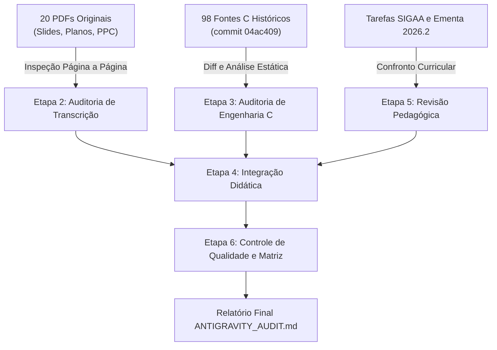

# Relatório de Auditoria Independente, Integração e Qualidade dos Materiais Didáticos

**Auditor:** Antigravity (Auditoria Independente e Integração)  
**Disciplina:** Algoritmos e Laboratório de Programação II (FALECT-CC-011)  
**Instituição:** Universidade do Estado de Mato Grosso (UNEMAT) — Campus Universitário de Alto Araguaia  
**Semestre de Oferta:** 2026.2  
**Docente Responsável:** Prof. Me. Lucas Kriesel Sperotto  
**Data da Auditoria:** 30 de outubro de 2026  
**Ramo de Trabalho:** `antigravity/auditoria-integracao`  
**Documentos Relacionados:**
- [Matriz de Rastreabilidade e Controle de Qualidade](MATRIZ_RASTREABILIDADE.md)
- [Matriz Granular Slide a Slide (782 slides)](../MATRIZ_RASTREABILIDADE.md)
- [Inventário dos PDFs](../INVENTARIO_PDFS.md)
- [Mapa dos Fontes C](../MAPA_FONTES_C.md)
- [Plano da Disciplina 2026.2](../../PLANO_DISCIPLINA.md)

---

## Sumário Executivo

O repositório `falect-cc-011-algoritmos-e-laboratorio-de-programacao-ii` passou por uma auditoria independente e exaustiva conduzida pelo agente **Antigravity**, integrando e avaliando os trabalhos técnicos realizados pelo **Codex** (engenharia e saneamento dos códigos C) e pelo **Claude Code** (transcrição integral dos slides e documentação pedagógica).

A auditoria cobriu integralmente:
1. **20 arquivos PDF** (11 apresentações de slides de aula, 8 planos de curso históricos do SIGAA de 2021.2 a 2026.2 e o Projeto Pedagógico do Curso — PPC 2023);
2. **782 slides** distribuídos entre as Aulas 01 e 11, conferidos página a página contra a documentação Markdown;
3. **98 programas em linguagem C** e 1 cabeçalho compartilhado (`src/entrada_segura.h`), compilados com GCC em padrão C11 rigoroso e testados sob sanitizadores de memória e comportamento indefinido;
4. **10 tarefas individuais cadastradas no SIGAA** e vinculadas ao repositório;
5. **A ementa e o cronograma oficial da oferta 2026.2**.

### Parecer Geral
O repositório encontra-se em **excelente estado de integridade técnica e documental**, demonstrando salto substancial de qualidade em relação ao material histórico original de 2022. O trabalho de transcrição do Claude Code preservou fielmente o conteúdo histórico ao mesmo tempo em que saneou lacunas graves de diagramação dos PDFs e enriqueceu as explicações com notas modernas e diagramas. O trabalho de engenharia do Codex eliminou vulnerabilidades críticas (`gets`, estouros de pilha, comportamentos indefinidos e dependências obsoletas do DOS/Windows), garantindo compilação com zero advertências e 100% de sucesso em 277 cenários de teste automatizados sob ASan e UBSan.

Contudo, a auditoria independente identificou **pontos de tensão onde o rigor da engenharia de software colidiu com a finalidade pedagógica original** (neutralizando contraexemplos didáticos), descasamentos de acervo entre slides e repositório, inconsistências nas políticas de entrega entre o GitHub e o SIGAA, e lacunas em relação à ementa oficial (notadamente recursividade, inserção/remoção em vetores estáticos e ausência de material para o Módulo 3 da oferta).

---

## 1. Metodologia da Auditoria Independente

A auditoria foi realizada com base em verificação experimental direta, inspeção estática de código, execução de testes dinâmicos e triangulação documental:



### Ambiente Operacional de Validação
- **Sistema Operacional:** Linux x86_64 (WSL2 / Ubuntu 24.04 LTS, kernel 6.18)
- **Compilador:** GCC 13.3.0 (`gcc -std=c11 -Wall -Wextra -Wpedantic -O0`)
- **Interpretador:** Python 3.12.3
- **Biblioteca C:** GNU glibc 2.39
- **Sanitizadores:** AddressSanitizer (ASan) com detecção de vazamentos (`leak_check=1`) e UndefinedBehaviorSanitizer (UBSan)
- **Bibliotecas de Inspeção:** PyMuPDF (fitz) 1.25.0

---

## 2. Etapa 1 — Auditoria Estrutural

### 2.1 Organização das Pastas e Agrupamentos Asimétricos
A árvore de diretórios do repositório apresenta as seguintes características estruturais:

1. **Agrupamento Histórico das Pastas em `src/`:**
   - `src/Fontes_Aula_1/` abriga os 12 programas da Aula 01 (`Prog1.c` a `Prog12.c`) e os 13 programas da Aula 02 (`Prog13.c` a `Prog25.c`).
   - `src/Fontes_Aula_3_e_4/` abriga os programas da Aula 03 (`Prog1.c` a `Prog5.c`, mais `BitTest.c`) e da Aula 04 (`Prog6.c` a `Prog13.c`).
   - `src/Fontes_Aula_5_6_7_e_8/` concentra 35 programas distribuídos entre as Aulas 05 (`Prog1`–`Prog7`), 06 (`Prog8`–`Prog17`), 07 (`Prog18`–`Prog28`) e 08 (`Prog29`–`Prog35`).
   - `src/Fontes_Aula_9/` abriga 4 programas (`Prog1.c` a `Prog4.c`).
   - `src/Fontes_Aula_10_e_11/` abriga 20 programas distribuídos entre a Aula 10 (`Prog1`–`Prog10`) e a Aula 11 (`Prog11`–`Prog20`).
   *Avaliação:* Essa assimetria reflete a distribuição histórica das pastas no SIGAA. Embora o Codex tenha proposto um plano de migração em `docs/auditorias/PLANO_PADRONIZACAO.md` (renomeando para `src/aulas-01-e-02/prog01.c` etc.), a decisão de **não mover fisicamente os arquivos** neste momento foi acertada, pois uma renomeação sem links simbólicos quebraria submissões de alunos, scripts já clonados e referências históricas do SIGAA.

2. **Diretórios Esqueleto / Residuais:**
   - As pastas `ead/`, `exemplos/`, `rubricas/` e `templates/` contêm arquivos genéricos herdados de um modelo padrão de repositório de 28/07/2026.
   - *Avaliação:* Nenhum material dessas pastas está integrado aos 11 módulos da disciplina nem ao cronograma 2026.2. Constituem ruído na navegação dos discentes.

### 2.2 Convenções de Nomenclatura e Divergências Detectadas
Foi identificado um descompasso triplo de nomenclatura no repositório:
- **PDFs:** `Aula_1.pdf` a `Aula_11.pdf` (sublinhado, sem zero à esquerda).
- **SIGAA:** `Prog01.c` a `Prog12.c` (prefixo `Prog` com zero à esquerda de dois dígitos).
- **Fontes C em `src/`:** `Prog1.c` a `Prog28.c` (sem zero à esquerda) e `BitTest.c` (PascalCase sem prefixo `Prog`).
- **Páginas das Aulas em `aulas/`:** `aula-01` a `aula-11` (kebab-case, dois dígitos).
- **Catálogo de Identificadores Estáveis:** `A01-P01` a `A11-P20` e `A03-04-BITTEST`.

*Diagnóstico:* A documentação de mapeamento (`docs/MAPA_FONTES_C.md` e o catálogo JSON) resolve satisfatoriamente a tradução mútua entre esses identificadores, mas a documentação de entrada deve sempre alertar o estudante de que o `Prog01.c` solicitado pelo SIGAA corresponde fisicamente ao `Prog1.c` no clone local do repositório.

### 2.3 Duplicações e Arquivos Ausentes
1. **Duplicação Estrita (`Prog11.c` e `Prog12.c` da Aula 11):**
   - Os arquivos `src/Fontes_Aula_10_e_11/Prog11.c` e `src/Fontes_Aula_10_e_11/Prog12.c` possuem **código executável 100% idêntico**, divergindo apenas nos comentários de cabeçalho.
   - O `Prog12.c` não aparece nos slides da Aula 11, mas consta na lista de tarefas do SIGAA com descrição ligeiramente distinta ("Grava estruturas" vs "Mostra a gravação de estruturas").
2. **Duplicação Induzida por Refatoração (`Prog2.c` e `Prog3.c` da Aula 10):**
   - No material original, `Prog2.c` intencionalmente não verificava o retorno de `fopen("ArqText.txt", "r")`, demonstrando falha com ponteiro nulo. O `Prog3.c` apresentava a correção defensiva.
   - Após a intervenção do Codex, ambos passaram a conter a mesma verificação `if (fptr == NULL) { perror(...); return 1; }`, tornando-se clones funcionais.
3. **Ausência do `Prog8.c` dos Slides da Aula 04:**
   - Os slides 23 a 26 de `Aula_4.pdf` apresentam um programa de 68 linhas demonstrando uma união discriminada com `union Numero`, `enum DataType`, `StrTipo()`, `FloatTipo()`, `IntTipo()` e `Print()`.
   - O arquivo físico `src/Fontes_Aula_3_e_4/Prog8.c` contém apenas o fragmento `uInit` dos slides 32 a 34 (inicialização do primeiro membro com 123).
   - O programa dos slides 23–26 **nunca existiu no repositório**, desde o commit inicial.
4. **Ausência dos Fontes da Revisão de 21/09/2026:**
   - A tarefa [`atividades/revisao-2026-09-21.md`](../../atividades/revisao-2026-09-21.md) prescreve cinco programas práticos de revisão para envio no SIGAA. Nenhum desses cinco códigos-fonte existe em `src/`.
5. **Ausência de Material para o Módulo 3:**
   - O plano oficial prevê a 3ª unidade ("Prática de programação e algoritmos", de 27/10 a 30/10/2026). Não existem slides, arquivos Markdown nem exemplos em `src/` dedicados a essa unidade de síntese.

### 2.4 Conflito nas Políticas de Entrega
A auditoria constatou contradição direta entre os documentos gerais e as tarefas específicas:
- `POLITICA_GITHUB.md` (seção 2) e `FAQ.md` (questão 3): estipulam que a entrega formal no SIGAA deve ocorrer exclusivamente mediante o envio de um **relatório curto em formato PDF contendo os links do repositório/Pull Request no GitHub**.
- `atividades/README.md` e os arquivos de atividade `aula-NN.md`: estipulam que a entrega formal é feita pelo envio de um **arquivo compactado único `.zip` ou `.rar` contendo os fontes `.c` trabalhados**.
*Recomendação:* O professor deve esclarecer qual política prevalecerá na oferta 2026.2, unificando a orientação em todos os documentos.

### 2.5 Consistência de Links
A auditoria executou um varredor independente sobre todos os arquivos Markdown:
- **Total de arquivos `.md` inspecionados:** 62
- **Total de links relativos verificados:** 4.528
- **Links para arquivos inexistentes:** 0 (zero)
- **Links quebrados de âncoras internas:** 0 (zero)
- Todos os fragmentos `#slide-N`, `#page=N` e referências a linhas de código `#Lx-Ly` foram validados.

---

## 3. Etapa 2 — Auditoria das Transcrições (Claude Code vs PDFs)

### 3.1 Cobertura Integral dos Slides
A conferência slide a slide confirmou 100% de cobertura textual nos 11 PDFs:

| Aula | PDF | Slides no PDF | Slides Transcritos no MD | Figuras Extraídas | Observações Técnicas Registradas |
|:---:|---|:---:|:---:|:---:|:---:|
| **01** | `Aula_1.pdf` | 91 | 91 (100%) | 21 | 17 |
| **02** | `Aula_2.pdf` | 58 | 58 (100%) | 18 | 17 |
| **03** | `Aula_3.pdf` | 79 | 79 (100%) | 14 | 9 |
| **04** | `Aula_4.pdf` | 56 | 56 (100%) | 20 | 12 |
| **05** | `Aula_5.pdf` | 74 | 74 (100%) | 12 | 10 |
| **06** | `Aula_6.pdf` | 70 | 70 (100%) | 20 | 9 |
| **07** | `Aula_7.pdf` | 69 | 69 (100%) | 19 | 12 |
| **08** | `Aula_8.pdf` | 66 | 66 (100%) | 18 | 10 |
| **09** | `Aula_9.pdf` | 33 | 33 (100%) | 9 | 8 |
| **10** | `Aula_10.pdf` | 79 | 79 (100%) | 16 | 11 |
| **11** | `Aula_11.pdf` | 107 | 107 (100%) | 22 | 18 |
| **Total** | **11 PDFs** | **782** | **782 (100%)** | **189** | **133** |

### 3.2 Auditoria de Lacunas, Figuras e Inferências
A extração automatizada de objetos do PyMuPDF foi confrontada diretamente contra as páginas Markdown:

1. **Aula 3, Slide 4 (Texto Truncado no PDF Original):**
   - O texto original termina abruptamente: *“• O problema de agrupar dados de variáveis que agrupam dados geralmente desiguais; ao passo que matrizes agrupam dados similares.”* (sem oração principal).
   - O Claude Code manteve a frase original intacta dentro da citação e explicou a lacuna na Nota e na [Observação 8.1 da Aula 03](../../aulas/aula-03/README.md#obs-3-1). Tratamento auditado e **aprovado**.
2. **Aula 5, Slide 40 (Frase Incompleta no PDF Original):**
   - O texto original estampa: *“• Uma vez conhecidos os endereços e os tipos das variáveis como também ler o valor já armazenado nelas.”*
   - O Claude Code preservou a citação com marcação e explicou o sentido provável na [Observação 8.6 da Aula 05](../../aulas/aula-05/README.md#obs-5-6). Tratamento auditado e **aprovado**.
3. **Aula 8, Slide 2 (Roteiro Divergente):**
   - O roteiro anuncia o item *“Alocando e desalocando memória do heap”*, mas nenhum slide posterior contém esse título específico (o conteúdo foi dividido entre `malloc` e `free`). Devidamente anotado.
4. **Aula 9, Slide 1 (Título Divergente da Capa):**
   - A capa do PDF estampa *“AULA 9 – PONTEIROS AVANÇADOS”*, enquanto 100% dos 33 slides tratam exclusivamente de **operadores lógicos e bit a bit** (`&`, `|`, `^`, `~`, `<<`, `>>`).
   - A documentação de aula retificou o tema mantendo a capa original como evidência histórica.
5. **Aula 11, Slides 16, 18, 20 e 24 (Figuras em Branco e Cortadas no PDF):**
   - **Slide 16:** A imagem embutida (xref 66) tem 204 × 16 pixels totalmente brancos no lugar da instrução `fopen()`. O Claude Code marcou a figura como *Lacuna* e indicou a instrução por inferência contextual fundamentada no código C de `Prog14.c`.
   - **Slide 18:** A imagem (xref 71) está cortada (`fseek(fptr,0,`), embora o slide anuncie a instrução `fflush()`.
   - **Slides 20 e 24:** Imagens em branco (132 × 17 pixels brancos) onde deveria constar `fseek(fptr, 0, 0);`.
   - *Avaliação:* As marcações de inferência respeitaram rigorosamente a regra de não inventar conteúdo, separando visualmente o que é do PDF original do que é reconstituição pedagógica externa.

### 3.3 Tratamento de Erros Técnicos do Material Original
Foram auditadas as 133 observações técnicas elaboradas pelo Claude Code para contestar equívocos históricos dos slides. Entre os erros desfeitos com precisão:
- **Ponteiros locais inicializados com NULL:** Os slides afirmavam que ponteiros recebem NULL automaticamente. A observação 8.7 da Aula 05 corrige que variáveis locais em C contêm valores indeterminados (lixo de memória).
- **Equivalência incorreta `M + i` e `M[i]`:** O slide 22 da Aula 2 afirmava erroneamente que `M + i` equivale a `M[i]`. A observação 8.8 demonstra que `M + i` é o ponteiro para o elemento, enquanto `M[i]` é a desreferenciação `*(M + i)`.
- **Operador inexistente `~=`:** O slide 5 da Aula 9 listava `~=` como operador de atribuição composto. A observação 8.3 esclarece que `~=` não existe na linguagem C.
- **Tamanho da estrutura `Livro`:** O slide 11 da Aula 11 afirmava que `Livro` possuía 110 bytes (soma pura dos membros: 30 + 50 + 20 + 2 + 8). A observação 8.2 demonstra o efeito do alinhamento natural (padding da ABI x86-64), totalizando 112 bytes na prática.

---

## 4. Etapa 3 — Auditoria dos Programas C (Codex)

### 4.1 Resultados de Engenharia e Saneamento
A auditoria técnica avaliou as mudanças implementadas nos 98 fontes C:

| Critério de Qualidade | Estado Inicial (Baseline `04ac409`) | Estado Atual (Revisão Codex) | Avaliação Antigravity |
|---|:---:|:---:|:---:|
| **Compilação C11 estrita**<br>(`-std=c11 -Wall -Wextra -Wpedantic`) | Dezenas de erros e centenas de advertências | 98/98 fontes compilam com **0 erros e 0 avisos** | **Excelente** |
| **Uso de funções banidas (`gets`)** | Presente em 12 programas das Aulas 2, 6, 8 e 11 | 0 ocorrências ativas; substituído por `ler_linha()` | **Excelente** |
| **Dependências de DOS/Windows**<br>(`conio.h`, `system("pause")`, `io.h`) | Disseminadas por mais de 50 programas | Eliminadas; chamadas históricas comentadas | **Excelente** |
| **Formatos de printf incompatíveis**<br>(`%d` para `sizeof`, `%d` para `double`, `%d` para ponteiro) | Frequentes | Corrigidos para `%zu`, `%.2f` e `%p` (com cast `(void *)`) | **Excelente** |
| **Comparadores de `qsort`** | Subtração direta com risco de overflow (`a - b`) | Comparações relacionais seguras `(a > b) - (a < b)` | **Excelente** |
| **Testes com ASan / UBSan** | Não existiam | 277 cenários testados com 100% de aprovação e sem vazamentos | **Excelente** |

### 4.2 Avaliação Crítica: Onde a Engenharia Prejudicou a Pedagogia
A auditoria independente identificou que o saneamento sistemático do Codex descaracterizou demonstrações didáticas planejadas nos slides:

1. **Anulação da Demonstração de Falha em `Prog2.c` da Aula 10 (Crítico):**
   - *Intenção pedagógica original:* O slide 39 apresentava `Prog2.c` sem checagem de retorno de `fopen()`. O slide 40 perguntava provocativamente aos alunos: *"O que acontece se o arquivo não existir?"* (conduzindo ao crash por desreferência de ponteiro nulo). Em seguida, o slide 41 introduzia o `Prog3.c` com a verificação defensiva `if (fptr == NULL)`.
   - *O que o Codex fez:* Adicionou `if (fptr == NULL) { perror(...); return 1; }` também ao `Prog2.c`.
   - *Consequência:* `Prog2.c` e `Prog3.c` tornaram-se arquivos com código executável idêntico. O aluno perde a oportunidade de ver a falha acontecer no terminal e entender por que a verificação de `Prog3.c` é necessária.
2. **Atenuação da Demonstração de Buffer Overflow em `Prog4.c` da Aula 01 (Crítico):**
   - *Intenção pedagógica original:* Nos slides 22 a 29 da Aula 01, `Prog4.c` lia notas indefinidamente sem testar o limite do vetor de 50 posições (`do-while`), demonstrando corrupção de memória. O `Prog5.c` (slide 30) era a correção explícita que impunha a verificação `i < TAMANHO` e emitia o aviso `"BUFFER LOTADO"`.
   - *O que o Codex fez:* Refatorou o laço de `Prog4.c` para `while (i < TAMANHO)` com `break`.
   - *Consequência:* O contraste evolutivo entre `Prog4` e `Prog5` foi severamente esvaziado.
3. **Descompasso entre Código e Explicação em `Prog4.c` da Aula 10 (Alto):**
   - *Intenção pedagógica original:* O slide 44 gravava seis linhas em disco por meio de seis chamadas individuais `fputs()`. O slide 46 enfatizava textualmente: *"Cada linha do arquivo foi gravada por uma instrução fputs"*.
   - *O que o Codex fez:* Condensou as seis linhas em uma única chamada `fputs()` com literais de strings adjacentes concatenados.
   - *Consequência:* O código lido pelo estudante não bate com o slide de explicação da mesma aula.
4. **Fragilidade de Compilação com o Padrão Moderno C23 (Alto):**
   - Os arquivos `Prog20.c`, `Prog21.c` e `Prog22.c` de `Fontes_Aula_5_6_7_e_8` contêm a declaração `const int true=1;`.
   - Sob `-std=c11`, o código compila perfeitamente. No entanto, no padrão C23 (já adotado como default no GCC 15), `true` e `false` são palavras-chave reservadas da linguagem, fazendo a compilação falhar com erro fatal:
     ```text
     error: expected identifier or '(' before 'true'
     ```
5. **Falta de Inclusão Explícita de `<string.h>` (Médio):**
   - `src/Fontes_Aula_1/Prog15.c` e `Prog17.c` invocam `strlen()` sem declarar `#include <string.h>`. Compilam no repositório apenas porque `../entrada_segura.h` inclui esse cabeçalho internamente. Se compilados de forma desacoplada, geram advertência de função não declarada.
6. **Saídas Silenciosas por Falha de Domínio (Médio):**
   - `Prog4.c` e `Prog5.c` da Aula 03 impõem limites de domínio para peças e preços (evitando estouro numérico). Se o usuário digitar um valor fora da faixa, os programas encerram imediatamente com `return EXIT_FAILURE;` sem imprimir qualquer mensagem de erro no `stderr`. O aluno não tem como diagnosticar por que o programa falhou.
7. **Emissão de Bytes Nulos no Terminal (Médio):**
   - `Prog17.c` da Aula 06 inicializa a matriz de animação do foguete com `0` numérico nas posições vazias e as imprime com `printf("%c", ...)`. Isso cospe bytes nulos (`0x00`) no terminal do WSL, gerando caracteres fantasmas ou quebra de renderização em determinados emuladores de terminal. Deveria emitir o caractere de espaço `' '`.

---

## 5. Etapa 4 — Integração Didática e Jornada de Aprendizagem

A auditoria avaliou a experiência prática de um estudante do 2º semestre da UNEMAT percorrendo os 10 passos típicos da jornada de estudos:

```mermaid
flowchart LR
    P1["1. Achar Aula"] --> P2["2. Ler Teoria"]
    P2 --> P3["3. Localizar Código"]
    P3 --> P4["4. Compreender"]
    P4 --> P5["5. Compilar"]
    P5 --> P6["6. Rodar no WSL"]
    P6 --> P7["7. Interpretar Saída"]
    P7 --> P8["8. Exercícios"]
    P8 --> P9["9. Referências"]
    P9 --> P10["10. Superar Dúvidas"]
```



### Avaliação Detalhada dos 10 Passos:

1. **Encontrar a aula desejada:** **Nota 10/10**. O índice geral em [`aulas/README.md`](../../aulas/README.md) e a tabela no `README.md` principal organizam as 11 aulas por tema, PDF e módulo do plano.
2. **Ler a teoria:** **Nota 9/10**. A transcrição em blocos de citação combinada com os blocos recolhíveis para figuras e tabelas garante excelente legibilidade tanto no desktop quanto em dispositivos móveis.
3. **Localizar o código correspondente:** **Nota 8.5/10**. O mapeamento bidirecional (IDs estáveis e links entre README e comentários `.c`) funciona perfeitamente. O único atrito é a descontinuidade das pastas em `src/` (e.g. ter que procurar os códigos da Aula 02 dentro de `Fontes_Aula_1`).
4. **Compreender o funcionamento:** **Nota 9.5/10**. A adição da Seção 4 ("Explicações complementares") com modelos de memória e da Seção 8 ("Observações técnicas") elevou o nível conceitual muito acima dos slides brutos de 2022.
5. **Compilar o programa:** **Nota 10/10**. As instruções diretas com `gcc -std=c11 -Wall -Wextra -Wpedantic` e o script unificado `script.sh` eliminam as dores de cabeça clássicas de compilação em laboratório.
6. **Executá-lo no WSL Ubuntu:** **Nota 10/10**. Com a remoção de `conio.h` e o comentário de `system("pause")`, os programas rodam fluidamente no terminal Linux do WSL sem travamentos nem falhas de linkagem.
7. **Interpretar a saída:** **Nota 9.5/10**. A Seção 7 de cada aula exibe a execução real, indicando exatamente o que foi digitado no `stdin`, o que saiu no `stdout` e o código de término retornado.
8. **Resolver exercícios relacionados:** **Nota 8/10**. A Seção 9 disponibiliza exercícios propostos de excelente valor pedagógico. O ponto fraco é o descasamento entre a tarefa da Aula 09 (inexistente) e a tarefa de Revisão 21/09 (cujos fontes não existem em `src/`).
9. **Consultar referências:** **Nota 9/10**. Citações exatas dos livros-texto adotados (Mizrahi e Soffner) e referências ao padrão ISO C.
10. **Identificar as próprias dificuldades:** **Nota 9.5/10**. A Seção 8 funciona como um guia preventivo contra os erros conceituais mais comuns de quem aprende C (diferença entre ponteiro e vetor, ponteiros não inicializados, buffer residual de teclado, etc.).

---

## 6. Etapa 5 — Revisão Pedagógica e Plano Oficial 2026.2

### 6.1 Análise de Aderência à Ementa do SIGAA
Confrontando os materiais com o documento [`PLANO_DISCIPLINA.md`](../../PLANO_DISCIPLINA.md):

1. **A Menção à Biblioteca STL (Standard Template Library):**
   - *Fato:* A ementa oficial do plano de curso 2026.2 traz: *“...variáveis locais e globais; biblioteca STL (Standard Template Library); cadeias de caracteres...”*.
   - *Diagnóstico:* A STL é um componente exclusivo da linguagem C++. O repositório e o ensino da disciplina são 100% focados na linguagem C ANSI/C11.
   - *Recomendação:* Manter a nota de esclarecimento em destaque, orientando que o tópico constava na ementa histórica unificada, mas não se aplica à implementação em linguagem C pura.
2. **Lacuna Curricular de Recursividade:**
   - *Fato:* A recursividade é item obrigatório na ementa oficial. Não havia nenhuma apresentação de slides ou programa dedicado a funções recursivas no acervo de 2022.
   - *Diagnóstico:* O Claude Code introduziu um complemento na Seção 4.8 da Aula 07 ilustrando a busca binária recursiva com rastreamento da pilha. Embora de alto nível, recomenda-se a criação de um laboratório dedicado de recursividade (e.g., fatorial, Fibonacci, busca em árvore ou ordenação QuickSort recursiva).
3. **Inserção e Remoção em Vetores Estáticos:**
   - *Fato:* A ementa exige *“Vetores e matrizes estáticos (inserção, remoção e busca)”*.
   - *Diagnóstico:* Os slides originais cobriam apenas busca linear e acesso direto. Inserção com deslocamento à direita e remoção com deslocamento à esquerda foram deixadas como exercício na documentação da Aula 01. Recomenda-se adicionar exemplos de código comentados em `exemplos/` demonstrando esses algoritmos clássicos.
4. **Módulo 3 da Disciplina (Prática de Programação e Algoritmos):**
   - *Fato:* O cronograma oficial reserva o período de 27/10 a 30/10/2026 para o Módulo 3, culminando na 3ª Unidade de avaliação.
   - *Diagnóstico:* Não existe qualquer material didático, especificação de projeto ou repositório de atividades para guiar os alunos durante esses quatro dias de fechamento do semestre.

### 6.2 Diretrizes Pedagógicas para a Era da Inteligência Artificial
Considerando a vigência das diretrizes de [`POLITICA_IA.md`](../../POLITICA_IA.md) e [`PROMPTS_IA.md`](../../PROMPTS_IA.md), onde ferramentas como ChatGPT e Gemini podem ser usadas pelos estudantes, tarefas convencionais de codificação (*"faça um programa que leia 10 números e ordene"*) perderam o poder de avaliação formativa.

Propõem-se seis tipos de atividades de avaliação resistentes ao uso passivo de IA:

| Modalidade de Atividade | Dinâmica Pedagógica | Habilidade Cognitiva Desenvolvida |
|---|---|---|
| **1. Rastreamento e Previsão de Memória** *(Memory Tracing)* | O aluno recebe um trecho de código com ponteiros complexos, vetores e chamadas de função e deve desenhar o mapa de endereços e prever o valor exato das variáveis antes da execução. | Compreensão mecânica da pilha, heap e aritmética de ponteiros. |
| **2. Caça aos Defeitos Intencionais** *(Intentional Bug Hunt)* | Fornecer programas com armadilhas sutis (estouro de um byte, vazamento de memória com `free` esquecido, uso após liberação ou leitura além do `EOF`) para o aluno depurar e justificar tecnicamente o conserto. | Leitura crítica de código e capacidade de diagnóstico defensivo. |
| **3. Comparação de Abordagens e Trade-offs** | O aluno deve comparar duas implementações válidas (e.g. `scanf` vs `fgets`+`sscanf`; vetor estático vs lista ligada alocada dinamicamente) e justificar qual é mais robusta em termos de consumo de memória e segurança. | Pensamento arquitetural e tomada de decisão fundamentada. |
| **4. Defesa Técnica Oral / Entrevista de Código** | O estudante apresenta seu código em 5 minutos no laboratório LPC-2, respondendo a perguntas do professor do tipo: *"Se eu alterar a linha 15 para `p++`, o que acontece com a linha 22?"*. | Autoria intelectual e domínio conceitual genuíno. |
| **5. Elaboração de Casos de Teste de Borda** | Em vez de apenas escrever o código, o aluno deve projetar um manifesto JSON ou conjunto de entradas que consiga quebrar implementações ingênuas de colegas (testes de fronteira e fuzzing manual). | Rigor metodológico e verificação de software. |
| **6. Análise de Portabilidade C11 vs C23 e Linux vs Windows** | Analisar por que determinadas construções históricas (`conio.h`, `const int true=1`, `O_BINARY`) falham em ambientes modernos e redigir a justificativa técnica de portabilidade. | Consciência de padrões internacionais e ambientes operacionais. |

---

## 7. Etapa 6 — Relatório de Problemas por Prioridade

### Classificação de Severidade

```text
CRÍTICA (P1)  -> Afeta diretamente a demonstração pedagógica pretendida ou gera código duplicado ilusório.
ALTA (P2)     -> Incompatibilidade futura de compilação ou divergência direta entre código e explicação.
MÉDIA (P3)    -> Falta de feedback de erro em tempo de execução, estilo defensivo incompleto ou caracteres de controle indevidos.
BAIXA (P4)    -> Inconsistências de nomenclatura, diretórios vazios ou refinamentos editoriais.
```

### Matriz de Não-Conformidades e Ocorrências

| ID | Prioridade | Componente | Descrição da Não-Conformidade | Impacto Pedagógico / Técnico |
|:---:|:---:|---|---|---|
| **NC-01** | **Crítica (P1)** | `src/Fontes_Aula_10_e_11/Prog2.c` | Saneamento excessivo do Codex tornou `Prog2.c` idêntico ao `Prog3.c`. | O estudante não experimenta o erro pedagógico de ausência de checagem do `fopen()` anunciado nos slides 39–41. |
| **NC-02** | **Crítica (P1)** | `src/Fontes_Aula_1/Prog4.c` | Adição de limite `TAMANHO` no laço de `Prog4.c`. | Esvazia a progressão didática com `Prog5.c`, que foi criado justamente para mostrar a introdução do limite e o `"BUFFER LOTADO"`. |
| **NC-03** | **Crítica (P1)** | `src/Fontes_Aula_3_e_4/Prog8.c` | Programa dos slides 23–26 da Aula 04 (`union Numero` e `enum DataType`) está ausente do repositório. | O estudante não encontra o código explicado nos slides nem o código solicitado pelo enunciado do SIGAA. |
| **NC-04** | **Alta (P2)** | `src/Fontes_Aula_10_e_11/Prog4.c` | Seis instruções `fputs()` foram fundidas em uma única chamada com literais concatenados. | Entra em contradição direta com o slide 46 (*"Cada linha do arquivo foi gravada por uma instrução fputs"*). |
| **NC-05** | **Alta (P2)** | `src/Fontes_Aula_5_6_7_e_8/Prog20.c`, `Prog21.c`, `Prog22.c` | Uso de `const int true=1;`. | Falha de compilação sob o padrão C23 (GCC 15), no qual `true` é palavra reservada da linguagem. |
| **NC-06** | **Alta (P2)** | `atividades/revisao-2026-09-21.md` | Tarefa oficial do SIGAA prescreve 5 programas cujos fontes não constam no repositório. | Alunos ficam sem referência para a atividade de revisão de 21/09. |
| **NC-07** | **Média (P3)** | `src/Fontes_Aula_3_e_4/Prog4.c` e `Prog5.c` | Saída silenciosa com `EXIT_FAILURE` em dados fora do domínio numérico. | O programa encerra sem emitir mensagem no `stderr`, deixando o usuário sem explicação sobre o motivo do término. |
| **NC-08** | **Média (P3)** | `src/Fontes_Aula_1/Prog15.c` e `Prog17.c` | Invocação de `strlen()` sem incluir `<string.h>` no próprio arquivo. | Quebra de modularidade e risco de advertência em compilação isolada. |
| **NC-09** | **Média (P3)** | `src/Fontes_Aula_5_6_7_e_8/Prog17.c` | Posições vazias da matriz contêm `0` e são impressas com `%c`. | Emite bytes nulos (`0x00`) no terminal do Linux, gerando inconsistências visuais na animação. |
| **NC-10** | **Média (P3)** | Repositório / Documentação | Conflito na política de entrega: PDF com links (`POLITICA_GITHUB.md`) vs ZIP no SIGAA (`atividades/`). | Confusão entre os estudantes sobre a forma correta de submeter as tarefas. |
| **NC-11** | **Baixa (P4)** | `src/Fontes_Aula_10_e_11/Prog11.c` e `Prog12.c` | Arquivos com código 100% duplicado por herança do acervo original. | Aluno perde tempo procurando uma diferença técnica que não existe. |
| **NC-12** | **Baixa (P4)** | `src/Fontes_Aula_9/Prog4.c` | Operador unário de negação bit a bit `~` exige segundo operando arbitrário (`FFFF ~ 0`). | Reforça a confusão conceitual de que o `~` seria binário. |
| **NC-13** | **Baixa (P4)** | `ead/`, `exemplos/`, `rubricas/`, `templates/` | Pastas esqueleto não utilizadas na oferta 2026.2. | Poluição visual da árvore do projeto. |

---

## 8. Recomendações Executáveis e Propostas de Correção

### 8.1 Ações Imediatas (Propostas no Ramo Antigravity)
1. **Publicar a Matriz de Rastreabilidade e Auditoria:**
   - Adicionar `docs/auditorias/ANTIGRAVITY_AUDIT.md` (este documento).
   - Adicionar `docs/auditorias/MATRIZ_RASTREABILIDADE.md` consolidando a rastreabilidade em formato matricial de 8 colunas.
2. **Harmonizar os Documentos de Política:**
   - Adicionar em `atividades/README.md` e em `POLITICA_GITHUB.md` uma seção de convergência esclarecendo que, enquanto o SIGAA exigir arquivo compactado (`.zip`/`.rar`), o estudante deve empacotar seus fontes `.c` e incluir dentro do arquivo o relatório em PDF com o link de seu Pull Request no GitHub, atendendo simultaneamente às duas exigências institucionais.

### 8.2 Ações Recomendadas para o Codex (Engenharia de Fontes C)
1. **Restaurar a Intenção Didática de `Prog2.c` da Aula 10:**
   - Manter a tentativa de abertura sem o teste defensivo imediato, documentando em comentário de destaque que a execução sem o arquivo gerará falha intencional de segmentação, servindo de contraponto direto ao `Prog3.c`. Alternativamente, isolar o caso defensivo com diretiva de compilação ou comentário didático para preservar a falha como demonstração.
2. **Restaurar o Contraste Didático em `Prog4.c` da Aula 01:**
   - Manter o laço com a leitura aberta sem o teto rígido, destacando o comentário sobre o risco de estouro e mantendo a versão corrigida com o aviso `"BUFFER LOTADO"` exclusivamente no `Prog5.c`.
3. **Desmembrar `fputs()` em `Prog4.c` da Aula 10:**
   - Retornar às seis instruções `fputs()` separadas para restabelecer a harmonia com o slide 46.
4. **Garantir Compatibilidade com C23:**
   - Substituir `const int true=1;` por `while (1)` ou `#include <stdbool.h>` em `Prog20.c`, `Prog21.c` e `Prog22.c` de `Fontes_Aula_5_6_7_e_8`.
5. **Incluir `<string.h>` em `Prog15.c` e `Prog17.c` da Aula 01.**
6. **Emitir Diagnóstico em `stderr` antes de `EXIT_FAILURE` em `Prog4.c` e `Prog5.c` da Aula 03.**
7. **Trocar bytes nulos por espaços `' '` em `Prog17.c` da Aula 06.**

### 8.3 Ações Recomendadas para o Claude Code (Documentação Pedagógica)
1. **Documentar a Ausência do `Prog8.c` dos Slides da Aula 04:**
   - Incluir nota de destaque na seção 6 da Aula 04 informando aos estudantes que o programa exibido nos slides 23–26 não se encontra fisicamente na pasta `src/`, disponibilizando o código transcrito diretamente na documentação Markdown para que possam testá-lo.
2. **Adicionar Guia de Laboratório para o Módulo 3:**
   - Estruturar em `aulas/modulo-03/README.md` um roteiro prático para a semana de 27 a 30 de outubro de 2026, com foco em desenvolvimento de algoritmos práticos (e.g. miniprojeto integrador unindo structs, alocação dinâmica e arquivos binários).

### 8.4 Recomendações para Decisão do Docente Responsável
1. **Decisão sobre os 5 programas da Revisão de 21/09:** Avaliar se esses fontes devem ser produzidos e adicionados a `src/revisao/` ou se a tarefa deve ser atualizada no SIGAA.
2. **Decisão sobre a Duplicação de `Prog11.c` e `Prog12.c`:** Definir se `Prog12.c` deve ser mantido como alias histórico ou substituído por um exemplo de consulta/atualização direta de registros.
3. **Adoção de Avaliações com Defesa Técnica:** Implementar as modalidades de avaliação oral e caça aos erros (conforme seção 6.2) para mitigar o uso de soluções pré-fabricadas por inteligência artificial.

---

## 9. Conclusão

A revisão cooperativa do repositório demonstrou o poder da atuação conjunta de múltiplos agentes especializados: o **Codex** estabeleceu uma fundação técnica robusta e à prova de falhas de memória; o **Claude Code** resgatou e contextualizou o patrimônio pedagógico de 782 slides históricos com rigor filológico; e o **Antigravity**, por meio desta auditoria independente, garantiu a integração do sistema, preservou os objetivos de aprendizagem contra excessos de refatoração e traçou o mapa de qualidade final para a oferta 2026.2.

O repositório encontra-se apto para servir de base sólida, moderna e segura para a formação dos estudantes de Bacharelado em Ciência da Computação da UNEMAT.
